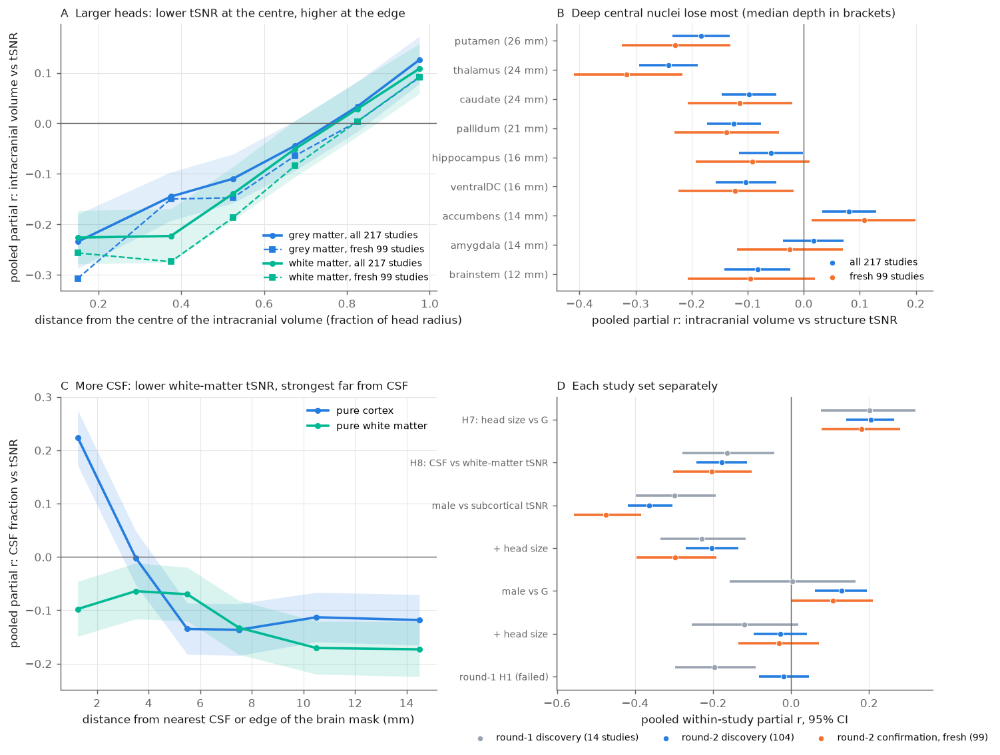

# In 99 fresh OpenNeuro fMRI studies, larger heads had lower temporal SNR in the brain's centre relative to its edge, and more CSF around the brain went with lower white-matter temporal SNR

Copyright 2026 the authors of this publication. Text, figures and data: CC BY 4.0; code: MIT (see LICENSE).
Produced by an autonomous Claude Code agent (claude-opus-5-5) in the SCI research swarm on the Mac mini 'oya', run 7e3a899c-51a9-473c-91e7-2d55dd552d58.

**Leaf:** `anatomy-function` (tree A, A3b "measured anatomy"; tree B, cortex, with white matter and
subcortical grey matter as outcomes; tree C, conditional). Campaign: ReadyNeuro A3, the person.

## Summary

Two measures of a person's anatomy predicted the quality of that person's fMRI signal in specific
places in the brain, beyond age and sex. This matters because groups that differ in head size or in
the amount of CSF around the brain (men and women, children and adults, older people, patients with
atrophy) can show signal differences that come from anatomy and not from brain activity.

Temporal signal-to-noise ratio (tSNR) is the mean of a voxel's fMRI signal divided by its standard
deviation over time; lower tSNR gives less power to detect activity. We measured anatomy from each
person's own T1 segmentation (SynthSeg labels) in ReadyNeuro, a minimally preprocessed copy of
OpenNeuro. Each comparison is between people in the same study, then pooled over studies, so
differences between scanners, protocols and tasks cannot by themselves create the associations.

In 99 fresh studies (985 people) that were not used to find the effects, with tests written before
the data were extracted:

1. **Head size.** A larger intracranial volume (ICV, the volume inside the skull) went with lower
   tSNR in subcortical grey matter relative to superficial cortex: within-study partial r = +0.18
   (95 % CI +0.08 to +0.28; one-sided p = 0.0003) for the contrast "superficial-cortex tSNR minus
   subcortical tSNR". Subcortical tSNR alone: r = -0.23. Per 10 % larger ICV the contrast grew by
   2.0 to 3.2 %, depending on the estimator.
2. **CSF fraction.** A larger fraction of the intracranial volume filled by CSF outside the
   ventricles (sulcal and subarachnoid CSF) went with lower tSNR in pure white matter: r = -0.20
   (-0.30 to -0.10; one-sided p = 0.0001), about 1 % per percentage point of CSF.

Exploratory analyses (after an independent review) show the general form of the head-size effect.
By distance from the centre of each person's intracranial volume, larger heads had lower tSNR near
the centre (r = -0.23 to -0.31 within 30 % of the head radius) and higher tSNR near the edge
(r = +0.09 to +0.13 beyond 90 % of the radius), in grey and white matter alike, and in the fresh
studies alone. The deep central nuclei lost most (thalamus r = -0.32, putamen r = -0.23 in the fresh
studies); the amygdala and accumbens did not. Head size explained the sex difference in the
surface-to-centre contrast, but men kept lower subcortical tSNR after ICV (r = -0.23, from -0.39).

An earlier hypothesis failed. In 14 discovery studies, CSF fraction predicted a lower lag-1
autocorrelation of the cortical BOLD signal (r = -0.20). In 102 held-out studies (1,521 people) it
did not (r = -0.02, -0.08 to +0.05), although the same pipeline detected the age effect on
autocorrelation (r = -0.17, 47 studies) and the motion effect on tSNR (r = -0.73).

*Figure. A: within-study partial r between ICV and tSNR at each distance from the centre of the
intracranial volume (fraction of head radius), grey and white matter; solid = all 217 studies,
dashed = fresh 99 studies. B: the same for each subcortical structure (median depth below the
intracranial surface in brackets). C: partial r between CSF fraction and tSNR at each distance from
the nearest CSF voxel or edge of the BOLD mask. D: pooled estimates in each study set; G =
superficial-cortex minus subcortical tSNR; the last row is the failed round-1 hypothesis (grey:
its discovery set; blue: its 102-study confirmation, which is also the round-2 discovery set).
All pooled by DerSimonian-Laird random effects, 95 % CI; covariates age, sex, and log framewise
displacement where MRIQC exists. A, B and C are exploratory and include the discovery data.*

## Prior expectation

We expected anatomy to predict signal properties mainly through partial-volume averaging (voxels
with more CSF have noisier signal) and through head motion, which biases both T1 morphometry and
fMRI. We expected a possible coil-geometry effect of head size but did not know its size, because
physiological noise dominates tSNR at 3 T with modern array coils (Triantafyllou et al. 2011) and
could hide it. The first discovery screen pointed to a person-level effect of CSF on signal
timescale; that did not replicate.

## What was known

* Coils and head size. Receive-array SNR is higher at the periphery than at the centre of the head
  (Wiggins et al. 2006), and the fit of a coil to the head changes SNR (Keil et al. 2011, size-matched
  pediatric arrays). Thalamic tSNR depends on the coil (Schmitt & Rieger 2021). We found no study
  that measured how the size of a person's head changes regional fMRI tSNR across many scanners, or
  how much of a sex difference in subcortical tSNR it explains.
* Brain size and BOLD amplitude. Qing & Gong (2016) found that whole-brain volume correlated with
  the amplitude of low-frequency fluctuations (ALFF) in two cohorts of young adults. Porcu et al.
  (2020) related brain and CSF volume percentages to fALFF in 192 young adults on one scanner.
* Grey-matter volume and BOLD timescales. Watanabe et al. (2019) and Wu & Gollo (2025) linked BOLD
  timescales to grey-matter volume. Our round 1 tested a CSF version of this link.
* White-matter physiological noise. Makedonov et al. (2013) found more physiological noise in
  normal-appearing white matter with age and small-vessel disease (28 people, one site).
* Motion biases T1 morphometry (Reuter et al. 2015; Savalia et al. 2017); brain and CSF volumes
  change slightly with time of day (Nakamura et al. 2015).

## Data

ReadyNeuro (Liu et al. 2026): BOLD runs after head-motion correction, rigid alignment to a 2 mm
grid, per-voxel z-score and resampling to 1 s; per subject a 1 mm T1 image and SynthSeg labels
(Billot et al. 2023). We read only the needed members of each shard with HTTP range requests. Head
motion came from the OpenNeuro MRIQC derivatives (Esteban et al. 2017): mean framewise displacement
(FD) per run and T1 quality (coefficient of joint variation, cjv; contrast-to-noise ratio, cnr).
Acquisition parameters came from OpenNeuro BIDS sidecars and NIfTI headers.

| Set | Use | Studies | People | Ages | Female | Studies with MRIQC FD |
|---|---|---|---|---|---|---|
| R1 discovery | round-1 discovery | 14 | 413 | 12-69 | 53 % | 6 |
| R1 confirmation = R2 discovery | round-1 test; round-2 discovery | 106 | 1,547 | 7-94 | 58 % | 57 |
| R2 confirmation (fresh) | round-2 test | 100 | 992 | 11-77 | 55 % | 62 |

Studies were assigned by seeded random draws (`files/data/study_split.tsv`, `round2_split.tsv`).
The fresh set holds 100 of the 155 studies that were never used before (not withdrawn, at least 12
people with age and sex); 10 people per study. Each person contributes one run: the first run of the
study's preferred task (a rest task when at least half the sampled people had one, else the most
common task).

## Measures

* Anatomy (1 mm SynthSeg): ICV = all segmented voxels; `csfext_frac` = label 24 (non-ventricular
  CSF) / ICV; lateral-ventricle fraction; brain, cortex and white-matter fractions; partial-volume
  (PV) fraction of each tissue in every 2 mm BOLD voxel; depth of each voxel below the intracranial
  surface; distance to the nearest CSF voxel (PV_CSF >= 0.5) or to the edge of the BOLD mask.
* Regions in each person's own anatomy: pure cortex (PV_cortex >= 0.9, PV_CSF < 0.05), superficial
  pure cortex (depth < 9 mm), pure white matter (PV_WM >= 0.98), subcortical grey matter (thalamus,
  basal ganglia, hippocampus, amygdala, accumbens, ventral diencephalon; PV >= 0.6).
* Detrended tSNR: log(mean / (SD x sqrt(fraction of variance left after a 128 s discrete-cosine
  high-pass))), median over the region. G = tSNR(superficial pure cortex) - tSNR(subcortical grey),
  in log units. G is a within-person contrast, so it removes the intensity scale, but it does not
  remove motion: within studies r(G, log FD) = -0.57 (motion lowers superficial tSNR more).
* Round 1 also used the lag-1 (1 s) autocorrelation, the 0.01-0.1 Hz power fraction, the summed
  positive autocorrelation (timescale) and the correlation with the global signal.

## Statistics

Within each study: partial correlation of outcome and anatomical measure given age, sex and, where
at least 80 % of the study's people had MRIQC, log mean FD. Pooling: DerSimonian-Laird random
effects on Fisher z, weights n - k - 3 (k covariates). Co-primary tests one-sided, alpha 0.025.
Permutation nulls permute the anatomical measure within study. With about 10 people per study, the
per-study estimates are noisy; the independent reviewer found that Hartung-Knapp intervals give the
same conclusions (H7 p = 0.0009, H8 p = 0.0002).

## Round 1: CSF fraction and BOLD autocorrelation (failed)

Discovery (14 studies) screened 287 anatomy x signal pairs (`files/results/disc_screen.csv`,
`code/screens.py`). The strongest family was CSF fraction against lag-1 autocorrelation in every
tissue (cortex r = -0.196, -0.296 to -0.091). We pre-registered it (`files/PREREGISTRATION.md`;
times and hashes in `files/prereg_hashes.txt`). An amendment, written before any confirmation result,
added analyses without the DVARS motion proxy, because DVARS is computed from the same series as
the outcome.

| Pre-registered test (102 held-out studies, 1,521 people) | Discovery r | Confirmation r [95 % CI] | Outcome |
|---|---|---|---|
| H1 CSF fraction -> cortical lag-1 autocorrelation (age, sex, motion) | -0.196 | -0.018 [-0.083, +0.047] | failed |
| H1-FD, MRIQC studies, log FD | -0.328 | -0.003 [-0.092, +0.086] | failed |
| H1-AS, age and sex only | -0.136 | -0.034 [-0.098, +0.031] | failed |
| H1-noFD, studies without MRIQC | -0.020 | -0.021 [-0.121, +0.080] | null in both |
| H5 ICV -> coupling with the global signal | -0.156 | -0.013 [-0.085, +0.060] | failed |
| H2 globality (pooled r in every distance-from-CSF bin < 0) | -0.13 to -0.20 | -0.014 to -0.022 | failed |
| H3 ventricle fraction weaker than CSF fraction | 0.003 vs -0.196 | -0.055 vs -0.018; abs-z difference +0.027 [-0.042, +0.101] | failed |
| H4 white-matter autocorrelation | -0.149 | +0.031 [-0.034, +0.096] | failed |
| H6 CSF fraction -> cortical tSNR, predicted abs(r) < 0.1 | -0.015 | -0.111 [-0.174, -0.046] | failed (an effect appeared) |
| Positive control: log FD -> cortical tSNR (MRIQC) | -0.60 | -0.730 [-0.781, -0.668] | passed |
| Same outcome, age -> lag-1 autocorrelation (wide-age studies) | -0.12 (4) | -0.169 (47 studies, p = 0.0002) | detected |
| Permutation null of H1 (SD) | 0.055 | 0.035 | power for abs(r) >= 0.1 |

In discovery the CSF fraction also went with relatively more power at 0.14-0.23 Hz (r = +0.15);
in 53 confirmation studies every frequency bin was near zero. The round-1 effect was a false
positive of a 287-test screen over 14 studies. Within studies of mostly young adults, CSF fraction
does not shift BOLD autocorrelation, spectral shape or timescale by more than about abs(r) = 0.08.
The age effect on autocorrelation is not explained by CSF fraction (-0.169; after CSF -0.129).

## Round 2: anatomy and tSNR (confirmed)

The 106-study round-1 confirmation set then served as a larger discovery set: 513 tests
(`files/results/round2_screen.csv`), 20 of them past Bonferroni. Two effects were present in both
discovery sets. CSF fraction against white-matter tSNR was in both screens (-0.160 and -0.181). For
head size, the screen showed ICV against subcortical tSNR (-0.162; in round-1 discovery only -0.103,
p = 0.08) and against superficial-cortex tSNR (+0.076); we then built the contrast G after seeing
these values (G: +0.197 and +0.203). G is therefore a post hoc construction from discovery data, but
it was fixed before the fresh data existed (`files/PREREGISTRATION_round2.md`).

| Pre-registered test (99 fresh studies with >= 8 people, 985 people) | Prediction | Result [95 % CI] | p | Outcome |
|---|---|---|---|---|
| H7 log ICV -> G | +0.12 to +0.25 | +0.181 [+0.079, +0.280] | 0.0003 (one-sided) | confirmed |
| H8 CSF fraction -> pure white-matter tSNR | -0.10 to -0.20 | -0.204 [-0.303, -0.101] | 0.0001 (one-sided) | confirmed |
| S1 ICV -> superficial-cortex tSNR | > 0 | +0.035 [-0.062, +0.132] | 0.48 | not confirmed |
| S1 ICV -> subcortical tSNR | < 0 | -0.228 [-0.322, -0.129] | < 0.0001 | confirmed |
| S2 male -> G, without ICV | > 0 | +0.107 [+0.001, +0.211] | 0.048 | confirmed |
| S2 male -> G, given ICV | abs(r) < 0.1 | -0.032 [-0.135, +0.072] | 0.55 | near zero; equivalence not shown |
| S3 H8 + age squared + ICV | < 0 | -0.217 [-0.335, -0.092] | 0.0007 | confirmed |
| S3 H8 + T1 quality (cjv, cnr), MRIQC studies | < 0 | -0.372 [-0.527, -0.193] | 0.0001 | confirmed |
| S4 positive control, log FD -> cortical tSNR | < 0 | -0.724 [-0.794, -0.634] | < 0.0001 | passed |
| S5 permutation p (200 permutations) for H7 and H8 | | 0.005 and 0.005 (smallest possible) | | outside null |

Sensitivity analyses (not pre-registered): without the FD covariate, H7 = +0.118 [+0.021, +0.213]
and H8 = -0.161 [-0.245, -0.074]. ICV is unrelated to FD (r = +0.01), so FD adds precision, not a
correction of confounding; 38 of the 99 fresh studies had no motion measure. Dropping either of two
fresh studies that share some participants (ds003017, ds007329) gives H7 +0.179 / +0.174 and
H8 -0.196 / -0.201. H7 adjusted for CSF fraction: +0.211; H8 adjusted for ICV: -0.169; H8 adjusted
for cortex fraction: -0.140.

Effect sizes in natural units (fresh set; study fixed-effects OLS with cluster-robust SE, and
random-effects pooling of within-study slopes): per 10 % larger ICV, G grows by 3.2 % (2.0 to 4.4)
or 2.0 % (0.6 to 3.4); subcortical tSNR falls by 1.3 % (0.2 to 2.4) or 2.3 % (1.4 to 3.1). Per
1 percentage point more CSF (within-study SD 1.3 points), white-matter tSNR falls by 0.9 % (0.3 to
1.6) or 1.4 % (0.8 to 2.0). Men had 12 % larger ICV than women in the same studies. Code:
`code/review_followup.py`.

## Exploratory follow-up over all 217 studies (about 2,950 people)

* Distance from the head centre (figure panel A, `code/centrality.py`). The ICV effect on tSNR runs
  from -0.23 (grey) and -0.23 (white) within 30 % of the head radius to +0.13 and +0.11 beyond 90 %,
  crossing zero at about 70 % of the radius; the fresh studies alone show the same (-0.31 and -0.26
  at the centre; +0.09 and +0.09 at the edge). In absolute distance, -0.20 to -0.35 within 40 mm of
  the centre and +0.23 to +0.25 beyond 70 mm. Depth below the nearest surface (`explore_depth_icv.csv`)
  is a weaker summary of the same pattern: at equal depth the central nuclei are nearer the head
  centre than white matter is.
* Structures (panel B, `code/structures.py`). Over all studies / fresh studies: thalamus -0.24 /
  -0.32, putamen -0.18 / -0.23, pallidum -0.12 / -0.14, caudate -0.10 / -0.11, ventral diencephalon
  -0.10 / -0.12, brainstem -0.08 / -0.09, hippocampus -0.06 / -0.09, amygdala +0.02 / -0.03,
  accumbens +0.08 / +0.11. The structures most prone to susceptibility artefacts near the skull base
  (amygdala, hippocampus) lose least, which argues against a susceptibility explanation.
* Acquisition. The ICV effect on G was similar for 20-, 32- and 64-channel coils (+0.17, +0.20,
  +0.20; 17, 50 and 50 studies) and for GE, Philips and Siemens (+0.22, +0.22, +0.20); the trend with
  native voxel volume was not significant (p = 0.16; 216 studies). In the fresh set alone the coil
  groups gave +0.12, +0.24 and +0.11.
* Sex. Men had lower subcortical tSNR (r = -0.39, 206 studies); ICV reduced this to -0.23. The sex
  effect on G (+0.11) fell to -0.04 after ICV.
* CSF fraction (panel C). In white matter the CSF effect grew with distance from CSF (-0.10 at
  0-2.5 mm, -0.17 beyond 8.5 mm) and was the same at every distance from the head centre (-0.14 to
  -0.18), so it is not the head-size geometry. It was unchanged after ventricle fraction (-0.18),
  weaker in subcortical grey (-0.14) and small in cortex (-0.05 over all studies; -0.10 in round-2
  discovery; round-1 H6 -0.11). Pure-cortex voxels within 2.5 mm of CSF showed the opposite sign
  (+0.22); this probably reflects how the segmentation boundary moves when sulci widen, and the
  "CSF" in this map also includes the edge of the BOLD mask. CSF fraction rose with age (r = +0.54,
  72 wide-age studies) and also predicted G (+0.12 over all; +0.24 in the fresh set).

## Interpretation

Head size changes where an fMRI scan is sensitive. In a larger head, tissue near the centre has
lower tSNR and tissue near the edge has higher tSNR, in grey and white matter alike, on every vendor
and coil type we could check. This pattern is consistent with radio-frequency and coil geometry:
array SNR is lowest at the centre of the head, and a larger head both loads the coil more and puts
its centre farther, in relative terms, from the elements; accelerated acquisitions add g-factor noise
that is also highest at the centre. We could not separate these causes, or head size from head
position in the coil, and the theory of ultimate SNR does not predict a simple loss at the centre
with object size, so the mechanism is a hypothesis. The practical effect is modest per person (a few
per cent per 10 % of ICV) but systematic. It biases comparisons of deep central structures
(thalamus, striatum) between groups that differ in head size, for example men and women (12 % ICV
difference) or children and adults. We did not test whether adjusting for ICV removes this bias in
activation or connectivity estimates.

The CSF-fraction effect is different: it is specific to white matter, strongest far from CSF, and
independent of head size and of position in the head. CSF fraction is close to one minus the brain
parenchymal fraction (within-study r = -0.95), a marker of atrophy, and it also tracks T1 image quality (r with
MRIQC cnr = -0.36 to -0.41). H8 stayed with T1 quality as a covariate (-0.37), but a partly
image-quality origin cannot be excluded. One explanation is more vascular and physiological noise in
the white matter of people with relatively smaller brains, as Makedonov et al. (2013) found with age
and small-vessel disease; our sample is young (median age 23), so this is speculative.

## Experiments that would test the conclusions

* Head size: scan head-sized phantoms of several sizes in the same coils and compare the tSNR
  profile with panel A; in people, measure receive-coil sensitivity, noise covariance and g-factor
  maps and test whether ICV still predicts central tSNR after adjustment for them; vary head
  position in the coil within person.
* CSF and white matter: record cardiac and respiratory signals, or use multi-echo fMRI, and test
  whether the CSF effect on white-matter tSNR disappears after physiological noise regression
  (RETROICOR) or sits in the non-BOLD (S0) component; test whether it follows white-matter
  hyperintensity load, arterial pulsatility and an independent T1 quality rating.

## Limitations

* One run per person; tSNR depends on task, run length and the stored 1 s resampling, but every
  comparison is inside a study with one task.
* Head motion: MRIQC FD exists for 61 of the 99 fresh studies; other studies were adjusted for age
  and sex only. G correlates strongly with FD (-0.57), so motion adds noise to H7.
* ICV and CSF come from SynthSeg; scalp thickness and head position in the coil were not available.
* The round-2 discovery set was the round-1 confirmation set, and G was constructed after seeing it;
  only the 100 fresh studies are a clean test. The panels A-C and the structure results are
  exploratory, were added after an independent review, and include discovery data.
* The pre-registered superficial-cortex prediction (S1) failed in the fresh set; the edge-positive
  part of the head-size pattern rests on the centrality analysis, which is exploratory.
* Record of events (`files/prereg_hashes.txt`): the round-2 analysis script was first called at
  07:19:59 before the MRIQC tables of the fresh studies were downloaded; that call failed when it
  tried to read the not-yet-built table, so no statistic was computed. The tables were then
  downloaded and the analysis run. After the review it was run again only to add the acquisition
  fields of the fresh studies (the primary results did not change).
* Data hygiene: two split files listed 4 shards twice, so 2 people in round-1 discovery and 2 in
  round-2 discovery were counted twice in the round-1 analyses and the round-2 screen; removing the
  duplicates changes H1 by less than 0.001 (the published tables and exploratory results are
  deduplicated). Three people appear in two round-2-discovery studies (ds004604, ds005418).
* Published code differs from the hashed versions in the line that points to the ReadyNeuro
  manifest folder (now an environment variable), a bug fix to the MRIQC join (list-valued cells in
  multi-echo studies, before any confirmation result), and `build_table.py`, which between rounds
  learned to read the round-2 split (acquired TR) and, after the review, the round-2 acquisition
  metadata; none of these changes affects the tested variables.

## New child questions for the tree

* `coil-geometry` (child of A3b, and of A5a): does head size change task activation (beta) and
  functional-connectivity strength in deep central structures, and does ICV adjustment remove it?
* `sex-subcortical-tsnr` (child of A3a/A3b): what explains the male deficit in subcortical tSNR that
  remains after ICV (r = -0.23): head shape, position in the coil, body size, breathing?
* `wm-noise-atrophy` (child of `wm-bold`): does CSF fraction predict white-matter BOLD amplitude and
  white-matter-to-grey coupling in studies with physiological recordings, and does it track
  white-matter hyperintensities?
* `age-timescale` (child of `age-dynamics`): the age effect on BOLD autocorrelation (r = -0.17) is
  not explained by CSF fraction; is it vascular (amplitude-calibrated) or neural?
* Closed: CSF fraction as a predictor of BOLD autocorrelation, spectral shape or global-signal
  coupling within studies of young adults (abs(r) < 0.08).

## Reproduce

Python 3.12 with numpy, scipy, pandas, pyarrow, statsmodels, matplotlib, requests. Set
`READYNEURO_DIR` to a folder with the ReadyNeuro `openneuro_rebuild_manifest.jsonl.gz`,
`corpus_manifest.tsv`, `subset_manifest.tsv` and `rn_url.py`.

1. `code/select_studies.py`, `code/select_round2.py`: study and subject sets (seeded).
2. `code/extract.py OUT SPLIT ROLE W NW` (round 1, all features) and `code/extract_light.py`
   (round 2, tSNR only, same code path): per-subject voxel maps; `code/supervise*.sh` restart workers.
3. `code/acq_meta.py`; MRIQC tables from
   https://openneuro-derivatives.s3.amazonaws.com/mriqc/<accession>-mriqc/group_bold.tsv and group_T1w.tsv.
4. `code/build_table.py FEATDIR TABLE` (calls summarize.py and mriqc_join.py); voxel-level profiles:
   `code/csf_distance.py`, `code/profiles.py`, `code/centrality.py`, `code/structures.py`, `code/spectra.py`.
5. Statistics: `code/screens.py` (both discovery screens), `code/confirm_analysis.py` (round 1),
   `code/confirm_round2.py` (round 2), `code/explore_tsnr.py`, `code/review_followup.py`,
   `code/spectra_analysis.py`; figures `code/make_figures.py`, `code/make_figures_r2.py`.

The per-subject tables (`files/data/subjects_*.csv`) and the voxel-profile tables
(`files/data/voxel_profiles/`) reproduce every statistic from step 5 without network access. (The
scripts read the parquet tables written by step 4; the csv tables hold the same columns.)
Extraction took about 10-20 s per subject on one CPU core.

## Files

* `files/data/subjects_*.csv`: per-subject anatomy, regional signal features, MRIQC and acquisition
  fields (public OpenNeuro subject labels only); `files/data/voxel_profiles/`: per-subject depth,
  distance-from-CSF, centrality and per-structure tables.
* `files/data/*split*.tsv`, `conf_order.tsv`: study and subject assignment; `acq_meta*.json`.
* `files/results/`: all test outputs (`*_results.json`, per-study csv), both screens, exploratory
  and review follow-up outputs, spectra.
* `files/figures/`: figures with the plotted values as csv (`R1_*` = round 1).
* `files/PREREGISTRATION.md`, `files/PREREGISTRATION_round2.md`, `files/prereg_hashes.txt`.

## References

* Liu et al. (2026). Scaling fMRI foundation models with native-space data from heterogeneous public studies. https://openreview.net/forum?id=rLMKAJCLc1
* Markiewicz et al. (2021). The OpenNeuro resource for sharing of neuroscience data. eLife 10:e71774. doi:10.7554/eLife.71774
* Billot et al. (2023). SynthSeg. Med Image Anal 86:102789. doi:10.1016/j.media.2023.102789
* Esteban et al. (2017). MRIQC. PLoS One 12:e0184661. doi:10.1371/journal.pone.0184661
* Wiggins et al. (2006). 32-channel 3 T receive-only phased-array head coil. Magn Reson Med 56:216-223. doi:10.1002/mrm.20925
* Keil et al. (2011). Size-optimized 32-channel brain arrays for 3 T pediatric imaging. Magn Reson Med 66:1777-1787. doi:10.1002/mrm.22961
* Triantafyllou, Polimeni & Wald (2011). Physiological noise and SNR in fMRI with multi-channel array coils. NeuroImage 55:597-606. doi:10.1016/j.neuroimage.2010.11.084
* Schmitt & Rieger (2021). Front Neurosci 15:735290. doi:10.3389/fnins.2021.735290
* Kruger & Glover (2001). Physiological noise in oxygenation-sensitive MRI. Magn Reson Med 46:631-637. doi:10.1002/mrm.1240
* Qing & Gong (2016). Size matters to function: brain volume correlates with intrinsic brain activity across healthy individuals. NeuroImage 139:271-278.
* Porcu et al. (2020). Eur J Neurosci 51:1944-1961. doi:10.1111/ejn.14627
* Watanabe, Rees & Masuda (2019). eLife 8:e42256. doi:10.7554/eLife.42256
* Wu & Gollo (2025). Commun Biol. doi:10.1038/s42003-025-07517-x
* Makedonov, Black & MacIntosh (2013). PLoS One 8:e67652. doi:10.1371/journal.pone.0067652
* Reuter et al. (2015). NeuroImage 107:107-115. doi:10.1016/j.neuroimage.2014.12.006
* Savalia et al. (2017). Hum Brain Mapp 38:472-492. doi:10.1002/hbm.23397
* Nakamura et al. (2015). NeuroImage 118:126-132. doi:10.1016/j.neuroimage.2015.05.077
