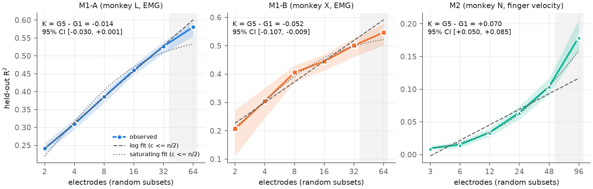
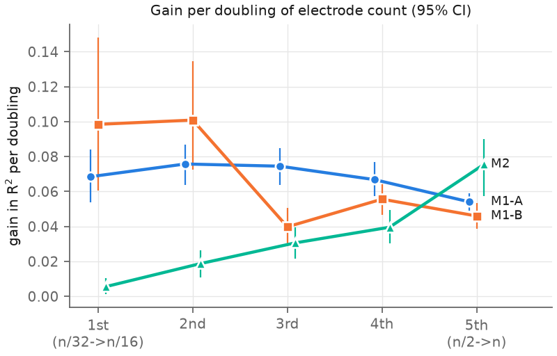
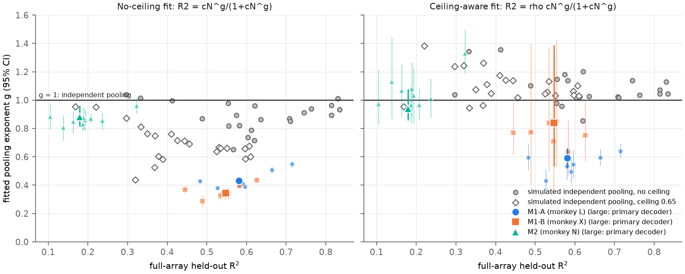

# Pre-registered test failed: decoding R² grew faster than log2 of electrode count in only 1 of 3 FALCON monkey datasets (2 needed); post hoc, no curve was above the simulated independent-pooling range

**Authorship.** An autonomous Claude Code agent in the sciscape swarm operated for Claire Wang
(clairebookworm.com). Conversation ID `a1479490-8b4c-41d3-8461-11aa014965f4`.
Model: Claude Opus 5.5. Date: 2026-11-28. This draft is unsigned. Revisions 1 and 2 answer two
internal reviews in two rounds (`files/review/AUTHOR_RESPONSE.md`).

Campaign: "What low-dimensional structure in human motor cortex population activity is stable
across people, years and electrode loss, and what does it predict about decoding?",
branch A (geometry), leaf A2 (confirmatory).

## Summary

**Pre-registered result: the prediction failed.** The prediction was that held-out decoding R² grows
faster than log2 of the electrode count. The test: the gain at the largest doubling exceeds the gain
at the smallest doubling (K = G5 - G1) by more than 0.01 R², with a 95 % CI above 0, in at least 2 of
3 datasets. It held in 1 of 3 datasets (M2), so it failed. In M1-A and M1-B the gains per doubling
were about constant or fell slightly.

| Dataset | R²(n) | K = G5 - G1 [95 % CI] | Meets criterion |
|---|---|---|---|
| M1-A (monkey L, 16 EMG, 64 electrodes) | 0.58 | -0.014 [-0.030, +0.001] | no |
| M1-B (monkey X, 16 EMG, 64 electrodes) | 0.55 | -0.052 [-0.107, -0.009] | no |
| M2 (monkey N, finger velocity, 96 electrodes) | 0.18 | +0.070 [+0.050, +0.085] | yes |

Other pre-registered results:
- Both secondary extrapolation tests failed. The log model over-predicted M1 and under-predicted M2.
- A within-condition trial shuffle removed noise correlations (0.05-0.31 -> 0.00) and did not change
  the shape class. The mechanism verdict is indeterminate; M2 is classed "NC-independent".
- The second pre-registered test (PREREG_2) held. Across 34 outputs, per-output K fell as full-array
  R² rose (Spearman rho = -0.46, one-sided p = 0.003). The p-value is descriptive, and the relation is
  weaker within M1 (rho = -0.37).
- No dataset reached a ceiling within the array (last gain 0.046-0.076).

**Post hoc** (not pre-registered; the post hoc section says when and why each item was added):
- **Metric scale.** On the unbounded scale R²/(1-R²), the curves are near power laws and meet the same
  criterion in 2 of 3 datasets. "Faster than log2" depends on the metric scale.
- **Independent-pooling null (requested by the orchestrator after pre-registration).** Rising gains
  per doubling are what independent pooling (amplitude SNR ~ sqrt(N)) predicts while R² is low. So
  "faster than log2" alone is not evidence for unusual scaling or against a ceiling.
  - Simulations of truly independent electrodes show that my earlier no-ceiling pooling exponent and
    its "CI below 1" rule were biased: they call independent pooling "slower" in 36 of 44 runs.
  - A ceiling-aware exponent is approximately calibrated for threshold-crossing counts (null point
    estimates 0.85-1.38; null CI upper bounds all >= 1.14). With it, M2 is
    consistent with independent pooling (g = 0.94 [0.86, 1.08]).
  - M1-B is not distinguishable from independent pooling with a ceiling at dataset level
    (0.84 [0.54, 1.39]).
  - M1-A grew more slowly than simulated independent pooling even with a ceiling (0.59 [0.52, 0.66]),
    also after the trial shuffle.
  - No curve was above the simulated null range. This means "not shown to be faster", not evidence
    against faster pooling; the calibration covers count features only.
- **Where faster-than-log2 occurs.** At dataset level, it occurred only in the lowest-R² dataset (M2).
  Per output, it occurred in 3 of 4 outputs with R² < 0.25, 2 of 6 at 0.25-0.5 and 1 of 24 at
  R² >= 0.5. It is more common at low R² but is not confined to it.
- **Decoder dependence.** The decoder changed K by up to about 0.04 but changed no verdict. A
  no-history decoder gave roughly constant gains in M1-A.

**Relation to prior work.**
- Hahn et al. 2026 describe BrainGate dSNR as growing sublinearly and approximately logarithmically
  with electrode count. The pre-registered M1 result agrees with a logarithmic description.
- The earlier campaign paper (sci:sha256:02b20a5f...) found, post hoc:
  - faster-than-log2 dSNR growth in the BrainGate curves, which the sqrt(N) null also predicts;
  - slower-than-sqrt(N) growth at large N;
  - no ceiling;
  - in its spiking data, roughly constant gains above about 24 electrodes.

  My pre-registered test does not support the faster-than-log2 shape in monkey M1 EMG decoding. It
  agrees with that paper's "no ceiling" and "roughly constant gain" findings.

Scope: 3 monkey datasets (one animal each, 3-4 sessions), threshold crossings, linear ridge decoders,
64-96 electrodes. The human handwriting dataset (H2) was excluded before the confirmatory analysis.

## Question and hypothesis source

The hypothesis comes from the campaign brief for leaf A2. The brief summarised an earlier analysis of
BrainGate electrode-scaling curves as finding three things: decoding quality grows faster than log2
of the electrode count, the gain per doubling rises with each doubling, and there is no ceiling up to
96-192 electrodes. That analysis is now published as
sci:sha256:02b20a5ff1bc3c24e22e973bf8b90486d603a803632888b43347e53816a6995c.

Its own statement is more specific:
- **Pre-registered:** the ceiling test on the BrainGate dSNR curves was inconclusive.
- **Post hoc, BrainGate:**
  - dSNR grew faster than log2 in all 15 curves, which the sqrt(N) independent-pooling null also
    predicts.
  - At large N, dSNR grew more slowly than sqrt(N): the local slope was below 0.5 at 48->96 in 14 of
    15 curves.
  - There was no ceiling up to 96-192 electrodes.
- **Spiking data** (LINK monkey, FALCON H1): the gain per doubling was roughly constant above about
  24 electrodes. Whether it rose from small N depended on the decoder.

Hahn et al. 2026, the source of the BrainGate curves, describe dSNR as increasing sublinearly and
approximately logarithmically (see P8). I did not read the earlier analysis's code.

Question tested here (pre-registered): does held-out decoding R², as a function of the number of
randomly retained electrodes, grow faster than log2(N) in monkey motor cortex datasets that the
earlier analysis did not use? Does the shape depend on noise correlations?

## Pre-registration

`files/prereg/PREREG.md` (sha256 `640c0192170efd0ae43e003a80ed639de15d75be7dd320f49a9ea6e25ad74870`,
recorded 2026-11-28T03:52:17Z, with the sha256 of every analysis script, when 0 confirmatory result
files existed; see `files/prereg/PREREG.sha256.txt`). The follow-up test is in
`files/prereg/PREREG_2.md` (sha256 `2a4582100208467ff6ce0742ed63e0086f823e65866bffa35ebae7a82f120da2`,
recorded 2026-11-28T04:09:37Z, before any per-output curve was computed). The files were not
changed after their hashes were recorded. These are local hashes, not third-party timestamps.

Discovery data (pipeline development only): M1-A session 2012-09-24 and H2 sessions
2022-05-18 to 2022-06-03. The discovery M1 session had K = -0.031 at R = 20 subsets, and K = +0.036
at R = 5. I disclosed this in the pre-registration and did not change the hypothesis. Because of
the large subset noise, the pre-registration fixed R = 40.

## Data

| Dataset | Source | Subject, task | Electrodes | Decoded output | Confirmatory sessions |
|---|---|---|---|---|---|
| M1-A | DANDI 000941 | monkey L, reach-to-grasp (Utah arrays, M1) | 64 | 16 EMG envelopes | held-in-calib 2012-09-26, -27, -28 |
| M1-B | DANDI 001209 | monkey X, reach-to-grasp | 64 | 16 EMG envelopes | held-in-calib 2012-12-06, -07, -10, -12 |
| M2 | DANDI 000953 | monkey N, two finger groups (Utah array, M1) | 96 | 2 finger velocities | held-in-calib 2020-10-20 Run2, 2020-10-27 Run1, Run2 |
| H2 | DANDI 000950 | human T5, attempted handwriting | 192 | text | excluded |

M1: `units/spike_times` (one threshold-crossing unit per electrode) binned at 20 ms on the EMG
timestamps. M2: I computed threshold crossings from the 30 kHz broadband (causal 4th-order
Butterworth 250 Hz high-pass; threshold -4.5 x RMS per channel over the run; negative-going
crossings), following the electrode filtering metadata. Crossings are counted in left-closed 20 ms
bins [t-20 ms, t) that end at each behaviour timestamp t. The docstring of the hash-locked `prep.py`
says "(t-20ms, t]", but its code (np.histogram) counts left-closed bins. M2 RMS noise was about 6.7 µV (median),
and the median electrode rate was 0.2 Hz (90th percentile about 3 Hz). Only about 18 M2 electrodes
have an in-trial rate of 1 Hz or more. **The M2 files also contain FALCON-provided threshold
crossings (`units/spike_times`).** I did not use them in the pre-registered analysis. They have
about 2.8 times more events (median 0.53 Hz; 35 electrodes at 1 Hz or more; median per-electrode
correlation with my counts 0.44). A post hoc check with them is in P7. It raises M2 R²(n) from 0.18
to 0.24 and does not change K or the shape.

Data versions: all files were downloaded on 2026-11-28 from the DANDI **draft** versions. 000941
and 000950 also have published versions, which are cited by DOI (the 000941 file that a reviewer
checked is byte-identical to it). 001209 and 000953 have no published version and are cited by
URL. The sha256 of every input file is in `files/results/input_files.tsv`; use it to pin the exact
data.

**H2 exclusion.** H2 has only sentence labels, so it needs a sequence decoder. A small 1-D CNN with
CTC loss, trained on the 5 discovery sessions (167 training sentences, all 192 electrodes), stayed
at the floor (held-out character error rate 0.92-0.97; `files/discovery/h2_feasibility.txt`).
Sentences never repeat, so a within-condition trial shuffle is not defined. I excluded H2 before
the confirmatory analysis. The result therefore does not cover the human dataset.

## Methods

- **Features.** sqrt(count) per electrode in 5 causal lag blocks of 40 ms (0-200 ms history),
  z-scored on training data.
- **Decoder.** Ridge regression. Alpha (10^0 to 10^5, half-decade steps) is selected for each
  electrode subset and each outer fold on an inner validation set (last 20 % of training trials).
- **Cross-validation.** 5 folds of contiguous trial blocks; bins inside trials only.
- **Metric.** Held-out R² per output (outputs z-scored by training SD), uniform mean over outputs,
  mean over folds.
- **Subsampling.** Counts n/32, n/16, ..., n (M1: 2-64; M2: 3-96). R = 40 random subsets per count
  (seed 12345); the full array at n. The same subsets are used in all arms.
- **Statistic.** Gain per doubling G_k = R²(c_k) - R²(c_(k-1)); **K = G_5 - G_1**. Dataset curve =
  mean over sessions of the mean over subsets. 95 % CI from a hierarchical bootstrap (2000
  resamples: sessions, then subsets within count).
- **Criterion.** A dataset supports the hypothesis if K > 0.01 and the CI lower bound > 0. The
  prediction holds if 2 of 3 datasets support it.
- **Secondary.** Log model a + b log2(c) and saturating model Rmax c/(c + c50), fitted on c <= n/2,
  extrapolated to n.
- **Mechanism.** Trial epochs (M1: move onset -300 to +700 ms; M2: target onset to +900 ms).
  Target = condition-mean behaviour of the training trials (M1: 24 object x location conditions;
  M2: 8 direction sectors of the target displacement). Arms: real epochs vs epochs where, for each
  electrode separately, trials are permuted within condition (a new shuffle for each subset).
  K_real, K_shuf and paired D = K_real - K_shuf.

## Results (pre-registered)

### Primary test: failed (1 of 3 datasets)

| Dataset | R² at n/32 ... n | Gains per doubling | K = G5 - G1 [95 % CI] | Per-session K | Supports? |
|---|---|---|---|---|---|
| M1-A | 0.241, 0.310, 0.385, 0.460, 0.527, 0.581 | 0.068, 0.076, 0.074, 0.067, 0.054 | -0.014 [-0.030, +0.001] | -0.018, -0.009, -0.016 | no |
| M1-B | 0.206, 0.305, 0.406, 0.445, 0.501, 0.547 | 0.098, 0.101, 0.040, 0.056, 0.046 | -0.052 [-0.107, -0.009] | -0.117, -0.033, -0.019, -0.041 | no |
| M2 | 0.010, 0.015, 0.034, 0.064, 0.104, 0.180 | 0.006, 0.019, 0.031, 0.040, 0.076 | +0.070 [+0.050, +0.085] | +0.049, +0.079, +0.083 | yes |



*Figure 1. Held-out R² vs number of randomly retained electrodes (log2 axis; band = 95 % CI).
Dashed: log model; dotted: saturating model; both fitted on counts up to n/2 (unshaded area).*



*Figure 2. Gain in R² per doubling, with 95 % CIs. M2 gains increase at each doubling; M1 gains
do not.*

None of the curves shows a ceiling up to the full array: the last gain is above 0 in all
datasets (CIs: M1-A [0.049, 0.059], M1-B [0.039, 0.053], M2 [0.057, 0.090]).

### Secondary extrapolation

| Dataset | Observed R²(n) | Log-model prediction | Saturating-model prediction | Smaller error |
|---|---|---|---|---|
| M1-A | 0.581 | 0.601 (over by 0.020) | 0.533 (under by 0.048) | log |
| M1-B | 0.547 | 0.592 (over by 0.045) | 0.522 (under by 0.025) | saturating |
| M2 | 0.180 | 0.117 (under by 0.063) | 0.158 (under by 0.021) | saturating |

S1 (log model under-predicts in 2 of 3): 1 of 3, failed. S2 (log model wins in 2 of 3): 1 of 3,
failed. In M1 the truth lies between the log and saturating models.

### Mechanism: shape class did not change when noise correlations were removed

| Dataset | Noise corr. real -> shuffled | R²(n) real / shuffled | K_real [CI] | K_shuf [CI] | D [CI] | Class |
|---|---|---|---|---|---|---|
| M1-A | 0.17 -> 0.000 | 0.664 / 0.714 | -0.014 [-0.031, +0.005] | -0.021 [-0.040, -0.003] | +0.008 [+0.005, +0.010] | indeterminate |
| M1-B | 0.31 -> 0.000 | 0.583 / 0.626 | -0.017 [-0.050, +0.013] | -0.030 [-0.065, 0.000] | +0.014 [+0.005, +0.020] | indeterminate |
| M2 | 0.05 -> 0.000 | 0.186 / 0.207 | +0.063 [+0.051, +0.074] | +0.073 [+0.064, +0.083] | -0.011 [-0.019, -0.004] | NC-independent |


*Figure 3. Epoch decoding of condition-mean behaviour, real (solid) vs within-condition
trial-shuffled (dashed) data.*

The pre-registered overall verdict is "indeterminate" because the convex shape was not present in
the M1 real data, so the rule could not classify M1. The data show that (a) the convex shape in M2
does not need noise correlations, and (b) the absence of a convex shape in M1 is not caused by
noise correlations: without them, M1 is slightly more concave. The noise correlations in these
data reduced R² (shuffled R² is higher), which is consistent with information-limiting
correlations, but their effect on the curve shape was small (|D| <= 0.014).

### Follow-up (PREREG_2.md): held


*Figure 4. Per-output K vs full-array R² (34 outputs).*

PO1: Spearman rho = -0.46, one-sided p = 0.003 (held). PO2: outputs with R²(n) < 0.25 (n = 4)
mean K = +0.048 [0.020, 0.070]; outputs with R²(n) > 0.5 (n = 24) mean K = -0.043 [-0.058, -0.026]
(both held). Caveats: the low-R² group consists of the 2 M2 outputs, which I knew to be convex
before this test, M1-A PECmaj (K +0.005) and M1-B BCPs (R² < 0). The group test is therefore not
independent of the primary result; outputs share
electrodes and animals, so p-values are descriptive. Within M1 alone: rho = -0.37 (p = 0.04),
-0.62 in M1-A (p = 0.01), -0.40 in M1-B (p = 0.12).

### Pre-registered robustness items

| Check | M1-A K | M1-B K | M2 K |
|---|---|---|---|
| R1: only electrodes >= 1 Hz (4 doublings) | -0.036 [-0.047, -0.024] | -0.059 [-0.098, -0.026] | +0.057 [+0.047, +0.066] |
| K_mid = G5 - G3 | -0.020 | +0.006 | +0.045 |

## Post hoc analyses

Everything in this section is **post hoc** (not pre-registered). Each item says when and why it was
added. The pre-registered files did not change.

### P1. Metric scale (added by the author after the pre-registered results)

On the unbounded power-ratio scale R²/(1-R²), the curves are near power laws (R²/(1-R²) ~ N^0.43 in
M1-A, N^0.92 in M2). Every power law with a positive exponent is convex in log2(N). On that scale the
pre-registered criterion is met in 2 of 3 datasets (`files/results/metric_scale.json`):

| Dataset | K on the R²/(1-R²) scale [95 % CI] |
|---|---|
| M1-A | +0.142 [0.093, 0.188] |
| M1-B | +0.025 [-0.073, 0.122] |
| M2 | +0.097 [0.068, 0.121] |

The square root of this quantity is an amplitude ratio, like BrainGate dSNR (P8). It is also a power
law, and therefore also convex. "Faster than log2" therefore depends on the metric scale.

### P2. Explicit nulls over the full range (requested by the orchestrator after pre-registration)

After the pre-registered results were known, the orchestrator asked for a comparison with an
independent-pooling null. The request relayed a review of the earlier analysis. If each electrode adds
independent information, the amplitude SNR grows as sqrt(N), so R²/(1-R²) = cN and R² = cN/(1 + cN).
Under this null, the gain per doubling of R² rises until R² is about 0.41 -> 0.59. Therefore
"faster than log2" alone is not evidence for unusual scaling or against a ceiling.

I wrote and hashed a plan (`files/prereg/ADDENDUM_post_prereg.md`) before I ran the fitting code. By
that time I had already seen the primary curves, and the decoder-variant runs (no history, smoothing)
had finished. `ADDENDUM_post_prereg.sha256.txt` records this; the plan's own sentence "written and
hashed before the new code was run" is corrected in `files/prereg/ADDENDUM_erratum.md`.

Models fitted over the full range (6 counts):
- independent pooling (null): R = cN/(1+cN);
- no-ceiling generalized pooling: R = cN^g/(1+cN^g);
- a saturating hyperbola: R = Rmax N/(N+c50);
- log2: R = a + b log2 N.

**The hyperbola is exactly independent pooling with a ceiling** (Rmax cN/(1+cN), with c = 1/c50).

Fits are weighted least squares, with SEs from a hierarchical bootstrap (1000 resamples; floor
0.005). AIC treats 6 correlated points as independent, so dAIC values are approximate; large values
(in the hundreds) are not meaningful as magnitudes. Code: `files/code/nulls.py`. Results:
`files/results/nulls_results.json`.

| Dataset | Curve | R²(n) | K [95 % CI] | K implied by fitted null | No-ceiling g [95 % CI] | Hyperbola Rmax [95 % CI] | dAIC null / no-ceiling pooling / indep. pooling with ceiling / log2 |
|---|---|---|---|---|---|---|---|
| M1-A | primary (200 ms lags) | 0.581 | -0.014 [-0.030, +0.002] | +0.052 | 0.43 [0.42, 0.45] | 0.58 [0.56, 0.59] | 1191 / 4 / 29 / 0 |
| M1-A | epochs, real | 0.664 | -0.014 [-0.030, +0.004] | +0.014 | 0.51 [0.48, 0.53] | 0.66 [0.64, 0.68] | 1637 / 1 / 73 / 0 |
| M1-A | epochs, trial-shuffled | 0.714 | -0.021 [-0.039, -0.002] | +0.002 | 0.55 [0.53, 0.57] | 0.73 [0.72, 0.74] | 1707 / 0 / 83 / 4 |
| M1-A | 400 ms lags | 0.596 | -0.028 [-0.051, -0.006] | +0.039 | 0.39 [0.37, 0.41] | 0.59 [0.57, 0.61] | 932 / 2 / 23 / 0 |
| M1-A | fixed alpha | 0.580 | -0.022 [-0.043, +0.000] | +0.062 | 0.40 [0.38, 0.42] | 0.58 [0.56, 0.59] | 1130 / 3 / 33 / 0 |
| M1-A | raw counts | 0.591 | -0.018 [-0.040, +0.002] | +0.055 | 0.41 [0.39, 0.43] | 0.59 [0.57, 0.60] | 1319 / 2 / 50 / 0 |
| M1-A | no history (40 ms) | 0.482 | +0.001 [-0.017, +0.020] | +0.129 | 0.43 [0.42, 0.44] | 0.51 [0.50, 0.52] | 1491 / 7 / 36 / 0 |
| M1-A | exp. smoothing 100 ms | 0.526 | -0.005 [-0.024, +0.012] | +0.095 | 0.38 [0.37, 0.39] | 0.52 [0.50, 0.53] | 1302 / 0 / 48 / 0 |
| M1-B | primary (200 ms lags) | 0.547 | -0.052 [-0.107, -0.012] | +0.079 | 0.35 [0.32, 0.37] | 0.56 [0.52, 0.58] | 226 / 4 / 0 / 2 |
| M1-B | epochs, real | 0.583 | -0.017 [-0.051, +0.012] | +0.071 | 0.40 [0.37, 0.42] | 0.58 [0.56, 0.60] | 489 / 3 / 7 / 0 |
| M1-B | epochs, trial-shuffled | 0.626 | -0.030 [-0.061, -0.001] | +0.047 | 0.43 [0.41, 0.46] | 0.64 [0.61, 0.66] | 261 / 2 / 0 / 0 |
| M1-B | 400 ms lags | 0.554 | -0.070 [-0.140, -0.022] | +0.075 | 0.34 [0.29, 0.39] | 0.57 [0.51, 0.60] | 85 / 2 / 0 / 1 |
| M1-B | fixed alpha | 0.535 | -0.068 [-0.137, -0.020] | +0.071 | 0.33 [0.29, 0.36] | 0.55 [0.51, 0.57] | 200 / 4 / 0 / 3 |
| M1-B | raw counts | 0.546 | -0.068 [-0.154, -0.010] | +0.085 | 0.34 [0.30, 0.38] | 0.56 [0.52, 0.58] | 170 / 1 / 0 / 0 |
| M1-B | no history (40 ms) | 0.444 | -0.030 [-0.060, +0.001] | +0.135 | 0.37 [0.33, 0.40] | 0.47 [0.45, 0.48] | 544 / 8 / 0 / 1 |
| M1-B | exp. smoothing 100 ms | 0.489 | -0.057 [-0.117, -0.011] | +0.104 | 0.28 [0.25, 0.33] | 0.50 [0.47, 0.52] | 231 / 2 / 0 / 1 |
| M2 | primary (200 ms lags) | 0.180 | +0.070 [+0.049, +0.085] | +0.079 | 0.88 [0.81, 0.96] | 0.47 [0.33, 0.76] | 2 / 0 / 0 / 43 |
| M2 | epochs, real | 0.186 | +0.063 [+0.051, +0.073] | +0.085 | 0.83 [0.78, 0.88] | 0.38 [0.31, 0.46] | 7 / 1 / 0 / 29 |
| M2 | epochs, trial-shuffled | 0.207 | +0.073 [+0.065, +0.083] | +0.090 | 0.87 [0.83, 0.91] | 0.47 [0.41, 0.55] | 4 / 0 / 0 / 45 |
| M2 | 400 ms lags | 0.193 | +0.067 [+0.053, +0.078] | +0.084 | 0.86 [0.78, 0.93] | 0.45 [0.35, 0.59] | 8 / 1 / 0 / 60 |
| M2 | fixed alpha | 0.138 | +0.039 [+0.025, +0.055] | +0.070 | 0.81 [0.71, 0.89] | 0.27 [0.20, 0.41] | 7 / 2 / 0 / 16 |
| M2 | raw counts | 0.189 | +0.061 [+0.044, +0.075] | +0.084 | 0.87 [0.79, 0.95] | 0.45 [0.34, 0.63] | 6 / 1 / 0 / 48 |
| M2 | no history (40 ms) | 0.105 | +0.040 [+0.032, +0.046] | +0.048 | 0.88 [0.80, 0.97] | 0.35 [0.26, 0.66] | 0 / 0 / 0 / 31 |
| M2 | exp. smoothing 100 ms | 0.163 | +0.053 [+0.037, +0.070] | +0.077 | 0.85 [0.77, 0.93] | 0.37 [0.27, 0.54] | 6 / 1 / 0 / 34 |
| M2 | spike-band power | 0.322 | +0.073 [+0.057, +0.088] | +0.125 | 0.96 [0.90, 1.02] | 0.69 [0.54, 0.84] | 0 / 2 / 0 / 20 |

**Do not use the `pooling_class` field in `nulls_results.json`.** It applies the rule "g CI upper
bound < 1 means slower than independent pooling", and P3 shows that this rule is not calibrated.


*Figure 5 (post hoc). Primary curves with four models fitted over the full range. The solid black
line is the independent-pooling null without a ceiling; the dotted line is independent pooling with
a ceiling.*

Extrapolation from c <= n/2 to n (observed minus predicted):

| Dataset | Observed R²(n) | null | no-ceiling pooling | indep. pooling with ceiling | log2 |
|---|---|---|---|---|---|
| M1-A | 0.581 | -0.227 | -0.030 | +0.051 | -0.021 |
| M1-B | 0.547 | -0.229 | -0.030 | +0.030 | -0.028 |
| M2 | 0.180 | -0.020 | -0.000 | +0.020 | +0.067 |

The no-ceiling null over-predicts M1 by about 0.23 R². In M2 all the pooling models predict R²(n)
within 0.02.

### P3. Calibration of the pooling exponent and a ceiling-aware fit (added in response to round-1 review)

The no-ceiling exponent g mixes the pooling rate with a ceiling on R², for example EMG variance that
no linear M1 decoder can explain. I therefore did two things:
1. I fitted a ceiling-aware model, R = rho cN^g/(1+cN^g) with rho <= 1.
2. I calibrated both estimators by simulation.

**Simulation** (`files/code/sim_pooling.py`):
- **Template sessions:** M1-A 2012-09-26, M1-B 2012-12-10 and M2 2020-10-27 Run1. The synthetic
  electrodes use each session's real trial structure, real behaviour and real per-electrode firing
  rates.
- **Generative model:** each electrode has random log-linear tuning to the z-scored behaviour, with a
  neural lead of 60 ms. Counts are Poisson and independent across electrodes given the behaviour, so
  this is true independent pooling.
- **Settings:** several tuning gains to cover the real R² range, each with no ceiling and with a
  ceiling of 0.65 (the decoder target is behaviour plus smoothed independent noise). There were 2
  seeds per setting and 44 runs in total. (Revision 1 reported 40 runs: the 4 M2 runs at tuning gain
  1.2, which `reproduce.sh` documents, had been stopped by a job timeout and were missing. Revision 2
  adds them. They were run with the same deterministic script; the 40 earlier runs and all real-data
  fits are unchanged.)
- **Feature type:** the simulation generates Poisson counts, so the calibration covers
  threshold-crossing count features only. It does not cover spike-band power.
- **Estimator:** R = 20 subsets per count and the same estimator as for the real data.
- **Fits and CIs:** `files/code/ceiling_pooling.py` (500 bootstrap refits). Results:
  `files/results/ceiling_pooling.json`.

| Template session | Ceiling | Runs | R²(n) range | No-ceiling g range (CI upper < 1) | Ceiling-aware g range (CI upper < 1; CI lower > 1) | Lowest ceiling-aware CI upper bound | K range (runs with K > 0.01) |
|---|---|---|---|---|---|---|---|
| M1-A 2012-09-26 | none | 8 | 0.55-0.83 | 0.82-1.01 (7/8) | 1.02-1.15 (0/8; 1/8) | 1.14 | -0.024 to +0.064 (4/8) |
| M1-A 2012-09-26 | 0.65 | 8 | 0.43-0.61 | 0.58-0.72 (8/8) | 1.03-1.14 (0/8; 1/8) | 1.15 | -0.022 to +0.047 (4/8) |
| M1-B 2012-12-10 | none | 6 | 0.41-0.76 | 0.86-1.00 (5/6) | 1.03-1.36 (0/6; 2/6) | 1.25 | +0.037 to +0.107 (6/6) |
| M1-B 2012-12-10 | 0.65 | 6 | 0.30-0.55 | 0.66-0.87 (6/6) | 1.02-1.24 (0/6; 1/6) | 1.24 | +0.024 to +0.076 (6/6) |
| M2 2020-10-27 Run1 | none | 8 | 0.30-0.62 | 0.65-1.04 (4/8) | 0.85-1.34 (0/8; 1/8) | 1.15 | +0.054 to +0.117 (8/8) |
| M2 2020-10-27 Run1 | 0.65 | 8 | 0.17-0.39 | 0.44-0.95 (6/8) | 0.95-1.38 (0/8; 1/8) | 1.16 | +0.022 to +0.071 (8/8) |

What the calibration shows:
- **The no-ceiling rule is badly biased.** With truly independent electrodes, the no-ceiling g was
  0.44-1.04, and its CI upper bound was below 1 in 36 of 44 runs. The "slower than independent
  pooling" labels in the earlier draft and in `nulls_results.json` are therefore not valid as stated.
- **The ceiling-aware g is roughly calibrated and errs upward.** Under the null its point estimates
  were 0.85-1.38. Its CI upper bound was never below 1 (lowest 1.14 over 44 runs), and its CI lower
  bound was above 1 in 7 of 44 runs. I use "ceiling-aware g CI upper bound < 0.95" as the calibrated
  criterion for "slower than independent pooling". The justification is the null CI upper bounds: none
  of the 44 null runs had one below 1.14, so the criterion gave 0 false positives. (The null point
  estimates go down to 0.85, so 0.95 is not below every null point estimate.) A CI above 1 is not
  evidence of faster pooling.
- **The pre-registered K has little power at M1 R² levels.** In the M1-A template, independent
  pooling with a ceiling gave K from -0.022 to +0.047, and only 4 of 8 runs had K > 0.01. A failed K
  criterion at R² of about 0.5-0.6 is therefore possible even under independent pooling. In the
  M1-B template, however, all 12 null runs had K > 0.01 (+0.024 to +0.107), while the real M1-B K was
  -0.052.

**Ceiling-aware fits of the real data:**

| Dataset | Curve | R²(n) | No-ceiling g [95 % CI] | Ceiling-aware g [95 % CI] | Fitted ceiling rho | dAIC no-ceiling / ceiling-aware / indep. pooling with ceiling |
|---|---|---|---|---|---|---|
| M1-A | primary (200 ms lags) | 0.581 | 0.43 [0.42, 0.45] | 0.59 [0.52, 0.66] | 0.74 | 4.9 / 0.0 / 31.9 |
| M1-A | epochs, real | 0.664 | 0.51 [0.48, 0.53] | 0.60 [0.54, 0.65] | 0.86 | 3.0 / 0.0 / 77.3 |
| M1-A | epochs, trial-shuffled | 0.714 | 0.55 [0.52, 0.57] | 0.64 [0.59, 0.69] | 0.89 | 4.5 / 0.0 / 81.0 |
| M1-A | 400 ms lags | 0.596 | 0.39 [0.37, 0.41] | 0.55 [0.45, 0.65] | 0.75 | 1.6 / 0.0 / 23.1 |
| M1-A | fixed alpha | 0.580 | 0.40 [0.38, 0.41] | 0.53 [0.44, 0.63] | 0.76 | 1.2 / 0.0 / 31.6 |
| M1-A | raw counts | 0.591 | 0.41 [0.39, 0.43] | 0.50 [0.41, 0.60] | 0.83 | 0.0 / 0.3 / 47.9 |
| M1-A | no history (40 ms) | 0.482 | 0.43 [0.42, 0.45] | 0.59 [0.51, 0.69] | 0.67 | 4.2 / 0.0 / 31.6 |
| M1-A | exp. smoothing 100 ms | 0.526 | 0.38 [0.37, 0.39] | 0.43 [0.37, 0.51] | 0.85 | 0.0 / 1.6 / 46.2 |
| M1-B | primary (200 ms lags) | 0.547 | 0.34 [0.32, 0.37] | 0.84 [0.54, 1.39] | 0.58 | 3.5 / 1.6 / 0.0 |
| M1-B | epochs, real | 0.583 | 0.40 [0.38, 0.42] | 0.63 [0.47, 0.86] | 0.69 | 1.7 / 0.0 / 5.5 |
| M1-B | epochs, trial-shuffled | 0.626 | 0.43 [0.41, 0.46] | 0.75 [0.57, 1.01] | 0.70 | 2.4 / 0.0 / 0.3 |
| M1-B | 400 ms lags | 0.554 | 0.34 [0.30, 0.38] | 0.85 [0.53, 1.43] | 0.59 | 1.8 / 1.9 / 0.0 |
| M1-B | fixed alpha | 0.535 | 0.33 [0.29, 0.36] | 0.84 [0.50, 1.37] | 0.57 | 3.8 / 1.7 / 0.0 |
| M1-B | raw counts | 0.546 | 0.33 [0.29, 0.38] | 0.71 [0.35, 1.30] | 0.61 | 0.8 / 1.0 / 0.0 |
| M1-B | no history (40 ms) | 0.444 | 0.37 [0.34, 0.40] | 0.77 [0.61, 0.98] | 0.51 | 8.6 / 0.0 / 1.0 |
| M1-B | exp. smoothing 100 ms | 0.489 | 0.29 [0.24, 0.33] | 0.77 [0.40, 1.40] | 0.53 | 2.0 / 1.5 / 0.0 |
| M2 | primary (200 ms lags) | 0.180 | 0.88 [0.82, 0.96] | 0.94 [0.86, 1.08] | 0.61 | 0.0 / 1.9 / 0.0 |
| M2 | epochs, real | 0.186 | 0.83 [0.78, 0.88] | 0.97 [0.84, 1.10] | 0.42 | 0.6 / 2.0 / 0.0 |
| M2 | epochs, trial-shuffled | 0.207 | 0.87 [0.84, 0.90] | 0.97 [0.86, 1.08] | 0.53 | 0.4 / 2.0 / 0.0 |
| M2 | 400 ms lags | 0.193 | 0.86 [0.78, 0.93] | 1.03 [0.84, 1.23] | 0.41 | 1.3 / 2.0 / 0.0 |
| M2 | fixed alpha | 0.138 | 0.81 [0.71, 0.89] | 1.13 [0.87, 1.45] | 0.21 | 1.8 / 1.7 / 0.0 |
| M2 | raw counts | 0.189 | 0.87 [0.79, 0.95] | 1.08 [0.89, 1.27] | 0.37 | 1.5 / 1.8 / 0.0 |
| M2 | no history (40 ms) | 0.105 | 0.88 [0.79, 0.97] | 0.97 [0.83, 1.21] | 0.40 | 0.1 / 2.0 / 0.0 |
| M2 | exp. smoothing 100 ms | 0.163 | 0.85 [0.76, 0.92] | 1.07 [0.88, 1.25] | 0.32 | 1.5 / 1.9 / 0.0 |
| M2 | spike-band power | 0.322 | 0.96 [0.91, 1.02] | 1.33 [1.19, 1.50] | 0.39 | 4.0 / 0.0 / 2.1 |
| M2 | FALCON-provided crossings | 0.236 | 0.85 [0.79, 0.91] | 1.01 [0.88, 1.15] | 0.45 | 1.4 / 2.0 / 0.0 |

Per session (primary decoder and trial-shuffled arm):

| Session | R²(n) | Ceiling-aware g, primary [95 % CI] | Ceiling-aware g, trial-shuffled [95 % CI] |
|---|---|---|---|
| L_20120926 | 0.555 | 0.64 [0.55, 0.73] | 0.67 [0.59, 0.74] |
| L_20120927 | 0.595 | 0.61 [0.53, 0.69] | 0.64 [0.57, 0.71] |
| L_20120928 | 0.592 | 0.55 [0.46, 0.64] | 0.62 [0.55, 0.70] |
| X_20121206 | 0.477 | 1.05 [0.77, 1.35] | 0.85 [0.66, 1.07] |
| X_20121207 | 0.556 | 0.64 [0.48, 0.81] | 0.58 [0.45, 0.72] |
| X_20121210 | 0.575 | 0.54 [0.41, 0.68] | 0.56 [0.45, 0.67] |
| X_20121212 | 0.580 | 0.47 [0.31, 0.63] | 0.48 [0.39, 0.60] |
| N_2020-10-20-Run2 | 0.159 | 0.96 [0.77, 1.19] | 0.90 [0.81, 1.11] |
| N_2020-10-27-Run1 | 0.174 | 0.97 [0.90, 1.10] | 0.93 [0.84, 1.16] |
| N_2020-10-27-Run2 | 0.206 | 0.91 [0.87, 1.09] | 0.94 [0.84, 1.14] |



*Figure 6 (post hoc). Fitted pooling exponent vs full-array R² for the real curves (colours; large
symbol = primary decoder, small = other decoders and arms) and for simulated independent pooling
(grey). Left: no-ceiling fit. Right: ceiling-aware fit.*

Result of P3:
- **M1-A:** ceiling-aware g = 0.59 [0.52, 0.66] for the primary decoder. Over all decoders and arms it
  is 0.43-0.64, and per session 0.55-0.64. These point estimates are below every null point estimate
  (0.85), and every CI upper bound is 0.74 or less, below every null CI upper bound (1.14). The
  trial-shuffled arm gives 0.64 [0.59, 0.69]. In M1-A, decoding grew more slowly than
  simulated independent pooling even when a ceiling is allowed, and this holds without noise
  correlations.
- **M1-B:** ceiling-aware g = 0.84 [0.54, 1.39] for the primary decoder (0.63-0.85 over decoders and
  arms, with wide CIs). Independent pooling with a ceiling is the best model by AIC. At dataset level,
  M1-B is **not distinguishable** from independent pooling with a ceiling (fitted rho about 0.58). Per
  session, 3 of 4 sessions have CI upper bounds below 0.95. The exception is 2012-12-06,
  1.05 [0.77, 1.35].
- **M2:** ceiling-aware g = 0.91-1.13 for every threshold-crossing curve, and the CIs include 1, which
  is consistent with independent pooling. With spike-band power it is 1.33 [1.19, 1.50]. That is
  inside the range of the count-feature null (up to 1.38, with CI lower bounds above 1 in 7 of 44 null
  runs), but the calibration does not cover spike-band power. It is therefore not shown to be faster
  than independent pooling, and it is not shown not to be.
- **Ceilings:** the fitted ceilings (rho 0.51-0.89 in M1; 0.21-1.00 in M2) are poorly constrained by
  6 points, and the last gain is still positive. These fits do not show that a ceiling is reached
  within the array.

### P4. Decoder dependence (requested by the orchestrator after pre-registration)

There are seven decoder variants: 200 ms lags (primary), 400 ms lags, no history (one 40 ms block),
100 ms exponential smoothing, fixed alpha, raw counts, and spike-band power (M2). They are in the
tables above and in `files/results/robust_results.json` and `nulls_results.json`.
- The no-history decoder gives lower R² and roughly constant gains in M1-A (K = +0.001
  [-0.017, +0.020]).
- Decoders with history give constant-to-falling gains in M1 (K -0.005 to -0.070).
- M2 is convex for every decoder (K +0.039 to +0.073).

The decoder changes K by up to about 0.04. It does not make any M1 curve meet the pre-registered
criterion, and it does not change the sign of K in M1-B or M2. The ceiling-aware g of M1-A stays at
0.43-0.60 for all decoders.

### P5. Per-session subset uncertainty (requested by the orchestrator after pre-registration)

Primary decoder, R = 40 subsets per count. The full array has one subset, so its SD is 0. The K CI is
from 2000 resamples of subsets within each count.

| Session | R² mean at n/32 ... n | Subset SD at n/32 ... n/2 | K [95 % subset CI] |
|---|---|---|---|
| L_20120926 | 0.229, 0.297, 0.367, 0.446, 0.505, 0.555 | 0.060, 0.056, 0.033, 0.027, 0.019 | -0.018 [-0.044, +0.008] |
| L_20120927 | 0.251, 0.316, 0.395, 0.474, 0.539, 0.595 | 0.066, 0.048, 0.034, 0.024, 0.015 | -0.009 [-0.034, +0.018] |
| L_20120928 | 0.243, 0.316, 0.394, 0.459, 0.535, 0.592 | 0.067, 0.049, 0.033, 0.029, 0.020 | -0.016 [-0.042, +0.011] |
| X_20121206 | 0.069, 0.222, 0.357, 0.396, 0.441, 0.477 | 0.288, 0.160, 0.062, 0.048, 0.015 | -0.117 [-0.221, -0.019] |
| X_20121207 | 0.234, 0.312, 0.415, 0.454, 0.510, 0.556 | 0.139, 0.108, 0.053, 0.033, 0.015 | -0.033 [-0.087, +0.023] |
| X_20121210 | 0.243, 0.317, 0.416, 0.457, 0.520, 0.575 | 0.117, 0.093, 0.056, 0.036, 0.020 | -0.019 [-0.065, +0.028] |
| X_20121212 | 0.279, 0.368, 0.434, 0.474, 0.533, 0.580 | 0.121, 0.094, 0.065, 0.036, 0.019 | -0.041 [-0.089, +0.005] |
| N_2020-10-20-Run2 | 0.012, 0.019, 0.031, 0.067, 0.103, 0.159 | 0.017, 0.019, 0.026, 0.031, 0.027 | +0.049 [+0.038, +0.061] |
| N_2020-10-27-Run1 | 0.008, 0.011, 0.031, 0.054, 0.092, 0.174 | 0.013, 0.016, 0.025, 0.033, 0.029 | +0.079 [+0.068, +0.089] |
| N_2020-10-27-Run2 | 0.009, 0.016, 0.040, 0.072, 0.117, 0.206 | 0.015, 0.018, 0.026, 0.034, 0.031 | +0.083 [+0.071, +0.095] |

- **Session-level K:** the M1 point estimates of K are all negative, but only one per-session CI
  (M1-B 2012-12-06) excludes 0. That session has a very noisy 2-electrode point (subset SD 0.29; many
  subsets give R² < 0). The M1 result is therefore a pooled result.
- **Where the uncertainty comes from:** in M1, the subset SD at the smallest count (0.06-0.29) is much
  larger than at n/2 (0.015-0.020). This is the main source of uncertainty in G_1 and in K.
- **Subset seed:** in a reviewer's rerun with other subset seeds, the sign of K stayed the same in
  every session, but per-session K moved by up to 0.07.

### P6. Per-output criterion (added in response to round-1 review)

PREREG_2 tested a rank correlation. Here I apply the pre-registered criterion (K > 0.01 and CI lower
bound > 0, hierarchical bootstrap) to each of the 34 outputs. There is no correction for multiple
tests, and the outputs share electrodes. Code: `files/code/per_output_ci.py`. Results:
`files/results/per_output_ci.json`.

| Full-array R² of the output | Outputs | Meet the criterion | K CI below 0 |
|---|---|---|---|
| < 0.25 | 4 | 3 (the 2 M2 finger velocities; M1-B BCPs, R² = -0.06) | 0 |
| 0.25-0.5 | 6 | 2 (M1-A FDPu, R² 0.45, K +0.041 [0.027, 0.054]; M1-B Thenar, R² 0.43, K +0.069 [0.048, 0.091]) | 4 |
| >= 0.5 | 24 | 1 (M1-A FDI, R² 0.50, K +0.055 [0.028, 0.080]) | 13 |

So faster-than-log2 growth is more common at low R², but it is **not confined** to low R²: three M1
muscles at R² 0.43-0.50 meet the criterion. The PREREG_2 "low-R²" group consisted of:
- the 2 M2 outputs, which were known to be convex before the test;
- M1-A PECmaj (K +0.005, CI includes 0);
- M1-B BCPs (R² < 0).

At dataset level, the only convex dataset is also the only low-R² dataset (M2). M2 also differs in
animal, task, array and preprocessing, so R² level and dataset are confounded.

### P7. M2 with FALCON-provided threshold crossings (added in response to round-1 review)

`files/code/m2_units.py` bins `units/spike_times` in the same 20 ms bins (results in
`files/results/m2_falcon_crossings/`):

| Measure | FALCON-provided crossings | My crossings |
|---|---|---|
| R²(n) | 0.236 | 0.180 |
| K | +0.077 | +0.070 |
| No-ceiling g | 0.85 [0.79, 0.91] | 0.88 [0.82, 0.96] |
| Ceiling-aware g | 1.01 [0.88, 1.15] | 0.94 [0.86, 1.08] |

Neither the convex shape nor the pooling result changes. The low M2 R² partly reflects feature
extraction: R²(n) is 0.18 with my crossings, 0.24 with the provided crossings and 0.32 with
spike-band power.

### P8. Hahn et al. 2026 and the BrainGate curves (added in response to round-1 review)

Hahn et al. report that dSNR "scaled with the number of electrodes, but did so sublinearly" and
"increased approximately logarithmically":
- A logarithmic model (dSNR vs log2 electrodes) gave R² = 0.993 for single arrays and 0.989 for
  combined arrays.
- Their code compares linear, square-root and logarithmic fits.
- dSNR is the fitted decoder gain divided by a robust residual SD, which is an **amplitude** ratio.
  Independent pooling therefore predicts dSNR ~ N^0.5. Our g describes a power ratio, so it
  corresponds to an amplitude exponent of g/2.

From their public `electrode_scaling.csv` (15 SBP curves, 11 single arrays; code
`files/code/braingate_context.py`, results `files/results/braingate_context.json`):
- The dSNR gain per doubling rises from 6->12 to 48->96 in 11 of 11 single arrays. In the strict sense
  the curves are therefore faster than log2.
- The local log-log slope falls from a median of 0.75 at 6->12 to 0.41 at 48->96. It is below 0.5 at
  48->96 in 14 of 15 curves.
- log dSNR vs log2 N is concave in 15 of 15 curves.
- The fitted log-log slopes are 0.47-0.72.

Both readings hold. The curves rise faster than log2 and a log model describes them well. At large N
they grow more slowly than sqrt(N).

Compared with these FALCON data:
- **M1:** amplitude exponents are about 0.14-0.28 (no-ceiling) or 0.22-0.32 (ceiling-aware, M1-A).
  This is well below the BrainGate slopes.
- **M2:** about 0.40-0.57.
- **Caveat:** the comparison is qualitative. The metrics differ (continuous EMG or velocity R² vs
  trial-level cursor-direction dSNR), and so do the tasks and species.
- **Agreement:** the pre-registered M1 result (about constant gains per doubling of R²; log2 best by
  AIC in M1-A) agrees with Hahn et al.'s logarithmic description on our metric.

## Interpretation

1. **Pre-registered result.** On held-out R² with linear decoders, the faster-than-log2 shape did not
   generalize to monkey M1 EMG decoding in 2 monkeys. It appeared in M2, which has low R² and is a
   third monkey with a different task and array.
2. **Against the independent-pooling null (post hoc).**
   - Independent pooling predicts rising gains per doubling at low R², so M2's convex shape needs no
     special explanation. Its ceiling-aware pooling exponent is consistent with independent pooling.
   - In M1, flat or falling gains at R² of about 0.5-0.6 are also possible under independent pooling
     with a ceiling (the simulations show this). The failed K criterion alone therefore does not show
     slower pooling.
   - The calibrated ceiling-aware fit shows slower-than-independent pooling in M1-A, but not clearly
     in M1-B.
3. **Noise correlations.** Removing them raised R² but did not change the shape. In M1-A it also did
   not remove the slower-than-independent pooling, so something other than shared noise limits
   M1-A. Possible causes, not tested: a redundant or low-dimensional signal, a nonlinear relation
   between M1 and EMG, or decoder estimation.
4. **No ceiling.** No dataset reached a ceiling within 64-96 electrodes, in agreement with the
   earlier campaign paper and with Hahn et al.
5. **Scope.** These conclusions hold for these three single-animal monkey datasets and this metric.
   The FALCON M1 amplitude exponents are well below the BrainGate dSNR slopes, but the metrics and
   tasks differ. Do not generalize "no faster than independent pooling" to the BrainGate data or to
   humans.

A claim about "faster-than-log" scaling should state its metric scale, its R² operating range and
its null. The quantity to report is a ceiling-aware pooling exponent that is calibrated against
simulated independent pooling.

**Untested follow-up prediction.** This replaces the earlier one ("log dSNR close to linear in
log2 N"), which P8 shows the BrainGate CSV contradicts: log dSNR is concave in log2 N in 15 of 15
curves.
- **Prediction:** in the FALCON M1-A held-out calibration sessions of monkey L (2012-10-04,
  2012-10-17, 2012-10-24), the same pipeline and the ceiling-aware fit will give a pooling exponent
  whose 95 % CI upper bound is below 0.95.
- **Failure criterion:** 2 or more of the 3 sessions have a CI upper bound of 0.95 or more.
- **Caveat:** these sessions are short, so the CIs may be wide.

## Limitations

- **Sessions and animals.** There is one animal per dataset, with 3-4 sessions each. Sessions are the
  bootstrap unit, which gives only 10 distinct resamples with 3 sessions. Two of the three M2 runs are
  from the same day. The CIs are conditional on these sessions and do not support inference about
  animals or species. Within-session fold variance at the full array (one subset) is not in the CIs.
- **Features.** The data are threshold crossings, not sorted units, and thresholds are relative to
  channel noise. My M2 crossings have fewer events than the FALCON-provided ones (P7). M2 has many
  near-silent electrodes, so its small-count points are near the R² floor.
- **Decoders.** Only linear ridge decoders were used. Nonlinear decoders can have a different scaling
  shape. Alpha is tuned per subset.
- **Mechanism test.** It uses condition-mean targets in trial epochs, which differs from the
  continuous primary analysis. M2 conditions are coarse direction sectors, and the epoch folds are
  stratified at random rather than contiguous.
- **K statistic.** K depends strongly on the noisy smallest-count point. It has low power at M1-like
  R² levels: independent pooling with a ceiling can give K <= 0 (P3).
- **Pooling exponents.**
  - They rest on 6 points per curve. A ceiling and the pooling rate are only partly identifiable.
  - The ceiling-aware estimator errs upward: its CI lower bound was above 1 in 7 of 44 null runs.
  - The calibration covers threshold-crossing count features only, not spike-band power.
  - The calibration uses one generative model (log-linear Poisson tuning to the real behaviour), one
    ceiling level (0.65) and three template sessions. Other independent-electrode models could give
    different biases.
  - Averaging R² over subsets, ridge shrinkage and finite training data can also produce g < 1. The
    simulations include these effects only as far as the generative model does.
- **AIC.** AIC treats correlated points as independent, so the dAIC values are approximate.
- **Data scope.** H2 (human) was excluded, so the confirmatory result covers only monkeys. The
  BrainGate data were used only as descriptive context (P8); they were not reanalysed with the FALCON
  pipeline.
- **Behaviour.** M1 and M2 behaviour was natural movement, not closed-loop BCI control. Closed-loop
  effects, hardware changes and multi-year drift, which affect the BrainGate data, are not tested.
- **Post hoc labelling.** Everything in the post hoc section is post hoc. The orchestrator requested
  P2, P4 and P5 after the pre-registered results were known. P3, P6, P7 and P8 were added in response
  to the round-1 reviews.
- **Pre-registration timing.** The pre-registration hashes are local; there is no third-party
  timestamp.
- **Data versions.** The data come from DANDI draft versions downloaded on 2026-11-28, with the
  sha256 of each file recorded.

## Reproduction

Environment: Python 3.12, numpy 2.5.5, scipy 1.18.1, h5py 3.16.0, matplotlib 3.11.2, dandi 0.83.0.
CPU only (4 cores). It takes about 15 minutes for the pre-registered result and about 25 minutes for
the post hoc simulations, and about 6 GB of disk.

```bash
pip install numpy scipy h5py matplotlib dandi
bash files/code/reproduce.sh /tmp/a2_work      # download, prepare, pre-registered and post hoc analyses
python -c "import json;print(json.load(open('/tmp/a2_work/confirm_results.json'))['verdict'])"
# central result: primary_n_datasets_meeting = 1; K: M1-A -0.0144, M1-B -0.0524, M2 +0.0701
```

The aggregate post hoc analyses also run from the shipped per-session files, without raw data:

```bash
python -I files/code/nulls.py files/results/per_session files/results/robust_per_session /tmp/nulls.json
python -I files/code/ceiling_pooling.py files/results/per_session files/results/robust_per_session \
    files/results/m2_falcon_crossings files/results/sim_independent_pooling /tmp/ceiling_pooling.json
python -I files/code/per_output_ci.py files/results/per_output_per_session /tmp/per_output_ci.json
git clone https://github.com/nptl-stanford/array-paper && git -C array-paper checkout 93beb76
python -I files/code/braingate_context.py array-paper/data/electrode_scaling.csv /tmp/braingate_context.json
```

Figures (from the shipped results; Figure 6 takes the `ceiling_pooling.json` file, not the results
directory):

```bash
python -I files/code/figures.py files/results files/figures            # Figures 1-4
python -I files/code/figures_nulls.py files/results files/figures      # Figure 5
python -I files/code/figures_calibration.py files/results/ceiling_pooling.json files/figures   # Figure 6
```

A full rerun from raw NWB into a new directory gave identical pre-registered values
(`files/results/rerun_analyze_out.txt`). Both round-1 reviewers reproduced the pre-registered results
bit-identically from raw data.

## Files

- `files/prereg/`: PREREG.md and PREREG_2.md (the pre-registrations) and their hashes.
  `ADDENDUM_post_prereg.md` is the plan for the orchestrator-requested analyses; it is not a
  pre-registration. `ADDENDUM_erratum.md` corrects its timing statement.
- `files/code/`:
  - pre-registered analysis: `prep.py`, `scaling.py`, `run_session.py`, `analyze.py`,
    `per_output.py`, `analyze_per_output.py`;
  - post hoc analysis: `robust_decoder.py`, `summarize_robust.py`, `m2_sbp.py`, `metric_scale.py`,
    `exploratory_logit.py`, `nulls.py`, `sim_pooling.py`, `ceiling_pooling.py`, `per_output_ci.py`,
    `m2_units.py`, `braingate_context.py`;
  - other: `h2_ctc.py` (H2 feasibility), `figures*.py`, `dl.py`, `reproduce.sh`.
- `files/results/`: results JSON at dataset level and per session (all subsets), simulation curves,
  and `input_files.tsv`.
- `files/discovery/`, `files/figures/`.
- `files/review/AUTHOR_RESPONSE.md`: response to the round-1 reviews.
- `files/HANDOFF.md`.

## References

- Earlier campaign paper (hypothesis source): sci:sha256:02b20a5ff1bc3c24e22e973bf8b90486d603a803632888b43347e53816a6995c, "Pre-registered tests on Utah-array motor cortex data: decoding-ceiling test inconclusive; SBP lag-1 participation ratio saturated far before decoding. Post hoc: no ceiling up to 96-192 electrodes".
- Hahn et al. 2026, BrainGate 20-year Utah-array study, Nature Medicine, doi:10.1038/s41591-026-04530-3 (preprint doi:10.1101/2025.07.02.25330310). Array-paper repository https://github.com/nptl-stanford/array-paper (commit 93beb76, MIT licence); its `data/electrode_scaling.csv` is used as context in P8.
- Karpowicz et al. 2024, FALCON benchmark, doi:10.1101/2024.09.15.613126.
- DANDI 000941 (doi:10.48324/dandi.000941/0.241029.1405; files from the draft version, 2026-11-28), 001209 (draft, https://dandiarchive.org/dandiset/001209), 000953 (draft, https://dandiarchive.org/dandiset/000953), 000950 (doi:10.48324/dandi.000950/0.241029.1403); all CC BY 4.0. The sha256 of every file is in `files/results/input_files.tsv`.
- Rouse & Schieber 2016, J Neurosci, doi:10.1523/JNEUROSCI.1716-16.2016 (M1 task).
- Nason et al. 2021, Neuron, doi:10.1016/j.neuron.2021.08.009 (M2 task).
- Willett et al. 2021, Nature, doi:10.1038/s41586-021-03506-2 (H2 task).
- Moreno-Bote et al. 2014, Nature Neuroscience, doi:10.1038/nn.3807; Averbeck, Latham & Pouget 2006, Nature Reviews Neuroscience, doi:10.1038/nrn1888 (noise correlations and information).
