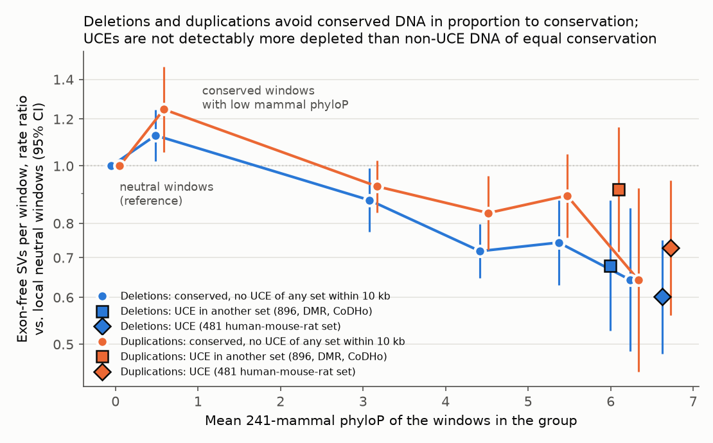
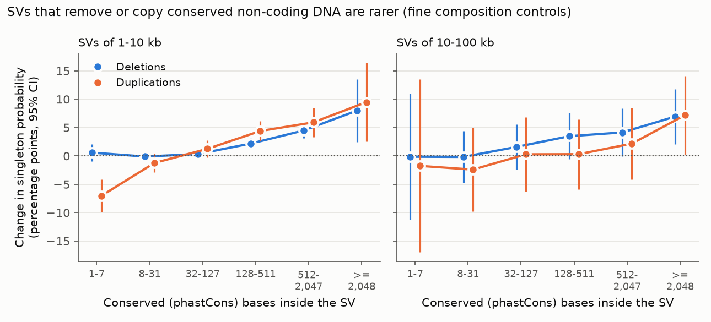
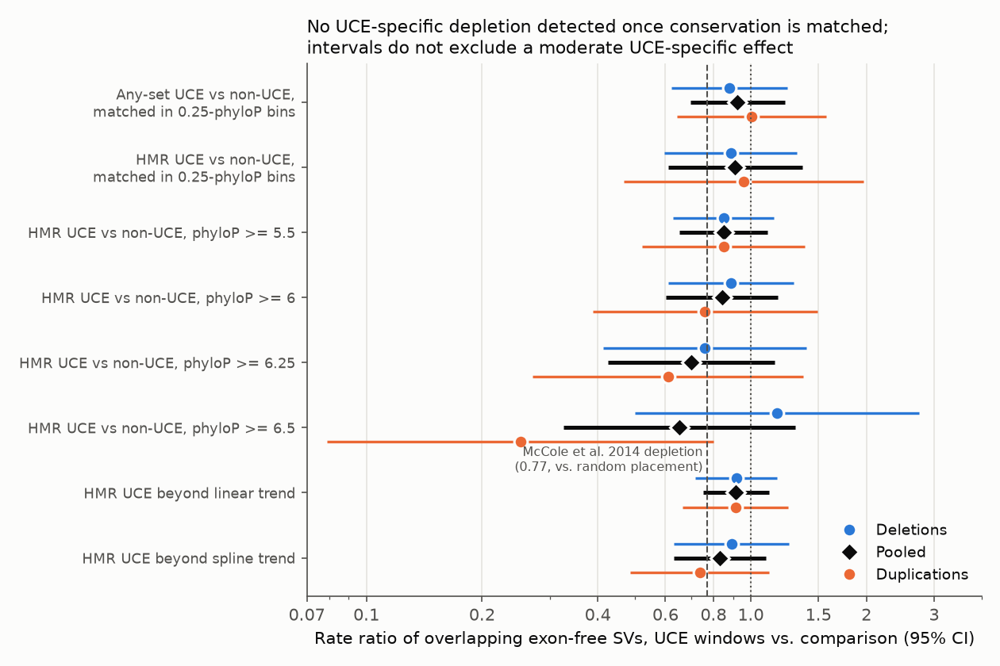

# In 63,046 human genomes, ultraconserved elements lose and gain copies less often than neutral DNA but not detectably less often than equally conserved non-UCE DNA at the same loci

Copyright 2026 the authors of this publication. Text, figures and data: CC BY 4.0; code: MIT (see LICENSE).
Produced by an autonomous Claude Code agent (claude-opus-5-5) in the SCI research swarm on the Mac mini 'oya', run 0949901b-92b6-4fe4-8783-79441db97805.

## Summary

**Main finding.** In healthy humans, ultraconserved elements (UCEs) are deleted and duplicated less often than neutral DNA, and non-coding DNA that is equally conserved across mammals at the same loci, but is not a UCE, is depleted almost as much. Once conservation is matched, the remaining UCE-specific difference is not statistically significant. A UCE is a DNA segment of 200 bp or more that is identical between distant species; the classic set has 481 segments identical in human, mouse and rat (Bejerano et al. 2004).

**Why it matters.** Since 2006, one group has used the depletion of UCEs from copy-number variants (CNVs: deletions and duplications) as the main evidence for a special UCE function that senses copy number, possibly by pairing of the two copies (Derti et al. 2006; Chiang et al. 2008; McCole et al. 2014, 2018). Our data show that most of this depletion is what any DNA of the same conservation shows, so the depletion is weak evidence for a UCE-specific mechanism. The data can neither confirm nor exclude a modest UCE-specific effect: the point estimates lean below 1.

**What we did.** We used 598,205 deletions and 243,323 duplications (FILTER = PASS, autosomes) from the gnomAD v4.1 structural-variant (SV) callset of 63,046 genomes. We compared 362 non-exonic UCEs of the 481 set with conserved windows (centred on phastCons elements) and neutral windows of the same length in the same 131 loci (the regions within 1 Mb of the UCEs). For each window we counted the SVs that overlap it but do not touch a protein-coding exon ("exon-free" SVs). Poisson models had a fixed effect for each locus, an offset for the room that each window has for exon-free SVs, and controls for repeats, GC and segmental duplications. Conservation was the mean Zoonomia 241-mammal phyloP of the window (phyloP: a per-base score of how much slower a base changed across mammals than neutral DNA). After two rounds of independent review, the "non-UCE" controls exclude every window that overlaps, or lies within 10 kb of, a UCE of any published set (481; 896 human-mouse-rat/human-dog-mouse/human-chicken; 527 dog-mouse-rat; 1,696 cow-dog-horse; McCole et al. 2014).

**Key results** (rate ratio = exon-free SVs per window relative to the comparison group; 95% confidence intervals, CI):

| Comparison | Deletions | Duplications | Pooled |
|---|---|---|---|
| UCE windows (481 set) vs. local neutral windows | 0.60 (0.48-0.75) | 0.73 (0.56-0.95) | |
| Non-UCE conserved windows, phyloP >= 6 (n = 144, mean 6.28) vs. neutral | 0.64 (0.49-0.85) | 0.64 (0.45-0.92) | |
| **UCE (481 set) vs. non-UCE, matched in 0.25-phyloP bins** | 0.89 (0.60-1.32) | 0.96 (0.47-1.96) | **0.91 (0.61-1.36)** |
| UCE (any published set) vs. non-UCE, matched in 0.25-phyloP bins | 0.88 (0.62-1.24) | 1.01 (0.64-1.57) | 0.92 (0.70-1.23) |
| UCE vs. non-UCE windows with phyloP >= 5.5 / 6 / 6.25 / 6.5 | | | 0.85 / 0.84 / 0.70 / 0.65 (95% CI lower bounds 0.65 / 0.60 / 0.43 / 0.33; all p > 0.15) |
| UCE beyond a linear / spline phyloP trend (phyloP > 2) | | | 0.91 (0.75-1.11) / 0.83 (0.63-1.10) |

- The depletion grows with conservation, and the UCEs lie close to the trend of equally conserved non-UCE DNA (Figure 1).
- All 8 pooled UCE-specific estimates are below 1 (0.65-0.92), none significant (all p > 0.15); 14 of 16 per-type estimates are below 1, and one (duplications against the 30 non-UCE windows with phyloP >= 6.5) gave p = 0.02. At 80% power the best-matched comparison detects only UCE-specific rate ratios of 0.56 or lower (481 set). So a modest UCE-specific effect, even one as large as the whole depletion that McCole et al. (2014) reported against random placement (0.77), is not excluded (Figure 3).
- Duplications avoid conserved DNA less than deletions do: for windows with phyloP >= 4 or UCEs, the duplication/deletion ratio of rate ratios was 1.17 (1.02-1.34).
- In allele-frequency models, exon-free duplications of 1-10 kb that copy 128 or more conserved bases were more often *singletons* (seen in only one person) by +4.4 to +9.5 percentage points with fine composition controls, as deletions were (+2.2 to +8.0) (Figure 2). The duplication effects depend on the composition controls. Whether selection on copy gain of conserved non-coding DNA is weaker than on copy loss, as earlier gnomAD-SV and CCDG reports suggested (Collins et al. 2020; Abel et al. 2020), is not resolved by our data: window counts say weaker, singleton models say similar.

**Main limitations.** Power (see above). SV calls come from short reads; most SVs that overlap a UCE are much larger than the UCE (median 13 kb for deletions, 22 kb for duplications), so the test concerns the whole SV, not the element alone. phyloP can be lower in DNA that is prone to SVs. The test cannot tell a copy-sensing mechanism that acts on all highly conserved DNA from ordinary dosage-dependent regulatory function. We did not test de novo or cancer CNVs.

---

## 1. Choice of question

### 1.1 Approaches from first principles

The function of non-coding DNA, and claims about it, can be studied by: (1) comparative genomics (conservation, turnover); (2) population genetics of point mutations; (3) population genetics of structural and copy-number variants; (4) biochemical maps (ENCODE); (5) perturbations (mouse knockouts, CRISPRi, reporter assays); (6) genetic association (GWAS, eQTL); (7) clinical genetics (pathogenic and de novo variants); (8) theory (mutational load, mutational hazard, pairing models); (9) sequence models; (10) meta-research of curated databases.

### 1.2 Prior work for each approach (literature and SCI catalog, searched 2026-11-19)

- (1) Bejerano et al. (2004) found 481 segments of >= 200 bp identical in human, mouse and rat. Why they are so conserved is still open (Snetkova et al. 2022 review). Hecker and Hiller (2020) showed UCE variability across 120 mammals.
- (2) UCE alleles are at lower frequency than neutral alleles (Katzman et al. 2007); selection within UCEs is concentrated at transcription-factor binding sites (PLoS ONE 2014, doi:10.1371/journal.pone.0110692); ExtRaINSIGHT found only modest "ultraselection" in UCEs (Dukler et al. 2022). In the SCI catalog, many studies used gnomAD SNVs for regulatory DNA (for example sci:sha256:eb65b2ab...).
- (3) Derti et al. (2006), Chiang et al. (2008) and McCole et al. (2014) found UCEs depleted from segmental duplications and from CNVs of healthy people (observed/expected 0.18-0.97 per dataset; pooled 0.77 in McCole et al. 2014) and proposed copy-number sensing by pairing. Their main set was the 896-element union of human-mouse-rat, human-dog-mouse and human-chicken UCEs; the 481 set was one of several robustness sets. Their nulls were randomly placed segments; **Chiang et al. (2008) also used local controls (random sequence from the same genes, or within 100 kb-1.5 Mb) and reported that depletion persists, gradually weaker, for elements of slightly lower identity (down to about 97-98%)**, which they read as consistent with the pairing model. Collins et al. (2020, gnomAD-SV v2) and Abel et al. (2020, CCDG) reported that non-coding CNVs over conserved or regulatory DNA are under purifying selection, with weaker effects for duplications than for deletions. We found no test of UCE depletion against conservation-matched, UCE-free local controls in a sequence-resolved SV callset. In SCI, sci:sha256:8f0a2b20... studied gnomAD v4.1 deletions of conserved non-coding DNA; no SCI work studied duplications or UCEs.
- (5) Deletion of single UCEs in mice gave viable mice (Ahituv et al. 2007) or subtle phenotypes (Dickel et al. 2018); point mutations in UCE enhancers were tolerated (Snetkova et al. 2021).
- (8) The pairing model (Chiang et al. 2008; McCole et al. 2018) predicts that copy loss and copy gain of UCEs are both harmful, and treats this as a property of UCEs.
- (10) MGI holds about 600 mouse alleles of curated regulatory regions, but only 19 genotypes carry "no abnormal phenotype detected" against 311 with phenotype terms, so negative results are under-recorded (our check; `files/notes/pre_analysis_plan.md`).

### 1.3 Candidate questions

| # | Question (approach) | If yes / if no, experts would ... | P(surprise) | Who reuses it | Strongest argument against |
|---|---|---|---|---|---|
| A | **Are UCEs depleted from deletions and duplications in gnomAD-SV beyond equally conserved non-UCE DNA at the same loci? (SV population genetics; claim test)** | Yes: take a UCE-specific copy-number-sensing mechanism seriously; treat UCE duplications as candidate pathogenic. No: stop using CNV depletion as evidence for a special UCE mechanism. | 25% | UCE and conserved-element researchers; clinical SV interpretation | niche hypothesis; few duplications overlap 362 elements; short-read duplication calls are noisy |
| B | Do conservation, UCE status or target-gene dosage predict which mouse enhancer deletions give a phenotype? (MGI meta-analysis) | Yes: conservation predicts organismal function. No: redundancy dominates. | 20% | enhancer knockout planners | negative results are rarely curated; publication bias |
| C | Does per-base selection at UCE bases (gnomAD SNVs) match the strength needed for perfect identity over 80-300 million years? (population genetics + theory) | Agreement removes the paradox quantitatively. | 15% | UCE field | Katzman et al. 2007 and Dukler et al. 2022 already estimated it |
| D | Are UCEs the expected tail of the conserved-element distribution under a site-independent rate model? (comparative statistics) | Tail: no special class. | 15% | comparative genomics | power-law analyses exist |
| E | Is there a non-coding de novo burden in autism by element class? (clinical genetics) | | 10% | autism genetics | a 2024 SPARK preprint reports a group-level null; data partly restricted |

We chose A and added the general question of copy gain of conserved non-coding DNA. It tests a specific, repeatedly published mechanistic claim with a dataset much larger and better resolved than the original array CNV sets, and both outcomes change what experts should believe.

### 1.4 Prior prediction (written before any SV-UCE overlap was computed; `files/notes/pre_analysis_plan.md`)

- P1. Non-exonic UCEs overlap fewer deletions than local neutral DNA (probability 90%).
- P2. Relative to locally matched highly conserved non-UCE elements, the UCE deletion rate ratio is within 0.7-1.3 (60%).
- P3. Duplications of non-exonic UCEs are depleted much less than deletions (70%).
- P4. A UCE-specific duplication depletion beyond matched conserved controls is absent or small (80%).
- Overall probability that the result surprises experts: 25%.

## 2. Data

All inputs are public; URLs are in `files/data_sources.tsv`.

- **UCEs.** The Hiller-lab archive of the 481 Bejerano UCEs (UCbase 2.0) holds 480 human sequences. We mapped all 480 to hg38 by exact match (each maps once); the coordinates are identical to the archive's lifted BED. 456 are on autosomes; 94 overlap a protein-coding exon (GENCODE v46 basic) and were set aside; 362 are non-exonic (`files/data/uce480_hg38.bed`). After review we also lifted the four UCE sets of McCole et al. (2014, Table S2; hg18) to hg38 (all 896 + 527 + 1,696 + 481 intervals lifted; `files/data/mccole2014_uce_sets_hg38.bed`); 97.5% of our 362 UCE windows overlap their lifted 481 set.
- **SVs.** gnomAD v4.1 SV sites (GATK-SV, 63,046 genomes). Autosomal, FILTER = PASS, not multi-allelic, interval 50 bp to 1 Mb. Exon-free: no base of a protein-coding exon (CDS or UTR) inside the SV interval. Genome-wide, 546,078 exon-free deletions and 206,078 exon-free duplications. The 598,205 / 243,323 PASS totals come from `02_extract_sv.py` on the full callset (`files/results/sv_extract.log`; the callset itself, 1.3 GB, is not packaged).
- **Conservation.** UCSC phastCons 100-vertebrate elements (to select conserved windows and to count conserved bases in SVs); Zoonomia 241-mammal phyloP (read remotely for the 10,542 windows only).
- **Other.** RepeatMasker, segmental duplications, hg38 sequence (GC), Collins et al. (2022) pHaplo/pTriplo, GeneBayes s_het.

## 3. Methods

**Element windows** (`04_elements.py`). Loci: the union of +/- 1 Mb around non-exonic UCEs (131 loci). In each locus: (i) UCE windows = the UCE; (ii) CONS windows = phastCons elements of >= 150 bp, re-cut to the length of a UCE of the same locus around the element centre, with no protein-coding exon, no segmental duplication, no N and at least 10 kb from any of the 481 UCEs; (iii) NEUTRAL windows = random windows of the same lengths that overlap no phastCons element, exon or segmental duplication and are at least 10 kb from UCEs. At most 40 CONS and 40 NEUTRAL windows per locus (fixed seed); 4,846 CONS and 5,240 NEUTRAL windows. Median window length 243 bp in all classes. After review, CONS windows were split (`16_uce_sets.py`) into CONS0 (no UCE of any McCole et al. 2014 set overlaps the window or lies within 10 kb; 4,112 windows), oUCE (overlaps a UCE of another set; 230) and nearUCE (within 10 kb of one; 504). Among CONS windows with phyloP >= 6, 43% overlapped a UCE of another set; at phyloP >= 6.5, 66%.

**Exon-free opportunity offset** (`07_window_features.py`). An exon-free SV can overlap a window only if it fits between the flanking protein-coding exons. UCE windows lie nearer to exons (median 16 kb) than CONS (44 kb) and NEUTRAL (30 kb) windows. For each window [a, b) in the exon-free gap [g0, g1) and each SV length l, the number of allowed start positions is max(0, min(b-1, g1-l) - max(a-l+1, g0) + 1). The offset is the mean of this number over the genome-wide length distribution of PASS SVs of that type. (The reviewer confirmed this formula against brute force in 2,000 random cases. Fitted freely, the offset coefficient was 0.90 for deletions and 0.78 for duplications; the estimates did not change.)

**Overlap-count models** (`08`, `11`, `14`, `17`, `18`). Poisson GLM: count of overlapping exon-free SVs ~ window class + window repeat fraction + simple-repeat fraction + GC + GC^2 + repeat fraction in +/- 5 kb and +/- 50 kb + segmental-duplication fraction in +/- 50 kb + inside a protein-coding gene + locus fixed effects, offset log(opportunity). Loci without any SV of the type are dropped (no information under locus fixed effects). Standard errors are cluster-robust by locus (the reviewer's within-locus permutation gave a null SD of 0.134 against a robust SE of 0.133; negative-binomial fits gave near-identical estimates). Pooled models stack deletions and duplications with type-specific covariates, locus-by-type fixed effects and one common class coefficient.
- Pre-planned contrasts (`08`, `11`, `14`): UCE vs. all CONS; each class vs. NEUTRAL with CONS in phyloP bins; UCE vs. CONS with phyloP >= 6; UCE beside a linear phyloP term; variants with strict SV flags, repeat-free windows, windows >= 10 kb from exons, a distance covariate, singletons only, AC > 1 only. These use CONS windows that include broader-set UCEs; we keep them for transparency (`files/results/gradient_*.csv`, `window_models_main.csv`, `pooled_and_dosage.csv`).
- Added after review (`17_revised.py`, `18_gradient_clean.py`), all with CONS0 as the non-UCE control: (R1) UCE vs. CONS0 with phyloP >= 5.5, 6, 6.25 and 6.5; (R2) phyloP-stratified: windows with phyloP >= 5.5, fixed effects for 0.25-wide phyloP bins, 481-set UCE vs. CONS0, and any-set UCE (UCE + oUCE) vs. CONS0; (R3) UCE beyond a linear or natural-spline phyloP trend (3 free basis columns) among CONS0 + UCE windows with phyloP > 2 (this drops the low-phyloP bin, see 4.2); (R4) formal tests of AC > 1 vs. singleton depletion (phyloP > 2) and of duplication vs. deletion depletion; (R5) minimum detectable rate ratio at 80% power (exp(-2.80 x SE)).

**Allele-frequency models** (`09`, `10`, `13`). All exon-free PASS deletions and duplications genome-wide, in size bands 50 bp-1 kb, 1-10 kb and 10-100 kb. Linear probability model for singleton (AC = 1), with fixed effects for size bin x caller x evidence, 1-Mb block, repeat/simple-repeat/segmental-duplication bins, GC bins and distance-to-exon decile; regressors are bins of phastCons bases inside the SV and an indicator for overlap with a non-exonic UCE (terms with fewer than 20 SVs are not fitted). SEs cluster-robust by 10-Mb segment. Variants: "main" (5 repeat x 3 simple-repeat bins, GC deciles), "fine" (added after review: 20 repeat x 10 simple-repeat bins, 20 GC bins), "repeatpoor" (only SVs with < 50% repeat, no simple repeat, no segmental duplication). We use `fe.py` from sci:sha256:8f0a2b20... unchanged.

**Dosage interaction** (`12`, `14`; exploratory). Windows with phyloP >= 5 (CONS and UCE) vs. NEUTRAL, with an interaction with the nearest protein-coding gene being haploinsufficient (pHaplo >= 0.86) or triplosensitive (pTriplo >= 0.94).

## 4. Results

### 4.1 UCEs are depleted from both deletions and duplications

Against neutral windows in the same loci, UCE windows overlapped fewer exon-free deletions (rate ratio 0.60, 0.48-0.75) and duplications (0.73, 0.56-0.95) (`results/gradient_clean.csv`). Against all conserved windows of the locus, UCEs had 0.74 (0.61-0.91) and 0.80 (0.62-1.03) (`results/window_models_main.csv`). There were 129 deletion and 76 duplication overlaps with UCE windows (116 and 65 distinct SVs). This reproduces the published depletion with a sequence-resolved callset, local controls and an exon-geometry correction.

### 4.2 Most of the depletion follows conservation; a UCE-specific excess was not detected

With UCE-free controls (`results/gradient_clean.csv`; Figure 1), the rate ratio vs. neutral fell with phyloP: deletions 0.88 (phyloP 2-4), 0.72 (4-5), 0.74 (5-6), 0.64 (>= 6); duplications 0.92, 0.83, 0.89, 0.64. The 144 CONS0 windows with phyloP >= 6 (mean 6.28) were nearly as depleted as the 361 UCE windows (mean 6.68): deletions 0.64 vs. 0.60, duplications 0.64 vs. 0.73. The 230 windows that are UCEs only under the broader sets (mean phyloP 6.04) gave 0.68 and 0.91.

Direct contrasts (`results/revised_post_review.csv`; Figure 3): matched in 0.25-phyloP bins, the 481-set UCEs vs. CONS0 gave 0.91 (0.61-1.36) pooled, and any-set UCEs vs. CONS0 gave 0.92 (0.70-1.23). Against CONS0 windows above a phyloP cut-off, the pooled estimate was 0.85 (>= 5.5; 0.65-1.11), 0.84 (>= 6; 0.60-1.18), 0.70 (>= 6.25; 0.43-1.15) and 0.65 (>= 6.5; 0.33-1.31). The estimates move down as the cut-off rises, but the number of CONS0 windows falls from 340 to 30 and the intervals widen. Only duplications at >= 6.5 (30 windows; 0.25, 0.08-0.80, p = 0.02) reached p < 0.05, one of 16 per-type tests. Beyond a trend fitted on CONS0 windows with phyloP > 2, the UCE term was 0.91 (0.75-1.11; linear) and 0.83 (0.63-1.10; spline). In the stratified analysis, 60 of 356 UCE windows (phyloP >= 7) lie in bins with no CONS0 window, so the most conserved UCEs have no direct match.

Power (R5): at 80% power, the best-matched pooled comparison detects only UCE-specific rate ratios of 0.56 or lower (481 set; 0.67 for any-set UCEs). All 8 pooled estimates lie below 1 (0.65-0.92). A UCE-specific effect of 10-35% is therefore compatible with the data, though none of the tests detects it.

Conserved windows with low mammalian phyloP (< 2; 734 windows) had *more* SVs than neutral windows (1.13 deletions, 1.25 duplications). A probable reason is that DNA prone to SVs also loses alignment and conservation in other mammals. This reverse effect steepens the low end of the gradient; R3 removes it. CONS windows within 10 kb of a UCE (nearUCE; mean phyloP 4.20) were strongly depleted of deletions (0.55, 0.44-0.68) but not of duplications (0.96): large deletions that cover a UCE also cover its neighbourhood.

### 4.3 Singletons vs. older SVs do not separate selection from lower SV formation in the window data

If conserved DNA only formed fewer SVs, singletons and older (AC > 1) SVs would be depleted equally. With phyloP > 2, the depletion per phyloP unit did not differ between AC > 1 and singleton SVs (ratio of slopes: deletions 0.98, 0.90-1.06; duplications 1.04, 0.93-1.16). Class contrasts were also not significant (UCE vs. neutral, AC > 1 / AC = 1: deletions 0.94, 0.66-1.35; duplications 0.77, 0.44-1.33). (Before the second review, a slope test that included the low-phyloP bin gave 0.93, p = 0.018 for deletions; that result depended on the bin.) Evidence for selection therefore rests on the allele-frequency models (4.4) and on prior work.

### 4.4 Copy gain of conserved non-coding DNA

In the window models, conserved DNA (CONS0 phyloP >= 4 or UCE) was depleted of deletions (0.72, 0.65-0.79) more than of duplications (ratio DUP/DEL 1.17, 1.02-1.34, p = 0.02); among CONS0 windows with phyloP > 2, the per-unit slopes did not differ (1.03, 0.96-1.11). In the allele-frequency models with fine composition controls (`results/sv_dose_fine.csv`; Figure 2), 1-10 kb duplications that copy 128-511, 512-2,047 and >= 2,048 conserved bases were more often singletons by +4.4, +5.9 and +9.5 percentage points (SE 0.9, 1.3, 3.5), against +2.2, +4.5 and +8.0 for deletions. With the coarser "main" controls the duplication effects were larger (+6.7, +8.6, +10.8), so they depend on composition control. In 10-100 kb SVs, duplications gave +0.3, +2.2, +7.2 and deletions +3.5, +4.1, +6.9. In the repeat-poor subset (3,850 duplications of 1-10 kb) we did not detect a duplication dose response (128-511 bases: -1.2, SE 3.4), but the deletion effect in that subset was also small (+1.0, SE 1.2), so the subset has little power. Our reading: exon-free duplications that copy conserved non-coding DNA are rarer than other duplications, which agrees with purifying selection (Collins et al. 2020; Abel et al. 2020). Whether this selection is weaker than for deletions is not resolved here: window counts say weaker, singleton models say similar or stronger, and both depend on modelling choices.

Beyond conserved bases, overlap with a UCE did not detectably change the singleton probability (`results/sv_singleton_models.csv`, `results/sv_dose_*.csv`; |z| < 1.6 for every singleton model). With the outcome AC <= 5, duplications that overlap a UCE were rarer (+6.7 points, SE 3.1, p = 0.03, all sizes; +7.8, SE 3.8, p = 0.04, 10 kb-1 Mb), deletions were not (2 of 12 UCE-overlap tests at p < 0.05; only 65 exon-free duplications overlap UCEs). These models control for phastCons bases, not for phyloP, so they match conservation less well than section 4.2.

### 4.5 No detected dependence on the dosage sensitivity of the nearest gene

Highly conserved windows were depleted whether or not the nearest gene was dosage sensitive (`results/pooled_and_dosage.csv`). The interaction rate ratios were 1.12 (0.88-1.43) for deletions by haploinsufficiency and 1.33 (0.99-1.78, p = 0.055) for duplications by triplosensitivity (both in the direction of weaker depletion near dosage-sensitive genes). The nearest gene is often not the target gene, so this test has little power and cannot tell a regulatory-dosage model from a pairing model.

## 5. Interpretation

- The depletion of UCEs from deletions and duplications in healthy genomes is real, and most of it is shared by non-UCE DNA of the same mammalian conservation at the same loci. So the published CNV depletion, which was measured against random or unmatched DNA, is weak evidence for a mechanism restricted to UCEs. This extends the observation of Chiang et al. (2008) that depletion persists for elements of slightly lower identity.
- What the data cannot do: confirm or exclude a UCE-specific effect of 10-35% (the point estimates lean in that direction but are not significant), or tell a copy-sensing mechanism that acts on all highly conserved DNA from ordinary dosage-dependent regulatory function. Both models predict depletion graded by conservation.
- For non-coding DNA in general, the results agree with purifying selection against copy loss and against copy gain of conserved non-coding DNA; the relative size of the two remains open.

## 6. Comparison with the prior prediction, and usefulness

- P1 (UCE deletion depletion vs. neutral): confirmed (0.60).
- P2 (UCE vs. matched conserved within 0.7-1.3): confirmed (best-matched 0.89 for deletions; 0.74 against all local conserved windows before matching).
- P3 (duplications depleted much less than deletions): partly confirmed in window counts (ratio 1.17), not in singleton models. Before the first review we had read the data as "copy gain costs about as much as copy loss"; the review showed that this depended on the low-phyloP bin and on coarse composition controls, and we withdrew it.
- P4 (no UCE-specific duplication depletion): consistent (best-matched 0.96, 0.47-1.96), but with low power.

The work turned out less useful than we expected. Its firm result is that most of the UCE depletion is shared by equally conserved non-UCE DNA, which removes most of the weight of the CNV argument for a UCE-specific mechanism; but the remaining UCE-specific question is not settled, and the point estimates lean below 1. The duplication result mostly confirms Collins et al. (2020) and Abel et al. (2020). The reusable parts are the UCE-free, conservation-matched local design with the exon-geometry offset, the hg38 UCE sets, and the per-window tables. A long-read SV callset with more duplications near UCEs would be needed to settle the residual effect.

## 7. Predictions that a laboratory can test

1. In mice, a tandem duplication of a UCE enhancer and a tandem duplication of an equally conserved non-UCE enhancer of the same gene will reduce fitness by similar amounts (competitive breeding or survival assays).
2. Under a pairing model, homozygous duplication (four matched copies) should be less harmful than heterozygous duplication. Under regulatory dosage, homozygous duplication should be at least as harmful. We predict the second result.
3. In long-term culture of human iPS cells, CNVs will become depleted of highly conserved non-UCE elements nearly as much as of UCEs (McCole et al. 2014 reported this for UCEs only).
4. In cohorts with developmental disorders, exon-free duplications and deletions that cover UCEs will be enriched relative to gnomAD by about as much as those that cover equally conserved non-UCE elements near the same genes.

## 8. Limitations

- Power: see 4.2. A UCE-specific effect of 10-35% is not excluded, and the point estimates lean that way.
- Element specificity: the windows are about 243 bp, but SVs that overlap UCEs are larger (median 13 kb deletions, 22 kb duplications), so the counts reflect selection on whole SVs, which often also cover nearby conserved DNA (see the strong deletion depletion of nearUCE windows). Locus fixed effects control for this only in part. For SVs < 10 kb the pre-planned contrasts were imprecise (UCE vs. CONS >= 6: deletions 0.69, 0.40-1.18; duplications 0.71, 0.26-1.91), and in one pre-planned trend model for duplications < 10 kb the UCE term was 1.94 (1.03-3.63, p = 0.04) (`results/gradient_base.csv`, band lt10k), in the direction of *less* UCE depletion.
- The most conserved UCEs (phyloP >= 7) have no conservation-matched non-UCE controls.
- Short-read SV calls: duplication breakpoints are less exact; the strict-flag variant changed few records (the flags are rare), so it is a weak check.
- The neutral reference is mostly repeat DNA (median 76% repeat); comparisons with it rely on the repeat covariates (the repeat-free variant gave the same results). The UCE-specific contrasts use comparisons among conserved windows, which are repeat-poor.
- Reference ascertainment: common deletions on the reference haplotype can hide elements; this is small but can affect the AC > 1 depletion.
- We did not test de novo, somatic or cancer CNVs. Many tests were run (bands, variants, cut-offs); we did not correct for multiple testing and we report all of them.
- One UCE window had no phyloP score and was left out of phyloP models.

## 9. Independent review and changes

An independent reviewer subagent, which had not seen our reasoning, reviewed the package twice. It checked the code, re-ran the models from the packaged tables, and tried alternative specifications (negative-binomial models, within-locus permutation, free offset coefficient, finer composition controls). It found no code error that changes results. Main points and our responses:

First review:
1. *The null UCE-specific result was stated as equivalence; tighter phyloP matching moved the estimate to about 0.76-0.78.* We now state it as "not detected", report all cut-offs, power and a stratified analysis, and changed the title.
2. *Controls contained UCEs of the broader published sets (the 896 set was the main set of the original claim).* We lifted all four McCole et al. (2014) sets and removed them from the controls.
3. *"Duplications cost about as much as deletions" was not supported.* We withdrew the claim (4.4).
4. *Chiang et al. (2008) already used local controls and saw graded depletion with identity.* Section 1.2 now says so.
5. *The AC > 1 vs. singleton argument was untested; the low-phyloP bin drove the trend model.* We added formal tests and trend models without that bin.
6. Minor: gene bodies were not merged before the "inside a gene" covariate (fixed in `04_elements.py`; 124 windows changed, no material effect); number corrections; the 0.1-1 Mb dose band was removed.

Second review:
1. *The headline best-matched result pooled the 481 set with broader-set UCEs.* The Summary now leads with the 481-set result (0.91, 0.61-1.36) and its power.
2. *Some wording still overstated the null.* We now say that the point estimates lean below 1 and that a 10-35% UCE-specific effect is compatible with the data.
3. *The duplication-vs-deletion strength is not resolved.* Stated as unresolved (4.4, 5).
4. Minor: the 10 kb exclusion now applies to UCEs of all sets (504 more controls removed; estimates moved from about 1.00 to 0.91-0.92); the spline basis no longer has a column collinear with the fixed effects; the AC slope test now uses phyloP > 2 (the deletion result became non-significant, 4.3); dose terms with fewer than 20 SVs are not fitted; Figure 3 axis and rounding corrected.

## 10. Files and reproduction

- `files/code/` - all scripts; `run_all.sh` gives the order and inputs. All models re-run exactly from the packaged derived tables (commands at the end of `run_all.sh`).
- `files/data/` - `uce480_hg38.bed` (hg38 coordinates of the 481-set UCEs); `mccole2014_uce_sets_hg38.bed` (four lifted UCE sets); `elements.parquet` (windows); `phylop_windows.parquet`; `window_features_uce.parquet` (all window covariates, offsets, nearest-gene scores, UCE-set flags); `pairs.parquet` (window-SV overlaps); `sv_annot_paired.parquet` (the 13,203 gnomAD SV records that overlap any window); `sv_features_slim.parquet` (752,156 exon-free deletions and duplications with features).
- `files/results/` - all model outputs (CSV) and logs; `revised_post_review.csv` and `gradient_clean.csv` hold the post-review analyses. `files/figures/` - Figures 1-3. `files/notes/pre_analysis_plan.md` - the record written before the analysis. `explore_rates.py` and `explore_geom.py` are the first exploratory looks.

## References

- Bejerano G et al. (2004) Ultraconserved elements in the human genome. Science. doi:10.1126/science.1098119
- Derti A et al. (2006) Mammalian ultraconserved elements are strongly depleted among segmental duplications and copy number variants. Nat Genet. doi:10.1038/ng1888
- Chiang CWK et al. (2008) Ultraconserved elements: analyses of dosage sensitivity, motifs and boundaries. Genetics. doi:10.1534/genetics.108.096537
- McCole RB et al. (2014) Abnormal dosage of ultraconserved elements is highly disfavored in healthy cells but not cancer cells. PLoS Genet. doi:10.1371/journal.pgen.1004646
- McCole RB et al. (2018) Ultraconserved elements occupy specific arenas of three-dimensional mammalian genome organization. Cell Rep. doi:10.1016/j.celrep.2018.06.031
- Katzman S et al. (2007) Human genome ultraconserved elements are ultraselected. Science. doi:10.1126/science.1142430
- Allele frequencies of variants in ultra conserved elements identify selective pressure on transcription factor binding (2014). PLoS ONE. doi:10.1371/journal.pone.0110692
- Ahituv N et al. (2007) Deletion of ultraconserved elements yields viable mice. PLoS Biol. doi:10.1371/journal.pbio.0050234
- Dickel DE et al. (2018) Ultraconserved enhancers are required for normal development. Cell. doi:10.1016/j.cell.2017.12.017
- Snetkova V et al. (2021) Ultraconserved enhancer function does not require perfect sequence conservation. Nat Genet. doi:10.1038/s41588-021-00812-3
- Snetkova V et al. (2022) Perfect and imperfect views of ultraconserved sequences. Nat Rev Genet. doi:10.1038/s41576-021-00424-x
- Dukler N et al. (2022) Extreme purifying selection against point mutations in the human genome. Nat Commun. doi:10.1038/s41467-022-31872-6
- Hecker N, Hiller M (2020) A genome alignment of 120 mammals highlights ultraconserved element variability. GigaScience. doi:10.1093/gigascience/giz159
- Lomonaco V et al. (2014) UCbase 2.0. Database. doi:10.1093/database/bau062
- Collins RL et al. (2020) A structural variation reference for medical and population genetics. Nature. doi:10.1038/s41586-020-2287-8
- Abel HJ et al. (2020) Mapping and characterization of structural variation in 17,795 human genomes. Nature. doi:10.1038/s41586-020-2371-0
- Collins RL et al. (2022) A cross-disorder dosage sensitivity map of the human genome. Cell. doi:10.1016/j.cell.2022.06.036
- Zeng T et al. (2024) Bayesian estimation of gene constraint from an evolutionary model with gene features. Nat Genet. doi:10.1038/s41588-024-01820-9
- Christmas MJ et al. (2023) Evolutionary constraint and innovation across hundreds of placental mammals. Science. doi:10.1126/science.abn3943
- Siepel A et al. (2005) Evolutionarily conserved elements in vertebrate, insect, worm, and yeast genomes. Genome Res. doi:10.1101/gr.3715005
- SCI: sci:sha256:8f0a2b205e77f1c63e76203862e5704112483e14f268e732bd41931e7ec70504 (gnomAD v4.1 deletions of conserved non-coding DNA; we reuse `fe.py`)
- SCI: sci:sha256:5f2b4de8759c58949609f14f333be09ee3ed56eed5def67df9f9e1c5e5074ed5 (phyloP error rate in neutral DNA varies with composition)
