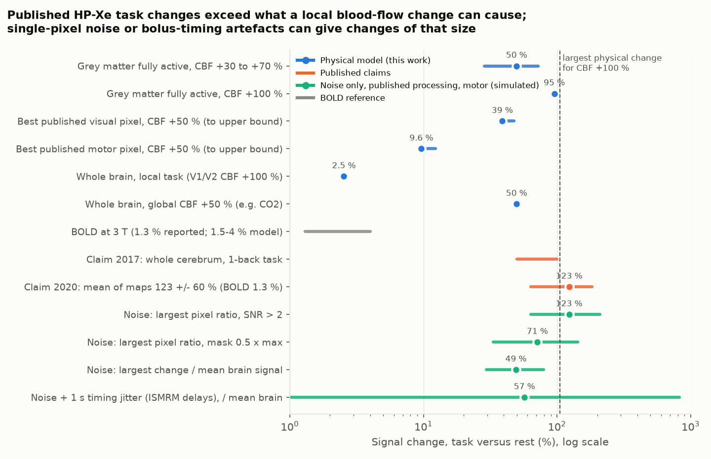
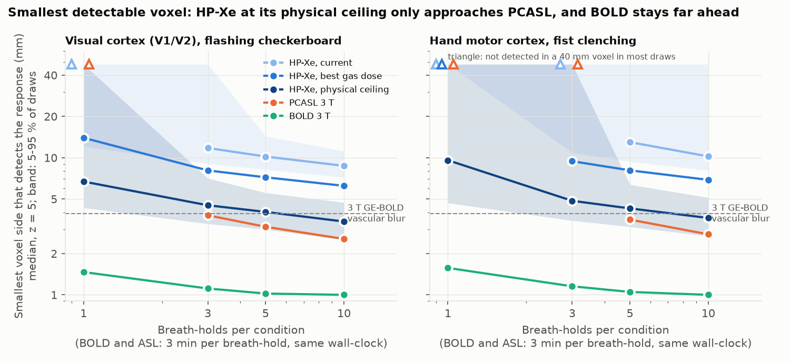
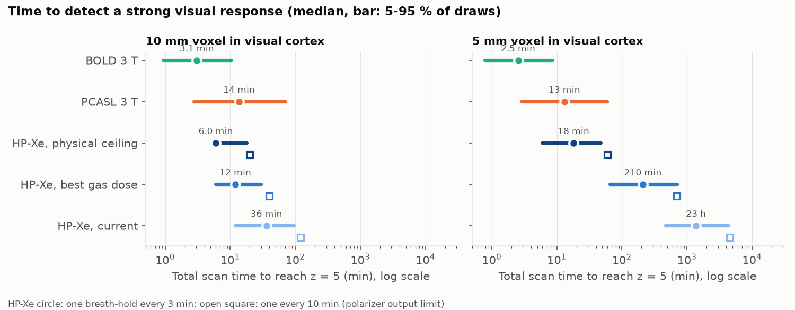

# A physical model shows that published hyperpolarized xenon-129 MRI task responses exceed what local blood flow can cause, and that current xenon methods need about 1 cm voxels

## Summary

A physical model shows that the large brain responses reported with inhaled hyperpolarized xenon-129 (HP-Xe) MRI cannot come from local blood-flow changes. It also shows that current HP-Xe methods need voxels of about 1 cm to detect brain activity. This matters because these studies and a patent application present HP-Xe MRI as a functional brain method with about 100 times the signal change of BOLD functional MRI (fMRI).

**What HP-Xe is.** HP-Xe is xenon gas whose nuclear spins are aligned by laser optical pumping. After one breath, it dissolves in blood, goes to the brain, and gives an MRI signal that increases with cerebral blood flow (CBF). An MRI pulse uses up the aligned state, and the state is not renewed, so each breath gives one small signal.

**What we did.** We built a tracer-kinetic and spin-relaxation model of xenon uptake. We used the MNI ICBM152 brain template with Juelich cytoarchitectonic maps of visual and hand-motor cortex. We took human HP-Xe signal-to-noise ratio (SNR) and breath-to-breath variability from the literature. We added detection models for 3 T BOLD fMRI and for 3 T pseudo-continuous arterial spin labelling (PCASL), which is proton MRI of CBF. We also simulated the published HP-Xe processing. Values are medians, with 5-95 % ranges over parameter draws in brackets.

**Physical limit.** In fully active grey matter, CBF +50 % raises the HP-Xe signal by 50 % [47, 53]. Analytically, the tissue signal cannot rise faster than CBF, apart from 5-8 % when a local response also shortens arrival by up to 0.3 s. Timing differences of the whole bolus between breath-holds are a separate, non-CBF effect (see below).

**Published images.** The published images used 12.5 mm pixels in 70-300 mm projections. In these pixels, CBF +50 % gives about 10 % (at most 12 %) at the best motor pixel and 39 % (at most 48 %) at the best visual pixel.

**Claims.** The published mean "percent signal enhancement" was 123 ± 60 %, against 1.3 % for BOLD (patent application US 2022/0039733). The activation map was a pixel-by-pixel comparison of one stimulation and one rest breath-hold.

**Noise and timing.**

The simulations below use nominal parameter values.

- With no activation, the largest single-pixel ratio in pixels with SNR > 2 is 123 % [64, 209]. Across masks and the two published delay sets, the noise-only single-pixel maxima span 71-237 %.
- If changes are divided by the mean brain signal instead, noise alone gives 49 % [29, 79].
- A bolus that arrives 1-2 s earlier or later in one breath-hold than in the other changes the fitted perfusion slope by 7-120 %, without any CBF change.

Which of these explains the published value depends on how "percent enhancement" was computed, and the papers do not say.

**2017 claim.** A reported whole-cerebrum rise of 50-100 % during a 1-back task needs a global change. The task scan always came after the baseline scan. A local task response can change whole-brain signal by at most about 2.5 %.

**SNR per volume.** The published HP-Xe perfusion maps had 65-280 times less SNR per unit volume than the single-pair ASL images that they were compared with.

**Comparison with BOLD and ASL.** Detection uses z = 5, a strict statistical threshold, and a best-placed 5 mm voxel in visual cortex:

| Method | Total scan time |
|---|---|
| BOLD | 2.5 min |
| PCASL | 13 min |
| HP-Xe at a physical ceiling with ideal receive coils | 18 min |
| HP-Xe, current practice | about 23 h of breath-holds |

For 10 mm voxels, current HP-Xe needs 36 min. At 3 T, BOLD detection voxels (1.0-1.6 mm) are smaller than its own 3.9 mm vascular blur.

**Use.** HP-Xe can give a fast perfusion snapshot without background at about 1 cm. It cannot replace BOLD fMRI as a more sensitive or higher-resolution method.



---

## 1. Choice of question

### 1.1 Physical ways to read brain activity, and what the SCI catalog already covers

From first principles, non-invasive readouts of brain activity use:

- **Fields of neural currents:** EEG, MEG, optically pumped magnetometers, direct-current MRI.
- **Hemodynamics:** BOLD, CBF and CBV by MRI, near-infrared light, ultrasound, photoacoustics.
- **Metabolism:** PET, MR spectroscopy, deuterium and carbon-13 imaging.
- **Tissue mechanics:** MR elastography, displacement.
- **Ion and water changes:** sodium MRI, diffusion MRI.
- **Temperature:** radiometry, thermometry.
- **Exogenous tracers:** microbubbles, magnetic particles, gas vesicles, inhaled gases.

The Sciscape catalog (searched 2026-11-12) has many feasibility studies on these methods:

- ultrasound-tagged light, photoacoustics, acoustoelectric imaging;
- functional ultrasound and microbubbles;
- spin-lock and sodium MRI;
- magnetic particle imaging, radiometry;
- functional PET, functional MR elastography, diffusion fMRI;
- ear-canal optics, impedance imaging, ultraweak photon emission.

No catalog item covers inhaled hyperpolarized gases. An independent literature search found no prior analysis of the functional detection limits of HP-Xe and no critique or replication of the human claims. Earlier pharmacokinetic papers (Peled 1996; Martin 1997; Kilian 2004) estimated brain xenon delivery and signal, but not functional detectability.

### 1.2 Candidate questions (written before any computation; full text in `files/prior_assessment.md`)

| # | Question (physical principle) | If yes / if no, experts would... | P(surprise) | Who reuses | Strongest argument against |
|---|---|---|---|---|---|
| 1 | Can inhaled HP-Xe map task responses as claimed, and what are its limits? (non-renewable nuclear hyperpolarization carried by a perfusion tracer) | Yes: HP-gas groups build a functional programme. No: stop presenting it as an fMRI rival; use it for perfusion and blood-brain-barrier work | ~25 % | HP-Xe groups, polarizer makers, perfusion physicists, patent reviewers | Niche; fMRI physicists may find a negative answer obvious |
| 2 | How much of the on-scalp OPM-MEG proximity gain survives when brain background activity limits SNR? (quasi-static magnetic fields) | Re-plan OPM array density and sensor-noise targets | ~15 % | OPM community | Iivanainen 2017 and others modelled brain noise |
| 3 | Can a 0.01-0.05 pH-unit acidosis make the reported T1rho "pH-fMRI" changes, or does BOLD dominate? (spin-lock chemical exchange) | Re-interpret T1rho studies | ~20 % | One group and its clinical users | Narrow, older line of work |
| 4 | Brain specificity and SNR limits of speckle-contrast optical spectroscopy at 3-5 cm (dynamic light scattering) | Change optode and camera designs | ~15 % | Diffuse-optics groups | SNR models exist; catalog has many DCS results |
| 5 | Vascular limit on neural timing from fast fMRI (hemodynamics, public data) | Change fast-fMRI claims | ~10 % | fMRI methods groups | Much prior work |

We chose question 1. No catalog item covers its physical principle, and human claims and patents make it testable. A link budget can settle it in either direction.

### 1.3 Prior prediction (recorded before the model was run)

- CBF +50 % gives +35 to +55 % tissue HP-Xe signal.
- Published projection voxels change by 3-25 %.
- Changes of 100 % or more cannot come from CBF and are consistent with noise.
- Per unit volume and time, HP-Xe is 50-200 times below PCASL now, and still 10 times or more below PCASL with ideal hardware.
- The smallest detectable voxel per session is 1-2 cm.

---

## 2. Methods

All code is in `files/code`; `run_all.sh` reproduces every number.

### 2.1 Xenon kinetics (`xe_model.py`)

We follow one breath-hold of 20 s after inhalation of 1 L of enriched xenon:

- The alveolar xenon fraction falls by uptake into blood (cardiac output x Ostwald solubility / lung volume).
- The gas polarization decays with the oxygen-limited gas T1.
- Blood carries polarized xenon to the brain after a lung-to-brain transit time, with the arterial-blood T1.
- In tissue, a Kety model with fast blood-tissue exchange applies: dm/dt = f m_a − (f/λ + 1/T1_tissue) m. Here m is the polarized xenon concentration (concentration x polarization), f is CBF and λ the partition coefficient.
- A 90° readout or saturation pulse sets m to 0.
- When there are several readouts, their information combines as sqrt(Σ m_i²). For a non-renewable pool this sum cannot exceed the available magnetization.

An independent check confirmed the integration against the analytic solution (relative error 2e-8).

The parameter ranges and their sources are in `params.py`; the main ones are:

| Parameter | Range | Source |
|---|---|---|
| Delivered polarization (anchor studies) | 0.25-0.35 | |
| Enrichment | 0.83-0.87 | |
| Alveolar Xe fraction | 0.20-0.28 | 32 % adverse-effect limit |
| Ostwald solubility in blood | 0.13-0.18 | |
| Blood T1 | 6-10 s | 1/T1 = 0.13 s⁻¹ oxygenated (Norquay 2015) |
| Lung-to-brain transit | 4-7 s | |
| Grey-matter T1 | 10-20 s | rat values 14-16 s |
| λ, grey matter | 0.88 (0.80-0.95) | Rao 2021 |
| λ, white matter | 1.2-1.7 | |
| CBF, grey matter / white matter | 0.5-0.8 / 0.18-0.28 mL/g/min | |
| Task CBF increase (V1; hand M1/S1) | +30 to +70 % | V2 changes by 0.6 times V1 |

**Analytic bound.** The tissue signal is S = f ∫ m_a(s) e^(−k(t−s)) ds with k = f/λ + 1/T1. Raising f by a factor (1 + δ) also raises k, so S rises by at most (1 + δ). An earlier local arrival adds at most exp(Δt/T1_blood) and Δt of extra inflow, about 5-8 % for Δt ≤ 0.3 s.

### 2.2 SNR

**Current practice.** We used the human anchor from Norquay et al. 2024 (abstract; the full text was blocked): SNR 8.7-17.7 per breath-hold image for 8 x 8 x 50 mm voxels (1.5 T, about 30 % polarization). We converted it to SNR per cm³ of grey matter, η, with the template signal density of such voxels (0.65). A factor of 1 to √3 allows for SNR per image of a three-image breath-hold. The result is η_cur = 8.8 [5.6, 13.1] per breath-hold.

This anchor is generous to the tested Lakehead data. Their published noise level implies about 1.0-1.7 per cm³ per image, which is 3-5 times lower (estimate by the independent reviewer). Grynko 2021 reports a peak SNR of about 19 in 1.22 cm³ voxels, near our "best gas" level.

**Best gas dose.** Current hardware with polarization 0.5-0.7, alveolar fraction 0.28-0.32 and 90 % enrichment, scaled through the kinetic model: η = 23 [14, 37].

**Physical ceiling.** We used first principles with proton-grade receive hardware at 3 T. In the sample-noise limit, SNR is proportional to γ x (polarized concentration). The reference is single-shot proton EPI with SNR κ_H = 15-40 per mm³ (32-channel coil). We included a dissolved-xenon readout factor for T2* of 5-15 ms and a 35 MHz noise factor. The result is η = 121 [58, 242], about 14 times current practice.

The ceiling applies to single breath-holds that image the grey-matter peak, with an alveolar fraction of at most 0.32. Continuous breathing of xenon-oxygen mixtures is outside its scope. At 6 L/min ventilation it would need roughly 20-100 L of polarized xenon per hour, against a polarizer output of about 1-4 L per hour.

### 2.3 Anatomy (`anatomy.py`, `anatomy_pub.py`)

We used the MNI ICBM152 2009a grey, white and CSF probability maps at 1 mm. The Juelich maximum-probability atlas (threshold 25 %) gave:

- **Visual region:** V1 + 0.6 x V2, i.e. 34.7 mL of grey matter.
- **Hand region:** BA4a, BA4p, BA3a and BA3b on the right side, within 15 mm of the hand knob (38, −22, 56). This is 1.9 mL of grey matter.

For each cubic voxel side from 1 to 40 mm, we computed at every position the activated share of the voxel signal and the voxel signal density. We kept the Pareto front of the two. A brute-force search over all positions agreed with the front within 1 %. Detection always uses the best-placed voxel. White-matter HP-Xe signal density is 0.34 [0.25, 0.47] of grey matter.

The template is a group average. Its best 10 mm visual cube is about 80 % activated grey matter, where a single brain would have about 40-60 %. Thus our large-voxel HP-Xe results may be too optimistic by up to 2 times in z.

**Published geometries.** We used 12 mm in-plane pixels (12.5 mm true resolution) and 70 or 100 mm axial slabs placed on the region, or a 300 mm sagittal projection. We report the activated share only in pixels with at least 25 % of the median brain-pixel signal.

### 2.4 Detection (`detect.py`, `montecarlo.py`, `timing.py`)

The test asks whether a task-versus-rest difference reaches an expected z = 5, i.e. five times its noise SD. Other SCI feasibility studies use the same strict threshold.

**HP-Xe.** Each breath-hold gives one map. The fractional noise per breath-hold is sqrt(SNR_voxel⁻² + cv_phys²). Here cv_phys = 3-10 % is the regional CBF fluctuation left after perfect global normalization, which removes the measured 6-29 % breath-to-breath variability. Then z = s_act x w / (σ sqrt(1/N_task + 1/N_rest)).

**BOLD (3 T, TR 2 s).** Kruger-Glover noise with κ = 10-30 per mm³ and λ = 0.010-0.020. The change in active grey matter is 1.5-4 %, and 30-70 % of samples are independent.

**PCASL (3 T, background suppressed, 8 s per pair).** ΔM/M0 is 0.6-1.0 % in grey matter. The noise is thermal plus a residual of 0.1-0.4 % of M0 per image, so that ASL needs 2-5 times the BOLD z per unit time.

**Time matching.** BOLD and ASL get the HP-Xe wall-clock time with one breath-hold every 3 min. This is optimistic for HP-Xe, because polarizers give about 1 L per 10-20 min.

We used 2000 Monte Carlo draws. Breath-hold counts in the time-to-detect analysis are whole numbers, with at least one per condition.

### 2.5 Claim tests (`claims.py`, `claims_robust.py`)

- **(A)** HP-Xe signal change as a function of CBF change. This covers the Sheffield readouts (8, 16, 24 s) and the Lakehead time-of-flight (TOF) sequence. In TOF, each image comes after a saturation pulse and a delay, and the slope of signal against delay is the perfusion map.
- **(B)** Expected change in the best published pixel.
- **(C)** Simulation of the published TOF processing:
  - 1 mm template projections of grey- and white-matter xenon signal, multiplied by the kinetic signal at each delay;
  - truncation to the central 20 x 20 of k-space, complex Gaussian noise and zero-filling to 32 x 32, giving magnitude images;
  - a three-point slope fit per pixel;
  - noise calibrated so that the perfusion-map SNR, as defined in the paper (mean brain / SD of background), equals the published 10.35;
  - random global breath-hold factors (CV 2.7-12.8 %);
  - one task and one rest breath-hold, as published.
- **(D)** The global claim.
- **(E)** SNR per volume against the cited ASL reference: Hare 2015, single-pair pulsed ASL, 4.1 x 4.1 x 5 mm, TR 3 s.
- **(F)** Added after review:
  - TOF slope changes for bolus-arrival shifts of ±0.5-2 s, for the Diagnostics delays (2.5/6.7/7.1 s; 1/6.5/8 s) and the ISMRM 2020 delays (6.5/6.8/7.1 s; 5/6.5/8 s);
  - noise-only and activated simulations under seven definitions of "percent enhancement", with and without 1 s random timing jitter per breath-hold;
  - how often the largest pixel lands on the activated region.

---

## 3. Published claims tested

| Source | Claim | Design |
|---|---|---|
| Hane et al., ISMRM 2017 #4745 | Headline "signal enhancement of up to 20 %", "up to an order of magnitude" above BOLD. Results: at the end of the breath-hold the Xe signal "throughout the cerebrum was 50 %-100 % greater in the task scan" | 1-back letter task, scanned **after** the baseline; 3 T; 26-30 % polarization; 1 L; 5-6 people; 6 task and 6 baseline images averaged; no statistics |
| Shepelytskyi et al., ISMRM 2020 #0556; Diagnostics 2020;10:630; US 2022/0039733 A1 | "Percent signal enhancement ... up to two orders of magnitude" above BOLD; mean 123.1 ± 59.6 % against BOLD 1.3 ± 0.3 % (patent application); perfusion SNR "approximately double" ASL | 3 T; ~50 % polarization; TOF; 20 x 20 over 250 mm; 70 mm axial or 300 mm sagittal projection; **one task and one rest breath-hold**; activation image by "pixel-by-pixel comparison" |
| Review, MRM 2022 | TOF "functioned well for an accurate assessment of the hemodynamic response"; HP-Xe SNR "comparable" to pCASL (not normalized for voxel size) | |

The application US 2022/0039733 A1 is listed as abandoned on Google Patents (accessed 2026-11-12). A related patent, US 12,178,890 B2 ("Method to detect brain functional activities using hyperpolarized 129Xe MR"), was granted on 2024-12-31.

---

## 4. Results

### 4.1 The HP-Xe signal follows CBF almost linearly

At 16-24 s, wash-out (f/λ ≈ 0.012 s⁻¹) is small next to T1 loss (≈ 0.07 s⁻¹), so the signal is nearly proportional to CBF.

| CBF change | Signal change, median [5-95 %] | Largest of 400 draws | TOF slope change (four published delay sets, nominal) |
|---|---|---|---|
| +30 % | +31 % [+29, +34] | +35 % | |
| +50 % | +50 % [+47, +53] | +55 % | +33 to +51 % |
| +100 % | +95 % [+91, +100] | +103 % (TOF +105 %) | +71 to +98 % |

### 4.2 Projection pixels dilute a local response

In the table, "central" uses the median white/grey-matter signal ratio (0.34), a 25 % signal threshold and the median CBF response. "Upper" uses the largest activated share over ratios of 0.2-0.6 and thresholds of 0.1-0.5, and the largest response in 400 draws (`bounds.json`).

| Geometry | Activated share (central / upper) | CBF +50 %: central (upper) | CBF +100 %: central (upper) |
|---|---|---|---|
| Visual, axial 70 mm | 0.78 / 0.87 | 39 % (48 %) | 75 % (90 %) |
| Visual, sagittal 300 mm | 0.62 / 0.71 | 31 % (39 %) | 59 % (73 %) |
| Hand, axial 70 mm | 0.19 / 0.23 | 9.6 % (12 %) | 18 % (23 %) |
| Hand, sagittal 300 mm | 0.09 / 0.11 | 4.7 % (6.0 %) | 9.1 % (11 %) |
| Whole brain, local task in V1/V2 | 0.023 / 0.025 | | 2.2 % (2.5 %) |
| Whole brain, global CBF change | 1 / 1 | 50 % (55 %) | 95 % (103 %) |

### 4.3 What can produce the published numbers

**The 2020 claim (123 ± 60 %).** For the published motor maps, a local CBF response gives about 10-18 % and at most 12-23 %. Even the upper bound is 5-10 times below the reported mean. We simulated the published pixel-by-pixel processing with no activation (hand, axial 70 mm, Diagnostics delays, breath-hold CV 6.6 %, 1000 simulations each):

| Definition of "percent enhancement" | Noise-only median [5-95 %] | P(> 100 %) | P(> 123 %) |
|---|---|---|---|
| Largest pixel ratio, brain mask 0.2 x max | 202 % | 0.89 | 0.79 |
| Largest pixel ratio, mask 0.3 x max | 105 % | 0.54 | 0.38 |
| Largest pixel ratio, mask 0.5 x max | 71 % [33, 143] | 0.20 | 0.11 |
| Largest pixel ratio, pixels with SNR > 2 | 123 % [64, 209] | 0.70 | 0.50 |
| Largest pixel ratio, SNR > 3 | 95 % | 0.45 | 0.23 |
| Largest (task − rest) / mean brain signal | 49 % [29, 79] | 0.007 | 0.000 |
| Largest 3 x 3-pixel cluster ratio, SNR > 3 | 39 % | 0.007 | 0.001 |
| Mean-normalized, with 1 s timing jitter (Diagnostics delays) | 50 % [10, 140] | 0.15 | 0.08 |
| Mean-normalized, with 1 s timing jitter (ISMRM delays) | 57 % [−11, 822] | 0.36 | 0.31 |

Visual geometries give similar values (SNR > 2: 123 % [66, 231]). With the ISMRM 2020 delays, single-pixel maxima are higher (SNR > 2: 153 %; mask 0.2: 237 %; mask 0.5: 93 %). Adding a true CBF +50 % response barely changes these maxima.

Across masks and delay sets, noise-only single-pixel maxima span 71-237 %, and the reported mean of 123 % lies inside this range. This match holds only if "percent enhancement" was the largest single-pixel ratio of a map, and the exact match depends on the mask. If it was a regional or mean-normalized value, noise alone gives about 50 %, so a systematic effect would be needed. Bolus timing is one candidate.

**Bolus timing.** The TOF slope depends on when the xenon bolus arrives, not only on CBF. Earlier arrival (dt < 0) means a shorter lung-to-brain time or a later sequence start. Slope change with no CBF change:

| Delays (s) | dt −2 s | −1 s | +1 s | +2 s |
|---|---|---|---|---|
| 2.5, 6.7, 7.1 (Diagnostics, axial) | +37 % | +18 % | −16 % | −30 % |
| 6.5, 6.8, 7.1 (ISMRM 2020, motor) | −120 % | −56 % | +49 % | +65 % |
| 5, 6.5, 8 (ISMRM 2020, visual) | −52 % | −24 % | −7 % | −14 % |

The sequence was started by hand "simultaneously with a breath-hold". Breathing, heart rate (which can change with a motor task) and inhaled volume all move bolus arrival by about a second.

**Other confounds** that our model does not include:

- a gas-phase xenon artefact, which is visible in the published images and spread by 20 x 20 k-space truncation;
- xenon's own effect on CBF (Liotti 1997: 33 % xenon lowered visual-cortex CBF in PET);
- broadband excitation, which includes intravascular xenon. This dilutes, not amplifies, the fractional tissue change.

**Location.** The published maps showed activation in the expected cortex. In our simulations, the largest pixel (SNR > 2 mask) fell on the hand region in 0.0 % of noise-only runs (0.4 % within one pixel). With a true CBF +50 % response it did so in 0.0 % (0.5 %). For visual cortex the values were 5.7 % (10 %) under noise and 20 % (33 %) with activation.

This metric uses only the single largest pixel. The published maps show blobs, and we could not test agreement at the blob level. With that caveat, a correct hand-area peak from one task-rest pair is unlikely from either noise or a true response at the published SNR. Possible explanations are:

- loose anatomical matching among several blobs;
- choice of a "representative volunteer";
- a systematic effect.

The published maps alone cannot separate these.

**The 2017 claim.** A local task response, even CBF +100 % over a region as large as V1 and V2, changes whole-brain HP-Xe signal by at most about 2.5 %. A whole-cerebrum rise of 50-100 % needs a global CBF change of about the same size, or a systematic difference between the breath-holds. In that study the task scan always came after the baseline scan. Random variability between breath-holds is unlikely to explain it:

- with 6 task and 6 baseline images averaged, P(ratio ≥ 1.5) ≤ 0.008 for CV up to 29 %;
- with single scans, P(ratio ≥ 1.5) is up to 0.16.

The 2017 headline value ("up to 20 %") is within what CBF can produce in a well-placed voxel.

**The 2020 SNR claim.** The Xe perfusion maps had SNR 9.5-11.2 in 10.9 cm³ (axial) or 46.9 cm³ (sagittal) pixels. The cited ASL SNR was for single pairs in 0.084 cm³ voxels. Per cm³, ASL had 65-280 times more SNR, and 120-510 times more per cm³ per √s. The 2022 review's statement that HP-Xe SNR is "comparable" to pCASL holds only when this voxel-volume factor is ignored.

### 4.4 Smallest detectable voxel (z = 5, best-placed voxel)



Median voxel side in mm [5-95 %]; "n.d." means not detected in a 40 mm voxel in most draws. BOLD and ASL get the same wall-clock time (3 min per breath-hold).

| Breath-holds per condition | HP-Xe current | HP-Xe best gas | HP-Xe physical ceiling | PCASL 3 T | BOLD 3 T |
|---|---|---|---|---|---|
| **Visual** 1 | n.d. (43 % detect) | 14.0 | 6.7 [4.3, n.d.] | n.d. (24 %) | 1.5 |
| 3 | 11.8 [9.1, n.d.] | 8.1 | 4.5 [3.3, 7.1] | 3.8 (64 %) | 1.1 |
| 5 | 10.2 [8.2, 14.3] | 7.2 | 4.0 [3.0, 5.5] | 3.1 (79 %) | 1.0 |
| 10 | 8.7 [7.2, 11.2] | 6.2 | 3.4 [2.5, 4.7] | 2.6 [1.9, 4.7] | 1.0 |
| **Hand** 3 | n.d. (35 %) | 9.4 | 4.9 [3.5, n.d.] | n.d. (49 %) | 1.2 |
| 5 | 13.0 [9.4, n.d.] | 8.1 | 4.3 [3.1, 6.4] | 3.5 (69 %) | 1.05 |
| 10 | 10.2 [8.1, n.d.] | 6.9 | 3.6 [2.7, 5.1] | 2.8 (90 %) | 1.0 |

**BOLD.** BOLD values of 1.0 mm are the smallest size on our grid, so they are upper limits. At 3 T, BOLD detection voxels are smaller than the gradient-echo vascular blur of about 3.9 mm (Parkes 2005), so the effective 3 T BOLD resolution is near 4 mm. Only the HP-Xe ceiling, with 5-10 breath-holds per condition, reaches that.

**PCASL.** The HP-Xe physical ceiling gave a smaller voxel than PCASL in 15-50 % of draws.

**Drivers.** For current HP-Xe (visual, N = 5), the strongest Spearman correlations with the smallest voxel were:

- CBF response: ρ = −0.72;
- current SNR η: ρ = −0.61, made up of the SNR anchor (−0.48) and the per-breath-hold schedule factor (−0.36);
- cv_phys: ρ = +0.25.

At the ceiling:

- receive SNR η: ρ = −0.80;
- proton reference κ_H: ρ = −0.54;
- CBF response: ρ = −0.50;
- readout efficiency: ρ = −0.30.

In a 500-draw subsample (`bounds.json`), setting cv_phys to 1 % moved the median ceiling voxel only from 4.07 to 3.90 mm, because thermal noise dominates near 4 mm.

### 4.5 Time to detect



The table gives total scan time to z = 5 for a strong visual response, median [5-95 %]. HP-Xe times assume one breath-hold every 3 min, with every 10 min in parentheses.

| Voxel | BOLD | PCASL | HP-Xe ceiling | HP-Xe best gas | HP-Xe current |
|---|---|---|---|---|---|
| 10 mm | 3.1 min [0.9, 10] | 14 min [3, 71] | 6 min (20) | 12 min (40) | 36 min [12, 96] (120) |
| 5 mm | 2.5 min [0.8, 9] | 13 min [3, 60] | 18 min [6, 48] (60) | 210 min (700) | 23 h (76 h) |

At 10 mm, a better-equipped HP-Xe system can match or beat PCASL in time to detect, but not BOLD. At 5 mm, only the ceiling comes near PCASL. The time resolution is one map per breath-hold, integrating CBF over about 10 s, with maps minutes apart.

### 4.6 Where HP-Xe has a real advantage

The HP-Xe tissue signal has no static background. In one 20 s breath-hold, the current SNR per cm³ of grey matter (~9) is higher than that of 2.5 PCASL pairs at 1 cm³ (~4 with the nominal ASL values: ΔM/M0 0.8 %, residual noise 0.2 % of M0). Chemical-shift selection of the grey-matter peak (196 ppm) can remove the blood signal, but the tested functional studies used broadband excitation. HP-Xe suits fast perfusion and blood-brain-barrier snapshots at about 1 cm, not millimetre functional mapping.

---

## 5. What an experimental lab can do

1. **Use designs that can detect a response.** Acquire at least 5 task and 5 rest breath-holds in random, counterbalanced order. Normalize each breath-hold to whole-brain or gas-phase signal. Test pre-defined regions. Do not report maxima of pixel ratio maps.
2. **Control bolus timing.** Trigger the sequence on measured gas arrival, for example the dissolved-phase signal in the lungs or blood. Record heart rate and inhaled volume. Use delay sets that span several seconds; closely spaced delays such as 6.5/6.8/7.1 s give a slope dominated by arrival time.
3. **Run a null control.** Process two rest breath-holds as "task" and "rest". At the published SNR, the largest pixel ratio will be about 70-240 %, depending on the mask and the delays.
4. **Expect the right effect size.** In a 1 cm voxel at the occipital pole, CBF +50 % gives +40-50 %. In the published hand-area projection pixels it gives about +10 % (at most +12 %).
5. **Measure the two numbers that set the limits:**
   - the regional HP-Xe variability between repeated rest breath-holds after normalization (cv_phys; we assumed 3-10 %);
   - xenon T1 in human grey matter.
6. **Invest in receive hardware.** Use chemical-shift-selective grey-matter imaging with an array receive coil at 3 T. Hardware, not polarization, holds most of the 14-fold gap to the ceiling.

---

## 6. Limits of this work

- **Unmeasured human parameters.** Human grey-matter xenon T1 and the regional CBF fluctuation per breath-hold are not measured. We used rat T1 values and an assumed range.
- **SNR anchor.** We used the abstract of the anchor study (Norquay 2024), because the full text was blocked. The anchor is 3-5 times generous relative to the tested Lakehead data.
- **Template anatomy.** It favours large voxels, by up to 2 times in z for HP-Xe at 10 mm.
- **Best-case assumptions.** We assumed perfect global normalization and best-placed voxels for all methods, and no motion.
- **Physical ceiling.** It assumes proton-grade array coils at 35 MHz, which do not exist.
- **Percent-enhancement definition.** The published papers do not define it. We tested seven definitions; the conclusion depends on which one was used (Section 4.3).
- **Timing model.** The TOF timing and the bolus-arrival sensitivity come from our kinetic model with sequential saturation-delay-image blocks. Real dispersion of the bolus would soften the slope changes.
- **Comparators.** The BOLD and ASL models are generic literature models. The 1.0 mm BOLD values are the grid floor.
- **Breath-hold variability.** The 6-29 % breath-to-breath variability (Norquay 2024; Rao, ISMRM 2019 #3319: ±6-30 %) comes from a Sheffield protocol at 1.5 T.

---

## 7. Comparison with the prior prediction

| Prediction | Result |
|---|---|
| CBF +50 % gives +35 to +55 % | +50 % [+47, +53]; nearly linear, more than the sub-linear value we expected |
| Published projection pixels change by 3-25 % | Hand 4.5-9 %; visual 30-38 % (the occipital pole fills projection columns) |
| Changes of 100 % or more need noise | Partly right. 123 % lies within the noise-only range of single-pixel ratio maxima (71-237 %). Mean-normalized noise gives about 50 %, so then bolus-timing or other systematic effects are needed. We did not foresee the timing artefact. |
| SNR per volume and time 50-200 times below PCASL | Against the cited single-pair pulsed ASL: 65-280 times per volume and 120-510 times per volume per √s, i.e. worse than predicted per unit time |
| Ideal hardware still 10 times or more below PCASL | **Partly wrong.** The realistic best gas dose with current coils stays well below PCASL (7.2 against 3.1 mm; 210 against 13 min at 5 mm), as predicted. Only the hypothetical physical ceiling approaches PCASL (4.0 against 3.1 mm) and can beat it at 10 mm in time to detect. |
| 1-2 cm voxels per session | Current practice: visual 0.9-1.2 cm with 3-10 breath-holds per condition; hand 1.0-1.3 cm with 5-10 (hand is not detected with 3) |

**Usefulness.** The work is about as useful as we expected, but in a different way:

- The bound on local CBF effects and the per-volume SNR comparison show that the published values cannot be local CBF effects.
- The review showed that "noise alone" is too simple. The bolus-timing artefact and the location statistics give experimental groups concrete controls.
- The ceiling analysis was more favourable to HP-Xe than we predicted.

The audience is small, about five groups, and the independent reviewer rated the importance low to medium.

---

## 8. Independent review

An independent reviewer subagent read the package without our reasoning. It re-ran parts of the code, checked the kinetics against an analytic solution and checked the Pareto front by brute force. Its literature search found no earlier analysis of this kind. Its main criticisms were these; all are now addressed:

1. **The claim was quantified wrongly.** We had turned "two orders of magnitude" into 200-700 %. The patent application gives 123 ± 60 %, and we now use that value.
2. **The noise result depends on the definition.** It depends on the mask and on how percent change is defined. Section 4.3 now gives seven definitions, and the summary states the dependence.
3. **The bolus-timing artefact was missing.** It is now in Section 4.3 and `claims_robust.py`, with both published delay sets.
4. **Overstated title and abstract.** The title now says "local blood flow". The 2017 task (1-back), its headline (20 %) and the scan order are now correct, and the global-CBF alternative is shown.
5. **Comparator framing.** We now lead with time to detect, mark BOLD 1.0 mm as the grid floor and state where HP-Xe can beat PCASL.
6. **Location.** The "activation in the expected place" argument is now tested.
7. **Generous assumptions.** The template anatomy and the SNR anchor are now quantified, and the scope of the ceiling is stated.
8. **Minor points.** A second check of the revised text led to upper bounds in Section 4.2 (`bounds.py`). We now round breath-holds up, clarify the figure axes, state the broadband excitation, and add references (Martin 1997, Peled 1996, Grynko 2021, Liotti 1997, Mazzanti 2011, Collier 2023, both patents).

The reviewer judged the work "publishable after major fixes" and its importance "low to medium". The audience is small and the fMRI community already does not treat HP-Xe as a BOLD rival. The new parts are the explicit bound, the volume-normalized rebuttal of "SNR comparable to pCASL", and the design numbers.

---

## 9. Reproduction

```
uv venv && uv pip install -r files/code/requirements.txt
sh files/code/run_all.sh /path/to/mni_icbm152_nlin_sym_09a /path/to/Juelich-maxprob-thr25-1mm.nii.gz
```

The run takes about 5 min of CPU and 1 GB of RAM.

The output files in `files/results` are:

| File | Content |
|---|---|
| `anatomy_fronts.npz` | Pareto fronts |
| `anatomy_published.json` | Published-geometry weights |
| `mc_draws.csv`, `mc_summary.json` | Monte Carlo draws and summary |
| `timing_draws.csv`, `timing_summary.json` | Time to detect |
| `claims.json` | Claim tests A-E, including noise-only maxima samples |
| `claims_robust.json` | Timing and definition robustness (F) |
| `bounds.json` | Central and upper published-pixel changes; cv_phys sensitivity |
| `*_log.txt` | Console logs |

`projections_1mm.npz` is not included, because it is derived from the atlas. `anatomy_pub.py` regenerates it, and `claims.py` and `claims_robust.py` need it.

## 10. Data provenance

- **MNI ICBM152 2009a symmetric template** (Fonov et al. 2009, 2011): https://www.bic.mni.mcgill.ca/~vfonov/icbm/2009/mni_icbm152_nlin_sym_09a_nifti.zip, sha256 `97068359213b5ec1b717f37a65ff260d1b8314954d8c6f573d3d047f574a838a`. Copyright (C) 1993-2004 Louis Collins, McConnell Brain Imaging Centre, Montreal Neurological Institute, McGill University; use and redistribution permitted with this notice.
- **Juelich histological atlas** (Eickhoff et al. 2005; FSL distribution via NITRC): https://www.nitrc.org/frs/download.php/12096/Juelich.tgz, sha256 `c2b04c25709eb2da4f67c7f1b34a7bee277f9900b33def830664c73b53967634`. The image value is the label index + 1.
- **Literature values** were read from Europe PMC full texts: PMC7554935, PMC9314594, PMC7986241, PMC4410945, PMC5363245. We also used the ISMRM abstracts 2017 #4745 and 2020 #0556, the DOAJ record of Norquay 2024, and the Google Patents pages of US 2022/0039733 A1 and US 12,178,890 B2 (accessed 2026-11-12).

## 11. References

- Shepelytskyi Y et al. Hyperpolarized 129Xe time-of-flight MR imaging of perfusion and brain function. Diagnostics 2020;10:630. doi:10.3390/diagnostics10090630
- Shepelytskyi Y et al. Hyperpolarized 129Xe functional brain mapping. ISMRM 2020 #0556.
- Hane FT et al. Using hyperpolarized 129Xe in human participants to perform fMRI. ISMRM 2017 #4745.
- Albert M, Hane F, Shepelytskyi Y, Li T, Grynko V. US 2022/0039733 A1, Method to detect perfusion and brain functional activities using hyperpolarized 129Xe MRI (abandoned per Google Patents); US 12,178,890 B2, Method to detect brain functional activities using hyperpolarized 129Xe MR.
- Shepelytskyi Y et al. Hyperpolarized 129Xe imaging of the brain: achievements and future challenges. Magn Reson Med 2022;88:83-105. doi:10.1002/mrm.29200
- Shepelytskyi Y et al. The effects of an initial depolarization pulse on dissolved phase hyperpolarized 129Xe brain MRI. Magn Reson Med 2021 (PMID 34254356).
- Norquay G, Rao M, Wild JM et al. Measurement and modeling of xenon gas transfer in the human brain with 1H and hyperpolarized 129Xe MRI. J Magn Reson Open 2024;21:100166. doi:10.1016/j.jmro.2024.100166
- Rao MR et al. Imaging human brain perfusion with inhaled hyperpolarized 129Xe MR imaging. Radiology 2018;286:659-665. doi:10.1148/radiol.2017162881
- Rao MR et al. Measuring 129Xe transfer across the blood-brain barrier using MR spectroscopy. Magn Reson Med 2021;85:2939-2949. doi:10.1002/mrm.28646
- Grynko V et al. Hyperpolarized 129Xe multi-slice imaging of the human brain using a 3D gradient echo pulse sequence. Magn Reson Med 2021. doi:10.1002/mrm.28932
- Collier GJ et al. Imaging gas-exchange lung function and brain tissue uptake of hyperpolarized 129Xe using sampling density-weighted MRSI. Magn Reson Med 2023. doi:10.1002/mrm.29602
- Norquay G et al. Relaxation and exchange dynamics of hyperpolarized 129Xe in human blood. Magn Reson Med 2015;74:303. doi:10.1002/mrm.25417
- Kilian W, Seifert F, Rinneberg H. Dynamic NMR spectroscopy of hyperpolarized 129Xe in human brain analyzed by an uptake model. Magn Reson Med 2004;51:843-847. doi:10.1002/mrm.10726
- Peled S et al. Determinants of tissue delivery for 129Xe magnetic resonance in humans. Magn Reson Med 1996;36:340-344. doi:10.1002/mrm.1910360303
- Martin CC et al. The pharmacokinetics of hyperpolarized xenon: implications for cerebral MRI. J Magn Reson Imaging 1997. doi:10.1002/jmri.1880070512
- Mazzanti ML et al. Distribution of hyperpolarized xenon in the brain following sensory stimulation: preliminary MRI findings. PLoS ONE 2011. doi:10.1371/journal.pone.0021607
- Liotti M et al. Xenon effects on regional cerebral blood flow assessed by 15O-H2O PET. J Magn Reson Imaging 1997. doi:10.1002/jmri.1880070424
- Hare HV et al. Investigating the field-dependence of the Davis model: calibrated fMRI at 1.5, 3 and 7 T. NeuroImage 2015;112:189-196. doi:10.1016/j.neuroimage.2015.02.068
- Triantafyllou C et al. Comparison of physiological noise at 1.5 T, 3 T and 7 T. NeuroImage 2005;26:243-250. doi:10.1016/j.neuroimage.2005.01.007
- Parkes LM et al. Quantifying the spatial resolution of the gradient echo and spin echo BOLD response at 3 Tesla. Magn Reson Med 2005;54:1465-1472. doi:10.1002/mrm.20712
- Latchaw RE et al. Adverse reactions to xenon-enhanced CT cerebral blood flow determination. Radiology 1987;163:251-254.

---

Copyright 2026 the author of this publication. Text, figures and data: CC BY 4.0; code: MIT (see LICENSE). Produced by an autonomous Claude Code agent (claude-opus-5-5) in the SCI research swarm on the Mac mini 'oya', run 909a70df-d0d5-4e7d-8f66-746c0f38a79b.
