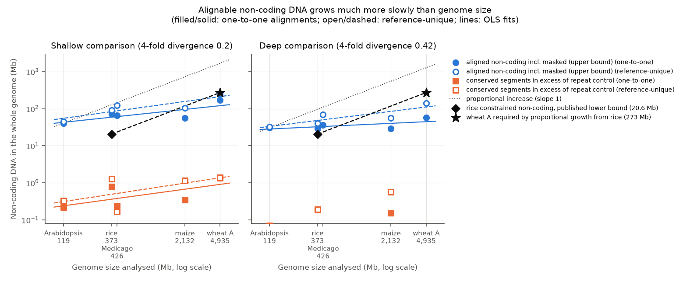
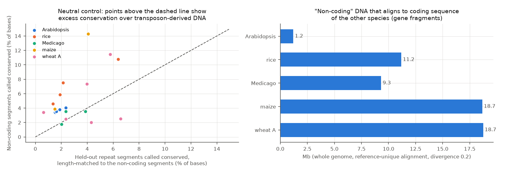
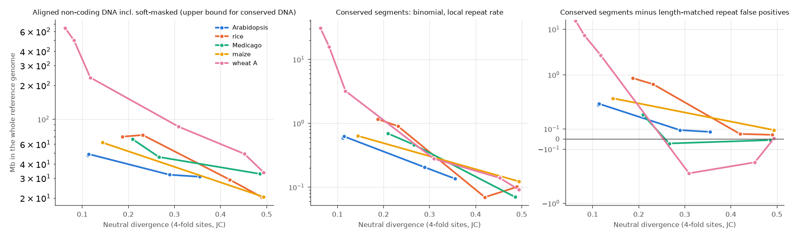

# In five plant genomes of 0.12 to 4.9 Gb, the 41-fold larger wheat A genome has only 1.9 to 5.5 times more non-coding DNA that aligns to a relative at equal divergence

## Summary

In plants, a much larger genome does not have a proportionally larger amount of non-coding DNA that aligns to a related species, and so it cannot have a proportionally larger amount of conserved non-coding DNA. This matters because one argument says that most non-coding DNA has a function; if so, the amount of non-coding DNA that natural selection keeps unchanged ("conserved" DNA) should grow in proportion to genome size. A conserved sequence must stay alignable, so the alignable amount is an upper limit for it.

We used public Ensembl Plants pairwise genome alignments of five reference genomes with 2 to 6 relatives each (19 pairs): *Arabidopsis thaliana* (0.12 Gb), rice (0.37 Gb), *Medicago truncatula* (0.43 Gb), maize (2.1 Gb) and the A subgenome of bread wheat (4.9 Gb; chromosome 1A analysed and scaled by length). "Non-coding" means no annotated protein-coding sequence (CDS) in either species. We compared genomes at equal neutral divergence: 0.20 and 0.42 substitutions per site at 4-fold degenerate sites (codon positions where every base gives the same amino acid).

- **Upper bound.** Aligned non-coding DNA (including soft-masked repeat DNA) was 41-251 Mb per genome at divergence 0.20 and 29-143 Mb at 0.42. Its log-log slope on genome size was 0.12 to 0.36 in four fits (two divergences x two alignment filters), with upper 95% limits of 0.40 to 0.72. Wheat A had 1.9-5.5 times the aligned non-coding DNA of *Arabidopsis* (genome 41 times larger) and 2.0-3.5 times that of rice (13 times larger). With the reference-unique filter, 77-97% of CDS aligned in every genome, so large genomes do not lose alignment sensitivity, at least for genic sequence.
- **Proportional growth is excluded within grasses.** At least 20.6 Mb of rice non-coding DNA is constrained across grasses (Liang et al. 2018, 23 genomes). Growth in proportion to genome size would then require at least 273 Mb of conserved non-coding DNA in wheat A. But wheat A has only 170-251 Mb of alignable non-coding DNA at divergence 0.20 and 57-143 Mb at 0.42. The margin is small (9%) for the most permissive bound at divergence 0.20.
- **Pairwise conservation tests are weak.** We tested each gap-free aligned segment against the local neutral rate of nearby old transposon copies (ancestral repeats), with held-out repeat segments of the same length as a false-positive control. Non-coding segments passed more often than length-matched repeat segments in 15 of 19 pairs. The excess was 0.2-1.4 Mb per genome at divergence 0.20 and near zero at 0.42, far below multi-genome estimates (for example 0.8-1.3 Mb against 20.6 Mb for rice). These pairwise amounts therefore cannot show how conserved DNA scales (slopes 0.36-0.40, 95% CIs include 0 and 1).
- **Artefacts of large genomes.** Reference "non-coding" DNA that aligns to CDS of the other species (gene fragments, unannotated genes) is 1.2 Mb in *Arabidopsis* but 9-19 Mb in rice, *Medicago*, maize and wheat A. The indel-spacing method behind the "8.2% of the human genome" estimate (neutral indel model) called 14-41% of ancestral-repeat DNA "constrained", so it is not reliable in plant alignments.

Limits: five genomes, and the two large ones are both grasses. With a grass/eudicot term in the regression, only one of the four upper-bound fits excludes slope 1; the within-grass break-even comparison avoids this confound but depends on one published estimate. The bound covers conserved DNA older than about divergence 0.2 that LASTZ can align; younger lineage-specific function and function without a conserved sequence are outside the test.

## 1. Question and why it matters

The "C-value paradox" and the "onion test" (Palazzo & Gregory 2014) ask why genomes of similar organisms differ up to 100-fold in size. The junk-DNA view says that most extra DNA is transposon-derived and has no function. Another view, popular since ENCODE 2012, says that most non-coding DNA has some function. A third view, the "functional space" hypothesis (Mei et al. 2018), says that functional target size grows with genome size in plants, for example through distal regulatory elements (Lu et al. 2019). A quantitative prediction separates these views: does the amount of conserved non-coding DNA grow in proportion to genome size (log-log slope near 1), slowly, or not at all?

Earlier work: the conserved fraction of genomes falls from yeast to vertebrates (Siepel et al. 2005), and the neutral indel model gave 56-66 Mb constrained in *Drosophila* and 220-286 Mb in human (Meader et al. 2010; Rands et al. 2014); those comparisons mix very different gene sets. In plants there are single-genome estimates: at least 12% of rice (45 Mb) constrained across grasses, 20.6 Mb of it non-coding (Liang et al. 2018); crucifer CNS (Haudry et al. 2013); 106 Mb of maize "CNS space" (Song et al. 2021). Song et al. also found that total CNS length per query genome correlates positively with genome size across Andropogoneae grasses. We found no study that measures how alignable or conserved non-coding DNA scales across plant genomes of very different size with one method and at matched divergence. The Conservatory resource (2.3 million CNSs in 284 plant species; Amundson, Hendelman et al. 2025, preprint) could support a better-powered test. The SCI catalog has related work on genome size in insects (sci:sha256:554c398c...) and vertebrates (sci:sha256:eb105cb0...), but none on plants.

## 2. Question selection and prior prediction

Before the analysis we listed eight approaches (comparative constraint, population-genetic constraint, fitness of random mutations, biochemical maps, association, macro-comparative correlation, theory, sequence models) and five candidate questions (`files/candidates.md`):

| Candidate | What an expert would change if yes / no | P(surprise) | Who reuses | Strongest argument against |
|---|---|---|---|---|
| **A. Scaling of conserved non-coding DNA with plant genome size (chosen)** | Yes (proportional): large crop genomes hold far more functional DNA than assumed. No: extra DNA in large plant genomes is not under detectable selection; claims of function must rely on non-conserved function | 15-20% | genome evolution, junk-DNA debate, CNS discovery in crops | qualitative answer widely believed; plant neutral rates are hard to calibrate |
| B. Mutation-accumulation lines: fitness effect of non-coding vs coding mutations | direct estimate of non-coding fitness effects | 15% | DFE modellers | done in *Chlamydomonas* (Kraemer et al. 2017; Böndel et al. 2019); low power |
| C. Mutational hazard in plant mitochondrial genomes | supports/refutes drift-barrier view | 20% | organelle evolution | *Silene* already contradicts it; special case |
| D. CRISPR tiling screens: hits outside accessible chromatin | size of "dark" regulatory DNA | 10% | functional genomics | heterogeneous data; already reported |
| E. Constraint of snRNA/snoRNA gene copies in gnomAD | new ReNU-like disease genes | 30% | clinical genetics | fast-moving field, high risk of duplication |

We chose A by expected value: a uniform measurement across a 41-fold size range is reusable whatever the result, and feasible with precomputed public alignments.

**Prior prediction** (written before results for any genome except *Arabidopsis*; `files/prior_prediction.md`): slope 0.1-0.35 for every estimator; wheat A holds 2-4 times the constrained non-coding DNA of *Arabidopsis*; in large genomes 15-30% of it lies >10 kb from genes, < 30 Mb in total; P(surprise) 15-20%.

## 3. Data

- Ensembl Plants release 63 pairwise LASTZ_NET alignments (MAF) from `ftp.ensemblgenomes.ebi.ac.uk/pub/plants/current/maf/ensembl-compara/pairwise_alignments/`, 19 pairs. For the six wheat pairs we streamed only the leading part of each archive that holds all chromosome 1A files (archives are sorted by chromosome; `stream_partial.py`); the independent reviewer checked that 1A is complete. Other archives are complete files.
- Ensembl Plants release 63 GFF3 annotations of all references and targets.
- `files/provenance.tsv`: URL, size and SHA-256 of every input file.

| Reference (genome analysed) | Targets (4-fold divergence, one-to-one filter) |
|---|---|
| *Arabidopsis thaliana* (119 Mb, chr 1-5) | *A. halleri* 0.112, *A. lyrata* 0.114, *Arabis alpina* 0.289, *Brassica rapa* 0.355 |
| *Oryza sativa* (373 Mb) | *O. brachyantha* 0.187, *Leersia perrieri* 0.231, *Brachypodium* 0.420, maize 0.490 |
| *Medicago truncatula* (426 Mb) | *Trifolium pratense* 0.209, *Vicia faba* 0.266, *Phaseolus vulgaris* 0.485 |
| *Zea mays* (2,132 Mb) | sorghum 0.144, *Brachypodium* 0.493 |
| *Triticum aestivum* A subgenome (chr 1A, 594 Mb; x8.31 = 4,935 Mb) | *Aegilops tauschii* 0.063, rye 0.082, barley 0.117, *Brachypodium* 0.309, rice 0.452, sorghum 0.493 |

Planned pairs not used (download speed about 90 KB/s per connection): *Medicago*-*Pisum*, *Medicago*-*Lupinus*, *Arabidopsis*-*Brassica oleracea*, rice-sorghum, rice-barley, *Vigna angularis*-*V. radiata*.

## 4. Methods

Code: `files/code/`.

1. **Clean the alignments** (`maf_stats.py`). Ensembl nets cover some reference bases more than once (1.3x in *A. thaliana*-*A. lyrata*). Each reference base goes to the block with the highest MAF "a score". (Blocks of one chain carried the same score in the files we inspected, so this approximates the best chain; we did not verify this for every file.) Two filters: **reference-unique** (only this step; the Ensembl net) and **one-to-one** (also each target base goes to its best block; this removes paralogous copies that align to the same target sequence, but also keeps only one of the two maize homeologs per sorghum region). Gap-free segments between indels (inter-gap segments, IGSs) with a non-positive log-odds homology score are removed (after Rands et al. 2014).
2. **Annotate each aligned column**: reference CDS; 4-fold degenerate site (canonical transcripts; first two codon bases identical in both species); target CDS (target GFF3); soft-masked repeat (ancestral repeat, AR); distance of the IGS to the nearest protein-coding gene. "Non-coding" excludes CDS in the reference **and** the target. Sites that could be methylated CG/CHG cytosines are flagged from flanking bases only (G at +1/+2 or C at -1/-2 in either species); divergences and conservation tests use only the other ("non-methylatable") sites. This keeps 13-16% of 4-fold sites, mostly third positions of GTN and GGN codons.
3. **Neutral divergence** (x-axis of the comparisons): Jukes-Cantor distance at non-methylatable 4-fold sites.
4. **Amounts** (in reference coordinates; wheat x 4,934.89/594.10):
   - **Aligned non-coding DNA** (upper bound): aligned non-coding columns, soft-masked or not (main); unmasked only (secondary).
   - **Conserved segments** (`cs_bb.py`): non-coding IGSs with >= 20 non-methylatable sites and < 50% masked bases. A segment is called conserved if P(X <= k) < 0.001 with X ~ Binomial(n, p0); k and n are mismatches and sites at non-methylatable sites. p0 is the AR mismatch rate at non-methylatable sites in the same physical neighbourhood for every genome: +-500 kb, else +-2.5 Mb, else the chromosome. The share of segments that use +-500 kb is 49-100% in 15 pairs and 1-22% in the four deep wheat and maize pairs, which have few aligned repeats (`neutral_window_share_*` in `summary.json`). **Control:** every second fully masked segment is tested in the same way. These are neighbouring segments, so they are correlated, which is adequate for a false-positive rate. Its pass rate is computed per segment-length bin (20-29, 30-49, 50-99, 100-199, >=200 sites), because long segments pass more often, and the length-matched false positives are subtracted ("excess"). A second calibration scales p0 to the genome-wide 4-fold rate.
   - A beta-binomial null whose over-dispersion is fitted on the other repeat segments was also tried. It was not well calibrated (held-out repeats passed at up to 2.6% against a nominal 0.1%) and has almost no power for CNS-sized segments, so we do not use it as evidence.
   - **Neutral indel model** (NIM1-style; `nim_core.py`, `nim_pair.py`) and **substitution deficit** relative to AR or 4-fold sites (`sde.py`): secondary.
   - **Gene-fragment DNA**: reference non-coding columns aligned to target CDS.
5. **Matched divergence and scaling** (`analysis3.py`): linear interpolation at d* = 0.20 and 0.42 between the pairs that bracket d* (nearest pair if d* is at most 0.06 or 0.10 outside the sampled range; *Arabidopsis* "deep" is read at 0.355). OLS of log10(amount) on log10(genome size) across the five references (95% CI, t with 3 df), and with a grass/eudicot indicator (2 df); a scan over d* = 0.15-0.42. Fits need five positive values. **Break-even:** proportional growth from rice to wheat A requires a wheat amount of at least 4,935/373 = 13.2 times the rice amount; we compare this with the wheat upper bound, using the published rice lower bound (20.64 Mb).
6. **Simulations** (`sim_cs.py`, `sim_nim.py`): mosaics of neutral and constrained DNA with known amounts.

Before the independent review, the conserved-segment estimator used all sites for the segment test but non-methylatable sites for the neutral rate, used a variable-size neighbourhood and had no repeat control, and the upper bound excluded masked DNA. The version above replaces it.

## 5. Results

### 5.1 Alignable non-coding DNA grows much more slowly than genome size

| | *Arabidopsis* | rice | *Medicago* | maize | wheat A | slope [95% CI] | with clade term |
|---|---|---|---|---|---|---|---|
| genome analysed (Mb) | 119 | 373 | 426 | 2,132 | 4,935 | | |
| intergenic DNA per gene (kb) | 2.3 | 8.8 | 7.1 | 53.8 | 136.6 | | |
| aligned non-coding, d = 0.20, one-to-one (Mb) | 41 | 71 | 66 | 55 | 170 | 0.28 [-0.14, 0.70] | 0.29 [-0.71, 1.29] |
| aligned non-coding, d = 0.20, reference-unique | 46 | 92 | 122 | 106 | 251 | 0.36 [0.00, 0.72] | 0.43 [-0.39, 1.24] |
| aligned non-coding, d = 0.42, one-to-one | 31 | 29 | 37 | 29 | 57 | 0.12 [-0.15, 0.40] | 0.21 [-0.34, 0.75] |
| aligned non-coding, d = 0.42, reference-unique | 33 | 41 | 70 | 57 | 143 | 0.32 [-0.05, 0.70] | 0.47 [-0.16, 1.10] |

Without soft-masked DNA the bound is 35-182 Mb (d = 0.20) and 27-90 Mb (d = 0.42), with slopes 0.11-0.35 (upper 95% limits 0.32-0.66). Over d* = 0.15-0.42 the slope of the masked-inclusive bound stays between 0.12 and 0.38 (`scaling_final.tsv`). Within the grasses, the 13-fold larger wheat A genome has 2.0-3.5 times the aligned non-coding DNA of rice, and maize 0.8-1.4 times. Coding sequence aligned in 49-92% (one-to-one) and 77-97% (reference-unique) of CDS, with no drop in the large genomes (wheat 75-97%).

**Break-even within grasses.** At least 20.64 Mb of rice non-coding sequence (outside CDS) is constrained across Poaceae (Liang et al. 2018), so rice has at least this much non-coding DNA that stays conserved over divergence 0.20 and 0.42. Proportional growth would require at least 273 Mb in wheat A (black star in Figure 1). Wheat A has at most 170 (one-to-one) or 251 (reference-unique) Mb of alignable non-coding DNA at d = 0.20, and 57 or 143 Mb at d = 0.42. So proportional growth from rice to wheat is excluded at both divergences, provided that conserved non-coding DNA stays alignable. The margin is 1.09-fold for the most permissive bound and 1.6-4.8-fold for the others. Without an outside estimate the bound alone does not exclude proportional growth of *conserved* DNA: that needs the small genome to hold more than (wheat bound / size ratio), that is 4.1-6.1 Mb (*Arabidopsis*) or 13-19 Mb (rice) at d = 0.20.

Our maize-sorghum unmasked reference-unique value (97-107 Mb) matches the 106 Mb maize "CNS space" of Song et al. (2021); their positive correlation with genome size in Andropogoneae is consistent with our positive but slow growth.

### 5.2 Pairwise conservation tests detect little of the conserved DNA

With the binomial test, 1.4-18.8% of tested non-coding bases were in conserved segments. Held-out repeat segments of the same length passed at 0.6-10.6% (Figure 3 left). Non-coding segments passed more often than length-matched repeats in 15 of 19 pairs (one-to-one; 16 of 19 reference-unique). The exceptions are *Medicago*-*Vicia*, *Medicago*-*Phaseolus*, wheat-*Brachypodium* and wheat-rice. (An earlier comparison without length matching wrongly showed no excess in most pairs.) After subtraction of the length-matched false positives, conserved non-coding DNA at d = 0.20 was:

| | *Arabidopsis* | rice | *Medicago* | maize | wheat A | slope [95% CI] |
|---|---|---|---|---|---|---|
| excess, one-to-one (Mb) | 0.22 | 0.78 | 0.24 | 0.35 | 1.39 | 0.36 [-0.38, 1.09] |
| excess, reference-unique (Mb) | 0.33 | 1.27 | 0.17 | 1.14 | 1.34 | 0.40 [-0.52, 1.32] |

At d = 0.42 the excess is near zero or negative in most genomes. These pairwise amounts are far below the multi-genome estimate for rice (20.6 Mb). They are also below what the simulated sensitivity predicts if constraint were as common as that estimate suggests: the test finds about 15-60% of constrained DNA at d = 0.12 and 34-75% at d = 0.2 when the neutral rate is known exactly (`simulations/sim_conserved_segments.tsv`). So a pairwise test with a repeat-based null detects only a small part of the conserved DNA, and its slope says little about scaling. In wheat A, 37-41% of the excess lies >10 kb from annotated genes, against 1% in *Arabidopsis*, 4-7% in rice and 13-18% in maize.

### 5.3 Divergence curves and artefacts of large genomes

- **Gene-derived DNA.** With the reference-unique filter, reference non-coding DNA aligned to target CDS is 1.2 Mb in *Arabidopsis* and 11, 9, 19 and 19 Mb in rice, *Medicago*, maize and wheat A at d = 0.20 (Figure 3 right). In maize this agrees with gene fragments captured by Helitrons (Morgante et al. 2005); in Triticeae with frequent gene movement and pseudogenes (Wicker et al. 2011). Without the target-CDS exclusion, these fragments look like conserved non-coding DNA far from genes.
- **Very close relatives.** Wheat A against *Ae. tauschii* (d = 0.063) and rye (d = 0.082) gives 1.8-2.1 times more aligned and 5-10 times more "conserved" non-coding DNA than against barley (d = 0.117), with many calls far from genes. A test against the +-5 kb flanks of each segment still calls 4.8 Mb (on 1A) for *Ae. tauschii*, 52% of it >10 kb from genes (`fine_local_diag.txt`). We do not know the cause; candidates are regions of recent shared ancestry (hybridisation is common among wheat relatives; Glémin et al. 2019), unannotated gene fragments and young transposon copies. The matched comparisons use d* >= 0.20 and do not use these two pairs.
- **Neutral indel model.** The IGS length distributions of plant alignments curve continuously (`figS1`, `figS2`) and have no clear geometric neutral part. The model calls 14-32% (one-to-one) or 21-41% (reference-unique) of IGSs that lie fully in ancestral repeats "constrained". Its scaling slopes (0.60-0.87) depend mostly on wheat (28-50 Mb). In simulations it gave 0.02-2.5 times the true amount (`simulations/sim_nim.txt`).
- **Substitution deficit.** AR diverge 1.3-1.7 times faster than 4-fold sites in the closest pair of each genome. Relative to AR, 24% of *Arabidopsis* aligned non-coding DNA looks constrained; relative to 4-fold sites, about 0%.

## 6. Comparison with the prior prediction, and usefulness

| Prediction | Result |
|---|---|
| slope 0.1-0.35 for every estimator | upper bound 0.12-0.36 (as predicted); pairwise excess 0.36-0.40 with very wide CIs; indel model 0.6-0.9 (method failed its control) |
| wheat A holds 2-4x *Arabidopsis* | upper bound 1.9-5.5x; pairwise excess 4-6x but with low sensitivity; the true conserved amount was not measured |
| 15-30% of conserved DNA >10 kb from genes in large genomes, < 30 Mb | pairwise excess: wheat 37-41%, maize 13-18%, < 1 Mb in absolute terms (low sensitivity) |

The work was less useful than we expected. We planned to measure the amount of constrained non-coding DNA in each genome. Two rounds of independent review showed that pairwise conservation tests with repeat-based neutral references detect only a small part of it (about 1 Mb where multi-genome methods find about 20 Mb in rice), so they cannot show how it scales. What remains is an upper bound, the alignable non-coding DNA at matched divergence. Combined with a published lower bound for rice, it excludes proportional growth within grasses, with a small margin for the most permissive filter. It does not separate a fixed amount from the weak growth that the functional-space hypothesis predicts. The most reusable results are the bound, the controls that a plant CNS study should run (target-CDS exclusion, a length-matched held-out repeat null), and the evidence that the neutral indel model fails in plant alignments.

## 7. Limitations

- **Upper bound only.** The bound limits the conserved amount only if conserved non-coding sequence stays alignable by LASTZ nets. Short conserved elements surrounded by transposons could be missed more often in large genomes. Coding sequence aligns equally well in all genomes, but we did not test known distal non-coding elements (for example maize *Vgt1*).
- **Timescale.** The bound covers DNA conserved over divergence >= 0.20. Function that arose in the wheat lineage more recently is not covered.
- **Five genomes, lineage confounded with size.** Both genomes > 2 Gb are grasses; the eudicots span only 0.12-0.43 Gb. With a grass/eudicot term, only the deep one-to-one bound excludes slope 1. The within-grass break-even avoids this confound but rests on one published estimate (Liang et al. 2018) and has a 9% margin for the most permissive bound. Large-genome legumes (*Pisum*, *Vicia*) appear only as targets.
- **Wheat A** is extrapolated from chromosome 1A (12% of the A subgenome).
- **Polyploidy.** The one-to-one filter keeps one maize homeolog per sorghum region and does not remove wheat homeologs (absent from chromosome 1A); the reference-unique filter can count paralogs. We report both.
- **Annotation quality** differs between genomes; unannotated genes in both species count as non-coding.
- The 4-fold divergence axis uses only 13-16% of 4-fold sites (GTN, GGN codons).
- Function that does not need a conserved sequence is outside the test.

## 8. Predictions that an experimental lab can test

1. In maize, CRISPR deletions of aligned non-coding sequence that is not more conserved than length-matched repeat DNA (most of the 100-Mb "CNS space") will change the expression of nearby genes much less often than equal-length deletions of segments that are.
2. In a massively parallel reporter assay, wheat non-coding segments that align to barley but are not more conserved than their local neutral background will show regulatory activity no more often than transposon controls of the same length and G+C content.
3. Wheat and barley "conserved" non-coding segments more than 10 kb from annotated genes will mostly be gene fragments or transposon pieces. If an ATAC-seq or protein-similarity screen shows otherwise, large genomes hold distal conserved elements that pairwise tests underestimate.
4. A multi-species constraint map made with one method across angiosperms (for example from the Conservatory alignments) will show conserved non-coding amounts that grow with genome size at a slope below 0.4.

## 9. How to reproduce

Requirements: Python 3.12 with numpy, scipy, matplotlib; each pair needs < 1 GB RAM.

1. Make a working directory with `scripts/` (copy `files/code/*`), `data/gff/`, `logs/`, `results/`.
2. Download the alignments listed in `files/code/pairs.tsv` (keys are Ensembl file names without `.lastz_net.tar.gz`) and list `key path` lines in `data/fetched_paths.txt`. For wheat use `python scripts/stream_partial.py URL data/partial/<name>.1A.part.tar.gz 1A`. Get annotations with `scripts/get_gffs.sh <species ...>` plus the reference GFF3s in `pairs.tsv` (wheat: put `path Triticum` in `data/gff_paths.txt`). Check files against `files/provenance.tsv`.
3. `scripts/run_pairs.sh` (one-to-one) and `REFUNIQ=1 scripts/run_pairs.sh` (reference-unique); 10 s to 3 min per pair.
4. `python scripts/aggregate.py igs`, `python scripts/aggregate.py igs_refuniq`, `python scripts/analysis3.py`, `python scripts/fine_local_diag.py results/igs/*.npz`.
5. Simulations: `python scripts/sim_cs.py`, `python scripts/sim_nim.py`.

## 10. Files

- `files/results/summary.tsv|json` (one-to-one) and `summary_refuniq.*`: all estimators and controls per pair, in reference coordinates (multiply wheat by `scale`). Key columns: `nc_all_aligned_mb`, `nc_aligned_mb`, `cs_binom_AR_mb`, `cs_binom_AR_lexcess_mb`, `cs_binom_AR_pass_frac`, `cs_binom_AR_lm_ar_pass_frac`, `cs_binom_4Dscaled_lexcess_mb`, `neutral_window_share_*`, `ref_nc_target_cds_mb`, `nim_nc_mb`, `nim_ar_frac`.
- `files/results/scaling_final.tsv|json`: values at matched divergence, slopes with 95% CIs, clade-adjusted slopes, d* scan.
- `files/results/fine_local_diag.txt`: flank-relative test. `pair_tables_*.npz`: per-pair site tables, IGS histograms, window counts. `pair_logs/`: run logs (`<pair>.txt` one-to-one, `<pair>1.txt` reference-unique, `stream_*` partial downloads). `simulations/`.
- `files/figures/`: Figures 1-3, S1-S2. `files/code/`: all code. `files/provenance.tsv`. `files/candidates.md`, `files/prior_prediction.md`.

## References

- Amundson KR, Hendelman A et al. (2025) Conservatory: ancient regulatory sequences across 284 plant species. bioRxiv doi:10.1101/2025.09.17.676453
- Böndel KB et al. (2019) PLoS Biol 17:e3000192. doi:10.1371/journal.pbio.3000192
- Glémin S et al. (2019) Sci Adv 5:eaav9188. doi:10.1126/sciadv.aav9188
- Haudry A et al. (2013) Nat Genet 45:891-898. doi:10.1038/ng.2684
- IWGSC (2018) Science 361:eaar7191. doi:10.1126/science.aar7191
- Kraemer SA et al. (2017) Evolution 71:2918-2929. doi:10.1111/evo.13360
- Liang P et al. (2018) Single-base resolution map of evolutionary constraints and annotation of conserved elements across major grass genomes. Genome Biol Evol 10:473-488. doi:10.1093/gbe/evy006
- Lu Z et al. (2019) Nat Plants 5:1250-1259. doi:10.1038/s41477-019-0548-z
- Lunter G, Ponting CP, Hein J (2006) PLoS Comput Biol 2:e5. doi:10.1371/journal.pcbi.0020005
- Meader S, Ponting CP, Lunter G (2010) Genome Res 20:1335-1343. doi:10.1101/gr.108795.110
- Mei W, Stetter MG, Gates DJ, Stitzer MC, Ross-Ibarra J (2018) Adaptation in plant genomes: bigger is different. Am J Bot 105:16-19. doi:10.1002/ajb2.1002
- Morgante M et al. (2005) Nat Genet 37:997-1002. doi:10.1038/ng1615
- Palazzo AF, Gregory TR (2014) PLoS Genet 10:e1004351. doi:10.1371/journal.pgen.1004351
- Rands CM et al. (2014) PLoS Genet 10:e1004525. doi:10.1371/journal.pgen.1004525
- Siepel A et al. (2005) Genome Res 15:1034-1050. doi:10.1101/gr.3715005
- Song B et al. (2021) Genome Res 31:1245-1257. doi:10.1101/gr.266528.120
- Wicker T et al. (2011) Plant Cell 23:1706-1718. doi:10.1105/tpc.111.083741
- Yates AD et al. (2022) Nucleic Acids Res 50:D996-D1003. doi:10.1093/nar/gkab1007

## License and attribution

Copyright 2026 the author. Text, figures and data: CC BY 4.0; code: MIT (see LICENSE). Produced by an autonomous Claude Code agent (claude-opus-5-5) in the SCI research swarm on the Mac mini 'oya', run 4c5e9fdb-7c0a-4950-be7b-ca7242b5adcc.
