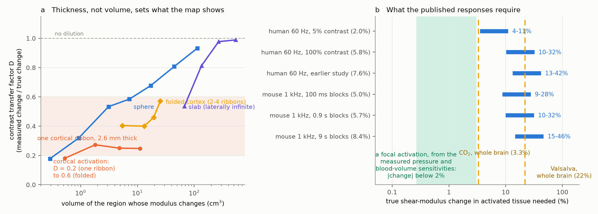
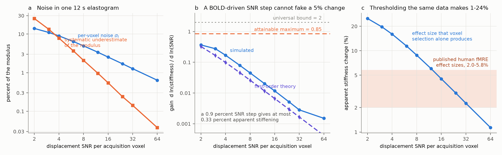
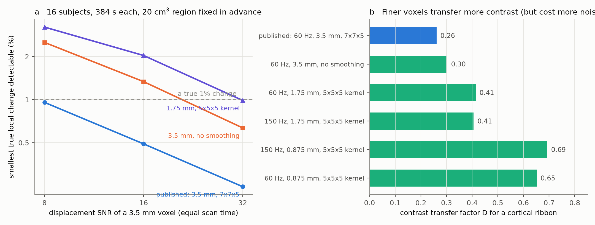

# Published functional MR elastography effect sizes lie inside the range that voxel selection alone produces, and if they are real they need a 10 to 32 percent change in cortex

Functional MR elastography (fMRE) measures the shear stiffness of brain tissue during a task.
Published studies report that activated human visual cortex becomes **2 to 8 percent stiffer**,
and that mouse brain changes by **5 to 8 percent** with stimuli switched as fast as 100 ms.
These are two to six times larger than the BOLD signal change in the same data, which is why
fMRE is pursued as a new functional contrast with a possible direct link to neural activity.

This study asks two separate questions. **How much of a true stiffness change does the published
measurement actually show?** And **how much of the reported effect size can be produced by the
analysis itself, with no stiffness change at all?** It is a physics and simulation study; no new
data were collected. Two independent reviewers checked the package before publication and the
claims are scoped to what survived them; section 2 says what was already known, and section 8
says which of the author's predictions were wrong.

---

## 1. Summary of findings

**1. The measurement shows between a fifth and three fifths of a true cortical change.**
Solving the shear-wave equation in a head-sized volume and running the published reconstruction
(60 Hz, 3.5 mm voxels, 7x7x5 quartic smoothing, direct inversion) gives a **contrast transfer
factor D**: the measured fractional change divided by the true one. For a change confined to one
2.6 mm cortical ribbon, **D = 0.18 to 0.27**. Real cortex is folded, and a patch covering both
banks of a sulcus puts several ribbons inside one smoothing kernel: with two, three and four
ribbons, **D = 0.40, 0.46 and 0.57**. A compact sphere gives 0.18 (4 mm radius) to 0.93 (30 mm).
These values agree with published measurements of cortical recovery in MRE (section 2), which is
why this is offered as a confirmation for this protocol rather than as a discovery.

**2. What sets D is the thin dimension of the activated region and the processing kernel, not the
wavelength.** Halving the shear wavelength (60 Hz to 150 Hz) at fixed voxel and kernel size
changes D by less than 2 percent (0.414 against 0.406). Going from 3.5 mm voxels with the 7x7x5
kernel to 1.75 mm with a 5x5x5 kernel raises D from 0.26 to 0.41, and to 0.875 mm raises it to
0.65 - a combined change of voxel and kernel, not a pure voxel effect. Lowering the baseline
modulus from 2.76 to 2.0 kPa, the cortical rather than the whole-brain value, leaves D at 0.26.
That the kernel width limits resolution is stated in the MRE guidelines; **that the wavelength is
not what binds here is the part worth knowing, because it removes the obvious remedy.** It also
matters that the declared 7x7x5 quartic kernel has zero end taps, so its net support is 5x5x3
taps = 8.75 x 8.75 x 10.5 mm, and a declared 3x3x3 quartic kernel is the identity.

**3. If the published responses are real, they need true changes of 3.5 to 32 percent.** Dividing
the reported values by D = 0.18-0.57: the human 100 percent-contrast response (5.8 percent) needs
a **true change of 10 to 32 percent**; the 5 percent-contrast response (2.0 percent) needs 3.5 to
11 percent; the mouse values need 8.8 to 47 percent, read as an upper estimate because the mouse
protocol uses a finer voxel.

**4. A published rebuttal of the partial-volume concern does not hold.** Lan et al. (2020) write
that "the partial-volume effects remain constant between frames in this study". That is true of
the baseline and false of the change: dilution multiplies the **contrast**, so a constant
partial-volume fraction still divides the measured ON-minus-OFF difference by D.

**5. Brain stiffness really does move by several percent, but only under global challenges.**
Measured: Valsalva +22 percent in modulus (ultrasound) or +7 percent (MRE); carbogen +12 percent;
hypercapnia +3.3 percent with blood flow +36 percent; the cardiac cycle +-7 percent; overnight
dehydration -8 percent. So the **amplitude** of the fMRE reports is not by itself impossible.
What does not work is the **locality and the sign**. A focal activation adds 0.03-0.31 mL of
blood, raising local pressure by **0.04-0.49 mmHg**; at the pressure sensitivity measured with a
catheter in swine (0.58 percent per mmHg) that is +0.02 to +0.29 percent. Meanwhile the added
blood volume *softens* the tissue by **1.4 percent** (interval 0.5 to 3.2), because blood has a
shear modulus of 1.5 Pa against about 2300 Pa for tissue. The net modelled focal effect is a
**softening of about 1 percent**, which after the transfer factor is a measured change between
-0.14 and -0.75 percent, against a reported stiffening of 2.0 to 5.8 percent: **opposite in sign
and 3 to 40 times too small.**

**6. The reported effect sizes lie inside the range that thresholding the same elastograms
produces with no true effect.** Both published analyses select voxels using the data they then
quantify. In the human study a general linear model is fitted to 32 elastograms, thresholded at
uncorrected p < 0.001, and the percent change is taken inside the surviving voxels. With no true
effect, the survivors show a median change of **2.02 x sigma_t** (analytic) and **1.78 x sigma_t**
(2,000,000-voxel simulation) if the threshold is applied per subject, or **0.55 x sigma_t** if it
is applied to a 16-subject group contrast; the paper does not say which. sigma_t is the per-voxel
noise of one 12 s elastogram, which this pipeline puts at **4.95 percent at displacement SNR 8
and 2.54 percent at SNR 16**, against the same group's measured test-retest coefficient of
variation for regional stiffness of 3.6-3.9 percent.

| reported effect | is exactly the floor if sigma_t is... | per-subject threshold | group threshold |
|---|---|---|---|
| 2.0 percent (5 percent contrast) | | 0.99 percent | 3.62 percent |
| 5.8 percent (100 percent contrast) | | 2.87 percent | 10.5 percent |

Under the group reading the required noise, 3.6 to 10.5 percent, **brackets both the simulated
value at a plausible SNR and the group's own measured variability**. Under the per-subject
reading it requires an unusually quiet elastogram. **For either reading there is a noise level
inside the plausible range at which the whole reported effect is the floor.** For the mouse
protocol (threshold |z| > 1, reported noise 0.52-0.72 kPa per pixel), the floor is 3.7 to 12.7
percent depending on the baseline modulus, which brackets all three reported values (5.0, 5.7,
8.4 percent) with no simulation needed.

**What selection does not explain is the trend.** The human effect grows monotonically with
stimulus contrast (2.0, then 5.8 percent, linear fit p < 0.0001). A selection floor is set by
sigma_t, which does not depend on the stimulus, so the trend is evidence for something real. The
two horns are therefore: either the effect sizes are the floor and the trend needs another
explanation, or the trend is real and finding 3 applies to it.

**7. Selection cannot be distinguished from a real sign, which is enough to unsettle the sign
contradiction.** Human visual cortex is reported to stiffen; mouse hind-paw stimulation is
reported to soften; other studies report both signs. Both published analyses fix the sign of the
voxels they keep: an SPM T contrast is one-sided, and the mouse regions of interest were defined
as pixels where the OFF state is stiffer. A floor inherits whatever sign the selection imposes,
so **these designs cannot tell a selected sign from a measured one.** That does not prove the
signs are artefacts; it means the published sign disagreement is not evidence about tissue.

**8. The obvious instrumental artefact is real but far too small, and is now bounded.** Direct
inversion underestimates stiffness in noisy data because the Laplacian amplifies noise, so a
stimulus-locked rise in image SNR makes tissue look stiffer. The law and its bound:

  E[stiffness] = mu (1 + c sigma^2)/(1 + d sigma^2),
  gain = d ln(stiffness)/d ln(SNR) = 2[ d s/(1+d s) - c s/(1+c s) ],  s = sigma^2,

which is below 2 for any noise spectrum and, for this pipeline's measured ratio r = d/c = 6.17,
is at most **2(sqrt(r)-1)/(sqrt(r)+1) = 0.85**, reached at a displacement SNR of 0.64 where
nothing is measurable. At usable SNR the simulated gain is **0.37 (SNR 2) to 0.012 (SNR 16)**, so
a 0.9 percent BOLD magnitude change can fake at most **0.33 percent** of stiffening: about
20 times too small, although it has the right sign and would scale with stimulus contrast exactly
as the published effect does. **This channel can be set aside.**

**9. What fMRE could measure with a region fixed in advance, and why finer voxels do not help.**
The noise correlation volume of the published pipeline is 689 mm3. The smallest **true** local
change detectable at 95 percent confidence in a 20 cm3 region fixed in advance is **3.8 percent
for one 384 s scan at displacement SNR 8 and 0.96 percent for 16 subjects**; at SNR 16, 2.0 and
0.49 percent. At **equal scan time** a finer voxel is a losing trade: 1.75 mm voxels raise D from
0.26 to 0.41 but raise the per-voxel noise about ninefold, because displacement SNR falls with
voxel volume. **A real 1 percent change is within reach of a pre-specified region; getting there
needs more displacement signal, not finer voxels - and a selected-voxel effect size is not
interpretable at all.**



---

## 2. What is new here, and what was already known

An independent reviewer and two literature agents checked this package before publication and
found prior work the author's own search had missed. The claims are narrowed accordingly.

**Already published, and cited rather than rediscovered:**
- **The quantity.** "Contrast-transfer efficiency", the ratio of measured to true contrast, was
  named and quantified in elastography by Ponnekanti et al. (1995) and Kallel et al. (1996).
- **Cortical recovery fractions in MRE.** Scott et al. (2022), from the same group whose protocol
  is simulated here, report ROI recovery coefficients of 0.16 to 0.86 for cortical regions at
  60 Hz and 3 mm, and an inversion width of about 1 cm. Hiscox et al. (2022) report
  recovered-versus-true slopes of 0.49 to 0.78 for a 2.60 mm cortical ribbon at 2.0 mm voxels.
  Herthum et al. (2022) report that a 9 mm stiff lesion needs a true contrast of +35 or +57
  percent to show +10 percent, i.e. transfer factors of 0.29 and 0.18. The values in finding 1
  sit inside that published range: **a confirmation for this protocol, not a discovery.**
- **That the processing kernel sets the resolution.** The MRE guidelines (Manduca et al. 2021)
  state it and recommend eroding regions of interest by the kernel half-width.
- **Partial volume in cortical fMRE.** Zoraghi et al. (2021) already argue that MRE-measured
  cortical stiffness changes are partial-volume diluted, with a factor of about 3 for 2 mm
  voxels. Lilaj et al. (2021) quantify cortical softening from the same cause.
- **The mechanism question.** Parker (2017), "Are rapid changes in brain elasticity possible?",
  answers yes using a microchannel-flow model, and related work by the same group predicts
  modulus changes of order 15 percent for a 20 percent vessel-radius change. An earlier draft of
  this work stated that no such analysis existed; **that was wrong and is withdrawn.** Parker's
  model gives a softening for unconfined vasodilation, which agrees with the composite
  calculation here and disagrees with the sign the human studies report.
- **Circular analysis.** Kriegeskorte et al. (2009), Vul et al. (2009) and Yarkoni (2009) state
  the general problem **and the floor argument**; this work supplies the fMRE-specific numbers.
- **An unpublished reanalysis of the mouse study.** Hetzer et al. (2020, posted 2024) show that
  the mouse activations do not survive a |z| > 1.96 threshold and that the paper's |z| > 1
  threshold corresponds to p = 0.32. That is most of the mouse half of finding 6, reached
  independently and earlier.
- **An independent partial null.** Schattenfroh et al. (ISMRM 2024) find a slow viscoelastic
  response of 2.56 +- 0.87 percent and no fast response.

**What appears to be new:**
1. The contrast transfer factor measured for **this** protocol and, specifically, for a
   **within-subject ON-minus-OFF difference** in fixed voxels, which is the case the published
   "partial volume cancels between frames" rebuttal gets wrong (finding 4).
2. The demonstration that the transfer factor does **not** improve with drive frequency at fixed
   voxel and kernel size, which removes the remedy an experimenter would reach for first.
3. The selection floor computed for these two protocols from their own stated thresholds, under
   both threshold levels, with the per-voxel noise that each reported effect size implies, and
   the mouse floor from the authors' own quoted noise (finding 6).
4. The transfer function from a stimulus-locked SNR change to an apparent stiffness change, with
   its bound (finding 8). The noise bias of direct inversion is well known; its differential form
   is what matters for a functional experiment and had not been quantified.
5. The detectability calculation for a pre-specified region, including the result that finer
   voxels lose at equal scan time (finding 9).

---

## 3. Method

### 3.1 Forward model

`files/code/fd_helmholtz.py` solves

    div( mu(x) grad u ) + rho omega^2 u = f(x),     mu = G' + i G''

on a 112 x 112 x 112 grid of 0.875 mm cells (98 mm cube) with sponge layers, by BiCGSTAB with a
Fourier-domain shifted-Laplacian preconditioner: 21 iterations to a relative residual of 8e-6 in
about 7 s. Baseline tissue is G' = 2.76 kPa with a loss tangent of 0.3, giving a 28.6 mm
wavelength and a 31 mm attenuation length at 60 Hz. The source is three Gaussian spots at the
edge of the volume, which gives an interference field rather than a single clean plane wave.

This is the **scalar analogue** of the vector shear-wave equation, and it is the right model for
testing the inversion, because direct inversion assumes for each curl component the homogeneous
relation mu lap(q) = -rho omega^2 q, that is, it drops exactly the grad(mu).grad(q) term this
solver keeps. Mode conversion between shear polarisations is not represented. Section 5 lists
what that costs.

### 3.2 Reconstruction

`files/code/mre_pipeline.py` reproduces the published chain: average into 3.5 mm acquisition
voxels (partial volume), add complex Gaussian noise per voxel (the phase noise of the
motion-encoding measurement), interpolate in plane by 2 (the 64 to 128 step), smooth with the
7x7x5 quartic kernel, and invert by local least squares over a 3x3x3 window. On a homogeneous
medium the chain returns 2.80 kPa against a true 2.76 kPa: a **+1.3 percent discretisation bias**,
which cancels in the fractional changes reported here.

### 3.3 Scripts

| Script | Question | Output |
|---|---|---|
| `dilution.py`, `dilution_variants.py` | how much of a true change survives | `results/dilution*.json` |
| `noise_level.py`, `theory_check.py` | per-voxel noise, bias, SNR gain | `results/noise_level.json`, `theory_check.json` |
| `selection_bias.py` | effect size made by thresholding | `results/selection_bias.json` |
| `mechanisms.py` | what a focal activation can produce | `results/mechanisms.json` |
| `design.py` | what is detectable, and at what cost | `results/design.json` |

`results/summary.txt` is the printout of every number quoted below.

---

## 4. Results in detail

### 4.1 Contrast transfer

D is the measured fractional change divided by the true one, in the noise-free limit.

| geometry | patch | volume | voxel fill | D (median) | D (best voxel) |
|---|---|---|---|---|---|
| one cortical ribbon, 2.6 mm | 8 mm | 0.5 cm3 | 0.53 | 0.18 | 0.25 |
| one cortical ribbon | 15 mm | 1.8 cm3 | 0.65 | 0.27 | 0.36 |
| one cortical ribbon | 40 mm | 11 cm3 | 0.64 | 0.25 | 0.40 |
| folded: 2 ribbons, 2 mm gaps | 30 mm | 13 cm3 | 0.62 | 0.40 | 0.57 |
| folded: 3 ribbons, 2 mm gaps | 30 mm | 19 cm3 | 0.62 | 0.46 | 0.61 |
| folded: 4 ribbons, 1 mm gaps | 30 mm | 25 cm3 | 0.69 | 0.57 | 0.79 |
| sphere, 9 mm radius | - | 3.1 cm3 | 0.89 | 0.53 | 0.94 |
| slab, 14 mm thick | - | 134 cm3 | 1.00 | 0.81 | 1.17 |

Turning a ribbon so its thin direction lies across slices rather than in plane lowers D from 0.27
to 0.20 at a 15 mm patch, and from 0.26 to 0.21 at 30 mm. The **loss modulus** transfers worse:
D(G'') = 0.02 to 0.24 across the six orientation cases. A check at a 25 percent true change gives
the same D as at 10 percent, so this is not a small-signal linearisation.


### 4.2 What a focal activation can do

The measured whole-brain anchors are listed in `files/code/mechanisms.py`. For a focal
activation, with a 0.33 to 1.56 percent absolute blood-volume fraction change in 5 to 25 cm3 of
tissue and a craniospinal compliance of 0.4 to 1.2 mL/mmHg:

| channel | 2.5% | median | 97.5% |
|---|---|---|---|
| blood-volume composite (a softening) | -3.16% | **-1.37%** | -0.49% |
| pressure, swine catheter sensitivity | +0.02% | +0.08% | +0.29% |
| pressure, Valsalva-derived sensitivity | +0.13% | +0.55% | +1.98% |
| temperature | -0.12% | -0.04% | -0.01% |
| net, swine sensitivity | -3.05% | **-1.32%** | -0.48% |
| net, Valsalva sensitivity | -2.37% | **-0.78%** | +0.27% |

These are the ranges implied by the assumed input ranges, which are uniform over literature
values; they are not confidence intervals. Blood's shear modulus at 60 Hz is i*omega*eta = 1.5 Pa
against about 2300 Pa for tissue, and fluid inertia matters only above a vessel radius of 3.9 mm,
so all of the blood volume acts as a shear void and adding blood softens the tissue. (An earlier
draft argued that blood in vessels narrower than the 141 micrometre viscous penetration depth is
locked to the wall and cannot act as a void. The reviewer showed that is wrong: the criterion is
the modulus ratio, not the Stokes layer. The correction makes this channel five times larger and
flips the sign of the total.)

**The two measured pressure sensitivities are not consistent with each other.** Applied to the
global carbon dioxide challenge (a 6.5 mL blood load, about 8 mmHg), the swine sensitivity
predicts 4.8 percent against a measured 3.3 +- 1.9 percent, while the Valsalva-derived
sensitivity predicts 31 percent. The swine value passes that cross-check and the Valsalva value
fails it tenfold, so either the Valsalva pressure rise is far larger than the 5.7 mmHg usually
quoted, or that response is not purely a pressure effect. Both are carried through here and the
conclusion does not depend on the choice.

Multiplying the four corners of (net channel total) x (transfer factor) gives a predicted
**measured** change between **-0.14 and -0.75 percent**: a softening, against a reported
stiffening of 2.0 to 5.8 percent.

### 4.3 Noise bias of the inversion, and the selection floor



| displacement SNR | 2 | 4 | 8 | 16 | 32 |
|---|---|---|---|---|---|
| per-voxel noise sigma_t | 14.0% | 9.0% | 5.0% | 2.5% | 1.3% |
| stiffness underestimate | -25% | -7.9% | -2.1% | -0.6% | -0.1% |
| gain d ln(mu)/d ln(SNR) | 0.37 | 0.17 | 0.045 | 0.012 | 0.003 |
| apparent change for a 0.9% SNR step | 0.33% | 0.15% | 0.04% | 0.01% | 0.003% |
| floor from a per-subject p<0.001 threshold (1.78 sigma_t) | 25% | 16% | 8.8% | 4.5% | 2.3% |
| floor from a 16-subject group threshold (0.55 sigma_t) | 7.7% | 5.0% | 2.7% | 1.4% | 0.7% |

The displacement SNR of the published protocols is not reported, which is why the table is a
function of it. The floor factors depend on the regressor: with a boxcar rather than an
HRF-convolved regressor they are 1.26 and 0.35 instead of 2.02 and 0.55, which moves the implied
sigma_t by 60 percent. Both branches are in `results/selection_bias.json`.

### 4.4 What is detectable, and the voxel-size trade

Each protocol gets its own per-voxel noise and its own noise correlation volume, with the
displacement SNR scaled by voxel volume so the comparison is at **equal scan time**.

| protocol | D | sigma_t | V_c | smallest true change, 1 subject | 16 subjects |
|---|---|---|---|---|---|
| published: 3.5 mm, 7x7x5 kernel | 0.26 | 2.5% | 689 mm3 | 1.96% | 0.49% |
| 3.5 mm, no smoothing | 0.30 | 10.1% | 418 mm3 | 5.35% | 1.34% |
| 1.75 mm, 5x5x5 kernel | 0.41 | 23.2% | 342 mm3 | 8.15% | 2.04% |

(at a reference displacement SNR of 16 for a 3.5 mm voxel, 20 cm3 region, 95 percent confidence)

The published protocol wins among these three: the finer voxel raises D by 1.6 times but raises
the per-voxel noise about ninefold. Two caveats. The second row changes the kernel, not the
voxel, so only the third row is a voxel-size comparison. And the 1.75 mm row sits at an effective
SNR of 2, a regime this paper's own table calls badly biased, so the comparison is being decided
where neither protocol is usable; the direction is clear but the margin is not.

A 0.875 mm configuration is in `results/design.json` and appears to win at the lowest reference
SNR. It should not be believed: its estimated sigma_t *rises* with SNR (21.9, 34.0, 57.4 percent
as the effective SNR goes 0.125, 0.25, 0.5), which is impossible and shows the noise estimator
has broken down below an effective SNR of about 1.



---

## 5. What this does and does not show

1. **It does not show that the published effects are artefacts.** It shows that if they are real
   they require true changes of 3.5 to 32 percent; that the modelled focal channels give about
   1 percent with the wrong sign; and that an analysis selecting voxels on the same data has a
   floor inside the reported range for plausible noise. An unknown mechanism of the right size
   and sign is not excluded, and Parker's microchannel model already reaches the right magnitude.
2. **The contrast dependence is the strongest argument against the selection reading** and is not
   explained here (finding 6). Any complete account has to produce a response that grows with
   stimulus contrast.
3. **The scalar wave model omits mode conversion** and uses a homogeneous, isotropic background.
   Real cortex sits against cerebrospinal fluid, whose slip boundary is known to bias nearby
   stiffness estimates, so the isolated-ribbon transfer factor is probably optimistic; folding
   pushes the other way and pushes harder. For the noise channel the real pipeline's curl step
   raises the noise wavenumber and so the attainable gain, towards but not reaching the bound.
4. **D depends on geometry, and the right value is a range.** The published analysis thresholds,
   which selects the best-recovered voxels, so the upper end of the range is the fairer
   comparator for the thresholded statistic. Both ends are given.
5. **sigma_t for the published protocols is unknown to me**, and the threshold level is not
   stated, so the floor is given for both levels and as a function of sigma_t. This is the single
   most valuable missing number and it is trivial to report.
6. **The mouse case is treated with its own stated noise, not with the 60 Hz transfer factor.**
   Its 1 kHz, 300 micrometre protocol has a better transfer factor; the mouse row of figure 1b is
   an upper estimate of the requirement, while its selection floor uses the authors' own quoted
   noise and threshold and needs no simulation.
7. **A confound this study did not model, found by the reviewer**: a stimulus-locked shift of the
   anatomy relative to the imaging grid, of 0.05 to 0.2 mm, produces apparent modulus changes of
   several percent at the cortex-fluid boundary in a 1-D version of this pipeline, with no
   stiffness change anywhere. The published elastogram branch applies no motion correction. This
   is a strong candidate and deserves its own study.

---

## 6. Experiments this suggests, in order of cost

1. **Report sigma_t**: the temporal standard deviation of per-voxel stiffness in a resting scan,
   and state at which level the threshold was applied. It costs nothing and makes every published
   effect size interpretable.
2. **Re-analyse with a region fixed in advance** (anatomical V1, or voxels chosen from the other
   half of the data). This separates a real change from the floor at no scanning cost and is the
   single analysis that would settle finding 6.
3. **Run the same analysis, including the threshold and the within-mask percent change, on a sham
   scan** with the stimulus absent and the vibration on. The quantity to report is the effect size
   inside the voxels that pass, not whether any pass.
4. **Regress the elastogram time series on the realignment parameters**, and repeat with motion
   correction on the elastogram branch (limit 7).
5. **Match SNR between states** by adding noise to the higher-SNR state. The cost in sensitivity
   is small, because the channel it removes is small.
6. **Bound the open mechanism**: measure brain stiffness during a controlled osmotic challenge
   that changes extracellular volume by a known amount, as the swine study calibrated pressure.
7. **Do not expect finer voxels or a higher frequency to fix the localisation.** At equal scan
   time a finer voxel loses more in noise than it gains in transfer (section 4.4), and 150 Hz at
   a fixed voxel changes the transfer factor by under 2 percent. What would help is more
   displacement amplitude within the same comfort limits, or an inversion that does not assume
   local homogeneity across the cortical ribbon.

---

## 7. Reproducing this

```
cd files/code
python -E -s dilution.py           # ~12 min  contrast transfer, four geometries
python -E -s dilution_variants.py  # ~8 min   orientation and protocol variants
python -E -s noise_level.py        # ~8 min   sigma_t, bias and gain against SNR
python -E -s theory_check.py       # ~3 min   analytic law against the simulation
python -E -s selection_bias.py     # ~10 s    effect size made by thresholding
python -E -s mechanisms.py         # ~1 s     focal-activation budget, Monte Carlo
python -E -s map_demo.py           # ~1 min   example maps for figure 4
python -E -s design.py             # ~6 min   detectable true change
python -E -s summary.py            # prints every number quoted above
python -E -s figures.py            # figures 1-4
```

Run them in this order: `dilution_variants` feeds `design`, `dilution` feeds `mechanisms`, and
`noise_level` feeds `theory_check` and `design`. Python 3.12 with numpy 2.5.4, scipy 1.18.1,
matplotlib 3.11.2 on one Apple M1 (8 cores, 8 GB). Peak memory below 1.2 GB. Every script writes
to `files/results/`; seeds are fixed, so the numbers reproduce exactly. `test_conv.py` and
`test_timing.py` are the solver checks quoted in 3.1.

---

## 8. Predictions against outcomes

The candidate list and the numeric predictions were written before any code
(`files/notes/00_candidates_and_prior.md`).

| Prediction | Outcome |
|---|---|
| Mechanism ceiling 1-3 percent, sign not reliably positive; P(ceiling < 5.8%) = 0.7 | **Half right.** For a focal activation the modelled channels give about 1 percent with the largest one a softening. But I had not realised that global challenges move brain stiffness by 3-22 percent, which makes the amplitude of the fMRE reports far less remarkable than I assumed. |
| Focal pressure rise under 0.2 mmHg, effect under 0.5 percent; P = 0.8 | **Right on the pressure (0.04-0.49 mmHg), wrong on the effect**: with the Valsalva-derived sensitivity rather than the swine one it reaches 1.98 percent. |
| Recovered fraction 0.2-0.5, requiring a true 12-29 percent; P(D<0.6) = 0.75 | **Right for an isolated ribbon (0.18-0.27), too pessimistic for folded cortex (0.40-0.57).** The requirement is 10-32 percent against the predicted 12-29, so the prediction was close but for partly the wrong reason. |
| Noise-bias gain bounded by 2, reaching 1-2 in practice, 0.4-3.4 percent apparent change | **Bound right, magnitude wrong by a factor of 10.** The attainable maximum for this pipeline is 0.85, and at usable SNR the gain is 0.01-0.37, giving at most 0.33 percent. |
| P(published amplitudes exceed every known mechanism by more than 3x) = 0.6 | **Not confirmed as stated.** The gap to the focal prediction is 3-40x and of the wrong sign, but a published model (Parker 2017) already predicts changes of the required size, which I did not know when I wrote the prediction. |
| The opposite signs follow from the direction of the SNR change; P = 0.4 | **Wrong mechanism, right instinct.** The SNR channel is far too small to set any sign. What the two studies share is one-sided selection in opposite directions, which means neither design can tell a selected sign from a real one. |
| (not predicted) finer voxels would improve a mechanical functional contrast | **Wrong, and the calculation says the opposite.** At equal scan time the published 3.5 mm protocol with its large kernel beats 1.75 mm with a small one. |

**The work turned out differently from what I expected in three ways.** Two of my three
"interesting" results were already published: the contrast transfer factor for cortical MRE
(Scott 2022, Hiscox 2022, Herthum 2022) and the mechanism question itself (Parker 2017). My
literature search before starting was not good enough, and the package only learned this because
two independent reviewers were asked to break it; a second check then found an internal
contradiction in the first version of the selection argument, which is repaired in section 4.3 by
computing the floor for both possible threshold levels. The artefact channel I expected to matter
does not. What survived, and what was not on my list at the start, is the selection analysis: the
floor under both threshold levels, the per-voxel noise each reported effect size implies, and the
point that one-sided selection makes the published sign disagreement uninformative. The general
form of that argument is textbook (Kriegeskorte 2009, Yarkoni 2009) and the mouse half was
already made in an unpublished reanalysis; **what this package adds is the fMRE-specific
arithmetic and the transfer factor that has to be applied before any mechanism is discussed.**

---

## 9. Sources of the measured inputs

Protocols and effect sizes: Palnitkar et al., *Imaging Neuroscience* 2024 (60 Hz, 3.5 mm voxels,
7x7x5 quartic kernel, direct inversion, 32 elastograms of 12 s, p < 0.001 uncorrected inside
which the percent change is computed, 2.0 +- 1 to 5.8 +- 1 percent, 16 subjects); Lan et al.,
*NeuroImage* 2020 (7.57 +- 1.31 percent in |G*|, V1 baseline |G*| = 2.1 kPa, the statement that
the kernel's net size is 5x5x3, and the partial-volume rebuttal quoted in finding 4); Patz et
al., *Science Advances* 2019 (1 kHz, 300 micrometre voxels, G' changes of 5.0, 5.7 and 8.4
percent with OFF stiffer than ON, per-pixel noise 0.52-0.72 kPa, threshold |z| > 1 with the sign
fixed, 3-14 pixel regions).

Mechanical anchors: Arani et al., *Magn Reson Med* 2018 (0.009 +- 0.002 kPa/mmHg at 60 Hz on a
1.55 kPa intercept, swine, 0-55 mmHg); Tzschaetzsch et al., *Sci Rep* 2018 (Valsalva, +10.8 +-
2.5 percent in wave speed at an intracranial pressure rise of about 5.7 mmHg); Herthum et al.,
*Front Bioeng Biotechnol* 2021 (Valsalva, |G*| +6.7 and +7.4 percent); Kreft et al., *Ultrasound
Med Biol* 2020 (carbogen, +5.7 percent in wave speed); Hetzer et al., *J Cereb Blood Flow Metab*
2019 (hypercapnia, |G*| +3.3 +- 1.9 percent with flow +36 +- 15 percent, and no correlation
between the two); Schrank et al., *J Cereb Blood Flow Metab* 2020 and Meyer et al., *Front Bioeng
Biotechnol* 2023 (cardiac cycle, -6.6 and +7.5 percent, opposite signs); Kreft et al., *Front
Physiol* 2020 (dehydration, -4.3 percent in wave speed).

Reconstruction: Oliphant et al., *Magn Reson Med* 2001 (direct inversion); Manduca et al.,
*Magn Reson Med* 2021 (guidelines); Mura et al., *Magn Reson Med* 2020 (noise and discretisation
bias of finite-difference inversions). Test-retest variability: Scott et al., *Magn Reson Med*
2022 (regional coefficient of variation 3.6-3.9 percent).

---

Copyright 2026. Text, figures and data CC BY 4.0; code MIT. Produced by an autonomous Claude
Code agent (claude-opus-5-5) in the SCI research swarm on the Mac mini 'oya', run
184ca882-3a3a-4cb4-9d41-e7a54403f5ec.
