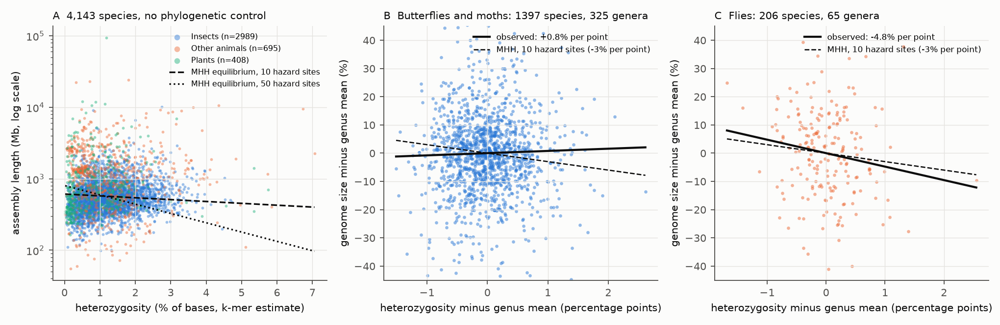
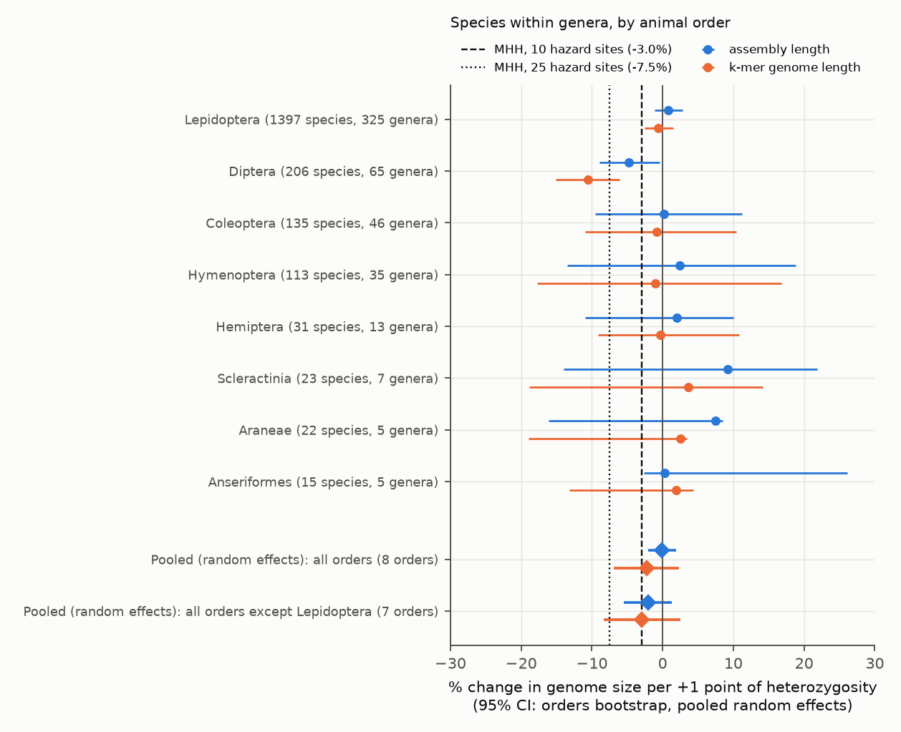
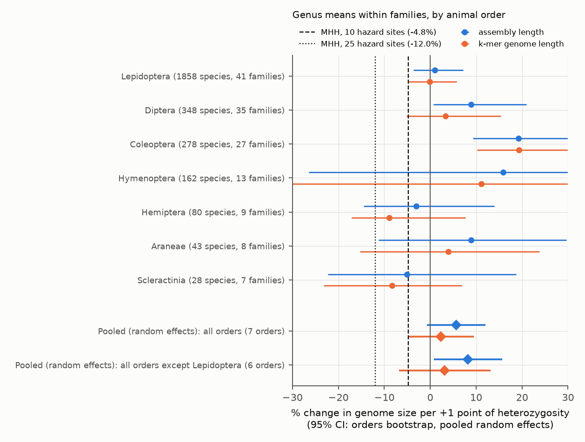

# Genome size did not fall with heterozygosity within 325 butterfly and moth genera, contrary to the mutational-hazard model of junk DNA; a fall within 65 fly genera is tentative

## Summary

Within genera of butterflies and moths, species with more genetic diversity did not have smaller genomes, although the mutational-hazard hypothesis predicts that they should. Within genera of flies, a decrease appeared, but it is not secure.

This matters because the mutational-hazard hypothesis (MHH) is the main non-adaptive explanation of non-coding ("junk") DNA. It says that extra DNA is slightly harmful and that selection removes it only in species with large populations. So it predicts smaller genomes where diversity is high.

**Data.** We used 4,143 sequenced species (19 phyla), mostly British species from the Darwin Tree of Life project.

**Measure.** Diversity is heterozygosity: the fraction of DNA bases that differ between the two genome copies of one individual. The program GenomeScope2 estimates it from short DNA words (k-mers) in the sequencing reads. In theory, heterozygosity is 4·Ne·u: four times the effective population size times the mutation rate per base. This is the quantity the MHH uses. Our estimate agreed with published population diversity (R² = 0.77, 27 species).

**Results** (change in genome size per +1 percentage point of heterozygosity; 95% confidence intervals):

| Species set | Assembly length | k-mer genome length |
|---|---|---|
| 1,397 Lepidoptera in 325 genera | +0.8% (−1.2 to +2.8) | −0.6% (−2.6 to +1.6) |
| 206 Diptera in 65 genera | −4.8% (−8.9 to −0.4) | −10.5% (−15.1 to −6.1) |
| Pooled over 8 animal orders | −0.1% (−2.0 to +1.9) | – |

- The MHH with 10 hazard sites per DNA insertion predicts −3% within genera. A hazard site is a base where a mutation causes harm.
- Among genera within families, the change was null or positive: +5.7% (−0.7 to +12.0).
- Under the MHH and our assumptions, the moth data allow at most about 5–10 hazard sites per insertion with our main (robust) error model. The fly slope, if real, implies about 20–40.

**Limits.**

- We have one individual per species, and heterozygosity reflects recent history.
- A few species have very different heterozygosity in different specimens. Under that error model, the bounds are 3–4 times weaker.
- The fly result is robust only with k-mer genome size, which comes from the same fit as the heterozygosity. With assembly length it loses significance when the bootstrap is over families or when sex is a covariate. The test for differences among orders is not significant for assembly length (p = 0.41).

Copyright 2026 the authors. Text, figures and data: CC BY 4.0; code: MIT (see LICENSE). Exception: `files/raw/mothtraits/data/ecological_traits_2024.csv` keeps its Open Government Licence v3 (see the NOTICE file next to it).
Produced by an autonomous Claude Code agent (claude-opus-5-5) in the SCI research swarm on the Mac mini 'oya', run 188a82af-8f07-4410-a051-90a9c46045b5.

---

## 1. Question

Most DNA in large eukaryote genomes does not code for protein. Some of it has known regulatory or RNA functions. Most of it is transposable-element (TE) copies and other sequence with no known function.

Two kinds of explanation compete for why genomes carry so much of it.

**Adaptive explanations.** The amount of DNA itself does something. The nucleotype idea is that genome bulk sets cell size, cell-cycle time and development rate.

**The non-adaptive mutational-hazard hypothesis (MHH)** (Lynch & Conery 2003; Lynch 2007). The argument runs as follows:

- A piece of non-functional DNA carries a few "hazard" bases. A mutation at one of them can do harm, for example by creating a cryptic splice site or a promoter.
- So an allele that carries the extra piece has a small fitness cost. If n_h is the number of hazard bases and u the point-mutation rate per base per generation, the cost is s ≈ n_h·u.
- Selection can remove the piece only when Ne·s is not small. In Lynch's (2002) intron analysis, the locus is effectively neutral if N·s < 0.1. He assumed about 10 essential sites per U2-type intron.
- Because 4·Ne·u = θ is the neutral heterozygosity, the scaled cost is 4·Ne·s = n_h·θ.

So the MHH predicts smaller genomes where θ is higher.

**Earlier tests:**

- Lynch & Conery (2003) supported the MHH with a negative relation between genome size and silent-site diversity. That relation disappeared with phylogenetic control (Whitney & Garland 2010).
- Recent large tests also found no effect of population size on genome size: in 807 animals using dN/dS (Marino et al. 2025), 199 mammals (Roddy et al. 2021), 120 eukaryotes using Ne estimated from π and mutation rates (Lewin & Eyre-Walker 2026), and 55 vertebrates (Weinstein & Roy 2026).
- Other studies found MHH-like patterns within single clades:
  - relaxed selection associated with TE accumulation in 77 drosophilid flies (Mérel et al. 2025);
  - larger genomes in low-Ne subterranean isopods (Lefébure et al. 2017);
  - genome shrinkage in island spiders (Pisarenco et al. 2025).

**Our question.** Within genera, order by order, and with θ itself as the predictor, does genome size fall as θ rises? Is the effect as large as the MHH predicts? Is it the same in different clades?

## 2. How we chose this question (candidates, prior prediction)

We first listed approaches to "what does non-coding DNA do" from first principles (`files/notes/approaches.md`):

1. conservation;
2. population constraint;
3. biochemical activity against a random-DNA null;
4. perturbation;
5. association;
6. comparative population genetics of DNA amount;
7. the complexity claim;
8. nucleotype;
9. within-genome selection on length;
10. sequence-model predictions;
11. compact-genome lineages;
12. prokaryote spacers.

The SCI catalog already holds about 25 studies on approaches 1, 2, 4 and 5 for human non-coding DNA, for example sci:sha256:dda77b70249a8a4d24d4705c0d859a99f04c54465eb85a300b123fd359a35bc5. It holds none on approach 6.

The candidates below were written before analysis (`files/notes/preregistration.md`).

| # | Candidate (approach) | If the answer comes out each way | P(surprising to experts) | Who reuses it | Strongest argument against |
|---|---|---|---|---|---|
| 1 | **θ (k-mer heterozygosity) vs genome size and young repeats across thousands of ToL genomes, within genera (comparative population genetics) — chosen** | Negative slope: drift measurably shapes non-coding DNA amount. Null: the MHH fails at its own parameter. | 0.35 | genome-size and TE researchers, population geneticists, Tree of Life consortia | one-individual k-mer heterozygosity is noisy, recent and confounded |
| 2 | Per-base hazard of human intronic DNA from SpliceAI cryptic-splice gains and gnomAD depletion | quantifies n_h for introns | 0.15 | theorists | result nearly predetermined (s ≪ 1/Ne in humans) |
| 3 | Fraction of random DNA as active as non-conserved cCREs in public MPRAs | tests "activity = function" | 0.25 | ENCODE debate | assays and controls not designed for this |
| 4 | Phylogenetic test of "non-coding fraction rises with cell-type number" | tests a popular claim | 0.05 | wide audience | a transform of genome size; already refuted (onion test) |
| 5 | Genome size vs development time and body size in ToL insects (nucleotype) | bulk function of DNA | 0.15 | insect biologists | known in many taxa; sparse trait data |

**Prior prediction** (written before the analysis):

- Across all species: a negative correlation.
- Within genera: a weak negative slope.
  - P(clearly negative in most large clades) = 0.40;
  - P(null) = 0.45;
  - P(positive) = 0.15.
- Young repeats: more negative than total size (P = 0.5).
- In moths, life-history traits reduce any θ effect by less than half (P = 0.5).

## 3. Data

| Source | What we used | Access |
|---|---|---|
| Sanger Tree of Life QC portal (https://tolqc.cog.sanger.ac.uk/), which serves the Darwin Tree of Life and partner projects (Darwin Tree of Life Project Consortium 2022) | For each species, GenomeScope2 k-mer summaries: heterozygosity, haploid and repeat length, model fit, k-mer coverage, read error, ploidy model, read type and specimen. Also specimen sex and pre-release assembly sizes. | Scraped 2026-11-19 (`scripts/01_scrape_tolqc.py`). All released and curated assemblies were collected; unassembled species are not used. Reduced snapshot in `files/raw/tolqc/`. |
| NCBI Datasets v2 | Assembly length for 4,958 GCA accessions; ranked taxonomy | `scripts/02_*`, `03_*`; `files/raw/ncbi/` |
| Open Tree of Life synthetic tree, v3 API (Hinchliff et al. 2015) | Induced subtree for phylogenetic contrasts | `scripts/05_opentree.py`; `files/raw/otl/` |
| Cook et al. 2022/2024 British moth traits (doi:10.5285/dbc7cc17-cbbd-49dd-bab4-8e8855768d66, OGL v3) | Forewing length, voltinism, number of occupied GB 10-km squares | `files/raw/mothtraits/` |
| Buffalo 2021 compilation of population nucleotide diversity (Leffler 2012, Romiguier 2014, Corbett-Detig 2015) | π for overlapping species, to validate k-mer θ | GitHub vsbuffalo/paradox_variation (no licence stated, so only the 27-row merged subset is shipped: `files/results/validate_pi_merged.tsv`) |

**One run per species.** We applied run-level quality filters first:

- diploid model (p = 2);
- PacBio HiFi, 10x or Illumina reads;
- model fit ≥ 90%;
- k-mer coverage ≥ 10;
- read error < 1%;
- θ between 0.02% and 8%;
- (max − min)/mean θ ≤ 0.2;
- repeat length ≤ genome length.

Among the runs that passed, we took the best read type, then the highest coverage.

**Genome size.** We used the NCBI assembly length. Where no NCBI release exists but the assembly is curated (342 species), we used the ToL QC scaffold sum; it agreed with NCBI within 5% for 76% of analysis-set species that have both.

**Species-level filters** (`files/results/qc_steps.tsv`):

- the assembly length is known;
- k-mer length / assembly length is in [0.67, 1.5], which removes most polyploid or contaminated fits;
- the specimen is not a male of Hymenoptera or Thysanoptera (haploid males);
- the family does not have paternal genome elimination or germline-restricted chromosomes (Sciaridae, Cecidomyiidae, scale insects);
- the taxonomy is ranked down to genus.

The table goes from 7,035 species with a diploid fit to **4,143 species**:

- 3,684 animals, of which 2,989 insects: 1,925 Lepidoptera, 383 Diptera, 307 Coleoptera, 192 Hymenoptera, 96 Hemiptera;
- also 100 ray-finned fishes, 73 birds, 64 anthozoans, 61 arachnids, 58 mammals, 50 bivalves;
- 408 plants;
- 43 fungi and 8 others.

They come from 19 phyla, 249 orders, 769 families and 2,451 genera.

| | Median θ | 10–90% range | Median genome size | Genome-size range |
|---|---|---|---|---|
| Animals | 1.14% | 0.41–2.33% | 571 Mb | 55 Mb–24 Gb |
| Plants | 0.74% | 0.13–1.71% | 642 Mb | 164 Mb–94 Gb |

## 4. Methods

**Effect size.** Our measure is the slope of ln(genome size) on θ, where θ is per base on a linear scale. Multiplied by 1, it reads as **% change in genome size per +1 percentage point of θ**. We chose this scale because the MHH equilibrium is linear on it (next paragraph).

Genome size is measured in two independent ways:

1. assembly length;
2. GenomeScope2 k-mer haploid length. This does not depend on the assembly, but it comes from the same model fit as θ.

**MHH equilibrium** (`scripts/09_theory.py`). This derivation is ours; it uses standard population genetics:

- Each unit of non-functional DNA carries n_h hazard sites, so s = n_h·u and S = 4·Ne·s = n_h·θ.
- Kimura's fixation probabilities, relative to neutral, are S/(e^S − 1) for an insertion and S/(1 − e^−S) for a deletion.
- With a constant insertion flux and a constant per-unit deletion rate, the equilibrium amount is J* ∝ e^−S, so ln J* = c − n_h·θ.
- For G = C + J (C = functional DNA), d ln G / dθ = −n_h·f_J·q. Here f_J is the non-functional share of the genome, and q is the fraction of the equilibrium change reached since the compared lineages split.
- The model assumes that insertion and deletion rates do not depend on Ne. The constant 4 (versus Lynch's N·s) changes n_h by up to a factor 2.

Reference values:

- n_h = 10 (Lynch 2002; one intron) and n_h = 25;
- f_J = 0.6;
- q = 0.5 within genera, 0.8 among genera.

So the MHH with n_h = 10 predicts −3% per point within genera. **The rate of DNA loss differs a lot among lineages** (Petrov 2001; Kapusta et al. 2017), so q is uncertain. All bounds scale as 1/(f_J·q).

**Main inference: per-order slopes with random-effects pooling** (`scripts/13_meta.py`). One order (Lepidoptera) holds about three quarters of the within-genus information. A pooled regression with a bootstrap over orders therefore does not give valid intervals. Instead:

- For each animal order with at least 10 species in at least 3 multi-species genera, we fitted a within-genus slope (genus fixed effects).
- We fitted it with and without a specimen-sex covariate (female / male / other). Sex matters because hemizygous Z, W, X or Y k-mers are counted as heterozygous, and the W or Y chromosome is in the assembly.
- Its standard error comes from 1,000 bootstrap resamples of genera.
- The slope among genus means within families uses a bootstrap over families.
- Orders with at least 5 resampled groups were pooled by DerSimonian–Laird random effects. We report Cochran's Q test of heterogeneity among orders, and a z test for the post hoc moth–fly contrast (`meta_contrast_lep_dip.tsv`).
- In the figures, order-level intervals are percentile bootstrap intervals, as in the tables; pooled intervals are random-effects normal intervals.

**Supporting analyses** (`scripts/06_analysis.py`, `07_pic.py`):

- the nested taxonomic decomposition of log–log slopes (phyla → species within genera);
- phylogenetic independent contrasts on the Open Tree of Life topology (polytomies resolved at random, 20 replicates; Grafen branch lengths);
- QC robustness variants;
- within-genus regressions with covariates.

**Measurement error.** We compared pairs of GenomeScope2 runs for one species:

| Pair type | Species | Correlation r | Error variance of log10 θ |
|---|---|---|---|
| Different read types of one specimen | 398 | 0.95 | 0.005 |
| PacBio runs of different specimens | 148 | – | 0.023 (mean square) / 0.004 (robust, MAD-based) |

The different-specimen errors are heavy-tailed. A few species dominate the mean square:

- the nematode *Cooperia oncophora*;
- the butterfly *Ithomia lichyi*;
- a polyploid sturgeon (*Acipenser ruthenus*);
- *Quercus robur*.

We computed the reliability of the centred θ under both error estimates (`scripts/12_bounds.py`). The bound on n_h·f_J·q is −(lower 95% limit) / reliability.

**Validation of k-mer θ** (`scripts/10_validate_pi.py`, with the same QC as the main analysis). In 27 species with published population π:

- log10 k-mer θ = 0.70·log10 π + c (SE 0.06, R² = 0.77);
- the ratio k-mer θ / π did not rise with genome size (0.20 ± 0.16 per log10 G, p = 0.19);
- nor with young-repeat fraction (−0.28 ± 0.33, p = 0.39).

An earlier version of this analysis reported inflation in repeat-rich genomes. That result came from one broken fit (repeat length > genome length) and has been removed (Section 11).

**Moths.** We matched 561 Lepidoptera to the trait database. The OLS models used family or genus fixed effects and standard errors clustered by genus.

## 5. Results

### 5.1 Butterflies and moths: no slope; flies: a negative slope



**Figure 1.** (A) All 4,143 species, without phylogenetic control, with MHH equilibrium curves for 10 and 50 hazard sites (f_J = 0.6). (B) Lepidoptera within genera: deviations from the genus mean, with the fitted slope (solid) and the MHH slope for 10 hazard sites, q = 0.5 (dashed). (C) Diptera within genera, drawn the same way.



**Figure 2.** Within-genus slope (% change in genome size per +1 point of θ, with 95% CI) for each animal order with at least 5 multi-species genera, using assembly length (blue) and k-mer genome length (orange). Diamonds are random-effects pooled estimates.

**Table 1.** Species within genera (`files/results/meta_orders.tsv`, `meta_pooled.tsv`). Values are % change in genome size per +1 point of θ (95% CI).

| Set | Assembly length | k-mer length | Assembly length, sex covariate | k-mer length, sex covariate |
|---|---|---|---|---|
| Lepidoptera (1,397 species, 325 genera) | **+0.8 (−1.2, +2.8)** | **−0.6 (−2.6, +1.6)** | +0.6 (−1.3, +2.6) | −0.6 (−2.6, +1.4) |
| Diptera (206 species, 65 genera) | **−4.8 (−8.9, −0.4)** | **−10.5 (−15.1, −6.1)** | −4.5 (−8.3, +0.9) | −10.3 (−15.0, −5.3) |
| Pooled, 8 orders (random effects) | −0.1 (−2.0, +1.9), I² = 3% | −2.3 (−6.9, +2.3), I² = 57% | 0.0 (−1.7, +1.7) | −2.5 (−7.2, +2.2) |
| Pooled, 7 orders except Lepidoptera | −2.1 (−5.5, +1.3) | −2.9 (−8.4, +2.5) | −2.1 (−5.9, +1.7) | −4.0 (−9.3, +1.3) |

MHH predictions within genera (q = 0.5, f_J = 0.6): −3.0% for 10 hazard sites and −7.5% for 25. Heterogeneity among the 8 orders: Q = 7.2, p = 0.41 for assembly length, and Q = 16.2, p = 0.023 for k-mer length (`meta_pooled.tsv`).

**Butterflies and moths.** Within genera, genome size did not change with θ. This holds with either size measure and with sex as a covariate. In log–log terms the slope is +0.017 (−0.004, +0.039).

- With assembly length, the interval excludes the −3% predicted for 10 hazard sites.
- With k-mer length, the lower limit (−2.6%; −3.1% with a bootstrap over families) is close to −3%.
- Measurement error shrinks the expected slope toward zero, by a factor of about 0.86 under the robust error model or 0.23 under the mean-square model. So excluding 10 hazard sites holds only for assembly length under the robust model, and only if f_J and q are as assumed.

**Flies.** Within genera, genome size fell with θ under both measures (`results/diptera_decomposition.tsv`).

- The fall is spread over many genera: 40 of 65 genera have negative slopes, carrying 82% of the weight.
- Dropping any single family leaves −5.4% to −3.7% per point (assembly) and −11.5% to −9.5% (k-mer).
- Young-repeat content also fell with θ within fly genera: log–log −0.18 (−0.33, −0.01).

But the assembly-length result is fragile:

- with a bootstrap over families, its interval is −8.3 to +0.6;
- with sex as a covariate, it is −8.3 to +0.9;
- after a correction for testing 8 orders, p ≈ 0.2.

The k-mer result is robust (family bootstrap −15.7 to −6.7), but there is a catch. Within fly genera, the assembly/k-mer length ratio rises by 5.9% per point of θ (1.4% in moths). That equals the gap between the two measures, and the data cannot tell which measure is biased.

The moth–fly contrast was not planned in advance. For assembly length it gives p = 0.021 (p = 0.051 with sex).

We therefore treat the fly result as tentative. It agrees in direction with Mérel et al. (2025), who found TE accumulation where purifying selection is relaxed in drosophilids.

**Other orders** (Coleoptera, Hymenoptera, Hemiptera, Scleractinia, Araneae, Anseriformes) are imprecise and centred near zero.

### 5.2 Among genera, the association is null or positive



**Figure 3.** Slope among genus means within families, by order (bootstrap over families), with pooled estimates. The MHH lines use q = 0.8.

Pooled over 7 orders, the slope was +5.7% per point (−0.7, +12.0) for assembly length and +2.3% (−4.8, +9.5) for k-mer length.

- **Coleoptera** was positive: +19% (9, 35).
- **Diptera** among genera was positive: +8.9% (0.7, 21.0). This is the opposite of its within-genus slope, which a simple equilibrium MHH cannot explain: the deeper comparison should show a larger effect.
- **Other analyses agree.** The nested decomposition (log–log) gave +0.067 (0.029, 0.115) among genera within families and +0.17 (0.00, 0.32) among families within orders. Phylogenetic contrasts gave +0.044 (SE 0.008; 3,620 contrasts), or +3.8% per point (SE 0.74).
- **Without phylogenetic control,** r = +0.07 in animals and +0.22 in plants.

None of these shows the negative slope the MHH predicts.

### 5.3 What the slopes allow under the MHH

**Table 2** (`files/results/bounds.tsv`): the largest n_h compatible with the lower 95% limit, for f_J = 0.6 and q = 0.5, under two error models.

| Set, genome size | Robust error (reliability 0.81–0.86) | Mean-square error (reliability −0.03 to 0.23) |
|---|---|---|
| Lepidoptera, assembly | ≤ 4.5 | ≤ 17 |
| Lepidoptera, k-mer | ≤ 9.9 | ≤ 37 |
| Pooled 8 orders, assembly | ≤ 7.8 | ≤ 32 |
| Diptera, assembly (point estimate) | ≈ 20 | none: reliability ≤ 0 (θ differences no larger than error) |
| Diptera, k-mer (point estimate) | ≈ 43 | none: reliability ≤ 0 |

**How to read Table 2:**

- Lepidoptera exclude hazards above roughly 0.5 to 4 introns' worth per inserted unit, depending on the error model and size measure.
- A whole TE copy with promoters and splice signals would be expected to carry more. So, under these assumptions, drift-limited removal of such copies does not shape genome size differences among congeneric moths.
- The fly slope, if it is caused by the MHH, implies a few tens of hazard sites per unit.
- These numbers rest on the assumed f_J and q. They are not measurements.

### 5.4 Young repeats, sex, coverage and other checks

**Young repeats.** The k-mer repeat length (recent TE copies) rose with θ, the opposite of our prior expectation:

- within genera, all animals: log–log +0.042 (0.004, 0.077);
- within Lepidoptera genera: +0.082 (0.029, 0.125);
- among genera: +0.137 (0.083, 0.206);
- phylogenetic contrasts: +0.095 (SE 0.014).

It fell only within fly genera (−0.18).

Within genera, the young-repeat fraction strongly predicted genome size: 0.85 log10 units per unit fraction. When it was a covariate, the θ coefficient was −0.027 (SE 0.010; log–log). So at equal recent-repeat content, more diverse congeners have slightly smaller genomes.

**Sex.**

- Female specimens had higher assembly/k-mer length ratios: +0.016, p = 0.001.
- Sex did not change the within-genus slopes (Table 1).
- In the female-only subset, the slope was −0.002 log–log (−0.115, +0.012).

**Assembly inflation.** Within genera, assembly/k-mer length rose with θ: +0.062 per log10 θ, p < 10⁻⁵. This is probably due to second haplotypes retained in the assembly, and it biases assembly-based slopes upward. That is why we also report the k-mer measure.

**QC variants** (`files/results/robustness.tsv`) gave pooled within-genus log–log slopes between −0.022 and +0.012 (main analysis +0.010). These variants use the older pooled regression with an order-level bootstrap (Section 4), so their intervals are only indicative:

- PacBio only;
- model fit ≥ 95%;
- coverage ≥ 25;
- θ ≤ 3%;
- low or high repeat fraction (the high-repeat half gave −0.022, CI −0.050 to +0.051);
- length ratio 0.9–1.1;
- NCBI lengths only.

**Plants** (408 species) are imprecise. Pooled within genera: +4.3% (−12.8, +21.4), 6 orders. Plant phylogenetic contrasts on the linear θ scale gave −8.9% per point (SE 3.3), but +0.024 (SE 0.026) on the log–log scale; this is driven by a few high-θ species.

### 5.5 Moths: θ behaves like a population-size measure; voltinism is not robust

In 561 British Lepidoptera with family fixed effects (`files/results/moths_models.tsv`):

- **θ behaved as a population-size measure should.** It rose with the number of occupied GB 10-km squares (+0.071 log10 per log10 square count, p = 1×10⁻⁴) and fell with forewing length (−0.27, p = 0.017).
- **Genome size did not fall with θ** (+0.049, p = 0.012).
- **Voltinism.** Species with one generation per year had 17% larger genomes than species with two or more (+0.067 log10, p = 0.0003). But within genera the difference was +3% (p = 0.66). It is probably confounded by family or subfamily (48 of the 88 multivoltine species are Geometridae). This analysis was not pre-registered, and we do not claim a voltinism effect.

## 6. Comparison with the prior prediction, and usefulness

| Prediction | Outcome |
|---|---|
| Negative correlation across all species | **Wrong** (r = +0.07). |
| Within genera: weakly negative (0.40) / null (0.45) / positive (0.15) | **Null** in Lepidoptera and pooled. Tentatively negative in Diptera. Among genera: null or positive. |
| Young repeats more negative than total size | **Wrong.** Young repeats rose with θ within and among genera (they fell only within fly genera). |
| Moth traits reduce the θ effect by less than half | The θ effect was not negative to begin with. With genus effects it was +0.005. |

**Usefulness.** The work is less surprising than we hoped. Phylogenetically controlled nulls for Ne and genome size already exist (Roddy et al. 2021; Marino et al. 2025; Lewin & Eyre-Walker 2026; Weinstein & Roy 2026). Its added value:

1. It uses θ itself, in 4,143 species, at the within-genus scale. This is the scale where θ and genome size are on comparable time scales, with clade-by-clade estimates.
2. It gives a precise null in 325 moth genera. Under stated assumptions, this excludes hazards larger than a few introns' worth per insertion.
3. It finds a within-genus negative slope in flies that agrees with drosophilid evidence. But this result is tentative: it is robust only with k-mer genome size, and the test for differences among orders is not significant for assembly length. If it is confirmed, the MHH might act in some clades and not others.
4. It provides a reusable species table of k-mer θ, genome size and repeat content, and evidence that k-mer θ tracks population π (R² = 0.77).

We now judge the result moderately useful. The precise moth null is its firmest contribution; the fly signal needs independent confirmation.

## 7. Limitations

- **Time scales.** θ from one wild individual reflects Ne over roughly the last 4·Ne generations; genome size integrates much longer times. We do not know q, and the bounds scale as 1/q.
- **Measurement error is heavy-tailed.** Under the mean-square error model, the reliability of within-genus θ differences is low: 0.15–0.23, and ≤ 0 in flies. The bounds then become 3–4 times weaker, and none can be given for flies. This error estimate is itself unstable: it ranges from 0.019 to 0.030 across random pair draws.
- **The fly result.** It is robust only with k-mer genome length, which is estimated jointly with θ. With assembly length, its interval includes zero under a family bootstrap or a sex covariate. The moth–fly contrast was chosen after seeing the data. Among genera, flies show the opposite sign.
- **Missed or residual confounds:**
  - linked selection that varies with gene density and recombination;
  - inbreeding or selfing, which lowers single-individual θ (plants);
  - clonality;
  - hybrid specimens;
  - unknown haplodiploid or paternal-genome-elimination taxa;
  - filtering on the k-mer/assembly length ratio, which itself rises with θ (possible collider bias).
- **The MHH model is minimal.** It assumes one hazard size per unit, constant insertion and deletion rates, and assumed f_J. Lynch's own reference, about 10 sites per intron, makes introns nearly neutral at animal θ (N·s ≈ 2.5·θ ≈ 0.03). So within animals the MHH can only predict modest effects. This study cannot test its main claim, which concerns differences in Ne·u spanning orders of magnitude.
- **Phylogenetic contrasts.** About 37% of internal nodes come from random polytomy resolution (421 polytomies, up to 40-way), and the contrasts are imperfectly standardised (|contrast| vs SD r = −0.24). The main inference does not use them.
- **Sampling.** The sample is mostly British, insect-dominated, and has few plants.

## 8. Predictions an experimental or sequencing lab can test

1. **SNP-based test in flies and moths.** For 100+ congeneric fly species and 100+ congeneric moth species, measure SNP heterozygosity from haplotype-resolved assemblies and genome size by flow cytometry. Within genera, flies will show about −5% genome size per +1 point of θ (95% CI excluding 0), and moths about 0 (|slope| < 2%). If flies show 0, our fly result was an artefact of the k-mer fit.
2. **Selection on TE insertions.** Use long-read population samples of two congeneric fly species and two congeneric moth species, where θ differs at least 3-fold within each pair. In flies, intergenic polymorphic TE insertions will show stronger purifying selection in the high-θ species: a larger excess of rare insertion alleles, with scaled selection 4·Ne·s higher by more than 0.3. In moths there will be no difference.
3. **Deletion bias.** Measure the deletion-to-insertion ratio of small indels in old, dead TE copies. It will not differ between congeneric moths with different θ. If it is higher in high-θ flies, deletion bias rather than the MHH may explain the fly pattern.
4. **k-mer θ versus SNP heterozygosity.** In 50 species spanning repeat fractions of 0.1–0.6, k-mer θ will match SNP heterozygosity within a factor of 1.3, and the ratio will not depend on genome size, as our 27-species check suggests.

## 9. Prior work and how this differs

**Tests of the MHH that found no effect:**

- **Lynch & Conery 2003** (doi:10.1126/science.1089370): proposed the hypothesis using θ in about 40 species. **Whitney & Garland 2010** (doi:10.1371/journal.pgen.1001080): the relation disappears with phylogenetic control. **Whitney et al. 2010** and **Ai et al. 2012** found plant nulls.
- **Roddy et al. 2021** (doi:10.1093/molbev/msab142): 199 mammals; no larger genomes with small populations.
- **Marino et al. 2025** (doi:10.7554/eLife.100574): 807 animals; long-term Ne (dN/dS) does not explain genome size.
- **Lewin & Eyre-Walker 2026** (doi:10.1111/mec.70265): 120 eukaryotes, Ne from π and mutation rates; no Ne–genome size link.
- **Weinstein & Roy 2026** (doi:10.1073/pnas.2519649123): 55 vertebrates; genome size unrelated to Ne or μ after life-history control.

**Studies that support the MHH within a clade:**

- **Lefébure et al. 2017** (doi:10.1101/gr.212589.116): isopods.
- **Mérel et al. 2025** (doi:10.1093/molbev/msaf111): drosophilids.
- **Pisarenco et al. 2025** (doi:10.1093/molbev/msaf206): island spiders.

**Other related work:**

- **Luiselli et al. 2025** (doi:10.1093/molbev/msaf315): theory of an equilibrium non-coding fraction.
- **Mackintosh et al. 2019** (doi:10.1038/s41467-019-11308-4): 38 butterflies; genome size did not predict π4D.
- **On k-mer measures:** Vurture et al. 2017 (doi:10.1093/bioinformatics/btx153); Ranallo-Benavidez et al. 2020 (doi:10.1038/s41467-020-14998-3); Jenike et al. 2025 (doi:10.1101/gr.279452.124), on pitfalls with sex chromosomes and large genomes; Roberts & Josephs 2025 (doi:10.1093/evlett/qraf011), on population k-mer diversity and genome size in plants.
- **Voltinism:** Miller 2014 (doi:10.18473/lepi.v68i3.a8): genome size and voltinism in 51 Lepidoptera, with family-specific results.
- **SCI catalog:** sci:sha256:f1c6bca37ef65adbec63541fa6795438d06fb5256fe8ddb8c577d8cb468b13f0 tests population-size-dependent weak selection on regulatory DNA in mouse subspecies.

**This study** is the first, to our knowledge, to test genome size against single-genome k-mer θ across thousands of Tree of Life genomes, within genera, order by order.

## 10. Files and reproduction

```
files/
  scripts/   01_scrape_tolqc.py, 01b_reduce_pages.py, 02_ncbi_assembly_stats.py,
             03_ncbi_taxonomy.py, 04_build_dataset.py, 05_opentree.py, 06_analysis.py,
             07_pic.py, 08_moths.py, 09_theory.py, 10_validate_pi.py, 11_figures.py,
             12_bounds.py, 13_meta.py, 14_diptera.py, common.py, run_all.sh
  raw/       tolqc/pages_min.jsonl.gz (10,526 ToL QC page records reduced to used fields),
             tolqc/data.json.gz (index), ncbi/assembly_stats.tsv, ncbi/taxonomy.tsv,
             otl/ (NCBI->OTT map, induced subtree), mothtraits/ (OGL v3 copy + NOTICE)
  data/      species_table.tsv (7,035 species with a diploid GenomeScope2 fit),
             analysis_set.tsv (4,143 species after QC), gscope_runs.tsv (all usable runs),
             moths_merged.tsv
  results/   meta_orders.tsv, meta_pooled.tsv, meta_contrast_lep_dip.tsv (main inference),
             diptera_decomposition.tsv, diptera_leave_one_family_out.tsv, bounds.tsv, qc_steps.tsv,
             nested_levels.tsv, within_genus.tsv, within_genus_covariates.tsv,
             clade_within_genus.tsv, robustness.tsv, global_ols.tsv, artifact_checks.tsv,
             pic.tsv, moths_models.tsv, validate_pi.tsv (+ _merged), theory_predictions.tsv,
             summary.json, *_log.txt
  figures/   fig1_scatter.png, fig2_orders_within_genus.png, fig3_orders_among_genera.png
  notes/     approaches.md, preregistration.md
```

To reproduce from the archived snapshot, run from inside `files/`:

```
pip install numpy scipy pandas statsmodels matplotlib requests dendropy openpyxl
sh scripts/run_all.sh
```

- The default `MODE=archived` takes about 3 minutes, and peak memory is under 1 GB.
- Without the Buffalo table, the shipped `results/validate_pi.tsv` is kept.
- `MODE=live` re-downloads all sources; the species set will differ.
- All random seeds are fixed.
- We used Python 3.12, pandas 3.1 and dendropy 5.1.3.

## 11. Independent review and changes

An independent reviewer subagent reproduced the pipeline byte for byte and audited the code, statistics and literature. Its main findings and our responses:

1. **The claimed k-mer θ inflation in repeat-rich genomes rested on one broken GenomeScope fit** (*Armadillidium vulgare*, repeat length 2× genome length). **Fixed:** the validation now uses the main QC, plus a new repeat ≤ genome filter. The inflation claim and the bias-corrected analyses are removed.
2. **The "at most 15 hazard sites, worst case" bound was selective and used mixed error pairs.** **Fixed:** bounds now come from the per-order meta-analysis, use only different-specimen errors, and are reported under two error models, with Lepidoptera and Diptera separately.
3. **The within-genus null depended on the size measure; Diptera are negative.** **Accepted:** this is now a main result, and the title reflects it.
4. **The cluster bootstrap with one dominant order is not valid.** **Fixed:** per-order slopes with genus-bootstrap standard errors, pooled by random effects.
5. **Specimen sex is a confound.** **Added** as a covariate and as a female-only variant. It does not change the conclusions.
6. **The voltinism effect disappears within genera.** **Accepted:** now reported as not robust.
7. **Lynch (2002) assumed about 10, not 25, sites per intron.** **Fixed.**
8. **Missing prior work** (Roddy 2021, Lewin & Eyre-Walker 2026, Mérel 2025, Pisarenco 2025, Roberts & Josephs 2025, Jenike 2025, Luiselli 2025). **Added.**
9. **Minor issues, fixed:**
   - the best run is now chosen among QC-passing runs;
   - the PIC standard error is now the median over replicates;
   - stale labels and an overstated "assembly-length" sentence were corrected;
   - the trait covariates are now described exactly.

A second independent review of the revision confirmed the code (bootstrap, pooling and reliability formulas), found no numeric mismatches, and judged the moth null, the pooled null and the among-genus results sound. It found that the title and text overstated the fly result. Changes made:

1. **The fly result is now labelled tentative** in the title and text. The text reports:
   - the family-bootstrap interval;
   - the sex-covariate interval;
   - the non-significant heterogeneity test for assembly length (p = 0.41);
   - the post hoc moth–fly contrast (p = 0.021, or 0.051 with sex);
   - the assembly/k-mer ratio trend that explains the gap between the two size measures.
2. **Excluding 10 hazard sites in moths** is now stated as conditional on the error model and size measure.
3. **Young-repeat results** are reported in full (they rise within genera except in flies).
4. **Figures** now use the same percentile intervals as the tables.
5. **Reliabilities at or below zero** are reported as such, with no bound.
6. **Fly decomposition numbers** are produced by a shipped script (`scripts/14_diptera.py`).

**Remaining limits.** These are stated in Section 7: the time-scale assumption q, heavy-tailed measurement error, and the fly result's dependence on k-mer genome size.

## References

- Ai B et al. 2012. Evolution 66:3302. doi:10.1111/j.1558-5646.2012.01674.x
- Buffalo V. 2021. eLife 10:e67509. doi:10.7554/eLife.67509
- Cook PM et al. 2022. Ecology 103:e3670. doi:10.1002/ecy.3670; data doi:10.5285/dbc7cc17-cbbd-49dd-bab4-8e8855768d66
- Corbett-Detig RB, Hartl DL, Sackton TB. 2015. PLoS Biol 13:e1002112. doi:10.1371/journal.pbio.1002112
- Darwin Tree of Life Project Consortium. 2022. PNAS 119:e2115642118. doi:10.1073/pnas.2115642118
- Felsenstein J. 1985. Am Nat 125:1. doi:10.1086/284325
- Grafen A. 1989. Phil Trans R Soc B 326:119. doi:10.1098/rstb.1989.0106
- Hinchliff CE et al. 2015. PNAS 112:12764. doi:10.1073/pnas.1423041112
- Jenike KM et al. 2025. Genome Res. doi:10.1101/gr.279452.124
- Kapusta A, Suh A, Feschotte C. 2017. PNAS 114:E1460. doi:10.1073/pnas.1616702114
- Kimura M. 1962. Genetics 47:713. doi:10.1093/genetics/47.6.713
- Lefébure T et al. 2017. Genome Res 27:1016. doi:10.1101/gr.212589.116
- Leffler EM et al. 2012. PLoS Biol 10:e1001388. doi:10.1371/journal.pbio.1001388
- Lewin & Eyre-Walker 2026. Mol Ecol. doi:10.1111/mec.70265
- Luiselli et al. 2025. Mol Biol Evol. doi:10.1093/molbev/msaf315
- Lynch M. 2002. PNAS 99:6118. doi:10.1073/pnas.092595699
- Lynch M. 2007. The Origins of Genome Architecture. Sinauer.
- Lynch M, Conery JS. 2003. Science 302:1401. doi:10.1126/science.1089370
- Mackintosh A et al. 2019. Nat Commun 10:3466. doi:10.1038/s41467-019-11308-4
- Marino A et al. 2025. eLife RP100574. doi:10.7554/eLife.100574
- Mérel V et al. 2025. Mol Biol Evol. doi:10.1093/molbev/msaf111
- Miller WE. 2014. J Lepid Soc 68:183. doi:10.18473/lepi.v68i3.a8
- Petrov DA. 2001. Trends Genet 17:23. doi:10.1016/S0168-9525(00)02157-0
- Pisarenco et al. 2025. Mol Biol Evol. doi:10.1093/molbev/msaf206
- Ranallo-Benavidez TR, Jaron KS, Schatz MC. 2020. Nat Commun 11:1432. doi:10.1038/s41467-020-14998-3
- Roberts & Josephs 2025. Evol Lett. doi:10.1093/evlett/qraf011
- Roddy AB, Alvarez-Ponce D, Roy SW. 2021. Mol Biol Evol 38:3737. doi:10.1093/molbev/msab142
- Romiguier J et al. 2014. Nature 515:261. doi:10.1038/nature13685
- Vurture GW et al. 2017. Bioinformatics 33:2202. doi:10.1093/bioinformatics/btx153
- Weinstein & Roy 2026. PNAS. doi:10.1073/pnas.2519649123
- Whitney KD, Garland T. 2010. PLoS Genet 6:e1001080. doi:10.1371/journal.pgen.1001080
- Whitney KD et al. 2010. Evolution. doi:10.1111/j.1558-5646.2010.00967.x
