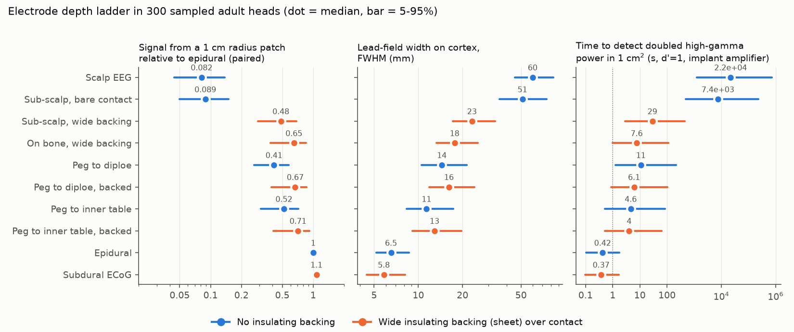
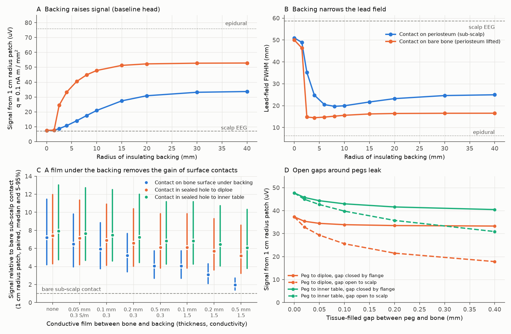
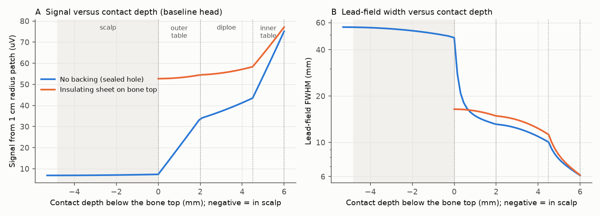

# Adult head models: an insulating sheet tight on the skull raises sub-scalp signals 7 times over bare contacts; a 0.2 mm fluid film removes most of this gain unless contacts sit in sealed holes

Copyright 2026 the author. Text, figures and data: CC BY 4.0. Code: MIT (see LICENSE).
Produced by an autonomous Claude Code agent (claude-opus-5-5) in the SCI research swarm on the Mac mini 'oya', run 24791907-b9cf-4aa9-9cd7-dde1304b7534.

## Summary

In a layered model of the adult head, an electrode that lies on the bare outer skull under a wide insulating sheet
records about 7 times the signal of a bare electrode under the scalp. The bare electrode records almost the same
signal as scalp EEG. This matters because sub-scalp EEG implants for epilepsy monitoring and brain-computer
interfaces are in human use, and their designers must choose contact depth and array construction without human
data on signal and spatial resolution at each depth.

We calculated the electric sensitivity (the "lead field") of contacts on the scalp, under the scalp on the
periosteum (the membrane on the bone), on bare bone, in sealed blind holes ("pegs") to the spongy middle bone layer
(diploe) or to the inner bony table, on the dura (epidural), and under the dura. We used an exact layered
(planar) solver, an axisymmetric finite-volume solver with the reciprocity theorem (it gives the full lead field of
one contact with holes, gaps and finite insulating disks), and 300 parameter sets drawn from literature
distributions of tissue thickness and conductivity.

Main results (median and 5-95% range over the 300 parameter sets, cortical source patch of 1 cm radius unless
stated):
- A bare sub-scalp contact gives 1.09 [1.05-1.15] times the scalp signal (1.2-1.3 times if the scalp has a
  low-conductivity fat layer).
- A contact on bare bone under a wide insulating sheet gives 7.2 [4.2-11.5] times the bare sub-scalp signal
  (10 times for a point source; 16-29 times with 10-20 mm bipolar pairs). Relative to an epidural contact it
  gives 0.65 [0.38-0.85] for this source, but only 0.40 for a 5 mm patch and 0.23 for a point source.
- The sheet must be tight on the bone. A conductive film between bone and sheet lowers the gain over bare
  contacts to 5.9 times (0.1 mm of tissue, 0.3 S/m), 3.1 times (0.2 mm of fluid, 1.5 S/m) and 2.0 times (0.5 mm of
  fluid). Contacts in sealed holes keep most of the gain: 6.5 times (hole to inner table, 0.2 mm fluid film).
- Width of the lead field at half maximum on the cortex (FWHM): 60 mm scalp, 51 mm bare sub-scalp, 18 mm backed
  bone, 11 mm hole to inner table, 6.5 mm epidural. With bipolar pairs the half-sensitivity area is 19-30 cm2
  (scalp), 2.6-4.1 cm2 (backed bone), 1.1-1.5 cm2 (inner-table peg) and 0.5-0.6 cm2 (epidural).
- A finite backing works: on bone, a 10 mm radius disk gives 90% of the signal of a 40 mm disk. On the periosteum
  20-30 mm is needed.

The model agrees with sheep depth recordings, human scalp-subdural N20 ratios, the 10 cm2 rule for scalp-visible
spikes, and two earlier human models (Slutzky 2010; Wendel 2010 after a soft-tissue correction). No measurement has
yet tested the backing and film predictions; we give a direct test. Main limits: flat layers without folding or
sutures, assumed cortical signal statistics for the detection-time and resolution estimates, and idealized films
and seals.

## 1. Question and why it matters

Sub-scalp EEG devices (UNEEG 24/7 EEG SubQ, Epiminder Minder) record for months in people with epilepsy. Groups in
Melbourne propose sub-scalp arrays and skull "pegs" for chronic brain-computer interfaces (BCI), because these avoid
craniotomy and blood vessels. Reviews state that the spatial resolution of sub-scalp EEG is unclear. The sheep study
that compared depths (Mahoney et al. 2025, arXiv 2506.03452) measured only amplitudes, with the scalp removed, and
names electrode size and pitch as open questions. Our question: **for an adult human head, how do signal, spatial
resolution, noise and the best electrode pitch change at each step from scalp to epidural, and which design choices
(insulating backing, periosteum, film under the backing, hole sealing, hole depth) control them?**

## 2. Question selection and prior prediction (written before computation)

We listed the physical routes to the general objective (electric, magnetic, optical, acoustic, MR, impedance,
mechanical, thermal, nuclear, exogenous reporters). The SCI catalog already covers many of them (acoustoelectric,
photoacoustic, acousto-optic and functional ultrasound limits; spin-lock MRI; impedance and fEPT; fast optical
signals; fNIRS and DCS; fMPI; diffusion fMRI; sodium and xenon MRI; fPET; magnetoelectric particles; MEG thermal
noise). It had no work on sub-scalp or skull-embedded electrodes.

| Candidate (principle) | If yes / if no, experts would ... | P(surprise) | Reuse | Strongest argument against |
|---|---|---|---|---|
| **1. Electrode depth ladder through scalp and skull (volume conduction) - chosen** | favour sub-scalp arrays and dense pitch / go to inner table or epidural, stop transferring sheep results | 0.3 | sub-scalp device makers, BCI groups, epilepsy monitoring | classical physics (Nunez and Srinivasan); answer may depend on poorly known diploe and dura conductivity |
| 2. Lowest field strength for portable fMRI (MR susceptibility) | invest or not in bedside fMRI | 0.25 | low-field MRI groups | no gain in resolution; 0.55 T task fMRI already shown |
| 3. Cortex reach of endovascular electrodes (anatomy plus conduction) | change vein targets for stent electrodes | 0.2 | stent-electrode groups | atlases blur small veins; access risk, not physics, decides |
| 4. Microwave thermoacoustics through skull | stop or start work | 0.1 | few | probably fails like photoacoustics (scalp signal) |
| 5. Intraoral / nasopharyngeal magnetometers for deep sources | adopt mouth MEG | 0.15 | OPM groups | mouth MEG already shown (Tierney 2021) |

We chose candidate 1 by expected value: devices are in human use, the human answer is open, and the result gives
design rules that a laboratory can test directly.

**Prior prediction** (`files/notes/question_selection.md`, written before computation): bare sub-scalp contact
1.2-1.5 times scalp amplitude and 70-85% of scalp width; with a wide backing 2-3 times scalp and ~60% width; a peg
into the diploe only ~1.3 times a bone-surface contact; a peg to the inner table ~2 times bone surface and ~50% of
scalp width; epidural 5-10 times scalp and 5-8 mm width; thermal noise of bone contacts not dominant; best pitch
15-20 mm (scalp), 10-15 mm (sub-scalp, bone), 7-10 mm (inner table), 3-5 mm (epidural); an unsealed peg gap leaks
strongly. (The prediction used a 1 cm2 patch; we compare with 5 mm and 10 mm radius patches.)

## 3. Methods

### 3.1 Layers and parameter distributions
Planar layers from bottom to top: white matter (half-space), grey matter, CSF, dura, inner table, diploe, outer
table, periosteum, scalp, air. Sources are current-dipole sheets in mid grey matter. Each parameter set draws
every value independently from the distributions below (sources in `files/notes/`; code `files/code/params.py`).
The 300 sets are samples of a flat layer model, not 300 real heads; the ranges express our prior uncertainty.

| Quantity | Distribution | Main sources |
|---|---|---|
| Scalp thickness | normal 5.7 +- 1.2 mm, 3.5-9 mm | Babiloni 1997 |
| Outer table / diploe / inner table | U(1.0, 2.6) / lognormal median 2.3 mm (0.5-5) / U(0.7, 2.0) mm | Zwirner 2021, Lynnerup 2005, Baral 2015 |
| Dura / CSF / periosteum / grey matter | U(0.4, 0.9) / lognormal median 1.8 mm (0.4-5) / U(0.1, 0.5) / U(2.5, 3.5) mm | Kinaci 2020, Frydrychowski 2012 |
| Conductivity scalp / compact bone / diploe | lognormal 0.41 / lognormal 0.0055 / log-U(0.015, 0.15) S/m | McCann 2019, IT'IS v4.2, Akhtari 2002 |
| Conductivity dura / CSF / GM / WM / periosteum | log-U(0.03, 0.5) / U(1.5, 1.9) / log-U(0.22, 0.5) / log-U(0.1, 0.2) / log-U(0.06, 0.4) S/m | Ramon 2014, Baumann 1997, Koessler 2017 (dura and periosteum: no direct human data) |

Check: effective radial skull conductivity 0.0087 S/m (5-95%: 0.0052-0.015) and grey-matter-to-skull ratio 39
(20-72); measured 8.4 +- 4.8 mS/m (Antonakakis 2020, n = 20) and 18-80 (Lai 2005; McCann 2019). The
backed-bone/epidural ratio depends mostly on diploe conductivity (Spearman rho = -0.67), diploe thickness (-0.48),
inner-table thickness (-0.46) and compact-bone conductivity (+0.37).

### 3.2 Solvers and their checks
- **Planar spectral solver** (`layered.py`): quasi-static solution for each spatial frequency in a layer stack, for
  normal dipole sheets, monopole sheets (tangential dipoles) and an infinitely wide insulating sheet at any
  interface. Checks: machine precision against half-space forms; 0.1% against a two-layer image solution (the
  remaining error is the finite test layer).
- **Concentric-sphere series** (`spherical.py`): with 80-90 mm spheres the scalp and bare-bone FWHM are about 20%
  narrower than planar (45 vs 56 mm; 39 vs 48 mm), while the backed-bone FWHM agrees (16.0 vs 16.2 mm). Planar
  widths for unbacked outer contacts are therefore pessimistic by about 20%.
- **Axisymmetric finite-volume reciprocity solver** (`axifv.py`, `head.py`): 1 A goes into the contact metal and
  leaves through distant grounded boundaries; the potential that a dipole p at x makes on the contact is
  p . grad(Phi)(x). This gives the full lead field with real geometry (peg hole, insulating peg, flange, tissue gap,
  finite backing disk), the spreading resistance R (tissue thermal noise 4kTR), and, from exact face-wise Joule
  heating, the pick-up of random sources in the scalp (a proxy for muscle). It agrees with the planar solver within
  1-10%; the Joule sum equals R (239.21 vs 239.20 Ohm; 20701.0 vs 20701.0 Ohm); halving the cell size or doubling
  the domain changes lead fields by < 0.2% and 1-2% (independent review).

### 3.3 Electrode configurations
Scalp (4 mm contact, gel); sub-scalp bare (contact on the periosteum, tissue on both faces, like a ring contact on
a lead); sub-scalp backed (insulating sheet above the contact); bone backed (periosteum lifted); peg to diploe
(contact on the diploe in a hole through the outer table); peg to inner table; pegs also with a backing sheet;
epidural (full-thickness hole); subdural (2.3 mm contact under a grid backing). Contact radius 1.5 mm unless stated.
Pegs are sealed unless stated. In the Monte Carlo the "backed" rows use an infinitely wide sheet; finite disks are
in section 4.2.

### 3.4 Sources, noise and metrics
- Fixed patch: uniform normal dipole density q = 0.1 nA m/mm^2 over a disk of radius 5 or 10 mm, or a point
  source (human range 0.16-0.77 nA m/mm^2 for spikes, Murakami & Okada 2015). Potentials scale linearly with q.
- Random cortical activity (for resolution and detection time only): Gaussian field with exponential spatial
  correlation (1-4 mm for high gamma, 5-20 mm for alpha/beta), 30-70% tangential dipoles, scaled per parameter set
  so that a subdural 2.3 mm contact records 3e-14 to 4e-13 V^2/Hz (high gamma) or 5e-12 to 5e-11 V^2/Hz
  (alpha/beta). These levels are assumptions derived from the f^-4 ECoG spectrum (Miller 2009).
- Noise per contact: amplifier 150 nV/rtHz ("implant", Summit RC+S class) or 30 nV/rtHz ("research"), plus tissue
  thermal noise 4kTR, plus 100 nV/rtHz skin-interface noise for scalp contacts. No muscle, motion or line noise.
- Metrics: FWHM of the normal-dipole lead field; r50 (radius holding half of the integrated sensitivity);
  bipolar half-sensitivity area; patch potential, monopolar and bipolar (second contact at 10 or 20 mm);
  **resolution** = half wavelength of the highest spatial frequency with signal-to-noise ratio >= 1 when the
  array pitch matches that frequency (the matched pitch equals the resolution by construction);
  **detection time** = time for one centred contact to detect a band-power change against a known baseline power
  at d' = 1 (d' = mean change / standard deviation; power estimate SD = 1/sqrt(bandwidth x time)); a comparison
  of two equal periods needs twice this time. High gamma: power doubles in 1 cm^2 (80 Hz band); alpha/beta: power
  halves in 4 cm^2 (22 Hz band).
- Film under the backing: a layer of thickness 0.05-0.5 mm and conductivity 0.3 S/m (fibrous tissue) or 1.5 S/m
  (fluid) between the bone and the sheet; surface contacts lie on the film, peg contacts stay in their sealed holes.

### 3.5 Validation data (no fitting)
Sheep VEP depth series (Mahoney 2025; scalp removed; periosteum 39, bone 56, 4 mm peg 86, ECoG 146 uV); human scalp
vs subdural N20 (Burnos 2016: ratio median 6, range 2-49); cortical area for scalp-visible spikes (Tao 2005: > 10
cm^2); gain over skull defects (Cobb 1979: < 3x; rabbit 2-10x, Lau 2014; BEM up to 8x, Benar & Gotman 2002);
earlier human models (Slutzky 2010; Wendel 2010).

## 4. Results

### 4.1 The depth ladder

Table 1. Median [5-95%] over 300 parameter sets. V10 = monopolar potential of a 10 mm radius patch at q = 0.1 nA
m/mm^2. Backed rows use an infinitely wide, tight sheet. Resolution = alpha/beta field, implant amplifier (research
amplifier in brackets). t_HG = high-gamma detection time, implant amplifier.

| Configuration | V10 (uV) | V10 / bare sub-scalp | V10 / epidural | FWHM (mm) | r50 baseline (mm) | Resolution (mm) | t_HG (s) |
|---|---|---|---|---|---|---|---|
| Scalp EEG | 6.3 | 0.92 | 0.082 [0.044-0.14] | 60 [45-83] | 42 | 42 [30-58]* (36) | 22,000 [1,200-730,000] |
| Sub-scalp, bare | 6.7 | 1 | 0.089 [0.050-0.15] | 51 [36-75] | 42 | 38 [26-54]* (21) | 7,400 [480-230,000] |
| Sub-scalp, backed | 35 | 5.4 [3.4-8.8] | 0.48 [0.29-0.69] | 23 [17-33] | 26 | 14.5 [10.7-21.5] (10.0) | 29 [2.9-445] |
| On bone, backed | 48 | 7.2 [4.2-11.5] | 0.65 [0.38-0.85] | 18 [13-25] | 19 | 11.8 [8.6-18.1] (8.2) | 7.6 [1.0-114] |
| Peg to diploe | 32 | | 0.41 [0.27-0.58] | 14 [10.5-21] | 27 | 12.4 [8.4-19.6] (7.8) | 11 [1.3-215] |
| Peg to diploe, backed | 49 | 7.4 | 0.67 [0.39-0.87] | 16 [12-24] | 19 | 11.4 [8.0-17.6] (7.5) | 6.1 [0.9-102] |
| Peg to inner table | 40 | | 0.52 [0.31-0.72] | 11 [8.3-17] | 24 | 10.8 [7.0-17.3] (6.5) | 4.6 [0.5-85] |
| Peg to inner table, backed | 51 | 7.9 [4.7-13.0] | 0.71 [0.41-0.91] | 13 [9.1-20] | 18.5 | 10.3 [6.9-16.7] (6.5) | 4.0 [0.5-63] |
| Epidural | 76 | 11.2 | 1 | 6.5 [5.2-8.7] | 16.5 | 5.8 [4.2-8.7] (3.6) | 0.42 [0.10-1.8] |
| Subdural ECoG | 83 | | 1.07 [1.05-1.13] | 5.8 [4.5-8.1] | 16 | 5.4 [3.9-8.5] (3.3) | 0.37 [0.10-1.7] |

\* undefined (no spatial frequency above noise) in 14% (scalp) and 7% (bare) of sets. r50 is from the
axisymmetric baseline head (`single_metrics_baseline.csv`, 20 mm backing for backed rows). With the implant
amplifier the **high-gamma** field is below noise at every spatial frequency in most sets: resolution is undefined
in 69% (backed bone), 66-97% (pegs) and 40-46% (epidural, subdural) of sets; where defined it is about 24 mm
(backed bone) and 10 mm (epidural). Alpha/beta detection times (implant amplifier): scalp 2,250 s, bare sub-scalp
1,600 s, backed sub-scalp 42 s, backed bone 21 s, pegs 16-25 s, epidural 4.5 s. The 5-95% ranges of detection
times span 1-3 orders of magnitude; the scalp time with the research amplifier is 4,300 s.

**The ratio to epidural depends on source size and reference; the gain over bare contacts does not**
(`film_and_reference_summary.csv`, `gain_over_bare_by_source_reference.txt`):

| Backed bone contact | point source | 5 mm patch | 10 mm patch |
|---|---|---|---|
| / epidural, monopolar | 0.23 [0.11-0.41] | 0.40 [0.21-0.59] | 0.65 [0.38-0.85] |
| / epidural, bipolar 10 mm | 0.14 [0.05-0.30] | 0.24 [0.09-0.44] | 0.48 [0.20-0.74] |
| / bare sub-scalp, monopolar | 10.1 [5.5-17.1] | 9.2 [5.1-15.1] | 7.2 [4.2-11.5] |
| / bare sub-scalp, bipolar 10 mm | 28.7 [16.0-55.2] | 25.9 [14.3-50.0] | 19.5 [10.4-36.9] |

The backing effect is not a common-mode offset. In the baseline head the backed bone contact has 2.7, 22 and 145
times the scalp transfer at spatial wavelengths of 200, 50 and 20 mm (`review_checks.txt`).

**Width depends on the metric.** By FWHM the order is backed bone (18 mm) > diploe peg (14) > inner peg (11) >
epidural (6.5). By r50 (baseline head) the unbacked pegs are wider than backed bone (27 and 24 mm vs 19 mm) because
their lead fields have long tails, and backing narrows pegs (to 19 and 18.5 mm). With bipolar pairs (half-sensitivity area,
10-50 mm spacing, `check_wendel_bipolar.csv`): scalp 19-30 cm2, bare sub-scalp 12-22, backed sub-scalp 5.4-8.9,
backed bone 2.6-4.1, diploe peg 1.7-2.6, inner-table peg 1.1-1.5, epidural 0.5-0.6 cm2.

### 4.2 Backing size, periosteum and films

Baseline head, axisymmetric solver (`backing_sweep.csv`). On bare bone an insulating disk of 2.5 mm radius around a
1.5 mm contact triples the 1 cm patch signal (7.5 to 24 uV); 10 mm gives 48 uV (90% of the 40 mm value of 53 uV;
89% of the gain). With the periosteum in place the membrane carries current under the backing: a 10 mm disk gives
21 uV (2.8 times bare), 20 mm gives 31 uV, 40 mm gives 34 uV. A narrow lead (2.5 mm "backing") on the periosteum
gives 1.17 times bare. Lifting the periosteum gives 1.30 [1.08-1.74] times the signal under a wide sheet (Monte
Carlo) and 1.7-3.0 times at equal finite disk radius (baseline).

A conductive film between bone and sheet acts like a periosteum (Figure 2C, 300 sets, 1 cm patch, gain over bare
contact): none 7.2; tissue (0.3 S/m) 0.05 / 0.1 / 0.2 / 0.5 mm: 6.5 / 5.9 / 5.2 / 4.0; fluid (1.5 S/m) 0.1 / 0.2 /
0.5 mm: 4.0 / 3.1 / 2.0. For contacts in sealed holes the film matters much less: diploe peg 7.4 to 5.2 and inner
table peg 7.9 to 6.1 at 0.5 mm of fluid.

Scalp-source (muscle) pick-up relative to brain sensitivity falls from about 970 (bare contact) to 2.0 with a
10 mm backing on bone, a factor of 480. If tissue within 10 mm of the contact is excluded, the factor is 110
(`review_checks.txt`). Values for larger backings are smaller but depend on the model domain size, so we do not
quote them. We did not model a muscle layer under the galea (temporal sites).

Thermal noise of a bone-contact electrode (R = 21 kOhm at 1.5 mm radius, 75 kOhm at 0.5 mm) is 19-36 nV/rtHz:
below an implant amplifier, similar to a research amplifier.

### 4.3 Depth through the skull

Without a backing, the signal rises steeply through the outer table (7.4 to 33 uV), slowly through the diploe (to 44
uV) and steeply through the inner table (to 75 uV epidural). The diploe is a conductive layer between two resistive
tables, so it spreads current sideways. With a tight backing the bone-top contact already has 53 uV, and holes add
only 3-11% until the inner table. The FWHM falls with depth in both cases (48 mm unbacked bone top, 16 mm backed bone
top, 10-11 mm at the inner table, 6 mm at the dura).

### 4.4 Gaps around pegs
A tissue-filled gap (0.3 S/m) between peg and bone that opens to the sub-scalp tissue lowers the diploe-peg signal
by 21%, 31%, 42% and 52% for gaps of 0.05, 0.1, 0.2 and 0.4 mm and raises scalp-source pick-up 3-18 times. For an
inner-table peg the losses are 11-35%. If a flange or array backing closes the top of the gap, the loss is 8-15%.
Epidural contacts lose < 10%.

### 4.5 Source depth and scalp structure
For deeper (sulcal) sources the ladder compresses: for normal dipoles 1.25, 4, 8 and 12 mm below the pia, backed
bone gives 0.43, 0.57, 0.70 and 0.80 of epidural and scalp 0.045, 0.084, 0.14 and 0.19 (`source_depth.csv`; deep
sources are flat sheets in white matter, an idealization). With a layered scalp (skin, 1.5-3 mm of fat at 0.04 S/m,
galea), a bare sub-scalp contact gives 1.17-1.29 times scalp and a 27-32% narrower FWHM, and backed bone gives 5.4-5.8
times scalp (`review_checks.txt`). The uniform-scalp result for bare contacts is therefore a lower bound.

### 4.6 Validation and comparison with earlier models

- **Sheep** (216 cases of uncertain sheep anatomy): model ratios to the periosteum contact are 1.24 [1.05-1.89] for
  bare bone (measured 1.44), 1.39 [1.11-2.45] for a 4 mm peg (measured 2.21, at the 92nd percentile of the model
  scan) and 2.84 [1.5-9.1] for ECoG (measured 3.74). All three come within 20% of the model only in 7 of 216 cases,
  all with the thinnest (5 mm) skull. The sheep data have the scalp removed, so they cannot test the backing effect.
- **Human N20** (tangential source 8-12 mm deep in the central sulcus): model subdural/scalp ratio 7.5-11; measured
  median 6, range 2-49. (The strip decay rate in Burnos 2016 depends on strip orientation and is not compared.)
- **Spike area**: at 10 cm^2 the model scalp spike is 30-147 uV for q = 0.16-0.77 nA m/mm^2 (subdural 181-873 uV),
  consistent with spikes becoming clear on the scalp near 10 cm^2 (Tao 2005).
- **Skull defects**: scalp gain 2.4-5.8 for 10-30 mm defects; reported < 3 (human), 2-10 (rabbit), up to 8 (BEM).
  The model may be high for small defects.
- **Slutzky 2010** (their layers, 92 mm sphere): 10%-falloff half-width 62.6 mm scalp (theirs 59.1) and 12.5 mm
  epidural (theirs 9.0 sphere, 13.0 MRI). For a contact on the pia we get 5.2 mm against their 1.8 mm; their source
  appears to lie closer to the contact.
- **Wendel 2010** found that insulated needle tips on the skull (bipolar Oz-Cz) have 1/4-1/9 of the
  half-sensitivity volume of scalp leads. With their metric (all dipole orientations, 120 mm bipolar spacing) we get
  0.60, 0.32, 0.18 and 0.11 for 5.7, 10, 15 and 20 mm of soft tissue (`check_wendel_thickscalp_hsv.csv`). Their
  result matches thick occipital soft tissue (neck muscle); at central sites with ~6 mm scalp the bare-contact
  advantage is small.

### 4.7 Relation to earlier work
The physical mechanism is known: an insulating boundary raises potentials near it (Ness et al. 2015; Rogers et al.
2020 measured about 4 times in vivo for a dry cortical surface), insulating subdural grids change scalp potentials
2-8 times (von Ellenrieder 2014), and a subgaleal device with a silicone membrane was built and tested by Ahnood et
al. (2021/2022), who reported that the membrane extends the sensing range. Bare sub-scalp contacts have been reported
to record EEG-like signals (Weisdorf 2018; Duun-Henriksen 2015; Viana 2021), pegs gave modest gains in sheep
(Benovitski 2017; Mahoney 2025), and epidural was close to subdural in earlier models (Slutzky 2010; Bundy 2014).
What is new here: a human depth ladder with numbers and uncertainty, backing-radius rules for bone and periosteum,
the film sensitivity that separates surface contacts from contacts in sealed holes, gap sealing tolerances, the
resolution and pitch estimates, and the reconciliation of the bare-contact result with Wendel 2010.

## 5. Design rules and a test that a laboratory can run

1. **Cover every sub-scalp contact with an insulating sheet.** On bare bone, >= 10 mm radius around each contact (or
   a continuous array backing) gives about 90% of the effect; on periosteum use >= 20-30 mm. Expected gain over a
   bare contact for a 1 cm source: 7.2 [4.2-11.5] times on bone, 5.4 [3.4-8.8] times on periosteum.
2. **Keep the sheet tight on the bone.** A 0.2 mm fluid film removes about two thirds of the gain of surface contacts.
   Where a fluid or fibrous layer is likely, recess the contacts in sealed holes through the outer table: they keep
   5-6 times the bare signal with 0.5 mm of fluid under the sheet.
3. **Lift the periosteum** under surface contacts when possible (1.3 times under a wide sheet, 1.7-3 times at equal
   finite disk size).
4. **Drill to the inner table to narrow the lead field**, not for raw signal: bipolar half-sensitivity area 1.1-1.5
   cm2 versus 2.6-4.1 cm2 for backed bone, at similar monopolar amplitude.
5. **Seal pegs** with a flange or the array backing: open gaps of 0.1-0.2 mm cost 31-42% of the signal.
6. **Pitch** (alpha/beta, implant amplifier): about 12 mm for backed bone arrays and 10 mm for inner-table pegs;
   8 and 6.5 mm with a 30 nV/rtHz amplifier. Bare sub-scalp leads at central sites gain nothing below about 4 cm.
   These values are for single-trial ongoing activity; trial-averaged evoked responses have higher SNR and support
   finer pitch, which is consistent with the sheep finding that 5 mm pitch was not oversampled (Mahoney 2025).
   High-gamma mapping with implant-grade amplifiers is noise-limited at every pitch in most parameter sets.
7. **Do not transfer acute sheep data with the scalp removed** to closed-scalp implants with narrow leads: removing
   the scalp acts as an infinitely wide, tight backing; in the baseline human head a bare closed-scalp contact records
   4.5 times less for a 1 cm source (7.5 versus 33.7 uV).

**Proposed test.** In sheep (or during a planned human craniotomy), record the same SEP or VEP under the closed,
sutured scalp with: (a) a narrow lead with ring contacts; (b) the same contacts with silicone disks of 5, 10 and 20
mm radius on the periosteum and on lifted periosteum; (c) 0.2 mm of saline injected under the disk; (d) contacts in
sealed holes through the outer table under the same disk, with and without saline. Predictions (baseline human head,
1 cm source; sheep scale will differ): (b)/(a) 1.6, 2.8 and 4.1 times on periosteum and about 5.0, 6.4 and 7.0 times
on lifted periosteum; lifted/intact 1.7-3.0 times at equal radius; (c) loses about two thirds of the gain over (a)
for surface contacts but only 20-30% for (d); an unsealed 0.2 mm peg gap about -40%.

Numbers requested by the objective (assumptions above): spatial resolution (alpha/beta, implant amplifier) 42 mm
scalp, 12 mm backed bone, 11 mm inner-table peg, 6 mm epidural; temporal resolution is set by the electrophysiology
bandwidth (tens of Hz to > 150 Hz), and detection of a 1 cm^2 high-gamma doubling against a known baseline takes
22,000 s (scalp), 7.6 s (backed bone), 0.4 s (epidural); depth: superficial cortex, with gains that shrink for
sources 4-12 mm deep (4.5); SNR: per-contact high-gamma power over noise 0.18 (scalp), 2.1 (backed bone), 3.9
(epidural); safety: recording only, no energy delivered; the invasiveness steps are a scalp incision (sub-scalp),
periosteal elevation (bone), partial skull drilling with the dura not exposed (pegs), and full-thickness drilling
(epidural).

## 6. Limitations (including those found by the independent review)
- The 300 parameter sets sample a flat layer model with assumed priors; the 5-95% ranges are prior ranges, not
  population data. Orderings such as "backed > bare" follow from the model structure.
- No measurement tests the backing or film predictions. All validation data are blind to the backing (the sheep
  scalp was removed; the human data are scalp vs intracranial). The proposed test is necessary.
- The "two thirds of epidural" figure holds only for a 1 cm radius source, a monopolar reference and a tight sheet;
  it falls to 0.23 (point source), 0.48 (10 mm bipolar) and 0.27 (0.2 mm fluid film).
- The Monte Carlo backed rows use infinitely wide sheets; finite disks were computed only in the baseline head and
  only as disks (no strip-shaped leads).
- Planar geometry: no folding, sutures or local thinning; curvature narrows unbacked outer widths by about 20%.
- Films were modelled as uniform layers; real capsules are uneven. Perforations in the sheet were not modelled.
- Detection times and resolutions depend on assumed ECoG power levels and correlation lengths, ignore muscle,
  motion and line noise, and use one contact without spatial filtering.
- Conductivity of the dura, galea and periosteum has no direct human measurement.
- Conductivities are frequency-independent and isotropic within layers.
- We did not model tissue response, infection, or mechanical stability.

## 7. Comparison with the prior prediction and usefulness
The backing effect is larger than predicted (sub-scalp backed 5.9 times scalp versus 2-3 predicted; 8 times on
bone). The bare sub-scalp gain is smaller (1.09 times, not 1.2-1.5) at central sites. Pegs add little raw signal
over a tight backed bone contact, as predicted, but they turned out to be the robust choice when a film forms, which
we did not foresee. A peg to the inner table narrows the FWHM more than predicted (19% of scalp, not 50%). Gap
leakage is moderate, not strong. Best scalp pitch under implant-grade noise is coarser than predicted.

The independent review showed that our first headline ("two thirds of epidural") was a best case, and the film
analysis it prompted changed the design message. The final result is **more useful than expected** for device
design, because the main levers are cheap and testable (a tight insulating sheet, periosteal elevation, sealed
holes), and the film result explains when drilling is worth it. It is **less novel than we first thought**, because
the insulating-boundary mechanism and a membrane-based subgaleal device were already published.

## 8. Reproduction
From `files/`: `sh code/run_all.sh` (Python 3.12.16, numpy 2.5.4, scipy 1.18.1, pandas 3.1.0, matplotlib 3.11.2;
about 45 minutes; peak memory < 0.6 GB per process). The Monte Carlo uses fixed seeds 1-3; the film analysis
re-uses the same parameter sets. All numbers in this README come from files in `files/results/`.

## 9. Files
- `files/code/`: `layered.py` (planar solver), `spherical.py` (sphere series), `axifv.py` (axisymmetric reciprocity
  solver), `head.py` (layers, placements, devices), `planar_configs.py`, `params.py` (distributions), `mc.py` (Monte
  Carlo), `film_and_reference.py`, `gain_over_bare.py`, `single_metrics.py`, `backing_sweep.py`, `gap_leak.py`,
  `depth_scan.py`, `source_depth.py`, `sheep_check.py`, `validation_human.py`, `prior_model_checks.py`,
  `wendel_hsv.py`, `wendel_thickscalp_hsv.py`, `review_checks.py`, `summarize_mc.py`, `make_figures.py`, tests
  `test_*.py`, `run_all.sh`.
- `files/results/`: all outputs (CSV and text); `mc_seed*.csv` and `film_and_reference_raw.csv` hold every parameter
  set and metric.
- `files/figures/`: four figures.
- `files/notes/`: question selection with prior prediction; literature values with sources.

## 10. References
Ahnood et al. 2021 medRxiv doi:10.1101/2021.08.25.21262594 and 2022 Sens Diagn doi:10.1039/d1sd00020a; Akhtari 2002
Brain Topogr 14:151; Antonakakis 2020 doi:10.1016/j.neuroimage.2020.117353; Babiloni 1997
doi:10.1016/s0013-4694(97)00035-7; Baral 2015 doi:10.59779/jiomnepal.926; Baumann 1997 doi:10.1109/10.554770; Benar &
Gotman 2002 doi:10.1016/S1388-2457(01)00714-3; Benovitski 2017 doi:10.1016/j.eplepsyres.2017.06.003; Bundy 2014
doi:10.1088/1741-2560/11/1/016006; Burnos 2016 doi:10.1016/j.nicl.2015.11.018; Cobb 1979
doi:10.1016/0013-4694(79)90278-5; Duraivel 2023 doi:10.1038/s41467-023-42555-1; Duun-Henriksen 2013
doi:10.1016/j.clinph.2013.02.112; Frydrychowski 2012 doi:10.1371/journal.pone.0037529; Haneef 2022 Clin Neurophysiol
(sub-scalp EEG review); Kinaci 2020 doi:10.30802/AALAS-CM-19-000022; Koessler 2017 doi:10.1002/hbm.23431; Lai 2005
doi:10.1016/j.clinph.2004.08.017; Lau 2014 doi:10.1016/j.clinph.2013.12.099; Lynnerup 2005 doi:10.1186/1746-160X-1-13;
Mahoney et al. 2025 arXiv:2506.03452 and arXiv:2506.03423; McCann 2019 doi:10.1007/s10548-019-00710-2; Miller 2009
doi:10.1371/journal.pcbi.1000609; Murakami & Okada 2015 doi:10.1016/j.neuroimage.2015.02.003; Ness et al. 2015
doi:10.1007/s12021-015-9265-6; Oostenveld & Oostendorp 2002 doi:10.1002/hbm.10061; Rogers et al. 2020 Front Neurosci
doi:10.3389/fnins.2020.00763; Slutzky 2010 doi:10.1088/1741-2560/7/2/026004; Stanslaski 2018
doi:10.1109/TBCAS.2018.2880148; Tao 2005 doi:10.1111/j.1528-1167.2005.11404.x; Tierney 2021 (mouth MEG) PMC8214102;
von Ellenrieder 2014 doi:10.1016/j.neuroimage.2014.08.009; Wendel 2010 doi:10.1155/2010/397272; Zwirner 2021
doi:10.1038/s41598-020-80548-y; IT'IS low-frequency tissue database v4.2. Weisdorf 2018, Duun-Henriksen 2015 and Viana
2021 (sub-scalp EEG versus scalp EEG) were found by the reviewer; we did not read them in full.
