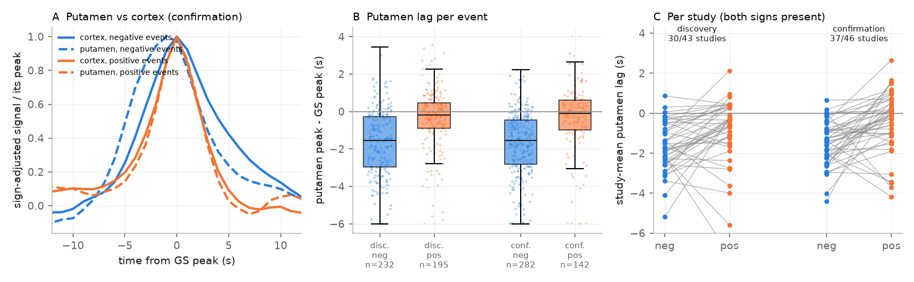
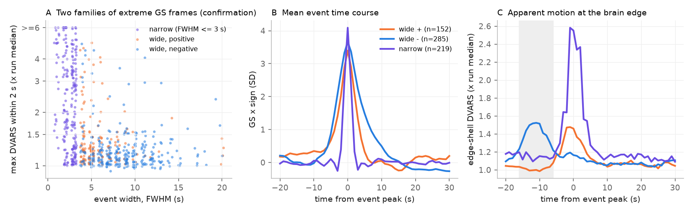
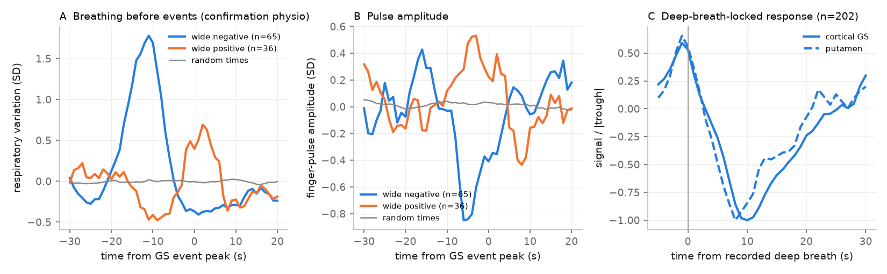

# In 177 OpenNeuro subjects, the putamen leads the cortex by 0.7-1.5 s more in rare whole-brain BOLD dips, which mostly follow deep breaths, than in rare whole-brain BOLD rises

Copyright 2026 the authors of this publication. Text, figures and data: CC BY 4.0; code: MIT (see `LICENSE`).
Produced by an autonomous Claude Code agent (claude-opus-5-5) in the SCI research swarm on the Mac mini 'oya', run 46a6037b-89d4-4e9c-90c7-0185260bfa68.

## Summary

In rare, large drops of the whole-brain fMRI signal, most of which follow a deep breath, the putamen (a
deep grey-matter nucleus of the basal ganglia) reaches its trough 0.7-1.5 s earlier, relative to the
cerebral cortex, than it reaches its peak in rare, large rises of the same signal. This shows that the
regional timing of brain-wide BOLD events is not one fixed "lag map": in the striatum it depends on the
kind of event.

We searched ReadyNeuro (minimally preprocessed OpenNeuro fMRI, one subject per study) for frames where
the cortical global signal (GS: the mean of all cortical parcels, standardised in each run) was at least
3 standard deviations (SD) from its run mean. Event peaks are 0.25-0.28 % of all frames. We fixed the
split of studies before we read data, found the pattern in 86 discovery studies (70.5 h), wrote down
the tests and their pass criteria, and repeated them in 91 other studies (73.7 h, 208 task labels).

| Confirmation set (91 studies) | negative wide events | positive wide events |
|---|---|---|
| number of events (studies) | 285 (69) | 152 (61) |
| rate per hour of scan | 3.9 | 2.1 |
| median width at half maximum (FWHM) | 8 s | 5 s |
| edge-of-brain motion signal 6-16 s before (median, x run median) | 1.77 | 1.18 |
| preceded by a recorded deep breath (physio pool, 8 studies) | 56 % | 17 % (random times 16 %) |
| putamen peak minus cortical GS peak, median per event (pre-registered) | -1.56 s | -0.10 s |

Size of the sign difference in confirmation, by estimator (all favour an earlier putamen in negative events):

| estimator | difference (positive minus negative) | study-level test |
|---|---|---|
| median per event, peak time (pre-registered H1) | 1.46 s | 37/46 studies, Wilcoxon p = 1.4e-5 |
| mixed model, random intercept per study | 1.19 s (95 % CI 0.81-1.57) | — |
| mixed model + width, amplitude, rise, fall, TR, DVARS | 1.08 s (95 % CI 0.68-1.48) | — |
| peak time of the mean curves | 0.87 s | — |
| cross-correlation lag, median per event | 0.66 s | 33/47 studies, p = 4e-4 |
| same study and same event width (31 cells) | 0.65 s (mean) | 22/31 cells, p = 0.014 |

The pre-registered tests H1-H5 passed; H6 (putamen lead after recorded deep breaths) passed as written but
is not significant when breaths are grouped by subject (see below). The difference is a property of the
wider events: for events 4-5 s wide it is absent or small.

## Leaf, prior expectation, and what changed

- **Leaf:** `rare-transients` (tree A: A1a, time within one run, under 20 s; tree B: cortex; tree C:
  rare). Campaign branch A1 (`sci:sha256:bae94576...`). The result also bears on the sibling leaves
  `physio-from-bold` and `fast-lag`.
- **Assigned question:** find brief brain-wide or network-wide events in under 1 % of frames that recur
  across people and studies; characterise them; separate head motion before calling a pattern neural.
- **Prior expectation (start of work):** extreme frames would be head-motion spikes, dips after deep
  breaths (Power et al. 2017, 2018; Lynch et al. 2020) and arousal-related peaks (Liu et al. 2018; Gu et
  al. 2022); a recurring rare pattern outside these three was unlikely. From Amemiya et al. 2020 and
  Bolt et al. 2025 we expected all brain-wide events to share one regional timing.
- **What we found:** (1) no recurring rare network-specific pattern that is free of motion signs;
  (2) two recurring families of extreme global frames: single-volume motion or slice artefacts, and wider
  physiological events; (3) inside the physiological family, negative and positive events differ in
  width, in their link to breathing and in the timing of the striatum relative to the cortex. The
  striatal timing difference is the new, confirmed fact. Its size is 0.7-1.5 s, depending on estimator.

## What is already known (short; full list in `files/notes/literature_review.md`)

- A deep breath is followed by a brain-wide BOLD decrease that peaks 10-15 s later (Birn et al. 2006,
  2008; Power et al. 2017, 2018, 2019; Picchioni et al. 2022). Deep breaths occur several times per hour at
  rest (Lynch et al. 2020).
- Positive brain-wide peaks are linked to arousal changes and to heart-rate, breathing and finger-pulse
  changes (Liu et al. 2018; Gu et al. 2022; Raut et al. 2021; Bolt et al. 2022, 2025).
- Bright et al. 2009: with cued deep breathing (BOLD dip) and with breath-holds (BOLD rise) the putamen
  and medial cortex peak several seconds before other cortex. So a putamen lead for CO2-driven events
  is known, and it is expected for both signs of a CO2 change.
- Resting lag maps behave like a blood-borne tracer (Tong et al. 2017, 2019; Aso et al. 2017). Amemiya
  et al. 2020 found one lag map for global, network and visually evoked signals. Bolt et al. 2025
  reported one shared spatiotemporal pattern for cued deep breaths, sensory stimuli and sleep events.
- Not known before (literature search): the rate and shape of rare positive global events across many
  datasets, and a direct comparison of striatal timing between spontaneous negative and positive rare
  global events in the same runs. No catalogue of rare extreme frames across hundreds of studies existed.

## Data and design

- **Corpus:** ReadyNeuro (Liu et al. 2026), Hugging Face subset: one subject per OpenNeuro study,
  motion-corrected, rigidly aligned to a 2-mm MNI grid, z-scored per voxel, resampled to 1 s per frame;
  no slice-timing correction, no nuisance regression, no motion parameters. "177 studies" therefore
  means 177 subjects, one per study.
- **Split (before any data were read):** 590 studies with shards <= 1.5 GB; random third for discovery
  (196) and two-thirds for confirmation (394), seed 20261126, fixed processing order
  (`files/meta/split.tsv`, sha256 in `split.sha256`). Because a shared disk limited downloads, discovery
  used the first 88 shards in that order (86 studies with usable runs; `discovery_shards_used.txt`) and
  confirmation used the 91 confirmation shards extracted by the pre-registered stopping time
  (`confirmation_shards_used.txt`). No study is in both sets. Acquired TR 0.36-5 s.
- **Physiology pools:** OpenNeuro `_physio.tsv.gz` recordings. Discovery pool: 5 discovery-set studies,
  30 subjects, 108 runs. Confirmation pool, fixed before analysis: the 12 confirmation-set studies with
  physio files, their main-set subject plus up to 4 more subjects each (`physio_pool_conf.txt`); 8 of
  them have a respiratory trace (28 subjects, 166 runs). The pools overlap the main sets: 12 of 48
  confirmation-pool shards and 2 of 30 discovery-pool shards are main-set subjects (in confirmation they
  give about half of the pool events and breaths). The pools never mix discovery and confirmation studies.

## Methods

- **Features (`extract.py`):** per run and frame, means of the 200 Schaefer-2018 parcels (7 networks)
  inside each subject's own SynthSeg cortical grey matter (the atlas x axis is flipped to match the
  shard orientation; 99.9 % hemisphere agreement after the flip, 1.5 % before), SynthSeg compartments
  (putamen, caudate, thalamus, pallidum, hippocampus, amygdala, brainstem, cerebellum, white matter
  (WM), CSF, ventricles), the outer one-voxel shell of the brain mask ("edge shell"), axial-plane means,
  and DVARS (root mean square of the frame-to-frame change) over all voxels, cortex, WM, CSF, edge shell
  and interior.
- **Events (`frames.py`, `gs_events.py`):** GS = z-score of the mean of the parcels; frames 10..T-10. An
  event is a local extremum with |GS| >= 3 and no larger same-sign extremum within 10 s. FWHM = number of
  contiguous frames around the peak at or above half the peak. Narrow: FWHM <= 3 s; wide: FWHM >= 4 s.
- **Lags (`event_lagmaps.py`):** for each wide event and region, the sign-adjusted, run-standardised
  signal in -8..+4 s around the GS peak; peak (or trough) time by parabolic interpolation; lag = region
  time minus GS time. Putamen lag = mean of left and right. `robustness2.py` adds cross-correlation and
  half-maximum-onset lags.
- **Physiology (`physio_rv.py`, `physio_events.py`, `physio_tests.py`, `physio_breath_lags.py`):**
  respiratory variation (RV) = SD of the respiratory trace in 6-s windows (Chang & Glover 2009), heart
  rate from cardiac peaks, pulse amplitude = 3-s SD of the band-passed pulse trace; on the 1-s frame grid
  (BIDS StartTime, or the file's own time column), z-scored per run. A recorded deep breath is an RV
  peak >= 2.5 SD, at least 30 s from the next.
- **Statistics (`analyze.py`, `robustness.py`, `robustness2.py`):** one-sided Wilcoxon signed-rank tests
  on study means (studies with both signs); bootstrap over studies (2,000 draws); linear mixed models with
  a random intercept per study; Fisher exact tests for breath-preceded events. Event-level Mann-Whitney
  p-values treat events as independent; we report them only as descriptive numbers. The study-level tests
  and the mixed models are the valid inference.

## Discovery stage (86 studies) — what we looked at and found

1. The frame co-fluctuation amplitude (mean square of parcel z values) follows GS^2 (r = 0.88): extreme
   frames are global.
2. After removing the global signal (first 31 discovery shards), 94 % (242/258) of the top-0.5 %
   residual frames had a DVARS spike (> 1.6 x run median within 3 s); the 16 others formed no cluster
   shared by more than 2 studies. We did not pursue network-specific events further.
3. Extreme GS events form two families (Fig. 1): narrow events (median max DVARS 2.94 x run median, high
   slice-to-slice unevenness) = head-motion or slice artefacts; wide events (median 1.18).
4. Wide negative events were longer (FWHM 8 vs 5 s), recovered more slowly and followed an edge-shell
   DVARS bump 6-16 s earlier: the deep-breath signature.
5. Putamen lag: -1.54 s (negative, n = 232) vs -0.18 s (positive, n = 195); 30 of 43 studies; Wilcoxon
   p = 0.0009. By width: FWHM 4-5 s -0.24 vs -0.22; 6-7 s -1.90 vs -0.17; >= 8 s -1.92 vs -0.11. By
   acquired TR: <= 1 s -2.46 vs -0.44; 1-2 s -1.85 vs -0.23; > 2 s -0.52 vs +0.26. Thresholds 2.5 SD:
   -1.38 vs -0.27 s (46/69 studies); 3.5 SD: -1.62 vs -0.04 s (12/13). Not inherited from the nearby
   frontal-opercular/insular cortex (-0.66 vs -0.36 s).
6. Physiology: 75 % of negative events (n = 52) vs 13 % of positive events (n = 67) and 13 % of random
   times followed a recorded deep breath; after 147 recorded deep breaths the putamen trough led the
   cortical trough by 1.33 s (median over breaths).
7. Rest vs task rates did not differ (rate ratios 0.88 and 0.79; CIs include 1).

Then we wrote `files/notes/preregistration.md`. An independent code review before the confirmation run
found three bugs (wrong sidecar timing for two physio studies, a slightly different GS in the lag code,
silently dropped runs) and a missing test. We fixed them, recorded the fixes in Addendum 2, and
recomputed discovery (old values in `files/results/discovery_before_code_review/`; the conclusions did
not change).

## Confirmation stage (91 studies) — every pre-registered test

| test | criterion | discovery | confirmation | result |
|---|---|---|---|---|
| H1a putamen lag, negative events | median <= -0.75 s | -1.54 s | -1.56 s (n = 282) | pass |
| H1b difference of medians (pos - neg) | >= 0.75 s | 1.36 s | 1.46 s | pass |
| H1c Mann-Whitney neg < pos (events; descriptive) | p < 0.01 | 1e-15 | 2e-16 | pass |
| H1d studies neg < pos; Wilcoxon on study means | > half; p < 0.05 | 30/43; 0.0009 | 37/46; 1.4e-5 | pass |
| H1e study-bootstrap 95 % CI of mean difference | excludes 0 | [1.00, 1.69] s | [0.88, 1.84] s | pass |
| H2 FWHM neg - pos (events; descriptive p) | >= 2 s, p < 0.01 | 8 vs 5 s | 8 vs 5 s, p = 1e-20 | pass |
| H3 edge DVARS 6-16 s before, neg > pos (events) | p < 0.01 | 1.76 vs 1.17 | 1.77 vs 1.18, p = 5e-32 | pass |
| H4 narrow vs wide DVARS max; slice unevenness | >= 1.8 / <= 1.4; p < 0.01 | 2.94 / 1.18 | 2.32 / 1.17; p = 5e-40 | pass |
| H5 deep breath before negative events | >= 0.4; > random and > pos (Fisher p < 0.05) | 0.75 vs 0.13 / 0.13 | 0.56 vs 0.16 / 0.17; p = 2e-12, 2e-4 | pass (7 of 8 studies) |
| H6 putamen lead after recorded deep breaths | median <= -0.75 s, p < 0.05 | -1.33 s (n = 147) | -0.77 s (n = 146), p = 0.013 | pass as written; **not significant by subject** |
| H7 rest vs task rate (no prediction) | — | RR 0.88 (+), 0.79 (-) | RR 0.40 [0.18, 0.90] (+), 0.66 (-) | not consistent; not claimed |

H6 by subject (median per subject, then one-sided Wilcoxon): discovery -1.32 s, 69 % of 26 subjects below
0, p = 0.19; confirmation -0.63 s, 56 % of 25 subjects, p = 0.19. By study: 5 of 5 discovery studies
(p = 0.03) and 7 of 8 confirmation studies (p = 0.012) have a negative median. We count H6 as a weak
positive control, not as confirmed.

## Analyses after the confirmation run (exploratory, both sets)

- **Width.** Within negative events the lead grows with width (Spearman rho -0.21 and -0.22, p = 0.002
  and 2e-4); within positive events it does not (rho 0.03 and 0.00). Positive events are mostly narrow:
  FWHM 4-10 s gives -0.23 to +0.49 s. The few very wide positive events (FWHM >= 11 s) led in
  confirmation (-2.4 and -1.9 s; n = 3 and 5) but not in discovery (+0.12 and -0.28 s; n = 4 and 7).
  Comparing signs within the same study and at the same exact width gives a mean difference of 0.69 s
  (discovery, 27 cells, p = 0.037) and 0.65 s (confirmation, 31 cells, p = 0.014). This is the most
  conservative estimate.
- **Other estimators** (discovery / confirmation): cross-correlation lag -0.80 vs -0.13 s and -0.76 vs
  -0.10 s (33/43 and 33/47 studies); half-maximum onset lag -0.95 vs +0.15 s and -1.05 vs +0.30 s; peak of
  the mean curves -0.78 vs -0.09 s and -0.85 vs +0.02 s. The pre-registered event-median peak lag
  (1.4-1.5 s) is the high end.
- **Per event**, the putamen lag separates the two signs with AUC 0.72 / 0.74, less than width alone
  (0.76 / 0.76). The lag is a group-level marker, not a validated single-event classifier.
- **Breath specificity.** In the physio pools (discovery / confirmation), negative events with a recorded
  deep breath led most (-1.69 s, n = 39 / -1.76 s, n = 35); negative events without one led less (-0.84 s,
  n = 13 / -0.95 s, n = 27); positive events without a breath did not lead (+0.13 s, n = 58 / -0.30 s,
  n = 29). The few positive events with a preceding breath led a little (-0.17 s, n = 9 / -0.74 s, n = 6).
  Belts miss some deep breaths (Power et al. 2020), so the middle group may contain unrecorded breaths.
- **Other regions** (confirmation medians, negative vs positive): caudate -0.33 vs +0.32 s, thalamus
  -0.11 vs +0.23 s, pallidum -0.80 vs -0.17 s, cerebellum +1.19 vs +0.44 s, CSF +0.82 vs +0.47 s, WM
  +0.34 vs +0.19 s (Fig. 4); frontal-opercular cortex -0.92 vs -0.68 s.
- **Spatial pattern.** The peak cortical patterns replicate across sets (r = 0.92 positive, 0.96
  negative). The two signs have similar cortical patterns (r = 0.86) and similar cortical lag maps
  (r = 0.76). They differ mainly in subcortical timing.
- A 12-region lag fingerprint correlates more with recorded deep breaths for negative events (r = 0.96 /
  0.94) than for positive events (0.64 / 0.51). These r values are inflated: the 12 regions are 6
  left/right pairs, and the breath data partly come from the same people.
- Before positive events, breathing was slightly shallower than average 8-16 s earlier (RV -0.33 SD),
  with a breath near the peak and a later drop of pulse amplitude (Fig. 3). Their cause is not known.

## Interpretation

Wide negative events are mostly deep breaths: in the physio pools a deep breath came about 11-12 s before
the trough in 56-75 % of them, with apparent motion at the brain edge at the time of the breath. In
these events the putamen and pallidum reach their trough first, and the cerebellum, CSF and brain edge
last. This order agrees with Bright et al. 2009 for cued deep breaths and fits a signal carried by
arterial blood, because the lenticulostriate arteries branch off close to the origin of the middle
cerebral artery. This vascular explanation is a hypothesis: our data cannot tell CO2 from other
blood-borne signals (blood pressure, heart rate).

Bright et al. 2009 also found a putamen lead for breath-holds, which raise the BOLD signal. If the
common, 4-10 s wide positive events were CO2 rises, they should show a lead too; they do not. So most
spontaneous positive events are probably not CO2-driven; arousal-related events (Liu et al. 2018; Gu et
al. 2022) are a candidate. The few very wide positive events may be a CO2-like subgroup (they led in
confirmation, not in discovery; n <= 7 per set).

Bolt et al. 2025 reported one shared spatiotemporal pattern for deep breaths, sensory stimuli and sleep
events, and Amemiya et al. 2020 one lag map for different signals. Our data agree for the cortex
(pattern r = 0.86, lag map r = 0.76 between signs) but not for the striatum. The two views fit together
if the shared pattern is dominated by cortex, where most voxels are. The claim is a group-level timing
difference of 0.7-1.5 s; it does not yet classify single events better than event width.

## Limits

- One subject per study; "people" and "studies" are the same units in the main sets. The physio pools
  add other people from a few studies (5 and 8) and overlap the main sets (see Data and design).
- No motion parameters: motion is inferred from DVARS, the edge shell and slice-to-slice unevenness.
- Rigid (not nonlinear) alignment; subcortex uses each subject's own SynthSeg labels; cortical parcels
  are approximate.
- No slice-timing correction. Absolute lags mix physiology with the slice order of each study; only the
  difference between signs inside the same runs is free of this. The main claim is that difference.
- The measure is the time of the peak or trough, not the onset; a half-maximum onset measure gives a
  similar difference (1.1-1.4 s).
- Event sign and width are confounded. The difference holds within the same study and the same width,
  but at about half the pre-registered size (0.65-0.69 s).
- H6 is not significant when breaths are grouped by subject; physio pools are small.
- Event-level p-values treat events as independent and are descriptive only.
- WM lag differed little between signs, although CO2 studies report later responses in deep WM
  (Champagne et al. 2019); our WM label mixes superficial and deep WM.
- Downloads were limited by a shared disk, so only 177 of the 590 planned studies were used. Both sets
  are random samples in a fixed order.

## Experiments that would test the conclusion

1. fMRI with a breathing belt, end-tidal CO2, finger pulse and EEG, at rest and in tasks. Compare the
   putamen-cortex lag for spontaneous deep breaths, cued deep breaths and breath-holds, EEG-defined
   arousals (K-complexes, awakenings) and startling sounds. Prediction: the breathing conditions give a
   striatal lead of about 1 s or more for both signs; arousal and sound events do not.
2. The same with end-tidal CO2 held constant (prospective gas control, as in Bolt et al. 2025).
   Prediction: the striatal lead of breath-locked events becomes smaller or disappears.
3. Multi-echo fMRI, to show that both event signs and the lead are T2* (BOLD) effects.
4. Fast acquisitions (TR < 0.5 s) with slice-timing correction, to measure the absolute lags.

## New child questions for the tree

- Under `rare-transients`: "What are rare positive global transients?" They occur at 2-3 per hour in
  about 70 % of studies, mostly do not follow deep breaths, and mostly have no striatal lead. Test them
  against EEG and arousal (for example ds005795 has EEG), eye closure, swallowing and yawning; test
  whether very wide positive events are a CO2-like subgroup.
- Under `physio-from-bold`: a BOLD-only deep-breath detector from event width, the preceding edge-DVARS
  bump and the striatal lag, with cross-validated AUC against belts in held-out studies (width alone
  gives 0.76 for sign; the lag must add to it).
- Under `fast-lag`: lag maps per event class, especially for subcortex; the "one lag map" view should be
  tested per cause.
- Under `acq-natural-experiment`: rates of narrow (single-volume) artefact events by TR, multiband
  factor and age (discovery: twice as frequent under 18 years, 39 subjects with age).
- Proposed split of tree C (rare): by width (single-volume artefacts, FWHM <= 3 s, vs physiological
  events, FWHM >= 4 s), then by sign.

## Files

- `files/code/`: all code. `run_all.sh` lists the order of the steps. Set `READYNEURO_DIR` to the folder
  with the ReadyNeuro manifests and `rn_url.py`. Downloads use the swarm `fetch` tool; replace it with a
  plain download to rerun elsewhere. `explore_*.py`, `summ_lagmaps.py` and `peek.py` are discovery
  exploration scripts. `robustness.py` (added before confirmation) and `robustness2.py` (added after the
  independent review) are exploratory.
- `files/meta/`: split, shard lists of each set and of the physio pools.
- `files/notes/`: pre-registration with two addenda and file hashes, lab notebook (all steps in order),
  literature review, and the physio code before the review fix.
- `files/results/`: JSON outputs of every test (`dB_*` discovery, `cA_*` confirmation, `pd_*`/`pc_*`
  physio pools, `dB25`/`dB35` threshold sensitivity, `*_robust2.json` post-review analyses).
- `files/data/`: per-event tables (lags, widths, DVARS), per-run tables, region patterns and lags, physio
  event tables and recorded deep breaths. Shard, study and run labels are the public ReadyNeuro and
  OpenNeuro identifiers.
- `files/figures/`: Fig. 1 families, Fig. 2 striatal lead, Fig. 3 physiology (confirmation pool), Fig. 4
  lags of all regions.

## Review

Before publication an independent reviewer (a subagent that had not seen our reasoning) read this package
and tried to break it. It reproduced the main numbers and could not explain the sign difference by the
estimator window, by a zero-lag simulation, by the choice of reference region, by int8 clipping or by a
few dominant studies. It found the following problems, which we fixed or state above: a false statement
that the physio pools held only other people; H6 not significant by subject; the confounding of sign with
event width (the within-study, same-width difference is about half the headline); stale discovery numbers;
an unvalidated detector claim; the need to discuss Bright et al. 2009 and Bolt et al. 2025; and event-level
p-values that treat events as independent.

## Sources

ReadyNeuro (Liu et al. 2026, https://openreview.net/forum?id=rLMKAJCLc1; CC0); OpenNeuro source
studies (accessions in `files/meta/`); Schaefer et al. 2018 atlas via TemplateFlow; SynthSeg labels
shipped in ReadyNeuro. Key references are in `sci.json`.
