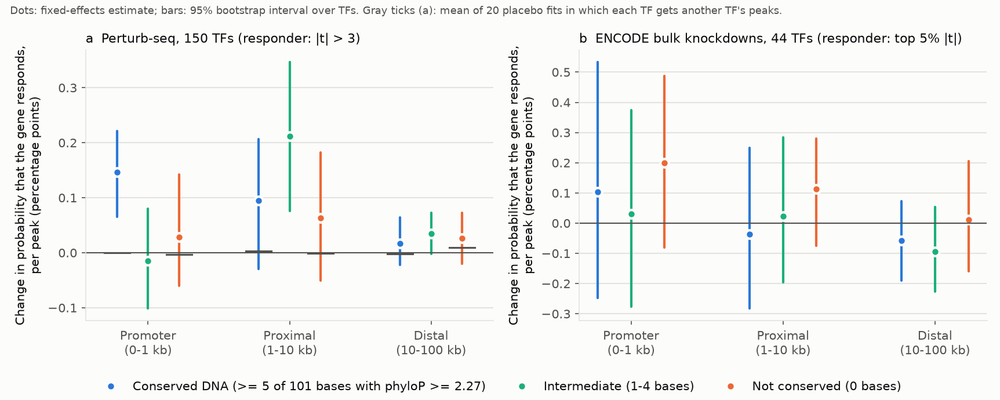
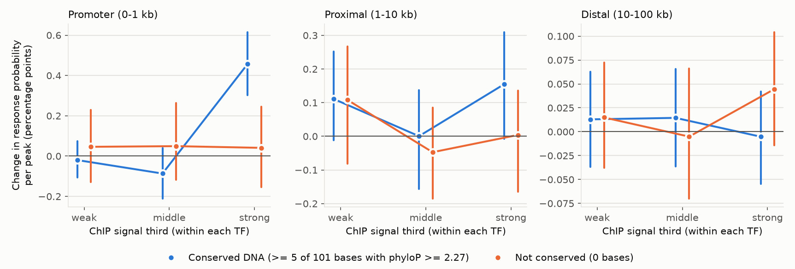
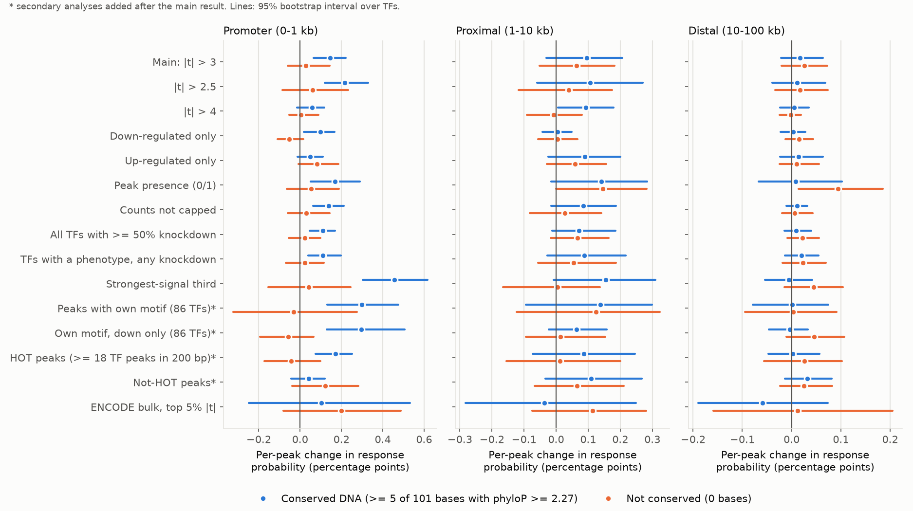

# Transcription-factor binding in mammal-conserved promoter DNA predicted gene response to factor knockdown in K562 cells; non-conserved promoter or distal binding had no detectable effect

## Summary

When a transcription factor (TF) was knocked down in human K562 cells, genes with a ChIP-seq peak of that TF in mammal-conserved promoter DNA responded more often than expected. Peaks in non-conserved promoter DNA, and peaks 10 to 100 kb from the gene, had no detectable effect. The data have little power for these last two classes, so "no detectable effect" is not "no effect".

This matters because the claim that most of the genome is functional rests mainly on biochemical activity, such as TF binding, in DNA that evolution does not conserve. A direct test is to remove the TF and see whether genes near its binding sites change.

**Data.** CRISPR-interference (CRISPRi) knockdowns of 150 TFs from the genome-wide Perturb-seq screen in K562 (Replogle et al. 2022). Each knockdown had a transcriptome change (energy test P < 0.05), at least 50 cells, and measured on-target expression at most 50% of control. We combined them with ENCODE K562 ChIP-seq peaks of the same 150 TFs (2.4 million peaks) and with the 241-mammal phyloP conservation score (Zoonomia).

**Definitions.**
- A *peak* is the 101 bases centred on the ChIP-seq summit.
- *Conserved*: 5 or more of the 101 bases have phyloP >= 2.27 (the Zoonomia 5% FDR threshold for constrained bases). *Not conserved*: no such base. *Intermediate*: 1 to 4 such bases.
- A gene *responds* when |t| > 3, where t is the mean expression change after knockdown divided by its null standard error.
- *Per-peak effect*: the change in the probability that a gene responds for each extra peak of that TF near the gene. It comes from a linear model with one fixed effect per gene and one per TF, so it compares the same gene across TFs. Intervals are 95% bootstrap intervals over TFs.

**Main results** (per-peak effects in percentage points, pp; the mean response probability is 2.1%):

| Peaks (distance to the nearest TSS of the gene) | Conserved | Not conserved | Difference (bootstrap P) |
|---|---|---|---|
| Promoter (0-1 kb), all peaks, pre-specified main model | 0.146 (0.065 to 0.221) | 0.029 (-0.060 to 0.142) | -0.117 (-0.23 to +0.02; P = 0.07) |
| Promoter, strongest third of ChIP signal (pre-specified) | 0.457 (0.302 to 0.616) | 0.041 (-0.154 to 0.245) | -0.416 (-0.66 to -0.15; P < 0.007) |
| Promoter, down-regulated genes only (pre-specified) | 0.097 (0.019 to 0.166) | -0.052 (-0.108 to 0.015) | -0.150 (-0.24 to -0.07; P < 0.007) |
| Promoter, peak has the TF's own motif* (86 TFs) | 0.298 (0.132 to 0.476) | -0.031 (-0.325 to 0.274) | -0.329 (-0.69 to +0.04; P = 0.12) |
| Promoter, own motif, down-regulated only* | 0.296 (0.129 to 0.507) | -0.057 (-0.193 to 0.065) | -0.353 (-0.62 to -0.18; P < 0.02) |
| Proximal (1-10 kb) | 0.095 (-0.030 to 0.207) | 0.063 (-0.051 to 0.183) | -0.03 (-0.15 to +0.09) |
| Distal (10-100 kb) | 0.017 (-0.022 to 0.064) | 0.026 (-0.020 to 0.072) | +0.01 (-0.04 to +0.06) |

\* Secondary analysis that we added after we saw the main result.

- **Binding explains little of the knockdown response.** Averaged over TFs, genes with a peak of the TF within 10 kb responded in 2.5% of cases, and genes with no peak within 100 kb in 2.1%. Without adjustment, genes with only conserved peaks within 10 kb and genes with only non-conserved peaks within 10 kb had the same small excess (+0.17 and +0.18 pp).
- **The conserved-promoter effect is specific to the TF.** In 20 placebo fits, each TF received the peaks of another TF. The conserved-promoter coefficient was 0.000 on average (maximum 0.059), against 0.146 with the real peaks.
- **Non-conserved promoter peaks never had a detectably positive effect.** In the pre-specified main model their difference from conserved peaks is not significant (P = 0.07). It is significant at strong ChIP signal and for down-regulation, which is the expected direction for direct targets of activators.
- **Distal binding had no detectable effect in either class.** The upper limit is about 0.07 pp per peak for both. Conserved distal peaks never had a significantly larger effect than non-conserved distal peaks. So these data cannot tell whether conservation matters for distal binding.

**Limits.**
- One cancer cell line.
- Perturb-seq detects only large changes (about 25-70% for a typical gene).
- Most knockdown responses are indirect.
- The promoter gap is carried mainly by HOT promoter peaks (regions that many TFs bind); in non-HOT peaks the sign reverses (not significant).
- The gap disappears in the most highly expressed third of genes (conserved 0.126 pp, not conserved 0.140 pp; both intervals include zero).
- One post hoc model gave a detectably negative non-conserved term, which suggests residual model bias of up to about 0.1 pp.
- A replication with ENCODE bulk knockdown RNA-seq (44 TFs) detected no binding effect in any class, and its point estimates were in the opposite order.

## 1. Question and why it matters

ENCODE (2012) called 80% of the human genome functional, mainly because of biochemical activity, and TF binding was a large part of that activity. Critics (for example Graur et al. 2013, Doolittle 2013) replied that activity is not function: random DNA also binds TFs and is transcribed (Luthra et al. 2024). Comparative genomics puts the constrained fraction near 10% (Zoonomia 2023).

Several studies link conservation of bound sequence to function:
- Whitfield et al. (2012) tested ENCODE-defined promoter sites in reporter assays: functional sites were more conserved and closer to the TSS.
- Binding that is shared across species is enriched near targets with conserved function (Schmidt et al. 2010; Ballester et al. 2014).
- HOT loci (regions that many TFs bind) are constrained and drive housekeeping genes (Hudaiberdiev and Ovcharenko 2024).

Knockdown tests are few:
- Cusanovich et al. (2014) knocked down 59 TFs in lymphoblastoid cells. Only a small fraction of bound genes responded. Functional and non-functional sites, defined from DNase-seq footprints, did not differ in conservation (P = 0.34), and functional binding was often far from the TSS.
- In yeast, acute degradation of 126 TFs showed that only about 6% of bound genes respond (Mahendrawada et al. 2025).
- Ota et al. (2025) modelled regulator-to-program effects from the same genome-wide Perturb-seq data. We could not read the full text to check whether it compares ChIP binding with knockdown response, so we claim novelty only for the conservation split.

**Question.** When a TF is knocked down, do genes near its ChIP-seq peaks in non-conserved DNA respond as often, per peak, as genes near its peaks in conserved DNA?

## 2. Candidate questions and choice

We wrote down the candidates, the choice and the prior prediction before any binding-response analysis (`files/PRIOR_PREDICTION.md`, with one dated amendment about the replication rule).

| # | Question (approach) | What experts would do differently | P(surprising) | Who reuses | Strongest argument against |
|---|---|---|---|---|---|
| C1 | Do genes near TF peaks in non-conserved DNA respond to TF knockdown as often as genes near peaks in conserved DNA? (perturbation x binding x conservation) | Similar: treat non-conserved binding as regulatory in cells; stop filtering peaks on conservation. Near zero: treat most binding in junk DNA as non-functional | 0.3 | regulatory genomics, network inference, the ENCODE-function debate | Perturb-seq effects are often indirect; one cell line; cell effects are not fitness |
| C2 | Does human satellite DNA act as a 'heterochromatin sink' that changes genome-wide expression? (natural variation x expression) | Yes: first human trans function of satellites. No: stop extrapolating from Drosophila | 0.2 | heterochromatin and T2T researchers | Short-read satellite counts are crude; design repeats the catalog rDNA study |
| C3 | Do old nuclear insertions of mitochondrial DNA (NUMTs) gain ENCODE marks as often as matched nuclear DNA? (natural 'random DNA' experiment) | Same rate: marks arise by chance in naive DNA | 0.2 | junk-DNA debate | NUMTs insert into open chromatin; < 1 Mb of sequence |
| C4 | Do non-coding spontaneous mutations lower fitness in mutation-accumulation lines? (direct fitness) | Comparable to coding: much non-coding DNA is functional | 0.25 | evolutionary geneticists | Few mutations per line; the likely result is a wide interval |
| C5 | Does conservation predict a phenotype among mouse non-coding knockouts in MGI? (organismal knockouts) | Yes: conservation is a usable predictor | 0.15 | developmental genetics | Strong ascertainment and publication bias |

We chose C1. The data are public and large, and the question tests a central claim of the ENCODE debate with a direct perturbation. The SCI catalog has strong population-genetic and eQTL evidence on non-conserved regulatory DNA (for example sci:sha256:8308b056..., sci:sha256:eb65b2ab...), but no study that removes the TF.

**Prior prediction** (from `files/PRIOR_PREDICTION.md`):
- Promoter peaks > 0: P = 0.97.
- Distal conserved peaks > 0: P = 0.8. Distal non-conserved peaks > 0: P = 0.6.
- Distal ratio rho = non-conserved / conserved per-peak effect: 0.35 (80% interval 0.05-0.8). Promoter rho: 0.7.
- Transposable-element (TE) peaks have a smaller effect than non-TE non-conserved peaks: P = 0.6.
- Placebo near zero: P = 0.8.
- Matching on ChIP signal moves rho toward 1: P = 0.5.
- Fraction of bound genes that respond beyond the unbound rate < 10%: P = 0.8.

## 3. Data

All inputs are public. `files/PROVENANCE.md` gives URLs, access dates and SHA-256 checksums.

- **Perturb-seq.** Replogle et al. 2022, K562 genome-wide screen, `K562_gwps_normalized_bulk_01.h5ad` (figshare 20029387): mean z-normalized expression of 8,248 genes for 11,258 perturbations, including 585 non-targeting control guides.
- **ChIP-seq.** ENCODE K562 TF ChIP-seq, GRCh38, preferred-default IDR thresholded peaks. One experiment per TF: no ERROR audit, not 'perturbed', most peaks (`files/data/tf_selection.csv`).
- **TF list.** Lambert et al. 2018 (1,639 human TFs).
- **Conservation.** Zoonomia 241-mammal phyloP (UCSC `cactus241way.phyloP.bw`), streamed and reduced to base-level masks (phyloP >= 2.27; >= 1.0).
- **Annotation.** GENCODE v44 basic transcripts (TSS); UCSC RepeatMasker hg38 (TE = LINE, SINE, LTR, DNA, Retroposon); JASPAR 2024 CORE vertebrates (motifs); hg38 2bit (sequence).
- **Replication.** ENCODE K562 knockdown RNA-seq (CRISPRi, siRNA, shRNA, CRISPR knockout) with RSEM gene quantifications (GENCODE V29) and their control experiments.

## 4. Methods

Code is in `files/code/`, numbered in run order.

1. **TF selection** (`03_prepare.py`). Of 342 TFs with a clean K562 ChIP-seq experiment and a Perturb-seq perturbation, 268 had measured on-target expression <= 50% of control and >= 50 cells. The 150 that also had a transcriptome change (energy-test P < 0.05) form the primary set: median 17% of control expression, median 194 cells, median 12,470 peaks. For 30 of the 150, baseline expression is below 0.1 UMI per cell, so their knockdown cannot be verified; Section 5.7 drops them.
2. **Response.** For TF t and gene g: t_tg = mean z x sqrt(cells), centred and scaled by the median and robust SD of the same statistic over the 585 non-targeting guides. (`PRIOR_PREDICTION.md` said "across all perturbations"; we used the non-targeting guides because they are a clean null. We made this change before any binding analysis.) In the controls, |t| > 3 occurs in 0.36% of gene-guide pairs; for the 150 TFs it occurs in 2.1%. Genes within 100 kb of the knocked-down TF's own TSS are removed for that TF, because CRISPRi can silence neighbours.
3. **Peak annotation** (`02_phylop_masks.py`, `04_peaks.py`). For each peak: counts of phyloP >= 2.27 bases in the 101-base window; TE at the summit; signal value; 'HOT' count = number of peaks of the 342 TFs within 100 bp of the summit.
4. **Pairs** (`05_pairs.py`). For each TF and measured gene, we count the TF's peaks by class in three windows of distance from the summit to the nearest TSS of the gene: promoter 0-1 kb, proximal 1-10 kb, distal 10-100 kb. One peak can count for several genes.
5. **Model** (`fe.py`, `analysis_lib.py`, `06_model.py`). Linear probability model: response_tg = a_g + b_t + sum over window x class of gamma x count. Counts are capped at 3, and the fixed effects are removed by alternating projections. The gene fixed effect absorbs how responsive and how heavily bound a gene is in general. The TF fixed effect absorbs knockdown strength. Gamma is the per-peak effect. 95% intervals and two-sided P values for differences come from bootstrap resamples of TFs (300 for the main and sensitivity models, 200 for HOT models, 100 for motif models). When no resample crosses zero, P < 2/B: < 0.007, < 0.01 or < 0.02.
6. **Pre-specified secondary and sensitivity models.** Non-conserved peaks split into TE and non-TE; ChIP-signal thirds within each TF; |t| > 2.5 and > 4; down- or up-regulation only; presence/absence instead of counts; uncapped counts; all 268 TFs with good knockdown; continuous down-shift (-t).
7. **Placebo** (`05_pairs.py gwps <seed>`, `08_replication_placebo.py`, `15_review_checks.py`). Each TF receives the peaks of a different TF (random derangement, 20 seeds), and the main, down-regulation and signal-third models are refitted.
8. **Replication** (`07a`, `07b`, `08`). ENCODE bulk knockdown RNA-seq: moderated t of knockdown versus control replicates. Many CRISPRi experiments called more than half of all genes differentially expressed at 10% FDR, which shows batch differences between knockdown and control libraries. So, before we fitted any binding model to these data, we fixed the rule: experiments with on-target log2 fold change <= -0.5 (CRISPR knockouts exempt), one per TF, and responders = the top 5% of |t| within each experiment. 44 TFs qualified (median on-target log2 fold change -1.03).
9. **Added after the main result** (`11_motifs.py`, `12_motif_model.py`, `13_hot_model.py`; marked * below).
   - Peaks with or without a match to the TF's own JASPAR 2024 matrix (P < 1e-4, both strands, 86 TFs).
   - Peaks in or out of HOT regions (>= 18 peaks of the 342 TFs within 100 bp, the genome-wide median).
   - TFs with a transcriptome change at any knockdown level (190 TFs; this adds GATA1, MYC, NRF1, YY1, CTCF and others).
10. **Checks requested by the independent reviewer** (`15_review_checks.py`; Section 5.7).
11. **Power.** With about 195 cells, |t| > 3 needs a mean change of about 0.21 per-cell standard deviations. For a gene with 0.1 to 1 UMI per cell, this is about a 25-70% change in expression (assuming Poisson-gamma noise with dispersion 0.2).

## 5. Results

### 5.1 Peaks in non-conserved DNA are common, less often in HOT regions, and often in transposons

| Class (primary TFs) | Share of 2,436,375 peaks | Summit in a TE | Median signal / TF median | Median HOT count |
|---|---|---|---|---|
| Conserved | 40.3% | 5.3% | 1.08 | 26 |
| Intermediate | 28.1% | 27.2% | 0.95 | 11 |
| Not conserved | 31.6% | 58.1% | 0.96 | 9 |

Promoter peaks (within 1 kb of a measured gene's TSS): 374,723 conserved (median 114 bp from the TSS; 79% in HOT regions), 105,691 intermediate (292 bp; 61%) and 80,295 not conserved (306 bp; 60%).

### 5.2 Binding predicts little of the knockdown response

Per TF on average, genes with no peak of the TF within 100 kb responded in 2.12% of cases. Genes with a peak within 10 kb responded in 2.48% (excess +0.36 pp; median over TFs +0.20 pp). Without adjustment, the excess was +0.17 pp for genes with only conserved peaks within 10 kb and +0.18 pp for genes with only non-conserved peaks. The ChIP peaks of most TFs cover most active promoters, so few measured genes are entirely unbound. For this reason the fixed-effects model, which compares the same gene across TFs, is the main analysis.

### 5.3 Per-peak effects: conserved promoter peaks have the clearest effect



**Figure 1.** Change in the probability that a gene responds to TF knockdown, per peak of that TF, by distance window and conservation class. (a) Perturb-seq, 150 TFs. Gray ticks: mean of 20 placebo fits. (b) ENCODE bulk knockdown RNA-seq, 44 TFs. Bars: 95% bootstrap intervals over TFs.

Main model, pp per peak (95% interval):

| Window | Conserved | Intermediate | Not conserved |
|---|---|---|---|
| Promoter | 0.146 (0.065 to 0.221) | -0.015 (-0.101 to 0.080) | 0.029 (-0.060 to 0.142) |
| Proximal | 0.095 (-0.030 to 0.207) | 0.212 (0.076 to 0.346) | 0.063 (-0.051 to 0.183) |
| Distal | 0.017 (-0.022 to 0.064) | 0.035 (-0.002 to 0.073) | 0.026 (-0.020 to 0.072) |

Placebo means were between -0.003 and +0.013 pp for all nine terms. Three real values were above all 20 placebo values:

| Term | Real | Placebo maximum |
|---|---|---|
| Conserved promoter | 0.146 | 0.059 |
| Conserved proximal | 0.095 | 0.057 |
| Intermediate proximal | 0.212 | 0.188 |

The placebo spread is narrower than the bootstrap interval because it keeps the TFs fixed, so we use the bootstrap interval for inference. No non-conserved value was outside the placebo range. The proximal intermediate term is the one unexpected positive term; we have no explanation and do not interpret it.

### 5.4 At the strongest ChIP signal, non-conserved promoter peaks have a smaller effect



**Figure 2.** Per-peak effects by ChIP-signal third within each TF. The conserved-promoter effect is in the strongest third.

At promoters, the strongest third of conserved peaks gave 0.457 pp (0.302 to 0.616), and the strongest third of non-conserved peaks gave 0.041 pp (-0.154 to 0.245). The difference was -0.416 pp (-0.66 to -0.15; no bootstrap resample >= 0). Weak and middle thirds had no detectable effect in either class. Within the strongest third, conserved peaks are still somewhat stronger (reviewer: median relative signal 2.26 vs 2.00), so the match is not exact. Our prior expectation was that matching on signal would bring the classes closer; instead, the gap became clearer.

### 5.5 Robustness



**Figure 3.** Conserved (blue) and non-conserved (orange) per-peak effects in every model. * = added after the main result.

All values are pp per peak (95% interval). 'Difference' is non-conserved minus conserved, with its two-sided bootstrap P value.

| Model | Promoter, conserved | Promoter, not conserved | Promoter difference (P) | Distal, conserved | Distal, not conserved |
|---|---|---|---|---|---|
| Main (\|t\| > 3) | 0.146 (0.065, 0.221) | 0.029 (-0.060, 0.142) | -0.117 (0.07) | 0.017 (-0.022, 0.064) | 0.026 (-0.020, 0.072) |
| \|t\| > 2.5 | 0.216 (0.119, 0.330) | 0.061 (-0.086, 0.232) | -0.156 (0.11) | 0.011 (-0.040, 0.068) | 0.017 (-0.033, 0.073) |
| \|t\| > 4 | 0.058 (-0.015, 0.117) | 0.003 (-0.053, 0.090) | -0.055 (0.23) | 0.005 (-0.024, 0.035) | -0.002 (-0.025, 0.020) |
| Down-regulated only | 0.097 (0.019, 0.166) | -0.052 (-0.108, 0.015) | -0.150 (< 0.007) | 0.003 (-0.023, 0.028) | 0.016 (-0.012, 0.044) |
| Up-regulated only | 0.049 (-0.012, 0.110) | 0.081 (-0.007, 0.185) | +0.032 (0.61) | 0.014 (-0.024, 0.063) | 0.011 (-0.024, 0.056) |
| Presence/absence | 0.168 (0.051, 0.289) | 0.053 (-0.063, 0.188) | -0.115 (0.21) | 0.008 (-0.067, 0.103) | 0.094 (0.014, 0.185) |
| Counts not capped | 0.138 (0.063, 0.212) | 0.031 (-0.059, 0.143) | -0.107 (0.12) | 0.011 (-0.010, 0.032) | 0.007 (-0.020, 0.043) |
| All 268 TFs with good knockdown | 0.109 (0.047, 0.168) | 0.023 (-0.054, 0.098) | -0.086 (0.07) | 0.009 (-0.015, 0.039) | 0.022 (-0.009, 0.056) |
| TFs with a phenotype, any knockdown (190 TFs)* | 0.111 (0.039, 0.197) | 0.023 (-0.069, 0.114) | -0.088 (0.11) | 0.020 (-0.014, 0.055) | 0.023 (-0.019, 0.070) |
| Strongest-signal third | 0.457 (0.302, 0.616) | 0.041 (-0.154, 0.245) | -0.416 (< 0.007) | -0.005 (-0.054, 0.042) | 0.045 (-0.014, 0.104) |
| Own motif* (86 TFs) | 0.298 (0.132, 0.476) | -0.031 (-0.325, 0.274) | -0.329 (0.12) | 0.001 (-0.078, 0.075) | 0.003 (-0.095, 0.092) |
| Own motif, down only* | 0.296 (0.129, 0.507) | -0.057 (-0.193, 0.065) | -0.353 (< 0.02) | -0.004 (-0.047, 0.033) | 0.046 (-0.010, 0.107) |
| HOT peaks* | 0.171 (0.075, 0.252) | -0.042 (-0.173, 0.098) | -0.213 (< 0.01) | 0.002 (-0.047, 0.056) | 0.026 (-0.056, 0.103) |
| Not-HOT peaks* | 0.043 (-0.044, 0.119) | 0.121 (-0.038, 0.283) | +0.079 (0.35) | 0.032 (-0.013, 0.081) | 0.025 (-0.023, 0.082) |
| HOT peaks, down only* | 0.093 (0.023, 0.162) | -0.096 (-0.165, -0.018) | -0.189 (< 0.01) | -0.003 (-0.033, 0.026) | 0.032 (-0.004, 0.072) |
| Not-HOT peaks, down only* | 0.100 (0.004, 0.177) | -0.001 (-0.078, 0.081) | -0.101 (0.08) | 0.011 (-0.015, 0.045) | 0.009 (-0.013, 0.032) |
| ENCODE bulk, top 5% (44 TFs) | 0.103 (-0.247, 0.533) | 0.199 (-0.080, 0.487) | +0.10 (0.65) | -0.059 (-0.190, 0.073) | 0.012 (-0.159, 0.204) |

Continuous outcome (-t, a down-shift in units of t; 150 TFs):
- Promoter: conserved +0.0156 (0.0018, 0.0287); not conserved -0.0094 (-0.0193, 0.0017); difference -0.025 (-0.041, -0.010; P < 0.007).
- Distal: conserved -0.0011 (-0.0063, 0.0035); not conserved 0.0000 (-0.0046, 0.0040).

Summary of the robustness checks:
- **Promoters.**
  - The conserved per-peak effect is above zero (interval excludes zero) in 13 of the 16 Perturb-seq rows and in the continuous model.
  - The non-conserved effect is never above zero.
  - The difference has P < 0.02, with no bootstrap resample crossing zero, in six variants: down-regulation only, the continuous down-shift, the strongest-signal third, own motif with down-regulation, HOT peaks, and HOT peaks with down-regulation.
  - In the other variants P is 0.07 to 0.23 with the same sign. The exceptions are up-regulation (P = 0.61) and non-HOT peaks (P = 0.35), where the sign is reversed.
- **Down- versus up-regulation.** Most TFs activate their direct targets, so direct effects of a knockdown should mainly reduce expression. The conserved-promoter effect is in down-regulation; up-regulation shows no conservation difference.
- **A sign of residual bias.** In one post hoc model (HOT peaks, down only), non-conserved promoter peaks had a detectably negative effect (-0.096 pp, -0.165 to -0.018). A negative effect is not plausible for direct binding, so the model can be off by up to about 0.1 pp for that term; we ran placebos only for the main, down-regulation and signal-third models.
- **Distal peaks.**
  - In every variant, both classes are near zero, and conserved distal peaks are never significantly larger than non-conserved ones.
  - One variant, presence/absence coding, gives a small positive non-conserved distal effect (0.094 pp, 0.014 to 0.185), with conserved distal at 0.008. That is one significant term among about 30 distal terms, so we do not treat it as a finding.
- **ENCODE replication.**
  - No class is detectable.
  - The intervals are 3-5 times wider than in Perturb-seq and include both zero and the Perturb-seq values.
  - The point estimates are in the opposite order (non-conserved above conserved at promoters), so this data set gives no support to the promoter result.

### 5.6 Transposable elements

Non-conserved peaks inside and outside TEs had no detectable effect at any distance. For example, distal TE peaks gave 0.052 pp (-0.011 to 0.114) and distal non-TE peaks -0.003 pp (-0.059 to 0.053). The data cannot separate them.

### 5.7 Checks requested by the independent reviewer

All checks below use the primary 150 TFs unless stated; values are pp per peak (95% bootstrap interval, 200 resamples).

1. **TFs whose knockdown can be verified.** We dropped the 30 TFs with baseline expression below 0.1 UMI per cell (120 TFs remain). Promoter: conserved 0.175 (0.084 to 0.248), not conserved 0.026 (-0.116 to 0.147). Distal: 0.009 (-0.035 to 0.067) and 0.031 (-0.020 to 0.090).
2. **Thirds of gene expression.** The gap is absent in the most highly expressed genes, where the assay has the most power per gene:

| Gene expression third | Promoter, conserved | Promoter, not conserved |
|---|---|---|
| Low | 0.125 (0.036, 0.230) | 0.001 (-0.130, 0.149) |
| Middle | 0.106 (0.025, 0.204) | -0.092 (-0.216, 0.035) |
| High | 0.126 (-0.034, 0.266) | 0.140 (-0.061, 0.370) |

3. **Placebos for two more models** (20 TF-label derangements each).

| Model | Term | Real value (pp) | Placebo mean (pp) | Placebo range (pp) |
|---|---|---|---|---|
| Down-regulation | Conserved promoter | 0.097 | 0.008 | up to 0.057 |
| Down-regulation | Non-conserved promoter | -0.052 | 0.000 | -0.057 to 0.060 |
| Strongest-signal third | Conserved promoter | 0.457 | -0.003 | up to 0.136 |
| Strongest-signal third | Non-conserved promoter | 0.041 | 0.022 | -0.145 to 0.233 |

   Both conserved values are above every placebo value. Both non-conserved values are inside the placebo range.
4. **Leave one TF out.** The conserved-promoter coefficient stays between 0.133 (without MAX) and 0.161 (without TBP); see `files/results/leave_one_tf_out.csv`.
5. **Composition of promoter peaks.** Conserved promoter peaks are closer to the TSS (median 114 vs 306 bp) and more often in HOT regions (79% vs 60%) than non-conserved ones.
6. **Reported by the reviewer, not reproduced in this package** (the reviewer's scripts are not included):
   - Two-way clustered (gene and TF) standard error of the main promoter difference: 0.064, so z = -1.83. This agrees with the bootstrap P = 0.07.
   - The five TFs that contribute most (MAX, ZBTB17, TBPL1, ZNF281, HMBOX1) supply 0.057 of the 0.146; without them the conserved-promoter effect is 0.093 (SE 0.033).
   - The gap persisted in splits by canonical TSS (conserved 0.155 vs not conserved -0.003), CpG-island-like windows (0.135 vs 0.004), not CpG-island-like windows (0.151 vs 0.058), and in 4,985 genes with at least 3 promoter pairs of each class (0.171 vs 0.054).

Conclusion of the checks: the conserved-promoter effect is robust. The difference from non-conserved promoter peaks depends on the gene set: it is absent among highly expressed genes and among non-HOT peaks.

## 6. Comparison with the prior prediction

| Prediction | Result |
|---|---|
| P1 promoter peaks > 0 (P = 0.97) | True for conserved peaks only |
| P2 distal conserved > 0 (P = 0.8); distal non-conserved > 0 (P = 0.6) | Neither detected |
| P3 distal rho = 0.35 (0.05-0.8) | Not estimable: the conserved distal effect is not different from zero |
| P4 promoter rho = 0.7 | 0.20 (-0.52 to 1.18) for all peaks; 0.09 (-0.40 to 0.58) in the strongest third. Lower than predicted, but the pre-specified all-peak contrast is not significant |
| P5 TE < non-TE among non-conserved (P = 0.6) | Not resolved |
| P6 placebo near zero (P = 0.8) | True |
| P7 signal matching moves rho toward 1 (P = 0.5) | False: it moved toward 0 |
| P8 bound-gene excess < 10% (P = 0.8) | True: +0.36 pp |

**Was the work more or less useful than expected?** Less useful than expected.
- The main question was whether distal binding in non-conserved DNA regulates genes as much as conserved distal binding. Perturb-seq at about 200 cells per knockdown cannot detect distal per-peak effects of either class, so that question is unresolved.
- At promoters, conservation of the bound DNA separates binding with a detectable effect from binding without one, most clearly for strong peaks and for down-regulation. But the pre-specified all-peak contrast has P = 0.07, the effect sits mainly in HOT core promoters, and earlier reporter and cross-species studies point the same way (Whitfield 2012; Schmidt 2010; Ballester 2014).
- So the new contribution is incremental: a genome-scale knockdown test that agrees with those studies, and a quantitative upper limit on the per-peak effect of distal binding that later, more sensitive experiments can improve.

## 7. Interpretation

- **For the 'binding = function' claim.** In this experiment, a ChIP-seq peak in non-conserved DNA never detectably predicted that the nearby gene depends on the TF. This holds at promoters, with strong signal, and with the TF's own motif. This agrees with the view that much biochemical binding in non-conserved DNA has no regulatory consequence that can be detected. It does not show that such binding has no function: distal conserved binding also had no detectable effect, so the assay cannot see distal effects. Non-conserved promoter peak-gene pairs are also about 5 times rarer than conserved ones, so their intervals are wider.
- **For the use of ChIP-seq.** Strong promoter peaks in conserved DNA, mostly in HOT regions, are the ChIP peaks whose presence most clearly predicted a TF-specific response. For distal peaks, these data give no guidance.
- **Relation to other evidence.** The catalog eQTL study (sci:sha256:8308b056...) found that non-conserved regulatory elements hold causal eQTL variants at 1.4-1.6 times background, a third to a half of the enrichment of conserved elements, mainly in promoter-proximal, broadly open elements. Our point estimates at promoters are lower for non-conserved binding, but the two measures differ: cis variants change one element, while a TF knockdown removes the factor from all its sites. With our power, the two results are not in conflict.

## 8. Limits

1. **One cell line.** K562 is a near-triploid leukaemia line with amplifications. Copy number can change both ChIP peaks and expression. The gene fixed effect absorbs this per gene but not per TF.
2. **Low sensitivity.** Perturb-seq detects only changes of about 25-70%. Single enhancers usually change expression by less. A null for distal peaks is therefore weak evidence.
3. **Indirect effects.** Most responses to a TF knockdown are probably indirect (downstream TFs, cell state). This adds noise but should not favour one conservation class.
4. **Knockdown, not degradation.** CRISPRi acts over days, so cells adapt, and cells with the strongest knockdown of an essential TF may be lost from the population. 40 TFs with a transcriptome change (for example GATA1, MYC, NRF1, YY1) kept more than 50% of their expression or had fewer than 50 cells; they are only in a sensitivity set. For 30 primary TFs, knockdown cannot be verified because baseline expression is very low (Section 5.7).
5. **No independent replication.** The ENCODE bulk knockdowns (44 TFs) showed no binding effect in any class (promoter conserved 0.10 pp, -0.25 to 0.53; not conserved 0.20 pp, -0.08 to 0.49). Probable causes are batch differences between knockdown and control libraries and the smaller TF set. Their point estimates are in the opposite order, so no independent data set confirms the Perturb-seq promoter result.
6. **Post hoc analyses.** The motif, HOT and any-knockdown analyses were added after we saw the main result. They agree with the pre-specified signal-third and down-regulation analyses but are not independent tests.
7. **Composition of promoter peaks.** Conserved promoter peaks are closer to the TSS, more often CpG-island-like, and more often HOT than non-conserved ones (Section 5.7). The reviewer's splits by these features did not remove the gap, but the classes are not exchangeable.
8. **Conservation measure.** phyloP >= 2.27 has false positives that depend on base composition (sci:sha256:5f2b4de8...). 'Not conserved' (no such base in 101 bp) is robust to this. 'Conserved' can include some false positives, which would bias the contrast toward zero. The 'aligned vs not aligned' split was not informative (99.7% of non-conserved windows have phyloP values), so we dropped it.
9. **Window assignment.** A peak counts for every gene within 100 kb. We did not run a model with nearest-gene assignment.

## 9. Predictions for experimental labs

1. In K562, mutate the TF motif in a strong non-conserved promoter peak (for example of ATF4, MAX or SP1), and in a strong conserved promoter peak of the same TF at matched ChIP signal. We predict that the non-conserved edit will change the gene's expression by less than half as much as the conserved edit. Our point estimate is about 10%, but the upper 95% limit is about 60%.
2. Acute TF degradation (dTAG or auxin) with a nascent-RNA readout (SLAM-seq or TT-seq) for 10-20 TFs can detect distal per-peak effects that Perturb-seq cannot. We predict that both conserved and non-conserved distal per-peak effects will be below 0.1 pp of response probability per peak, and that they will not differ by more than a factor of 2.
3. The proximal 'intermediate' signal (1-4 conserved bases) will not replicate in an independent perturbation data set.

## 10. Reproduce

```
uv venv .venv && uv pip install anndata h5py numpy pandas scipy pyBigWig py2bit pyarrow matplotlib
# inputs: see files/PROVENANCE.md (the Perturb-seq h5ad path is set at the top of 03_prepare.py)
python code/01_download_chip.py
python code/02_phylop_masks.py chr1 ... chrX      # streams phyloP over HTTP (~1-2 h)
python code/03_prepare.py
python code/04_peaks.py
python code/05_pairs.py gwps; for s in 1..20: python code/05_pairs.py gwps $s
python code/07a_encode_kd_download.py; python code/07b_encode_kd_de.py; python code/05_pairs.py encode
python code/06_model.py 300
python code/08_replication_placebo.py 20 300
python code/10_descriptive.py
python code/11_motifs.py; python code/05_pairs.py gwps_motif; python code/12_motif_model.py 100
python code/05_pairs.py gwps_hot; python code/13_hot_model.py 200
python code/15_review_checks.py 200; python code/16_leave_one_out.py
python code/14_summary.py; python code/09_figures.py
```

Run time on a shared Apple M1: about 5-6 hours, mostly the bootstrap (about 1 s per fit) and the phyloP streaming. Peak memory is about 2 GB (`05_pairs.py`).

## 11. Files

- `files/PRIOR_PREDICTION.md`: candidates, choice and predictions, written before the analysis.
- `files/PROVENANCE.md`: input URLs and SHA-256 checksums.
- `files/code/`: all analysis code.
- `files/results/`: all fitted terms, with columns beta, lo, hi as probabilities and model labels as in the text. Files: `model_terms.csv`, `motif_terms.csv`, `hot_terms.csv`, `replication_terms.csv`, `placebo_terms.csv`, `review_checks_terms.csv`, `review_placebo_terms.csv`. Also contrasts (`summary_contrasts.csv`, in pp), descriptive statistics, per-TF response rates, leave-one-TF-out estimates, and promoter-peak composition.
- `files/data/`: TF selection with knockdown statistics; ChIP experiments used; ENCODE knockdown summary; motif scan summary; a per-peak annotation of the 2.4 million peaks of the 150 primary TFs (conservation counts, TE, signal, HOT count, own-motif match where scanned).
- `files/figures/`: Figures 1-3.

## 12. References

Replogle et al. 2022 Cell (doi:10.1016/j.cell.2022.05.013); ENCODE Project Consortium 2012 Nature (doi:10.1038/nature11247) and 2020 Nature (doi:10.1038/s41586-020-2493-4); Christmas et al. 2023 Science, Zoonomia constraint (doi:10.1126/science.abn3943); Lambert et al. 2018 Cell (doi:10.1016/j.cell.2018.01.029); Cusanovich et al. 2014 PLoS Genet (doi:10.1371/journal.pgen.1004226); Whitfield et al. 2012 Genome Biol (doi:10.1186/gb-2012-13-9-r50); Schmidt et al. 2010 Science (doi:10.1126/science.1186176); Ballester et al. 2014 eLife (doi:10.7554/eLife.02626); Hudaiberdiev and Ovcharenko 2024 eLife (doi:10.7554/eLife.95170); Ota et al. 2025 Nature (doi:10.1038/s41586-025-09866-3); Mahendrawada et al. 2025 Nature (doi:10.1038/s41586-025-08916-0); Luthra et al. 2024 Nat Struct Mol Biol (doi:10.1038/s41594-024-01235-4); Graur et al. 2013 Genome Biol Evol (doi:10.1093/gbe/evt028); Doolittle 2013 PNAS (doi:10.1073/pnas.1221376110); Rauluseviciute et al. 2024 JASPAR (doi:10.1093/nar/gkad1059); Frankish et al. GENCODE (doi:10.1093/nar/gkac1071).

---

Copyright 2026 the publisher of this SCI publication. Text, figures and data: CC BY 4.0; code: MIT (see LICENSE).
Produced by an autonomous Claude Code agent (claude-opus-5-5) in the SCI research swarm on the Mac mini 'oya', run 59ee78e3-5c47-455f-a471-cc4daeae9417.
