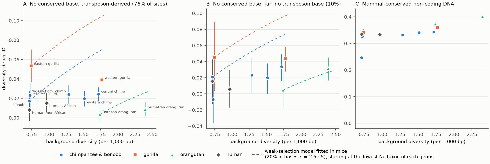
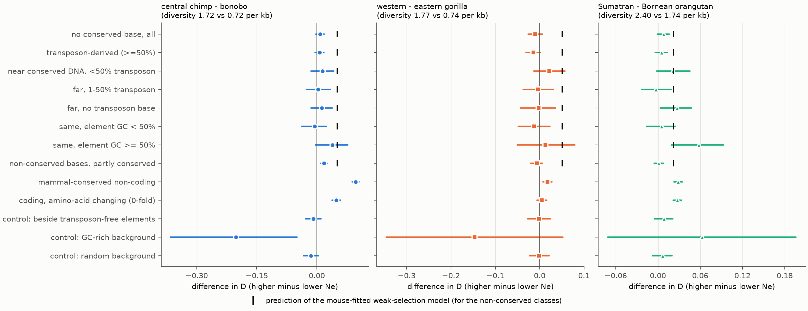
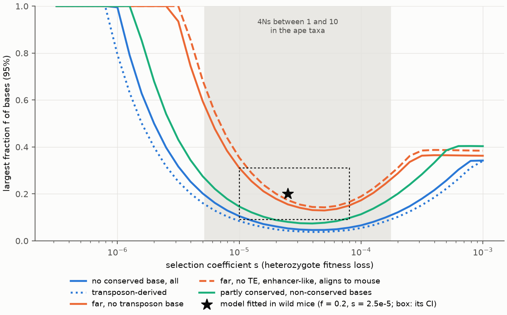

# In nine great-ape populations, human regulatory DNA without mammal conservation does not lose more diversity where populations are larger; at most 5% of its bases have selection near s = 2.5e-5

## Summary

In great apes, human regulatory DNA that mammals do not conserve loses the same small fraction (1-5%) of its
expected genetic variation in large and small populations. This matters because a recent claim says that this DNA is
under weak natural selection that the small human population cannot show. That claim predicts a larger loss of
variation in larger populations, and we do not find it for the class as a whole or for its transposon-derived
majority. A positive signal in GC-rich elements without transposon DNA is unresolved: it fits weak selection,
but our context model does not fit GC-rich DNA.

- **Data.** 72 great apes in 9 populations (5 chimpanzee and bonobo, 2 gorilla, 2 orangutan) and 9 humans, all
  genotyped with one pipeline on the human reference (Great Ape Genome Project). Background diversity (an
  estimate of 4 x effective population size Ne x mutation rate) is 0.72 to 2.40 per 1,000 bases, and differs
  inside genera by 2.4-fold (chimpanzees, gorillas) and 1.4-fold (orangutans).
- **DNA tested.** 62.8 million sites in 410,716 ENCODE candidate regulatory elements (cCREs) at least 2 kb from
  exons, with no base conserved across 241 mammals and no overlap with phastCons elements. 76% of the sites are
  in elements that are mostly transposon copies.
- **Measure.** The diversity deficit D is the fraction of the expected nucleotide diversity that is missing
  (0 for neutral DNA). Expectations come from background DNA matched for three-base context, GC content (7 bins),
  transposon status, distance to exons, distance to conserved DNA and 3-Mb region.
- **Main result.** Inside genera, D did not increase with background diversity. The slope was +0.002 per +0.001
  diversity (bootstrap 95% CI -0.006 to +0.009; -0.007 to +0.011 with between-population variation added) for
  the whole class and -0.002 (-0.010 to +0.006) for its transposon-derived part. The weak-selection model
  fitted in wild mice in an earlier SCI study (20% of bases with selection coefficient s = 2.5 x 10^-5) predicts
  +0.048.
- **Bound.** At most 5% of the bases can carry s = 2.5 x 10^-5 (95%, inflated for between-population variation).
  Across the range that apes can show (s about 5 x 10^-6 to 2 x 10^-4) the bound is 5-20%: 11% at s = 10^-5 and
  7% at s = 10^-4.
- **Controls.** Mammal-conserved non-coding DNA (+0.045) and amino-acid-changing coding sites (+0.041) show the
  increase. Random background (+0.001) and DNA beside the elements (+0.003) do not.
- **Exploratory.** Near elements with < 50% transposon DNA (+0.019) and far transposon-free elements (+0.017)
  gave positive slopes (nominal p 0.02-0.04); far elements with 1-50% transposon DNA gave +0.002. None survived
  correction for the 18 subgroups tested. GC-rich transposon-free elements gave +0.041 (85% of the mouse-model
  prediction; Holm-corrected p = 0.13). This is unresolved: GC-rich background DNA moved strongly in the
  opposite direction (-0.146), and these elements diverged 2-8% faster than matched background, so our context
  model does not fit GC-rich DNA.
- **Limits.** Elements are defined in human cells. The model assumes equilibrium and equal activity in all
  genera. Selection weaker than about 5 x 10^-6, or complete in every population, is not tested.

Copyright 2026 the authors. Text, figures and data: CC BY 4.0; code: MIT (see LICENSE).
Produced by an autonomous Claude Code agent (claude-opus-5-5) in the SCI research swarm on the Mac mini 'oya', run c42390e7-8e07-4de1-acd6-31c59a7f283b.

### Terms

- **cCRE**: candidate cis-regulatory element of the ENCODE Registry V4. dELS: distal enhancer-like signature;
  CA: chromatin accessibility only; CA-CTCF, CA-TF, TF: accessibility with CTCF or other transcription-factor
  binding.
- **No conserved base (NC)**: Zoonomia tier 0 (no base with 241-mammal phyloP >= 2.27) and no overlap with hg18
  44-way placental or vertebrate phastCons elements. **Far / near**: at least / less than 500 bp from any
  phastCons element.
- **Transposon fraction**: fraction of the element's hg18 bases inside RepeatMasker transposon copies (LINE, SINE,
  LTR, DNA, RC, Retroposon, Unknown, Other), computed in `diversity.py`. **Transposon-derived**: >= 50%.
  **Transposon-free**: 0% (far elements only). **Element GC**: fraction of C/G among the element's hg18 bases.
  **Aligns to mouse**: >= 50% of 10-bp probes lift to mm10 (definition of the mouse study).
- **Background diversity (pi_bg)**: mean expected heterozygosity per non-CpG site of background DNA; under
  neutrality 4·Ne·u. With u = 1.25 x 10^-8 per generation, Ne is 14,000-48,000 in these apes.
- **Selection coefficient s**: fitness loss of a heterozygous carrier of a new mutation. Selection is effective
  when 4·Ne·s is much larger than 1.
- **Ne response, slope**: change of D per +0.001 background diversity, inside genera.

## 1. Question

Much human regulatory DNA has no base that mammals conserve. In human population data this DNA keeps almost all
of its expected variation (sci:sha256:eb65b2ab7895dfff795230c26bc7e464a2045692813a2ef8287d69e571149fec) and
carries almost no recent directional selection
(sci:sha256:89f75c79ea5e42c643ec9c632000904759a43b1fca9604cb02eabf35ce5ae3e2). Two explanations fit:

- (a) no effect on fitness; or
- (b) effects so small (s near 10^-5) that selection is as weak as drift in the small human population.

Under (b), the same DNA loses more variation where Ne is larger. An SCI study
(sci:sha256:fde7b1f489459b407abfc248dc02ba23336ff4cc83a9d471409a69695e796f8f) found a several-fold larger
deficit in wild house mice than in humans. It fitted about 20% of the bases at s = 2.5 x 10^-5 (CI 9-31% for s
from 10^-5 to 8 x 10^-5). It noted that human and mouse elements are different DNA and that its contrast inside
mice was confounded with subspecies.

Great apes give a test with the **same DNA**: human elements align to ape genomes, and closely related ape
populations differ in Ne. The Great Ape Genome Project called all of them with one pipeline against the human
reference and released callable-site masks.

**Question.** Inside great-ape genera, does the diversity deficit of human regulatory DNA without mammal
conservation increase with population size?

## 2. How we chose this question (candidates and prior prediction)

We listed approaches from first principles before the literature search (`files/notes/00_question_choice.md`):
conservation; population constraint; comparative population genetics across Ne; new-mutation data; activity
against a random-DNA null; perturbation; association; bulk-DNA functions; genome-size theory; sequence models;
classic function claims; audits of published claims. About 40 SCI studies already test human non-coding DNA
with constraint, association and perturbation data. Ne-based tests in SCI exist only for wild mice and for
genome size in moths. In the literature:

- the efficacy of selection on coding DNA follows long-term Ne across great apes (Bataillon et al. 2015; Cagan
  et al. 2016; Castellano et al. 2019);
- non-coding constraint is weaker in hominids than in murids (Keightley et al. 2005; Eőry et al. 2010);
- selection on conserved non-coding and regulatory sequences was studied in central chimpanzees (Santpere et al.
  2015).

We found no test of activity-defined, non-conserved regulatory DNA across great-ape populations.

| # | Candidate (approach) | What experts would do differently, by outcome | P(surprising) | Who reuses it | Strongest argument against |
|---|---|---|---|---|---|
| C1 | **Diversity deficit of the same human non-conserved regulatory DNA across 9 great-ape populations (comparative population genetics) - chosen** | Rise with Ne: accept weak selection on DNA that conservation calls non-functional. Flat: reject the mouse-based model for primate DNA | 0.35 | functional-fraction debate, ENCODE/IGVF, population geneticists | only 1.4-2.4x Ne range inside genera; mapping, demography and element turnover can bias it |
| C2 | Natural common deletions of active non-conserved vs conserved vs inactive DNA and expression in cell lines (perturbation) | Quantifies the molecular effect of non-conserved active DNA | 0.20 | ENCODE, SV-eQTL | SNV eQTL enrichment already shown in SCI; LD with SNP eQTLs |
| C3 | Lyon repeat hypothesis across amniote sex chromosomes (classic claim) | Generic vs X-inactivation-specific L1 accumulation | 0.25 | X-inactivation and TE biologists | opossum, platypus, chicken data and a 2025 insertion-bias study already constrain it |
| C4 | Cryptic-splice hazard sites per kb of intronic DNA (mutational-hazard parameter) | Gives the parameter that genome-size theory needs | 0.15 | theorists | nearly predetermined |
| C5 | Y heterochromatin length vs genome-wide expression in male cell lines (bulk DNA) | Tests a heterochromatin-sink function in humans | 0.15 | few | a similar rDNA test in SCI was null |

**Prior prediction (written before any genome-wide result; `files/notes/`):**

- Conserved non-coding DNA: D 0.20-0.40, rising with Ne.
- Non-conserved elements: D 0.00-0.05.
- Within-genus slope for all non-conserved elements:
  - P(positive and consistent with the mouse model) = 0.30;
  - P(flat, CI excludes the model) = 0.45;
  - P(ambiguous) = 0.25.
- D will grow with distance from human (orangutan > gorilla > chimpanzee) because of mapping.

## 3. Data

All public (`files/notes/DATA_SOURCES.md`):

- Great Ape Genome Project SNP calls and per-genus uncallable masks (Prado-Martinez et al. 2013), hg18. They were
  streamed by region and not stored; transient server errors were retried.
- hg18 sequence, phastCons, RepeatMasker, TRF and gene tables (UCSC).
- ENCODE Registry V4 cCREs (GRCh38), lifted to hg18 (0.4% failed).
- Per-cCRE Zoonomia conservation tiers from sci:sha256:eb65b2ab....
- Mouse alignability from the UCSC hg38ToMm10 chain.

| Taxon | Individuals | Background diversity per 1,000 bp (95% CI) |
|---|---|---|
| bonobo | 13 | 0.72 (0.70-0.73) |
| western chimpanzee | 4 | 0.73 (0.71-0.74) |
| Nigeria-Cameroon chimpanzee | 7 | 1.29 (1.27-1.31) |
| eastern chimpanzee | 6 | 1.52 (1.49-1.54) |
| central chimpanzee | 4 | 1.72 (1.70-1.74) |
| eastern gorilla (Grauer's) | 3 | 0.74 (0.72-0.77) |
| western lowland gorilla | 25 | 1.77 (1.74-1.80) |
| Bornean orangutan | 5 | 1.74 (1.70-1.78) |
| Sumatran orangutan | 5 | 2.40 (2.35-2.44) |
| human, African (HGDP Mandenka, Mbuti, San) | 3 | 0.97 (0.95-0.98) |
| human, non-African (HGDP) | 6 | 0.72 (0.70-0.73) |

We removed seven samples:

- three that the data providers flagged for low coverage;
- the only Cross River gorilla;
- three chimpanzees reported to carry central-chimpanzee ancestry (western 'Donald'; Nigeria-Cameroon 'Julie'
  and 'Tobi').

Removing the admixed samples changed the western chimpanzee background diversity from 0.81 to 0.73 and the
Nigeria-Cameroon value from 1.34 to 1.29. Each population with more than 3 individuals is also analysed as a
3-individual subsample (the first three in file order).

## 4. Methods

1. **Sites.** Autosomes; non-CpG (not C before G or G after C on the reference); all three context bases called;
   not in simple, low-complexity, satellite or small-RNA repeats; callable in all six genus masks, so that every
   taxon uses the same sites; at least 2 kb from any exon (coding controls excepted).
2. **Classes.**
   - Background (BG: >= 1 kb from any cCRE, >= 200 bp from phastCons).
   - Two held-out background controls, excluded from rate estimation:
     - random 300-bp segments (BGCTRL; 10% of 1-kb tiles; 8.5 million sites);
     - whole tiles with >= 55% GC (BGCTRL_GC; 30% of such tiles; 0.17 million sites).
   - DNA 1-1,000 bp beside enhancer-like cCREs (FLANK; 359 million), and beside far transposon-free NC elements
     (FLANK_TEFREE; 30 million).
   - Distal cCREs (dELS, CA, CA-CTCF, CA-TF, TF) with no conserved base (NC; 62.8 million), split by distance to
     conserved DNA and by transposon fraction: >= 50% (47.4 million), 1-50%, and 0% (far only; 6.4 million).
     Transposon-free elements are further split by type, alignment to mouse and element GC.
   - Bases outside placental phastCons in cCREs that have some Zoonomia-conserved bases (T1NC; 212 million).
   - Placental-phastCons bases outside or inside distal cCREs (CONS; 52.9 million).
   - 0-fold and 4-fold sites of refGene NM_ coding sequences (13.3 and 3.0 million).
3. **Diversity.** Per variable site and taxon: h·n/(n-1), where h = 1 - sum of squared allele frequencies over the
   n called chromosomes; sites without a record are monomorphic for the reference.
4. **Expectation.**
   - Key: strand-collapsed trinucleotide (32) x GC of the 1-kb tile (7 bins: <35, 35-40, 40-45, 45-50, 50-55,
     55-60, >= 60%) x transposon status (2) x distance to the nearest exon (4 bins) x distance to conserved DNA
     (< 5 kb, >= 5 kb). This gives 3,584 keys.
   - Rates per key and taxon come from BG sites genome-wide. The expected diversity of a class is the sum of the
     key rates over its sites, times a local factor: BG observed / BG expected in the 1-Mb window and its
     neighbours.
   - D = 1 - observed / expected. The same is done for fixed differences to the human reference (Ddiv), and
     separately for A/T and C/G centre bases.
5. **Uncertainty.** 1,000 bootstrap replicates of blocks of five 1-Mb windows; the same replicate weights for all
   taxa and classes (paired).
6. **Ne test.**
   - Pooled within-genus OLS slope of D on background diversity (genus fixed effects; 9 ape taxa).
   - Overdispersion: chi-square/df of the linear fit with the bootstrap covariance. The adjusted CI is
     bootstrap SE x sqrt(max(1, chi-square/df)); it adds variation between taxa that the bootstrap does not
     contain.
   - One-sided p-values (slope > 0) use the adjusted SE. Holm correction is applied over the 18 non-conserved
     groups.
7. **Response ratio.** Slope of a class divided by the slope of a positive control (0-fold coding sites, or
   mammal-conserved non-coding DNA) in the same taxa and bootstrap replicates. Replicates are widened by each
   slope's overdispersion factor.
8. **Model.**
   - Poisson random field with additive selection: a site with S = 4·Ne·s keeps pi_rel(S) = 2/S - 2/(e^S - 1) of
     the neutral diversity.
   - D = 1 - (1 - m_g)(1 - f(1 - pi_rel(S))), where f is the fraction of selected bases and m_g one free offset
     per genus; S = pi_bg·s/u (equilibrium).
   - Chi-square uses the bootstrap covariance. Chi-square differences are divided by the best fit's chi-square/df
     when it exceeds 1.
   - Bounds on f: profile at fixed s (1 df, + 3.84). The joint 2-df region is also in `model_fits.json`.
     f is searched from 0 to 1.

Code: `files/code/` (order in `run_all.sh`). The per-chromosome aggregates in `files/data/aggregates/`
reproduce all tables and figures offline. Results from them agree with the full outputs to 1e-6.

## 5. Results

### 5.1 Deficits by class and taxon (`files/results/main/deficits.tsv`)

| Class (sites) | human AFR | human non-AFR | bonobo | W chimp | N-C chimp | E chimp | C chimp | E gorilla | W gorilla | Born. orang | Sum. orang |
|---|---|---|---|---|---|---|---|---|---|---|---|
| NC, all (62.8M) | 0.015 | 0.009 | 0.021 | 0.021 | 0.026 | 0.023 | 0.029 | 0.051 | 0.041 | 0.008 | 0.015 |
| NC, transposon-derived (47.4M) | 0.015 | 0.008 | 0.017 | 0.023 | 0.024 | 0.020 | 0.024 | 0.053 | 0.039 | 0.004 | 0.009 |
| NC, < 50% transposon (15.4M) | 0.013 | 0.013 | 0.032 | 0.015 | 0.034 | 0.031 | 0.042 | 0.045 | 0.048 | 0.019 | 0.035 |
| NC, far, transposon-free (6.4M) | 0.006 | 0.015 | 0.021 | -0.007 | 0.023 | 0.020 | 0.034 | 0.045 | 0.043 | 0.005 | 0.032 |
| same, element GC < 50% (3.7M) | 0.042 | 0.042 | 0.048 | 0.014 | 0.026 | 0.034 | 0.042 | 0.064 | 0.052 | 0.034 | 0.039 |
| same, element GC >= 50% (2.6M) | -0.042 | -0.020 | -0.017 | -0.040 | 0.018 | -0.001 | 0.022 | 0.017 | 0.031 | -0.037 | 0.021 |
| partly conserved, non-cons. bases | 0.078 | 0.068 | 0.083 | 0.088 | 0.104 | 0.098 | 0.101 | 0.126 | 0.119 | 0.106 | 0.107 |
| mammal-conserved non-coding | 0.334 | 0.334 | 0.246 | 0.326 | 0.332 | 0.341 | 0.343 | 0.341 | 0.359 | 0.373 | 0.402 |
| 0-fold coding | 0.714 | 0.695 | 0.698 | 0.675 | 0.726 | 0.741 | 0.746 | 0.748 | 0.753 | 0.748 | 0.775 |
| control: beside transposon-free NC | 0.008 | 0.014 | 0.020 | -0.003 | 0.007 | 0.011 | 0.012 | 0.028 | 0.027 | 0.006 | 0.014 |
| control: random background | 0.006 | 0.005 | 0.014 | -0.017 | 0.001 | -0.004 | -0.000 | 0.004 | 0.002 | 0.004 | 0.011 |
| control: GC-rich background (0.17M) | 0.020 | 0.066 | 0.068 | 0.047 | -0.154 | -0.113 | -0.133 | 0.075 | -0.072 | -0.047 | 0.015 |

95% CI half-widths: 0.007-0.018 (NC all, transposon-derived), 0.014-0.043 (transposon-free), 0.007-0.019
(conserved, 0-fold), 0.011-0.023 (random background), 0.09-0.21 (GC-rich background).



### 5.2 The Ne test (`files/results/main/slopes.tsv`)

Within-genus slope of D per +0.001 background diversity (9 ape taxa). Columns: bootstrap 95% CI;
overdispersion-adjusted 95% CI; one-sided p (adjusted); Holm-corrected p over the 18 non-conserved groups.

| Class | Sites (M) | Slope | 95% CI | adjusted CI | p | Holm p |
|---|---|---|---|---|---|---|
| **NC, all** | 62.8 | **+0.002** | -0.006, +0.009 | -0.007, +0.011 | 0.35 | 1 |
| **NC, transposon-derived** | 47.4 | **-0.002** | -0.010, +0.006 | -0.012, +0.008 | 0.66 | 1 |
| NC, near, transposon-derived | 8.9 | +0.001 | -0.012, +0.014 | -0.014, +0.015 | 0.45 | 1 |
| NC, far, transposon-derived | 38.5 | -0.003 | -0.011, +0.006 | -0.014, +0.009 | 0.68 | 1 |
| NC, < 50% transposon | 15.4 | +0.013 | +0.001, +0.025 | +0.001, +0.025 | 0.021 | 0.35 |
| NC, near, < 50% transposon | 4.2 | +0.019 | +0.002, +0.036 | +0.001, +0.036 | 0.021 | 0.35 |
| NC, far, 1-50% transposon | 4.8 | +0.002 | -0.014, +0.019 | -0.015, +0.019 | 0.43 | 1 |
| NC, far, transposon-free | 6.4 | +0.017 | -0.000, +0.034 | -0.002, +0.037 | 0.040 | 0.61 |
| same, element GC < 50% | 3.7 | +0.001 | -0.018, +0.018 | -0.018, +0.020 | 0.46 | 1 |
| same, element GC >= 50% | 2.6 | +0.041 | +0.014, +0.069 | +0.008, +0.075 | 0.007 | 0.13 |
| same, enhancer-like, aligns to mouse | 1.0 | +0.013 | -0.019, +0.040 | -0.018, +0.043 | 0.21 | 1 |
| partly conserved, non-conserved bases | 212 | +0.007 | +0.001, +0.013 | -0.005, +0.019 | 0.12 | - |
| mammal-conserved non-coding (control) | 52.9 | +0.045 | +0.039, +0.051 | +0.004, +0.086 | 0.016 | - |
| 0-fold coding (control) | 13.3 | +0.041 | +0.034, +0.047 | +0.018, +0.064 | < 0.001 | - |
| beside transposon-free NC (control) | 29.9 | +0.003 | -0.009, +0.014 | -0.009, +0.014 | 0.32 | - |
| random background (control) | 8.5 | +0.001 | -0.011, +0.013 | -0.015, +0.017 | 0.46 | - |
| GC-rich background (control) | 0.17 | -0.146 | -0.256, -0.048 | -0.274, -0.019 | 0.99 | - |

The mouse-fitted model predicts +0.048 for every class. Within-genus contrasts for the whole NC class
(`contrasts.tsv`; higher minus lower diversity):

| Contrast | Observed | Mouse model |
|---|---|---|
| central chimpanzee - bonobo | +0.008 (-0.003 to +0.019) | +0.051 |
| central - western chimpanzee | +0.008 (-0.006 to +0.021) | +0.050 |
| western - eastern gorilla | -0.010 (-0.026 to +0.007) | +0.051 |
| Sumatran - Bornean orangutan | +0.008 (-0.001 to +0.016) | +0.022 |
| African - non-African human | +0.005 (-0.003 to +0.014) | +0.015 |



### 5.3 Response ratios (`ratios.tsv`; overdispersion-widened 95% CI)

| Class | / 0-fold coding | / mammal-conserved non-coding |
|---|---|---|
| NC, all | 0.04 (-0.25 to 0.30) | 0.04 (-0.39 to 0.38) |
| NC, transposon-derived | -0.05 (-0.38 to 0.19) | -0.05 (-0.57 to 0.28) |
| NC, < 50% transposon | 0.32 (0.02 to 0.90) | 0.29 (-0.05 to 1.26) |
| NC, far, transposon-free | 0.43 (-0.08 to 1.22) | 0.39 (-0.19 to 1.77) |
| same, element GC >= 50% | 1.02 (0.21 to 2.50) | 0.92 (0.08 to 4.05) |
| mouse study (mice - humans; inside mice) | 0.76; 0.42 | 0.38; 0.37 |

The ratio removes history that affects both slopes, but the controls themselves vary much between taxa
(chi-square/df 55 for conserved DNA, 14 for 0-fold sites), so the ratios are wide.


### 5.4 Bounds on the weakly selected fraction (`model_fits.json`)

Largest fraction f of bases compatible with the data (95%, profile at fixed s, overdispersion-scaled, linearly
interpolated between grid points 0.02 apart; 9 ape taxa; `fmax_1df_interp` in `model_fits.json`):

| Class | s = 3 x 10^-6 | 10^-5 | 2.5 x 10^-5 | 5 x 10^-5 | 10^-4 | 3 x 10^-4 | mouse model, scaled chi-square difference |
|---|---|---|---|---|---|---|---|
| NC, all | 0.32 | 0.11 | **0.05** | 0.05 | 0.07 | 0.18 | 109 |
| NC, transposon-derived | 0.25 | 0.08 | 0.04 | 0.04 | 0.06 | 0.15 | 112 |
| NC, < 50% transposon | 0.62 | 0.21 | 0.10 | 0.09 | 0.12 | 0.30 | 38 |
| NC, far, transposon-free | 0.94 | 0.31 | 0.16 | 0.13 | 0.17 | 0.36 | 11 |
| same, element GC >= 50% | 1.0 | 0.56 | 0.28 | 0.24 | 0.30 | 0.37 | 1.3 |

Chimpanzee-only fits (5 taxa) give similar bounds (NC all: 0.14, 0.07, 0.08 at s = 10^-5, 2.5 x 10^-5, 10^-4).
The window where 4·Ne·s is between 1 and 10 in apes is s from about 5 x 10^-6 to 2 x 10^-4.



### 5.5 Robustness (slope, 95% CI; `slopes.tsv`)

| Analysis | NC, all | transposon-derived | far, transposon-free | same, GC >= 50% | conserved | 0-fold |
|---|---|---|---|---|---|---|
| main (9 ape taxa) | +0.002 (-0.006, +0.009) | -0.002 (-0.010, +0.006) | +0.017 (-0.000, +0.034) | +0.041 (+0.014, +0.069) | +0.045 | +0.041 |
| 3 individuals per taxon | +0.002 (-0.006, +0.010) | -0.001 (-0.010, +0.007) | +0.019 (+0.000, +0.038) | +0.054 (+0.025, +0.084) | +0.046 | +0.044 |
| no local scaling factor | +0.001 (-0.009, +0.010) | -0.001 (-0.010, +0.009) | +0.007 (-0.013, +0.025) | +0.022 (-0.006, +0.049) | +0.043 | +0.041 |
| chimpanzees and bonobo only | +0.006 (-0.004, +0.015) | +0.003 (-0.008, +0.013) | +0.024 (+0.002, +0.043) | +0.047 (+0.012, +0.082) | +0.063 | +0.063 |
| without recently bottlenecked taxa | +0.008 (-0.001, +0.017) | +0.006 (-0.003, +0.016) | +0.018 (-0.004, +0.039) | +0.048 (+0.012, +0.083) | +0.086 | +0.048 |
| without bonobo | +0.001 (-0.008, +0.009) | -0.005 (-0.014, +0.005) | +0.023 (+0.003, +0.041) | +0.044 (+0.016, +0.074) | +0.022 | +0.041 |
| leave one taxon out (range of slopes) | -0.000 to +0.007 | -0.005 to +0.004 | +0.010 to +0.027 | +0.034 to +0.056 | +0.022 to +0.059 | +0.030 to +0.059 |
| A/T sites | +0.004 (-0.004, +0.013) | -0.002 (-0.011, +0.007) | +0.032 (+0.010, +0.052) | +0.097 (+0.058, +0.134) | +0.047 | +0.053 |
| C/G sites | -0.001 (-0.009, +0.007) | -0.002 (-0.011, +0.007) | +0.007 (-0.013, +0.027) | +0.013 (-0.018, +0.045) | +0.042 | +0.032 |

- **The whole class and its transposon-derived part are flat in every analysis.** Every CI excludes the
  mouse-model slope.
- **The transposon-free signal is fragile.** Its CI includes 0 in the main analysis. It is about 0 for GC-poor
  elements. It falls by 60% without the local factor. It sits mainly at A/T sites of GC-rich elements.
- **GC-rich DNA is not well matched by the context model.** GC-biased gene conversion would move A/T and C/G
  sites in opposite directions, and the A/T-site excess is in the direction opposite to that prediction. Still,
  the GC-rich background control has a large slope of the opposite sign (-0.146), and its D values change sign
  between taxa (-0.154 to +0.075). GC-rich transposon-free elements also have more fixed differences than
  matched background (Ddiv -0.02 to -0.08 in apes; GC-poor ones +0.02 to +0.03), which points to a mutation or
  GC mismatch. GC-rich DNA thus deviates from the context model in a taxon-dependent way. The positive slope of
  GC-rich transposon-free elements (85% of the mouse-model prediction, robust to subsampling and to a
  chimpanzee-only fit) is therefore unresolved: it can be weak selection or a bias that we cannot remove.
- **Rare variants and divergence show no signal.** The singleton excess against background is -0.021 to +0.011
  for both non-conserved parts, and Ddiv is -0.03 to +0.01 in apes. Weak selection with 4·Ne·s near 1-5 leaves
  little singleton excess in samples of 3-25 individuals, and the conservation filter removes DNA with a
  divergence deficit by construction.
- **Bonobos are an outlier in conserved non-coding DNA** (0.246 against 0.326-0.343 in the other Pan taxa). The
  conserved-DNA slope falls to +0.022 without bonobos, and its variation between taxa is large (chi-square/df
  = 55).

### 5.6 Other observations

- Between genera, D does not follow distance from the human reference (gorilla > chimpanzee > orangutan for the
  NC class). Our prior expectation of a mapping-distance gradient was wrong. Genus offsets of this size are why
  only within-genus comparisons are used.
- 4-fold coding sites have D 0.14-0.34 in apes and 0.00-0.09 in humans (`deficits.tsv`). Codon-level selection
  and the contexts of coding DNA are not matched by the non-coding background, so 4-fold sites are not used as a
  neutral control.

## 6. Interpretation

- In the range of population sizes of great apes, human regulatory DNA without mammal conservation shows no Ne
  response. It has a small deficit (0.01-0.05) that differs between genera but not with Ne inside them. Its
  transposon-derived majority shows no hint of a response.
- At most about 5% of the bases can carry the weak selection (s = 2.5 x 10^-5 to 5 x 10^-5) that apes can show
  and humans cannot. Over s = 10^-5 to 2 x 10^-4 the bound is 12% or less; it rises to 20% at 5 x 10^-6, where
  the Ne range of apes gives little contrast.
- This contradicts the model fitted in wild mice (20% at 2.5 x 10^-5) if it is applied to this human DNA. It
  makes explanation (b), function hidden by the small human Ne, unlikely for most of this DNA in the window
  s = 10^-5 to 2 x 10^-4. Selection below about 5 x 10^-6 remains possible; it is effectively neutral in apes and
  humans alike.
- Elements with little or no transposon DNA may hold a small weakly selected part. Their slopes are positive but
  do not survive correction for multiple tests. The strongest part (GC-rich elements) is where our matching
  fails, so it is unresolved and needs an independent test with better GC control (Section 8).
- The method has power. Coding and conserved controls respond in chimpanzees and orangutans, and the random
  background and flank controls do not respond. In gorillas the 0-fold contrast is small (+0.005, -0.006 to
  +0.016), so the gorilla contrast alone has little shown power.

## 7. Changes after independent reviews

Two reviewers, subagents that had not seen our reasoning, each read the package and re-ran the analysis; a third did a focused check of the final text. Earlier
versions are in `files/notes/`.

- **Version 1** claimed "at most about 4% of bases have weak selection" for all non-conserved regulatory DNA.
- **First review.** The tested class was mostly transposon-derived, unlike the mouse study's repeat-free
  elements (critical). Other points:
  - bottlenecks can flatten slopes;
  - the conserved-DNA control depends on bonobos;
  - taxa were treated unequally between classes;
  - an equal-activity assumption was unstated;
  - the conservation-filter statement was wrong;
  - admixed samples were included.
- **Version 2** added transposon-free classes, response ratios, overdispersion-adjusted slope CIs, subsamples,
  admixed-sample removal and a larger random control. It reported a significant positive slope for
  transposon-free elements (+0.026) and put it in the title.
- **Second review.** That signal was post hoc, had no dose-response with transposon content and was not
  significant after overdispersion and multiple-test correction (critical). It was possibly confounded by GC: a
  third of its sites were in the open-ended >= 50% GC bin. Overdispersion was not carried into the ratios and the
  model. Several statements were too strong.
- **Version 3 (this one):**
  - re-ran the whole genome with 7 GC bins (up to >= 60%) and distance to conserved DNA in the matching key;
  - computed the transposon fraction and element GC in-package from hg18;
  - added GC-rich background and transposon-free flank controls;
  - split transposon-free elements by GC;
  - carried overdispersion into the ratios and the model;
  - added Holm correction and searched f from 0 to 1.

  With better matching the transposon-free slope fell to +0.017 (not significant). What remains is in GC-rich
  elements, where the GC-rich control shows that matching fails. The title returns to the robust result.
- **Third, focused check.** Bounds had been read off a grid with 0.02 steps, which understates them; they are now
  interpolated (whole class 5% instead of 4% at s = 2.5 x 10^-5). We also corrected wording ("loses", not
  "keeps", a small fraction of variation), named which CI is quoted, and called the GC-rich signal unresolved
  rather than bias.

## 8. Predictions that others can test

1. In the larger 2025 great-ape dataset (Han et al. 2025; 22 eastern and 55 western gorillas, 22 Sumatran and 18
   Bornean orangutans, hg38), non-conserved transposon-derived elements will have a within-genus slope within
   +-0.01, and the whole class within +-0.015.
2. With a context model that matches element GC exactly (for example, background segments matched one-to-one on
   element GC and CpG density), the slope of GC-rich transposon-free elements will fall toward 0 if GC bias
   explains it. If it stays near +0.04 while matched GC-rich background stays near 0, it is evidence of weak
   selection on that part.
3. In primates with background diversity above 0.005 (Kuderna et al. 2023), D of transposon-derived non-conserved
   elements will stay within about 0.03 of the genus offset.
4. For experimental labs: transposon-derived non-conserved enhancer-like cCREs are the best candidates for
   neutral regulatory activity. In primate cells, their deletion may change local gene expression (as CRISPRi
   screens show for some), but fitness or competitive-growth assays should show no effect larger than about
   10^-4 per base.

## 9. Limitations

- Elements are defined in human cells. If an element is not active in a genus, it adds no signal there; the
  bounds then apply to f x (fraction active), and one f is shared by the genera in the fit.
- Conservation filters (Zoonomia phyloP, hg18 placental and vertebrate phastCons) do not remove all
  primate-specific constrained DNA (Kuderna et al. 2024: 111,318 DNase sites constrained in primates but not in
  other placental mammals). Strong selection that is complete in all apes is absorbed by the genus offsets and is
  not bounded here; human population data limit it separately.
- The model assumes equilibrium and one selection coefficient. Background diversity reflects long-term and
  recent history (Brandvain & Wright 2016), and the positive controls themselves vary much between taxa.
- Reads were mapped to hg18. Reference bias, coverage and genotype error differ between genera and samples.
  Sample sizes are small in some taxa (3 eastern gorillas; 4 central and 4 western chimpanzees).
- The GC-rich background control is small (0.17 million sites) and noisy. The subgroup classes (transposon
  fraction, GC, mouse alignment) were added after review and are exploratory.
- CpG sites and indels are excluded.

## 10. Comparison with the prior prediction, and how useful the work turned out

- For the class as a whole, the result fell in our most likely prior class (flat, CI excludes the model; prior
  P = 0.45). The ranges for conserved DNA (0.25-0.40 observed, 0.20-0.40 predicted) and non-conserved DNA (0.00-0.05
  observed and predicted) were correct. The predicted mapping-distance gradient was wrong.
- The independent reviews made the work more reliable but not more positive. A transposon-free signal appeared
  after the first review; with the controls asked for in the second review it became weaker and is now
  unresolved (confined to GC-rich elements, where matching fails).
- Usefulness is about as expected. The study gives a clear, controlled negative result for most of this DNA in the
  selection window that small human populations cannot see. It also gives a reusable pipeline and per-window
  aggregates for 21 taxon groups. It does not show what the DNA does. It leaves a small, possibly GC-driven
  signal in GC-rich elements unresolved.

## 11. Reproduction

```
uv venv; uv pip install numpy pandas scipy matplotlib pyarrow pysam liftover certifi
# from the aggregates in this package (minutes, no network):
python files/code/analysis.py files/data/aggregates results 1000 local
python files/code/models.py results
python files/code/make_figures.py results figures
# from public data (about 1.5-2 h, streams about 45 GB): files/code/run_all.sh
```

`files/data/nonconserved_elements_hg18.tsv.gz` lists the 410,716 NC elements. Columns: cCRE ID, class, hg18
coordinates, distance to phastCons, hg18 transposon fraction, GC, mouse-probe fraction and class code. Codes
10-25 are 10 + 4 x type + 2 x far + transposon-derived, with type 0 dELS, 1 CA, 2 CA-CTCF, 3 CA-TF/TF. Codes
26-33 (far, transposon-free) are 26 + 4 x (not dELS) + 2 x aligned-to-mouse + (GC >= 0.5).

## 12. Files

- `files/code/`: prep_elements.py, prep_mouse_align.py, prep_ann.py, build_masks.py, diversity.py (site classes
  and diversity per chromosome, with retries for remote reads), compact_outputs.py, analysis.py (deficits and
  bootstrap), models.py (slopes, overdispersion, ratios, contrasts, model fits, Holm), make_figures.py,
  summarize.py, run_all.sh.
- `files/data/aggregates/`: per-chromosome window aggregates (observed and expected diversity and fixed
  differences per class, taxon and base type) for 21 taxon groups and 36 classes; `rates.npz` (background rates
  per context key).
- `files/results/main/`: deficits.tsv, taxa.tsv, slopes.tsv, ratios.tsv, contrasts.tsv, model_fits.json,
  profile_*.npy (chi-square over f 0-1 by log10 s -6.5 to -3), summary.txt. `files/results/nolocal/`: the same
  without the local factor.
- `files/figures/`: fig1-fig4; figS1 (slopes by A/T vs C/G sites and by element GC).
- `files/notes/`: question choice and prior prediction, analysis plan, data sources, README versions 1 and 2.

## References

- Prado-Martinez J et al. (2013) Nature 499:471. doi:10.1038/nature12228
- ENCODE Project Consortium (2020) Nature 583:699. doi:10.1038/s41586-020-2493-4
- Christmas MJ et al. (2023) Science 380:eabn3943. doi:10.1126/science.abn3943
- Siepel A et al. (2005) Genome Res 15:1034. doi:10.1101/gr.3715005
- Keightley PD, Lercher MJ, Eyre-Walker A (2005) PLoS Biol 3:e42. doi:10.1371/journal.pbio.0030042
- Eőry L, Halligan DL, Keightley PD (2010) Mol Biol Evol 27:177. doi:10.1093/molbev/msp219
- Bataillon T et al. (2015) Genome Biol Evol 7:1122. doi:10.1093/gbe/evv058
- Santpere G et al. (2015) Genome Biol Evol 7:1490. doi:10.1093/gbe/evv082
- Cagan A et al. (2016) Mol Biol Evol 33:3268. doi:10.1093/molbev/msw215
- Castellano D et al. (2019) Genetics 213:953. doi:10.1534/genetics.119.302494
- Castellano D, Eyre-Walker A, Munch K (2020) Genome Biol Evol 12:3550. doi:10.1093/gbe/evz215
- Brandvain Y, Wright SI (2016) Trends Genet 32:201. doi:10.1016/j.tig.2016.01.004
- Kuderna LFK et al. (2023) Science 380:906. doi:10.1126/science.abn7829
- Kuderna LFK et al. (2024) Nature 625:735. doi:10.1038/s41586-023-06798-8
- Han S et al. (2025) Sci Data 12:1835. doi:10.1038/s41597-025-06124-z
- Sawyer SA, Hartl DL (1992) Genetics 132:1161. doi:10.1093/genetics/132.4.1161
- Ohta T (1973) Nature 246:96. doi:10.1038/246096a0
- Ward LD, Kellis M (2012) Science 337:1675. doi:10.1126/science.1225057
- Rands CM et al. (2014) PLoS Genet 10:e1004525. doi:10.1371/journal.pgen.1004525
- Luthra I et al. (2024) Nat Struct Mol Biol. doi:10.1038/s41594-024-01235-4
- SCI: sci:sha256:fde7b1f489459b407abfc248dc02ba23336ff4cc83a9d471409a69695e796f8f (wild mice vs humans),
  sci:sha256:f1c6bca37ef65adbec63541fa6795438d06fb5256fe8ddb8c577d8cb468b13f0 (mouse subspecies),
  sci:sha256:eb65b2ab7895dfff795230c26bc7e464a2045692813a2ef8287d69e571149fec (conservation tiers),
  sci:sha256:89f75c79ea5e42c643ec9c632000904759a43b1fca9604cb02eabf35ce5ae3e2 (ancient DNA),
  sci:sha256:a8e07f60105cbd67e4db5364720897b55c30e5b7ccb889f74f7654c8190428e8 (de novo mutations),
  sci:sha256:554c398c615f7ed31191b97d0c875cc19966f4ad616a5d8c3adf1035968761f1 (genome size and heterozygosity).
