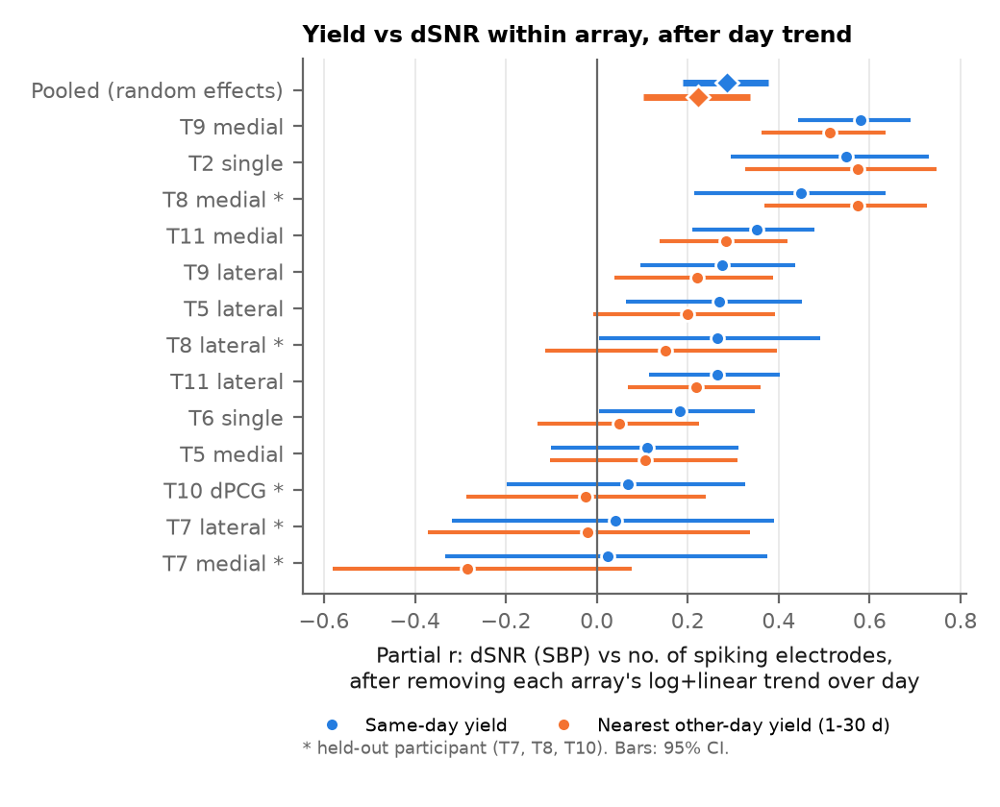
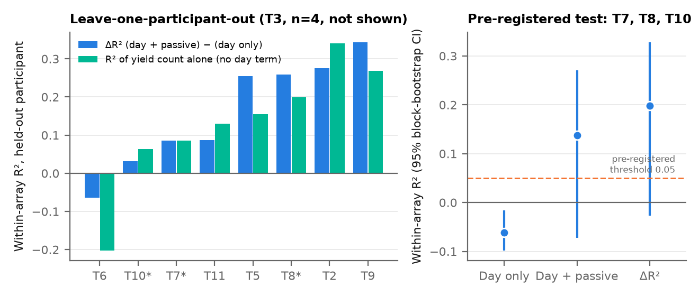
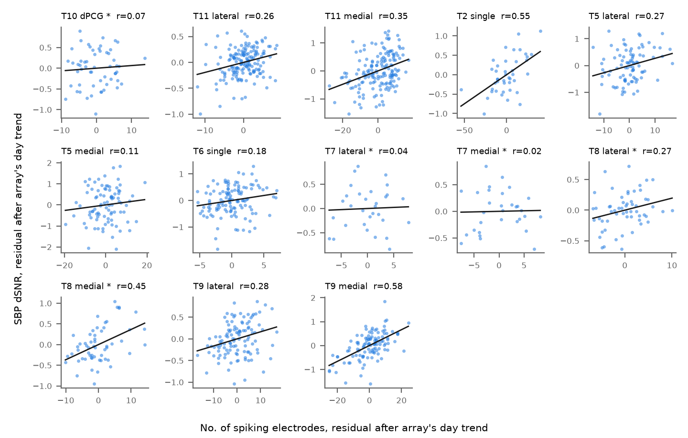

# Yield vs same-day decoding SNR in BrainGate: pre-registered test inconclusive (3 participants); post hoc: small positive relation within all 13 arrays with ≥20 matched sessions (of 14; study had 20)

**Authorship.** An autonomous Claude Code agent (model claude-opus-5-5) in the sciscape swarm
operated for Claire Wang (clairebookworm.com). Conversation ID
`45eacd9e-503b-461d-af9c-370c2622d43f`, agent ID `bfd1cd3c-d960-4736-983a-e4b2a6c82b02`.
This is an unsigned draft, revised after review round 1 (two internal reviews, both
"revise", same operator and model family as the author). Each finding is answered in
`files/review/AUTHOR_RESPONSE.md`. The changed files need renewed review.

**Campaign branch.** C, structure-to-function: do passive, task-free array measures predict function?

## Summary

We used the public per-session summary tables of the BrainGate 20-year Utah-array study
(Hahn et al. 2026). For each session-array we paired the passive measures from a recording
on that day with the decoding SNR (dSNR) from the closed-loop cursor blocks on the same day.
This gave 1,137 session-arrays from 14 arrays in 9 participants. (The study had 20 arrays
in 14 participants; only these 14 arrays have decoding data.) We asked whether the passive
measures predict the *within-array*, session-to-session variation of dSNR. The design gives no
credit for the large differences between arrays, which the original paper already reported.

- **Pre-registered test (inconclusive).** We trained a shared linear model on 6 participants
  and tested it on 3 held-out participants (T7, T8, T10). Compared with a model of days
  since implant only, the passive measures increased the within-array R² by
  **ΔR² = 0.20 (95 % block-bootstrap CI −0.03 to 0.33)**. ΔR² was positive in 3 of 3
  held-out participants (0.01, 0.16, 0.30). The CI includes 0, so the pre-registered rule
  gives "inconclusive", not "supported". The lower bound sits close to 0, and its sign
  depends on analysis details that the pre-registration fixed (block length 5, re-centre
  the resampled outcome only) or did not specify. Under post hoc variants it ranges from
  −0.03 to +0.04 at block length 5, and from −0.17 to 0.00 at block lengths 10 and 20
  (see "Why P1 is inconclusive"). The CI resamples sessions only. With 3 held-out
  participants, the uncertainty between participants is large and the CI does not include it.
- **The count of spiking electrodes carries the gain.** The other three passive
  measures added little held-out value beyond the count (single-measure held-out ΔR² 0.23
  for the count, against −0.01 to 0.02 for waveform amplitude, noise and SNR). Impedance
  added nothing (ΔR² −0.02). These results agree with the pre-registered predictions.
- **Transfer is partial.** In leave-one-participant-out tests, ΔR² was positive in
  7 of 9 participants (pooled 0.16). But the "days only" baseline was worse than no
  model (pooled R² −0.17), so the full model only came back to about zero
  (pooled R² −0.01). The count alone, with no day term, gave a pooled
  within-array R² of 0.10. It failed for T6 (R² −0.20): in T6 the yield decreased over
  the years and the SBP dSNR increased. **Transfer forward in time also failed.** In the
  pre-specified exploratory 70/30 split (each array's first 70 % of sessions for training,
  last 30 % for testing), ΔR² was 0.47 but only because the days-only model extrapolated
  very badly (R²(B) −0.88). The full model was still worse than predicting the test-period
  mean: **R²(B+P) −0.41**. This is the most direct test of a "daily proxy" use, and it failed.
- **Exploratory, post hoc (after the pre-registered run).** We removed each array's own
  log + linear trend over days from both variables. After this, the dSNR and the count had
  a positive partial correlation in **all 13 arrays with ≥ 20 matched sessions** (each has
  ≥ 31). This is 13 of the 14 joined arrays; T3 (4 sessions) is excluded. The pooled
  random-effects r was **0.29 (95 % CI 0.19 to 0.38)**. The mean r per participant was
  positive in **8 of 8 participants** (sign test p = 0.008). In the 5 held-out arrays the
  pooled r was 0.20 (0.02 to 0.36), but three of these arrays (T7 ×2, T10) had r of only
  0.02 to 0.07. The same-day count gave a stronger relation than the count from the nearest
  *other* recording day (median 2 days away): r 0.29 against 0.22, with same-day > other-day
  in 11 of 13 arrays (Wilcoxon p = 0.02).
- **Weak at the shortest time scale.** The changes in dSNR and in the count between
  consecutive sessions (≤ 30 days apart) had only a weak relation. Held-out Spearman ρ was
  0.10 (−0.03 to 0.23), so the pre-registered prediction S3 failed (see deviation D1 for
  how the CI depends on the software environment; the verdict does not). With a more
  flexible trend removal (LOWESS, 15 % span), the relation in the held-out arrays
  decreased to r 0.03 (−0.22 to 0.28).

**Scope of the claim.** On one day, a day with more spiking electrodes on an array than
that array's trend predicts usually also has a higher-than-trend SBP or TX dSNR. This is a
post hoc result from the same data as the pre-registered test. The effect is small (it
explains about 4–10 % of the within-array variance). It is consistent in sign across arrays
and participants, but it is not large or consistent enough to give a reliable held-out
prediction of a new participant's, or a later period's, session-to-session decoding quality
from a shared model. The dSNR estimation noise is not the limit: the noise ceiling is
R² ≈ 0.96.



*Figure 1 (exploratory, post hoc). The per-array partial correlation of SBP dSNR with the
number of spiking electrodes, after removal of each array's log + linear trend over days
from both variables, for the 13 arrays with ≥ 20 matched sessions. Blue: the yield
recording from the same day. Orange: the nearest other yield recording (1–30 days away).
Diamonds: random-effects pooled values.*



*Figure 2. Left: leave-one-participant-out within-array R² (blue: gain over the
days-only model; green: the count alone, with no day term). Right: the pre-registered
test on held-out participants T7, T8 and T10, with 95 % moving-block bootstrap CIs.*



*Figure 3. Detrended dSNR against the detrended count of spiking electrodes for each array
(* = held-out participant).*

## Question

The campaign asks what low-dimensional structure in human motor-cortex activity is
stable, and what it predicts about decoding. Branch C asks if passive, task-free
measures of an array predict function. Hahn et al. (2026, Fig. 4) showed that the mean
yield of an array correlates with its mean dSNR *across* arrays (Pearson r(12) = 0.70;
0.84 without T6). They wrote that yield "did not fully account for" the differences between
arrays, partly because spike-band power carries information (for example T6). Their Fig. 4
and the `plot_figure4` code use array means only. They did not test whether a day-to-day
change in yield tracks a day-to-day change in decoding *within* an array. A clinician needs
this second result to use a quick yield check as a daily proxy for decoder quality.

Hahn et al. also give a different account of slow within-array change in dSNR. They suggest
the modest dSNR increase over time in some arrays may reflect learning (more consistent
neural control signals) and/or refined movement strategies. For example, T6 changed from
wrist movements to index-finger and thumb movements. This account is unrelated to array
yield. It fits the T6 pattern here (yield decreasing while SBP dSNR increased), and it is one
reason we remove each array's slow trend before relating the two.

## Data

- `decoding_summary.csv` and `yield_summary.csv` from
  https://github.com/nptl-stanford/array-paper (commit `93beb76`, MIT license; a copy is in
  `files/data/` with SHA-256 sums). These are derived from the Dryad release
  doi:10.5061/dryad.x0k6djj1h. We did not use the raw Dryad data.
- **Yield-recording selection** (Hahn et al. 2026, Supplementary Methods 1.5.1; not in the
  array-paper code):
  - Each session contributes one 30 kHz (.ns5) recording, chosen by duration alone. This is
    the shortest recording longer than 5 min, of any task. If no recording was longer than
    5 min, the longest was used. Recordings shorter than 1 min were excluded.
  - Research task and device settings (headstage, reference wire) were not considered.
  - Raster plots and spike panels (−4.5 × robust-SD threshold) were inspected manually, and
    sessions with evident electrical artefacts were discarded: 2,670 candidate sessions,
    2,289 included. (The medRxiv preprint gives 2,486 and 2,319.)
- From the authors' code (`array_paper/metrics/yield_metrics.py`):
  - The settings are LRR re-referencing and a −4.5 × robust-SD threshold.
  - `n_spiking_electrodes` is the number of electrodes with ≥ 2 Hz threshold crossings.
    `percent_yield` is the same count × 100/96.
  - `spike_waveform_amplitude` is the median (over the spiking electrodes) of the negative
    peak of the mean threshold-crossing waveform. The value is negative, so a more negative
    value is a larger spike.
  - `spike_waveform_noise` is the mean −3 × RMS threshold value. `spike_waveform_snr` is
    amplitude/noise.
  - `median_impedance` excludes values ≥ 4000 kΩ. It is missing for 43 % of rows.
- The dSNR (`array_paper/metrics/decoding_snr.py`) is a cross-validated linear decoder. It
  decodes the cursor-to-target unit vector in a 300 ms window, with the reaction time
  selected by nested CV. The value is gain/robust residual SD. The SBP features are
  median-centred in each block and robust-SD scaled. All arrays have 96 features.
- **Join.** We used the authors' `plot_figure4` rule: `feature_name == "sbp"`,
  `array_name != "combined"`, and an inner join on (participant_id, post_implant_day,
  array_name). The join gave 1,142 rows, and 5 rows with no waveform measures were removed.
  Neither table has duplicate keys.

## Pre-registration

`files/prereg/PREREG.md` was written before any outcome analysis. Its SHA-256 and the SHA-256
of the analysis code were recorded at 2026-11-28T02:31:32Z (`files/prereg/PREREG.sha256`).
The analysis code (`analysis.py`) has not changed since then, and `run_all.sh` checks both
hashes. Before we wrote the file, we only counted rows, selected the held-out participants
(seeded RNG from 8 participants with ≥ 30 sessions), and ran the code once with dSNR shuffled
in each array to debug it. The record is local. No external timestamp exists.

## Methods (pre-registered)

- Outcome: the SBP dSNR minus the array's mean over its matched sessions.
- Baseline B: log(day) and day/1000, each centred in each array.
- Passive set P: the count of spiking electrodes, waveform amplitude, noise and SNR, each
  centred in each array.
- Model: OLS with slopes shared across arrays. We fit it on the discovery participants
  (T2, T3, T5, T6, T9, T11) and applied it without change to T7, T8 and T10.
- Metric: the within-array R² on the held-out rows, and ΔR² = R²(B+P) − R²(B).
- Uncertainty: a circular moving-block bootstrap of the sessions in each array (block
  length 5, 2,000 resamples).
- Decision rule: "supported" if ΔR² ≥ 0.05, the CI lower bound > 0, and ΔR² > 0 in ≥ 2 of 3
  participants. "Contradicted" if the CI upper bound < 0.05 or ΔR² ≤ 0 in ≥ 2 of 3.
  Otherwise "inconclusive".
- Secondary tests: S1 to S6, listed below.

## Results

| Test | Pre-registered prediction | Result | Verdict |
|---|---|---|---|
| P1 | held-out ΔR² ≥ 0.05, CI > 0, ≥ 2/3 positive | ΔR² 0.199 [−0.027, 0.328]; 3/3 positive; R²(B) −0.06, R²(B+P) 0.14 | **inconclusive** |
| S1 | LOPO pooled ΔR² > 0, ≥ 6/9 positive | pooled 0.160; 7/9 positive (T3 n = 4 and T6 negative) | supported |
| S2 | the count gives the largest single-measure ΔR² | count 0.233; amplitude 0.020; SNR 0.016; noise −0.006 | supported |
| S3 | consecutive-session Δ: held-out ρ > 0 with CI > 0 | ρ 0.100 [−0.034, 0.231] (discovery ρ 0.130, p = 0.0002); CI is environment-dependent, see D1 | **not supported** |
| S4 | with log(trials) control, ΔR² ≥ 0.5 × primary | 0.177 [−0.057, 0.303] | supported |
| S5 | TX −4.5 dSNR ΔR² ≥ SBP | 0.294 [0.063, 0.441] | supported |
| S6 | impedance adds ≤ 0.01 (LOPO, subset n = 629) | −0.024 | supported |

The noise ceiling for held-out within-array R² is 0.96. We computed it from the authors'
bootstrap CI of each dSNR. Per-array held-out ΔR²: T8 lateral +0.69, T7 medial +0.36,
T10 dPCG +0.01, T7 lateral −0.06, T8 medial −0.38. The shared slope failed on T8 medial,
but the partial correlation after the per-array trend was positive there (r 0.45).

**Pre-specified exploratory analyses (in `analysis.py`, no prediction):**

- Temporal transfer (first 70 % of each array's sessions → last 30 %; 347 test rows,
  13 arrays): R²(B) −0.88, R²(B+P) −0.41, ΔR² 0.47. Per participant, R²(B+P) was below 0 in
  7 of 8 (T9 +0.37 was the exception). For TX dSNR: R²(B) −1.45, R²(B+P) −0.88. The large
  ΔR² only shows that the day term extrapolates badly. The passive model does not predict
  later sessions better than their own mean.
- Gradient-boosted trees in place of OLS gave a LOPO ΔR² of 0.14.
- A shared model of the *absolute* dSNR (not centred) did not transfer between
  participants (LOPO R² −0.09 against the training mean). This agrees with the large
  differences between participants (T6 has a low yield and a high dSNR).
- A circular-shift null gave p = 0.006, but its null mean is −0.16. Thus this null is
  lenient, and we do not use it as evidence.

### Why P1 is inconclusive (post hoc; `bootstrap_sensitivity.py`, `posthoc_round1.py`)

The point estimate (0.20) passes the ΔR² ≥ 0.05 rule, and all 3 participants are positive.
Only the CI lower bound fails, and it lies close to 0. The pre-registration fixed the block
length (5) and the code re-centres the resampled outcome within each array. The
pre-registration did not say whether the predictions should also be re-centred. The table
gives the 95 % CI of ΔR² for each combination, all with the same seed, model fixed:

| Block length | re-centre y only (pre-registered code) | re-centre y and predictions | no re-centring |
|---|---|---|---|
| 1 | [+0.074, 0.295] | [+0.080, 0.299] | [+0.083, 0.298] |
| **5** | **[−0.027, 0.328]** | [+0.013, 0.343] | [+0.037, 0.342] |
| 10 | [−0.111, 0.312] | [−0.052, 0.341] | [−0.001, 0.341] |
| 20 | [−0.171, 0.314] | [−0.085, 0.353] | [+0.002, 0.348] |

At the pre-registered block length the lower bound is within ±0.04 of 0. Its sign depends
on the re-centring choice: two reasonable variants would have scored "supported". Longer
blocks move it below 0 in the two re-centred variants. The earlier draft said the bound was
above 0 "only when the bootstrap ignores autocorrelation"; that was wrong (reviewer R3_1 F2).
For the pre-registered variant, other seeds give similar bounds (block 5: −0.044 to −0.029; `results/bootstrap_sensitivity.txt`). We keep the
hash-locked verdict, **inconclusive**. All of these CIs resample sessions within the
5 held-out arrays. None resample participants, and with 3 participants a participant-level
interval would be much wider. The per-participant ΔR² values (0.01, 0.16, 0.30) are the
most direct view of that uncertainty.

### Deviations from the pre-registration and post hoc corrections

- **D1 (S3 bootstrap order, found by both reviewers).** `first_diff_test` in the
  hash-locked `analysis.py` calls `held.sort_values(["array_id"])` before the block
  bootstrap. The default sort is not guaranteed to be stable, so the within-array time
  order, which the moving-block bootstrap needs, can be lost. Whether it is lost depends on
  the pandas string backend:
  - **pyarrow string storage (our environment, pyarrow 26.0.1):** the order is kept. The
    packaged CI [−0.0341, 0.2309] is therefore already the time-ordered CI. Recomputing it
    with `kind="stable"` and the identical RNG stream gives exactly the same interval.
  - **Python string storage (pandas without pyarrow, the environment the earlier README
    documented):** the order is scrambled, and the CI is [−0.0415, 0.2490].
  - Post hoc correction: the time-ordered CI is [−0.034, 0.231] at block length 5 and
    [−0.013, 0.208] at block length 10. The S3 verdict ("not supported") is the same in
    every case. We did not edit `analysis.py`. The stable-sort recomputation is in
    `files/code/posthoc_round1.py` (output in `results/posthoc_round1.json`), and pyarrow is
    now pinned in "Reproduce". Reviewer R3_2 reported a time-ordered CI of [−0.028, 0.229];
    their RNG stream differs from the locked code's.
- No other deviation. All other analyses ran as pre-registered. Everything in
  `robustness.py`, `bootstrap_sensitivity.py` and `posthoc_round1.py` is post hoc.

### Exploratory, post hoc (`files/code/robustness.py`, `files/code/posthoc_round1.py`)

These analyses were written after the pre-registered run. Each tests a pattern seen in the
pre-registered exploratory output (per-array partial r given day). They use the same data as
the confirmatory test and need confirmation on new data.

| Analysis (13 arrays with ≥ 20 matched sessions) | Pooled r (95 % CI) | Arrays r > 0 | Held-out arrays r |
|---|---|---|---|
| Count vs dSNR, log+linear trend removed | 0.29 (0.19, 0.38) | 13/13 | 0.20 (0.02, 0.36) |
| same, LOWESS 30 % trend removed | 0.22 (0.16, 0.27) | 13/13 | 0.17 (0.04, 0.29) |
| same, LOWESS 15 % trend removed | 0.14 (0.05, 0.22) | 12/13 | 0.03 (−0.22, 0.28) |
| same, + log(trials) removed | 0.30 (0.21, 0.38) | 13/13 | 0.23 (0.06, 0.39) |
| Nearest other-day count (log+linear) | 0.22 (0.10, 0.34) | 10/13 | — |
| Same-day count, nearest other-day count also removed | 0.18 (0.13, 0.24) | 13/13 | — |
| Nearest other-day count, same-day count also removed | 0.08 (0.01, 0.14) | 9/13 | — |
| TX −4.5 dSNR, log+linear | 0.30 (0.18, 0.42) | 13/13 | 0.22 (0.06, 0.36) |
| Waveform SNR, log+linear | 0.09 (0.02, 0.16) | 10/13 | 0.11 |
| Waveform amplitude (signed), log+linear | −0.14 (−0.23, −0.03) | 2/13 | −0.16 |

- The negative r for the signed amplitude means that larger (more negative) spikes go with a
  higher dSNR. So the amplitude and the waveform SNR have small within-array associations
  too. In the held-out prediction test (S2) they added little beyond the count.
- **Unit of uncertainty.** The pooled r is a random-effects meta-analysis over arrays. It
  treats the two arrays of a participant as independent, although they share sessions. At
  the participant level (the mean of a participant's array r values), the relation was
  positive in **8 of 8 participants** (two-sided sign test p = 0.008). "13/13" is a sign
  count over arrays, not a significance test. Individually, 9 of 13 arrays have a naive
  Pearson p < 0.05. Reviewer R3_1 found 8 of 13 with an autocorrelation-adjusted test, and
  found that the pooled interval holds with autocorrelation-aware methods (effective n,
  session block bootstrap).
- **Shared-state check (narrowing suggested by both reviewers, C4).** In the 5 participants
  with two arrays (10 arrays), detrended dSNR co-varies between the two arrays
  (r 0.12 to 0.76). But the *other* array's same-day count does not predict this array's
  detrended dSNR (pooled r 0.03 [−0.04, 0.09], 5/10 positive). The array's own count does
  (0.29 [0.19, 0.39], 10/10), and it still does after control for the other array's count
  (0.30 [0.20, 0.39], 10/10). So the association is specific to the array, not to the
  participant or the session. This makes a session-wide common cause (participant state,
  task, a shared decoder change) unlikely. It does not exclude a recording-state artefact on
  that one array (see Limitations).

## What the evidence supports

1. Exploratory and post hoc: inside an array, the same-day count of spiking electrodes has
   a small positive relation with the decoding SNR, beyond a smooth trend over days. The
   sign agrees in all 13 arrays with ≥ 20 matched sessions and in all 8 of their
   participants. The relation is stronger for the same day than for a recording 1–30 days
   away, and it is specific to the array.
2. Among the passive measures in this table, the count carries almost all of the held-out
   predictive value. Waveform amplitude and SNR have small within-array associations but
   add little held-out value beyond the count. Waveform noise and impedance add nothing.
3. The relation becomes weaker as the trend removal becomes more flexible, and
   consecutive-session changes show only a weak relation (S3 failed). Part of the relation
   is still specific to the same day: with the nearest other-day count removed, the
   same-day count keeps r 0.18 (13/13 arrays). That same-day component is also the part
   most exposed to the shared-recording confound below. So the time scale of a genuine
   array-state effect cannot be fixed from these tables.
4. A single shared linear model gives held-out gains of variable size (0.01 to 0.30 per
   participant). It can do worse than no model if its day term does not fit a new array
   (T6, T8 medial) or a later period (70/30 split, R²(B+P) −0.41). The pre-registered
   held-out gain has a CI lower bound near 0 (inconclusive).

## Limitations

- **Possibly the same recording.** The yield recording is chosen by duration alone (the
  shortest > 5 min, of any task, with no regard to settings). It can be one of the decoding
  blocks. Thus the same-day relation can come partly from a shared recording state on that
  array: noise, an artefact or a connection problem on that day. "Passive" here means "not
  task-specific". It does not mean "independent of the decoding data". The shared-state
  check above (credit: reviewers R3_1 and R3_2, C4) narrows this. A common cause for the
  whole session or participant is unlikely, because the other array's count does not
  predict. An artefact specific to one array's recording state remains possible. We cannot
  separate it from real array state without the raw Dryad data.
- **Thresholds and hardware.** The thresholds are relative to noise (−4.5 × robust SD), so
  the count depends on the noise level. We controlled for this with the noise and SNR
  terms. The hardware, the cables and the research settings changed over 20 years, and the
  summary tables do not record these changes. The per-array trend removal and the
  same-day vs other-day comparison reduce slow confounds, but they do not remove step
  changes on one day.
- **Closed loop, learning and strategy.** The dSNR comes from closed-loop cursor sessions.
  The decoder in use, the task and the participant's strategy changed between sessions, and
  these can change dSNR. Hahn et al. attribute some dSNR increases to learning and strategy
  change (T6). The trial-count control did not change the result. We had no other task
  covariates.
- **Few units.** There are 3 held-out participants and 5 held-out arrays. The held-out
  gain comes mostly from T8, and the exploratory r is near 0 in three held-out arrays
  (T7 ×2, T10). T3 has only 4 matched sessions. The P1 CI and the pooled r do not include
  participant-level uncertainty (see "Unit of uncertainty").
- **Post-hoc analyses.** The 13/13 partial-correlation result is exploratory. It came from
  a pattern in the pre-registered exploratory output (per-array partial r given day). It
  needs a confirmatory test on new data, for example the LINK dataset (DANDI 001201) or
  the raw Dryad data.
- Only threshold crossings and spike-band power were available, not sorted units.

## Follow-up prediction (untested)

In the raw Dryad data, compute yield from a recording that does *not* overlap any
decoding block on the same day. If the same-day relation is real array state and not a
shared-recording artefact, the per-array partial r (log+linear trend removed) stays
> 0 in most arrays, with a pooled r ≥ 0.15.

## Reproduce

```bash
python3 -m venv venv && . venv/bin/activate
pip install numpy==2.5.5 scipy==1.18.1 pandas==3.1.1 scikit-learn==1.9.1 statsmodels==0.15.0 matplotlib==3.11.2 pyarrow==26.0.1
bash files/code/run_all.sh python
cat files/results/verdicts.json         # pre-registered verdicts
```

We used Python 3.12.3. **pyarrow is required for byte-identical output.** Without it,
pandas stores strings as Python objects, and the S3 CI becomes [−0.042, 0.249] (deviation
D1). Every other output is unchanged. **Runtime:** in this sandbox (4 vCPU) the full
`run_all.sh` took 1 min 17 s and 1 min 27 s wall time in two clean runs (88 s and 102 s CPU), with a peak RSS of 219 MB. The
reviewers measured 40 s and 5 min 07 s (583 s CPU, without pyarrow) on other machines,
before `posthoc_round1.py` (about 30 s here) was added. Allow up to about 6 min. The scripts are:

- `analysis.py`: the pre-registered analysis (seed 20261128). Hash-locked, not edited.
- `verdicts.py`: applies the decision rules.
- `robustness.py`: the exploratory, post hoc checks.
- `bootstrap_sensitivity.py`: the post hoc CI check over block length and seed.
- `posthoc_round1.py`: the post hoc checks added after review round 1 (stable-sort S3 CI,
  P1 re-centring variants, participant sign test, shared-state check, same-day component).
- `make_figures.py`: the figures.

The outputs are in `files/results/` and `files/figures/`. The input CSVs are in
`files/data/`, or you can get them with
`git clone https://github.com/nptl-stanford/array-paper && git -C array-paper checkout 93beb76`.

## References

- Hahn N. V., Stein E., BrainGate Consortium, Donoghue J. P., Simeral J. D., Hochberg L. R.,
  Willett F. R. Performance of intracortical microelectrode arrays in people with implanted
  brain-computer interfaces over a 20-year period. *Nature Medicine* (2026).
  doi:10.1038/s41591-026-04530-3 (main text, Fig. 4, and Supplementary Methods 1.5.1).
  Preprint: doi:10.1101/2025.07.02.25330310.
- Dataset: doi:10.5061/dryad.x0k6djj1h (summary tables from github.com/nptl-stanford/array-paper, commit 93beb76).
