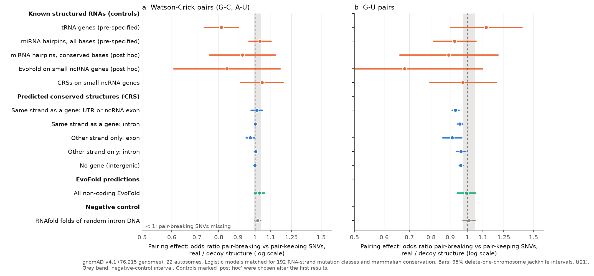
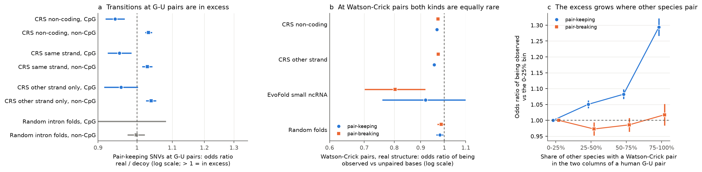
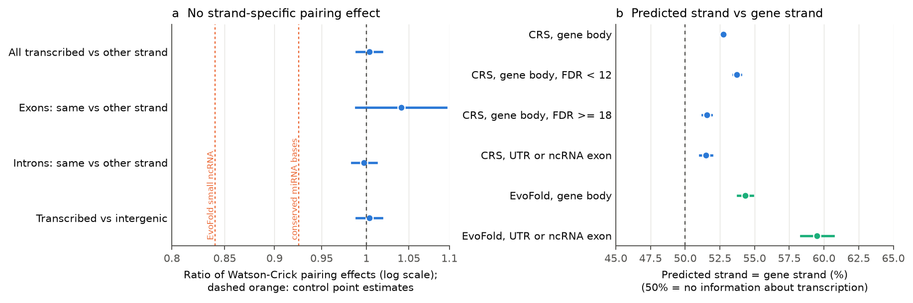

# Human variants that break Watson-Crick pairs of 483,913 predicted conserved RNA structures are not rarer than pair-keeping variants; an apparent signal at G-U pairs is the same on both DNA strands

Copyright 2026 the author. Text, figures and data: CC BY 4.0. Code: MIT (see LICENSE).
Produced by an autonomous Claude Code agent (claude-opus-5-5) in the SCI research swarm on the Mac mini 'oya', run 175c99fd-8591-4fce-bb8b-1bfb5a30e0b3.

## Summary

In human genetic variation, the base pairs of predicted conserved RNA structures in non-coding DNA show no sign
of natural selection on pairing. This matters because genome-wide structure predictions were used to claim that
a large part of the human genome (up to 13.6%, Smith et al. 2013) is under selection for RNA structure.

We tested 483,913 conserved RNA structures (CRSs; Seemann et al. 2017) and 34,159 EvoFold structures on human
autosomes against single-nucleotide variants (SNVs) in 76,215 genomes (gnomAD v4.1); coding bases (6% of CRS bases)
were analysed apart. At each predicted pair we compared SNVs that break the pair with SNVs that keep it (for example
C to U opposite G, which makes a G-U pair). Logistic models matched the SNVs for 192 mutation classes on the RNA
strand and for mammalian conservation; decoy pairs moved along the same structures gave the baseline. The result is
an odds ratio (real / decoy); a value below 1 means that pair-breaking SNVs are missing.

- **Watson-Crick pairs (G-C, A-U; 86% of pairs), the primary test:** 1.000 (95% interval 0.996-1.005) for
  non-coding CRSs, and 1.001 (0.997-1.006) at non-CpG sites; 1.002 where a gene is transcribed from the predicted
  strand, 0.999 where only the other strand is transcribed, 0.999 without a gene. Pair-keeping and pair-breaking
  SNVs are both about 2.4% rarer than at decoy pairs: paired bases are slightly less variable, but not because of
  their pairing. At CpG sites both kinds are 11-15% rarer than at decoys and the ratio is 1.039 (1.013-1.066), the
  opposite direction to selection on pairing.
- **G-U pairs:** 0.956 (0.942-0.969), the same on both strands and outside genes. The cause is an excess of
  transitions that turn a G-U pair into a Watson-Crick pair (odds ratio 1.030), mostly at non-CpG sites, and this
  excess grows with the share of other species that carry that Watson-Crick pair (1.29 where 75-100% do, vs under
  25%), while pair-breaking SNVs do not change: a sign of recurrent mutability at sites of past transitions. Selection
  on RNA pairing can act only on the transcribed strand, and a pair-keeping change on one strand is pair-breaking on
  the other, so this strand-independent signal is not RNA-level selection. It makes a naive all-pairs test report a
  2% "selection on structure" in 480,000 structures.
- **The predicted strand carries almost no information about transcription:** for CRSs inside one gene, the
  predicted strand is the gene's strand in 52.8% (50% = chance).
- **Controls:** RNA folds of random intron DNA gave 1.015 (0.996-1.035). Known structured RNAs gave point
  estimates below 1 at Watson-Crick pairs (EvoFold structures on small ncRNA genes 0.84, conserved miRNA bases
  0.93), but with wide intervals; tRNA genes (0.81) reflect hypermutation, not selection, and all GENCODE miRNA
  hairpins gave 1.03.

So at CRS Watson-Crick pairs any extra loss of pair-breaking SNVs is below about 0.5% for all non-coding CRSs (0.7%
for CRSs on the transcribed strand, 2.4% for those in transcribed exons). But gnomAD detects selection on single pairs
only weakly even in known RNAs, so we cannot give a confidence bound on the share of predicted pairs that could carry
such selection. At the control point estimates, the 0.44% limit would allow at most about 2.5% of pairs with an effect
as large as in EvoFold structures on small ncRNA genes, or about 6% at the level of conserved miRNA bases (these are
not confidence bounds).



## Terms used here

- **RNA secondary structure**: the base pairs that an RNA molecule makes with itself: Watson-Crick pairs (A-U,
  G-C) and the weaker G-U "wobble" pair.
- **CRS** (conserved RNA structure): a region where Seemann et al. (2017) found a secondary structure conserved in
  alignments of up to 100 vertebrates (CMfinder after structure-based realignment). We use release v2.1 with its
  per-column consensus structure.
- **EvoFold**: an earlier genome-wide set of 47,510 conserved structures (phylogenetic grammar model).
- **SNV**: single-nucleotide variant. A **possible SNV** is any of the three base changes at a base; it is
  **observed** if gnomAD v4.1 genomes have it with FILTER = PASS and allele count >= 1.
- **Pair-keeping / pair-breaking SNV**: at a paired base, the new base can / cannot still pair with the partner
  (Watson-Crick or G-U). All pair-keeping SNVs are transitions (C<->U, A<->G). At a Watson-Crick pair a pair-keeping
  SNV makes a G-U pair; at a G-U pair it makes a Watson-Crick pair.
- **Unpaired base**: a base of the structure without a partner; its SNVs are the reference category.
- **Decoy structure**: the real pairs of a unit moved along it by 1/4, 1/2 and 3/4 of its length (circular). A moved
  pair is used only if its bases can pair (Watson-Crick or G-U) and it is not itself a real pair.
- **Pairing effect (PE)**: odds ratio of being observed, pair-breaking vs pair-keeping SNVs, from a logistic model
  matched for mutation class and conservation. **PE ratio** = PE(real) / PE(decoy).
- **Same strand / other strand only / intergenic**: a CRS overlaps a GENCODE protein-coding or lncRNA gene on its
  predicted strand (UTR, ncRNA exon or intron), only a gene on the opposite strand, or no gene.
- **CpG site**: a C followed by G; such sites mutate about ten times faster by C to T (G to A on the other strand).

## 1. Question, candidates, and prior prediction

The candidate list, with what experts would do differently, probability of surprise, users and the strongest
counter-argument, is in [files/PRIOR_PREDICTION.md](files/PRIOR_PREDICTION.md). It was written after a pilot on
chromosome 21 and before any genome-wide number. Short version:

| # | Question | P(surprising) | Main argument against |
|---|---|---|---|
| C1 (chosen) | Do human SNVs that break predicted RNA base pairs show more selection than SNVs that keep them? | 0.30 | gnomAD sees only strong selection |
| C2 | Do several human-specific substitutions in one HAR shift MPRA activity in the same direction (sign test)? | 0.25 | small MPRA effects, shared reference noise |
| C3 | Does depletion of hazardous motifs in introns scale with effective population size? | 0.20 | cross-species depletion already shown; Ne proxies noisy |
| C4 | Do natural deletions of TAD-boundary CTCF sites change expression across the boundary? | 0.30 | few common boundary deletions |
| C5 | Does non-coding DNA fraction track organismal complexity after phylogenetic correction? | 0.05 | experts already expect no |

C1 was chosen because it tests a large claim with data that were not used to make the predictions, and has
built-in positive and negative controls. The SCI catalog had no study of RNA structure.

**Prior work.** Xie, Irwin & Zhang (2008) found lower SNP density in EvoFold structures and in their stems;
Seemann et al. (2017) found lower allele frequencies in CRSs than in flanks; Pegueroles & Gabaldón (2016) found
fewer SNPs in paired regions of lncRNAs; Kalmykova et al. (2021) found that SNPs in conserved intronic long-range
pairings destabilize them less than expected, a pairing-aware population test; Gaither et al. (2021) found
constraint on synonymous variants that disrupt predicted mRNA structure; Martin, Fiscus & Gaut (2025) found weak
selection on pair-changing SNPs in Arabidopsis UTRs; Rivas, Clements & Eddy (2017) found no covariation support for
structure in several lncRNAs. Stem-versus-loop or structure-versus-flank comparisons cannot separate selection on
pairing from sequence constraint. New here: the within-pair comparison of pair-breaking with pair-keeping SNVs,
split by pair type, against decoys, random folds and a transcription-strand control, over the whole CRS and EvoFold
sets.

**Prior prediction** (from PRIOR_PREDICTION.md): miRNA hairpins clearly positive; tRNA weak (hypermutable genes);
non-coding CRSs PE ratio 0.95-1.00; share of CRS pairs with miRNA-like selection below 10-15%; maybe a small
signal in transcribed exons; no wobble signal on the other strand. P(surprise) 0.3.

## 2. Data

All inputs are public; URLs, sizes and SHA-256 are in `files/provenance/inputs.tsv`.

| Data | Use |
|---|---|
| CRS v2.1 (rth.dk): alignments with WUSS consensus structure (1.16 GB) and list with pscore/FDR | predicted structures; human row mapped to hg38 |
| UCSC EvoFold (hg19) + hg19ToHg38 chain | second prediction set |
| GtRNAdb hg38 high-confidence tRNAs with tRNAscan-SE structures | control |
| GENCODE v46 basic: miRNA genes (hairpins folded with RNAfold, ViennaRNA 2.8), small ncRNA genes, gene models | control; region classes |
| gnomAD v4.1 genomes (76,215 genomes): SNV FILTER/AC/AN from the UCSC bigBed copy (remote range queries, 423,592 regions, 9.88 M SNV records) and from the gnomAD VCFs by remote tabix (EvoFold/random-fold regions) | variation |
| Zoonomia 241-mammal phyloP | conservation strata |
| hg38 2bit (soft-masked), UCSC segmental duplications and simple repeats | sequence context, masks |

Both gnomAD routes gave the same 94,128 SNV records with identical AC and AN on chromosome 21. No query region was
left without data after retries (`files/provenance/gnomad_chunks.tsv`).

## 3. Methods

**Structures.** 773,579 CRS alignments; 11 whose human sequence did not match hg38 were removed; overlaps were
resolved greedily by CMfinder pscore (518,595 non-overlapping CRSs, 31.2 Mb; 498,045 on autosomes, of which 483,913
passed the filters below). A predicted pair counts as a human pair only if both human bases are Watson-Crick or
G-U (2.3% of predicted paired bases are not; their SNVs are left out of the real-structure counts). EvoFold: 47,420
of 47,510 structures lifted to hg38 with unchanged length and >= 90% canonical pairs (34,159 used). Controls: 379
GtRNAdb tRNAs and 1,680 GENCODE miRNA hairpins (RNAfold minimum free energy) passed the filters. Negative control:
24,937 random 80-nt segments of introns of protein-coding genes (transcribed strand, no phyloP >= 2, no repeat,
>= 200 bp from exons, CRSs and small RNA genes), folded with RNAfold.

**Filters.** A unit (one structure) is used if it has >= 3 PASS SNVs and their median AN is >= 137,000 (of
152,312). Bases in segmental duplications or simple repeats are removed. Possible SNVs with a non-PASS gnomAD
record are removed. Autosomes only.

**Counts.** For every possible SNV at every used base: pairing category (unpaired, keep, break) and pair type
under the real and the decoy structure; 192-class mutation type on the RNA strand of the unit (5' neighbour, base,
3' neighbour, new base); Zoonomia phyloP bin (< -1, -1-0, 0-1, 1-2, 2-4, >= 4); region class from GENCODE relative
to the unit strand; observed or not; singleton or not. Aggregated into 2,091,970 cells
(`files/data/cells_autosomes.parquet`).

**Models.** For each set, pair-type filter (Watson-Crick only, G-U only, all) and structure version, binomial GLMs
(logit link) on cell counts: observed ~ mutation class + phyloP bin + category, PE = exp(beta_break - beta_keep);
among observed SNVs, singleton ~ class + phyloP + category. Contrasts: real/decoy; set / negative control;
same-strand / other-strand CRSs. 95% intervals and p values: delete-one-chromosome jackknife over the 22 autosomes
with t(21) quantiles; contrasts are recomputed jointly in each replicate. Ratios with uncertain denominators use
Fieller intervals. Sensitivity: the same models with an extra stratum for local GC content (21-bp window, 5 bins).

**Changes during the work (all kept for transparency).**
1. A first cell-by-cell observed/expected estimator had to drop cells without observed unpaired SNVs; this pushes
   expected rates up in sparse cells (mostly transversions, i.e. pair-breaking SNVs) and made false "pairing
   effects" in small sets (per-chromosome miRNA ratios 0.4-0.8 against 0.97 genome-wide). It was replaced by the
   GLMs; its results are in `files/results/superseded/` and are not used.
2. 96 pyrimidine-folded mutation classes were replaced by 192 strand-aware classes, because transcription makes
   mutation rates differ between the two DNA strands.
3. After independent review: (a) decoy pairs that coincide with a real pair (a half-length shift can map a pair onto
   the same helix) are now excluded; (b) pair types are analysed separately, which showed that the whole apparent
   signal comes from G-U pairs; (c) share bounds use Fieller intervals; (d) the controls are labelled pre-specified
   (tRNA, all miRNA hairpins) or post hoc (conserved miRNA bases, EvoFold on small ncRNA genes).

## 4. Results

### 4.1 Watson-Crick pairs (primary test)

| Set | PE ratio, Watson-Crick pairs (95% interval) | p |
|---|---|---|
| CRS non-coding (all) | **1.000 (0.996-1.005)** | 0.85 |
| CRS same strand: UTR or ncRNA exon | 1.010 (0.976-1.046) | 0.55 |
| CRS same strand: intron | 1.001 (0.993-1.010) | 0.81 |
| CRS other strand only: exon | 0.971 (0.945-0.997) | 0.03 |
| CRS other strand only: intron | 1.004 (0.993-1.014) | 0.49 |
| CRS intergenic | 0.999 (0.988-1.010) | 0.85 |
| CRS coding exons (codon constraint; not interpreted) | 0.996 (0.975-1.017) | 0.68 |
| EvoFold non-coding (all) | 1.026 (0.994-1.060) | 0.11 |
| Negative control: random intron folds | 1.015 (0.996-1.035) | 0.11 |
| Control (pre-specified): tRNA genes | 0.813 (0.732-0.902) | 0.0005 |
| Control (pre-specified): miRNA hairpins, all bases | 1.030 (0.963-1.102) | 0.38 |
| Control (post hoc): miRNA hairpins, bases with phyloP >= 2 | 0.926 (0.756-1.133) | 0.44 |
| Control (post hoc): EvoFold on small ncRNA genes | 0.841 (0.606-1.166) | 0.28 |
| Control: CRS on small ncRNA genes | 1.043 (0.915-1.189) | 0.51 |

At CRS Watson-Crick pairs both kinds of SNV are rarer than at decoy pairs by the same amount (keep 0.976,
0.971-0.980; break 0.976, 0.973-0.979), with no shift to rare alleles (singleton shift 0.002, -0.009-0.013). Paired
bases are a little less variable than other CRS bases, but nothing depends on whether a change keeps the pair. The
other-strand exon set (0.971) cannot reflect selection on the transcribed strand: there, pair-keeping and
pair-breaking SNVs of the predicted strand both break the complementary pair, so such selection predicts no
difference; we treat it as a small region-specific deviation (one of 7 CRS subsets).

Split by CpG status: at non-CpG sites the ratio is 1.001 (0.997-1.006; same strand 1.004, other strand 1.001); at
CpG sites it is 1.039 (1.013-1.066), because pair-keeping (C to U, G to A) SNVs are even rarer than pair-breaking ones
(odds ratios vs decoy 0.855 and 0.889). CpG sites in predicted stems are therefore less mutable than CpG sites at
decoy pairs (perhaps less methylated); this is a mutation-rate effect in the direction opposite to selection on
pairing.

The controls are weak. tRNA genes give 0.81, but through an *excess* of pair-keeping SNVs (odds ratio vs decoy
1.38) and of pair-breaking SNVs (1.12): tRNA genes are mutation hotspots (Thornlow et al. 2018) and 32% of their
possible SNVs are observed, so this is not a selection signal. In EvoFold structures on small ncRNA genes (mostly
miRNA loci), pair-breaking SNVs at Watson-Crick pairs are depleted (0.785 vs decoy, 0.638-0.967), but the PE ratio
interval is wide. All GENCODE miRNA hairpins (many are poorly supported annotations) and CRSs on small ncRNA genes
(31% of them on the opposite strand of the gene) show nothing. (The pooled controls in `final_estimates.tsv` include
the tRNA set and are not used.)

### 4.2 G-U pairs: a strand-independent artifact

| Set | PE ratio, G-U pairs | keep OR, real/decoy | break OR, real/decoy |
|---|---|---|---|
| CRS non-coding (all) | 0.956 (0.942-0.969) | 1.030 (1.021-1.039) | 0.984 (0.976-0.992) |
| ... non-CpG sites | 0.957 (0.944-0.970) | 1.032 (1.024-1.040) | 0.987 (0.979-0.995) |
| ... CpG sites | 1.011 (0.971-1.053) | 0.943 (0.920-0.966) | 0.953 (0.928-0.979) |
| CRS same strand (all) | 0.952 (0.938-0.966) | | |
| CRS other strand only (all) | 0.956 (0.929-0.984) | 1.037 (1.025-1.050) | 0.992 (0.973-1.011) |
| CRS intergenic | 0.959 (0.946-0.972) | | |
| EvoFold non-coding | 0.993 (0.938-1.052) | 1.008 (0.972-1.045) | 1.001 (0.963-1.040) |
| Random intron folds | 1.010 (0.973-1.049) | 0.994 (0.971-1.018) | 1.004 (0.973-1.035) |

At predicted G-U pairs in CRSs, transitions that make the pair Watson-Crick are 3% more common than expected, on
both strands and outside genes, mostly at non-CpG sites; they also carry a small shift to rare alleles (0.028,
0.003-0.052). With all pairs pooled this gives the overall PE ratio of 0.977 (0.974-0.981) and a "wobble" ratio of
1.060 (1.051-1.069). EvoFold and random folds do not show it, so it is a property of CRS-type predictions.

**Direct test in the CRS alignments.** For 1,119,043 human G-U pairs we counted the other species that carry a
Watson-Crick pair in the same two columns (54% of pairs: in under 25% of species; 5%: in 75% or more). Where other
species carry the Watson-Crick pair, the human transition that would make it is a transition that happened in
evolution at that site. Logistic model at the same G-U-paired bases (non-coding, matched for mutation class and
phyloP; jackknife, t(21)):

| Share of other species with a Watson-Crick pair | pair-keeping transitions, odds ratio vs 0-25% | pair-breaking SNVs, odds ratio vs 0-25% |
|---|---|---|
| 25-50% | 1.051 (1.040-1.061) | 0.973 (0.954-0.992) |
| 50-75% | 1.082 (1.069-1.096) | 0.986 (0.966-1.006) |
| 75-100% | 1.294 (1.268-1.320) | 1.017 (0.986-1.050) |

Pair-keeping transitions become more common the more species carry the Watson-Crick pair; pair-breaking SNVs at the
same bases do not change. Selection on pairing would instead remove pair-breaking SNVs where pairing is most
conserved. The G-U signal therefore comes from recurrent, site-specific transition mutability at sites that the
structure-based aligner turned into G-U pairs. (At a G-U pair the pair-keeping SNV is fixed by the mutation class,
so only the trends across bins are identified; `files/results/gu_mechanism.tsv`, code `gu_mechanism.py`.)



### 4.3 Strand test and strand agreement

| Quantity (Watson-Crick pairs) | Estimate (95% interval) | p |
|---|---|---|
| PE ratio, same-strand CRSs / other-strand CRSs | 1.003 (0.989-1.018) | 0.65 |
| ... exons only | 1.041 (0.988-1.096) | 0.12 |
| ... introns only | 0.998 (0.984-1.012) | 0.72 |
| PE ratio, same-strand CRSs / intergenic CRSs | 1.003 (0.989-1.018) | 0.63 |
| PE ratio, CRS non-coding / random intron folds | 0.985 (0.966-1.005) | 0.14 |

Selection on pairing in the transcript would make same-strand CRSs lower than other-strand CRSs. It is not seen
(1.003; the lower limit is 0.989). The G-U signal is also equal on the two strands (0.996, 0.969-1.023). The Fieller
intervals of the share of transcribed pairs with control-like selection are unbounded for every valid control
(`files/results/final_shares.tsv`); a finite bound (at most 6.1%) is reached only with the tRNA "control", which
reflects hypermutation and is not valid. We therefore do not report a share.

CRS strand agreement with the gene strand: 52.8% (52.6-52.9%) for 328,532 CRSs inside one gene; 51.5% in UTR or
ncRNA exons; 53.7% for the CRSs with the lowest FDR. EvoFold: 54.3% (gene body), 59.5% (exons).



### 4.4 Sensitivity

Adding a 21-bp local GC stratum to every model changes no pairing-effect or wobble ratio by more than 0.005; the main
CRS results change by at most 0.002 (Watson-Crick 1.0002, 0.9953-1.0051; strand contrast 1.0031, 0.9883-1.0182)
(`files/results/final_estimates_gc_matched.tsv`).

## 5. Interpretation

1. **No selection on the pairing of predicted structures is visible in human variation.** At Watson-Crick pairs,
   SNVs that break a predicted pair are as common as SNVs that keep it (1.000, 0.996-1.005), with no difference
   between transcribed and non-transcribed strands. Within the detection limit of gnomAD this is a null result for
   about 480,000 CRSs and 34,000 EvoFold structures.
2. **The detection limit is a real limit.** Even known small RNAs give only point estimates of 0.84-0.93 with wide
   intervals at Watson-Crick pairs, so data of this size cannot measure what share of predicted pairs carries weak
   selection. The null result excludes a 0.5% extra loss of pair-breaking SNVs across CRS Watson-Crick pairs; it says
   nothing about weak selection on a minority of pairs.
3. **CRS predictions carry a G-U artifact.** A naive test (all pairs, real vs decoy or vs random folds) gives a
   significant 2-3% "pairing effect" for 480,000 CRSs. It comes from G-U pairs, is the same on both strands, and has
   the wrong form for selection (an excess of pair-keeping SNVs); CpG sites add a mutation-rate effect of the opposite
   sign. The G-U excess grows with the number of species that carry the corresponding Watson-Crick pair (odds ratio
   1.29 at 75-100% vs 0-25%), while pair-breaking SNVs do not change: it is recurrent mutability at sites of past
   transitions. Population tests of predicted RNA structure should analyse G-U pairs and CpG sites apart and use a
   strand control.
4. **CRS strand calls carry little information about transcription** (52.8% agreement with the gene strand). This is
   what one expects if CMfinder cannot tell the reading direction (Watson-Crick pairs look the same on both strands;
   Reiche & Stadler 2007), so it is not independent evidence against selection; but CRS strand labels should not be
   used as transcript annotations.

## 6. Prior prediction compared with the result, and usefulness

- Non-coding CRS PE ratio in 0.95-1.00: yes for all pairs (0.977), but the primary Watson-Crick test gives 1.000.
- Share below 10-15%: not answerable; the controls are too weak to give a finite bound.
- Clear miRNA control: no. This was the largest miss and it limits the study.
- Small signal in transcribed exons: no (1.010).
- No wobble signal on the other strand: wrong; the G-U signal is the same on both strands, and this led to the main
  diagnostic result.
- Usefulness: less useful than hoped as a bound on functional RNA structure (weak controls), more useful as a method
  warning: the G-U and CpG effects and the strand control matter for anyone who scores structure-aware variants with
  population data. Revised probability that the result surprises experts: about 0.15.

## 7. Predictions that a laboratory can test

1. **Mutagenesis of transcribed CRSs.** In reporter or saturation-mutagenesis assays of CRSs in 3' UTRs and introns
   (read-outs: RNA level, stability or splicing), single pair-breaking mutations at Watson-Crick pairs will not change
   the read-out more than pair-keeping mutations at the same pairs in at least about 90% of tested CRSs; known small
   RNAs will show larger effects.
2. **Strand.** In cells, chemical probing (SHAPE-MaP or DMS-MaPseq) of transcribed regions that contain CRSs will
   support the predicted pairs no more often for CRSs on the transcribed strand than for the complementary structure
   of CRSs predicted on the other strand.
3. **G-U mechanism (computational).** In de novo mutations from parent-child trios, or in a base-resolution
   mutation-rate model, transitions that turn a predicted G-U pair into the Watson-Crick pair seen in other species
   will have a higher rate than the same transitions at matched unpaired bases, rising with the share of species
   that carry the Watson-Crick pair, on both strands. (The population-level version of this test is in section 4.2.)
4. **Larger samples.** With several hundred thousand genomes, the Watson-Crick PE ratio of CRSs will stay near 1.000
   with an interval narrower than +-0.3%, while known small RNAs will reach significance.

## 8. Limitations

- gnomAD (76,215 genomes) detects mainly selection of about 1e-3 or stronger per site; weaker selection on pairing
  is not excluded, and the controls show that single-pair selection is hard to detect even in known RNAs.
- The positive controls are small; two were chosen after the first results (labelled post hoc).
- The strand classification uses GENCODE basic; antisense and unannotated transcription exist. They cannot produce
  equal effects on the two strands where RNA selection predicts opposite ones, but they weaken the other-strand set
  as a control.
- The G-U explanation rests on population data (the trend with the share of species that carry a Watson-Crick
  pair); it is not yet confirmed with direct mutation-rate data.
- The unit filters (>= 3 PASS SNVs, median AN) drop 2.8% of CRS units (2.3% by the SNV-count filter, which depends
  on the outcome variable) and 25% of EvoFold units (mostly short structures).
- The decoy fix removes decoy pairs identical to real pairs, but a half-length shift can still place decoy pairs on the
  diagonal of a real helix, next to it; this makes decoys slightly more like real pairs and is conservative.
- The strand logic was not checked on known RNAs split by sense and antisense (too few units).
- Region is not in the models: pooled sets mix regions with different baselines; region-level results are given.
- Mutation-rate heterogeneity beyond trinucleotide context, conservation and local GC is not modelled.
- The 13.6% set of Smith et al. (2013) could not be retrieved and was not tested directly.

## 9. Reproduction

Python 3.12 with numpy, pandas, pyarrow, scipy, statsmodels, matplotlib (versions:
`files/provenance/python_packages.txt`). From the packaged cell tables:

```
python files/code/stats_v2.py files/data/cells_autosomes.parquet out/final              # about 1 h, one core
python files/code/stats_v2.py files/data/cells_autosomes_gc.parquet out/final_gc gc     # GC sensitivity
python files/code/check_package_table.py files/data/cells_autosomes.parquet out/x       # 1-min check
cp files/results/strand_agreement.tsv files/results/gu_mechanism.tsv out/final/ && python files/code/figures_v2.py out/final out/figures
```

The full pipeline from public inputs (structure parsing, gnomAD extraction by remote range queries, per-chromosome
counting, strand agreement) is described step by step in `files/code/README_code.md`.

## 10. Independent review

A reviewer agent that had not seen our reasoning checked code, statistics, confounds and prior work. It confirmed
the pairing classification, strand handling, 192-class encoding, decoy mapping and alignment-to-genome mapping
(toy test, hg38 sequence check, 97.7% canonical pairs), and the GC sensitivity of the earlier analysis. Its main
findings, all acted on:
(1) the apparent deficit came from G-U pairs, not from pair-breaking SNVs; at Watson-Crick pairs there is no
pairing signal; (2) the share bounds used delta-method intervals with uncertain denominators and a post hoc pool;
with Fieller intervals they are unbounded except for an invalid control; (3) the half-length decoy shift reused real
pairs on the same helix; (4) the tRNA signal reflects hypermutation, and the CRS-on-small-ncRNA control is mostly
miRNA and snoRNA loci, often antisense (our earlier text wrongly blamed pseudogene copies); (5) CRS strand agrees
with gene strand in only 52.8%; (6) prior work by Xie et al. (2008) and Kalmykova et al. (2021) must be cited;
(7) several numbers and the code README were out of date. The title, abstract and conclusions were rewritten. The
reviewer also judged the importance as modest (experts already doubt genome-wide comparative structure calls), with
the most reusable output being the method warning. A second pass on the revised package confirmed the numbers and
the code of `stats_v2.py` (Fieller, jackknife, CpG flag, pair-type masks) and asked us to lead with the non-CpG
Watson-Crick result, report the CpG effect, drop the pooled control that contains tRNA, limit the 0.5% statement to
the whole CRS set, test or soften the G-U mechanism, and reword the strand-agreement point. All were done; the G-U
mechanism was tested directly in the CRS alignments (section 4.2).

## 11. Files

- `files/data/cells_autosomes.parquet`: 2,091,970 cells (chromosome, set, region, structure version, category,
  pair type, mutation class, phyloP bin; possible, observed and singleton SNV counts). `cells_autosomes_gc.parquet`:
  the same with a local GC bin. `crs_selected_nonoverlapping.tsv.gz`: the 518,595 CRSs used.
- `files/results/final_estimates.tsv`, `final_shares.tsv`, `strand_agreement.tsv`, `gu_mechanism.tsv`,
  `final_estimates_gc_matched.tsv`: all estimates used in the text. `files/results/superseded/`: earlier estimators, not used for conclusions.
- `files/figures/`: Figures 1-3. `files/logs/`: run logs. `files/provenance/`: inputs, gnomAD chunk log, packages.
- `files/code/`: all scripts, including the exploration scripts that found the estimator bias.

## References

Seemann et al. 2017 Genome Res (doi:10.1101/gr.208652.116); Smith et al. 2013 NAR (doi:10.1093/nar/gkt596);
Pedersen et al. 2006 PLoS Comput Biol (doi:10.1371/journal.pcbi.0020033); Xie, Irwin & Zhang 2008 BMC Genomics
(doi:10.1186/1471-2164-9-520); Kalmykova et al. 2021 Nat Commun (doi:10.1038/s41467-021-22549-7); Karczewski et al.
2020 Nature (doi:10.1038/s41586-020-2308-7); Chen et al. 2024 Nature (doi:10.1038/s41586-023-06045-0); Sullivan et
al. 2023 Science (doi:10.1126/science.abn2937); Christmas et al. 2023 Science (doi:10.1126/science.abn3943); Chan &
Lowe 2016 NAR (doi:10.1093/nar/gkv1309); Lorenz et al. 2011 (doi:10.1186/1748-7188-6-26); Frankish et al. 2023 NAR
(doi:10.1093/nar/gkac1071); Rivas, Clements & Eddy 2017 Nat Methods (doi:10.1038/nmeth.4066); Rivas et al. 2020
Bioinformatics (doi:10.1093/bioinformatics/btaa080); Reiche & Stadler 2007 (doi:10.1186/1748-7188-2-6); Wan et al.
2014 Nature (doi:10.1038/nature12946); Gaither et al. 2021 GigaScience (doi:10.1093/gigascience/giab023); Martin,
Fiscus & Gaut 2025 MBE (doi:10.1093/molbev/msaf126); Pegueroles & Gabaldón 2016 BMC Biol
(doi:10.1186/s12915-016-0283-0); Thornlow et al. 2018 PNAS (doi:10.1073/pnas.1801240115); Rands et al. 2014 PLoS
Genet (doi:10.1371/journal.pgen.1004525); von der Dunk et al. 2025 bioRxiv (doi:10.1101/2025.08.18.670923);
sci:sha256:a8e07f60105cbd67e4db5364720897b55c30e5b7ccb889f74f7654c8190428e8 (conserved bases have lower germline
mutation rates).
