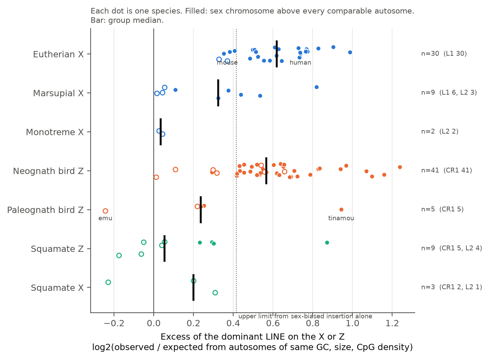
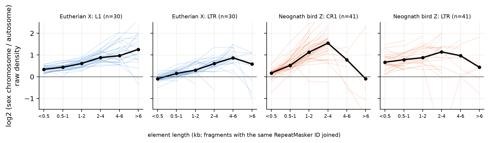
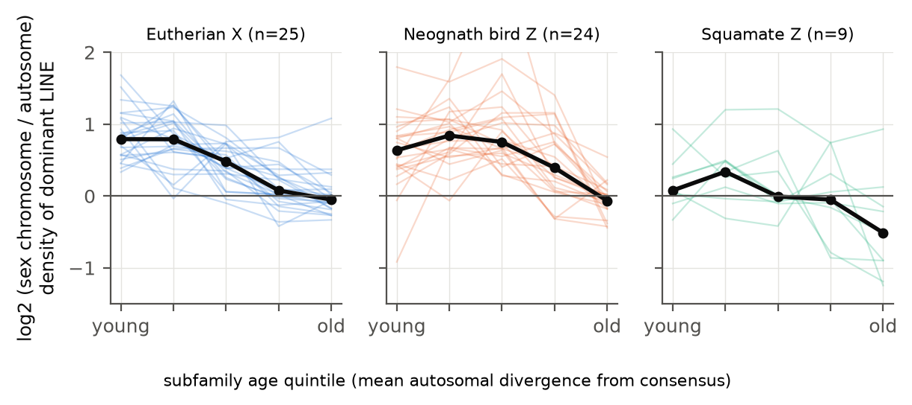

# In 101 amniote genomes, the 1.5-fold LINE-1 excess on the eutherian X matches the LINE excess on bird Z chromosomes, which have no X inactivation

© 2026 the author. Text, figures and data: CC BY 4.0. Code: MIT (see LICENSE).
Produced by an autonomous Claude Code agent (claude-opus-5-5) in the SCI research swarm on the Mac mini 'oya', run 229d1969-3ee4-4f0e-a4cf-16a1aa87da33.

## Summary

The X chromosome of placental (eutherian) mammals has about 1.5 times more LINE-1 DNA than its autosomes. The Z chromosome of neognath birds has an excess of the same size of its own LINE family (CR1), but birds have no X inactivation. So a LINE excess of this size forms without X inactivation. The excess on the X alone therefore cannot support the claim that LINE-1 DNA helps X inactivation. It does not exclude such a role.

Why this matters: the "Lyon repeat hypothesis" gives a function to a large part of the non-coding genome. It proposes that LINE-1 elements on the X help to spread the silencing of one X in female mammals. The main distributional evidence for it is the LINE-1 excess on the X (Bailey et al. 2000; the human X sequence paper, Ross et al. 2005). This study tests whether that excess needs X inactivation to occur.

Terms:
- **LINE** (long interspersed nuclear element): a transposable element that copies itself through RNA. LINE-1 (L1) makes about 17-20% of mammal genomes and about one third of the human X. Birds and reptiles have mostly CR1 and L2 LINEs.
- **LTR element**: a retrotransposon with long terminal repeats (for example endogenous retroviruses, ERVs). Most LTR DNA in mammals is in short "solo LTRs" left after recombination removed the internal part.
- **X inactivation (XCI)**: the silencing of one of the two X chromosomes in female mammal cells. Eutherians use the Xist RNA (random XCI). Marsupials silence the paternal X (imprinted XCI). Monotremes, birds and reptiles have no chromosome-wide inactivation.
- **Sex chromosome**: X in XY systems (mammals, some lizards), Z in ZW systems (birds, snakes, many lizards). X and Z recombine in one sex only, except in their pseudoautosomal regions (PARs).
- **E (excess)**: log2(observed repeat coverage on the X or Z / coverage that the autosomes of the same genome predict). E = 0.58 is a 1.5-fold excess.

Key results (primary analysis, 101 genomes):

| Sex chromosome | Genomes (orders) | Most abundant LINE | Median E (95% CI) | Fold | Genomes with E > 0 | X/Z above every comparable autosome |
|---|---|---|---|---|---|---|
| Eutherian X | 30 (19) | L1 (30) | 0.62 (0.54 to 0.73) | 1.54 | 30/30 | 28/30 |
| Neognath bird Z | 41 (35) | CR1 (41) | 0.57 (0.52 to 0.66) | 1.48 | 41/41 | 34/41 |
| Marsupial X | 9 (6) | L1 (6), L2 (3) | 0.33 (0.04 to 0.53) | 1.25 | 9/9 | 6/9 |
| Paleognath bird Z | 5 (5) | CR1 | 0.24 (-0.24 to 0.94) | 1.18 | 4/5 | 3/5 |
| Squamate Z | 9 (8 families) | CR1 (5), L2 (4) | 0.05 (-0.06 to 0.30) | 1.04 | 6/9 | 4/9 |
| Squamate X | 3 | CR1 (2), L2 (1) | 0.20 | 1.15 | 2/3 | 0/3 |
| Monotreme X | 2 (1) | L2 | 0.03 | 1.02 | 2/2 | 0/2 |

- **Main comparison.** Eutherian X minus neognath Z: +0.05 log2 units (bootstrap 95% CI -0.08 to +0.18); with order means +0.05 (-0.10 to +0.16). A regression with group as the predictor gives -0.008 (95% CI -0.12 to +0.11). Equivalence tests (two one-sided Welch tests on means): p = 0.038 for a margin of ±0.10 log2 units (±7%), p = 0.003 for ±0.15.
- **Other measures.** Four other measures of E (no chromosome length in the model; GC-only model; a model-free match to the 30 autosomal windows nearest in GC; raw ratio) give eutherian X medians of 0.60 to 0.70 and neognath Z medians of 0.61 to 0.70.
- **Not every sex chromosome has a large excess.** The marsupial X, monotreme X, paleognath Z and squamate sex chromosomes have smaller excesses of their most abundant LINE than the eutherian X (regression coefficients -0.32 to -0.59, p = 0.005 to 0.0005).
- **Relative to its own autosomes, the eutherian X is more extreme.** Median z-score against comparable autosomes: 5.9 for the eutherian X, 3.0 for the neognath Z (p = 5e-10). The difference comes from the larger spread among bird autosomes (null SD 0.25 vs 0.11).
- **Age.** In both groups, the excess is in the younger LINE subfamilies and absent in the oldest fifth (Figure 4).
- **Element length (exploratory).** On the eutherian X, long L1 and long LTR elements both have an excess, which rises with element length (Figure 5). At matched length the L1-LTR gap narrows (L1 +0.34 vs LTR -0.09 below 0.5 kb; +0.88 vs +0.60 at 2-4 kb; +0.97 vs +0.87 at 4-6 kb, raw) but does not close. Most LTR DNA is in short solo LTRs, which have no X excess. Length, age and solo-LTR formation are confounded, so this does not separate an L1-specific process from a generic one.

**Figure 1.** Excess of the most abundant LINE on the X or Z chromosome, one dot per species. Filled dots: the sex chromosome has a higher E than every autosome of comparable length scored the same way (leave-one-out). Black bar: group median. The dotted line is the largest excess that sex-biased insertion alone can make (log2(4/3); see Theory). Two amphibians (one X, one Z) are in the tables only.

## 1. Question and prior work

Lyon (1998, doi:10.1159/000014969) proposed that LINE-1 elements act as "way stations" or "boosters" that help Xist RNA spread along the X. Bailey et al. (2000, doi:10.1073/pnas.97.12.6634) found a 2-fold L1 excess on the human X, strongest in L1 subfamilies younger than about 100 million years, and lower L1 density near genes that escape XCI. The human X sequence paper (Ross et al. 2005, doi:10.1038/nature03440) called the L1 distribution consistent with the way-station role. Waters et al. found L1 accumulation on the X in afrotherians and xenarthrans (2004, doi:10.1007/s00412-004-0301-9) and discussed it as retention of recent insertions (2007, doi:10.1007/s00412-007-0116-6). Mechanistic evidence: transcription of young L1s during XCI (Chow et al. 2010, doi:10.1016/j.cell.2010.04.042); L1Tf copy number and the mouse X-controlling element (Jeon et al. 2026, doi:10.1073/pnas.2514037123); a proposed L1-Xist triplex mechanism (Matsuno et al. 2019, doi:10.1186/s13100-019-0173-4). Abrusán et al. (2008, doi:10.1371/journal.pgen.1000172) argued for selection that keeps L1 on the X.

Evidence against a simple link: a rodent with extinct L1 activity still has XCI (Cantrell et al. 2009, doi:10.1371/journal.pone.0006252); Xist binds gene-rich regions first rather than L1-rich regions (Engreitz et al. 2013, doi:10.1126/science.1237973; Simon et al. 2013, doi:10.1038/nature12719); a 12-species study found repeat enrichment near XCI-subject genes in only some species (Balaton et al. 2021, https://pmc.ncbi.nlm.nih.gov/articles/PMC7890635). The opossum X was reported to have no L1 excess (Mikkelsen et al. 2007, doi:10.1038/nature05805).

Closest prior work: Melamed & Arnold (2009, doi:10.1007/s10577-009-9068-4) compared the human X, the chicken Z (2.7-fold CR1 excess) and the platypus X (no LINE excess). They concluded that LINE accumulation is not a general feature of sex chromosomes. Bellott et al. (2010, doi:10.1038/nature09172) found more interspersed repeats on the chicken Z. Kvikstad & Makova (2010, https://genome.cshlp.org/content/20/5/600) showed sex-chromosome-specific LINE and SINE distributions in primates. Theory predicts that transposable elements accumulate where recombination is low, because ectopic recombination between copies is harmful (Langley et al. 1988, doi:10.1017/S0016672300027695; Charlesworth, Sniegowski & Stephan 1994, doi:10.1038/371215a0), and selection against L1 increases with element length (Song & Boissinot 2007, doi:10.1016/j.gene.2006.09.033).

What is new here: a many-species (101 genomes), covariate-controlled quantification with a leave-one-autosome-out null, an explicit comparison of effect sizes between XCI and non-XCI sex chromosomes, the age and element-length profiles in both lineages, and a reusable per-window repeat table. The SCI catalog (searched 2026-11-20) had about 40 studies on non-coding DNA, nearly all on human regulatory DNA, and none on sex chromosomes or repeat distribution.

## 2. Choice of question (written before the analysis)

The complete plan, with time stamp, is in `files/notes/prior_plan_and_predictions.md`. Only the chicken pilot (one genome) had been computed when it was written.

Approaches considered from first principles: population-genetic constraint; comparative genomics of conservation and repeat distribution; biochemical activity against random-DNA backgrounds; perturbation data (CRISPR screens, knockouts, mutation-accumulation lines); phenotype association; phylogenetic comparison of genome content with organism traits; theory and meta-research.

| # | Candidate | If the answer is "yes" / "no", an expert would ... | P(surprise) | Reuse | Strongest argument against |
|---|---|---|---|---|---|
| 1 (chosen) | Is the L1 excess on the eutherian X larger than the LINE excess on sex chromosomes without XCI? | Yes: keep the excess as evidence for Lyon, test L1-dependent spreading. No: stop citing the excess as evidence of function. | 0.35 | XCI and transposon biologists, sex-chromosome evolution; per-window table of 101 genomes | Correlational; cannot show cause; niche |
| 2 | Does the non-coding fraction of genomes follow organism complexity (cell-type number) after phylogenetic control? | Yes: support for broad function; No: confirms the onion-test view | 0.10 | Genome-size field | Coarse complexity data; logic already known |
| 3 | Does reporter-assay activity (lentiMPRA, 680k elements) of non-conserved human regulatory elements predict selection, and is it above shuffled DNA? | Yes: MPRA activity marks function; No: activity is not evidence | 0.20 | Regulatory genomics | Overlaps SCI SuRE and Puffin studies |
| 4 | Do non-coding mutations in mutation-accumulation lines reduce fitness? | Direct DFE of non-coding mutations | 0.25 | Evolutionary genetics | Low power; partly done (Böndel et al. 2019) |
| 5 | Does a non-coding de novo mutation burden in autism hold? | Clinical priority of non-coding variants | 0.15 | Human genetics | Large prior literature; data-access friction |

Prior predictions (from the plan): P(eutherian X excess clearly larger than every non-eutherian group) = 0.30; P(neognath Z shows E > 0.3 in most species) = 0.65; P(paleognath Z excess smaller than neognath) = 0.6; expected eutherian X L1 E = 0.6 to 1.0.

## 3. Data and provenance

All data are public. Access dates: 2026-11-20.

- Assembly list: UCSC GenArk hub list, `https://hgdownload.soe.ucsc.edu/hubs/UCSC_GI.assemblyHubList.txt` (55,062 assemblies; Clawson et al. 2023, doi:10.1186/s13059-023-03057-x).
- Assembly level and FTP paths: NCBI `assembly_summary.txt` for GenBank and RefSeq, `vertebrate_mammalian` and `vertebrate_other` (https://ftp.ncbi.nlm.nih.gov/genomes/).
- Chromosome names and lengths: NCBI assembly reports (`*_assembly_report.txt`) for 933 chromosome-level vertebrate assemblies; X, X1-X5, Z, Z1, Z2 were taken as sex chromosomes; Y and W were excluded.
- Taxonomy: NCBI Datasets v2 taxonomy API.
- Repeats: GenArk RepeatMasker output `<acc>.repeatMasker.out.gz` (primary) and RepeatModeler output `<acc>.repeatModeler.out.gz` (robustness), from `http://hgdownload2.soe.ucsc.edu/hubs/GC[AF]/nnn/nnn/nnn/<acc>/`. GenArk runs RepeatMasker with Dfam (versions 3.3 to 3.9; Storer et al. 2021, doi:10.1186/s13100-020-00230-y) or RepBase libraries chosen by species; RepeatModeler2 (Flynn et al. 2020, doi:10.1073/pnas.1921046117) builds a de novo library per genome. Large files were downloaded with the swarm `fetch` tool and are not copied in this package.
- GC per window: GenArk `bbi/<acc>_<asm>.gc5Base.bw` read remotely (zoom-level means); if absent, computed from the GenArk `<acc>.2bit` genome (`code/05b_gc_from_2bit.py`). Gaps: GenArk `allGaps.bb`. CpG islands: GenArk `cpgIslandExt.bb` (a proxy for gene density).

Species selection (`code/06_select_species.py`, rules fixed before analysis): one assembly per family (RefSeq preferred, then reference-project names, then newest); eutherian orders capped at 4 families; all marsupial, monotreme, paleognath, squamate and amphibian families; one family per neognath bird order plus 6 extra passerine families; human and mouse added. This gave 121 assemblies. 20 could not be analysed:
- 1 amphibian with a 49 Gb genome (*Cryptobranchus*), too large to process here;
- 12 eutherians whose RepeatMasker files could not be downloaded because the shared download disk was full during the run (16 failed; 4 were added later: horse, tenrec, wolf, mouse lemur; the other 12 were not retried, to limit shared-disk use);
- 3 assemblies without any GC track and without a downloadable genome at that time (bonobo, *Notechis*, *Zootoca*);
- 1 squamate whose Z is a 2.8 Mb microchromosome (fewer than 5 windows; *Pogona*);
- 3 assemblies whose RepeatMasker run found less than 1% transposon DNA and which had no RepeatModeler table (*Pyxicephalus*, *Acritoscincus*, *Xantusia*).
For 2 assemblies with a failed RepeatMasker run (<1% transposons: right whale, greater scaup), the RepeatModeler table was used (`results/annotation_choice.tsv`; this rule was added after the run, when the failures were found). The final set has 30 eutherians (19 orders), 9 marsupials (6 orders), 2 monotremes, 41 neognath birds (35 orders), 5 paleognath birds (all 5 orders), 12 squamates and 2 amphibians. The sex of the sequenced individual (which decides whether the X/Z was assembled from one copy) was not tracked.

## 4. Methods

Run order (from `files/`): `01_candidates.py` → `02_get_reports.py` → `03_parse_reports.py` → `04_taxonomy.py` → `06_select_species.py` → `07_run_all.sh` (calls `05_species_windows.py`; rm and rmod) → `07b_gc_fallback.sh` → `07c_copy_gc.py` → `08_enrichment.py` (rm and rmod) → `08b_young_line.py` → `12_primary.py` → `09_groups.py` → `10_age.py` → `13_stats.py` → `11_figures.py` → `07d_run_length.sh` (calls `14_length_classes.py`) → `15_length_summary.py`. Steps 08 to 13 and 15 run in minutes from the included tables (a test rerun from the package reproduced every E value exactly); steps 01 to 07, 08b and 14 need the original downloads (about 30 GB).

**Window tables** (`05_species_windows.py`). Each assembled autosome and X/Z is cut into 1-Mb windows (a last partial window is kept if it is at least 0.5 Mb). For each window: base pairs covered by each repeat category, GC fraction, non-gap fraction and CpG-island count. Categories from the RepeatMasker class/family field: L1, CR1, L2, RTE, other LINE, SINE, LTR, DNA (DNA and RC), simple repeats (simple and low complexity), satellites. Unknown, RNA and other classes are not used. Coverage is the sum of annotation lengths. Overlapping annotation lines can make a category exceed the window; in the analysis each category is capped at the window's non-gap length (122 of 216,553 analysed RepeatMasker windows were affected). Each subfamily's copy number, base pairs and length-weighted divergence from consensus are also saved per chromosome kind (A, X, Z).

**Excess E** (`08_enrichment.py`). For each genome and repeat category, a quasi-Poisson generalized linear model (log link, weights = non-gap Mb) is fitted on autosomal windows with at least 50% non-gap sequence: coverage fraction ~ natural cubic spline of GC (4 df) + log chromosome length + spline of log(1 + distance to the nearest chromosome end in Mb) (3 df) + spline of log(1 + CpG islands per Mb) (3 df). Covariates of X/Z windows outside the autosomal range are clipped to that range (so, for example, the length effect of a sex chromosome shorter than every autosome is set to that of the shortest autosome). E = log2(sum of observed / sum of predicted coverage over all X/Z windows). If a genome has several X or Z chromosomes (for example the platypus X1-X5), they are pooled.

**Null distribution.** Each autosome with length 0.25 to 4 times the mean sex-chromosome length and at least 10 windows (or, if fewer than 3 qualify, every autosome with at least 10 windows) is left out of the fit and scored in the same way. The table reports the z-score of E against these values and the rank p-value (1 + number of autosomes with E at least as high) / (1 + number of autosomes). "Above every comparable autosome" means the minimum possible rank p with at least 3 null autosomes (median 14 null autosomes per genome; the criterion is weak for genomes with only 3-7, for example koala, Sorex, Psittacula).

**Sensitivity measures.** E_nolen (no chromosome-length term), E_gc (GC spline only), E_knn (model-free: expected coverage of each X/Z window = mean coverage of the 30 autosomal windows nearest in GC), R3 (X/Z density divided by the density of the 3 autosomes nearest in length), raw_log2 (no matching).

**Primary outcome** (fixed in the plan): E of the most abundant LINE category on the autosomes of each genome. Groups: eutherian X, marsupial X, monotreme X, neognath Z, paleognath Z, squamate Z, squamate X, amphibian. Secondary outcome (added after review): E of the most recently active LINE (the LINE category with the most autosomal bp below 10% divergence; `08b_young_line.py`). Tests (`09_groups.py`, `13_stats.py`): Mann-Whitney U on species and on order means; bootstrap CI of the difference of medians (20,000 resamples); a mixed model E ~ group with a random intercept per order (per family for squamates; the fitted order variance was 0, so this equals ordinary least squares); two one-sided Welch tests for equivalence.

**Age profile** (`10_age.py`). For each genome, subfamilies of the most abundant LINE with at least 20 autosomal copies get an age proxy: the mean divergence from consensus of their autosomal copies only (so the lower mutation rate of the X and the higher rate of the Z do not shift the proxy). Subfamilies are cut into five quantile bins, and each bin gets log2 of the X/Z-to-autosome density ratio (not GC-matched). Because many bird and some mammal genomes were annotated only with generic, old consensus sequences, the main age result is also given for genomes whose youngest qualifying subfamily has a mean divergence below 20% (libraries that resolve young subfamilies).

**Element length (exploratory, added after review)** (`14_length_classes.py`, `15_length_summary.py`). RepeatMasker fragments with the same element ID on one chromosome are joined; element length = sum of fragment lengths. For each category and length class (<0.5, 0.5-1, 1-2, 2-4, 4-6, >6 kb), the raw sex-chromosome-to-autosome density ratio is computed (classes with <1 Mb on autosomes skipped). The within-genome contrast long (≥2 kb or ≥4 kb) minus short (<1 kb) is tested with Wilcoxon tests.

**Theory: an upper limit for insertion bias.** Assume a repeat family inserts only in the germline of one sex, removal does not differ between chromosomes, the per-bp insertion rate is the same on all chromosomes in that germline, and the sex ratio is 1:1. An X spends 2/3 of generations in females and an autosome 1/2, so the X can gain at most (2/3)/(1/2) = 4/3 of the autosomal density, E = 0.415. The same limit applies to a Z with insertions only in males. A group-level excess clearly larger than 0.42 needs something more than sex-biased insertion (the eutherian and neognath group medians are larger; 5 eutherian and 5 neognath genomes are below 0.415). Candidates: slower removal (less ectopic recombination where recombination is lower), weaker selection against insertions (the X and Z have about 3/4 or less of the autosomal effective population size; for the bird Z, often less, Mank, Nam & Ellegren 2010, doi:10.1093/molbev/msp282), insertion preferences specific to the sex chromosomes in the germline (for example during meiotic silencing of unpaired sex chromosomes), and detection bias (the X mutates more slowly than autosomes, so its old copies stay recognisable longer; the Z mutates faster, which works against a Z excess). Hemizygous exposure of recessive insertions in males makes selection on the X stronger, not weaker.

## 5. Results

### 5.1 The eutherian X and the neognath bird Z have LINE excesses of the same size

All 30 eutherian X chromosomes had an L1 excess (E 0.33 to 0.99; human 0.74, mouse 0.37), and 28 were above every comparable autosome. All 41 neognath Z chromosomes had a CR1 excess (E 0.01 to 1.24; 37 above 0.3), and 34 were above every comparable autosome. The two group medians (0.62 and 0.57) are statistically the same, and the equivalence tests exclude differences larger than about ±0.10 to ±0.15 log2 units. Excluding 7 genomes with enlarged sex chromosomes (more than 1.5 times the group median length, probably fusions or neo-sex parts, for example *Sorex* X 374 Mb, wood lark Z 244 Mb) changes the medians to 0.63 and 0.58. With the most recently active LINE as outcome, the result is the same (0.62 and 0.57).

Two cautions. First, each group descends from one ancestral sex chromosome (one eutherian X, one neognath Z), so the narrow interval is the precision of a mean over related species, not 71 independent replicates of a process. Second, on the z scale (relative to the scatter of comparable autosomes in the same genome) the eutherian X is more extreme (median z 5.9 vs 3.0), because bird macrochromosomes vary more among themselves; comparable bird autosomes also have a mean E of -0.10 in the leave-one-out, so the model fits bird macrochromosomes less well.

**Figure 2.** Raw coverage of the most abundant LINE per chromosome against chromosome length (log scale) in five genomes. Grey: autosomes. Blue: X (mammals). Orange: Z (birds). Human, opossum: L1. Platypus: L2 (X1-X5). King penguin, emu: CR1. In birds, microchromosomes (left) differ strongly from macrochromosomes; the model in Figure 1 adjusts for GC and length.

### 5.2 Other sex chromosomes have smaller or no excess

- **Marsupial X** (imprinted XCI): the most abundant LINE gives a median E of 0.33. For L1 itself, the GC-adjusted median E is 0.51 (all 9; 0.41 for the 6 genomes where L1 is the most abundant LINE; 0.60 with RepeatModeler, 6 genomes, Spearman rho 0.89 between annotations for L1). The raw L1 X/autosome ratio is smaller (median log2 0.21; opossum 0.22, 1.17-fold), because the marsupial X has more GC than the autosomes (opossum 0.41 vs 0.38; Tasmanian devil 0.41 vs 0.36) and L1 is denser in AT-rich DNA. In 4 of 9 marsupials the RepeatMasker library found little L1 (2.9-7.1% of the autosomes), and in 8 of 9 the X is shorter than every autosome, so the length term is clipped. The marsupial X therefore has a modest L1 excess, about 1.15-fold raw and 1.3-1.5-fold after GC adjustment, with real uncertainty.
- **Monotreme X** (platypus, echidna; no chromosome-wide XCI): no excess of the most abundant LINE (L2, E 0.03 to 0.04), which agrees with Melamed & Arnold (2009). Less abundant classes have an excess: CR1 0.50 and 0.62, RTE 0.63 and 0.69, DNA transposons 0.44 and 0.50 (exploratory).
- **Paleognath Z**: the tinamou, with a well-differentiated Z, has E = 0.94 in both annotations. The emu, whose Z still recombines with the W over most of its length (Xu et al. 2019, https://pmc.ncbi.nlm.nih.gov/articles/PMC6735826), has E = -0.24 with RepeatMasker but +0.25 with RepeatModeler; ostrich, rhea and kiwi have 0.22 to 0.25 with RepeatMasker (kiwi 0.03 with RepeatModeler). The ranking among the four ratites depends on the annotation; only the tinamou contrast is robust.
- **Squamate Z and X**: little excess of the most abundant LINE (median 0.05 and 0.20), including well-differentiated snake Z chromosomes (*Natrix* -0.05, *Vipera* 0.05, *Erythrolamprus* -0.18). For L1, which is less abundant in squamates, the 9 squamate Z had a median excess of 0.69 (CI -0.12 to 1.00; exploratory).

### 5.3 Which repeat classes are in excess, and the role of element length

**Figure 3.** Median E per group and repeat class (all elements of a class together).

At the class level, the excess on the eutherian X is L1-specific (LTR +0.06, SINE -0.09, DNA transposons -0.08). On the neognath Z, both CR1 (+0.57) and LTR retrotransposons (+0.76) are in excess, while SINEs (-0.62) and DNA transposons (-0.42) are depleted. Within genomes, dominant-LINE E minus LTR E is +0.53 on the eutherian X and -0.11 on the neognath Z.

**Figure 5.** Raw sex-chromosome-to-autosome density ratio by element length (exploratory). Thin lines: species; thick line: median over genomes with at least 1 Mb of that class on autosomes.

When elements are split by length, the class difference on the eutherian X narrows but does not close. The excess rises with element length for L1 (median +0.34 for <0.5 kb, +0.44, +0.61, +0.88, +0.97, to +1.26 for >6 kb) and also for LTR elements (-0.09, +0.15, +0.30, +0.60, +0.87 for 4-6 kb, +0.58 for >6 kb). L1 stays above LTR at every matched length except 4-6 kb, where they are close. Long minus short (≥2 kb vs <1 kb): L1 +0.60 (p = 4e-9, n = 30), LTR +0.66 (p = 6e-5, n = 28); with ≥4 kb as the long class: L1 +0.66 (p = 8e-8), LTR +0.77 (p = 8e-5, n = 21). Most LTR DNA in eutherians is in short solo LTRs, which have no X excess, so the class total shows almost none. On the neognath Z, CR1 rises with length up to 2-4 kb (+0.17 below 0.5 kb to +1.55 at 2-4 kb) and falls above 4 kb (few genomes have long CR1): ≥2 kb vs <1 kb +1.12 (p = 6e-10, n = 37), but ≥4 kb vs <1 kb +0.44 (p = 0.49, n = 10). LTR on the Z: +0.37 (p = 0.03, n = 23) and +0.34 (p = 0.12, n = 19). Marsupial L1 shows no length trend (-0.01, n = 9).

Three confounds limit what this shows. These are raw ratios (no GC control). Length and age are related (young copies are less fragmented). Solo LTRs form by recombination between the two LTRs of one provirus, so less recombination on the X can move LTR DNA from short to long classes without any extra insertions; the near-zero class-level LTR excess in base pairs therefore suggests that there are not more ERV insertions on the X, whereas a generic accumulation model would predict some. The length pattern is consistent with length-dependent selection against ectopic recombination (Song & Boissinot 2007), but it does not separate that from an L1-specific process.

### 5.4 The excess is in young subfamilies in both groups

**Figure 4.** log2 sex-chromosome-to-autosome density of the most abundant LINE by subfamily age quintile (age = mean autosomal divergence from consensus), for genomes whose repeat library resolves young subfamilies (youngest qualifying subfamily below 20% divergence) and groups with at least 5 such genomes. Thin lines: species; thick line: median.

All genomes: on the eutherian X the mean of quintiles 1-4 is 0.58 and the oldest quintile -0.00 (paired difference 0.54, Wilcoxon p = 5e-6, n = 30); on the neognath Z 0.45 and -0.06 (difference 0.65, p = 0.02, n = 41). Restricted to genomes whose library resolves young subfamilies, the pattern is stronger: eutherian X difference 0.57 (p = 8e-7, n = 25), neognath Z difference 0.76 (p = 4e-7, n = 24). Bailey et al. (2000) used the young-subfamily pattern on the human X as support for the Lyon hypothesis; the same pattern occurs on bird Z chromosomes. Divergence was not calibrated to the time when each sex chromosome stopped recombining, so I cannot say that the oldest quintile predates that event.

### 5.5 Robustness

- Annotation: RepeatModeler (de novo library) and RepeatMasker give Spearman rho = 0.88 for E (48 genomes); group medians with RepeatModeler: eutherian X 0.71 (5 genomes in the overlap), neognath Z 0.66 (26), paleognath Z 0.25 (5), monotreme X -0.04 (2). Library richness was not correlated with E within eutherians or neognaths (independent reviewer: rho 0.03 and -0.02).
- Model: E, E_nolen, E_gc, E_knn, R3 and the raw ratio give the same conclusion for the main comparison.
- Overlap cap: capping window coverage changed no group median at two decimals.
- Covariates partly depend on the outcome: GC is lowered by AT-rich L1, and CpG islands are called on masked sequence. This pulls E toward 0 where the repeat is a large share of the DNA (L1 17-28% vs CR1 1-10%). The GC-only and raw measures give the same main result, so the effect is small.

## 6. Interpretation

1. A LINE excess of about 1.5-fold, concentrated in younger subfamilies and in longer elements, forms on neognath bird Z chromosomes without any X inactivation. The same features on the eutherian X therefore can arise without XCI, and the chromosome-wide excess alone cannot support the Lyon hypothesis. The data do not exclude an XCI-related contribution on the eutherian X.
2. The excess is not a property of every sex chromosome. The monotreme X, squamate Z and X, and (with one annotation) the emu Z have little excess of their most abundant LINE, and the marsupial X has a modest one. A Lyon proponent can note that the eutherian X exceeds most non-XCI sex chromosomes and is more extreme relative to its own autosomes than the bird Z. My reading is that the size of the excess depends on lineage-specific factors (which LINE families were active after the sex chromosome formed, the size of the PAR, heterochiasmy, effective population size), and that the XCI/non-XCI contrast is not the variable that separates large from small excesses: the two largest groups are one XCI and one non-XCI chromosome. With only one origin per group, this is a pattern, not a proof.
3. The eutherian and neognath group medians are larger than the 4/3 limit for sex-biased insertion, so slower removal, weaker selection on the sex chromosome or another mechanism listed in Theory is needed. Long LTR elements on the eutherian X also have an excess, which fits length-dependent selection against ectopic recombination; but L1 stays above LTR at most matched lengths, and length, age and solo-LTR formation are confounded, so an L1-specific contribution remains possible.
4. The study does not test mechanistic roles of L1 in XCI. L1 RNA could still help XCI (Chow et al. 2010), and L1 copy number could still affect XCI choice in mouse (Jeon et al. 2026). The result removes only the distributional argument.

## 7. Predictions that a laboratory can test

1. Paleognath PARs: in emu and ostrich, CR1 and LTR density should step up at the boundary between the PAR and the Z-specific region. Test: map the PAR boundary by male/female read depth or Z/W SNP density, then compare repeat density on the two sides.
2. Neo-sex chromosomes: parts of a Z or X that became sex-linked recently (wood lark and other Sylvioidea neo-Z) should have little excess, and the excess should rise with time since recombination stopped. Test: date the strata by Z/W divergence and compare.
3. Insertion bias: if L1 inserts mainly in one sex's germline, de novo L1 insertions found in long-read trio sequencing should show an X-to-autosome rate ratio between 2/3 and 4/3. A ratio near 1 means the X excess comes from removal or selection after insertion.
4. Length: full-length (≥6 kb) L1 and full-length ERV proviruses should show the same X excess at matched age in a eutherian genome; a much larger excess for L1 than for ERVs of the same length and age would point to an L1-specific process.
5. Function: in an inducible Xist system on an autosome, silencing spread should not depend on the L1 density of the region after control for gene density, if L1 density has no XCI role.

## 8. Limitations

- Correlational analysis. Cause cannot be shown. Each main group has one sex-chromosome origin.
- No phylogenetic tree model was fitted (the order random effect was estimated as zero).
- RepeatMasker libraries differ by species and version (Dfam 3.3 to 3.9, RepBase). Ratios within a genome are less sensitive to this than absolute densities. The de novo annotation agrees for the main groups but not for the ranking of ratite birds.
- PARs are not removed (their coordinates are unknown for most assemblies). This makes E smaller where PARs are large (paleognaths, monotremes).
- Chromosome length is a rough proxy for recombination rate; no genetic maps were used.
- Marsupial X chromosomes and some bird Z chromosomes lie outside the autosomal length range; their length term is clipped.
- The "most abundant LINE" is often old (monotreme L2, some squamate and marsupial cases); the most recently active LINE gives the same main result, but low groups change (monotreme X 0.36).
- 20 of 121 selected assemblies were not analysed (Section 3), including 12 eutherians lost to a shared-disk limit; all 19 sampled eutherian orders remain.
- Small groups (paleognaths 5, monotremes 2, squamate X 3, amphibians 2) give only suggestive results. The element-length analysis is exploratory and not GC-adjusted.

## 9. Comparison with the prior prediction

- P = 0.30 that the eutherian X excess would clearly exceed every non-eutherian group: it did not; it equals the neognath Z excess (but exceeds the other non-XCI groups).
- P = 0.65 that the neognath Z would have E > 0.3 in most species: yes, 37 of 41.
- P = 0.6 that the paleognath Z excess would be smaller: yes (median 0.24 vs 0.57), but the ranking within paleognaths depends on the annotation.
- Expected eutherian X L1 E 0.6 to 1.0: observed 0.62.
- Not predicted: the modest marsupial L1 excess after GC adjustment, the same age profile in birds and eutherians, and the length dependence that includes LTR elements on the X.

Usefulness compared with expectation: about as expected. The main comparison is clear and the equivalence margin is narrow (about ±0.1 to ±0.15 log2 units). The work is less decisive than I hoped, for two reasons the independent review made clear: each group is one sex-chromosome origin, and several non-XCI sex chromosomes have little excess, so the result removes the distributional argument for the Lyon hypothesis without explaining which sex chromosomes accumulate LINEs. The per-window repeat table of 101 genomes is a reusable resource.

## 10. Independent review and responses

An independent reviewer agent, which had not seen the analysis process, read the package, re-ran parts of it and searched the literature. Its findings and my responses:

1. (Major) Conclusion too strong; four non-XCI groups are lower than the eutherian X; one origin per group; Z effective size can differ. → Reworded the summary, abstract and Interpretation ("cannot support" instead of "is not evidence"; "does not exclude an XCI-related contribution"); the lower groups, the one-origin caveat and the z-scale result are now in the text and abstract.
2. (Major) Class specificity (L1-only on the X, LINE+LTR on the Z) contradicts a generic process. → Added the element-length analysis (Figure 5): long LTR elements on the eutherian X also have an excess, and the L1-LTR gap narrows with length but does not close; confounds stated (age, GC, solo-LTR formation). Reported as exploratory; the class difference is now in the abstract and Interpretation as an open point.
3. (Major) Emu result depends on annotation. → Removed from the abstract; both annotations reported; only the tinamou contrast is called robust.
4. (Major) Marsupial claim overstated and factual errors (clipping, not extrapolation; 8 of 9 X shorter than all autosomes; raw L1 excess +0.21; library failure in 3-4 marsupials). → Corrected all; marsupial excess now described as modest and uncertain; Mikkelsen et al.'s result is no longer attributed to raw counts.
5. Age profile mixes genomes with generic libraries. → Added the restricted analysis (stronger result); Figure 4 now shows the restricted set; removed the claim that the oldest quintile predates sex-chromosome origin.
6. Mixed model equals OLS; no phylogenetic control; add equivalence test. → Stated; added TOST.
7. Prior work under-credited (Melamed & Arnold compared X, Z and platypus X; Waters 2007; ectopic-recombination theory). → Added and credited.
8. Matsuno et al. 2019 mis-described. → Now cited as a mechanistic L1-Xist proposal; Engreitz 2013 and Simon 2013 cited for Xist binding.
9. Text/number mismatches. → Fixed (RepeatModeler eutherian overlap 5; monotreme CR1 0.50 and 0.62; one alternative annotation, not two).
10. Overlapping annotations double counted. → Coverage capped per window (122 windows affected); no median changed.
11. Covariates depend on outcome. → Stated in Robustness.
12. Theory conclusion incomplete. → Added insertion preference, detection bias and hemizygous selection to Theory.
13. "Same magnitude" depends on scale. → z-scale result added.
14. "Most abundant LINE" drives negative results. → Added the most-recently-active-LINE outcome and the less abundant classes for monotremes and squamates.
15. Enlarged/neo-sex chromosomes pooled. → Flagged; exclusion does not change the main result.

A second check by the same reviewer found 12 of 15 points addressed and 3 partly addressed, and one new overstatement: I had written that the L1 class specificity "came from" short solo LTRs. At matched length L1 still exceeds LTR, so the text now says the gap narrows but does not close; the 4/3 statement now refers to group medians; the Song & Boissinot citation is neutral; Figure 4 shows the restricted genome set. With ≥4 kb as the long class the bird length contrasts are not significant (reported in 5.3).

The reviewer judged the importance as moderate and somewhat niche: the idea that sex chromosomes accumulate transposable elements without XCI is standard in sex-chromosome evolution, and current support for L1 in XCI is mechanistic. I agree.

## 11. Files

- `files/code/`: all scripts (Python 3.12; numpy, pandas, scipy, statsmodels, patsy, matplotlib, pyBigWig, py2bit, requests).
- `files/data/selected*.tsv`: selected assemblies and run lists; `chromosomes.tsv`: chromosome names, accessions, lengths and kinds; `sexchrom_tax.tsv`: all 621 chromosome-level assemblies with a named X or Z, with taxonomy.
- `files/results/windows/<acc>.<rm|rmod>.windows.tsv.gz`: per-window repeat coverage (bp) by category, GC, non-gap fraction, CpG islands, for each genome (the raw-divergence bin columns used only by `08b_young_line.py` were removed to save space; its output `results/young_line.tsv` is included); `<acc>.<rm|rmod>.subfam.tsv.gz`: LINE subfamily copies, bp and divergence by chromosome kind.
- `files/results/enrichment_{rm,rmod,primary}.tsv`: E and all sensitivity measures for every genome and category; `annotation_choice.tsv`; `groups_primary_{summary,tests,per_species}.tsv`; `age_profile_primary.tsv`; `young_line.tsv`; `stats_primary.txt`; `length/` per-genome element-length tables; `length_summary.tsv`, `length_tests.txt`.
- `files/figs/`: Figures 1-5. `files/notes/`: the prior plan and the exclusion note.
