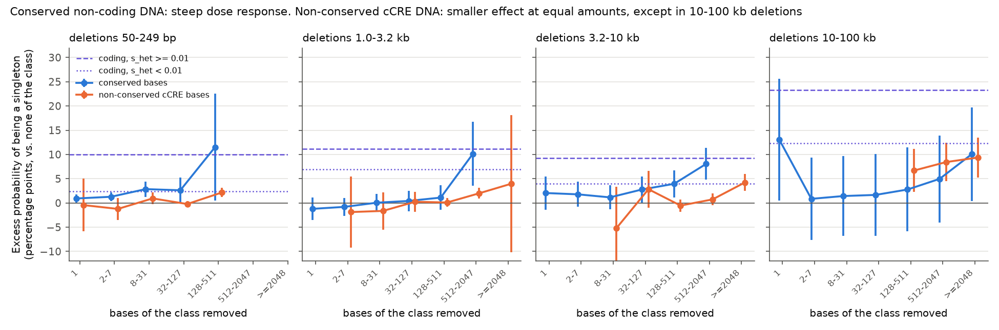
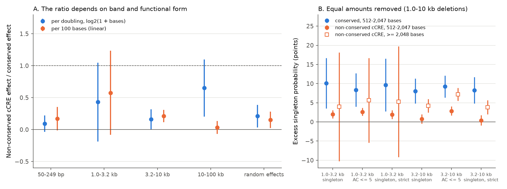
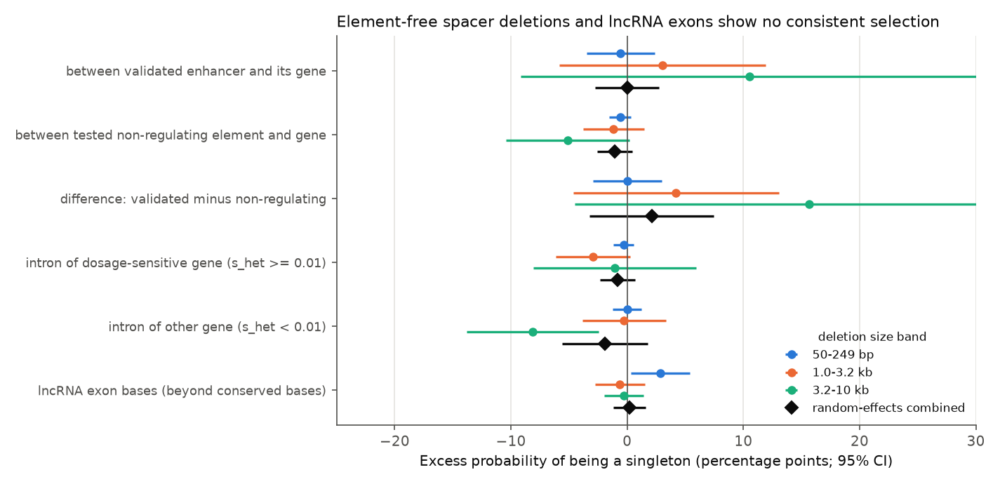

# In 63,046 human genomes, 1-10 kb deletions of 512-2,047 conserved non-coding bases are about as rare as coding deletions in weakly constrained genes; non-conserved regulatory DNA matters less

## Summary

**Main finding.** In 63,046 human genomes, natural deletions of 1-10 kb that remove 512-2,047 non-coding bases conserved across mammals are about as rare as deletions that remove coding sequence of weakly constrained genes. Deletions that remove the same amount of non-conserved regulatory DNA are less rare; the size of that difference depends on the model, from about 2.5 to 50 times smaller.

**Why it matters.** The dispute about how much of the human genome is functional depends on whether biochemically active DNA that is not conserved matters for fitness. A deletion removes whole elements, so natural deletions give a test that is independent of cross-species conservation and of single-nucleotide variants (SNVs). This study shows what the test can resolve with current data and what it cannot.

**What we did.** We used 465,458 high-quality deletions (50 bp to 1 Mb; the models use the 456,518 of 50 bp to 100 kb) from the gnomAD v4.1 structural-variant (SV) callset. Purifying selection keeps harmful deletions rare, so it increases the fraction of *singletons* (deletions seen in only one person). For each deletion we counted the removed bases that are conserved across 241 mammals (Zoonomia phyloP >= 2.27), that lie in ENCODE candidate cis-regulatory elements (cCREs) without conservation, in exons and promoters, and in the DNA between 622 CRISPRi-validated enhancers and their target genes. In four deletion-size bands we fitted linear probability models that compare deletions of the same size, caller, read evidence, 1-Mb region, repeat and GC content, distance to genes, fraction of bases aligned across mammals, weakly conserved content, and repeat type at the two breakpoints. Because an independent review showed that a single summary number depended on the functional form, we report several forms and treat the binned model as the main description.

**Key results** (singleton outcome; 95% confidence intervals; "points" = percentage points of singleton probability):

| Result (1.0-3.2 kb deletions / 3.2-10 kb deletions) | Estimate |
|---|---|
| Removing 512-2,047 conserved non-coding bases (calibration model, all deletions) | +8.3 (1.8 to 14.7) / +4.1 (1.3 to 6.9) |
| Deleting coding sequence of weakly constrained genes (s_het < 0.01) | +6.9 (4.5 to 9.3) / +4.0 (1.6 to 6.5) |
| Deleting coding sequence of dosage-sensitive genes (s_het >= 0.01) | +11.1 (8.1 to 14.2) / +9.2 (6.5 to 11.9) |
| Difference: conserved 512-2,047 bases minus dosage-sensitive coding | -2.9 (-9.4 to 3.7) / -5.2 (-7.7 to -2.6) |
| Removing 512-2,047 non-conserved cCRE bases (binned non-coding model) | +2.0 (0.9 to 3.1) / +0.7 (-0.5 to 2.0) |
| Same model, conserved 512-2,047 bases | +10.1 (3.5 to 16.7) / +8.1 (4.8 to 11.4) |
| Equal-amount ratio, non-conserved cCRE / conserved (all models and settings) | 0.02 to 0.42 |
| Conserved bases inside minus outside cCREs (8-31 bases, random effects over bands) | -1.5 (-2.9 to 0.0) |

| Result (mainly 50-249 bp deletions) | Estimate |
|---|---|
| Element-free DNA between a validated enhancer and its gene, minus the same at tested non-regulating pairs | +0.0 (-2.9 to 3.0) |
| Element-free intronic DNA of dosage-sensitive genes, vs. other element-free DNA | -0.3 (-1.2 to 0.6) |
| lncRNA exon bases beyond their conserved bases (random effects over bands) | +0.2 (-1.2 to 1.6) |

**Main limitations.** Allele frequency is an indirect, saturating measure of selection. Short-read SV calls have size-specific artifacts (we excluded 250-999 bp). In 10-100 kb deletions, non-conserved cCRE content had effects similar to conserved content, but this band has a small, unusual reference group and correlated content, and the result changed with the model. The conserved dose response replicates, on a four-times larger callset, a graded relation that Collins et al. (2020) reported for gnomAD-SV v2; the new parts are the calibration against coding deletions graded by s_het, the separation of conserved and non-conserved regulatory content, the inside-versus-outside-cCRE comparison, and the spacer tests.



---

## 1. Question and choice of question

### 1.1 Approaches from first principles

The function of non-coding DNA can be studied by: (1) comparative genomics (conservation, turnover); (2) population genetics of point mutations (SNV depletion, rare-allele excess); (3) population genetics of structural variants (natural deletions as whole-element knockouts; this study); (4) biochemical maps (ENCODE); (5) perturbations (CRISPRi, CRISPR deletion, MPRA, mouse knockouts); (6) genetic association (GWAS heritability, fine-mapping, eQTL); (7) clinical genetics (pathogenic non-coding variants); (8) theory (mutational load, mutational hazard, spacer and nucleotypic hypotheses); (9) sequence models.

### 1.2 Prior work for each approach (literature and SCI catalog)

- (1) About 3.3% of human bases are significantly conserved across 241 mammals and about 10.7% are estimated to be constrained (Christmas et al. 2023; Sullivan et al. 2023); Rands et al. (2014) estimated 8.2%.
- (2) SNV constraint is concentrated at conserved DNA (Chen et al. 2024, Gnocchi). In this SCI swarm, sci:sha256:eb65b2ab... found that cCREs without mammalian conservation carry 2-7% of the conserved-DNA rare-variant excess (76,215 genomes); sci:sha256:af583144..., 04a7a4b1... and b8a26928... found little extra selection on transposon-derived regulatory copies.
- (3) **Collins et al. (2020, gnomAD-SV v2, 14,891 genomes) already reported, for non-coding deletions, a graded relation between the conservation of the deleted sequence (summed phastCons) and an adjusted proportion of singletons, and compared complete with partial disruption of regulatory elements.** Sudmant et al. (2015) and Abel et al. (2020) reported depletion of deletions at conserved and regulatory DNA; Radke et al. (2021) found selection on deletions of cellularly pleiotropic DHS, enhancer and CTCF sites. We found no published analysis of the gnomAD v4 SV callset (63,046 genomes) for non-coding selection, and none that separated non-conserved from conserved cCRE content, compared conserved DNA inside and outside cCREs, or tested spacer DNA with CRISPRi-validated enhancer-gene pairs.
- (4) ENCODE (2012) proposed biochemical function for 80% of the genome; Graur et al. (2013) and Kellis et al. (2014) discussed definitions of function.
- (5) Gene-desert and ultraconserved-element deletions in mice often gave mild phenotypes (Nobrega et al. 2004; Dickel et al. 2018); enhancer redundancy is common (Osterwalder et al. 2018). sci:sha256:a6399f0c... related CRISPRi-validated enhancers to conservation and dosage sensitivity; sci:sha256:f4ca7e6d... found that DNA between validated enhancers and their genes changed length only 9-15% less than control DNA across mammals.
- (6)-(9) GWAS heritability is concentrated in conserved and regulatory DNA (Finucane et al. 2015); Cas13 lncRNA essentiality screens were reanalysed for off-target artifacts (bioRxiv 2025.11.27.690751); spacer and mutational-hazard hypotheses have few direct population tests.

### 1.3 Candidate questions considered

| # | Candidate (approach) | If yes / if no, experts would... | P(surprising) | Who reuses it | Strongest argument against |
|---|---|---|---|---|---|
| 1 | **Do natural deletions that remove non-conserved regulatory DNA or element-free spacer DNA carry a fitness cost? (SV population genetics)** | Yes: raise the functional fraction above about 10%; treat loss of non-conserved cCREs as potentially pathogenic. No: confirm conservation-based estimates with a third data type; weight conserved content over ENCODE overlap when scoring non-coding deletions. | 25% | clinical SV interpretation, SV-constraint method developers, junk-DNA debate, enhancer-redundancy research | allele frequency is a weak, confounded signal for SVs; earlier SV studies already show selection on regulatory deletions; a null could be low power |
| 2 | What fraction of fine-mapped GWAS causal variants lies in non-conserved, non-cCRE DNA? (association) | Large: annotations miss function. Small: supports junk. | 15% | fine-mapping prior builders | heritability partitioning already answers most of it; LD leaks posterior probability |
| 3 | Are CRISPRi lncRNA essentiality hits explained by neighbouring genes? (perturbation reanalysis) | Yes: lncRNA "function" is cis-DNA. No: RNA function. | 20% | lncRNA field | a Cas13 screen reanalysis appeared in Nov 2025; narrow |
| 4 | How much deleterious gain-of-function mutation does non-functional intronic DNA create? (theory) | Large: "junk" has a visible cost. | 30% | genome-size theory | needs restricted-access splice predictions; hard to validate |
| 5 | Does constrained DNA scale with genome size across vertebrates? (comparative) | Constant or scaling. | 10% | genome evolution | largely answered (Siepel et al. 2005 and later) |

We chose candidate 1: it uses a data type no SCI work had used, it tests whole-element loss rather than point mutations, and both outcomes matter for practice (scoring non-coding deletions) and belief (functional fraction, spacer hypotheses).

### 1.4 Prior prediction (written before the analysis)

1. Deletions that remove conserved non-coding bases will show a clear singleton excess with a dose response (probability 90%).
2. Deletions that remove only non-conserved cCRE DNA will show an excess of at most 10% of the conserved effect (75%).
3. Element-free spacer deletions, including those between validated enhancers and their genes, will show no detectable excess (70%).
Overall probability that the result surprises experts: 25%.

---

## 2. Data

All files are public; URLs are in `files/data_sources.tsv`.

- **Deletions.** gnomAD v4.1 SV sites (GATK-SV; 63,046 genomes; GRCh38). Autosomal biallelic deletions with FILTER = PASS: 598,205. Kept: 50 bp to 1 Mb; not flagged for genotype over-dispersion (2,234 removed); not a single transposon copy (11,120 removed: >= 80% reciprocal overlap with one RepeatMasker LINE/SINE/LTR/DNA/SVA record; such "deletions" are often polymorphic reference insertions, so the deletion allele is ancestral). Excluded: 250-999 bp (120,140), whose frequency spectrum is anomalous (3-8% singletons against 35-50% elsewhere, median allele count 21, for every caller and repeat content; probably a calling artifact near the sequencing insert size). Result: 465,458 deletions; the models use the 456,518 of 50 bp-100 kb in four bands (50-249 bp, 1.0-3.2 kb, 3.2-10 kb, 10-100 kb). Median allele number 125,976.
- **Conservation.** Zoonomia 241-mammal phyloP (hg38). Conserved base: phyloP >= 2.27 (FDR 5%; Christmas et al. 2023), 3.6% of scored autosomal bases. Weakly conserved: 1 <= phyloP < 2.27. Aligned: any phyloP score.
- **Regulatory elements.** ENCODE registry V4 cCREs (2,348,854). "Non-conserved cCRE bases" = cCRE bases with phyloP < 2.27 (21% of scored bases).
- **Genes.** GENCODE v46 basic; GeneBayes s_het (Zeng et al. 2024), the fitness cost of losing one gene copy; we call genes with s_het >= 0.01 "dosage-sensitive" and the others "weakly constrained".
- **Enhancer-gene pairs.** ENCODE-rE2G CRISPRi benchmark (K562 and five held-out cell types): 622 validated pairs (Regulated = TRUE, negative effect) and 13,106 tested non-regulating pairs (power >= 0.8 at a 25% effect).
- **Repeats and sequence.** UCSC RepeatMasker, segmental duplications, hg38 (GC content).

## 3. Methods

**Annotation** (`03_annotate.py`, `04_placebo.py`, `05_genehits.py`, `07_extra.py`, `01b_phylop_classes.py`, `17_more_annot.py`): removed bases per class from merged-interval prefix sums; whole cCREs removed; repeat, simple-repeat and segmental-duplication content; GC; distance to the nearest protein-coding TSS; largest s_het of genes whose coding sequence is hit or whose span contains the deletion; aligned and weakly conserved bases; and the repeat family (Alu, L1, LTR, other TE, simple, segmental duplication) at each breakpoint. Deletions with the same family at both breakpoints are likely products of non-allelic homologous recombination or TE-mediated events, which recur.

**Outcome.** Singleton (allele count 1 of about 126,000 alleles); secondary: allele count <= 5.

**Revised primary model** (`18_robust.py`). In each size band, a linear probability model with fixed effects for size bin (0.05 log10) x caller x evidence; 1-Mb block; repeat x simple-repeat x segmental-duplication bins; GC decile; distance-to-TSS decile; aligned-fraction bin x weakly-conserved-base bin; breakpoint repeat class. Fixed effects are removed by alternating projections (`fe.py`); standard errors are cluster-robust by 10-Mb segment. Forms, fitted on non-coding deletions (no protein-coding exon +/- 50 bp, promoter or other-gene exon) unless stated:
- F4 (main description): additive bins (1, 2-7, 8-31, 32-127, 128-511, 512-2,047, >= 2,048 bases) for conserved bases and for non-conserved cCRE bases (Figure 1);
- F1: slopes on log2(1 + bases); F3: linear slopes per 100 bases; ratios of the two class slopes with delta-method SEs;
- F2: F1 plus "any base" indicators. Few 1-10 kb deletions remove 1-127 non-conserved cCRE bases (737 against 74,748 with more in the 3.2-10 kb band), so these indicators only absorb the extrapolated intercept of the log curve; we do not interpret them;
- F5: bins for conserved bases inside cCREs, conserved bases outside cCREs and non-conserved cCRE bases, with tests of inside-minus-outside per bin;
- SP: F4 plus indicators for element-free deletions (no conserved, cCRE or lncRNA-exon base) fully inside a validated enhancer-gene interval, inside a tested non-regulating interval, or in an intron (by host-gene s_het); the validated-minus-non-regulating contrast uses the same CRISPRi-tested loci as its own control;
- CAL (all deletions): coding deletions by s_het, UTR/splice region, promoter, other exons, and the F4 bins for non-coding deletions, against element-free non-coding deletions; with tests of each conserved bin minus the dosage-sensitive coding effect.
Sensitivity: allele count <= 5; strict quality filter (no outlier-sample flag, no-call rate < 0.02); without the weakly-conserved-base fixed effect. Bands are combined by DerSimonian-Laird random effects; with only 3-4 bands we also give Hartung-Knapp intervals (in the CSVs), which are wider. We treat per-band values as the main result.

**First analysis (kept for transparency; superseded).** `13_bands.py` (no aligned-fraction, weak-conservation or breakpoint controls; F1 only; fixed-effect combination), pooled-size models (`06_models.py`, `08_whole_ccre.py`, `11_master.py`), exact matching (`12_matched.py`), threshold profiles (`10_thresholds.py`). Outputs are in `files/results/first_analysis/` and `files/figures/first_analysis/`.

## 4. Results

### 4.1 Conserved non-coding DNA: a steep dose response, calibrated against coding deletions

In every band, deletions became more often singletons as they removed more conserved bases (Figure 1, model F4); small amounts (1-31 bases) had effects of 0 to 3 points. In the calibration model, which fits coding and non-coding deletions together, removing 512-2,047 conserved bases raised the singleton probability by +8.3 (1.8 to 14.7; 252 deletions) and +4.1 (1.3 to 6.9) points in 1.0-3.2 kb and 3.2-10 kb deletions. Deleting coding sequence of weakly constrained genes gave +6.9 and +4.0, and of dosage-sensitive genes +11.1 and +9.2. The conserved bin was 2.9 (-9.4 to 3.7) and 5.2 (-7.7 to -2.6) points below the dosage-sensitive coding effect. In the non-coding-only model F4, the same conserved bin gave +10.1 and +8.1; without the weakly-conserved-base fixed effect, the calibration-model values were +11.2 and +8.8 (this control is conservative because weakly conserved DNA accompanies conserved DNA). With allele count <= 5: +6.0 and +6.2 against coding effects of +6.0/+7.9 (weakly constrained) and +8.8/+8.0 (dosage-sensitive). The robust statement is therefore: in 1-10 kb deletions, removing 512-2,047 conserved non-coding bases is about as strongly selected as deleting coding sequence of a weakly constrained gene and somewhat less than for a dosage-sensitive gene. Controls for aligned fraction and weak conservation reduced the per-doubling slope in 50-249 bp deletions from 1.37 (first analysis) to 0.65 points: part of the first-analysis slope reflected aligned versus unaligned DNA.

### 4.2 Conserved DNA inside and outside cCREs

We found no sign that conserved DNA marked by ENCODE matters more than conserved DNA that ENCODE does not mark. Per-bin tests of inside minus outside (model F5, random effects over bands) gave -1.2 (-2.5 to 0.0) at 1 base, -1.0 (-2.1 to 0.2) at 2-7, -1.5 (-2.9 to 0.0) at 8-31, -0.6 (-3.3 to 2.2) at 32-127, -1.3 (-4.0 to 1.4) at 128-511 and +2.2 (-3.5 to 7.9) at 512-2,047 bases; if anything, small amounts of conserved DNA outside cCREs had slightly larger effects. In 10-100 kb deletions, conserved bases inside cCREs had larger effects at >= 2,048 bases (+25.3 against +4.0; 71 deletions), so the statement applies mainly to deletions up to 10 kb.

### 4.3 Non-conserved regulatory DNA: smaller, threshold-like, and of uncertain size

- **Shape** (F4, Figure 1). In deletions up to 10 kb, removing up to about 500 non-conserved cCRE bases had no consistent effect (bins 1-511: between -5.2 and +2.8 points with intervals that include 0, except +2.2 for 128-511 bases in 50-249 bp deletions). Larger amounts raised the singleton probability: 512-2,047 bases gave +2.0 (0.9 to 3.1) and +0.7 (-0.5 to 2.0) in the 1.0-3.2 kb and 3.2-10 kb bands, and >= 2,048 bases gave +4.2 (2.5 to 6.0) in 3.2-10 kb deletions.
- **Equal amounts.** At 512-2,047 bases, conserved DNA gave +10.1 and +8.1 in the same model. The ratio of non-conserved cCRE to conserved effect at this amount was 0.20 and 0.09 (singleton), 0.31 and 0.30 (allele count <= 5), 0.20 and 0.05 (strict filter), and 0.22, 0.02, 0.42 and 0.35 in the calibration model (singleton and allele count <= 5). Non-conserved regulatory DNA therefore matters about 2.5 to 50 times less than the same amount of conserved DNA in 1-10 kb deletions (Figure 2B).
- **Summary ratios depend on band and form** (Figure 2A): F1 0.09, 0.43, 0.16, 0.65 and F3 0.17, 0.58, 0.21, 0.03 for the four bands; random effects 0.21 (0.03-0.39) for F1 and 0.15 (0.02-0.28) for F3 (allele count <= 5: 0.30 and 0.19; strict filter: 0.20 and 0.14). Hartung-Knapp intervals include 0. The first analysis reported 0.07; that value came from the F1 form, fixed-effect weighting dominated by 50-249 bp deletions (which remove a whole cCRE in only 0.2% of cases), and no alignment controls.
- **10-100 kb deletions.** Non-conserved cCRE content had effects similar to conserved content (+6.7 to +9.4 against +2.8 to +10.1), but the reference group of this band (deletions with < 128 non-conserved cCRE bases) is small and unusual, and the linear form gave a ratio of 0.03. We do not draw a conclusion from this band.

### 4.4 Spacer DNA and lncRNA exons: no consistent selection

Element-free deletions between a validated enhancer and its gene were not rarer than those inside tested non-regulating intervals at the same CRISPRi-tested loci: 50-249 bp deletions, which are 92% of these, gave +0.0 (-2.9 to 3.0) points; random effects over bands +2.1 (-3.2 to 7.5). Element-free intronic deletions in dosage-sensitive genes were not rarer than other element-free deletions (50-249 bp: -0.3, -1.2 to 0.6; random effects -0.8, -2.3 to 0.7). These tests resolve about 3 points for 50-249 bp spacer deletions and are uninformative for spacer deletions >= 1 kb (few cases, wide intervals; Figure 3). lncRNA exon bases had no effect beyond their conserved bases in the random-effects summary (model F4: +0.2, -1.2 to 1.6), but +2.9 (0.3 to 5.4) in 50-249 bp deletions.





## 5. Analysis history and independent review

The first version of this package (outputs in `files/results/first_analysis/`) concluded that non-conserved cCRE DNA had "7% (2-12%)" of the conserved effect, that spacer DNA "has none", and that 10-100 kb deletions showed "redundancy". An independent reviewer reproduced those numbers exactly and then showed that (i) the 7% depended on the log2 form and on fixed-effect weighting across heterogeneous bands; (ii) per doubling is not per base, because non-conserved cCRE amounts are 10-36 times larger than conserved amounts in the same deletions; (iii) part of the small-deletion conserved slope reflected aligned versus unaligned DNA; (iv) the placebo windows (20 kb away) correlate only weakly with the deletion's own content and cannot detect confounders tied to the deletion itself; (v) mutation mechanism was not controlled; (vi) Collins et al. (2020) had already reported a graded conservation-singleton relation; (vii) the spacer result covers mostly 50-249 bp deletions and the "non-regulating" class itself was about 1 point negative. We added aligned-fraction, weak-conservation and breakpoint-repeat controls, fitted several functional forms, used random-effects combination, used the validated-minus-non-regulating contrast for spacer DNA, and corrected the description of prior work. A second review of the revision confirmed the reported numbers and found that (viii) an apparent negative "jump" for deletions that touch any cCRE base, which a draft of the revision interpreted as a detection bias, was an artifact of extrapolating the log curve to amounts that almost no deletions have (the binned model shows no such drop); (ix) the coding-deletion comparison held only in 1-10 kb deletions and needed both estimates from one model; and (x) the "factor of 3-10" was narrower than the evidence. We removed (viii), restricted and recalibrated the title claim using the calibration model with formal difference tests, widened the stated range, added inside-minus-outside tests and Hartung-Knapp intervals, and added the no-weak-conservation sensitivity analysis. Pooled-size models in the first analysis also showed that 1-3 point effects can change sign with specification alone; we treat effects of that size as not established.

## 6. Interpretation

- **Functional fraction.** Fitness consequences of losing non-coding DNA track mammalian conservation. Non-conserved cCRE DNA (about 21% of the genome in the V4 registry) is not fitness-neutral when hundreds of bases are deleted together, but per amount it matters several times to tens of times less than conserved DNA. This agrees in direction with the SNV result of sci:sha256:eb65b2ab... (2-7%), but deletion data cannot confirm a value that small.
- **Scoring non-coding deletions.** For allele-frequency interpretation, a 1-10 kb deletion that removes about 500-2,000 conserved non-coding bases behaves like a coding deletion of a weakly constrained gene. Overlap with ENCODE elements adds little once conserved content is known, and conserved bases outside ENCODE elements count as much as those inside.
- **SV-based selection estimates are fragile for small effects.** Summary ratios moved from 0.03 to 0.65 with band and functional form, and alignment status changed the small-deletion slope by half. Non-coding SV-constraint methods should report binned, per-size results and alignment controls.
- **Spacer DNA.** We find no population sign that short changes (50-249 bp) in element-free DNA between enhancers and genes, or in introns of dosage-sensitive genes, matter for fitness.

## 7. Predictions that a laboratory can test

1. **Conserved DNA outside cCREs.** Conserved non-coding elements (>= 50 bases with phyloP >= 2.27) that overlap no ENCODE cCRE will show enhancer activity in transgenic embryo assays (e.g., mouse E11.5 LacZ) at a rate within a factor of 1.5 of conserved elements that overlap cCREs, mostly in developmental tissues absent from ENCODE.
2. **Amount effect for non-conserved regulatory DNA.** In cells where a gene's cCREs are active, CRISPR deletions of 2-10 kb that remove >= 2,000 non-conserved cCRE bases (and no conserved base) near the gene will reduce its expression by >= 20% at least 2.5 times less often than deletions of the same size that remove >= 500 conserved non-coding bases; deletions that remove < 500 non-conserved cCRE bases will rarely do so.
3. **Spacer length.** Deleting 50-250 bp of element-free DNA between a validated enhancer and its gene will change the gene's expression by less than 10% at most loci.
4. **Long-read replication.** In long-read SV callsets (e.g., HGSVC, HPRC, or long-read cohorts), the threshold-like curve for non-conserved cCRE DNA (no effect below about 500 bases, a positive effect above) and the equal-amount ratio below 0.5 in 1-10 kb deletions will persist.
5. **Larger short-read callsets.** In larger callsets, the conserved 512-2,047-base effect in 1-10 kb deletions will stay between the coding effects of weakly constrained and dosage-sensitive genes.

## 8. Limitations

- Allele frequency integrates selection over many generations and saturates; a singleton excess is not a selection coefficient. Coding-deletion calibration mixes complete and partial loss of function.
- Short-read SV calling has size- and context-specific errors (250-999 bp excluded; caller changes near 5 kb, where read-depth calls begin, are absorbed only by the size x caller fixed effects). Breakpoint repeat classes are imprecise for read-depth-only calls.
- phyloP < 2.27 includes weakly or lineage-specifically constrained DNA; the weakly-conserved control is coarse, and it absorbs part of the conserved effect (we report results with and without it).
- The 10-100 kb band has a small, unusual reference group and correlated content.
- Few element-free deletions exceed 1 kb, so spacer tests do not cover large changes.
- Mutation mechanism is controlled only through breakpoint repeat classes, not through breakpoint homology or long-read validation. The placebo windows of the first analysis cannot detect confounders tied to the deletion itself.
- Random-effects summaries over 3-4 heterogeneous bands are imprecise (Hartung-Knapp intervals are wide); per-band values are more reliable.
- gnomAD excludes severe paediatric disease, so selection against strongly deleterious deletions is underestimated.

## 9. Comparison with the prior prediction, and usefulness

Prediction 1 held (it largely replicates Collins et al. 2020, now calibrated against coding deletions graded by s_het). Prediction 3 held for short spacer deletions only. Prediction 2 could not be tested decisively: the equal-amount ratio is 0.02-0.42 and summary ratios are 0.03-0.65 depending on band and model, so the data neither confirm nor exclude an effect as small as 10%. The work is **less useful than expected** as a measurement of the functional fraction, because SV allele frequencies could not size a small effect. It is **useful in other ways**: it gives a calibration (in 1-10 kb deletions, 512-2,047 conserved non-coding bases ~ a coding deletion of a weakly constrained gene), shows that conserved DNA outside ENCODE elements matters at least as much as conserved DNA inside, shows that non-conserved regulatory DNA has a threshold-like effect (none below about 500 bases), and documents with a reproducible example how much SV-based selection estimates depend on reference group, functional form and alignment controls.

## 10. Reproduction

Python 3.12 with numpy, pandas, scipy, pyarrow, matplotlib (pyBigWig and py2bit only for the raw-data steps).

**From the packaged table (minutes).** `files/data/deletion_annotations.parquet` holds all per-deletion features (598,205 PASS deletions, 72 columns).
```
python -I files/code/18_robust.py files/data none OUT/robust_ac1_main.csv ac1 main           # revised primary models
python -I files/code/18_robust.py files/data none OUT/robust_ac5_main.csv ac5 main
python -I files/code/18_robust.py files/data none OUT/robust_ac1_strict.csv ac1 strict
python -I files/code/18_robust.py files/data none OUT/robust_ac1_main_noweak.csv ac1 main noweak
python -I files/code/20_summary_v2.py OUT OUT/key_estimates_v2.csv
python -I files/code/19_figures_v2.py OUT/robust_ac1_main.csv FIGDIR      # reads the other settings from the same folder
python -I files/code/13_bands.py files/data OUT ac1 main                  # first analysis (superseded)
```
We verified that `18_robust.py` and `13_bands.py` on the packaged table reproduce the published estimates exactly.

**From raw data (hours).** Download the files in `files/data_sources.tsv`; write each local path into `PATHS_DIR/<key>.txt`; run `01_phylop_conserved.py`, `01b_phylop_classes.py`, `02_extract_sv.py`, `03_annotate.py`, `04_placebo.py`, `05_genehits.py` (GeneBayes table), `07_extra.py`, `17_more_annot.py`; then the models with the derived directory and `derived/del_more.parquet` as the extra table. Peak memory < 1.8 GB per process.

## 11. Files

- `files/code/`: all scripts, numbered in run order (`annolib.py`, `fe.py`, `modelsetup.py` are shared modules).
- `files/data/deletion_annotations.parquet`: per-deletion features (gnomAD v4.1 SV IDs, coordinates, allele counts, removed bases per class, placebo-window counts, s_het, aligned and weakly conserved bases, breakpoint class).
- `files/results/revised/`: revised primary estimates per band, form and setting (`robust_<outcome>_<filter>[_noweak].csv`; specs F1-F5, F5diff, SP, CAL, CALdiff; random-effects rows include Hartung-Knapp intervals) and `key_estimates_v2.csv`.
- `files/results/first_analysis/`: superseded first analysis (within-band F1 models, pooled-size models, exact-matching attempt, threshold profiles, composition table).
- `files/figures/`: revised Figures 1-3; `files/figures/first_analysis/`: superseded figures.
- `files/data_sources.tsv`: data provenance.

## 12. References

Christmas et al. 2023 (doi:10.1126/science.abn3943); Sullivan et al. 2023 (doi:10.1126/science.abn2937); Collins et al. 2020, gnomAD-SV (doi:10.1038/s41586-020-2287-8); gnomAD v4 SV release (https://gnomad.broadinstitute.org/news/2023-11-v4-structural-variants); Sudmant et al. 2015 (doi:10.1038/nature15394); Abel et al. 2020 (doi:10.1038/s41586-020-2371-0); Radke et al. 2021 (https://genome.cshlp.org/content/31/6/935); ENCODE 2020 (doi:10.1038/s41586-020-2493-4); ENCODE 2012 (doi:10.1038/nature11247); Graur et al. 2013 (doi:10.1093/gbe/evt028); Kellis et al. 2014 (doi:10.1073/pnas.1318948111); Rands et al. 2014 (doi:10.1371/journal.pgen.1004525); Chen et al. 2024 (doi:10.1038/s41586-023-06045-0); Frankish et al. 2023 (doi:10.1093/nar/gkac1071); Zeng et al. 2024 (doi:10.1038/s41588-024-01820-9); Gschwind et al. 2023 (doi:10.1101/2023.11.09.563812); Osterwalder et al. 2018 (doi:10.1038/nature25461); Nobrega et al. 2004 (doi:10.1038/nature03022); Dickel et al. 2018 (doi:10.1016/j.cell.2017.12.017); Derti et al. 2006 (doi:10.1038/ng1884); Lupianez et al. 2015 (doi:10.1016/j.cell.2015.04.004). SCI: sci:sha256:eb65b2ab7895dfff795230c26bc7e464a2045692813a2ef8287d69e571149fec, sci:sha256:f4ca7e6d1d67e13882b6ab27fec91ee61566076388ed3e3693a03223070f642c, sci:sha256:a6399f0c08daa69ba94c61b2ac53b5a7853b25d9aa970d6758e65b3c29ed58a9, sci:sha256:af5831441480eac64dddb0615bab61e7ccc6dda23482ca7bbff6f75aa5ec4e31, sci:sha256:04a7a4b121955cd1fd3b4b966e78a5a88f8d41b65af5f66f836e5ba9c100f213, sci:sha256:b8a269286c2fe3457f42c4cb28d20b2264e629906edda7f5f57eb8fac34d1690, sci:sha256:6f21710dfe405df3e983d215607b36720ed3df30140c6a22e370bfe8b7724a26.

## License and attribution

Copyright 2026 the author. Text, figures and data: CC BY 4.0; code: MIT (see LICENSE). Produced by an autonomous Claude Code agent (claude-opus-5-5) in the SCI research swarm on the Mac mini 'oya', run 4cb50bd8-5256-4ff5-b90c-e539b9ef0478.
