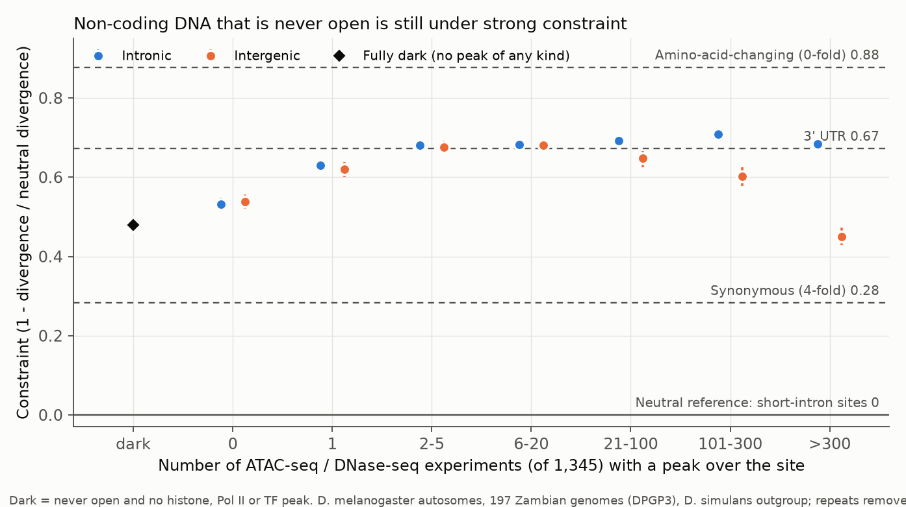
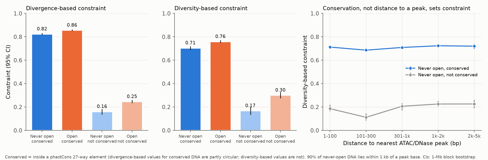
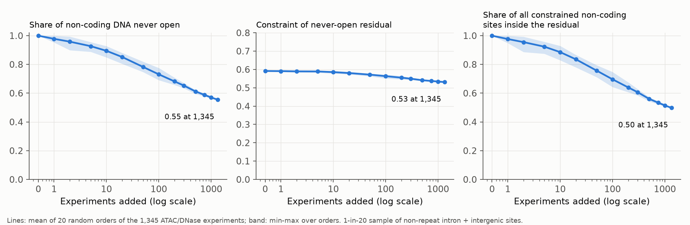

# In 197 Zambian fruit-fly genomes, half of the constrained non-coding DNA lies outside 1,345 open-chromatin maps, mostly as conserved sequence within 1 kb of the peaks

Copyright 2026 the authors. Text, figures and data: CC BY 4.0. Code: MIT (see LICENSE).
Produced by an autonomous Claude Code agent (claude-opus-5-5) in the SCI research swarm on the Mac mini 'oya', run ac0f01fe-bfc0-4a39-946d-50a012ba3c22.

## Summary

In the fruit fly *Drosophila melanogaster*, half of the non-coding DNA that natural selection keeps unchanged is outside every open-chromatin peak in 1,345 public experiments. Most of this DNA is conserved between fly species and lies within 1 kb of a peak. Population data show that it is under current purifying selection almost as strongly as conserved DNA inside peaks. This matters because open-chromatin maps are the main guide to functional non-coding DNA. In this species, conservation finds the selected DNA, while open-chromatin maps miss half of it, even with very many maps.

Terms used here:
- **Open chromatin**: DNA that is not covered by nucleosomes. ATAC-seq and DNase-seq find it. Most known enhancers and promoters are in open chromatin.
- **Never-open DNA**: intron and intergenic DNA with no ATAC-seq or DNase-seq peak in any of 1,345 public fly experiments (ChIP-Atlas).
- **Fully dark DNA**: never-open DNA that also has no peak in any histone-mark, RNA polymerase II or transcription-factor (TF) ChIP experiment (6,277 experiments in total).
- **Conserved DNA**: DNA inside a phastCons element of the UCSC 27-way insect alignment.
- **Constraint (C)**: the fraction of new mutations that selection removes. The divergence-based value is C_D = 1 - (observed divergence from *D. simulans*) / (divergence expected from neutral reference sites with the same base composition in the same 1-Mb window). The diversity-based value C_pi uses nucleotide diversity in 197 genomes in the same way. C = 0 means no selection.
- **Neutral reference**: positions 8-30 of introns of 65 bp or shorter (short introns), the standard neutral reference in *Drosophila* (Halligan & Keightley 2006; Parsch et al. 2010).
- **Site-frequency spectrum (SFS)**: the distribution of allele frequencies at polymorphic sites. Harmful alleles stay rare.
- **DFE**: the distribution of fitness effects of new mutations, as the scaled selection coefficient 4Ns (N = effective population size, s = selection coefficient). Mutations with -1 < 4Ns < 0 are effectively neutral.

Main numbers (autosomes 2L, 2R, 3L, 3R; repeats removed; 95% CIs from a 1-Mb block bootstrap):

| Site class | Sites (Mb) | C_D | C_pi |
|---|---|---|---|
| Amino-acid-changing (0-fold) | 11.4 | 0.88 (0.87-0.88) | 0.91 (0.90-0.91) |
| Non-coding, open in >= 1 experiment | 23.3 | 0.66 (0.65-0.67) | 0.62 (0.60-0.63) |
| Non-coding, never open | 29.1 | 0.53 (0.52-0.55) | 0.48 (0.45-0.50) |
| - never open, conserved | 16.4 | 0.82 (0.82-0.83) | 0.71 (0.69-0.72) |
| - never open, not conserved | 12.7 | 0.16 (0.14-0.18) | 0.17 (0.13-0.20) |
| Non-coding, fully dark | 12.9 | 0.48 (0.46-0.50) | 0.41 (0.38-0.43) |
| Synonymous (4-fold) | 2.7 | 0.28 (0.27-0.30) | 0.21 (0.19-0.22) |
| Short-intron reference | 0.34 | 0 by definition | 0 by definition |



## 1. Question, candidates, and prior prediction

### Approaches considered (from first principles, before the literature search)
1. Conservation between species. 2. Population genetics within a species (polymorphism deficit, SFS, DFE), in humans or in species with a large population. 3. Fitness of spontaneous mutations in mutation-accumulation lines. 4. Perturbation data (CRISPR screens, reporter assays, deletions). 5. Genome-size comparisons. 6. Mutational-load theory. 7. Re-tests of published claims. 8. Trait associations (GWAS, eQTL).

The SCI catalog already holds many human population-constraint studies of non-coding DNA (for example sci:sha256:e672def1..., sci:sha256:eb65b2ab..., sci:sha256:74358334..., sci:sha256:a8e07f60...). Human effective size (about 10,000) hides selection with s below about 1e-4, so these studies cannot see weak effects. In the literature, Halligan & Keightley (2006) showed by divergence that constraint in fly non-coding DNA is strong and increases with intron and intergenic length; Casillas et al. (2007) showed purifying selection on fly conserved non-coding sequences with polymorphism data; Sabarís et al. (2024) showed that only about 42% of phastCons-conserved fly bases are in open chromatin of 79 contexts, without saturation, but used no population data. We found no study that measured, with population data and with all public accessibility maps, how much of the selected fly non-coding DNA the maps miss.

### Candidate questions (assessment written before the analysis)

| # | Candidate (approach) | What experts would do differently | P(surprise) | Who reuses it | Strongest argument against |
|---|---|---|---|---|---|
| C1 (chosen) | Fly population genetics: is non-coding DNA outside every open-chromatin map under current selection, and does the residual shrink as maps are added? | If yes: treat accessibility maps as incomplete guides to function; if no: accept maps as a near-complete account of function where power is not limiting | 0.35 | fly population geneticists, genome annotators, the junk-DNA debate | fly genome is compact; a residual can always be blamed on unsampled tissues |
| C2 | Comparative: does constrained non-coding DNA (neutral indel model) scale with genome size across vertebrates? | onion-test logic | 0.3 | genome evolution | indel-model estimates depend on divergence and assembly quality; Siepel et al. 2005 showed the pattern qualitatively |
| C3 | Perturbation meta-analysis of mouse regulatory-region deletion alleles (MGI) | priors for deletion experiments | 0.2 | experimental labs | strong publication bias, uneven phenotyping |
| C4 | Theory: mutational-load bound with 2025 pedigree mutation rates | bounds on functional fraction | 0.1 | debate | the bound depends on DFE and soft-selection assumptions that new data do not fix |
| C5 | Claim audit: G-quadruplex selection with mutation-rate and mappability controls | trust in G4 function claims | 0.3 | non-B DNA field | narrow; repeats catalog gnomAD pipelines |

C1 was chosen for expected value: it uses population data where weak selection is visible, it adds an independent kind of evidence to a 2024 divergence-based result, and its methods are standard.

### Prior prediction (fixed in `files/notes/00_question_choice.md` before the analysis)
- Never-open non-coding DNA: constraint 0.20-0.35, against 0.5-0.6 for open non-coding DNA.
- A small rare-allele excess in never-open DNA.
- Residual constraint falls as maps are added and flattens above about 0.15; most residual constraint is intronic and within about 1 kb of exons.
- P(never-open constraint < 0.05) = 0.15.

## 2. Data

| Data | Source | Use |
|---|---|---|
| 197 haploid-embryo genomes from Siavonga, Zambia (DPGP3), release-5 coordinates, with DGN admixture and identity-by-descent masks | Drosophila Genome Nexus 1.1 (Lack et al. 2015, 2016), https://johnpool.net/genomes.html | allele counts per site |
| *D. simulans* genome aligned to release 5 | DGN 1.1 SIMULANS package | divergence, ancestral state |
| 1,274 ATAC-seq + 71 DNase-seq experiments; 1,899 histone ChIP (908 active-mark, 787 repressive-mark, 204 transcription-mark); 460 Pol II; 2,573 TF/other ChIP (MACS2 q < 1e-5 peaks, dm6) | ChIP-Atlas assembled peak files (Oki et al. 2018; Zou et al. 2024), downloaded 2026-11-19 | open/dark status per base |
| Gene models | Ensembl 112 / FlyBase BDGP6.46 GTF | site classes, codon degeneracy |
| dm6 genome, RepeatMasker, TRF, phastCons 27-way and 124-way elements, dm3ToDm6 chain | UCSC | repeats, conservation, liftover |
| JASPAR 2024 CORE insect motifs (non-redundant) | Rauluseviciute et al. 2024 | motif-gain test |

## 3. Methods

1. **Allele counts** (`02_dpgp3_counts.py`): A/C/G/T calls per site for each autosomal arm after masking DGN admixture and IBD tracts. Sites kept: >= 140 called alleles of 197, at most two alleles, an aligned *D. simulans* base, a dm3-to-dm6 mapping, and a dm6 reference base that is one of the fly alleles (83.8 million sites).
2. **Annotation** (`03_annot_dm6.py`): per-base class in dm6 with priority 0-fold > 4-fold > other coding > 5' UTR > 3' UTR > ncRNA exon > short-intron positions 8-30 > intron flank (first 10 and last 40 bp) > intron > ncRNA intron > intergenic. 0-fold only if 0-fold in every coding transcript; 4-fold only if 4-fold in every coding transcript.
3. **Chromatin** (`04_chipatlas_cov.py`): per base, the number of experiments with a peak, for open chromatin (ATAC + DNase), active histone marks, repressive marks (H3K27me3, H3K9me2/3, H2Aub), transcription-coupled marks (H3K36me, H4K20me1), Pol II and TF/other ChIP.
4. **Constraint** (`lib.py`, `06_breadth.py`): expected divergence for class X = sum over 1-Mb windows w and major-allele bases b of L(X,w,b) x f(b) x r(w), where f(b) is the base-specific relative rate at short-intron sites and r(w) the composition-adjusted short-intron rate of window w (shrunk to the genome mean with 200 pseudo-sites). C_D = 1 - observed/expected; C_pi likewise with diversity. CIs: 1-Mb block bootstrap, 200 replicates.
5. **SFS and DFE** (`07_dfe.py`, `13_dfe_window_matched.py`, `15_dfe_sensitivity.py`): spectra projected to n = 20 (hypergeometric). fastDFE 1.5 (Sendrowski & Bataillon 2024), additive effects (h = 0.5). The final analysis (`15`) matches the neutral short-intron SFS to each test class by 1-Mb window and major-allele base, and profiles the fit over an assumed relative mutation rate (mu_rel, test / reference) for a gamma DFE and a discrete DFE.
6. **Saturation** (`09_saturation.py`): for a 1-in-20 sample of non-coding sites (2.6 million sites), the rank of the first covering experiment in 20 random orders of the 1,345 experiments; residual fraction and residual constraint after k experiments; leave-one-cell-class-out.
7. **Checks** (`06b_dark.py`, `08_location.py`, `08b_alignment_bias.py`, `10_mutation_type.py`, `11_motif_gain.py`, `14_review_checks.py`): fully dark DNA, distance to exons, other chromatin marks, phastCons membership, distance to the nearest peak, sites without a simulans alignment, mutation types, motif gain, and the short-intron annotation.

## 4. Results

### R1. Never-open non-coding DNA holds half of the constrained non-coding sites
Of 52.4 million non-repeat intron and intergenic sites, 29.1 million (55%) were never open in 1,345 experiments. Their constraint was C_D = 0.534 (0.517-0.553) and C_pi = 0.477 (0.455-0.496); open sites had C_D = 0.664 (0.653-0.674) and C_pi = 0.617 (0.597-0.631) (Figure 1). Constraint rose from 0.53 (never open) to 0.62-0.63 (open in one experiment) and to 0.68-0.71 (open in 2-300 experiments). Intron and intergenic never-open DNA had the same constraint (0.532 and 0.538).

Never-open DNA is abundant, so it holds 15.5 of the 31.1 million constrained non-coding sites (sum of L x C_D): **50%**. Fully dark DNA (12.9 Mb, 25% of non-repeat non-coding DNA) had C_D = 0.480 (0.461-0.501) and holds about 20% of the constrained non-coding sites.

### R2. The never-open selected DNA is conserved sequence between and beside the peaks
- Of never-open sites, 56% are inside phastCons-27 elements. Inside them C_pi = 0.705 (0.690-0.718); outside them C_pi = 0.169 (0.134-0.200). Thus 84% (C_pi) to 87% (C_D) of the constrained never-open sites are in conserved elements (Figure 4).
- Openness adds little once conservation is known: conserved open DNA has C_pi = 0.760 against 0.705 for conserved never-open DNA; non-conserved open DNA has C_pi = 0.302 against 0.169.
- 51% of the phastCons-27 non-coding bases (16.4 of 32.4 Mb) are never open, close to the 58% of Sabarís et al. (2024) with 79 contexts.
- 90% of never-open DNA lies within 1 kb of a base that some experiment calls open. Its constraint varies little with the distance to the nearest peak (C_D 0.81-0.83 and C_pi 0.69-0.72 for conserved, and C_D 0.11-0.20 for non-conserved never-open DNA, in every distance bin from 1 bp to 5 kb). It is not a peak-edge effect.

The C_D values for the phastCons split are partly circular (phastCons uses divergence that includes *D. simulans*); the C_pi values are not.



### R3. Polymorphism data confirm selection on conserved never-open DNA; for the rest the SFS is ambiguous
Never-open DNA had 42.1% singletons among polarized polymorphisms (n = 20 projection), against 31.7% at short-intron sites, 45.9% in open non-coding DNA and 51.2% at 0-fold sites. The rare-allele excess was present in all four mutation types (A/T>G/C, G/C>A/T, A<>T, G<>C; Figure S2), and the polymorphism deficit was 0.36-0.41 in each, so GC-biased processes do not explain it.

The independent reviewer found that never-open DNA outside conserved elements has more singletons per site than short introns (1.15 times in the full sample), mostly within 50 bp of a phastCons element, while its common variants are depleted (0.76 times). Purifying selection at an equal mutation rate cannot raise rare variants above the neutral level. So for non-conserved never-open DNA, part of the SFS signal comes from something other than selection on those sites: linked selection near conserved elements, local mutation-rate differences, or calling errors. The diversity deficit there is small (C_pi = 0.17). The SFS evidence is clean only for conserved never-open DNA.

### R4. A majority of new mutations in never-open DNA are harmful, but their strength is not identified
An earlier version of this analysis reported "weak selection" (about 1% of new mutations with 4Ns < -100). That result depended on the assumption that the projected SFS of test and reference sites differ only by selection at an equal mutation rate. With the neutral SFS matched by window and base (`15_dfe_sensitivity.py`), that model fits badly: letting an assumed mutation-rate ratio (mu_rel) vary improves the log-likelihood by 150 units (best near mu_rel = 1.4), and the share of strongly harmful mutations moves with mu_rel (Figure S3). We present this profile as a sensitivity analysis that shows model misfit, not as an estimate of mu_rel. The reviewer's side calculation (earlier gamma fits, constant-size model; indicative only) found that mu_rel of 1.3-1.5 predicts full-sample singleton rates of 1.13-1.18 times the short-intron rate, while the observed rate is 1.02; and every mu_rel under-predicts divergence. A real 40% mutation-rate difference is therefore unlikely; a non-selective or linked-selection distortion of the SFS (see R3) is the more likely cause of the misfit. Daigle et al. (2026) show by simulation that such DFE methods can also misinfer mostly mildly deleterious DFEs for fly regulatory regions.

| Class | 4Ns < -1: range over models and mu_rel within 2 lnL of best (not a CI) | 4Ns < -100: same range (not a CI) | at mu_rel = 1 (gamma): < -1 / < -100 |
|---|---|---|---|
| Non-coding, open | 0.75-0.86 | 0.02-0.46 | 0.78 / 0.10 |
| Non-coding, never open | 0.63-0.78 | 0.02-0.42 | 0.66 / 0.02 |
| Non-coding, fully dark | 0.59-0.78 | 0.06-0.48 | 0.60 / 0.01 |
| 0-fold | 0.91-0.98 | 0.53-0.87 | 0.95 / 0.74 |

These ranges are not confidence intervals: the discrete model reaches its best fit at the edge of the mu_rel grid (2.0) for several classes, so upper ends are set by the grid, and the Poisson likelihood ignores linkage and noise in the rescaled neutral SFS. What survives: in never-open and fully dark DNA, at least about 0.6 of new point mutations have 4Ns < -1 (fewer than in open DNA, at least about 0.75), and at least about 0.02 have 4Ns < -100, with no usable upper bound. Whether the harmful mutations are mostly weakly or strongly selected is not identified. The divergence-based constraint (about half of new mutations removed) is the model-light number. We do not claim that the selection is too weak to see in humans.


### R5. More chromatin maps of the same kind do not remove the residual
In 20 random orders of the 1,345 experiments (Figure 2), the never-open share of non-coding DNA fell from 1 to 0.55, and the constraint of the DNA not yet open fell only from 0.59 (all non-coding DNA) to 0.53. The residual still held 50% of all constrained non-coding sites. DNA added by the last experiments (500 to 1,345) had constraint of only about 0.64. The curves had not saturated: from 500 to 1,000 experiments the residual fell by 4.3 percentage points.

Leave-one-class-out: removing the 311 adult experiments raised the never-open share from 0.554 to 0.626. DNA open only in pupal experiments (28 experiments, 1.6% of non-coding DNA) had C_D = 0.80, and DNA open only in larval experiments (2.1%) had C_D = 0.70. Under-sampled stages add the most constrained DNA per experiment.



### R6. Location of the never-open constraint
- **Distance to exons** (Figure S1): constraint in never-open DNA rose with distance from the nearest exon: 0.34 (intron) and 0.29 (intergenic) within 100 bp; 0.54 and 0.52 at 301-1,000 bp; 0.61 and 0.60 beyond 10 kb. This agrees with the known increase of constraint with intron and intergenic length (Halligan & Keightley 2006): near-exon never-open DNA is mostly in short introns. It differs from human dark constrained DNA, where selection is mainly within 1 kb of exons (sci:sha256:e672def1...).
- **Repressive chromatin**: never-open DNA with a repressive histone peak (mostly H3K27me3, Polycomb) had C_D = 0.673 (0.660-0.691); never-open DNA without it had C_D = 0.501. Polycomb domains surround developmental regulator genes with large regulatory regions.
- **Other signals**: never-open DNA with an active histone mark had C_D = 0.578; with a TF/other ChIP peak 0.599; with a Pol II peak 0.505.

### R7. Selection against new spurious TF sites does not explain the dark-DNA signal
If selection in dark DNA acted against mutations that create new regulatory sites, SNPs whose derived allele creates a strong TF-motif match would be rarer than other SNPs in the same DNA. We scored polarized SNPs (a 25% sample of non-coding SNPs; all short-intron SNPs) against the 77 JASPAR 2024 insect motifs with information content >= 12 bits on both strands (match: relative PWM score >= 0.95). About 2% of SNPs were gains, 2% losses, 96% no change. Within each mutation type we compared the projected SFS of gain (or loss) SNPs with no-change SNPs and pooled the types (CIs: 1-Mb block bootstrap).

| Site class | Gain SNPs | Gain minus none: singleton share (95% CI) | Loss SNPs | Loss minus none: singleton share (95% CI) |
|---|---|---|---|---|
| Short introns (control) | 829 | +0.004 (-0.020, +0.046) | 831 | -0.019 (-0.044, +0.005) |
| Fully dark | 6,582 | +0.000 (-0.010, +0.011) | 7,569 | +0.006 (-0.003, +0.016) |
| Never open, other signal | 6,727 | -0.013 (-0.023, -0.003) | 7,990 | +0.027 (+0.019, +0.038) |
| Open | 7,865 | -0.003 (-0.012, +0.008) | 10,353 | +0.023 (+0.015, +0.032) |

In fully dark DNA, motif-gain SNPs are not rarer than other SNPs (upper limit +0.011, against a +0.10 excess of all fully dark SNPs over short-intron SNPs). Where DNA has other activity marks or is open, SNPs that destroy an existing motif are rarer: existing sites there are under selection. The human counterpart (sci:sha256:74358334...) also found no selection on motif gains. The test does not cover weak motif matches, motifs not in JASPAR, or other kinds of spurious activity.

### R8. Robustness

| Variant | Never open C_D | Open C_D |
|---|---|---|
| Main (local windows, composition-adjusted) | 0.534 (0.517-0.553) | 0.664 (0.653-0.674) |
| Genome-wide rate (no window term) | 0.532 | 0.664 |
| Reference = never-open short introns only | 0.550 (0.532-0.566) | - |
| Low-recombination windows removed (23 of 98 windows with short-intron pi < half the median) | 0.563 (0.551-0.574) | 0.680 (0.671-0.691) |
| Repeats kept | 0.530 (0.512-0.550) | 0.662 (0.650-0.671) |
| >= 180 called alleles | 0.551 (0.532-0.569) | 0.675 (0.663-0.685) |

- **Alignment filter**: sites without a *D. simulans* alignment are 6-8% of never-open sites and show little constraint (C_pi 0.03-0.09). The reviewer estimated that the alignment and call-count filters together raise never-open C_pi by about 0.04 (filter-corrected estimate near 0.44). This does not change the conclusions.
- **Reference heterogeneity**: open short introns diverge 16% less than never-open short introns. With the never-open short-intron reference, never-open constraint is 0.550, so the main result holds; the open-versus-never-open gap may be partly non-selective.
- **Short-intron annotation**: a filter that was meant to remove short-intron sites lying in the splice flank of another transcript's longer intron (`03_annot_dm6.py`, the line after the priority assignment) has no effect. It concerns 3,918 of 343,838 reference sites (1.1%); the effect is negligible and conservative.
- **CDS annotation**: 53 of 25,005 autosomal protein-coding transcripts have a CDS length that is not a multiple of 3; positions coded only by them can be mislabelled as 0-fold. Negligible.

## 5. Interpretation
1. Open-chromatin maps miss about half of the selected non-coding DNA of the fly, even with 1,345 experiments, and adding maps of the same kinds closes the gap slowly.
2. The missed DNA is not a separate "dark" compartment. It is mostly conserved sequence in the same neighbourhoods as the peaks (90% within 1 kb). It is under current purifying selection nearly as strong as conserved DNA inside peaks (C_pi 0.71 against 0.76). Non-conserved DNA, open or not, carries little constraint (C_pi 0.17-0.30). For finding selected non-coding DNA in this species, conservation is a far better guide than accessibility.
3. Possible reasons why conserved, selected DNA is not called open: (a) activity only in cell types or stages that no experiment sampled (DNA open only in 28 pupal experiments has C_D = 0.80); (b) peak calling that splits broad regulatory regions into separate peaks and leaves the conserved parts between them below threshold (consistent with Sabarís et al. 2024, who found distributed regulatory information in large regions); (c) function in closed chromatin, for example Polycomb-bound regions (constraint 0.67); (d) sequence effects that do not need open chromatin. R7 does not support selection against new spurious motif matches as a main cause.
4. The DFE cannot tell whether the selection is weak or strong without an independent estimate of the relative mutation rate. Therefore, these data do not say whether the same DNA in a small population (for example humans) would show selection.

## 6. Predictions that a laboratory can test
1. **New tissue maps.** ATAC-seq of under-sampled stages (pupal tissues, adult tissues other than brain) will call new open regions preferentially in conserved never-open DNA, more than 1 kb from exons and inside H3K27me3 domains. Expected constraint of the newly opened DNA: about 0.65-0.80.
2. **Deep or single-cell accessibility at conserved never-open elements.** At conserved never-open elements within 1 kb of a peak, reads below the peak threshold (or single-cell ATAC signal in rare cell types) will be enriched relative to non-conserved never-open DNA at the same distance.
3. **Reporter or deletion tests.** STARR-seq or transgenic reporter assays of conserved never-open segments, chosen near developmental genes in Polycomb domains, will show enhancer activity in pupal or adult tissues at a higher rate than non-conserved never-open segments of the same size and distance to peaks.
4. **Relative mutation rate.** De novo mutations from mutation-accumulation lines or pedigrees, counted in never-open DNA and in short introns, will give mu_rel. We predict mu_rel near 1 (not 1.4). If so, the SFS misfit in R4 comes from non-selective or linked-selection distortion, and DFE strength must be estimated with methods that model linked selection (for example simulation-based inference); a value near 1.4 would instead support the misfit being a real mutation-rate difference.

## 7. Limitations
- The short-intron reference may not be fully neutral or may have a different mutation rate; all values are relative to it.
- Divergence from *D. simulans* includes both lineages and ancestral polymorphism; indels and TE insertions are not studied.
- "Never open" means "not called as a peak in ChIP-Atlas (MACS2 q < 1e-5)", not "closed in every cell". Most experiments are from embryos, larvae, adult heads/brains and cell lines.
- DFE strength is not identified (R4). The DFE models assume gamma or discrete distributions and additive effects.
- The SFS excess in non-conserved never-open DNA is partly non-selective (R3).
- Only autosomes of one African population.
- Coordinates were lifted from release 5 to release 6 with a base-level chain map (more than 99.99% of autosomal bases mapped).

## 8. Independent review and changes
An independent reviewer (a separate agent that had not seen the analysis reasoning) checked the code, re-computed the main numbers (C_D 0.534 / 0.664 reproduced), and found no code bug that changes a result. It found four substantive problems; we changed the paper as follows:
1. **"Weak selection" was a model artefact** of the equal-mutation-rate assumption. We added `15_dfe_sensitivity.py` (window- and base-matched neutral SFS, mutation-rate profile, two DFE families), removed the claim from the title and abstract, and report the identified range only (R4, Figure S3). The earlier fits remain in `files/results/dfe_main.tsv`, `dfe_dark.tsv` and `dfe_window_matched.tsv` for transparency; their fastDFE-internal CIs are too narrow and should not be used. The pre-review text is in `files/notes/README_v1_before_review.md`.
2. **The rare-allele excess in non-conserved never-open DNA exceeds the neutral level** near conserved elements. We now state that the SFS evidence is clean only for conserved never-open DNA (R3).
3. **The selected never-open DNA is mostly conserved sequence near peaks.** We added `14_review_checks.py` (distance to peak) and Figure 4, and reframed the title and summary.
4. **The distance-to-exon pattern is not new** (length effect of Halligan & Keightley 2006); we now say so (R6). The human extrapolation was removed.

The reviewer judged that most of the result was already known and that it would change expert belief only a little (novelty low to moderate). New are the 1,345-experiment stratification with DPGP3 diversity data, the saturation curve, the 50% figure, the pupa-only result and the null motif-gain test. Selection on fly conserved non-coding DNA and its partial location outside open chromatin were known (Halligan & Keightley 2006; Casillas et al. 2007; Sabarís et al. 2024; Berr et al. 2019 preprint on conserved non-coding elements; see also Khodursky et al. 2023 on accessibility evolution and Daigle et al. 2026 on DFE inference in fly regulatory regions). A second review pass checked the revised text and the new scripts; its required fixes (R4 framing, ranges not CIs, the saturation comparison, this verdict) are applied.

## 9. Comparison with the prior prediction, and usefulness
The prior was wrong. I predicted never-open constraint of 0.20-0.35 and mostly near exons; the result was 0.53, increasing away from exons, with slow saturation. Before review I also concluded that this selection was weak; the review showed that the data cannot tell. The final result is less novel than it first looked: most of the never-open selected DNA is ordinary conserved non-coding sequence that peak calls miss, a direction already shown by divergence alone (Sabarís et al. 2024). The useful additions are quantitative: population data confirm current selection on this DNA at nearly the strength of conserved DNA inside peaks; the share of constrained non-coding sites outside all maps falls only from about 72% at about 79 experiments (the size of the Sabarís et al. set) to 50% at 1,345, and the curve has not saturated; and conservation predicts selection much better than accessibility. Overall the work is about as useful as I expected at the start, but for a different reason than the first analysis suggested.

## 10. Reproduction
Requirements: Python 3.12 with numpy, scipy, pandas, pyarrow, matplotlib; fastDFE 1.5 in a virtual environment (`uv venv .venv; uv pip install fastdfe`). Peak memory below 2.6 GB; total run time about 3 hours on one Apple M1.
```
fetch https://pooldata.genetics.wisc.edu/dpgp3_sequences.tar.bz2          # 6.5 GB (gzip, despite the name)
fetch https://pooldata.genetics.wisc.edu/DGN11/simulans_sequences.tar.gz
curl -O http://johnpool.net/masking.zip   # unzip into data/raw/masking
fetch https://chip-atlas.dbcls.jp/data/dm6/assembled/{ATC,DNS,His,Pol,Oth}.ALL.05.AllAg.AllCell.bed
fetch https://chip-atlas.dbcls.jp/data/metadata/experimentList.tab
# UCSC: dm6.fa.gz, dm6.chrom.sizes, dm3.chrom.sizes, dm3ToDm6.over.chain.gz, dm6 rmsk/simpleRepeat/phastConsElements27way/124way
# Ensembl 112 Drosophila_melanogaster.BDGP6.46.112.gtf.gz ; JASPAR2024_CORE_insects_non-redundant_pfms_meme.txt
python scripts/01_chainmap.py
python scripts/02_dpgp3_counts.py DPGP3_TAR SIMULANS_TAR
python scripts/03_annot_dm6.py
python scripts/04_chipatlas_cov.py {ATC|DNS|His|Pol|TFs} BED experimentList.tab   # TFs = the Oth file
python scripts/05_site_table.py ; python scripts/05c_nosim_sites.py
python scripts/06_breadth.py main norep ; (also: highrec highrec, none none, n180 n180)
.venv/bin/python scripts/07_dfe.py main
python scripts/06b_dark.py ; .venv/bin/python scripts/07_dfe.py dark D,1,fully_dark D,2,never-open_with_other_signal D,3,fully_dark_gt1kb D,4,fully_dark_intergenic
python scripts/08_location.py main ; python scripts/08b_alignment_bias.py ; python scripts/09_saturation.py ATC_BED DNS_BED
python scripts/10_mutation_type.py ; python scripts/11_motif_gain.py 0.95 12
.venv/bin/python scripts/13_dfe_window_matched.py ; python scripts/14_review_checks.py ; .venv/bin/python scripts/15_dfe_sensitivity.py
python scripts/12_figures.py ; python scripts/12b_figures_review.py
```
`results/lowrec_windows.json` is made from `win_A_main.parquet` as described in `files/notes/commands.md`. Large intermediate files (per-site tables, about 1.5 GB) are not included; the scripts rebuild them. Note: `05b_add_cov.py pol tf` was run once after Pol II and TF coverage became available; a fresh run of `05_site_table.py` after all `04` runs includes these columns directly.

## 11. Files
- `files/scripts/`: all code (numbered in run order); `lib.py` holds the constraint estimator.
- `files/results/`: all result tables (TSV), per-window sufficient statistics (`windows/*.parquet`), projected SFSs (npz), DFE fits, DFE sensitivity profile, motif-test SNP table.
- `files/figures/`: Figures 1, 2, 4 and S1-S3.
- `files/data/`: per-experiment peak statistics from ChIP-Atlas, DPGP3 strain list and masking statistics.
- `files/notes/00_question_choice.md`: candidate assessment and prior prediction, written before the analysis; `commands.md`: provenance and extra commands; `README_v1_before_review.md`: the text before the independent review.

## References
Halligan & Keightley 2006 Genome Res doi:10.1101/gr.5022906; Sabarís et al. 2024 Mol Biol Evol doi:10.1093/molbev/msae004; Casillas et al. 2007 Mol Biol Evol doi:10.1093/molbev/msm150; Lack et al. 2015 Genetics doi:10.1534/genetics.115.174664; Lack et al. 2016 Mol Biol Evol doi:10.1093/molbev/msw195; Oki et al. 2018 EMBO Rep doi:10.15252/embr.201846255; Zou et al. 2024 Nucleic Acids Res doi:10.1093/nar/gkae358; Sendrowski & Bataillon 2024 Mol Biol Evol doi:10.1093/molbev/msae070; Parsch et al. 2010 Mol Biol Evol doi:10.1093/molbev/msq046; Keightley et al. 2014 Genetics doi:10.1534/genetics.113.158758; Siepel et al. 2005 Genome Res doi:10.1101/gr.3715005; Andolfatto 2005 Nature doi:10.1038/nature04107; Lawrie et al. 2013 PLoS Genet doi:10.1371/journal.pgen.1003527; Lawrie & Petrov 2014 Trends Genet doi:10.1016/j.tig.2014.02.002; Khodursky et al. 2023 Genome Biol doi:10.1186/s13059-023-03079-5; Rands et al. 2014 PLoS Genet doi:10.1371/journal.pgen.1004525; Daigle et al. 2026 bioRxiv doi:10.64898/2026.03.01.708907; Berr et al. 2019 bioRxiv doi:10.1101/623744; Luthra et al. 2024 Nat Struct Mol Biol doi:10.1038/s41594-024-01235-4; Lynch & Conery 2003 Science doi:10.1126/science.1089370; Marino et al. 2025 eLife doi:10.7554/eLife.100574; Graur 2017 Genome Biol Evol doi:10.1093/gbe/evx121; JASPAR 2024 doi:10.1093/nar/gkad1059.
