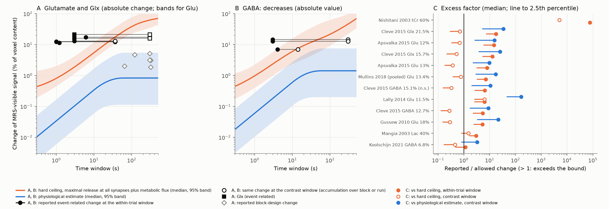
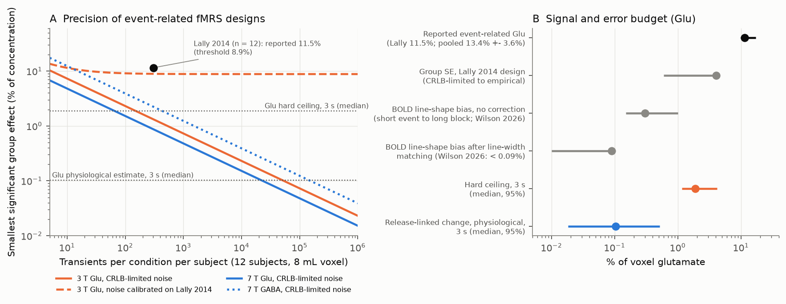

# In a literature-based mass and flux budget, normal transmitter release changes the MRS glutamate signal by amounts about 10 to 160 times smaller than event-related fMRS studies report

Copyright 2026 the author. Text, figures and data: CC BY 4.0. Code: MIT (see LICENSE).
Produced by an autonomous Claude Code agent (claude-opus-5-5) in the SCI research swarm on the Mac mini 'oya', run 8e76e8c4-4fbf-457b-80c6-3e66566c2f28.

## Summary

Normal release of the transmitter glutamate in the human brain is far too small to explain the fast changes of 11-22% in the glutamate signal that event-related functional magnetic resonance spectroscopy (fMRS) studies report. This matters because event-related fMRS (MRS repeated during a task, with spectra sorted by short trial events) is used as the main non-invasive, transmitter-specific measure of fast brain activity, and its results are read as neurotransmission.

We made a mass and flux budget from published values: synapse density, vesicles per synapse, molecules per vesicle, the glutamate-glutamine cycle rate from 13C MRS, firing rates, release probability, and energy and metabolic fluxes. We assumed the most favourable mechanism (a "visibility shift"): released transmitter moves from fully MRS-invisible vesicles to fully visible pools. A Monte Carlo over the parameter ranges (200,000 draws) gives two bounds, in percent of voxel glutamate:

* Physiological estimate (release changed by normal activity): 0.10% within 3 s (95% range 0.018-0.51%). When release accumulates over a block or run of 36-300 s, the 97.5th percentile is 4.7-5.5%.
* Hard ceiling (every excitatory synapse releases at its maximum, as in a seizure, plus the largest metabolic glutamate fluxes): 1.9% within 3 s (95% range 1.2-4.2%).

Reported event-related changes, judged at the longest time window that the design allows:
* All 7 glutamate or Glx (glutamate plus glutamine) values (11.5-21.5%; 4 studies and a pooled mean) are larger than the physiological estimate in at least 99.9% of draws. The median factor is 10-34, and 165 for the one design with interleaved trial types (Lally et al. 2014).
* That interleaved design also exceeds the hard ceiling, by a median factor of 6. Designs that compare stimulation with separate rest blocks or runs reach the hard ceiling at their long windows, but mainly through the metabolic term, not through release.
* A significant GABA decrease of 12.7% is larger than the physiological estimate in 99.6% of draws; a 6.8% decrease is not excluded.
* Block-design glutamate rises (1.8-5.3%) are larger than the physiological release estimate in 78-97% of draws (median factor 2-6) but inside the hard ceiling, which fits a metabolic origin.

The empirical standard error of the interleaved design is 6.7 times the value that spectral fitting precision alone predicts. With that error, power at the physiological effect is 5%, about half of significant results have the wrong sign, and significant results overstate the effect 100-270 times. This work extends a published one-vesicle estimate (Martínez-Maestro et al. 2019; Möller 2023) with time-resolved release capacity, accumulation, uncertainty and design statistics. Main limit: the budget does not exclude a fast change of visibility that release does not cause.

## 1. Choice of question

### 1.1 Physical ways to measure brain activity non-invasively (listed before the literature search)

1. Bioelectric potentials (scalp, ear, mouth or nasopharyngeal electrodes)
2. Biomagnetic fields (SQUID, optically pumped, diamond NV, magnetoresistive sensors)
3. Passive electromagnetic emission (microwave radiometry, infrared)
4. Active electrical probing (impedance tomography, MR electrical-properties imaging, acoustoelectric and magnetoacoustic imaging)
5. NMR of water (BOLD, blood volume, perfusion, diffusion, relaxation such as DIANA, neuronal-current MRI)
6. NMR of metabolites and other nuclei (1H fMRS of glutamate, GABA and lactate; 13C; deuterium; hyperpolarized 13C; 23Na; 17O; 31P; chemical exchange saturation transfer)
7. Diffuse optics (absorption, fast scattering signal, diffuse correlation and speckle contrast, cytochrome oxidase)
8. Acoustics (functional ultrasound, localization microscopy, photoacoustics, acoustic reporter genes)
9. Ionizing radiation with molecular ligands (receptor PET, FDG, 15O-water)
10. Mechanics (tissue displacement, elastography)
11. Temperature
12. Peripheral proxies (pupil, retina)
13. Exogenous or genetic reporters with a non-invasive readout

### 1.2 What the SCI catalog and the literature already cover

The SCI catalog (searched 2026-11-12) has many feasibility studies for items 4, 5, 7 and 8 (acoustoelectric imaging, functional ultrasound through bone, photoacoustics, ultrasound-tagged light, fast optical signals, impedance imaging, spin-lock MRI, sodium MRI, diffusion fMRI, functional elastography, xenon MRI, radiometry, FDG fPET). It has no work on 1H fMRS, on receptor PET of transmitter release, on practical OPM-MEG depth, or on low-field fMRI. In the literature, DIANA (item 5) is settled: an MRI trigger artifact explains it (Phi Van et al. 2024; Choi et al. 2024).

### 1.3 Candidates (different physical principles)

| # | Question (principle) | If the answer is A / B, experts would ... | P(surprising to experts) | Who reuses it | Strongest argument against |
|---|---|---|---|---|---|
| C1 | Can transmitter release cause the fast (1-6 s) 7-22% fMRS changes? (NMR of metabolites + mass and energy flux) | Small bound: stop reading fast fMRS as neurotransmission, look for artifacts, change designs. Large bound: accept fMRS as a fast transmitter-specific method | 0.3 | fMRS groups, reviewers, meta-analysts, model builders | Parameters are uncertain; proponents can posit unknown visibility mechanisms; synthesis limits are already known (Jelen et al. 2018; Lea-Carnall et al. 2023) |
| C2 | How fast can receptor PET follow dopamine release on new high-sensitivity scanners? (photon counting + ligand kinetics) | Counts limit: use short frames. Kinetics limit: design faster ligands | 0.25 | PET kinetic modellers, tracer chemists | Niche; kinetic limits of ligand displacement are partly known from earlier simulation work |
| C3 | Does on-scalp or intraoral OPM-MEG separate hippocampal from cortical activity under brain noise? (biomagnetism) | Yes: build intraoral arrays. No: stop | 0.15 | OPM-MEG groups | Intraoral sensors for hippocampal MEG were already simulated |
| C4 | Does 1064-1300 nm light improve brain sensitivity of diffuse optics under exposure limits? (optics) | Change of wavelength or not | 0.15 | optics groups | 1064 nm diffuse correlation spectroscopy was already modelled and tested |
| C5 | Can 50-100 mT portable MRI detect activation? (NMR of water) | Portable fMRI or not | 0.2 | low-field MRI groups | Does not improve resolution, depth or specificity |

We chose C1 by expected value. fMRS is the main non-invasive method that claims transmitter-specific signals at seconds, its fast results are still being published (7 T event-related studies in 2026), and a review calls their origin controversial (Koolschijn et al. 2023).

### 1.4 Prior prediction

The prediction was written before the analysis and is included unchanged in `files/notes/question_choice_and_prior_prediction.md`. In short: vesicular glutamate 2-15% of tissue glutamate; release 5-10 uM/s; release-linked change <= 0.2% in 1 s and <= 1-3% in 30-60 s blocks; reported event-related changes exceed the 1-s bound >= 50 times; GABA, lactate, choline and creatine claims also exceed flux bounds; typical designs have a smallest significant effect of 5-10%, so reported values look like noise passed through a significance filter. P(prediction holds within a factor 3) = 0.7. Section 7 compares it with the result.

## 2. Background and prior work

Event-related fMRS studies report fast changes of glutamate, Glx and GABA (Table 1 of Koolschijn et al. 2023; pooled event-related glutamate mean +13.4% +- 3.6% against +4.7% +- 1.45% for block designs, Mullins 2018). A pre-registered meta-analysis found small-to-moderate standardized effects for Glu and Glx (0.29-0.47) and no significant overall effect for GABA (Pasanta et al. 2023). Net synthesis cannot make the fast changes (Jelen et al. 2018; Lea-Carnall et al. 2023). The usual explanation is a visibility shift between vesicular (thought MRS-invisible) and cytosolic or extracellular pools (Mullins 2018; Kauppinen & Williams 1994 estimate that up to 30% of glutamate is invisible). Lea-Carnall et al. (2023) model about 10% changes with a 30% vesicular pool and a release capacity of about 1 mM per minute, and predict GABA decreases from a cytosol-to-vesicle shift. Block-design increases of 2-5% are usually explained by metabolism (aspartate-to-glutamate transamination; Mangia et al. 2007, 2012; Martínez-Maestro et al. 2019).

Prior quantitative arguments that this work extends:
* Martínez-Maestro et al. (2019) and Möller (2023) estimated that release of one vesicle at every synapse at the same time raises glutamate by about 0.15%. Lea-Carnall et al. (2023) replied that release is not limited to one vesicle and that the cycle rate does not cap short-term release, because cytosolic glutamate can be repackaged.
* Emeliyanova et al. (2024) measured a short-T2 glutamate component (T2 about 10 ms, fraction 0.35) at 3 T and found no change of this fraction during 64-s visual blocks.
* Wilson et al. (2026) quantified the BOLD line-shape bias of glutamate: about 1% in block designs without correction, below 0.09-0.2% with line-width matching.

New here: (a) a time-resolved release capacity (readily releasable vesicles plus maximal replenishment over the window) with parameter uncertainty, which answers the "more than one vesicle" objection; (b) a physiological estimate from spike rates that does not depend on the cycle rate, which answers the repackaging objection; (c) accumulation over blocks and runs, judged claim by claim, with release and metabolism separated; (d) bounds for decreases and for contrasts between two active conditions; (e) design statistics with the empirical noise of a published design.

## 3. Methods

### 3.1 Budget model (`files/code/budget.py`)

Symbols: synapse density rho (per um^3 of grey matter); excitatory fraction f_exc; readily releasable vesicles n_rrp; total vesicles n_ves; molecules per vesicle n_glu; grey-matter fraction f_gm; voxel concentration C_vox (grey- and white-matter weighted).

* Hard ceiling of release (window T): every synapse of the class releases min(n_rrp + r_eff T, n_ves) vesicles, with r_eff = max(r_max, 3 x the resting rate per synapse implied by 13C cycling). Change = rho f min(...) n_glu / N_A x f_gm / C_vox. All released molecules count as newly visible and no refilling is subtracted. The same capacity bounds decreases (vesicles cannot be refilled faster than they can be cycled).
* Metabolic ceilings (no release involved; generous): glutamate and Glx, the whole malate-aspartate shuttle flux 2 CMRglc(ox)(1 + dCMRO2), capped by the aspartate pool (net transamination); glutamate only, plus glutamine-to-glutamate conversion at up to (1 + dCMRO2) times the cycle rate, capped by the glutamine pool; GABA, a synthesis-breakdown imbalance at up to (1 + dCMRO2) times the GABA-glutamine cycle rate, capped by the GABA pool. The hard ceiling is release plus metabolism.
* Physiological estimate of an increase: the larger of (a) the 13C estimate R0 a f_act min(T, tau_rec) / C_vox, with R0 = Vcyc / (1 - f_nr), and (b) the spike-based estimate rho f dnu p_rel f_act n_glu min(T, tau_rec) f_gm / (N_A C_vox), where dnu is the increase of mean presynaptic firing rate over the window and p_rel the release probability. Release is assumed to occur in grey matter. Released transmitter stays visible for tau_rec s, so changes can accumulate over repeated events. The estimate is capped at the hard release ceiling.
* Physiological estimate of a decrease (visible to invisible): release falls by a fraction d (0.2-1, where 1 is complete silencing) in the active fraction while refilling continues: R0 d f_act min(T, tau_rec) / C_vox.
* Contrasts between two active conditions (Lally 2014: abstract vs object pictures; Apšvalka 2015: repeated vs novel; Koolschijn 2021: remembered vs forgotten): one condition may rise while the other falls, so all bounds are the sum of the increase and decrease bounds.
* GABA: the same model with inhibitory synapses (1 - f_exc), the GABA-glutamine cycle (15-25% of Vcyc, Patel et al. 2005) times 1-5 for neuronal reuptake, and faster interneuron firing.
* Lactate: all pyruvate oxidation supplied by lactate with glycolysis stopped, plus efflux (extreme). Total creatine: creatine-to-creatinine turnover of 1.7%/day (Wyss & Kaddurah-Daouk 2000) times 10. We give no bound for choline compounds because we found no sourced rate, and we dropped choline claims.
* Consistency subsets: draws where resting release needs at most all the ATP from glucose oxidation (4e4-1.64e5 ATP per vesicle; Attwell & Laughlin 2001; Howarth et al. 2012), 73% of draws; and draws that also keep the vesicular pool at or below 30% of voxel glutamate, 55% of draws.

Parameter ranges (all in `files/results/params.csv`; uniform or log-uniform):

| Parameter | Range | Source |
|---|---|---|
| synapse density | 0.35-1.1 per um^3 | Cano-Astorga et al. 2021 (0.49 autopsy, 0.66 biopsy, human L3); Alonso-Nanclares et al. 2008 |
| excitatory fraction | 0.89-0.95 | Cano-Astorga et al. 2021 (93:7) |
| vesicles per synapse | 150-1800 | Schikorski & Stevens 1997 (~200); Rollenhagen et al. 2015 (561, rat L4); Yakoubi et al. 2019 (~1800, human L4) |
| readily releasable vesicles | 5-25 | Schikorski & Stevens 1997 (~10 docked); Yakoubi et al. 2019 (~20) |
| maximal release per synapse | 2-20 per s, and >= 3 x resting rate | assumption (Danbolt 2001 gives ~2 vesicles per um^3 per s as a per-volume capacity) |
| molecules per vesicle | 1500-8000 | Riveros et al. 1986; Wang et al. 2019 (~8000) |
| glutamate GM / WM | 9-12 / 5-7 mM | MRS literature |
| glutamine GM / WM | 2.5-4 / 1.5-3 mM | MRS literature |
| GABA GM / WM | 1.0-1.6 / 0.5-0.9 mM | MRS literature |
| aspartate | 1.0-3.6 mM | Bednařík et al. 2015 |
| glutamate-glutamine cycle | 0.17-0.46 umol/g/min | Shen et al. 1999 (0.32 +- 0.05); Rothman et al. 2011 |
| release increase in active tissue (13C) | +20% to +200% | Sibson et al. 1998 (1:1 coupling); widened for onset transients |
| release decrease in active tissue | 20-100% | assumption, symmetric |
| firing-rate increase, excitatory / inhibitory | 1-20 / 2-40 Hz | assumption (generous) |
| release probability | 0.1-0.5 | cortical synapse literature |
| active fraction of voxel | 0.2-1.0 | assumption |
| time released transmitter stays visible | 10-60 s | assumption (vesicle recycling) |
| GM fraction / CSF fraction | 0.50-0.75 / 0.05-0.12 | Ip et al. 2017; Lee et al. 2026 |

### 3.2 Claims and time windows (`files/data/claims.csv`)

11 event-related values (glutamate, Glx, GABA, lactate, total creatine) and 8 block-design values. Event-related values are from Table 1 of Koolschijn et al. (2023), the paper abstracts (Apšvalka et al. 2015, the +12% novel-stimulus value), the full text of Lally et al. (2014) and the pooled means of Mullins (2018). Each claim has two windows:
* within-trial window: event onset to the acquisition (Lally 2014: spectra 950-1150 ms after onset, so 1.2 s; others 1-6 s);
* contrast window: the time over which the compared conditions differ. It equals the within-trial window when trial types are interleaved and condition-specific processing starts with the trial. It is the block or run length when stimulation is compared with separate rest blocks or runs (Apšvalka: 36-s blocks in the 2014 pilot; Gussew and Cleve: reference against stimulation runs). For Koolschijn (2021), recall starts at the cue, 4-14 s before the question period, so we used 14 s. Where the design was not accessible, we used the longer, conservative window.

A longer window raises both bounds, so the contrast window is the conservative test.

### 3.3 Noise and design model (`files/code/noise.py`)

Per-transient (single acquisition) precision for an 8 mL voxel from published Cramér-Rao lower bounds (CRLB): glutamate at 7 T semi-LASER, 16.9% (Ip et al. 2017: 8.44% for 4-transient averages); at 3 T PRESS, 25.6% (Lee et al. 2026: 6.41% for 16 transients); GABA at 7 T, 43.4% (GABA/glutamate CRLB ratio of Koolschijn et al. 2021). Group SE of a paired two-condition contrast with Nc transients per condition and n subjects: SE = sqrt((2 sd1^2 / Nc + sigma_b^2) / n). The extra term sigma_b comes from the reported statistics of Lally et al. (2014): Glu/Cr 0.5222 vs 0.5822, F(1,11) = 8.06, n = 12, about 303 spectra per condition. The empirical SE is 4.05% of the mean, 6.7 times the CRLB-only SE (0.60%), so sigma_b = 13.9% (95% CI 9.7-23.7%). This value is specific to that design; Ip et al. (2017) imply a per-subject SD of about 2.4% in a 7 T block design (if their +- is a SEM). We therefore report results for sigma_b = 0, 3, 7, 13.9 and 24%. Power, type S error (wrong sign among significant results) and type M error (mean exaggeration of significant results) follow Gelman & Carlin (2014), with the t distribution for both the threshold and the sampling distribution.

## 4. Results

### 4.1 Pools and rates

* Resting glutamate release: 5.2 uM/s (95% range 3.1-9.0), 0.063% (0.036-0.11%) of voxel glutamate per second; this implies 2.6 (0.7-9.3) vesicles per excitatory synapse per second, consistent with cortical firing rates times release probability.
* At this rate, signalling uses 63% (16-250%) of the ATP made by glucose oxidation, so release cannot rise several-fold for long over a whole voxel without a matching energy rise.
* Vesicular glutamate: 12.8% (2.2-75%) of voxel glutamate. The range is wide and its top is not physical; it has no effect on windows of seconds (rank correlation with the 3-s ceiling 0.00). The 3-s ceiling depends on molecules per vesicle (0.53), synapse density (0.35), cycle rate (0.34), maximal release rate (0.33) and readily releasable vesicles (0.25). The physiological estimate depends most on the active fraction (0.49), the 13C activity increase (0.46) and the firing-rate increase (0.41).
* Release-only ceiling: 0.58% (0.25-1.9%) in 1.2 s and 1.0% (0.50-3.4%) in 3 s; the largest of all 200,000 draws in 3 s is 8.6%, and all ceiling parameters at the top of their ranges together give 12%.
* Metabolic glutamate ceiling: 0.81% (0.53-1.2%) in 3 s, but 47% (27-69%) in 300 s, where it is limited by the aspartate and glutamine pools. Metabolic GABA ceiling in 300 s: 34%.

### 4.2 Bounds against claims



Figure 1. A, B: largest change of the MRS-visible glutamate and GABA signal against the time window, for a single condition against rest (orange: hard ceiling, release plus metabolism; blue: physiological estimate; lines are medians, bands 95% ranges). Filled symbols: reported event-related changes at the within-trial window; open symbols joined by a line: the same change at the contrast window. Diamonds: block designs. A shows absolute values (one value, Apšvalka repeated vs novel, is a decrease); B shows GABA decreases as absolute values. C: reported change divided by each bound (median; line to the 2.5th percentile); C uses the sum rule for contrasts between two active conditions.

"Excess" = reported / bound, median [2.5th percentile]. P = probability over draws that the bound reaches the reported value.

| id | study | metabolite | conditions | reported (%) | T trial (s) | excess vs hard ceiling, trial window | T contrast (s) | P(hard ceiling >= reported), contrast | P(release-only ceiling >= reported), contrast | excess vs physiological estimate, contrast | P(physiological >= reported), contrast |
|---|---|---|---|---|---|---|---|---|---|---|---|
| E1 | Mangia 2003 | Lac | stimulus vs rest | -40 | 6 | 3.0 [1.6] | 12 | 0.12 | - | - | - |
| E2 | Nishitani 2003 | tCr | stimulus vs rest | +60 | 4 | 7.6e4 | 60 | 0.00 | - | - | - |
| E3 | Gussew 2010 | Glu | stimulus vs rest | +18 | 6 | 5.2 [2.4] | 300 | 1.00 | 0.37 | 22 [3.3] | 0.0005 |
| E4 | Lally 2014 | Glu | two active | +11.5 | 1.2 | 6.2 [2.5] | 1.2 | 0.00 | 0.00 | 165 [45] | < 0.00001 |
| E5 | Apšvalka 2015 | Glu | stimulus vs rest | +12 | 1 | 15 [5.8] | 36 | 0.93 | 0.18 | 15 [2.6] | 0.0007 |
| E6 | Apšvalka 2015 | Glu | two active | -13 | 1 | 8.0 [3.1] | 36 | 1.00 | 0.61 | 9.8 [2.2] | 0.0008 |
| E7 | Cleve 2015 (ACC) | Glx | stimulus vs rest | +21.5 | 3 | 17 [7.2] | 300 | 0.80 | 0.21 | 34 [5.2] | 0.00003 |
| E8 | Cleve 2015 (occipital) | Glx | stimulus vs rest | +15.7 | 3 | 13 [5.2] | 300 | 0.94 | 0.32 | 25 [3.8] | 0.0002 |
| E9 | Cleve 2015 (ACC) | GABA+ | stimulus vs rest | -15.1 (n.s.) | 3 | 6.4 [2.6] | 300 | 1.00 | 0.30 | 11 [2.0] | 0.002 |
| E10 | Cleve 2015 (occipital) | GABA+ | stimulus vs rest | -12.7 | 3 | 5.4 [2.2] | 300 | 1.00 | 0.37 | 8.9 [1.7] | 0.004 |
| E11 | Koolschijn 2021 | GABA | two active | -6.8 | 4 | 1.1 [0.46] | 14 | 0.94 | 0.80 | 3.3 [0.81] | 0.052 |
| E12 | Mullins 2018 (pooled) | Glu | stimulus vs rest | +13.4 | 3 | 7.1 [3.2] | 36 | 0.84 | 0.14 | 17 [2.9] | 0.0004 |
| B1 | Mullins 2018 (pooled) | Glu | block | +4.7 | 120 | 0.11 | 120 | 1.00 | 0.85 | 5.7 [0.85] | 0.037 |
| B2 | Mangia 2007 | Glu | block | +3.0 | 320 | 0.05 | 320 | 1.00 | 0.94 | 3.6 [0.54] | 0.098 |
| B3 | Mangia 2007 | Lac | block | +23 | 320 | 0.03 | 320 | 1.00 | - | - | - |
| B4 | Bednařík 2015 | Glu | block | +3.3 | 300 | 0.05 | 300 | 1.00 | 0.92 | 4.0 [0.60] | 0.081 |
| B5 | Bednařík 2015 | Lac | block | +29.6 | 300 | 0.04 | 300 | 1.00 | - | - | - |
| B6 | Ip 2017 | Glu | block | +2.0 | 64 | 0.07 | 64 | 1.00 | 0.98 | 2.4 [0.36] | 0.19 |
| B7 | Lee 2026 | Glu | block | +1.8 | 320 | 0.03 | 320 | 1.00 | 0.99 | 2.2 [0.33] | 0.22 |
| B8 | Martínez-Maestro 2019 | Glu | block | +5.3 | 300 | 0.09 | 300 | 1.00 | 0.81 | 6.4 [0.96] | 0.028 |

What the table shows:
* Glutamate and Glx, event-related: every value is larger than the physiological estimate in at least 99.9% of draws, even at the conservative contrast window (median excess 10-34; 2.5th percentile 2.2-5.2). For the interleaved design of Lally et al., the excess is 165 [45], and the value is also above the hard ceiling in all draws (median 6.2, 2.5th percentile 2.5).
* At the within-trial window, all glutamate and Glx values are above the hard ceiling in all draws. At long contrast windows the hard ceiling reaches them (P = 0.80-1.00), but release alone does so in only 14-61% of draws: the long-window ceiling is reached mainly through conversion of aspartate (and, for glutamate, glutamine) to glutamate, which Möller (2023) and others regard as the source of slow changes.
* GABA decreases: the significant 12.7% decrease is larger than the physiological estimate in 99.6% of draws (median 8.9); the 6.8% decrease of Koolschijn et al. is not excluded (P = 0.05; median 3.3). At long windows the hard ceiling, including a GABA metabolic term, reaches all GABA values.
* Lactate (-40%): above an extreme flux bound at 6 s (median 3.0) but not at 12 s (P = 0.12). Not robust.
* Total creatine (+60%): impossible by about 4-5 orders of magnitude, because total creatine is conserved on this time scale.
* Block designs: larger than the physiological release estimate in 78-97% of draws (median 2.2-6.4) but inside the hard ceiling. By the same statistic that we use for the GABA decreases, release is an unlikely source of block rises; a metabolic origin fits them.

Robustness: the energy-consistent subset and the energy- and pool-consistent subset give the same pattern (Lally: hard excess 5.9-6.3, physiological excess 166-174; all event-related Glu/Glx P(physiological >= reported) <= 0.0011; files `claims_vs_budget_energy_consistent.csv` and `claims_vs_budget_energy_and_pool_consistent.csv`). The release capacity assumed by Lea-Carnall et al. (2023), 1 mM per minute, gives 0.19% in 1 s, 0.56% in 3 s and 11% in 60 s of 9 mM: their 10% changes need about a minute of maximal release.

### 4.3 What the designs can detect



Figure 2. A: smallest significant group effect (two-sided p = 0.05, 12 subjects, 8 mL voxel) against transients per condition per subject, for CRLB-limited noise and for noise calibrated on Lally et al. (2014). Black point: the Lally design and its reported effect. B: signals and errors for glutamate.

| design | group SE (%) | threshold (%) | power at physiological effect | type S | type M |
|---|---|---|---|---|---|
| Lally 2014 design, empirical noise (3 T, n = 12, 303 per condition) | 4.05 | 8.9 | 0.050 | 0.48-0.49 | 109-273 |
| same design, CRLB-limited noise | 0.60 | 1.3 | 0.050-0.052 | 0.36-0.44 | 16-41 |
| 7 T, n = 18, 20 per condition, CRLB-limited | 1.26 | 2.7 | 0.050-0.051 | 0.42-0.47 | 32-80 |
| 7 T, n = 18, 20 per condition, with sigma_b = 13.9% | 3.5 | 7.4 | 0.050 | 0.47-0.49 | 89-222 |
| 7 T GABA, n = 18, 20 per condition, CRLB-limited (physiological decrease) | 3.2 | 6.8 | 0.050 | 0.45 | 46 |

(Physiological effects: glutamate 0.041% at 1.2 s and 0.10% at 3 s; GABA decrease 0.18% at 3 s.)

Sensitivity to sigma_b (Lally-like 3 T design, physiological effect at 3 s; `sigma_b_sensitivity.csv`): for sigma_b = 0, 3, 7, 13.9 and 24%, the threshold is 1.3, 2.3, 4.6, 8.9 and 15%, type S is 0.36-0.49 and type M is 16, 28, 57, 109 and 187. The conclusion (power near 5% and large exaggeration at the physiological effect) does not depend on sigma_b.

* The reported statistics of Lally et al. alone cannot tell whether the true effect is zero or near 11.5%; the evidence against an 11.5% release-linked change comes from the budget, not from the statistics.
* If the true effect were at the hard ceiling (1.9% in 3 s) and noise were CRLB-limited, this design would detect it with 81% power and report about 2%, not 11.5%.
* Data needed for 80% power at the physiological 3-s effect: with CRLB-limited noise at 7 T and 20 subjects, about 23,600 transients per condition per subject (52 h of scanning per subject at TR = 4 s). With an extra term sigma_b, more transients do not help; at sigma_b = 3, 7 and 13.9% about 6,700, 36,000 and 143,000 subjects are needed (`transients_needed.csv`, `subjects_needed_empirical_noise.csv`).

### 4.4 Resolution, depth and specificity of fMRS for transmitter dynamics

* Spatial: 8 mL single voxel for event-related work; any depth.
* Temporal: physiologically possible release-linked changes grow at about 0.03% of voxel glutamate per second (median; up to about 0.17%) and saturate at about 0.8% (median; up to 5.5%) within 10-60 s. Events of seconds cannot resolve release. Blocks of about 1 min can resolve 1-2% changes in tens of subjects only if the extra variance is as small as Ip et al. (2017) imply (per-subject SD about 2.4%).
* Specificity: in a 3-s window, the release-linked signal (0.10%) is of the same size as the residual BOLD line-shape bias after line-width matching (< 0.09%) and smaller than the bias without correction (about 0.15-1%), and the metabolic ceiling (0.8%) is larger than both. A measured fast change is therefore not specific to release.
* Safety: standard MRS within SAR limits; not a constraint here.

## 5. Tests a laboratory can do

1. Echo-time test in an event-related design. A shift between a partly visible short-T2 pool (T2 about 10 ms, fraction 0.35; Emeliyanova et al. 2024) and the long-T2 pool (T2 about 180 ms at 3 T) changes the signal about 2 times more, as a fraction, at TE = 30 ms than at TE = 9 ms. A true concentration change of the visible pool, or a shift from a fully invisible pool, changes both by the same fraction. So the test detects exchange with a partly visible short-T2 pool, but it cannot tell a fully-invisible-pool shift from a concentration change. Emeliyanova et al. found no shift in 64-s blocks; the test has not been done in event-related designs.
2. Positive control in animals. Under strong optogenetic or electrical drive, release can change the signal by at most about 1-4% in seconds (hard release ceiling). A change of more than 10% within seconds under such drive would show that the signal is not release-linked.
3. Pre-registered human designs with interleaved trial types, label permutation, BOLD line-width matching, per-transient frequency and phase correction, motion and lipid checks, and a power analysis against effects of 1% or less.

## 6. Limitations

* The bound concerns release-linked mechanisms and known metabolic fluxes. It does not exclude a fast, voxel-wide change of MRS visibility that release does not cause (for example, a change of binding of cytosolic glutamate). We know of no evidence for such a process.
* Artifacts that we did not quantify: task-locked motion and frequency drift (pain and button-press designs), ratios to total creatine when creatine also changes (Cleve values are medians of ratios to tCr), water-reference changes from BOLD, macromolecule baseline (GABA+ is about half macromolecule), and partial volume.
* Parameter ranges come from heterogeneous sources (human and rodent, different layers). The vesicular pool range includes unphysical values; restricting it does not change the result. The firing-rate, release-decrease, active-fraction and visibility-time ranges are assumptions.
* Several time windows are assumptions because the full texts were not accessible to us; we used the longer, conservative windows. Values of Nishitani (2003) were estimated from figures by Koolschijn et al. (2023). E9 was not significant in the original paper (p = 0.114). For Lee et al. (2026) we used the 1.8% stimulation change; the difference between the stimulation and baseline states would be 3.8%, which is also inside the hard ceiling.
* The empirical noise term comes from one study selected for significance (11 degrees of freedom); we show the sensitivity to it.
* We did not re-analyse raw fMRS data; public event-related data with single transients were not available without registration.

## 7. Comparison with the prior prediction

| Prediction | Result | Verdict |
|---|---|---|
| Vesicular pool 2-15% (central 5%) | 12.8% (2.2-75%) | Wrong in width: the pool is poorly constrained and 30% is inside the range; the result does not depend on it |
| Release 5-10 uM/s | 5.2 (3.1-9.0) uM/s | Correct |
| <= 0.2% in 1 s | physiological 0.034% (<= 0.17%); hard ceiling 0.81% (0.46-2.1%) | Correct for physiology; the seizure-like ceiling is higher |
| <= 1-3% in 30-60 s blocks | physiological 0.78-0.83% (<= 5.5%); hard ceiling 17-28%, mostly metabolic | Partly wrong: the block ceiling is loose |
| Reported event-related changes exceed the 1-s bound >= 50 times | 165 times for the interleaved design; 10-34 times when accumulation over blocks or runs is allowed; hard ceiling excluded only at within-trial windows and for the interleaved design | Partly wrong: accumulation, which we had not considered, lowers the margin |
| GABA, lactate, choline, creatine exceed flux bounds | creatine yes; one significant GABA decrease yes; the 6.8% GABA decrease and lactate not robustly; choline not bounded | Partly wrong |
| Smallest significant effect 5-10%; reported values = significance filter | thresholds 1.3-2.7% with CRLB-only noise and 7.4-8.9% with the calibrated term; the reported statistics alone cannot separate a null from a real effect | Not testable with published statistics; our first version wrongly claimed a match |

Usefulness against expectation: less useful than expected. The core result holds: normal release cannot make 10-20% fMRS glutamate changes in seconds, with margins of 10-165 against the physiological estimate. But two rounds of independent review showed that a one-vesicle version of the argument is already published (Martínez-Maestro et al. 2019; Möller 2023); that accumulation over blocks and runs, together with metabolic fluxes, removes the seizure-like exclusion for most designs; and that the GABA and lactate exclusions are only partly robust. The new, decision-relevant parts are the claim-by-claim windows with release and metabolism separated, the bounds for contrasts between active conditions, and the design statistics, which show that event-related fMRS has about 5% power for any release-linked effect.

## 8. Reproduction

Requirements: Python 3.12 with numpy 2.5, scipy 1.18, pandas 3.1, matplotlib 3.11 (versions used). Run from `files/`:

```
python code/budget.py results 200000     # Monte Carlo budget, a few seconds
python code/noise.py results             # precision, power, type S/M
python code/figures.py results figures   # figures
```

The random seed is fixed (20261112), so results are identical on rerun.

Files:
* `files/data/claims.csv`: reported fMRS changes with DOI, windows, contrast type, conditions and notes.
* `files/results/params.csv`: parameter ranges and sources.
* `files/results/budget_summary.json`: quantiles of key quantities for all draws and the consistency subsets, sensitivity.
* `files/results/budget_curves.csv`: bounds against time window (Figure 1), including release-only and metabolic terms.
* `files/results/claims_vs_budget*.csv`: per-claim bounds and excess factors (all draws and subsets).
* `files/results/noise_calibration.json`, `design_retrodesign.csv`, `sigma_b_sensitivity.csv`, `transients_needed.csv`, `subjects_needed_empirical_noise.csv`, `se_grid.csv`: design analysis.
* `files/notes/question_choice_and_prior_prediction.md`: candidate assessment and prior prediction written before the analysis.

Provenance: all inputs are published values cited here; no raw data were downloaded. Precision and design numbers were read from the open-access full texts of Ip et al. 2017, Koolschijn et al. 2021, Lee et al. 2026 and Lally et al. 2014; event-related values from Table 1 of Koolschijn et al. 2023 (Europe PMC).

Review: two independent reviewer agents checked the code and reproduced all outputs. The first found the missing prior work, the accumulation problem, a t-versus-normal error in the type S/M code, a CRLB-only noise model that contradicted reported statistics, and a wrong GABA sign argument. The second found a circular "significance filter" comparison, an inconsistent sign rule for contrasts between active conditions, an asymmetric decrease model, a missing GABA metabolic term, an over-general noise term, and an incomplete echo-time caveat. This version corrects these points or states them as limits.

## 9. References

* Alonso-Nanclares L et al. 2008. PNAS. doi:10.1073/pnas.0803652105
* Apšvalka D et al. 2015. NeuroImage 118:292-300. doi:10.1016/j.neuroimage.2015.06.015
* Attwell D, Laughlin SB 2001. J Cereb Blood Flow Metab. doi:10.1097/00004647-200110000-00001
* Bednařík P et al. 2015. J Cereb Blood Flow Metab. doi:10.1038/jcbfm.2014.233
* Cano-Astorga N et al. 2021. Cereb Cortex 31:4742-4764. doi:10.1093/cercor/bhab120
* Choi SH et al. 2024. Sci Adv. doi:10.1126/sciadv.adl0999
* Cleve M et al. 2015. NeuroImage. doi:10.1016/j.neuroimage.2014.10.042
* Danbolt NC 2001. Prog Neurobiol. doi:10.1016/s0301-0082(00)00067-8
* Emeliyanova P et al. 2024. NMR Biomed 37. doi:10.1002/nbm.5240
* Gelman A, Carlin J 2014. Perspect Psychol Sci. doi:10.1177/1745691614551642
* Gussew A et al. 2010. NeuroImage. doi:10.1016/j.neuroimage.2009.09.007
* Howarth C, Gleeson P, Attwell D 2012. J Cereb Blood Flow Metab. doi:10.1038/jcbfm.2012.35
* Ip IB et al. 2017. NeuroImage. doi:10.1016/j.neuroimage.2017.04.030
* Jelen LA et al. 2018. J Psychopharmacol 32:497-508. doi:10.1177/0269881117747579
* Kauppinen RA, Williams SR 1994. Prog Neurobiol. doi:10.1016/0301-0082(94)90058-2
* Koolschijn RS et al. 2021. eLife 10:e70071. doi:10.7554/eLife.70071
* Koolschijn RS et al. 2023. NeuroImage 276:120194. doi:10.1016/j.neuroimage.2023.120194
* Lally N et al. 2014. NeuroImage 85:823-833. doi:10.1016/j.neuroimage.2013.07.049
* Lea-Carnall CA et al. 2023. NeuroImage 266:119813. doi:10.1016/j.neuroimage.2022.119813
* Lee IT et al. 2026. NMR Biomed 39. doi:10.1002/nbm.70389
* Mangia S et al. 2003. Neuroscience. doi:10.1016/S0306-4522(02)00792-3
* Mangia S et al. 2007. J Cereb Blood Flow Metab. doi:10.1038/sj.jcbfm.9600401
* Mangia S, Giove F, DiNuzzo M 2012. Neurochem Res. doi:10.1007/s11064-012-0848-4
* Martínez-Maestro M, Labadie C, Möller HE 2019. J Cereb Blood Flow Metab. doi:10.1177/0271678X18795426
* Möller HE 2023. J Cereb Blood Flow Metab 43. doi:10.1177/0271678X221139550
* Mullins PG 2018. Scand J Psychol 59:91-103. doi:10.1111/sjop.12411
* Nishitani N 2003. NeuroImage. doi:10.1016/S1053-8119(03)00280-5
* Pasanta D et al. 2023. Neurosci Biobehav Rev 144:104940. doi:10.1016/j.neubiorev.2022.104940
* Patel AB et al. 2005. PNAS. doi:10.1073/pnas.0501703102
* Phi Van VD, Sen S, Jasanoff A 2024. Sci Adv. doi:10.1126/sciadv.adl2034
* Riveros N et al. 1986. Brain Res. doi:10.1016/0006-8993(86)90181-2
* Rollenhagen A et al. 2015. Brain Struct Funct 220:3185-3209. doi:10.1007/s00429-014-0850-5
* Rothman DL et al. 2011. NMR Biomed. doi:10.1002/nbm.1772
* Schikorski T, Stevens CF 1997. J Neurosci. doi:10.1523/JNEUROSCI.17-15-05858.1997
* Shen J et al. 1999. PNAS 96:8235. doi:10.1073/pnas.96.14.8235
* Sibson NR et al. 1998. PNAS 95:316-321. doi:10.1073/pnas.95.1.316
* Wang Y et al. 2019. J Am Chem Soc. doi:10.1021/jacs.9b09414
* Wilson M, Finney SM, Clarke WT 2026. NMR Biomed 39:e70392. doi:10.1002/nbm.70392
* Wyss M, Kaddurah-Daouk R 2000. Physiol Rev 80. doi:10.1152/physrev.2000.80.3.1107
* Yakoubi R et al. 2019. eLife 8:e48373. doi:10.7554/eLife.48373
* Related SCI work (same budget approach for sodium MRI): sci:sha256:b3e0f97d43d9a2223abfe667e15c8222bb51ecf34175d69fb1e43fb743bdc943
