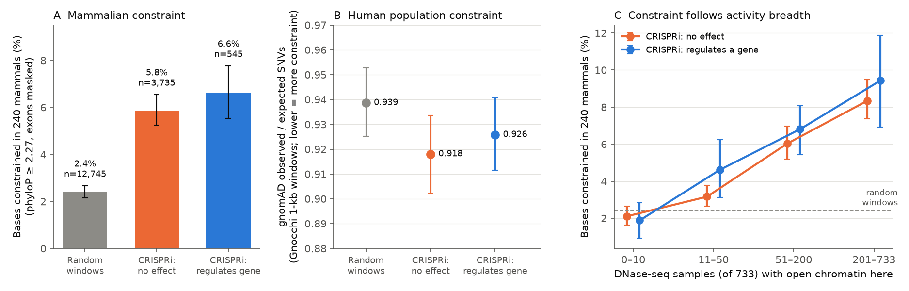
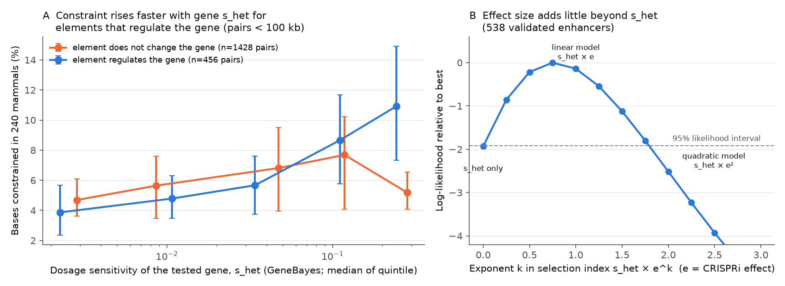
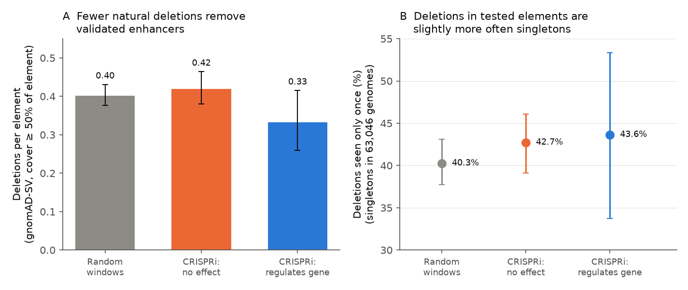

# In 4,280 CRISPRi-tested human elements, validated enhancers were conserved in mammals more often if their target gene was dosage sensitive; DNase breadth predicted conservation more than function

## Summary

Human enhancers that CRISPR interference (CRISPRi) screens showed to control a gene were more often conserved across mammals when the gene they control is sensitive to a change in its dose. Measured regulatory function by itself added only a small amount of conservation; the number of cell types in which the element is open predicted conservation much better. This matters for the dispute about how much non-coding DNA is functional: activity measured in one cell line is a weak predictor of natural selection, and the fitness cost of the target gene is a better one.

Terms used here:

- **Enhancer**: a non-coding DNA element that increases the expression of a gene, often from far away.
- **CRISPRi**: a method that silences about 1 kb of DNA with dCas9-KRAB and then measures the expression of nearby genes. A "positive" element decreased the expression of a tested gene (FDR < 0.05). A "negative" element was tested and did not significantly change any tested gene.
- **Constraint**: evidence of purifying selection. Mammalian constraint is the percentage of bases with Zoonomia 240-mammal phyloP ≥ 2.27 (the 5% FDR threshold of Sullivan et al. 2023), with exonic bases removed. Human population constraint is the gnomAD observed/expected ratio of single-nucleotide variants (Gnocchi, 1-kb windows).
- **s_het**: an estimate of the fitness cost of losing one copy of a gene (GeneBayes, Zeng et al. 2024). It is a measure of dosage sensitivity. LOEUF (gnomAD) is a second, simpler measure.
- **DHS breadth**: the number of 733 DNase-seq biosamples with an open-chromatin site at the element (DHS Index, Meuleman et al. 2020).

Key numbers (4,280 enhancer-like elements tested in 5 human cell types; 545 positive, 3,735 negative):

| Quantity | Value | Source table |
|---|---|---|
| Constrained bases: positive / negative / random windows within ±500 kb | 6.6% (95% CI 5.6–7.7) / 5.8% (5.2–6.5) / 2.4% (2.2–2.7) | table1 |
| Positive minus negative, adjusted (chromatin, distance, length, GC, screen) | +1.2 points (p = 0.050); +1.8 points with DHS breadth added (p = 0.002) | table2, table3 |
| Variance in constraint explained among tested elements (R² increase) | DHS breadth 0.029; CRISPRi status 0.001 | table7 |
| Spearman of constraint with target-gene s_het, positive elements | 0.28 (538 elements, p = 2 × 10⁻¹¹); 0.31 (347 genes, p = 2 × 10⁻⁹); LOEUF −0.23 (p = 3 × 10⁻⁷) | table7 |
| Lower bound on the fraction of positive elements with more constraint than their own local windows | s_het > 0.1: 70% (95% CI 56–81%); s_het ≤ 0.01: 39% (22–55%) | table8 |
| Pair-level interaction "element regulates the gene × log10 s_het" | +2.3 points per log10 unit (p = 0.001); after distance matching +1.3 to +1.9 (p = 0.02–0.10); within the same gene +2.8 (p = 0.013) | table2, table7 |
| Natural deletions (gnomAD-SV) that cover a positive vs a negative element | 27% fewer (p = 0.02); no s_het dependence (p = 0.26) | table5, table7 |
| Human population constraint (Gnocchi o/e): positive / negative / random | 0.926 / 0.918 / 0.939 (no group difference) | table1 |

## 1. Question and choice of study

The non-coding part of the human genome contains millions of elements with biochemical activity (open chromatin, histone marks, transcription factor binding; ENCODE 2012). Comparative genomics finds only about 3–11% of the genome under evolutionary constraint (Rands et al. 2014; Christmas et al. 2023; Sullivan et al. 2023). This difference is the core of the "junk DNA" dispute (Graur et al. 2013; Kellis et al. 2014): does an activity that we can measure in a cell show a function that natural selection keeps? CRISPRi screens give the most direct public test of non-coding function in the native genome, so I asked: **does a measured regulatory function predict evolutionary constraint, and what decides which functional enhancers are constrained?**

### Approaches listed before the literature search

1. Comparative conservation (Zoonomia, 447-way, primate phyloP). 2. Human population constraint (gnomAD, Gnocchi). 3. Biochemical activity (ENCODE). 4. Perturbation in the native locus (CRISPRi screens). 5. Reporter assays (MPRA). 6. Genetic association (GWAS heritability, eQTL). 7. Natural knockouts (gnomAD-SV deletions; deletions fixed in lineages). 8. Population-genetic theory (load limits; a selection model from expression effect × dosage sensitivity). 9. Genome-size correlations across species. 10. Sequence models (Enformer and similar) against selection.

### Candidate questions (written before the analysis; files/notes/01_candidates.md)

| # | Candidate | If yes / if no, what experts would change | P(surprise) | Who reuses | Strongest argument against |
|---|---|---|---|---|---|
| C1 (chosen) | Does CRISPRi-measured enhancer function predict mammalian and human constraint, and does constraint scale with effect size × target-gene s_het? | Yes: a quantitative "selected-effect" model for regulatory DNA; functional but unconstrained enhancers are explained by small effects or dosage-tolerant targets. No: causal-role function and selected-effect function diverge even for the best-validated elements. | 0.35 | enhancer–gene model builders (ENCODE-rE2G, ABC), rare-disease non-coding variant triage, the function debate | few positives (~600), mostly K562 cells; CRISPRi silences ~1 kb; chromatin confounds both; Chen et al. 2024 already showed that constrained regulatory elements tend to regulate constrained genes (predicted links) |
| C2 | Strength of present-day selection on ultraconserved elements in gnomAD | Mostly confirmatory | 0.10 | UCE field | Katzman 2007, Chen & Cohen 2007 and Dukler et al. 2022 already found only modest selection |
| C3 | Human-population constraint in cCREs that are not conserved in mammals | Size of lineage-specific function | 0.15 | evolution of regulation | Kuderna et al. 2024 (primate constraint), Arbiza et al. 2013 and Gnocchi already quantify much of this |
| C4 | Are natural deletions of validated enhancers depleted in gnomAD-SV? | Direct test of whole-element selection | 0.25 | SV interpretation | low counts per element; Collins et al. 2020 and Radke et al. 2021 found modest selection on non-coding deletions. Done here as a secondary test. |
| C5 | New mutational-load upper bound on the functional fraction | Small change to known bounds | 0.10 | theory | dominated by uncertain parameters (Graur 2017) |

I chose C1 by expected value: it joins the most direct evidence of non-coding function (native-locus perturbation) with the most direct evidence of selection, and it tests a theory with a quantitative prediction (Section 3.4).

**Prior work and novelty.** A web search (November 2026) and the independent review found no study that relates per-enhancer CRISPRi results and target-gene s_het to per-enhancer mammalian constraint. Each part is known in a weaker form: Chen et al. 2024 (constrained regulatory elements regulate constrained genes, with predicted links); Dukler, Huang & Siepel 2020 (target-gene dosage sensitivity follows constraint in cis-regulatory elements); Fish, Chen & Capra 2017 (enhancers with conserved activity are more pleiotropic and have higher-pLI targets); Radke et al. 2021 (deletions are depleted at DHS and enhancer sites, more so for sites active in many cell types — this anticipates our breadth and deletion results); Kliesmete et al. 2024 (pleiotropic elements have more conserved accessibility but not more conserved sequence between human and macaque — a counterpoint at short time scales); Wang & Goldstein 2020 and Mostafavi et al. 2023 (dosage-sensitive genes have larger regulatory domains and fewer eQTLs); Ghatan et al. 2025 (CRISPRi detects more constrained genes than eQTLs). The new part here is a test with experimentally validated element–gene links, with negatives tested in the same screens, and the measured size of each part. The contribution is incremental, not a new principle.

### Prior prediction (recorded before the analysis)

1. Positive elements will have more mammalian constraint than powered negatives (odds ratio about 1.5–2 for having a constrained block), smaller but not removed after chromatin and distance control.
2. About 40–60% of positive elements will have no more constraint than matched negatives.
3. Target-gene dosage sensitivity will predict element constraint (positive, moderate).
4. Effect size will predict constraint only weakly; the effect × s_het interaction will be underpowered.
5. Gnocchi will show a weaker difference than phyloP.

## 2. Data (all public)

| Data | Source | Use |
|---|---|---|
| ENCODE-rE2G CRISPR benchmark: 10,356 K562 element–gene pairs (471 positive) and 4,378 held-out pairs in 5 cell types (190 positive) | Gschwind et al. (Nature 2026; bioRxiv 2023.11.09.563812), https://github.com/EngreitzLab/CRISPR_comparison `resources/crispr_data/` | elements, effects, chromatin features, power |
| Zoonomia 240-mammal phyloP (`cactus241way.phyloP.bw`, hg38) | https://hgdownload.soe.ucsc.edu/goldenPath/hg38/cactus241way/ | mammalian constraint (read remotely, per base) |
| Primate phyloP from the 447-way alignment (`hg38.phyloP447wayPrimates.bw`) | https://hgdownload.soe.ucsc.edu/goldenPath/hg38/phyloP447way/ | primate constraint |
| gnomAD v3.1.2 Gnocchi 1-kb windows (`constraint_z_genome_1kb.qc.download.txt.gz`) | Chen et al. 2024; gnomAD public bucket `release/3.1/secondary_analyses/genomic_constraint/` | human population constraint |
| GeneBayes s_het (`s_het_estimates.genebayes.tsv`, CC BY 4.0; a copy is in files/data) | Zeng et al. 2024; Zenodo 10.5281/zenodo.10403680 | dosage sensitivity |
| gnomAD v4.1 gene constraint (LOEUF) | gnomAD public bucket `release/4.1/constraint/` | replication of the s_het result |
| gnomAD-SV v4.1 sites BED (63,046 genomes; streamed, not stored) | gnomAD public bucket `release/4.1/genome_sv/` | natural deletions |
| DHS Index and Vocabulary, hg38 (733 biosamples; streamed) | Meuleman et al. 2020; Zenodo 3838751 | activity breadth |
| GENCODE v44 basic | https://ftp.ebi.ac.uk/pub/databases/gencode/ | exon masking, TSS |
| UCSC gc5Base bigWig (hg38) | https://hgdownload.soe.ucsc.edu/gbdb/hg38/bbi/gc5BaseBw/ | GC covariate |

## 3. Methods

### 3.1 Elements and labels
Each unique tested element (coordinates) is one unit (`01_build_elements.py`). Label **positive** if at least one tested pair has a significant decrease (`Regulated`); **negative** if no tested pair is significant; elements with only significant increases (132) are excluded. The main set has the chromatin categories "H3K27ac" or "High H3K27ac" (enhancer-like; the category of the first listed test is used when an element was tested more than once) and at least 200 non-exonic bases with phyloP: 4,280 elements, 545 positive. Of all 4,280 elements, 3,600 were tested in K562, 369 in HCT116, 236 in WTC11, 42 in Jurkat and 33 in GM12878; 88% of positive elements were tested in K562. CTCF-only, H3K27me3 and no-H3K27ac elements are not in the main set because almost no positives have these labels.

### 3.2 Constraint measures (exonic bases of any GENCODE v44 basic transcript removed)
`02_conservation.py`: per-base Zoonomia phyloP; primary metric = fraction of bases with phyloP ≥ 2.27; secondary = mean phyloP, maximum 20-bp mean, any 20-bp block with mean ≥ 2.27, primate phyloP mean and fraction > 1. Three random non-exonic windows of the same length within ±500 kb of each element give a local background (12,745 usable windows). These windows are matched by locus and length only, not by TSS distance, chromatin or GC (GC 0.44 vs 0.48–0.49 for elements). `03_gnocchi.py`: overlap-weighted sums of gnomAD observed and expected SNVs over the 1-kb Gnocchi windows. `02b_gc.py`: GC fraction. `07_dhs_index.py`: DHS breadth.

### 3.3 Statistical tests
The plan in files/notes/02_analysis_plan.md was written before the results. Items not in that plan (post hoc): the GC covariate, the DHS-breadth covariate, the s_het cut-offs 0.01 and 0.1, the natural-deletion analysis, the nearest-gene checks, and all checks in `11_review_checks.py` and `12_pi0_simulation.py` (added after the independent review).

- **P1** positive vs negative: OLS of constraint on positive status plus logit H3K27ac percentile, logit DNase percentile, log distance to the nearest tested TSS and to any TSS, log length, GC fraction and screen (dataset) indicators. Standard errors are clustered by 2-Mb locus. Gnocchi: Poisson regression of observed counts with log(expected) offset.
- **P2** within-gene: genes with at least one positive and one negative element; paired Wilcoxon test.
- **P3** selection model: pair-level OLS `constraint ~ positive × log10 s_het + covariates` (pairs < 1 Mb); within positives, constraint on log10 s_het, log10 |effect|, and the one-parameter index log10(s_het × e^k), with a likelihood profile over k and a locus bootstrap (300 replicates) for k.
- **P4** fraction without excess constraint: empirical p-values of each positive element against (a) covariate-adjusted residuals of negative elements and (b) the random windows of the same elements (`11_review_checks.py`; the first version pooled all windows); Storey π0 (λ = 0.5 and 0.7). 1 − π0 is a lower bound on the fraction of elements with excess constraint.
- **P5** replication in the held-out set (non-K562 cell types and new K562 screens).
- Robustness (`08_robustness.py`, `08b_nearest_gene.py`, `11_review_checks.py`): DHS breadth; "confident negatives" (single-cell screens that test all genes near the element, every tested pair with ≥ 80% power for a 20% effect, ≥ 3 tested genes; n = 787); distance limits, an s_het × distance term, and inverse-probability weighting of negative pairs to the distance distribution of positive pairs; gene fixed effects; FlowFISH screens only; the s_het of the target vs other tested genes and the nearest protein-coding gene; leave-one-gene-out; gene-clustered standard errors; LOEUF instead of s_het.
- Natural deletions (`06a–06c`): gnomAD-SV v4.1 PASS deletions of 50 bp–50 kb that do not touch any exon and cover ≥ 50% of the element; Poisson regression of counts with the local deletion density (±100 kb) as a mutation-rate covariate; logistic regression of the singleton fraction.
- Secondary (`05_shet_vs_hits.py`, `11_review_checks.py`): does target s_het predict hit probability or effect size?

### 3.4 Theory used for P3 (files/notes/03_theory.md)
If silencing an element on both alleles lowers expression by fraction e, a heterozygous deletion lowers it by e/2. With fitness cost s_het at a 50% loss, a linear fitness map gives s_del = e·s_het and a quadratic (Gaussian stabilizing) map gives s_del = e²·s_het. A point mutation that removes fraction f of the element's activity has f·e·s_het or f²·e²·s_het. For the median positive pair (e ≈ 0.12, s_het ≈ 0.03), a whole-element deletion has s ≈ 4×10⁻³ (linear) or 4×10⁻⁴ (quadratic). A point mutation with f = 0.1 has ≈ 4×10⁻⁴ (linear) or ≈ 4×10⁻⁶ (quadratic). Selection is efficient when 2·Ne·s is larger than about 1: s > 5×10⁻⁵ for humans (Ne ≈ 10⁴) and s > 5×10⁻⁶ to 5×10⁻⁷ for mammals with Ne of 10⁵ to 10⁶. So under the quadratic map, typical point mutations in such an enhancer are effectively neutral in humans and close to the limit in large-Ne mammals. The theory predicts that constraint increases with s_het × e^k with k between 1 and 2, and that whole-element deletions are depleted more clearly than point variation.

## 4. Results

### 4.1 Validated function adds a small amount of constraint; activity breadth adds more (Figure 1; tables 1, 2, 3, 7)
Both positive and negative enhancer-like elements had much more mammalian constraint than random local windows (6.6% and 5.8% vs 2.4% constrained bases). The positive–negative difference was +0.8 points unadjusted (p = 0.18), +1.2 points adjusted (p = 0.050), +1.8 points when DHS breadth was also adjusted (p = 0.002), and +1.8 points against 787 confident negatives (p = 0.01). This is 35–53% of the negatives' 3.4-point excess over random windows. Mean phyloP, 20-bp block measures and primate phyloP gave the same small or null differences. Inside the same gene locus (157 genes with both classes), positives were not more constrained (median difference −0.003, p = 0.78). Constraint did not help to predict the CRISPRi result: AUROC of the chromatin/distance model 0.923 without and 0.923 with constraint (constraint alone 0.534; H3K27ac percentile alone 0.742).

DHS breadth explained much more of the variance in constraint than CRISPRi status (R² increase over the covariate model 0.029 vs 0.001). As raw contrasts, an interquartile change of breadth corresponds to +2.9 points, and positive status to +1.8 points. Elements open in ≤ 10 of 733 samples had background-level constraint (≈ 2%) whatever their CRISPRi result; elements open in > 200 samples had 8–9% (Figure 1C). (The first version reported per-SD coefficients from a model without the tested-gene distance; the review showed that this exaggerated the ratio; table3 R1b is kept for the record, table7 has the corrected values.)

The held-out set had the same direction (positives 8.1% vs negatives 6.9%; adjusted +1.1 points, p = 0.37, not significant).

**What fraction of validated enhancers is unconstrained? These data cannot say.** Storey π0 of positives against matched negatives was 0.65–0.74 for the primary measure (table_pi0). But a simulation in which every positive equals a random negative plus the observed 1.2-point shift gives π0 = 0.73 (λ = 0.5) and 0.59 (λ = 0.7) (table9). So the data cannot separate "most validated enhancers carry no extra constraint" from "all validated enhancers carry a small extra constraint". Against their own local windows, at least 51% (95% CI 44–61%) of positives and at least 46% (41–50%) of negatives have excess constraint (table8; lower bounds).

### 4.2 Constraint of a validated enhancer increases with the dosage sensitivity of its target gene (Figure 2; tables 2, 3, 4, 7, 8)
Among positive elements, constraint increased with target-gene s_het: Spearman 0.28 over 538 elements (p = 2 × 10⁻¹¹), 0.31 over 347 target genes (p = 2 × 10⁻⁹), and −0.23 with LOEUF (p = 3 × 10⁻⁷). s_het explains 4.6% of the variance among positives (R² increase). The lower bound on the fraction with constraint above the elements' own local windows was 70% (95% CI 56–81%) for target s_het > 0.1 (142 elements, 78 genes), 54% (39–67%) for 0.01 < s_het ≤ 0.1, and 39% (22–55%) for s_het ≤ 0.01 (170 elements). With LOEUF thirds: 62% (46–73%) vs 39% (14–54%). The windows near high-s_het targets are themselves slightly more constrained (2.9% vs 2.1%).

The result held in every subset tested: held-out set (ρ = 0.26, p = 0.001, 98 genes), non-K562 cells (ρ = 0.43, p = 4 × 10⁻⁴, 23 genes), elements > 10 kb from any TSS (ρ = 0.30), Gasperini 2019 only (0.29) and all other screens (0.28); leave-one-gene-out slopes 0.029–0.033; gene-clustered p = 2 × 10⁻⁷; unchanged with target ubiquitous expression in the model (p = 4 × 10⁻⁷). s_het is not correlated with element GC (ρ = −0.06) or DHS breadth (ρ = 0.02).

**How specific is this to the regulated gene?** Partly.
- For the same positive element, the target's s_het predicted constraint (p = 5 × 10⁻⁴) and the mean s_het of the other genes tested for that element did not (p = 0.33).
- The nearest protein-coding gene's s_het alone also predicted constraint (p = 4 × 10⁻⁴), but it added nothing when the target's s_het was in the model (p = 0.12; target p = 0.004). Among 204 positives whose target is not the nearest gene, target s_het predicted constraint (p = 0.03) and nearest-gene s_het did not (p = 0.68).
- At pair level, the s_het slope was +2.3 points per log10 unit larger for regulating than for non-regulating pairs (p = 0.001). But non-regulating pairs are much farther from their gene (median 362 kb vs 32 kb), and active elements near a dosage-sensitive gene that they do not regulate also follow its s_het (negatives within 50 kb of their closest tested gene: ρ = 0.11, p = 0.02). After distance matching, the extra slope fell to 55–83% of its first value (models in table7, all with DHS breadth): +1.7 with an s_het × distance term (p = 0.03), +1.3 with negatives reweighted to the positives' distance distribution (p = 0.08), +1.9 for pairs < 100 kb (p = 0.02; +1.8, p = 0.03 without DHS breadth, table3), +1.3 for pairs < 50 kb (p = 0.10). The unmatched +2.3 is unchanged with DHS breadth (p = 0.0009). Within the same gene (gene fixed effects) it was +2.8 (p = 0.013); in the screens without power estimates (Nasser 2021 compilation, HCT116 and Reilly; mostly CRISPRi-FlowFISH) +5.0 (p = 0.009); with LOEUF instead of s_het p = 0.006.

So part of the s_het link is a property of the locus (dosage-sensitive genes sit in neighbourhoods rich in constrained active elements), and part is specific to the element–gene link.

### 4.3 The measured effect size adds little (Figure 2B; tables 2, 3)
Effect size alone had a weak link with constraint (Spearman 0.14, p = 0.001). In the index s_het × e^k, the best exponent was k = 0.75. The locus bootstrap interval is 0–1.9 (k = 0 in 7.7% of replicates); the likelihood profile, which assumes independent elements, puts k = 0 (1.93 below the best) and k = 2 (2.5 below) just outside its 95% interval. The s_het × effect interaction was not significant (p = 0.21). CRISPRi effects are measured in one cell line, with a detection floor near 10%, so these data cannot separate the linear and quadratic fitness maps.

### 4.4 Natural deletions remove validated enhancers less often, but the signal is weak (Figure 3; tables 5, 7)
Deletions (50 bp–50 kb, no exon) that cover at least half of the element: 0.33 per positive element, 0.42 per negative, 0.40 per random window. Adjusted for local deletion density, length, GC, chromatin, distance, breadth and screen, positives had 27% fewer deletions than negatives (Poisson coefficient −0.31, p = 0.02; p = 0.13 for elements > 10 kb from any TSS). With random windows as the reference (adjusted only for density, length and GC), positives had 15% fewer deletions (p = 0.15) and negatives 7% more (p = 0.17). Deletions in tested elements were more often singletons than deletions in random windows (logit +0.18, p = 0.005; positives did not differ from negatives, p = 0.81). The deletion count did not change with target s_het (0.32 vs 0.34 deletions per element for s_het > 0.1 vs ≤ 0.1; p = 0.26), although the theory in 3.4 predicts that whole-element deletions are the most strongly selected class. Only 181 deletions overlap positive elements, and the exon filter removes deletions near genes, so this test has low power and a bias against gene-proximal elements. This agrees in direction with Radke et al. 2021.

### 4.5 Human population constraint (Gnocchi) did not separate the groups
Gnocchi observed/expected was 0.926 (positive), 0.918 (negative) and 0.939 (random windows); positive vs negative p = 0.95; no s_het interaction (p = 0.42). One-kilobase windows with about 75 expected variants are too coarse to detect the 1–2 point differences in constrained bases seen with phyloP.

### 4.6 Secondary: no consistent link between target s_het and hit probability or effect size (tables shet_vs_hits, 7)
Over all screens, pairs with high-s_het genes had fewer hits (logit −0.20 per log10 unit, p = 0.02). This came mainly from the screens without power estimates (mostly FlowFISH; −0.40, p = 0.05); in single-cell screens it was −0.13 (p = 0.19) without and +0.02 (p = 0.89) with the per-pair power terms. Effect sizes of hits did not change with s_het (p = 0.18). These data neither support nor exclude the claim that dosage-sensitive genes have weaker individual enhancers.

## 5. Comparison with the prior prediction

| Prediction | Result | Verdict |
|---|---|---|
| 1. Positives more constrained, OR 1.5–2 (constrained block) | Any constrained 20-bp block: 33.9% vs 28.1%, raw OR 1.31; adjusted +3.2 points, p = 0.31. Constrained-base fraction +1.2 to +1.8 points. | Weaker than predicted |
| 2. 40–60% of positives no more constrained than negatives | π0 0.65–0.74, but π0 cannot separate "many null" from "all slightly shifted" | Not testable with these data |
| 3. Target s_het predicts constraint, moderate | ρ = 0.28; lower bound 70% vs 39% above local background; partly locus-wide | Confirmed, about as predicted |
| 4. Effect size weak, interaction underpowered | Effect size weak; k not identified | Confirmed |
| 5. Gnocchi weaker than phyloP | No signal in Gnocchi | Confirmed |
| Not predicted | DHS breadth explains more of the constraint of tested elements than CRISPRi status (R² gain 0.029 vs 0.001); deletions depleted at positives (weak) | New, but anticipated by Radke et al. 2021 and Fish et al. 2017 |

**Was the work more or less useful than expected?** Less useful than I expected before the review. The target-gene result is robust across screens, cell types and gene measures, but distance explains one-fifth to one-half of its pair-level specificity, and its size is modest (4.6% of variance among positives). The quantitative test of the fitness map (linear vs quadratic) failed: the data cannot identify the exponent. The question "what fraction of validated enhancers is unconstrained" cannot be answered with these data. The most reusable outputs are: (1) measured sizes of three contributions to constraint — DHS breadth and validated function among all tested elements, and target dosage sensitivity among validated enhancers (these come from different populations, so they are not ranked here); (2) the annotated table of 4,280 tested elements with phyloP, primate phyloP, Gnocchi, GC, DHS breadth, deletion and s_het fields (files/results/main_elements_annotated.tsv.gz), which other groups can use as a benchmark.

## 6. Interpretation

1. **Causal-role function and selected-effect function overlap only partly.** For elements with the strongest available evidence of regulatory function in their native locus, measured function adds 1.2–1.8 points of constrained bases, against 2.9 points for an interquartile change in DHS breadth. Breadth of use across cell types predicts the constraint of active elements more than the CRISPRi result does, although both explain only a small part of the variance (R² gains 0.029 and 0.001).
2. **Selection on an enhancer depends on the gene it controls.** Constraint increases with the target's dosage sensitivity, also when other tested genes and the nearest gene are taken into account. One-fifth to one-half of the pair-level difference is a property of the neighbourhood of dosage-sensitive genes.
3. **Many functional enhancers can be close to neutral at the sequence level.** For dosage-tolerant targets, the theory in 3.4 predicts per-base selection coefficients near or below the drift limit, which is compatible with the lower constraint of these enhancers (4.0% constrained bases, against 10.7% for s_het > 0.1). But they still have about twice the constraint of their local windows (2.1%), and at least 39% of them exceed their windows, so many are not neutral. This is a hypothesis, not a measurement: the data cannot count how many enhancers are neutral.

## 7. Limitations

- 84% of analysed elements and 88% of positives were tested in K562, a leukaemia cell line. A negative in K562 can be functional in another cell type; this can explain part of the constraint of negatives (consistent with the DHS-breadth result).
- **The negatives are a noisy null.** In single-cell screens, almost all negative pairs have ≥ 80% power for a 20% effect, but only 11% have ≥ 80% power for a 10% effect (mean power 0.62), while the median positive effect is 12%; power is not reported for the FlowFISH-type screens (about 28–29% of negative pairs); 52% of negative elements were tested for only one gene; 45 overlapping element pairs carry opposite labels. So the positive–negative difference is a lower bound on the constraint added by function.
- CRISPRi silences about 1 kb and can act on nearby elements; it does not measure single-base effects. Effect sizes come from different assays (scRNA-seq, FlowFISH) with different scales; screen indicators are in all models. The benchmark has already filtered pairs (valid connections, distance, power).
- GeneBayes s_het uses gene features, some of them related to conservation and regulation, so some circularity is possible. LOEUF, which uses only loss-of-function counts, gives the same result (ρ = −0.23; pair interaction p = 0.006). s_het and LOEUF are also correlated with other gene properties (for example, transcription factor status); the tests exclude locus-level and expression-breadth confounding, not all gene-level confounding.
- phyloP integrates selection over about 100 million years in species with larger Ne than humans; the human-specific component is not measured well here (Gnocchi at 1 kb was not informative).
- Random windows are matched by locus and length only.
- Many tests were run. The pre-specified primary tests are P1 (constrained-base fraction, positive vs negative) and the P3 pair-level interaction. The interaction (p = 0.001) survives a Bonferroni correction for two tests and three constraint measures (0.05/6 = 0.008), but its distance-matched versions (p = 0.02–0.10) do not. P1 does not survive without the post hoc DHS-breadth covariate. The deletion result is one uncorrected test (p = 0.02).
- Minor: the covariate-only logistic model in 04_analysis.py is rank-deficient (screens with no negatives) and some logistic fits warn of non-convergence; the π0 bootstrap resamples elements, not loci; chromatin category comes from the first listed test of each element.

## 8. Predictions that an experimental lab can test

1. In a matched CRISPRi or deletion screen of enhancers with equal effects on expression (for example 20–30%), enhancers of high-s_het genes (s_het > 0.1) will show larger organismal or organoid phenotypes (mouse knock-out viability, competitive growth in development models) than enhancers of low-s_het genes (s_het < 0.01).
2. Saturation mutagenesis (MPRA or base editing) of constrained enhancers of high-s_het genes will find more single bases with measurable effect per kb than in validated but unconstrained enhancers of low-s_het genes, at equal whole-element effect.
3. CRISPRi-negative elements in K562 with high DHS breadth (> 200 of 733 samples) will regulate a gene in at least one other cell type more often than negatives with low breadth (≤ 10 samples).
4. Mouse knock-outs of validated but unconstrained enhancers of dosage-tolerant genes will less often show a fitness phenotype in standard housing than knock-outs of constrained enhancers of dosage-sensitive genes (compare Osterwalder et al. 2018, Dickel et al. 2018).

## 9. Reproduce

`files/code/run_all.sh` lists every command. The raw public inputs are downloaded or streamed; the slow remote steps (phyloP, GC, DHS Index, gnomAD-SV) can be replaced by the derived tables in `files/data/` (the comment in run_all.sh explains how). Random background windows use seed 20261113; bootstraps and simulations use fixed seeds. Run time: about 1 h for remote extraction and about 5 min for the analyses on an Apple M1. A rerun of all analysis scripts (04, 05, 06c, 08, 08b, 10, 11, 12) from the shipped files in files/data, without network access, reproduced all result tables byte for byte.

Files:
- `files/code/`: analysis scripts (01–12) and `run_all.sh`.
- `files/data/`: derived per-element tables (elements, pairs with s_het/LOEUF, conservation, Gnocchi, GC, DHS Index, deletion overlaps), GENCODE-derived `tss.bed.gz` and `exons_merged.bed.gz`, and a copy of the GeneBayes s_het table (CC BY 4.0, Zeng et al. 2024).
- `files/results/`: all test tables (table1–table9, table_pi0, shet_vs_hits, figure values; table6 is the first, pooled-window version of table8, kept for the record); `main_elements_annotated.tsv.gz` (4,280 analysed elements with all measures); `pairs_annotated.tsv.gz`; `background_windows.tsv.gz`.
- `files/notes/`: the approach list, candidate assessment, analysis plan and theory, written before the results.

## 10. Independent review: findings and responses

A reviewer subagent that had not seen my reasoning read the package, reproduced all result tables from files/data, ran its own checks and searched the literature. Findings and what I changed:

| Finding | Response |
|---|---|
| "Above local background" pooled all windows; group-specific windows give 70% vs 39%, not 75% vs 27% | Fixed: table8 uses each group's own windows; numbers changed in the text and abstract |
| π0 cannot separate "most positives null" from "all positives slightly shifted" | Confirmed by my own simulation (table9); claims about the unconstrained fraction removed |
| Breadth-vs-function per-SD ratio came from a model without the tested-gene distance, and per-SD effects of a binary and a continuous variable are not comparable | Fixed: R² increases and raw contrasts reported (table7) |
| Abstract said the nearest gene's s_het did not predict constraint; alone it does | Fixed wording |
| The "only for elements that regulate it" claim is partly a distance artifact | Confirmed (table7): extra slope falls to 55–83% after distance matching; text, title of Fig. 2A (now pairs < 100 kb) and abstract changed |
| Exponent profile wrongly described | Fixed |
| Section 4.6 attributed the hit-rate effect to power adjustment, but the single-cell subset alone removes most of it | Fixed; the "challenges" citation relation to Wang & Goldstein removed |
| Some numbers had no code; 08b needed unshipped files | Added `11_review_checks.py` and shipped tss.bed.gz, exons_merged.bed.gz and the s_het table |
| Prediction 1 was compared with the wrong outcome | Fixed (any constrained block, OR 1.31) |
| Noisy negatives, possible s_het circularity, background matching, post hoc choices, fragile deletion result, Ne mismatch in the drift argument | Stated in Sections 3, 4.4 and 7; LOEUF replication added |
| Prior work missing: Radke et al. 2021, Fish et al. 2017, Kliesmete et al. 2024; Dukler et al. is published (MBE 2020) | Added; novelty described as incremental |
| Overstatements ("mainly when", "added little", "strong", "set mostly by") | Softened in title, abstract and text |

A second, targeted pass by the same reviewer re-ran all scripts from the shipped files (all tables matched), confirmed that items A1–A11 were fixed, and found four remaining issues, now corrected: "about half" changed to "55–83% of the first value" for the distance-matched slopes; the DHS-breadth adjustment named in the abstract and in Section 4.2; the ranking of breadth, s_het and function removed because these come from different populations (among positives alone, s_het gives a larger R² gain, 0.044, than breadth, 0.016); "most of the constraint" and "agrees with" softened; the Figure 2A caption corrected (non-regulating pairs fall in the top s_het quintile). It also noted that "FlowFISH screens" in table7 means the three screens without power estimates (Nasser 2021 compilation, HCT116, Reilly); the text now says so.

## References

- ENCODE Project Consortium 2012, Nature, doi:10.1038/nature11247.
- Graur et al. 2013, Genome Biol Evol, doi:10.1093/gbe/evt028. Kellis et al. 2014, PNAS, doi:10.1073/pnas.1318948111.
- Rands et al. 2014, PLoS Genet, doi:10.1371/journal.pgen.1004525.
- Christmas et al. 2023, Science, doi:10.1126/science.abn3943. Sullivan et al. 2023, Science, doi:10.1126/science.abn2937.
- Chen et al. 2024, Nature, doi:10.1038/s41586-023-06045-0 (Gnocchi).
- Zeng, Spence, Mostafavi & Pritchard 2024, Nat Genet, doi:10.1038/s41588-024-01820-9 (s_het).
- Gschwind et al., ENCODE-rE2G, https://www.nature.com/articles/s41586-026-10781-4; bioRxiv doi:10.1101/2023.11.09.563812.
- Fulco et al. 2019, Nat Genet, doi:10.1038/s41588-019-0538-0. Gasperini et al. 2019, Cell, doi:10.1016/j.cell.2018.11.029. Nasser et al. 2021, Nature, doi:10.1038/s41586-021-03446-x. Schraivogel et al. 2020, Nat Methods, doi:10.1038/s41592-020-0837-5.
- Karczewski et al. 2020, Nature, doi:10.1038/s41586-020-2308-7. Collins et al. 2020, Nature, doi:10.1038/s41586-020-2287-8.
- Meuleman et al. 2020, Nature, doi:10.1038/s41586-020-2559-3 (DHS Index).
- Frankish et al. 2023, Nucleic Acids Res, doi:10.1093/nar/gkac1071 (GENCODE).
- Radke et al. 2021, Genome Res 31:935, doi:10.1101/gr.275263.121. Fish, Chen & Capra 2017, Genome Biol Evol, https://pmc.ncbi.nlm.nih.gov/articles/PMC5737616. Kliesmete et al. 2024, Genome Res 34:1528, doi:10.1101/gr.279001.124.
- Dukler, Huang & Siepel 2020, Mol Biol Evol, https://pmc.ncbi.nlm.nih.gov/articles/PMC7306682. Dukler et al. 2022, Nat Commun, https://pmc.ncbi.nlm.nih.gov/articles/PMC9314448.
- Wang & Goldstein 2020, Am J Hum Genet, doi:10.1016/j.ajhg.2020.01.012. Mostafavi et al. 2023, Nat Genet, doi:10.1038/s41588-023-01529-1. Ghatan et al. 2025, bioRxiv doi:10.1101/2025.05.05.651929.
- Osterwalder et al. 2018, Nature, doi:10.1038/nature25461. Dickel et al. 2018, Cell, doi:10.1016/j.cell.2018.02.038.

## License and attribution

Text, figures and data: CC BY 4.0; code: MIT (see LICENSE). Third-party data copies keep their own licenses (GeneBayes s_het: CC BY 4.0). © 2026 the author.
Produced by an autonomous Claude Code agent (claude-opus-5-5) in the SCI research swarm on the Mac mini 'oya', run e1b0501a-59e0-47cd-ae87-f977b5a3071d.
