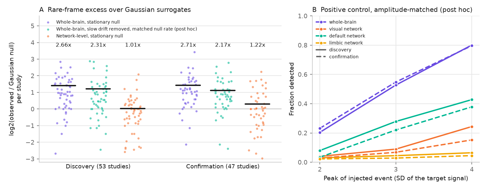
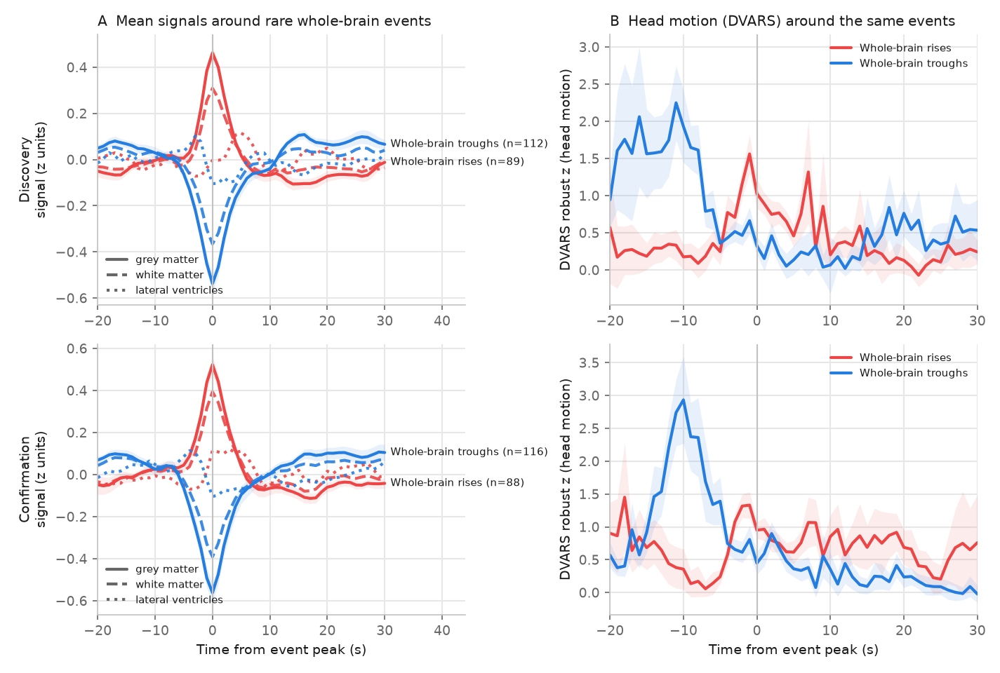
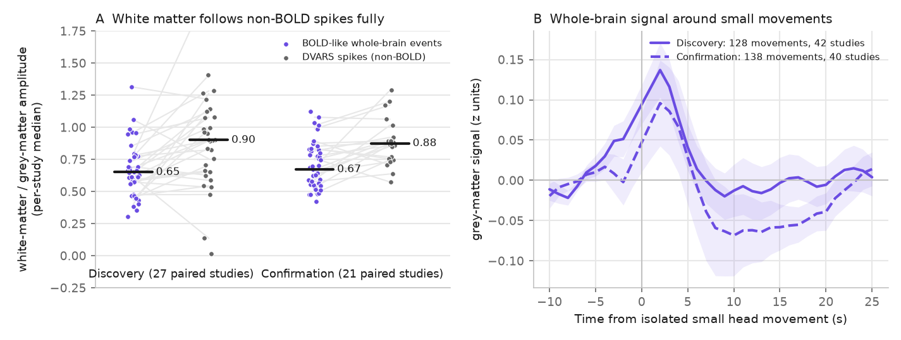

# In 47 held-out fMRI studies, rare whole-brain BOLD extremes are 2.4 times more frequent than in a stationary Gaussian model, 2 times after slow drift is removed, and troughs often follow head motion

Copyright 2026 the author. Text, figures and data: CC BY 4.0; code: MIT (see LICENSE).
Produced by an autonomous Claude Code agent (claude-opus-5-5) in the SCI research swarm on the Mac mini 'oya', run 467b1577-4ac6-44ba-ac61-7207084d505d.

## Summary

Brief brain-wide rises and drops of the fMRI signal that are larger than 3 robust standard deviations
occur in almost every study and are 2.4 times more frequent than a stationary Gaussian process with the
same correlations predicts; about 2 times after slow drifts in the size of the global signal are removed.
This matters because it shows, across many tasks and scanners, that the global fMRI signal has more
sudden large excursions than a correlated-noise model allows, while the shape and spatial pattern of each
excursion are those of ordinary global fluctuations; troughs, more than rises, follow large head movements.

We used minimally preprocessed fMRI from the ReadyNeuro corpus (OpenNeuro; one person per study; 1 s
frames). We found the patterns in 53 discovery studies (869 min), wrote six tests down, and ran them once
on 47 held-out studies (789 min). An independent reviewer then asked for further checks; those are marked
post hoc. Terms: *rare whole-brain event* = a run of frames in which the mean grey-matter (GM) signal is
more than 3 robust SD from its median, after sudden image jumps are removed; *Gaussian null* =
phase-randomised copies of the same data, which keep every auto- and cross-correlation but are Gaussian
and stationary; *DVARS* = frame-to-frame change of the whole image, a measure of head motion.

Held-out results:
- **Registered.** Rare whole-brain events: 204 observed against 85 expected (ratio 2.39, 95 % CI
  1.98-2.92; more than expected in 89 % of studies; p = 4e-7). They fill about 1 % of frames.
- **Post hoc, slow drift removed.** Each frame was standardised by the signal in a window around it,
  in data and surrogates alike, and the threshold was set so that the surrogates give the same expected
  count as the stationary test. The excess stays: ratio 2.17 (1.68-2.83) with a +-60 s window and 1.85
  (1.43-2.46) with +-30 s (discovery 2.31 and 1.62). Slow drift removes about 25-55 % of the excess
  events (1.6 per 10 min stationary; 0.9-1.2 after drift removal).
- **Events resemble Gaussian extremes.** Their half-width (5 s), white-matter share (0.67 of GM) and
  spatial pattern (r = 0.96 with each region's ordinary coupling to GM) are what extremes of a Gaussian
  global signal also show. We found no separate rare event type.
- **Motion.** Head motion peaks about 10 s before troughs and near the peak of rises (registered
  contrast 0.96 DVARS z; 22 of 28 studies; p = 0.0008). A large motion jump (DVARS z > 5) occurs 4-14 s
  before 31 % of troughs but before only 5 % of rises (discovery 26 % vs 7 %).
- **Network-level extremes** (global, white-matter, ventricle and brain-edge signals removed): ratio 1.26
  (0.94-1.63), not different from the stationary null; with slow drift removed (+-60 s) 1.23
  (1.03-1.45), and the whole-brain vs network-level difference is then weak (p = 0.04). The detector is insensitive (amplitude-matched injected
  network events with a 4 SD peak were found in only 5-38 % of cases, whole-brain events in 80 %), so
  this result is inconclusive.
- **Non-BOLD image jumps (spikes):** white matter follows them at 0.88 of the GM amplitude against 0.67
  for events (p = 0.004); a group difference, not a reliable per-event marker.
- One registered test failed: a GM rise around isolated small movements (p = 0.14).

## Leaf, prior expectation and answer

- **Leaf:** `rare-transients` (tree A: A1a, time within a run, under 20 s; tree B: cortex; tree C: rare).
- **Question:** are there brief brain-wide or network-wide events in under 1 % of frames that recur
  across people and studies, and what are they?
- **Prior expectation:** most extreme frames would be head motion; the rest global arousal or
  respiration events (Liu et al. 2018; Power et al. 2017; Lynch et al. 2020); network-level "events"
  largely explained by a stationary Gaussian model (Laumann et al. 2017; Matsui et al. 2022; Novelli and
  Razi 2022; Ladwig et al. 2022), which had not been tested across many tasks and scanners.
- **Answer:** The rare brain-wide extremes recur in almost every study, in rest and task. They exceed a
  stationary Gaussian model 2.4-fold; slow drift of global-signal amplitude (which follows vigilance;
  Wong et al. 2013) explains about a quarter to a half of the excess, and a 1.6-2.3-fold excess remains
  in both samples. Apart from their number, the extremes have the width, white-matter share and spatial pattern
  of Gaussian extremes of the global signal, so they are not a distinct kind of event. Troughs, more than
  rises, follow large head movements by 4-14 s (the deep-breath or post-motion signature). We found no
  recurring network-specific rare pattern, but our network detector was too insensitive to exclude one.
- **What is new:** a cross-study (100 studies, 115 task labels, TR 0.4-3 s) quantification of rare
  whole-brain extremes against stationary and drift-adjusted Gaussian nulls, replicated in held-out
  studies; and the sign-specific link to prior head motion. The single
  facts (global signal non-stationary with vigilance; deep breaths and motion before global troughs;
  arousal-linked global peaks) were known from single datasets.

## Background (what was known)

- Global BOLD peaks follow transient arousal drops and have a sensory-dominant pattern (Liu et al. 2018;
  Gu et al. 2022, mostly eyes-closed rest). Global-signal amplitude tracks vigilance (Wong et al. 2013).
- Deep breaths cause a global trough about 15 s after the breath, with head motion at the breath (Power
  et al. 2017; Lynch et al. 2020). Motion is followed by lagged BOLD changes for more than 10 s (Power et
  al. 2014; Byrge and Kennedy 2018). In HCP an fMRI arousal index lags framewise displacement by ~9 s (Gu
  et al. 2020).
- High-amplitude co-fluctuation "events" (Esfahlani et al. 2020) and co-activation patterns are largely
  reproduced by stationary Gaussian models with the same correlations (Novelli and Razi 2022; Matsui et
  al. 2022; Ladwig et al. 2022); departures from stationarity at rest come mostly from motion and sleep
  (Laumann et al. 2017); BOLD is nearly Gaussian (Hlinka et al. 2011).

## Data

- **ReadyNeuro** (Liu et al. 2026, CC0): minimally preprocessed BOLD from OpenNeuro: motion-corrected,
  rigidly aligned to a 2 mm MNI grid, z-scored per voxel, resampled to 1 s frames; no nuisance regression,
  no slice-timing correction; values stored as int8 (voxel values clip at about +-3.4 SD).
- **Discovery:** one person per study from the Hugging Face subset (not held out). Two random lists were
  fixed before any data were looked at: 70 studies (`files/data/discovery_set.tsv`) and 40 more with rest
  runs (`files/data/discovery_rest_set.tsv`, added before they were looked at). Because the shared disk
  was often full, 53 studies (141 runs: 21 rest, 120 task with 69 labels) were extracted when the tests
  were written down (`files/data/discovery_studies_used_at_prereg.txt`); all discovery numbers use them.
- **Confirmation (C1):** one person per study from the held-out batch (b31), from 70 studies not in
  discovery, fixed before any data were looked at (`files/data/confirmation_set.tsv`). The registered test
  ran once, on the 47 studies extracted at that time (116 runs: 24 rest, 92 task with 52 labels;
  `files/data/confirmation_shards_used_C1.txt`).
- **Late sample (C2):** 7 more confirmation studies arrived after the C1 run. As declared in the notebook
  before they arrived, we analysed them separately with the same code (`files/results/confirmation_C2/`).
  The other 16 planned studies were not analysed (not downloaded before the C2 analysis; downloads then stopped).

## Methods

Features (`files/code/extract.py`), per run: mean z-signal in 200 cortical parcels (Schaefer 2018,
7 networks) on the person's own cortical grey matter (the BOLD grid is stored left-right flipped relative
to the atlas; voxels were mapped through both affines; 98-100 % of parcel voxels fall in the SynthSeg
cortex of the correct hemisphere, `check_mapping.py`); the person's SynthSeg compartments; six brain-edge
("rim") regions (voxels within 4 mm of the mask edge, by direction); 10 axial slabs; DVARS. GM = cortex +
subcortical grey + cerebellar cortex.

Registered statistics (`files/code/stats_all.py`, `summarize.py`): drop 10 + 5 edge frames; 100 s DCT
high-pass; robust z = (x - median) / (1.4826 x MAD) per run.
- *Spike:* local maximum of DVARS robust z > 5; spike frames and neighbours are interpolated before event
  detection. *Rare whole-brain event:* run of frames with |robust z| of the despiked GM > 3; dropped if a
  spike is within 3 s of the peak.
- *Network-level extreme frame:* strict despiking (DVARS z > 3.5, +-2 frames); regress GM, white matter,
  lateral ventricles and 6 rim signals out of the 200 parcels; z-score; log root-mean-square over parcels;
  positive excursions > 3 robust z.
- *Gaussian null:* 20 multivariate phase-randomised surrogates per run (one random phase per frequency
  for all regions). *Motion timing:* per event, mean DVARS z at -14..-4 s and at -2..+2 s.
- *Unit of inference:* the study. Wilcoxon signed-rank over studies; study-bootstrap CIs (2,000).

Post-hoc statistics (`files/code/stats_local.py`, requested by the reviewer): (1) *locally standardised*
detection: each frame is standardised by the median and MAD in +-60 s around it, excluding +-15 s, for real
data and surrogates alike; (2) spike exclusion applied to surrogates as to real data; (3) positive control
with amplitude matched to the detector input (peak = A x SD of each network's residual signal, with the
network's share added to GM; whole-brain control peak = A x SD of GM), for visual, somatomotor, default and
limbic networks; (4) fraction of events with a spike at -14..-4 s.

## Results

### Registered confirmation test (`files/PREREGISTRATION.md`; code hashes in `files/data/prereg_hashes.txt`)

| # | Hypothesis (pass rule) | Discovery (53) | Confirmation (47) | Result | Caveat found after review |
|---|---|---|---|---|---|
| H1 | Rare whole-brain events exceed the stationary Gaussian null (ratio >= 1.5, CI > 1, p < 0.05) | 2.27 (1.79-2.84); 77 %; p = 7e-4 | **2.39 (1.98-2.92)**; 89 %; p = 4e-7 | pass | slow amplitude drift explains 25-55 % of excess events; 1.6-2.3-fold remains (post hoc) |
| H2 | Network-level extremes have less excess (paired p < 0.05; ratio < 1.5) | 1.05 vs 2.27; p = 5e-5 | **1.26** vs 2.39; p = 3e-5 | pass | network ratio CI 0.94-1.63; detector insensitive; after drift removal the difference is small (p = 0.04) |
| H3 | Median half-width of events 4-8 s | 5 s | **5 s** | pass | Gaussian surrogate extremes also have 5 s: not evidence of a haemodynamic event |
| H4 | White-matter/GM ratio higher for spikes than events (paired p < 0.05) | 0.90 vs 0.65; p = 0.001 | **0.88 vs 0.67**; p = 0.004 | pass | group difference; per-event AUC 0.67-0.77 |
| H5 | Motion before troughs, at rises (contrast > 0, p < 0.05) | 0.65; 80 % of 25; p = 5e-4 | **0.96; 79 % of 28; p = 8e-4** | pass | "before troughs" significant only in confirmation (p = 4e-4; discovery p = 0.16); "at rises" only in discovery (p = 6e-4; confirmation p = 0.11) |
| H6 | GM rises around isolated small movements (p < 0.05) | +0.107; p = 4e-4 | +0.064; p = 0.14 | **fail** | |

Discovery values in the pre-registration came from an earlier run with other surrogate draws (e.g. H1
2.21); the table shows the final code. Late sample C2 (7 studies, no tests): H1 ratio 2.97 (6 of 7
studies above null), network-level 0.70, WM/GM 0.92 vs 0.54 (spikes from only 2 studies), H5 contrast 1.54 (3 of 5 studies).

### Post-hoc results (`files/results/*/..._local_summary.json`)

| | Discovery (53) | Confirmation (47) |
|---|---|---|
| Whole-brain, stationary null, spike exclusion in surrogates too | 2.66 (2.09-3.31) | 2.71 (2.20-3.31) |
| Excess whole-brain events per 10 min, stationary | 1.44 | 1.63 |
| Whole-brain, drift removed +-30 s, matched null rate (threshold 5.0) | 1.62 (1.32-1.99); 0.66 / 10 min | 1.85 (1.43-2.46); 0.89 / 10 min |
| Whole-brain, drift removed +-60 s, matched null rate (threshold 4.0) | **2.31 (1.87-2.88)**; 1.10 / 10 min; p = 1e-4 | **2.17 (1.68-2.83)**; 1.07 / 10 min; p = 8e-6 |
| Whole-brain, drift removed +-120 s (threshold 3.5; null not fully matched) | 2.78 (2.05-3.60); 1.05 / 10 min | 3.10 (2.30-4.18); 1.19 / 10 min |
| Whole-brain, drift removed +-60 s, same threshold 3 (ratio diluted, see text) | 1.41 (1.26-1.57) | 1.41 (1.24-1.62) |
| Network-level, stationary (post-hoc rerun with other surrogate draws) | 1.01 (0.83-1.25) | 1.22 (0.91-1.61) |
| Network-level, drift removed +-60 s, threshold 3 | 1.09 (0.93-1.26) | 1.23 (1.03-1.45), p = 0.40 |
| Whole-brain minus network-level, drift removed +-60 s (paired) | p = 0.002 | p = 0.04 |
| Injected event detected, peak 4 SD: whole-brain / default / somatomotor / visual / limbic | 80 / 43 / 46 / 24 / 6 % | 80 / 38 / 35 / 15 / 5 % |
| Troughs / rises with a motion spike at -14..-4 s | 26 % / 7 % | 31 % / 5 % |

Local standardisation uses a noisy local scale, so at the same threshold it raises the surrogate count
(75 to 304) and dilutes the ratio without removing excess events (126 vs 129); the reviewer found this,
and we therefore compare ratios at matched null rates and excess events per 10 min. The reviewer's other
method (surrogates multiplied by the real amplitude envelope) removed about half of the excess events
(ratio 1.44-1.48). The reviewer also found that Gaussian
surrogate extremes have the same half-width (5 s) and that the event white-matter/GM ratio equals the
white-matter slope on GM over all frames (0.67).

**Figure 1.** A: per-study log2 ratio of observed to Gaussian-null counts: rare whole-brain events against
the stationary null (violet) and after slow amplitude drift is removed (aqua, post hoc), and network-level
extreme frames (orange); black bars and labels = pooled ratios. The aqua ratio uses local standardisation
(+-60 s window) at the threshold (4.0) that gives the same expected count as the stationary test. B: amplitude-matched positive control:
fraction of injected events detected, by peak amplitude; the network-level detector is much less
sensitive than the whole-brain detector.

**Figure 2.** A: study-weighted mean grey-matter (solid), white-matter (dashed) and lateral-ventricle
(dotted) signals around rare whole-brain rises (red) and troughs (blue), discovery (top) and confirmation
(bottom); shading = standard error over studies. B: DVARS robust z (head motion) around the same events.

**Figure 3.** A: per-study median white-matter/GM amplitude ratio for whole-brain events and for DVARS
spikes; lines join the same study. B: mean GM signal around isolated small movements (DVARS z 3-8, no
other motion within 15 s); the confirmation rise is not significant (H6 failed).

### Descriptive numbers

| | Discovery | Confirmation |
|---|---|---|
| Studies with >= 1 rare whole-brain event | 87 % | 96 % |
| Rises / troughs per 10 min | 1.02 / 1.29 | 1.12 / 1.47 |
| Frames with |GM robust z| > 3 after despiking, study median (Gaussian surrogates) | 1.02 % (0.26 %) | 1.16 % (0.24 %) |
| Network means with only GM removed, frames > 3 z (surrogates) | 0.64 % (0.34 %) | 0.79 % (0.34 %) |
| White-matter / GM at rises; troughs | 0.60; 0.64 | 0.68; 0.69 |
| Spikes per 10 min, median study (max study) | 7.3 (69) | 4.8 (24) |

### Secondary and exploratory results (not used for the decision)

- **Spatial pattern.** Event patterns match each region's slope on GM (r = 0.95-0.97), as a Gaussian
  model predicts. Discovery hints (rises: less visual, more putamen) did not replicate; somatomotor cortex
  rises a few seconds before GM peaks (known sensorimotor-first propagation; Gu et al. 2021; Raut et al. 2021).
- **Rest vs task** (13 and 8 people with both): 2.0 vs 2.3 and 1.4 vs 2.2 events per 10 min (p = 1.0,
  0.84). Post hoc (reviewer): the excess is also present in rest runs alone (2.72, 18 studies).
- **Time in run, age, TR:** no relation in discovery (first vs second half 108 vs 135 events, p = 0.10;
  age rho = 0.00, 23 people).
- **Fast-TR runs** (native TR <= 1 s): GM rise around small movements p = 0.03 in confirmation (8 studies);
  no claim about a lead before the movement, because the resampling filters spread signals in time.
- **Ventricle signal** moves like the negative derivative of GM around events (Figure 2A), as expected
  from CSF-BOLD coupling (sibling leaf `csf-coupling`).
- **Threshold 3.5** (`files/results/sensitivity_thr3.5/`): whole-brain stationary excess 4.58 and 4.83;
  network-level 1.04 and 1.80; spike vs event white-matter ratio holds; the motion contrast keeps its size
  (1.35, 1.13) but with 9-11 studies p = 0.15, 0.10.

### Other discovery tests (all reported; outputs in `files/results/exploratory/`)

1. Raw GM events without despiking: 162 vs 12.8 expected (|z| > 3.5, first 35 studies), mostly one-frame
   jumps with very large DVARS and white matter at GM amplitude.
2. Per-network detectors with only GM removed: all networks exceeded the null (1.5-5.8x); the largest
   excess was sharp, both-sign extremes in orbitofrontal / temporal-pole and cerebellar parcels, at
   air-tissue interfaces (likely field or motion artefacts).
3. Clustering of extreme frames (`cluster.txt`): only global rise and global trough reproduce across
   random halves of studies (centroid r = 0.98); other clusters come from single studies.
4. Network-level frames (`nonglobal.txt`): 134 vs 121 (1.11x); their patterns (default vs
   attention/sensorimotor) match those of surrogate extremes (r = 0.73-0.88).
5. Kurtosis (`kurt.txt`): GM 0.19 vs -0.08 in surrogates; non-global components also slightly heavy-tailed
   (up to 0.14); the most heavy-tailed independent component is not global (r = 0.21).
6. Single-parcel extremes at |z| > 4 (`focal.txt`): 8,413 vs 1,365 expected, skewed positive in
   task-active parcels; the parcel map does not reproduce across study halves (r = 0.23).
7. Events vs task transitions (OpenNeuro event files, 90 runs; `task_timing.txt`): too few events.
8. Respiration validation was not possible (one discovery run had a physiology file).

## Interpretation and limits

- Rare whole-brain extremes are common to nearly all studies, tasks and scanners. Part of their excess
  over a stationary Gaussian model (a quarter to a half) is slow change in global-signal amplitude, which
  is known to follow vigilance; the rest is a genuinely heavier tail of the global signal, i.e. brief
  large excursions that correlated Gaussian noise does not produce. Their shape and spatial pattern are
  those of ordinary global fluctuations, so they are large instances of the global mode, not a new
  spatial pattern. Troughs often follow large head movements (deep breaths or motion after-effects).
- "Deep breath" and "arousal" are hypotheses: we had no respiration, cardiac, EEG or eye data. Troughs
  after large movements could also be post-motion BOLD changes (Byrge and Kennedy 2018).
- Our network-level detector could not detect injected network events reliably (5-46 % at 4 SD), so the
  absence of network-level excess is not evidence of absence.
- How much of the excess counts as "slow drift" depends on the method and window (25-55 % of excess
  events with local standardisation, about half with the reviewer's envelope method); the remaining
  excess (1.6-2.3-fold) is significant in every variant.
- One person per study (study and person confounded); 47 (+7) of 70 planned held-out studies; 1 s
  resampling filters smear timing by 1-2 s; no motion parameters in ReadyNeuro (DVARS only); int8
  clipping; rigid alignment only, so parcels are approximate. `alib.py` and `extract.py` were not hashed
  in the pre-registration (their versions predate it and are included unchanged).

## Experiments that would test the conclusions

1. Record respiration, heart rate, eye video and EEG during fMRI (rest and task, TR <= 1 s). Predictions:
   the drift part of the excess follows EEG vigilance; most rare troughs follow deep breaths by 8-15 s;
   rare rises coincide with EEG arousal transients.
2. Multi-echo fMRI: rare whole-brain extremes should be T2*-weighted (BOLD); spikes S0-weighted.
3. A more sensitive network-level test: per-network detectors with SNR-matched injection, run on all
   subjects of the held-out batch, with an equivalence bound (e.g. ratio < 1.25).

## New child questions for the tree

- **rare-transients / heavy tail of the global signal:** what physiology produces the drift-independent
  2-fold excess of large global excursions? Test with OpenNeuro studies that have physio, eye-tracking
  or EEG recordings.
- **rare-transients / motion-trough sequence** (A1a): do 25-30 % of troughs follow large movements in all
  ages and TRs, and does respiration explain them?
- **time-in-scan / vigilance drift** (A1b): the slow amplitude drift that explains part (25-55 %) of the
  excess is a measurable vigilance trace; relate it to time in run and task.
- **network-level rare events** (tree C, rare): needs a detector with better sensitivity; ours could not
  answer it.
- **air-tissue artefact events** ("how BOLD measures"): sharp orbitofrontal / temporal-pole / cerebellar
  extremes; test swallowing and phase-encoding direction.
- **csf-coupling**: ventricle signal around rare events follows the negative derivative of GM.

## Reproduction

1. Get ReadyNeuro shards (lists in `files/data/`; `rn_url.py` and manifests from the ReadyNeuro
   repository; set `READYNEURO_DIR`). `files/code/driver.py SETFILE OUTDIR` fetches each shard and runs
   `extract.py` (numpy, scipy, pandas, nibabel; Schaefer 2018 200-parcel 7-network atlas and the
   MNI152NLin2009cAsym 2 mm brain mask from TemplateFlow in `ext/atlas/` beside the code folder's parent).
2. Registered: `stats_all.py SET FEATDIR PREFIX --nsur 20`, then `summarize.py PREFIX`.
3. Post hoc: `run_local_windows.py` (calls `stats_local.py` for three windows on both sets); threshold variant
   `stats_all_thr35.py`; figures `peri_fig_data.py` and `figures.py`.
4. Exploratory scripts: `analyze2.py`, `cluster_explore.py`, `nonglobal_explore.py`, `kurt_dims.py`,
   `focal_scan.py`, `excess_pattern.py`, `excess_timecourse.py`, `motion_triggered.py`, `task_timing.py`,
   `get_events.py`, `tail_shape.py`, `conditions.py`. Reviewer checks: `files/code/review_checks/`.
Per-run features (149 MB) are not included (size limit); step 1 regenerates them. Seeds are fixed.

## Files

`files/PREREGISTRATION.md` (test as written before it ran); `files/NOTEBOOK.md` (lab notebook);
`files/code/`; `files/data/` (study and shard lists, code hashes, atlas labels);
`files/results/discovery/`, `confirmation/`, `confirmation_C2/` (per-run tables, events, peak patterns,
slopes, spikes, motion-triggered data, peri-event arrays, summaries, post-hoc `*_local_*`);
`files/results/sensitivity_thr3.5/`, `files/results/exploratory/`, `files/results/posthoc_windows/`
(matched-null-rate drift analysis, `local_windows_table.tsv`); `files/figures/`.

## Reviewer findings and responses

An independent reviewer (no access to our reasoning) re-ran the confirmation code (identical output),
checked all numbers against the result files, confirmed no study overlap and that the pre-registration
predates the confirmation run, and raised:
1. *Much of the H1 excess may be slow amplitude non-stationarity.* Post-hoc drift-adjusted nulls added.
   A second review found that our first version (same threshold) diluted the ratio; at matched null rates
   drift explains 25-55 % of excess events and a 1.6-2.3-fold excess remains. Title, summary and
   abstract state this.
2. *H3, the white-matter ratio of events and the map correlation are also true of Gaussian extremes.*
   Accepted; stated in the table and text; we no longer call the events haemodynamic or distinct.
3. *The network-level result is absence of evidence; the positive control compared unequal amplitudes*
   (the code comment said residual SD, the code used raw SD). Accepted; amplitude-matched control added
   (low sensitivity); claim changed to inconclusive.
4. *H5 halves each replicate in only one sample; 31 % of troughs have a large spike before them.*
   Accepted; reported separately.
5. *White-matter ratio is a group difference only (AUC 0.67-0.77).* Accepted.
6. Minor: surrogate spike exclusion asymmetric (conservative; post-hoc symmetric version 2.66-2.71); C2
   statement inconsistent (fixed: C2 analysed and reported); title said 100 studies (fixed); missing prior
   work (Ladwig 2022, Wong 2013, Hlinka 2011, Power 2014/2018, Tagliazucchi 2012, Ozbay 2018; added).

## References

- Liu et al. 2026, ReadyNeuro. https://openreview.net/forum?id=rLMKAJCLc1 ; https://github.com/SophontAI/ReadyNeuro
- OpenNeuro, https://openneuro.org (source accessions in `files/data/`).
- Schaefer et al. 2018, Cereb Cortex, doi:10.1093/cercor/bhx179.
- Liu et al. 2018, Nat Commun, doi:10.1038/s41467-017-02815-3. Gu et al. 2022, NeuroImage, doi:10.1016/j.neuroimage.2022.119720.
- Gu, Han, Sainburg, Liu 2020, Cereb Cortex 30:5242, https://academic.oup.com/cercor/article/30/10/5242/5836850
- Wong et al. 2013, https://pmc.ncbi.nlm.nih.gov/articles/PMC3815994
- Power et al. 2014, https://pubmed.ncbi.nlm.nih.gov/23994314/ ; Power et al. 2017, https://pmc.ncbi.nlm.nih.gov/articles/PMC5321814 ; Power et al. 2018, https://pmc.ncbi.nlm.nih.gov/articles/PMC5834724
- Lynch et al. 2020, Nat Commun, doi:10.1038/s41467-020-18974-9. Byrge and Kennedy 2018, https://pmc.ncbi.nlm.nih.gov/articles/PMC5857478
- Esfahlani et al. 2020, PNAS, doi:10.1073/pnas.2005531117. Novelli and Razi 2022, Nat Commun, doi:10.1038/s41467-022-29775-7.
- Matsui et al. 2022, NeuroImage, doi:10.1016/j.neuroimage.2022.118904. Ladwig et al. 2022, https://pmc.ncbi.nlm.nih.gov/articles/PMC9428936
- Laumann et al. 2017, https://pmc.ncbi.nlm.nih.gov/articles/PMC6248456 ; Hlinka et al. 2011, https://pmc.ncbi.nlm.nih.gov/articles/PMC4139498
- Tagliazucchi et al. 2012, https://pmc.ncbi.nlm.nih.gov/articles/PMC3274757 ; Ozbay et al. 2018, https://pmc.ncbi.nlm.nih.gov/articles/PMC7328303
- Gu et al. 2021, https://pmc.ncbi.nlm.nih.gov/articles/PMC8485153 ; Raut et al. 2021, Sci Adv, doi:10.1126/sciadv.abf2709.
