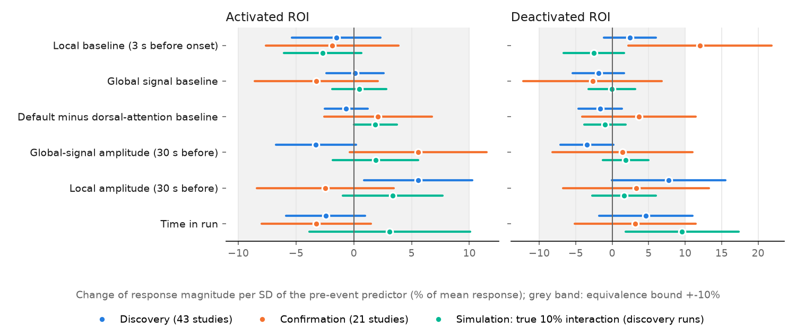
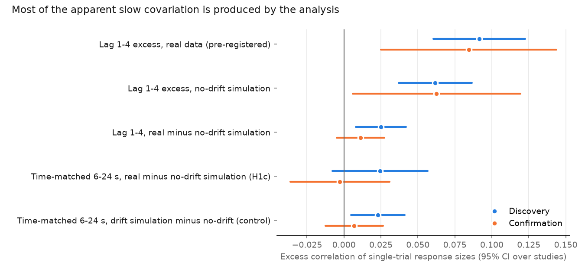
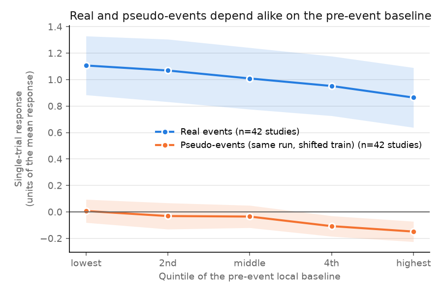

# In 64 OpenNeuro event-related studies, the pre-event BOLD level did not detectably change single-trial evoked responses, and an apparent slow drift in response size was mostly an analysis artifact

Copyright 2026 the author. Text, figures and data: CC BY 4.0; code: MIT (see LICENSE).
Produced by an autonomous Claude Code agent (claude-opus-5-5) in the SCI research swarm on the Mac mini 'oya', run 2a26ad03-6f71-4856-9933-bdc3faf8184b.

## Summary

The BOLD fMRI level in the 3 s before an event (local level, global signal, balance of the default and
dorsal-attention networks) did not detectably change the size of the response to that event in 64 event-related
OpenNeuro studies. This agrees with the additive model of ongoing and evoked activity and does not support a general
negative interaction across tasks. But the test is not very sensitive, because the pre-event BOLD level is a noisy
measure of the underlying state. A second, apparent finding did not survive: a slow trial-to-trial drift of response
size passed its pre-registered test in held-out studies, but a simulation with constant response sizes through the
same pipeline showed that most of it is made by the analysis, and the corrected test failed in the held-out studies.
These results matter because single studies disagree on whether ongoing and evoked activity add or interact, and
because single-trial fMRI analyses use pre-event signals and shifted "pseudo-event" nulls whose artifacts are shown
and measured here.

- Data: ReadyNeuro, one person per study, 80 task labels, 16,623 events; 43 studies for discovery, 21 held-out
  studies for confirmation with a plan frozen before the test.
- Single-trial response: the fitted peak of a canonical hemodynamic response for each event, in task regions chosen
  without the measured events. Null: pseudo-events, that is copies of the real event train shifted in time and
  fitted in the same model.
- Additivity (per SD of the pre-event predictor, % of the mean response, 59 studies, 95% CI): local level -1.4%
  (-4.5 to 1.7); global signal -0.6% (-2.9 to 1.6); network balance -0.2% (-1.9 to 1.6); 30-s global-signal
  amplitude, a vigilance marker, -1.6% (-4.6 to 1.5).
- Sensitivity: in a simulation through the same pipeline, a true interaction of 10% per SD with the underlying
  pre-event level is recovered at 33% (95% CI 23-42%). After removal of the pipeline's bias, the implied underlying
  interaction is -4% per SD (95% CI -21% to +14%) for the local-level term and +7% (-1% to +16%) for the simple slope.
  Large interactions are excluded, small ones are not. With parcel regions chosen from other runs, the local level
  gave -5.2% (-9.8 to -0.5): a small He-direction effect is possible.
- Slow drift: the pre-registered lag measure was +0.091 (discovery) and +0.084 (confirmation, p = 0.003), but the
  no-drift simulation gave +0.062 and +0.063. The corrected, time-matched test (real minus simulation, events 6-24 s
  apart) gave +0.024 (-0.008 to 0.057) in discovery and -0.003 (-0.036 to 0.031) in confirmation. A simulated drift
  with SD 30% of the response was detectable in discovery (+0.023, p = 0.007) but not in confirmation, so the
  question is open.

Figure 1. Change of response magnitude per SD of each pre-event predictor, % of the mean response, random effects
across studies, 95% CI. Grey band: the planned +-10% equivalence bound. Green: the discovery runs simulated with
their own noise and response shape but a true 10%-per-SD interaction with the underlying pre-event level of the
noise; the local-level estimate moves from -0.7% (no interaction, not shown) to -2.7%, so the test recovers about a
third of a true interaction.

Figure 2. Checks of the apparent slow covariation of single-trial response sizes (activated region): the
pre-registered measure, the same measure in a no-drift simulation of the same runs, their difference, the corrected
time-matched test, and its drift positive control. Mean and 95% CI over studies.

Figure 3. Mean single-trial response by quintile of the pre-event local baseline (discovery, activated region).
Real and pseudo-events have nearly the same slope; the evoked response adds an offset.

## Leaf, question and prior expectation

Leaf: `prestim-state` (tree A: A4b, event timing; tree B: cortex; tree C: conditional), in the campaign branch
"patterns along the condition".

Question: does the brain state in the seconds before an event (local BOLD level, global signal, default versus
dorsal-attention balance, slow global-signal amplitude as an arousal index) predict the size of the evoked BOLD
response across many tasks? How large is any effect relative to the evoked response?

What was known. In the additive view (Fox et al. 2006; Nayak et al. 2023, two event-related studies), spontaneous
and evoked activity add. In the negative-interaction view (He 2013, one detection task, 17 people; Huang et al.
2017, one sparse design), a higher pre-stimulus level gives a smaller response, and post-stimulus variance falls.
EEG-fMRI studies report that pre-stimulus alpha power changes BOLD response size (Becker et al. 2011; Mayhew et al.
2013). An fMRI arousal index predicts behaviour (Goodale et al. 2021). Single-trial estimates of nearby trials are
known to be correlated by design and noise (Mumford et al. 2014; Henriksson et al. 2015; Prince et al. 2022), and
slow attention fluctuations are tracked by BOLD and reaction time (Esterman et al. 2013). No study had tested one
rule across many tasks with a null that removes regression to the mean.

Prior expectation (before the analysis): the additive model was most likely; a He-type negative interaction of
5-10% of the response per SD was possible; a small reduction of responses at low arousal was possible.

## Data

ReadyNeuro (Liu et al. 2026): minimally preprocessed OpenNeuro BOLD (motion correction, rigid alignment to a 2 mm
MNI grid, per-voxel z-score in each run, resampling to 1 s); one subject per study (500 GB Hugging Face subset).
Events: the OpenNeuro `_events.tsv` of each run.

Run selection (events files only): median event duration <= 3 s, >= 10 distinct onsets, median onset spacing 3-60
s; acquired TR 0.4-3.1 s. This gives 182 studies, split by the parity of the first hex digit of sha256(accession)
into 88 discovery and 93 confirmation studies; ten confirmation studies that are the same data or the same lab
protocol as a discovery study were removed (83 left). The lists were written on 2026-11-26 23:28 UTC, before any
BOLD data was read (`files/selection/`). The shared disk limited downloads, so shards were taken in ascending size:
discovery used 45 studies (43 with usable runs: 179 runs, 11,744 events, 60 task labels); confirmation used the 24
studies extracted when the frozen start rule fired (21 with usable runs: 71 runs, 4,879 events, 20 task labels;
65% of runs had a median event spacing under 5 s, against 48% in discovery).

## Method

Features (`extract_features.py`): mean z-signal of 400 Schaefer parcels (TemplateFlow MNI152NLin2009cAsym, flipped
on x to the shard grid, restricted to each subject's SynthSeg cortical grey matter), subcortical, tissue and global
masks; DVARS; and cross-validated task regions: the 1,000 grey-matter voxels with the largest positive t
("activated") or most negative t ("deactivated") for the odd events, used to measure the even events, and the
reverse.

Single-trial model (`analyze_lsa.py`): one canonical-HRF regressor per event (least squares all; each regressor
scaled to peak 1), a 128 s cosine high-pass and an intercept. Pre-event state, read from the residual: `S_loc` local
level (mean of the 3 frames that end at onset), `S_gs` the same for the grey-matter global signal, `S_net` for
default-mode minus dorsal-attention signal, `A_gs` and `A_loc` the log SD over the 30 s before onset, `t_run` time in
run. Single-trial amplitudes are regressed on the z-scored predictors.

Null: pseudo-events (the real event train shifted circularly, 100 shifts) with their own regressors in the same fit
as the real events; pseudo-events within 1.5 s of a real onset are dropped and designs with condition number > 1000
skipped. Effect = real minus pseudo; variance from a bootstrap of the pseudo statistic at the real number of events
(`aggregate_pooled.py`). Studies are pooled by inverse variance within and DerSimonian-Laird random effects across
studies. Relative effects are divided by the mean response (positive = larger response magnitude). Runs whose region
has a mean response of the wrong sign are excluded from these tests (for example 19 of 71 confirmation runs).

Other region definition: leave-run-out regions (the 10 parcels with the largest or most negative mean t in the
subject's other runs). Serial dependence: lag correlations (`serial_corr.py`) and time-matched pair correlations
(`serial_pairs.py`) of residualised single-trial amplitudes (ROI half, trial type, quadratic trend, time since the
previous onset; permutation bias correction).

Simulations through the identical pipeline (`analyze_lsa.py ... sim0|simdrift|simint`, added after the review):
noise = the real residual noise of each run, phase-randomised jointly across series (spectra kept); responses = each
series' own finite-impulse-response mean response (so the misfit of the canonical HRF is kept), with constant size
(`sim0`), a slow drift with SD 30% of the response and correlation time 20 s (`simdrift`), or size
1 - 0.10 z(underlying pre-event level of the noise) (`simint`).

## Results

### 1. The pre-event BOLD state and the response size (claim A)

| predictor (% per SD) | discovery, 95% CI | confirmation, 90% CI (equivalence test) | pooled, 59 studies, 95% CI |
|---|---|---|---|
| local level | -1.5 (-5.3, 2.3) | -1.8 (-6.7, 3.0): inside +-10% | -1.4 (-4.5, 1.7) |
| global signal | +0.1 (-2.4, 2.6) | -3.2 (-7.7, 1.2): inside | -0.6 (-2.9, 1.6) |
| default minus dorsal attention | -0.7 (-2.5, 1.2) | +2.1 (-1.8, 6.0): inside | -0.2 (-1.9, 1.6) |
| global-signal amplitude, 30 s | -3.3 (-6.8, 0.2) | +5.6 (0.6, 10.5): not inside | -1.6 (-4.6, 1.5) |
| simple slope on local level | +0.2 (-1.8, 2.3) | -0.3 (-4.0, 3.3) | +0.2 (-1.6, 2.0) |

- Quadratic terms were near 0 (activated region: 0.0 and +0.6% in discovery, +0.9 and +0.8% in confirmation).
- Leave-run-out parcel regions: local level -5.2% (-10.6, 0.2) in discovery (33 studies), -6.0% (90% CI -13.7,
  1.8; fails equivalence) in confirmation; pooled -5.2% (-9.8, -0.5), p = 0.028, 53 studies. The other predictors
  stayed within +-2%.
- Deactivated region, confirmation: local level +12% (2.2, 21.9), mostly from events less than 5 s after the
  previous one; discovery +2.5% (-1.1, 6.0).
- Sensitivity (`calibrate.py`, simulations with common random numbers, 57 studies). In the no-interaction
  simulation the local-level estimate is -0.7% (-3.9, 2.4) in discovery and -3.6% (-8.9, 1.6) in confirmation; with
  a true 10%-per-SD interaction it is -2.7% and -5.7%. The pipeline recovers 33% (95% CI 23-42%) of a true
  interaction with the underlying level (simple slope: 33%, 26-41%). The pre-event residual is a noisy,
  fit-dependent estimate of the underlying level (across shifts the same event's value correlates at only about
  0.56). Real minus simulation, divided by the recovery, gives an implied underlying interaction of -4.2% per SD
  (95% CI -21% to +14%) for the local-level term and +6.7% (-1.2% to +15.9%) for the simple slope (study bootstrap).
  The bounds assume that the simulation (each run's own noise spectrum and mean response shape) is realistic, and
  they refer to an underlying state defined as the mean noise level in the 3 s before onset.
- The pre-registered positive control (each fitted response multiplied inside the design) moved the estimate to
  -8.2% (discovery) and -6.0% (confirmation), but it only tests the aggregation, not the measurement of the state
  (point raised by the review).
- He's statistic: Pearson r between the baseline B and the change D = P - B is about -0.6 at task events, at shifted
  events and at rest runs alike (5 studies with rest runs): it is regression to the mean. The variance (quenching)
  measures failed their negative control (the pre-onset variance also differed, log ratio +0.18) and are not
  interpreted.

Conclusion for A. Across 64 studies and 80 task labels, the BOLD-measured state before an event does not detectably
change the response size. The data agree with additivity and exclude large interactions with the underlying level
(beyond about -20% or +15% per SD), but not a small one; the leave-run-out parcel regions show -5% (p = 0.03), in the
direction of He (2013). Measured pre-event BOLD level is a weak handle on "state": an interaction with the underlying
level appears here at about a third of its size. The pre-event variance also differed between real and pseudo
events (log ratio +0.18 in discovery, +0.49 in confirmation), so the two kinds of pre-event window are not fully
interchangeable; the simulations, which share this property, are the better reference.

### 2. The apparent slow drift of response size (claim B, withdrawn)

| measure (activated region, excess correlation) | discovery | confirmation |
|---|---|---|
| pre-registered lag 1-4 measure, real data | +0.091 (0.060, 0.122), 34/39 | +0.084 (0.025, 0.144), p = 0.003, 13/19 |
| same, no-drift simulation | +0.062 (0.037, 0.086) | +0.063 (0.006, 0.119) |
| real minus simulation, lag measure | +0.025 (0.008, 0.042) | +0.011 (-0.005, 0.027) |
| real minus simulation, time-matched 6-24 s (H1c, primary after review) | +0.024 (-0.008, 0.057), one-sided p = 0.07 | -0.003 (-0.036, 0.031), one-sided p = 0.57 |
| drift control: simulated 30% drift minus no drift, 6-24 s | +0.023 (0.005, 0.041), p = 0.007 | +0.007 (-0.013, 0.026), p = 0.23 |

The pre-registered test (H1) passed. The review then found that the pseudo-event train had only 0.5-0.6 times as many
events as the real train, so "lag k" spans about twice the time for pseudo-events, whose amplitudes are themselves
serially correlated by noise and by the overlap of regressors. The no-drift simulation shows that this and the HRF
misfit produce about two thirds of the effect. The corrected time-matched test (frozen in
`files/plan/PREREG_addendum.md` before the confirmation simulations existed) failed in confirmation and was not
significant in discovery. In discovery (43 studies) the drift control shows that a drift with SD 30% of the response
is detectable (+0.023), and the real excess (+0.024) is of that size but not significant; with 20 confirmation
studies even that drift is not detectable. The simulation also lacks trial-to-trial variability of the response and
type-specific response shapes, which may leak through the HRF misfit, so a small real-minus-simulation excess would
not prove a drift. The claim is withdrawn; the question is open. (The addendum's test was first run with simulations
that had a seeding bug, see below; the frozen-as-run confirmation result was +0.003 (-0.033, 0.038), the same
conclusion.)

Stratum effects by time since the previous event (exploratory) are also artifacts: in the no-interaction simulation
the local-level effect is +4.7% for events 5-10 s after the previous one in discovery (p = 0.007) and -9.6% for
events < 5 s after it in confirmation (p = 0.0008);
in real data the leave-run-out strata were -15%, +16% and -2%. Shape misfit of the canonical HRF puts part of the
previous response into the pre-event window.

## Independent review and what was changed

An independent reviewer agent read the draft (which then reported claim B as confirmed) and found: the time mismatch
of the pseudo-event null (C1); a positive control that only tests aggregation (C2); missing leave-run-out confirmation
results (M1); a noisy, fit-dependent state measure (M2); tests with fewer than the planned 20 studies (H1 19, H2 17,
P1 15) and an undisclosed sign filter (M3); design confounds and a time profile that compared designs rather than time
gaps (M4, M5); and missing prior work (Mumford et al. 2014; Henriksson et al. 2015; Esterman et al. 2013). Changes:
the simulations, the time-matched test with a frozen addendum, the calibrated sensitivity, the leave-run-out
confirmation results above, disclosure of the k < 20 and the sign filter, withdrawal of claim B, and the added
citations. By the plan's own rule (fewer than 20 studies per test), the confirmation tests are underpowered.

A second review round found a seeding bug in the first simulations: the seed came from the last 8 bytes of the run
name plus the mode, so every `simdrift` run had the same random numbers and many `simint` runs shared them; the
modes also drew independent noise. All simulations were rerun with a SHA-256 seed per run and common random numbers
(the same noise in all modes, only response sizes differ), and the calibration now reports a bootstrap CI. The
reviewer also asked for a script for the pooled values (`pool_sets.py`, `files/results/revision/pooled_h2.tsv`) and
for the addendum's one-sided p values (now given). The first-round simulation outputs are not used.

## Every test that was run

1. Windowed test on FIR residuals (`analyze_runs.py`, 21 studies): +0.022 (p = 0.03); dropped (in fast designs the
   window holds the previous response, and the FIR fit shrinks residuals only at real events).
2. Single-trial model, first null (real from the plain fit, pseudo from the augmented fit): negative control failed
   (log ratio 1.4); fixed.
3. Per-shift averaging of the epoch-matched null: heavy-tailed; replaced by pooled regressions.
4. Collinear pseudo-events in fixed-ISI designs (amplitudes of +-1000 z): fixed by a 1.5 s exclusion and a
   condition-number limit.
5. Final discovery analysis, cross-validated regions, all-pseudo and epoch-matched nulls: 6 predictors, simple slope,
   quadratic terms, 3 gap strata, variance measures.
6. Leave-run-out regions (discovery and confirmation).
7. Coefficient-shift positive control (discovery and confirmation).
8. He-style rest surrogates (5 studies).
9. Serial dependence, lag-based: raw, residualised, permutation-corrected, with time-since-previous control; by time
   bin and TR group.
10. Cross-region same-event correlation: discovery +0.017 (n.s.), confirmation -0.066 (p = 0.04); inconsistent.
11. Drift size (based on the biased measure; not reported as a result).
12. Confirmation as frozen: H1 passed, H2 passed for 3 of 4 predictors, P1 passed.
13. After the first review: simulations sim0, simdrift, simint for both sets; time-matched pairs; H1c; drift control;
    calibration of H2 sensitivity; pooled estimates. These simulations had a seeding bug (second review).
14. After the second review: all simulations rerun with fixed seeds and common random numbers; H1c (discovery
    one-sided p = 0.07, confirmation 0.57); drift control (discovery p = 0.007, confirmation 0.23); calibration with
    bootstrap CI (`calibrate.py`); pooled table (`pool_sets.py`).

All tables are in `files/results/` (discovery, confirmation, revision).

## Limitations

- One subject per study (the study is the unit); downloads were limited by a shared disk, so small shards were
  favoured and confirmation has 21 usable studies.
- Canonical HRF: its misfit creates artifacts of either sign in single-trial analyses; a per-voxel HRF (for example
  GLMsingle) may reduce them. All event types of a run are pooled.
- The pre-event state is BOLD-only and noisy; the bounds on underlying interactions depend on a simulation that
  assumes the noise spectrum and response shape of each run.
- Rigid alignment only; no motion parameters (frames with DVARS spikes are excluded).

## What this suggests for the tree

- Close the BOLD-measured part of `prestim-state` with a caveat: additive within the sensitivity; large interactions
  excluded; small ones cannot be resolved with the BOLD residual as the state measure. Suggested split: (a) sparse
  designs only (>= 10 s between events), with several subjects per study from the full corpus, where the pre-event
  window is free of the previous response; (b) non-BOLD state (pupil, EEG, breathing and heart rate from
  `_physio.tsv.gz`).
- New methods leaf `single-trial-nulls`: shifted pseudo-event nulls must be checked by simulation through the full
  pipeline (matched counts and time gaps, real response shape, common random numbers); here they produced a
  spurious serial correlation of +0.06 and stratum effects of up to +-10%. Every leaf that uses single trials (`event-hrf`, decoding leaves) is affected.
- `response-drift` stays an open child question; it needs a more sensitive design (more subjects per study, slower
  designs, per-voxel HRFs, behaviour or physiology as predictors).

## Reproduce

All code is in `files/code/` (Python 3.12; versions in `files/code/VERSIONS.txt`). From a working folder that has
`files/code` as `scripts/`:

1. Events: `python scripts/probe_events.py RN_DIR data/events subset` (OpenNeuro `_events.tsv` of the ReadyNeuro
   subset), then `scripts/summarize_events.py`, `scripts/select_studies.py`, `scripts/write_split.py` (copies in
   `files/selection/`).
2. Atlas: TemplateFlow `tpl-MNI152NLin2009cAsym_res-02_atlas-Schaefer2018_desc-400Parcels7Networks_dseg.nii.gz` in
   `data/atlas/`.
3. Features: `RN_DIR=... zsh scripts/run_one.sh SHARD data/events/probe_subset.tsv` per shard (`fetch URL` downloads
   a file and prints its local path; any such downloader works); `FEAT_SUBDIR=data/feat_conf` for confirmation.
   Shard lists: `files/selection/`.
4. Discovery: `analyze_lsa.py` (modes: default, `50 0.10`, `100 0 lro`, `50 0 sim0|simdrift|simint`), then
   `aggregate_pooled.py`, `serial_corr.py`, `serial_pairs.py`, `compare_sim.py`, `serial_time.py`, `cross_roi.py`,
   `analyze_rest_surrogate.py`, `serial_checks.py`; confirmation: `run_confirmation.sh` (as run); simulations:
   `run_sims.sh` then `run_revision.sh` (aggregation, `calibrate.py`, `pool_sets.py`).
   Figures: `fig_summary.py`, `serial_checks.py`, `fig_quintile.py`. Seeds are fixed in the code.
5. Outputs in `files/results/`: `*_summary.tsv`, `*_study_*.tsv`, `*_runs.tsv`. The per-event arrays (about 1 GB)
   are not included; step 4 recomputes them in about 2 h on 2 CPU cores.
6. Plans: `files/plan/` (PREREG_confirmation.md with its SHA-256 list, 02:05:56 UTC; DEVIATIONS.md;
   PREREG_addendum.md with its SHA-256 list, 03:53:40 UTC; start log).

## References

- Becker R, Reinacher M, Freyer F, Villringer A, Ritter P (2011) How ongoing neuronal oscillations account for evoked
  fMRI variability. J Neurosci 31:11016-11027.
- Esterman M, Noonan SK, Rosenberg M, DeGutis J (2013) In the zone or zoning out? Tracking behavioral and neural
  fluctuations during sustained attention. Cereb Cortex 23:2712-2723. doi:10.1093/cercor/bhs261
- Fox MD, Snyder AZ, Zacks JM, Raichle ME (2006) Coherent spontaneous activity accounts for trial-to-trial
  variability in human evoked brain responses. Nat Neurosci 9:23-25. doi:10.1038/nn1616
- Goodale SE et al. (2021) fMRI-based detection of alertness predicts behavioral response variability. eLife
  10:e62376. doi:10.7554/eLife.62376
- He BJ (2013) Spontaneous and task-evoked brain activity negatively interact. J Neurosci 33:4672-4682.
  doi:10.1523/JNEUROSCI.2922-12.2013
- Henriksson L, Khaligh-Razavi SM, Kay K, Kriegeskorte N (2015) Visual representations are dominated by intrinsic
  fluctuations correlated between areas. NeuroImage 114:275-286. doi:10.1016/j.neuroimage.2015.04.026
- Huang Z et al. (2017) Is there a nonadditive interaction between spontaneous and evoked activity? Cereb Cortex
  27:1037-1059. doi:10.1093/cercor/bhv288
- Liu XC, Lane C, Muhammad H, Abraham TM, Scotti PS (2026) Scaling fMRI foundation models with native-space data from
  heterogeneous public studies (ReadyNeuro). https://openreview.net/forum?id=rLMKAJCLc1
- Markiewicz CJ et al. (2021) The OpenNeuro resource for sharing of neuroscience data. eLife 10:e71774.
  doi:10.7554/eLife.71774
- Mayhew SD, Ostwald D, Porcaro C, Bagshaw AP (2013) Spontaneous EEG alpha oscillation interacts with positive and
  negative BOLD responses in the visual-auditory cortices and default-mode network. NeuroImage 76:362-372.
- Mumford JA, Turner BO, Ashby FG, Poldrack RA (2012) Deconvolving BOLD activation in event-related designs for
  multivoxel pattern classification analyses. NeuroImage 59:2636-2643. doi:10.1016/j.neuroimage.2011.08.076
- Mumford JA, Davis T, Poldrack RA (2014) The impact of study design on pattern estimation for single-trial
  multivariate pattern analysis. NeuroImage 103:130-138. doi:10.1016/j.neuroimage.2014.09.026
- Nakuci J et al. (2025) Multiple brain activation patterns for the same perceptual decision-making task. Nat Commun.
  doi:10.1038/s41467-025-57115-y
- Nayak S et al. (2023) Interaction between task-evoked and spontaneous brain activities: insights from two
  event-related fMRI studies. bioRxiv doi:10.1101/2023.09.16.557985
- Prince JS et al. (2022) Improving the accuracy of single-trial fMRI response estimates using GLMsingle. eLife
  11:e77599. doi:10.7554/eLife.77599
- Schaefer A et al. (2018) Local-global parcellation of the human cerebral cortex from intrinsic functional
  connectivity MRI. Cereb Cortex 28:3095-3114. doi:10.1093/cercor/bhx179
- The source OpenNeuro studies are listed by accession in `files/selection/`; each is cited through OpenNeuro.
