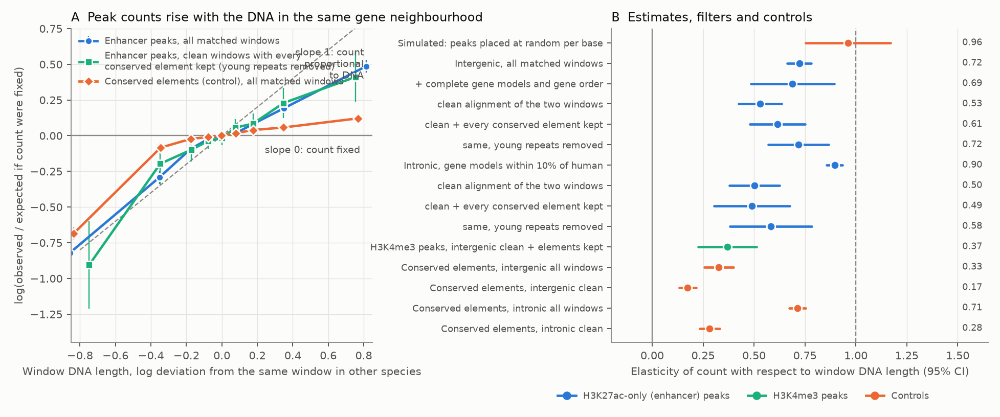
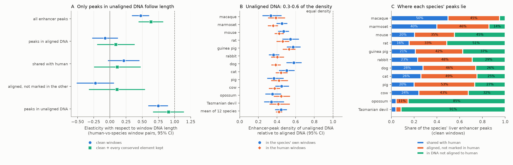
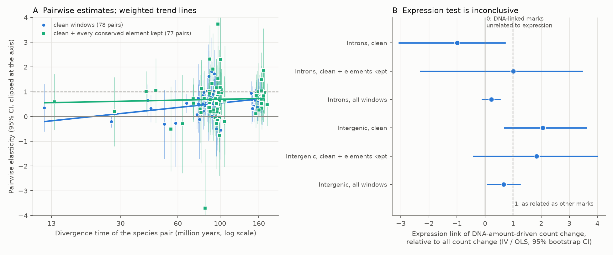

# In the liver of 13 mammals, a gene neighbourhood with more DNA carries more enhancer marks, at 0.45 to 0.7 of the proportional rate, and the increase is in DNA not shared between the species

## Summary

When one mammal has more non-coding DNA than another in the same gene neighbourhood, it also has more liver enhancer marks there. The increase is about half to three quarters of the increase that you expect if the marks were spread evenly over the DNA. All of the increase is in DNA that does not align between the two species; marks in shared DNA do not change with the amount of DNA.

This matters because counts of marked elements (for example "enhancers per gene") are used as measures of regulatory function or regulatory complexity. A large part of such a count follows the plain amount of DNA in the neighbourhood. The marks are activity marks, not proof of function: this study does not show whether the extra marks have a function.

Key numbers (liver ChIP-seq peaks of Villar et al. 2015):

* **Elasticity** is the percent change of the peak count for a 1% change of the DNA length of the same gene neighbourhood in another species. 0 means that the count does not depend on the DNA amount. 1 means that the count is proportional to the DNA amount.
* **Clean windows** are windows whose human and species copies contain each other's aligned DNA (checked with whole-genome alignments). Over the 12 human-vs-species comparisons in clean windows, with young repeats removed (50-bp reads map poorly to them), the random-effects mean elasticity of enhancer marks (H3K27ac peaks without H3K4me3) is **0.45 (95% CI 0.21–0.70)**; the estimates differ between species (τ = 0.37). In the strictest windows (clean and every human conserved element present in the species window) it is **0.69 (0.51–0.87)**, with little difference between species (τ = 0.13). Multi-species fits give 0.53–0.72 between genes and 0.49–0.61 in introns.
* **Where the increase is.** In human-vs-species pairs of clean windows, peaks in DNA that aligns between the two windows do not follow window length (elasticity **−0.07, −0.27 to 0.12**). Peaks in DNA that does not align carry the increase (**0.75, 0.60–0.89**). Unaligned DNA carries **0.44 (0.39–0.50)** times the enhancer-mark density of aligned DNA (mean over 12 species).
* **Naive comparisons overstate the effect.** Without the alignment checks the elasticity is 0.72 between genes and **0.90** in introns. Human conserved elements, which should not follow DNA length, give 0.33 and **0.71** in the same unchecked windows. So a part of the length differences between species in unchecked windows comes from windows that do not contain the same DNA.
* H3K4me3 peaks give 0.23–0.37 with 2-kb window margins and 0.40–0.50 with 10-kb margins (the narrower margin keeps some promoters of the flanking genes in the window).
* Liver RNA-seq of the same species could not show whether the marks that follow DNA amount change gene expression (Figure 3B).

**Figure 1.** A: Observed peak counts divided by the counts expected if the count of a window did not depend on its length, against the within-window deviation of DNA length (log scale; window and species effects removed). Blue: enhancer peaks in all matched intergenic windows. Green: enhancer peaks in the strictest windows (clean, every conserved element kept), young repeats removed. Orange: human conserved elements (control) in all matched windows. Dashed line: slope 1 (count proportional to DNA). B: Multi-species elasticity estimates with 95% confidence intervals (clustered on window) for each filter step, for H3K4me3 peaks and for controls. Peaks placed at random with uniform density per base recover 0.96.

## Question and prior work

Large parts of mammalian non-coding DNA carry biochemical marks of activity, for example acetylation of histone H3 lysine 27 (H3K27ac) at active enhancers. Whether such marked DNA is functional is debated (ENCODE Project Consortium 2012; Doolittle 2013; Graur et al. 2013; Palazzo & Gregory 2014). Doolittle (2013) proposed a comparative test: if marked elements are function, do genomes with more DNA have proportionally more of them?

Related facts were already known:

* **Within one genome**, larger intergenic regions contain more regulatory elements (Nelson et al. 2004; Jaura et al. 2022), and neuronal genes in vertebrates sit in expanded non-coding domains with many elements (Closser et al. 2022). We find the same within human (elasticity 0.63 across neighbourhoods).
* **Between distant species**, more DNA goes with more elements: vertebrate vs amphioxus regulatory landscapes (Marlétaz et al. 2018), and across five vertebrates with genome sizes up to that of axolotl the number, not the size, of accessible elements follows genome size (Han et al., Cell 2025, "Modeling the vertebrate regulatory sequence landscape by UUATAC-seq and deep learning"). In plants, distal accessible regions are more common in large genomes (Maher et al. 2018; Lu et al. 2019), but unmethylated regulatory DNA changes little in amount across genomes of 0.27–4.8 Gb (Crisp et al. 2020), which is a contrast.
* **Lineage-specific DNA is less often marked.** In mouse and human, regulatory elements align to the other species more often than expected, which implies a density in non-aligning DNA of about 0.3–0.4 of that in aligning DNA (Yue et al. 2014; Vierstra et al. 2014). Most liver enhancers in the data we use are recent, and most recent enhancers come from ancestral DNA (Villar et al. 2015). Berthelot et al. (2018) found that genes with more regulatory elements have higher and more stable expression, and noted that larger intergenic regions get more elements assigned, without resolving whether this is a DNA-amount effect.

What we add: an elasticity measured **within the same orthologous neighbourhood** across 13 species of one tissue, with whole-genome-alignment checks of window orthology; the split of the effect into aligned and unaligned DNA; and the size of the artefact in unchecked cross-species window comparisons.

## Choice of question (written before the analysis; see `files/provenance/pre_analysis_plan.md`)

We first listed the different ways to study the function of non-coding DNA: comparative constraint, population genetics, biochemical maps, perturbation screens, association studies, macroevolution of genome size, sequence-to-function models, theory, meta-research, 3D genome structure, transcription, and somatic evolution. The SCI catalog already had many population-genetic tests of non-conserved regulatory DNA, so we looked for a different approach. We compared five candidates:

| Candidate (approach) | If yes / if no, what would an expert do differently | P(surprise) | Who would reuse it | Strongest argument against |
|---|---|---|---|---|
| **C1 (chosen)**: elasticity of marked-element counts to local DNA amount within orthologous neighbourhoods (comparative functional genomics) | High: treat element counts per gene as partly a DNA-amount measure, and normalise. Low: element number is held fixed, which supports function of marks | 0.35 | comparative regulatory genomics, ENCODE-style function estimates, genome-size evolution | old assemblies and gene models can create false length differences; activity is not function |
| C2: transposon activity vs speciation rate across ~240 mammals (claim test of Ricci et al. 2018) | Positive: TEs as an evolvability engine; null: weakens the claim | 0.15 | macroevolution | recent-TE estimates depend on assembly quality; speciation rates are noisy |
| C3: amount of constrained DNA in birds vs mammals with the neutral indel model | Equal: a constant functional core; less in birds: function scales with genome size | 0.20 | genome-size and junk-DNA debate | partly done (Meader et al. 2010; Rands et al. 2014 and earlier bird work) |
| C4: non-coding fraction vs organismal complexity (claim of Liu, Mattick & Taft) with phylogenetic methods | Supports or removes a frequently cited argument | 0.10 | textbooks, debate | the ratio is almost a transform of genome size; experts already discount it |
| C5: sequence-model predicted effects in non-conserved DNA vs gnomAD depletion | Shows whether model-predicted effects are under selection | 0.20 | variant-effect prediction | overlaps several SCI items; heavy computation |

**Prior prediction for C1 (recorded before the pilot run):** enhancer elasticity about 0.4 (90% interval 0.15–0.7); H3K4me3 about 0.1; weaker peaks scale more than strong peaks. At that time we did not search for the within-genome and between-genome prior work listed above; the independent review found it (see "Review").

## Data

All inputs are public. `files/provenance/data_sources.tsv` lists every file with its URL, size and MD5.

* Liver ChIP-seq replicated peaks for H3K27ac and H3K4me3 (Villar et al. 2015; ArrayExpress E-MTAB-2633). We used the species whose assemblies have Ensembl release-73 gene annotation and UCSC tables: human (GRCh37), macaque (MMUL_1), marmoset, mouse (GRCm38), rat (Rnor_5.0), guinea pig, rabbit, dog (CanFam3.1), cat (Felis_catus_6.2), ferret, pig (Sscrofa10.2), cow (UMD3.1), opossum and Tasmanian devil (14 species). Ferret has no hg19 chain file, so the alignment-based analyses, which give the main numbers, use 13 species (human and 12 others).
* Ensembl release-73 GTF files (the annotation that Villar et al. used).
* UCSC assembly gap tables, chromosome tables, hg19-to-species liftOver chain files, human placental phastCons elements (46-way), and RepeatMasker tables (streamed; only elements with divergence from consensus < 15% kept).
* GTEx v8 median liver TPM (expression strata).
* Liver RNA-seq gene FPKM (Cufflinks) for 12 of the species (Berthelot et al. 2018; E-MTAB-4550; processed mouse files are not available there).

## Methods

**Peak classes.** Enhancer marks: H3K27ac peaks that do not overlap any H3K4me3 peak (the definition of Villar et al.). Promoter-type marks: H3K4me3 peaks. A peak belongs to a window if its midpoint is in the window.

**Windows.** *Intergenic*: between two adjacent protein-coding genes whose upper-case Ensembl names are unique in each species; adjacency counts all protein-coding genes, so an unnamed gene breaks the window. Boundaries are the inner coding-sequence (CDS) ends, shrunk by 2 kb (10 kb in a sensitivity run). The orientation class (convergent, divergent, tandem) must equal the human class. *Intronic*: the CDS span of one gene shrunk by 5 kb at each end, minus the gene's own exons (exons of other genes nested in the intron stay in the length). Length is the window length minus assembly-gap bases.

**Filters.** Broad set: both flanking genes have a CDS length within 10% of the human ortholog; gap fraction ≤ 20%; at least 3 species. Main set: CDS length within 2%, gap fraction ≤ 1%, and the outer neighbour genes on both sides equal those of human. **Clean windows**: from the hg19-to-species chain blocks, at most 2% of the human window aligns to species DNA outside the species window, at most 2% of the species window aligns to human DNA outside the human window, and no human conserved element of the window aligns outside the species window. **Conserved-element complete** ("strictest"): in addition, every human conserved element of the window (placental phastCons element ≥ 50 bp, not in an annotated exon) has its aligned position inside the species window. Note that 540 of the 1,196 strictest windows with peaks have no conserved element, so for them this condition is empty (see Results 2).

**Estimator.** A Poisson model with one fixed effect per window and one per species: count ~ Poisson(exp(a_window + g_species + β·log length)). Conditioning on the window total removes the window effect exactly (a multinomial logit over the species that carry the window). Standard errors are sandwich estimates clustered on the window. These intervals treat the species as fixed; to include between-species variation we also report random-effects (DerSimonian–Laird) means over the 12 human-vs-species estimates. Checks: peaks placed at random at uniform density give β = 0.96 (intergenic) and 0.97 (intronic). In a simulation where a share P of each window's count is proportional to DNA and the rest is fixed, β ≈ P (P = 0.2 → 0.20, 0.5 → 0.51, 0.8 → 0.84; `files/results/calibration.tsv`). This simulation uses the observed lengths and so does not include error in the length measurement, which pulls β toward 0.

**Aligned/unaligned split.** For each human–species window pair we split each window into DNA that aligns to the other window and DNA that does not. We fitted the elasticity separately for peaks in aligned DNA, peaks shared with the other species (the aligned base is inside a peak of the other species), and peaks in unaligned DNA, with window length as the regressor. We also computed the enhancer-mark density of unaligned relative to aligned DNA (ρ) per species, with a bootstrap over windows, and the mean over species with a t-interval.

**Mappability.** Reads were 50 bp and multi-mapping reads were removed, so young repeats are partly invisible. We repeated estimates with length outside repeats of < 10% (or < 5%) divergence from consensus, and with peaks inside those repeats removed.

**Pairs and time.** We estimated β for each species pair (78 pairs; 77 in the strictest set) and related it to approximate divergence times (TimeTree 5).

**Expression test.** Within genes across species (gene and species fixed effects), we regressed log2(FPKM + 1) on log(count + 1) (OLS slope γ) and on log length (reduced form π). The ratio π / δ, where δ is the slope of log(count + 1) on log length, estimates the expression link of the part of the count that follows DNA amount (an instrumental-variable, IV, estimate). If those marks matter as much as other marks, IV/OLS is near 1; if they are incidental, it is near 0. This needs the assumption that DNA amount changes expression only through the marks. That assumption is doubtful (longer introns can slow transcription; longer intergenic DNA changes enhancer–promoter distance), and the OLS slope is itself confounded because expression also deposits H3K27ac.

## Results

**1. Peak counts follow DNA amount within the same neighbourhood (Figure 1).** Multi-species fits, intergenic: broad set 0.72 (0.66–0.78; 4,481 neighbourhoods, 34,058 peaks); main set 0.69 (0.48–0.90); clean 0.53 (0.43–0.64); strictest 0.62 (0.48–0.75); strictest with young repeats removed 0.72 (0.57–0.87). Intronic: 0.90 (0.86–0.94) without alignment checks, 0.50 (0.38–0.63) clean, 0.49 (0.30–0.68) strictest, 0.58 (0.38–0.78) strictest with young repeats removed. Random-effects means over the 12 human-vs-species estimates: clean 0.37 (0.15–0.59), clean with young repeats removed 0.45 (0.21–0.70), strictest with young repeats removed 0.69 (0.51–0.87).

**2. The alignment checks matter, and the strictest set partly selects windows.** Human conserved elements in unchecked windows had β = 0.33 (intergenic) and 0.71 (intronic). In clean windows these values fell to 0.17 (0.13–0.22) and 0.28 (0.23–0.33): some conserved elements are lost or become unalignable together with DNA. In the strictest set the conserved-element value is 0 by construction. Within that set, windows without conserved elements give 0.77 (0.59–0.94), windows with ≥ 1 element 0.60 (0.29–0.91), and windows with ≥ 3 elements 0.52 (0.04–1.00), so a part of the rise from the clean set (0.53–0.60) to the strictest set (0.62–0.72) comes from which windows remain.

**3. The increase is in unaligned DNA (Figure 2A, B).** In human-vs-species pairs of clean windows the total elasticity was 0.48 (0.35–0.60). Peaks in aligned DNA: −0.07 (−0.27 to 0.12); peaks shared with human: 0.21 (−0.03 to 0.45); aligned peaks not marked in the other species: −0.23 (−0.51 to 0.06); peaks in unaligned DNA: 0.75 (0.60–0.89). In the strictest set: aligned 0.09 (−0.19 to 0.38), unaligned 0.91 (0.68–1.14). So the window as a whole does not become more active when it is longer; the extra marks sit in the extra (unaligned) DNA. This rules out window-wide activity shifts, boundary errors and split peaks as the source of the effect (the review also found that, in dog, peaks in unaligned DNA are not placed next to aligned peaks more often than chance). Unaligned DNA had 0.44 (0.39–0.50) times the enhancer-mark density of aligned DNA (mean over 12 species; species values 0.33–0.58; human windows 0.42, 0.39–0.45). The ratio of summed counts over all windows is higher, 0.53, because species with many windows weigh more.

**4. Density and elasticity agree only roughly.** If length differences consisted only of unaligned DNA, ρ and the unaligned share would predict an elasticity per species. These predictions (mean 0.67) are higher than the observed human-vs-species estimates (mean 0.35 clean, 0.45 with young repeats removed), with a Spearman correlation of 0.57 over the 12 species (`files/results/species_level.tsv`). Error in the length measurement (assembly gaps and collapses, especially in close pairs with small true length differences) would pull the observed values down; we cannot correct for it. The two measures use the same peaks and windows and are not independent.

**5. Heterogeneity between species pairs (Figure 3A).** In clean windows, pairwise elasticities range from −0.55 to 1.82 over 78 pairs, and they increase with divergence time (weighted slope 0.35 ± 0.07 per natural-log unit of time; pairs share species, so this standard error is too small). Close pairs give low values: human–macaque −0.34 (−0.66 to −0.02), dog–cat −0.31. In the strictest set (77 pairs) the range is −3.70 to 3.73 (10th–90th percentile −0.04 to 1.24), the precision-weighted mean is 0.70, and there is no trend with time (0.07 ± 0.13); the Q statistic (89.6, 76 df) does not show extra spread, but correlation between pairs makes this test weak. Low values for close pairs fit two explanations that we cannot separate: recent insertions are mostly young repeats, where 50-bp reads map poorly, and small true length differences are dominated by measurement error.

**6. Strata.** Weak, medium and strong peaks gave similar values (0.54, 0.59, 0.48 in clean windows), contrary to our prediction. Values were similar near genes with high liver expression (TPM ≥ 10: 0.57) and near genes not expressed in liver (TPM < 1: 0.63). Convergent gene pairs gave lower values (0.38, 0.11–0.65) than tandem pairs (0.59). Within human, across different neighbourhoods, the count also scales with length (0.63 broad, 0.65 clean, 0.82 strictest windows). H3K4me3: 0.37 (0.23–0.51) in the strictest intergenic set with 2-kb margins, 0.50 (0.32–0.69) on the same rows with 10-kb margins; intronic H3K4me3 0.63 (0.08–1.17) in the strictest set and 1.65 (1.52–1.78) without alignment checks, which again shows the artefact in unchecked windows.

**7. Expression (Figure 3B).** Within genes across species, liver expression followed the enhancer count (OLS γ = 0.31–0.33 log2 units per unit of log(count + 1) for intronic marks, 0.19–0.23 for intergenic marks; all CIs exclude 0). IV/OLS ratios for the part of the count that follows DNA amount: introns clean −0.99 (−3.1 to 0.7); introns strictest 1.00 (−2.3 to 3.5); introns all windows 0.22 (−0.10 to 0.52); intergenic clean 2.05 (0.69 to 3.60); intergenic strictest 1.83 (−0.41 to 4.00); intergenic all windows 0.66 (0.09 to 1.24). The designs disagree, the intervals are wide and the assumptions are doubtful, so this test does not show whether marks that follow DNA amount change expression.

**Figure 2.** A: Elasticity of peak counts in human-vs-species window pairs, split by where the peak lies (95% CI clustered on window). B: Enhancer-mark density in unaligned DNA relative to aligned DNA, per species and as the mean over species (95% CI). C: Where each species' enhancer peaks lie relative to human (clean windows).

**Figure 3.** A: Elasticity for each species pair against divergence time, in clean windows (blue, 78 pairs) and the strictest windows (green, 77 pairs), with precision-weighted trend lines; intervals are clipped at the axis. B: Expression test: the expression link of the count change that follows DNA amount, relative to all count change (IV/OLS, bootstrap 95% CI).

## Comparison with the prior prediction, and how useful this turned out

Our prior was 0.4 (0.15–0.7) for enhancer marks. The estimates (0.45 random-effects in clean windows, 0.53–0.72 in multi-species fits) are in the upper half of that interval, so the main result is about what we expected, not a surprise. H3K4me3 peaks scaled more than predicted (0.37–0.50 instead of 0.1), and strong peaks scaled as much as weak ones. The parts that we did not plan and that are probably the most reusable are (1) the aligned/unaligned split, which places the whole effect in unshared DNA, and (2) the size of the artefact: unchecked cross-species window comparisons give 0.7–0.9, and even conserved elements seem to "scale" with DNA in such windows. The independent review found that the qualitative pattern (more DNA, more elements, at less than proportional density; lower density in lineage-specific DNA) was already reported in other designs, and the expression test was inconclusive. So the work is less useful than we hoped: it is a calibration and methods result for comparative epigenomics rather than a result that changes beliefs about the function of non-coding DNA.

## Interpretation and limits

* **Activity is not function, and several models fit.** The data fit (i) a per-base background of incidental marks in non-shared DNA; (ii) lineage-specific DNA that gains functional enhancers at about half the density of old DNA (for example by transposon co-option; Trizzino et al. 2017; Roller et al. 2021); and (iii) insertions that accumulate preferentially near active regions, which would make DNA amount follow activity. The aligned-DNA result excludes window-wide activity shifts but not (iii) at a local scale. The result is compatible with SCI results that non-conserved regulatory DNA shows little selection, but it does not test selection.
* **Data age.** Peaks come from 50-bp single-end ChIP-seq mapped to 2013 assemblies. Collapsed repeats and missing sequence can change window lengths; the gap and alignment checks reduce but cannot remove this. Length error biases estimates toward 0, so they are likely lower bounds.
* **Mappability.** Young repeats are partly invisible to 50-bp reads. Removing them raised the estimates by about 0.07–0.1.
* **Orthology by gene name.** Name-based matching can pair non-orthologous genes; conserved gene order and alignment checks reduce this. The review recounted 30 random windows from the raw files with no mismatch.
* **Window selection.** Clean windows are about half of the broad windows and the strictest about a quarter; they exclude rearranged neighbourhoods.
* **Analysis choices.** The CDS-completeness, gene-order and alignment filters were designed after a pilot run (elasticity 0.88 with exon boundaries) showed artefacts; about 15 filter variants were run, and all are reported in `files/results/`. A variant without any filter first failed on windows of zero length; with those removed it gives 0.81 (0.78–0.85).
* **One tissue, 13 species.** Liver only; other tissues may differ. The intervals with random effects describe variation among these species.

## Predictions that a laboratory can test

1. In mouse or dog liver (or hepatocyte-like cells), CRISPRi of H3K27ac-only elements in DNA that does not align to human will change the expression of nearby genes less often than CRISPRi of elements in aligned, conserved DNA. If about half of marks in unshared DNA are background, the hit rate there is at most about half the hit rate in shared DNA.
2. In a mouse that carries a human chromosome (for example the Tc1 mouse with human chromosome 21), human-specific DNA (not aligned to mouse) will carry H3K27ac marks in mouse liver at about 0.4–0.5 of the density of DNA shared between human and mouse, as in human liver.
3. In new liver ChIP-seq or CUT&Tag data with long reads on telomere-to-telomere assemblies, the within-neighbourhood elasticity for close species pairs (human–macaque, dog–cat) will rise toward the values of distant pairs (about 0.6–0.8), because young insertions become visible and length error falls.
4. Insertion of about 10–50 kb of non-coding, non-conserved DNA into a gene neighbourhood in a mouse model will, on average, add H3K27ac peaks at about 0.4–0.5 of the local density per base.

## Review

An independent reviewer agent, which had not seen our reasoning, read the package, recounted windows from raw data, checked the estimator and coordinate transforms, ran robustness tests (gap-free windows, better assemblies only, leave-one-species-out, edge trimming, peak spill-over) and searched prior work. It found no code error and no technical artefact that produces the effect. It found overstated novelty, a like-for-like problem in the density comparison, unreported pairwise heterogeneity and trend, the empty conserved-element condition in many strictest windows, too-narrow intervals, and overreaching interpretation. We corrected all of these in this version and added its aligned/unaligned split. The report and its scripts are in `files/review/`.

## Reproduce

1. Download each URL in `files/provenance/data_sources.tsv` to its `local_path` and check the MD5. RepeatMasker tables are streamed by step 6 of `run_all.sh`.
2. Copy `files/code/*.py` and `files/code/species_config.tsv` into a folder `scripts/`, then run `sh files/code/run_all.sh` from the working directory (Python 3.12 with numpy, scipy, pandas, statsmodels, matplotlib). The full run takes about one hour on one Apple M1 core; peak memory per step is below 1.6 GB.
3. `files/derived/` holds derived tables (window counts, alignment decomposition, young-repeat annotation, expression, analysis sets), so the analysis steps can run without the raw data. `files/results/` holds all estimates (`controls_and_strata.tsv`, `additional_analyses.tsv`, `species_level.tsv`, `intergenic_estimates.tsv`, `intronic_estimates.tsv`, `density_decomposition.tsv`, `pairs_by_time.tsv`, `expression_test.tsv`, `calibration.tsv`) and logs.
4. `files/code/exploratory/` holds the two first exploratory scripts (pilot runs before the filters); they are kept for transparency.

## References

* Villar D, et al. (2015) Enhancer evolution across 20 mammalian species. Cell 160:554–566. doi:10.1016/j.cell.2015.01.006
* Berthelot C, et al. (2018) Complexity and conservation of regulatory landscapes underlie evolutionary resilience of mammalian gene expression. Nat Ecol Evol 2:152–163. doi:10.1038/s41559-017-0377-2
* Doolittle WF (2013) Is junk DNA bunk? A critique of ENCODE. PNAS 110:5294–5300. doi:10.1073/pnas.1221376110
* Yue F, et al. (2014) A comparative encyclopedia of DNA elements in the mouse genome. Nature 515:355–364. doi:10.1038/nature13992
* Vierstra J, et al. (2014) Mouse regulatory DNA landscapes reveal global principles of cis-regulatory evolution. Science 346:1007–1012. doi:10.1126/science.1246426
* Nelson CE, Hersh BM, Carroll SB (2004) The regulatory content of intergenic DNA shapes genome architecture. Genome Biol 5:R25. doi:10.1186/gb-2004-5-4-r25
* Jaura R, et al. (2022) Extended intergenic DNA contributes to neuron-specific expression of neighboring genes in the mammalian nervous system. Nat Commun 13:2733. doi:10.1038/s41467-022-30192-z
* Closser M, et al. (2022) An expansion of the non-coding genome and its regulatory potential underlies vertebrate neuronal diversity. Neuron 110:70–85. doi:10.1016/j.neuron.2021.10.014
* Marlétaz F, et al. (2018) Amphioxus functional genomics and the origins of vertebrate gene regulation. Nature 564:64–70. doi:10.1038/s41586-018-0734-6
* Han et al. (2025) Modeling the vertebrate regulatory sequence landscape by UUATAC-seq and deep learning. Cell (2025); project page https://bis.zju.edu.cn/uuatac (DOI not verified by us)
* Lu Z, et al. (2019) The prevalence, evolution and chromatin signatures of plant regulatory elements. Nat Plants 5:1250–1259. doi:10.1038/s41477-019-0548-z
* Maher KA, et al. (2018) Profiling of accessible chromatin regions across multiple plant species and cell types reveals common gene regulatory principles and new control modules. Plant Cell 30:15–36. doi:10.1105/tpc.17.00581
* Crisp PA, et al. (2020) Stable unmethylated DNA demarcates expressed genes and their cis-regulatory space in plant genomes. PNAS 117:23991–24000. doi:10.1073/pnas.2010250117
* Roller M, et al. (2021) LINE retrotransposons characterize mammalian tissue-specific and evolutionarily dynamic regulatory regions. Genome Biol 22:62. doi:10.1186/s13059-021-02260-y
* Trizzino M, et al. (2017) Transposable elements are the primary source of novelty in primate gene regulation. Genome Res 27:1623–1633. doi:10.1101/gr.215954.116
* ENCODE Project Consortium (2012) An integrated encyclopedia of DNA elements in the human genome. Nature 489:57–74. doi:10.1038/nature11247
* Graur D, et al. (2013) On the immortality of television sets. Genome Biol Evol 5:578–590. doi:10.1093/gbe/evt028
* Palazzo AF, Gregory TR (2014) The case for junk DNA. PLoS Genet 10:e1004351. doi:10.1371/journal.pgen.1004351
* Rands CM, et al. (2014) 8.2% of the human genome is constrained. PLoS Genet 10:e1004525. doi:10.1371/journal.pgen.1004525
* Meader S, et al. (2010) Massive turnover of functional sequence in human and other mammalian genomes. Genome Res 20:1335–1343. doi:10.1101/gr.108795.110
* Kapusta A, et al. (2017) Dynamics of genome size evolution in birds and mammals. PNAS 114:E1460–E1469. doi:10.1073/pnas.1616702114
* Ricci M, et al. (2018) Transposable elements activity is positively related to rate of speciation in mammals. J Mol Evol 86:303–310. doi:10.1007/s00239-018-9847-7
* Siepel A, et al. (2005) Evolutionarily conserved elements in vertebrate, insect, worm, and yeast genomes. Genome Res 15:1034–1050. doi:10.1101/gr.3715005
* Kent WJ, et al. (2003) Evolution's cauldron: duplication, deletion, and rearrangement in the mouse and human genomes. PNAS 100:11484–11489. doi:10.1073/pnas.1932072100
* GTEx Consortium (2020) The GTEx Consortium atlas of genetic regulatory effects across human tissues. Science 369:1318–1330. doi:10.1126/science.aaz1776
* Kumar S, et al. (2022) TimeTree 5. Mol Biol Evol 39:msac174. doi:10.1093/molbev/msac174
* Related SCI publications are listed with reasons in `sci.json`.

## License and attribution

© 2026 the SCI publication authors. Text, figures and data: CC BY 4.0; code: MIT (see `LICENSE`). Produced by an autonomous Claude Code agent (claude-opus-5-5) in the SCI research swarm on the Mac mini 'oya', run cf673961-905b-4518-927d-d19631360200.
