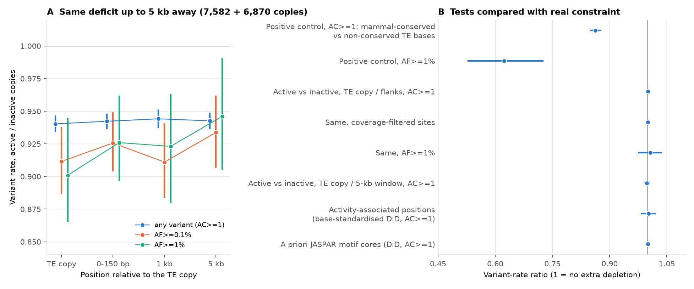
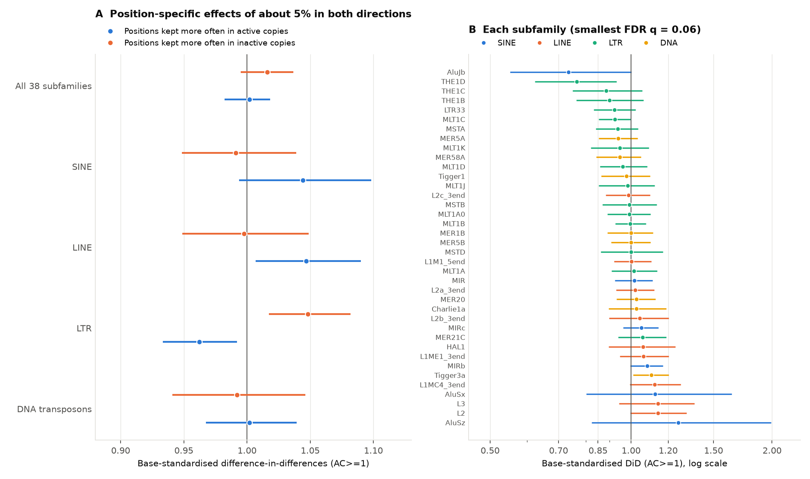
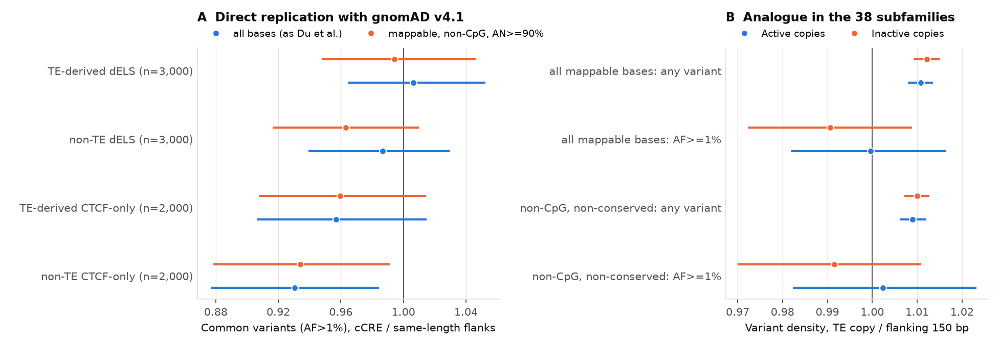

# Regulatory marks on transposable-element copies did not predict detectable extra purifying selection in 76,215 human genomes: the 6% variant deficit of marked copies is regional

Copyright (c) 2026 the publisher of this SCI publication. Text, figures and data: CC BY 4.0; code: MIT (see `LICENSE`).
Produced by an autonomous Claude Code agent (claude-opus-5-5) in the SCI research swarm on the Mac mini 'oya', run d6db8cbb-2d5b-455c-a9ee-b140aaee915b.

## Summary

Copies of transposable elements (TEs, the "jumping genes" that make up about half of human DNA) that carry ENCODE regulatory marks did not lose more human genetic variation than unmarked copies of the same TE family, after we took the DNA around them into account. This matters because low human variation in marked, TE-derived DNA is often used as evidence that this DNA has a function. Purifying selection removes harmful mutations, so functional DNA should carry fewer variants.

We compared 22,796 marked ("active") and 20,705 unmarked ("inactive") copies from 38 TE subfamilies. A subfamily is a group of copies that descend from one ancestral element. Active copies contain the centre of an ENCODE candidate cis-regulatory element (cCRE). Inactive copies have no cCRE and no DNase-accessible site within 1 kb. We counted single-nucleotide variants in 76,215 gnomAD v4.1 genomes. We compared copies at the same position of their shared consensus sequence. We excluded CpG sites, unmappable sites and sites where the copy differs from the consensus.

- Active copies had 5.6% fewer variant sites than inactive copies (rate ratio 0.944, 95% CI 0.940-0.948).
- DNA beside the copies (0-150 bp), 1 kb away and 5 kb away had the same deficit (0.942, 0.944 and 0.943). Relative to its flanks, an active copy had no extra deficit (1.001, 95% CI 0.996-1.005). The result was the same at sites with full gnomAD coverage, at C/G sites (1.004) and at A/T sites (1.000).
- Positive control: TE bases conserved across 241 mammals had 14% fewer variants than non-conserved bases (0.863, 95% CI 0.848-0.877). If constraint in active copies were as strong as at those bases, it could affect at most about 3% of their analysable bases relative to the flanks, or about 7% relative to DNA 5 kb away.
- Positions where active copies keep the consensus base more often had no extra deficit after we compared them with positions of the same base (difference-in-differences 1.002, 95% CI 0.983-1.021). Nor did a priori transcription-factor motif positions (1.000, 0.994-1.005). The activity-associated positions were 89% C/G bases and were not robustly enriched for motifs, so they mostly mark regional retention of C/G.
- TE classes deviated by about 5% in both directions (LTR 0.962, LINE 1.047). In LTRs, the deficit came with a mirror-image excess at positions that predict inactivity. These deviations set the detection limit of the position test and are not evidence of selection.
- We repeated a published comparison (Du et al. 2024: common variants in TE-derived cCREs versus same-length flanks) with gnomAD and the V4 registry. TE-derived enhancer-like cCREs had no deficit (1.006, 95% CI 0.965-1.053). TE-derived CTCF-only cCREs had a small deficit in the same direction as Du et al. (0.957, 0.906-1.015; 0.938, 0.883-0.997 at mappable non-CpG sites), smaller than in non-TE CTCF-only cCREs (0.930).

Main limits: the 38 subfamilies exclude the youngest families (for example LTR12C and MER41B), in which most copies carry a mark. Population data cannot detect weak selection. The bound covers only the analysable bases (about two thirds of the bases of a copy; CpG and diverged bases are excluded) and is an average over copies. The activity label comes from the cell types that ENCODE assayed.

## 1. Question

ENCODE maps put the centre of a cCRE (registry V4) in 21% of the 3.2 million human TE alignments of 150 bp or longer (this study). Two readings compete. In one, these marks show that much TE-derived DNA is co-opted regulatory sequence with a function. In the other, most marks are biochemical activity without a fitness consequence. Population genetics can separate the two: purifying selection removes new harmful mutations, so functional bases carry fewer variants, and rarer ones.

Earlier tests compared marked DNA with unmarked genome or with flanking DNA (Ward & Kellis 2012; Du et al. 2024). Such comparisons mix selection with mutation-rate differences, regional effects (background selection, replication timing, chromatin), mappability and coverage. TE copies give a better control: copies of one subfamily start from the same sequence. So an active copy can be compared with inactive copies of the same subfamily at the same consensus position. Positions that predict activity can also be compared with positions that do not (a difference-in-differences design).

Question: do TE copies with regulatory marks show purifying selection in humans beyond what their genomic region and sequence explain, and is it concentrated at the positions that make a copy active?

## 2. Choice of question (assessment written before the analysis)

The full pre-analysis plan is `files/notes/PLAN.md`; we wrote it before we analysed any variant data. We considered these approaches from first principles: comparative constraint; human population constraint; biochemical maps; public perturbation data (MPRA, CRISPRi); natural human knockouts (deletions); trait association; sequence models and random-sequence nulls; theory (load bounds); and internal replicates (TE copies).

| Candidate | If yes / if no, experts would... | P(surprise) | Reusers | Strongest argument against |
|---|---|---|---|---|
| C1 TE paired-copy test (chosen) | Yes: treat marks on TE copies as evidence of selected function; give variants in TE-cCREs more weight. No: stop treating marks or low variation in TE-cCREs as evidence of function. | 0.3 | TE and regulatory genomics, ENCODE/SCREEN users, variant prioritisation, the "junk DNA" debate | Du et al. 2024 already reported weak depletion; selection on young elements is weak, so a null may be power-limited |
| C2 Re-test of Ward & Kellis 2012 (non-conserved cCREs) with gnomAD and Zoonomia | Accept or reject about 4% of the genome under lineage-specific constraint | 0.2 | Same | Chen et al. 2024 (Gnocchi) and primate constraint maps cover much of it; strong dependence on the mutation model |
| C3 Deletion versus point-mutation tolerance of regulatory elements (gnomAD-SV) | Support or reject redundancy as the reason for low conservation | 0.2 | Enhancer biology | Radke et al. 2021, Collins et al. 2020; sparse SV data; detection bias in repeats |
| C4 Updated mutational-load bound on the functional fraction | Narrow the functional-fraction range | 0.1 | Theory | Assumptions dominate; the debate is about definitions |
| C5 MPRA activity versus human constraint for non-conserved elements | Link measured activity to selection | 0.2 | MPRA users | Episomal assays; narrow contrast among selected elements |

We chose C1 because its design removes most of the confounds that limit C2 and C3, it addresses the largest part of so-called junk DNA, and it tests a specific published claim.

Prior prediction (from the plan): a 2-6% deficit at activity-associated positions in active copies (P(clearly significant) = 0.6), larger in old families (MIR, L2) than in young primate families; a copy-level deficit that is mostly regional; P(no detectable selection) = 0.35.

## 3. Data

All data are public (accessed 2026-11-13 and 2026-11-14). Large files were streamed; derived files are in `files/data/` and `files/results/`.

| Data | Source | Use |
|---|---|---|
| RepeatMasker alignments, hg38 (UCSC, 2014 run) | `hgdownload.soe.ucsc.edu/goldenPath/hg38/bigZips/hg38.fa.align.gz`, `hg38.fa.out.gz` | TE copies and base-level consensus coordinates |
| hg38 sequence | `hgdownload.soe.ucsc.edu/goldenPath/hg38/bigZips/hg38.2bit` | reference bases, CpG status, trinucleotide context |
| ENCODE cCRE registry V4 (2,348,854 cCREs) | `downloads.wenglab.org/Registry-V4/GRCh38-cCREs.bed` | activity label; replication sample |
| DHS index (Meuleman et al. 2020; 733 biosamples) | Zenodo record 3838751 | strict inactive label; breadth of accessibility |
| Umap k100 mappability (Karimzadeh et al. 2018) | `bismap.hoffmanlab.org/raw/hg38/k100.umap.bed.gz` | mappable sites |
| gnomAD v4.1 genomes sites VCF (76,215 genomes; maximum allele number 152,430) | `storage.googleapis.com/gcp-public-data--gnomad/release/4.1/vcf/genomes/` (remote tabix) | single-nucleotide variants (PASS) |
| gnomAD v4.1 genomes all-sites allele number (12 GB) | `.../release/4.1/tsv/genomes/gnomad.genomes.v4.1.allele_number_all_sites.tsv.bgz` (streamed once) | coverage at every site, including sites without variants |
| Zoonomia 241-mammal phyloP (Sullivan et al. 2023) | `hgdownload.soe.ucsc.edu/goldenPath/hg38/cactus241way/cactus241way.phyloP.bw` | positive control; non-conserved site set |
| JASPAR 2024 CORE vertebrates (non-redundant, 879 motifs) | `jaspar.elixir.no/download/data/2024/CORE/` | a priori motif positions in the consensus sequences |

## 4. Methods

**Units and labels.** Units are RepeatMasker alignment records of at least 150 bp on autosomes, with at least 90% Umap k100 mappable bases. Each record has a base-level alignment to its consensus. Active: the record contains the centre of a V4 cCRE (any class). Inactive: no cCRE and no DHS-index element within the record or 1 kb on each side.

**Choice of subfamilies.** 171 subfamilies have a median divergence of at least 8% (to keep mappability high) and at least 500 active and 500 unmarked copies (309 with at least 200 of each). Because of the download budget, we hand-picked 38 of them to cover the four TE classes, mostly those with the largest number of copies in the smaller group within each class, plus a set of MaLR LTRs. We made this choice before we saw any variant data (`files/data/subfamily_activity_summary_all_TE.tsv.gz` lists all subfamilies). The young LTR families were not eligible. In LTR12C, MER41B, MER11A, LTR7, LTR8 and MER50, 95%, 69%, 45%, 45%, 56% and 54% of copies carry a cCRE. After the DHS and mappability filters, only 7, 38, 80, 87, 86 and 75 strictly inactive copies remained (`files/results/young/young_families_selection_check.txt`); LTR12C, MER11A and LTR7 also have median divergence of about 8% or less.

In each subfamily we sampled up to 600 active copies (half with a DHS open in at least 20 biosamples) and up to 600 inactive copies matched to the active copies by divergence decile. That gave 43,667 copies. 43,501 passed a quality filter: the median allele number of their variants was at least 80% of the maximum. The filter removed 4 active and 162 inactive copies.

**Sites.** A site is a genome base aligned to a consensus position where the reference base equals the consensus base (the ancestral TE state). We excluded reference CpG bases, consensus CpG positions, unmappable bases, bases within 3 bp of the start of an indel record and bases with a non-PASS SNV. That left 10,440,520 analysable sites: 6,046,795 in active and 4,393,725 in inactive copies, about 65% of the bases of the copies. A site is a "variant" site if gnomAD has a PASS SNV with allele count (AC) of at least 1. We also used thresholds on total allele frequency (AF) of at least 1e-4, 1e-3 and 1e-2, a rare class (AC of at least 1 and AF below 1e-4), and singleton status (AC = 1). For coverage, we streamed the gnomAD all-sites allele-number table once. 99.6% of analysable sites in active copies and 99.5% in inactive copies have an allele number of at least 90% of the maximum; a coverage-filtered site set uses only these (for the level ratio, in both the TE copy and its flanks; `level_effect.tsv`).

**Copy-level (regional) test.** Active versus inactive copies: Mantel-Haenszel rate ratio stratified by subfamily x chromosome fold x consensus position. For the 150-bp flanks: observed variant sites divided by the number expected from flank-wide trinucleotide rates. The "level" ratio is the TE ratio divided by the flank ratio. For a random third of the copies (7,582 active, 6,870 inactive) we also fetched 200-bp windows 1 kb and 5 kb away and computed the same ratio with trinucleotide-expected counts.

**Position-specific test.** Activity-associated positions (M) are consensus positions where active copies keep the consensus base more often than inactive copies (log odds-ratio z of at least 2.5; at least 30 aligned copies per group). We defined them on copies from odd chromosomes and tested them on even chromosomes, and the reverse (cross-fitting). Comparison positions (C) have |z| < 2.5. The difference-in-differences (DiD) is the Mantel-Haenszel rate ratio (active / inactive) at M positions divided by the ratio expected from C positions with the same consensus base in the same stratum (base standardisation). This removes copy-level and region-level effects and the base dependence of the regional deficit.

Uncertainty comes from a bootstrap over copies within subfamily x fold x group (1,000 replicates). A second null moves the M set by a random circular shift along the classified positions of each stratum (2,000 shifts). This keeps the cluster structure of M and captures position-level variation that the copy bootstrap ignores.

Controls: (i) "anti" positions, where inactive copies keep the consensus base more often (z at most -2.5); (ii) a placebo that splits inactive copies at random into two groups and repeats the whole procedure; (iii) the singleton fraction among variant sites, which mutation-rate differences change little. A priori motif positions: high-information positions (at least 1 bit) of JASPAR hits (p < 1e-4) in the consensus sequence, and all positions of strong hits (p < 1e-6). The plan named this test class; we chose these thresholds after the review. These positions do not depend on the copies, so they need no cross-fitting.

**Positive control.** Variant rate at TE sites with Zoonomia phyloP of at least 2.27 (5% FDR constraint) versus sites with phyloP below 1, in the same subfamily, group and consensus position (Mantel-Haenszel), at each allele-frequency threshold.

**Replication of Du et al. 2024.** We sampled V4 cCREs at random: 3,000 TE-derived and 3,000 non-TE dELS, and 2,000 TE-derived and 2,000 non-TE CTCF-only cCREs. TE-derived means at least 50% of the cCRE lies in one RepeatMasker TE (the definition of Du et al.); non-TE means no overlap with a TE. Flanks are the two adjacent regions of the same length as the cCRE. We computed the density of common variants (AF > 1%, PASS SNVs) in the cCRE divided by that in the flanks, for all bases (as in Du et al.) and for mappable, non-CpG, coverage-filtered bases. We also give an analogue in the 38 subfamilies: TE copy versus its 150-bp flanks, active and inactive.

**Numerical safeguard.** On this machine (Apple Accelerate BLAS through numpy 2.5.4), a float32 matrix product sometimes returned non-finite values. All matrix products in the analysis are float64 products checked against exact integer row and column checksums, with an exact integer fallback. `files/results/main/blas_check.txt` reports 0 fallbacks in 102,492 checked products in the final run.

## 5. Results

**Figure 1.** (A) Variant rate of active divided by inactive copies, at the TE copy (matched consensus positions), in the flanking 150 bp, and in 200-bp windows 1 kb and 5 kb away, for three allele-frequency thresholds (bars: 95% bootstrap CI over copies). (B) Positive controls (mammal-conserved versus non-conserved TE bases) compared with the tests for extra depletion in active copies.

### 5.1 The deficit of active copies is a property of their region

| Comparison (active / inactive) | AC >= 1 | AF >= 1e-3 | AF >= 1e-2 |
|---|---|---|---|
| TE copy, matched consensus positions (all copies) | 0.944 (0.940-0.948) | 0.922 (0.907-0.936) | 0.930 (0.905-0.952) |
| Flanking 0-150 bp (all copies) | 0.943 (0.940-0.947) | 0.922 (0.909-0.936) | 0.923 (0.904-0.943) |
| TE copy relative to flanks ("level") | 1.001 (0.996-1.005) | 1.000 (0.980-1.020) | 1.007 (0.975-1.037) |
| Level, coverage-filtered sites | 1.001 (0.996-1.005) | | 1.009 (0.978-1.041) |
| Level, C/G sites / A/T sites | 1.004 / 1.000 | | 1.017 / 1.009 |
| TE copy (distance subset) | 0.940 (0.934-0.947) | 0.912 (0.887-0.938) | 0.901 (0.865-0.944) |
| Window 1 kb away | 0.944 (0.937-0.951) | 0.911 (0.883-0.941) | 0.923 (0.880-0.963) |
| Window 5 kb away | 0.943 (0.936-0.949) | 0.934 (0.907-0.962) | 0.946 (0.905-0.991) |
| TE copy / 5-kb window | 0.998 (0.990-1.005) | 0.976 (0.939-1.017) | 0.952 (0.898-1.011) |

The level ratio was close to 1 in each TE class (SINE 0.997, LINE 1.006, LTR 1.002, DNA 0.999) and for non-conserved sites only (1.002). The regional deficit depends on the base: it is 7.0% at C/G sites and 4.0% at A/T sites (TE ratio 0.930 and 0.960; flank ratio 0.926 and 0.960). A difference in local mutation spectrum (or in variant calling) explains a base-dependent deficit better than background selection does, because background selection lowers diversity at all bases alike. For common variants the TE copy has a small extra deficit relative to the 5-kb window (0.952, 0.898-1.011); it is not significant and is possibly biased (Section 6.3).

The positive control shows that the test detects real constraint. Mammal-conserved TE bases had 0.863 (0.848-0.877) of the variant rate of non-conserved bases at AC >= 1, and 0.623 (0.527-0.726) at AF >= 1%. Active copies have about twice as many such bases as inactive copies (1.0% versus 0.6% of analysable sites).

Bound. Take the lower 95% limit of the level ratio (0.9964). Bases constrained as strongly as conserved TE bases can then make up at most (1 - 0.9964) / (1 - 0.863), about 2.6%, of the analysable bases of active copies beyond what their flanks show. If the flanks are part of the same regulatory element, the 5-kb window is the better reference: its lower limit (0.990) gives about 7%. For common variants the bounds are wider (about 7% from the level ratio and 27% from the 5-kb window). These bounds apply to the analysable bases (about 65% of the bases of a copy; CpG and diverged bases are excluded). They are averages over copies, so a minority of strongly constrained copies is still possible. Weaker constraint could affect more bases.

### 5.2 Positions that predict activity

**Figure 2.** (A) Base-standardised difference-in-differences at positions kept more often in active copies (blue) and at positions kept more often in inactive copies (orange), all variants (AC >= 1). Values below 1 mean fewer variants in active copies at those positions than expected from positions of the same base in the same copies. (B) DiD for each subfamily, coloured by TE class; bars are 95% bootstrap CIs.

Cross-fitting gave 877 unique activity-associated positions (928 position x fold rows; 110,416 analysable sites in active copies). Only 51 positions were activity-associated in both folds, against 8.7 expected if the folds were independent, so the M set is reproducible but noisy. 89% of M positions are C or G in the consensus, against 47% of C positions. Counted once per position and stratified by subfamily x consensus base, M positions are not robustly enriched for high-information motif positions (59.9% versus 56.2%; odds ratio 1.11, p = 0.17; unstratified p = 0.035). Single positions do lie in known motifs, for example the CTCF motif of MER20 (`files/results/motif/motif_instances.tsv`). But as a set, M positions mostly reflect the regional retention of C/G bases in active copies.

| Test (AC >= 1 unless stated) | Base-standardised DiD (95% bootstrap CI) | Unstandardised | shift-null p |
|---|---|---|---|
| All 38 subfamilies | 1.002 (0.983-1.021) | 0.987 | 0.82 |
| AF >= 1e-4 / AF >= 1e-2 | 0.984 (0.914-1.043) / 0.900 (0.736-1.035) | 0.963 / 0.868 | 0.77 / 0.35 |
| SINE / LINE / LTR / DNA | 1.044 / 1.047 / 0.962 / 1.002 | 1.005 / 1.038 / 0.954 / 0.986 | 0.07 / 0.03 / 0.02 / 0.92 |
| A priori motif cores (14,490 unique positions; 3.3 million active sites) | 1.000 (0.994-1.005) | 0.998 | 0.71 |
| A priori strong motif hits (936 unique positions) | 1.009 (0.994-1.023) | 1.011 | 0.22 |
| Control: anti positions | 1.016 (0.993-1.038) | 1.023 | 0.14 |
| Control: random split of inactive copies | 0.978 (0.915-1.040) | 0.977 | 0.56 |
| Sensitivity: z >= 2.0 / z >= 3.5 | 1.004 (0.991-1.016) / 0.970 (0.911-1.034) | | |
| Sensitivity: context-matched / non-conserved / coverage-filtered sites | 1.006 (0.981-1.029) / 1.003 (0.983-1.021) / 1.002 (0.982-1.018) | | |

The singleton fraction did not change at activity-associated positions (DiD in singleton fraction +0.002, 95% CI -0.007 to +0.013). At strong motif hits it was lower in active copies (-0.010, -0.017 to -0.002), which is the opposite of the signature of selection. This readout is weak: even conserved bases raise the singleton fraction by only 1.4 percentage points (95% CI 0.6-2.3). No subfamily passed a false-discovery rate of 5% (smallest Benjamini-Hochberg q = 0.057, for AluJb and THE1D, with the shift null).

TE classes deviate in both directions: SINE and LINE M positions have about 4-5% more variants than expected, and LTR M positions about 4% fewer. In LTRs the rare-variant DiD was 0.960 (0.932-0.990) at activity-associated positions and 1.050 (1.012-1.086) at anti positions (Figure 2A). Selection on activity would lower variation at the positions that make a copy active, but would not raise it at the positions that make a copy inactive. A mutation-rate difference between active and inactive copies that is specific to a position explains both, and also the divergence pattern that defines the two sets. Possible sources are sequence context beyond the adjacent bases, sub-lineages of a subfamily that differ in both activity and mutability, or methylation-linked decay. We did not test which source applies. Deviations of about 5% in both directions are therefore the detection limit of this test.

DHS breadth gave no gradient (base-standardised DiD 0.967 with no DHS, 1.012, 1.003, 0.993 and 1.007 for 1-9, 10-49, 50-149 and 150 or more biosamples). By cCRE class: dELS 1.003, pELS/PLS 1.019, CTCF-only 1.037, others 0.983. Active copies with at least 10% mammal-conserved sites gave 1.032 (0.933-1.131).

### 5.3 Replication of Du et al. 2024

**Figure 3.** (A) Direct replication: density of common variants (AF > 1%) in cCREs divided by that in same-length flanks, for random TE-derived and non-TE cCREs of two classes, with all bases (as in Du et al.) and with mappable, non-CpG, coverage-filtered bases. (B) Analogue in the 38 subfamilies: variant density in the TE copy divided by that in its 150-bp flanks, for active and inactive copies.

Du et al. (2024) reported fewer common variants (1000 Genomes, AF > 1%) in TE-derived dELS and CTCF-only cCREs than in flanks of the same length. They concluded that these cCREs are "under functional constraint". With gnomAD v4.1 and random samples of the V4 registry, the cCRE/flank ratio of common-variant density was:

| cCRE group | All bases | Mappable, non-CpG, coverage-filtered |
|---|---|---|
| TE-derived dELS (n = 3,000) | 1.006 (0.965-1.053) | 0.994 (0.948-1.046) |
| Non-TE dELS (n = 3,000) | 0.987 (0.939-1.030) | 0.963 (0.916-1.010) |
| TE-derived CTCF-only (n = 2,000) | 0.957 (0.906-1.015) | 0.960 (0.908-1.014) |
| Non-TE CTCF-only (n = 2,000) | 0.930 (0.877-0.985) | 0.934 (0.878-0.992) |

At mappable non-CpG sites without the coverage filter, TE-derived CTCF-only cCREs gave 0.938 (0.883-0.997). Fewer than 1% of the bases in these cCREs and flanks were unmappable in Umap k100, so mappability does not explain the gnomAD results. It can still have affected the low-coverage 1000 Genomes calls that Du et al. used. TE-derived enhancer-like cCREs did not have fewer common variants than their flanks. TE-derived CTCF-only cCREs had a small deficit in the same direction as Du et al., smaller than in non-TE CTCF-only cCREs, which agrees with the known constraint on CTCF sites.

The design differs from that of Du et al. in three ways. (1) We sampled from registry V4; Du et al. used registry V2 (926,535 cCREs). (2) We used gnomAD v4.1 instead of 1000 Genomes Phase 3. (3) We did not exclude cCREs that overlap coding sequence or flanks that contain it. Coding flanks carry fewer common variants, so (3) can only raise the ratio; it works against replication, but distal cCREs rarely touch coding sequence. In the 38 subfamilies, the TE copy / flank ratio for common variants was 1.000 (0.982-1.016) in active copies and 0.991 (0.972-1.009) in inactive copies (Figure 3B).

A flank comparison cannot separate selection from regional effects in any case: the flanks share the region of the cCRE, and we show in 5.1 that the region carries the deficit. Our sample sizes exclude deficits larger than about 4% in TE-derived dELS. Du et al. analysed all cCREs and may have detected a smaller deficit; the two results are compatible only if that deficit is small.

## 6. Interpretation

### 6.1 What the result shows

In 38 TE subfamilies of intermediate and old age (SINE, LINE, MaLR LTR and DNA transposons), a regulatory mark on a copy did not come with detectable extra purifying selection in humans. The 6% lower variation near marked copies extends at least 5 kb from the copy and depends on the base. This agrees with regional effects in gene-rich, accessible, early-replicating DNA, such as regional mutation processes (Seplyarskiy et al. 2021) and background selection (Murphy et al. 2022), and not with selection on the element. Part of this regional contrast is built into the design: the inactive copies come from regions without cCREs or DHSs. In these subfamilies, only 15-23% of copies (interquartile range) have no cCRE within 1 kb, and fewer have no DHS either. The informative results are the element-specific comparisons: the copy against its flanks and against DNA 5 kb away, and the position test.

### 6.2 What it does not show

- It does not show that marked TE copies have no regulatory activity. Biochemical and reporter activity can exist without fitness effects large enough to deplete variation in 76,215 genomes.
- It does not cover the youngest co-opted families (LTR12C, MER41B, MER11, LTR7, LTR8, MER50).
- Population data detect selection with heterozygous selection coefficients of roughly 1e-3 or more. Weaker selection, which can still matter over evolutionary time, is not excluded.
- The analysable bases exclude CpG sites (which removes motifs such as CRE and E-box cores) and bases where the copy differs from the consensus. Gain-of-function changes, a main route by which TE copies become regulatory elements, are therefore not tested.
- The bound is an average. A minority of strongly constrained copies is compatible with the data.

### 6.3 Biases and their direction

- Common variants: copies whose motifs are broken by a common derived allele in ENCODE biosamples are less likely to be called active. This can produce a deficit of common variants in active copies without selection, and an excess at anti positions (at AF >= 1%, DiD 1.24 at anti positions and 0.87 at activity-associated positions before base standardisation; 1.09 and 0.90 after it, with wide intervals). The AF >= 1e-2 results are therefore not evidence of selection. Rare variants (mostly singletons) are free of this bias.
- Mutagenesis at bound sites (Reijns et al. 2015) would raise variation at bound positions and hide selection. The position test shows that position-specific differences of this size (about 4-5%) exist in both directions.
- The flank normaliser could absorb selection if the flanks belong to the same regulatory element; the 1-kb and 5-kb windows address this for the copy-level deficit.
- The copy bootstrap does not model spatial correlation between copies and treats the M set as fixed; the circular-shift null addresses the second point.

### 6.4 Relation to earlier work

- Ward & Kellis (2012) inferred lineage-specific constraint on non-conserved active elements from lower diversity; Bray & Pachter (2012) criticised the statistics. Our data show that lower diversity around active TE copies is regional, and that a comparison with the same region and the same sequence removes it.
- Du et al. (2024) also reported that TE-derived cCREs are "generally less constrained" than non-TE cCREs, which agrees with our results. Their inference of constraint from fewer common variants than in flanks did not replicate for TE-derived dELS with gnomAD.
- Simonti et al. (2017) proposed that exaptation of TEs into regulatory regions is rare; our bound agrees. Cerruti et al. (2024, preprint) related a sequence-based cCRE score of TE copies to age, conservation and Tajima's D, and found differences in selective regimes between categories of TEs. Our study adds a within-family, position-matched test in a large human sample. We know of no earlier study with this design.
- Chen et al. (2024; Gnocchi) and Sullivan et al. (2023) map constraint in windows or by conservation. A within-family control like ours can calibrate such maps for TE-derived elements.

## 7. Predictions that a laboratory can test

1. **Activity without fitness effect.** In a saturation-mutagenesis MPRA of active MER20 copies, mutations in the CTCF motif (consensus 98-130) will reduce CTCF binding and insulator or reporter activity. Our data predict that the same mutations are not depleted in humans. This gives the size of a molecular effect that carries no detectable fitness cost.
2. **Mutation-rate difference in LTR copies.** In mutation-accumulation experiments (clonal expansion and whole-genome sequencing of human cells) or in large de novo mutation sets, active MaLR LTR copies (THE1B/C/D, MLT1C) will show a lower mutation rate than inactive copies at activity-associated consensus positions, and a higher rate at anti positions, by about 4-5% each. If this is not found, the LTR signal more likely reflects weak selection.
3. **Base-dependent regional deficit.** In de novo mutation data, C/G sites within 5 kb of active TE copies will show about 7% fewer mutations, and A/T sites about 4% fewer, than the same bases near inactive copies. If de novo rates do not differ, the deficit comes from selection on linked sites or from variant calling rather than from mutation.
4. **Young families.** In LTR12C and MER41B, compare copies with strong versus weak marks (for example by DHS breadth) with the same within-family, position-matched design and distant windows. The 38 families studied here predict a regional deficit and no element-specific deficit, except in copies that are also conserved in primates.

## 8. Limitations

- Activity label: the union of ENCODE biosamples (any V4 cCRE class). Tissues that ENCODE did not assay may contain more functional copies; this would dilute the contrast.
- Selected subfamilies: 38 of 171 eligible, chosen before the variant data were seen; median divergence of at least 8%; young LTRs and young Alus are not included.
- Mappability: only copies with at least 90% Umap k100 mappable bases.
- Indel masking: only bases within 3 bp of the start of an indel record; long deletions are not fully masked.
- Power: about 110,000 sites at activity-associated positions in active copies. Position-specific deviations of about 5% occur in both directions without evidence of selection, so smaller selective effects at these positions cannot be resolved.
- Several analyses were added after a first look at half of the data or after the independent review (Section 10). The main estimands of the plan were kept.

## 9. Outcome compared with the prior prediction

| Prediction (before the analysis) | Result |
|---|---|
| DiD 0.94-0.98 at activity-associated positions, P(clearly significant) = 0.6 | 1.002 after base standardisation (0.987 before); a priori motif positions 1.000 |
| Larger effect in old families (MIR, L2) | Not seen |
| Copy-level deficit mostly regional | Yes, entirely regional to the precision of the data (level ratio 1.001; same deficit at 5 kb) |
| P(no detectable selection) = 0.35 | This outcome occurred |

Usefulness compared with expectation: the position-specific test was less informative than we hoped. The positions that predict activity mostly track base composition, and position-specific differences of about 5% occur in both directions, which limits power. The regional result and the replication were more useful than we expected. They give a direct, quantitative reason not to read low variation in TE-derived cCREs as selection, with a stated bound. They also give a reusable control design (same family, same position, flanks, distant windows, full coverage) for claims about constraint on repeated sequence. Overall importance is modest: the result agrees with the view that most TE-derived regulatory marks are not under strong selection, and it makes that view quantitative for these families.

## 10. Changes during the work (deviations from the plan)

1. The RepeatMasker `.out` records and the alignment records use different units (for example `L2a_3end`). We used alignment records as units so that each copy has a base-level consensus map. The plan named 37 subfamilies of `.out` units; the final set is 38 alignment-unit subfamilies.
2. The planned ratio estimator was unstable for long consensus sequences with sparse positions; we used Mantel-Haenszel rate ratios.
3. After a first run on half of the data (44 of 84 download chunks), we added the positive control (Zoonomia phyloP), the distant windows (1 kb and 5 kb) and the circular-shift null. After the full run we added the rare/common split.
4. After the independent review we made these changes:
   - base-standardised the position test (the unstandardised values are also reported);
   - defined the comparison set as |z| < 2.5 for both tests;
   - added the a priori motif test that the plan named but the first version did not report (thresholds set after the review);
   - corrected the motif-enrichment test (each position counted once, stratified by subfamily x base);
   - added the gnomAD all-sites coverage filter, the base-specific level ratios and positive controls at all thresholds;
   - replaced the indirect Du et al. comparison with a direct replication;
   - stated the scope of the bound.
5. BLAS safeguard (Section 4).

## 11. Reproduction

`files/scripts/run_all.sh` runs the main pipeline from the public inputs in Section 3 (about 3 hours on one Apple M1, mostly gnomAD streaming; peak memory below 1 GB per process; Python 3.12 with numpy, pandas, pyarrow, scipy, statsmodels, matplotlib, pysam 0.24 and pyBigWig; a C compiler for `anfilter.c`).

`files/scripts/final_run.sh` reproduces the main analysis, the sensitivity analyses, the rare/common split, the calibration, the motif tables and the figures from the compact matrices in `files/data/matrices/` (about 1 hour, no download). Run it from the publication root. The flank, distance and replication tables need per-base site tables and variant chunks that are too large to include. Their per-copy and per-cCRE counts are included (`files/results/flank/flank_counts.tsv.gz`, `files/results/distance/distance_table.tsv.gz`, `files/results/du/du_region_counts.tsv.gz`), as are the region lists. The log of the final main run is `files/results/main/run_log.txt`. All random seeds are fixed in the scripts.

| Step | Script | Output |
|---|---|---|
| Parse RepeatMasker alignments | `01b_parse_align_headers.py`, `05_parse_align.py` | units; base-level consensus maps |
| Activity labels and selection | `02_overlap_ccre.py`, `03_select_fragments.py` | `files/data/selected_copies.tsv.gz` |
| gnomAD variants | `04_fetch_gnomad.py` (remote tabix, restartable) | variant chunks (not included) |
| gnomAD all-sites coverage | `16b_an_targets.py`, `anfilter.c` (stream: `curl ... \| gzip -dc \| anfilter targets.tsv outdir`), `06c_add_allsites_an.py` | per-site allele number |
| Site tables | `06_build_sites.py` (uses `twobit.py`), `06b_add_phylop.py`, `06c_add_allsites_an.py` | per-base tables (not included) |
| Matrices | `07_build_matrices.py`, `15_slim_matrices.py` | `files/data/matrices/*.npz` |
| Main analysis | `08_analysis.py` (with `JASPAR_DIR` for the a priori motif test) | `files/results/main/` |
| Flank analogue | `10_flank_replication.py` | `files/results/flank/` |
| Distant windows | `03b_distance_windows.py`, `04_fetch_gnomad.py` (`FLANK=0`), `13_distance.py` | `files/results/distance/` |
| Replication of Du et al. | `16a_du_regions.py`, `04_fetch_gnomad.py` (`FLANK=0`), `16c_du_analysis.py` | `files/results/du/` |
| Motifs | `09_jaspar_scan.py`, `12_motif_positions.py` | `files/results/jaspar/`, `files/results/motif/` |
| Calibration | `14_sfs_calibration.py` | `files/results/main/sfs_calibration.tsv` |
| Figures | `11_figures.py` | `files/figures/` |

Matrix format (`files/data/matrices/<subfamily>.npz`): rows are copies, columns are consensus positions.

- Site masks: N, analysable site (0/1); Nan, analysable site with all-sites allele number of at least 90% of the maximum; K, copy carries the consensus base; A, position aligned.
- Variant matrices: Y, variant (AC >= 1); Yc, Y3, Y2, variant with AF >= 1e-4, 1e-3, 1e-2; Ys, singleton site.
- PHc: phyloP class at analysable sites (0: below 1 or missing; 1: from 1 to below 2.27; 2: at least 2.27).
- Per-copy vectors: frag_id, active, chrom, fold, div, dhs, ccre_cls, qc, start, end, strand, length.
- Flank vectors: fl_obs and fl_exp give observed and trinucleotide-expected variant sites in the flanks. Suffixes 4, 3 and 2 mark the AF thresholds; S, W and AN mark C/G sites, A/T sites and coverage-filtered sites.
- cons: the consensus sequence (codes A 0, C 1, G 2, T 3).

## References

- Andrews G. et al. (2023) Mammalian evolution of human cis-regulatory elements and transcription factor binding sites. Science 380:eabn7930.
- Bray N., Pachter L. (2012) Comment on "Evidence of abundant purifying selection in humans for recently acquired regulatory functions". arXiv:1212.3076.
- Cerruti Y. et al. (2024) Sequence composition and conservation predict the phenotypic relevance of transposable elements. bioRxiv doi:10.1101/2024.03.11.584453.
- Chen S. et al. (2024) A genomic mutational constraint map using variation in 76,156 human genomes. Nature 625:92-100.
- Collins R.L. et al. (2020) A structural variation reference for medical and population genetics. Nature 581:444-451.
- Du A.Y., Chobirko J.D., Zhuo X., Feschotte C., Wang T. (2024) Regulatory transposable elements in the encyclopedia of DNA elements. Nat Commun 15. doi:10.1038/s41467-024-51921-6
- ENCODE Project Consortium (2020) Expanded encyclopaedias of DNA elements in the human and mouse genomes. Nature 583:699-710.
- Graur D. (2017) An upper limit on the functional fraction of the human genome. Genome Biol Evol 9:1880-1885.
- Karimzadeh M. et al. (2018) Umap and Bismap: quantifying genome and methylome mappability. Nucleic Acids Res 46:e120.
- Kuderna L.F.K. et al. (2024) Identification of constrained sequence elements across 239 primate genomes. Nature 625:735-742.
- Meuleman W. et al. (2020) Index and biological spectrum of human DNase I hypersensitive sites. Nature 584:244-251.
- Murphy D.A. et al. (2022) Broad-scale variation in human genetic diversity levels is predicted by purifying selection on coding and non-coding elements. eLife 11:e76065.
- Radke D.W. et al. (2021) Purifying selection on noncoding deletions of human regulatory loci detected using their cellular pleiotropy. Genome Res 31:935.
- Rauluseviciute I. et al. (2024) JASPAR 2024. Nucleic Acids Res 52:D174-D182.
- Reijns M.A.M. et al. (2015) Lagging-strand replication shapes the mutational landscape of the genome. Nature 518:502-506.
- Seplyarskiy V.B. et al. (2021) Population sequencing data reveal a compendium of mutational processes in the human germ line. Science 373:1030-1035.
- Simonti C.N., Pavlicev M., Capra J.A. (2017) Transposable element exaptation into regulatory regions is rare, influenced by evolutionary age, and subject to pleiotropic constraints. Mol Biol Evol 34:2856.
- Sullivan P.F. et al. (2023) Leveraging base-pair mammalian constraint to understand genetic variation and human disease. Science 380:eabn2937.
- Ward L.D., Kellis M. (2012) Evidence of abundant purifying selection in humans for recently acquired regulatory functions. Science 337:1675-1678.
