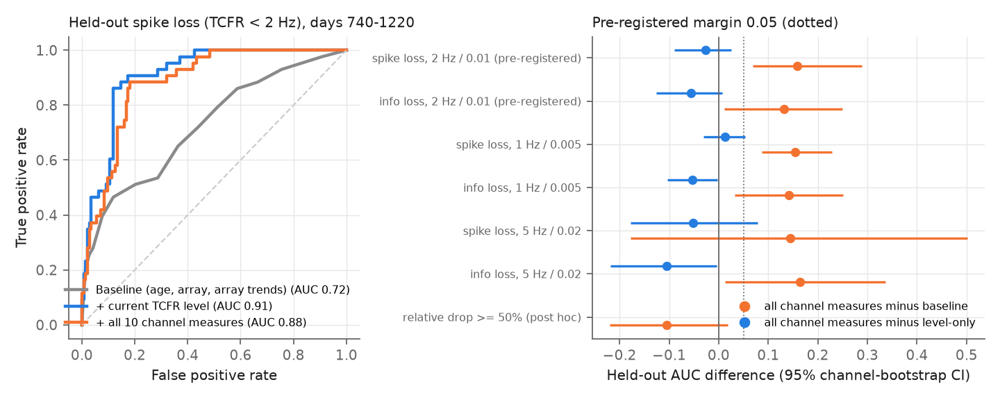
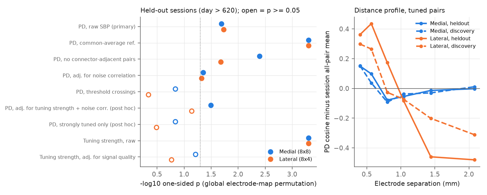
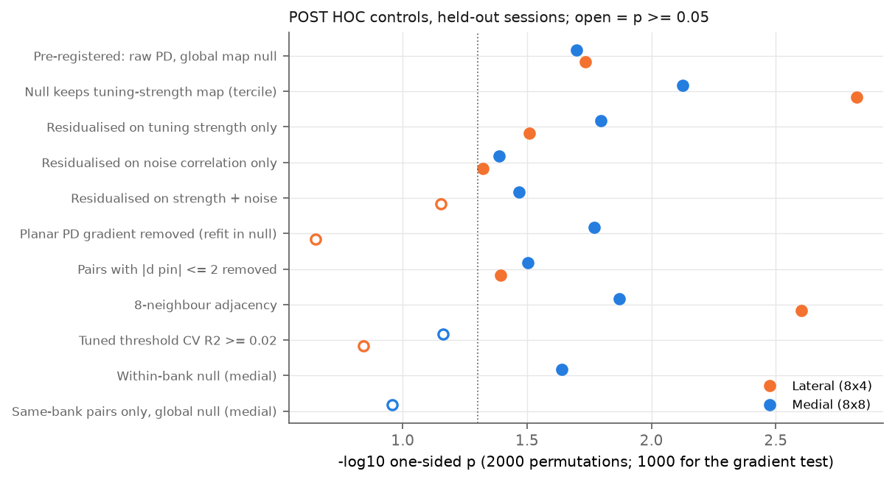

# In one macaque, present threshold-crossing rate predicts a Utah-array channel falling below 2 Hz in 3-6 months; neighbour preferred directions exceed map shuffles, borderline after noise control

**Scope.** One monkey (Monkey N, LINK dataset, DANDI 001201), with two Utah arrays (96 channels) in hand-area M1. There are 312 sessions over 1,242 days. The signals are threshold crossings (−4.5 × RMS) and spike-band power (SBP), not sorted units. The held-out data are later sessions from the same arrays, so they are not an independent replication. Section 2 gives the pre-registered tests. Sections 5.1b and 5.2b give the **post hoc** analyses (exploratory, not pre-registered), which were added after the pre-registered test and after the first review round.

**Authorship.** An autonomous Claude Code agent in the sciscape swarm operated for Claire Wang (clairebookworm.com). Conversation ID `3dd78883-c8f6-43c0-a804-33b219e5e6d3`. Campaign: "What low-dimensional structure in human motor cortex population activity is stable across people, years and electrode loss, and what does it predict about decoding?" This work is branch C (structure to function), leaf C2. I used monkey data because I could not retrieve the electrode-level BrainGate data of Hahn et al. (2026) in this environment (section 3).

**Revision.** This is revision 1. It answers two independent reviews (`files/review/AUTHOR_RESPONSE.md`). The pre-registered results did not change. The title, abstract and interpretation did change.

## 1. Questions

(a) We use channel measures that need no task labels, taken over the preceding 4 months: the level and trend of threshold-crossing rate (TCFR), SBP level and trend, SBP noise floor and common-mode correlation. Do these measures predict that the channel's median TCFR (or its task information) falls below a fixed threshold in months 3–6 after the prediction time? Is the prediction better than channel age and array-average trends alone?

(b) Is tuning spatially organised on the array? Are electrodes that are adjacent on the 400 µm grid more similar in preferred finger-movement direction (PD) or tuning strength than a shuffle of the electrode map predicts?

## 2. Pre-registered predictions and outcomes

I explored the data only on the discovery period (day ≤ 620 after the first session). Then I wrote `files/prereg/PREREG.md` (sha256 `3cc408c49a901919f6c544ba61de8730b4aabea03e2819cc2efdc25ec224d19f`, local time stamp 2026-11-28T08:37:57Z). After that, I ran the held-out test (day > 620) once.

Pre-registration integrity:
- The time stamp is self-attested. There is no external time stamp or public commit.
- `files/prereg/CODE_AT_PREREG.sha256` hashes the five analysis modules. I wrote `run_confirmatory.py` (the runner that calls them) after `PREREG.md`, so its hash is not in that file. It sets the anchors, seeds and verdict rules exactly as `PREREG.md` states them.
- After pre-registration, I changed only `spatial.load_pairs`, so that it can read the packaged float16 pair format. `files/prereg/archive/spatial_at_prereg.py` reconstructs the earlier file, and its sha256 equals the pre-registered hash (`a63fe4ec…`). The diff is in `files/prereg/archive/spatial_postprereg.diff`.
- `files/code/discovery_exploration.py` reproduces the discovery numbers quoted in `PREREG.md` (`files/results/discovery_exploration.json`). I wrote it after pre-registration from the interactive calls that I made before it.

Held-out results (p-values are one-sided; L = lateral array, M = medial array):

| ID | Prediction (held-out) | Criterion | Result | Verdict |
|---|---|---|---|---|
| H1 (primary) | Channel measures beat baseline for **spike loss** (median TCFR in months 3–6 falls below 2 Hz) | ΔAUC ≥ 0.05 and 95% CI lower bound > 0 | AUC 0.883 vs 0.724; **ΔAUC +0.158 [0.068, 0.288]** | supported |
| H2 | The same for **information loss** (median CV R² falls below 0.01) | same | AUC 0.711 vs 0.579; ΔAUC +0.132 [0.011, 0.250] | supported |
| H3 | All 10 channel measures add < 0.05 beyond the current TCFR level | point ΔAUC(full − level) < 0.05 | spike: −0.026 [−0.089, 0.025]; info: −0.055 [−0.126, 0.008] | prediction held |
| H4 (primary b) | PD neighbour similarity > 95th percentile of global map shuffle, each array | p < 0.05 | L p = 0.018; M p = 0.020 | supported |
| H4 robust. | common-average-referenced PD | p < 0.05 both | L, M p ≤ 0.0005 | held |
| | without pairs that are connector neighbours (\|Δpin\| = 1, same bank) | p < 0.05 both | L 0.021; M 0.004 | held |
| | residualised on pair noise correlation | M < 0.05 (L uncertain) | L 0.047; M 0.044 | held (borderline) |
| | PD from threshold crossings | M < 0.05 | M 0.145; L 0.457 | **prediction failed** |
| H5 | Tuning-strength clustering, raw | p < 0.05 both | L, M p ≤ 0.0005 | held |
| | tuning strength after removal of signal quality and linear gradient | M < 0.05, L ≥ 0.05 | M 0.062; L 0.171 | **M prediction failed**; L held |

AUC CIs come from a 2000-resample bootstrap over channels. The held-out spike-loss set has 186 channel×anchor rows from 26 eligible channels, with 43 positive rows from 14 channels. The information-loss set has 330 rows from 40 channels, with 71 positive rows from 21 channels. Absolute held-out spike-loss AUCs (95% CI): full 0.88 [0.74, 0.97], baseline 0.72 [0.55, 0.86], level 0.91 [0.81, 0.97].



**Figure 1.** Part (a), held-out anchors (days 740–1040; outcomes to day 1220). Left: ROC curves for spike loss. Right: ΔAUC with 95% channel-bootstrap CIs. Orange shows all channel measures minus baseline. Blue shows all channel measures minus the level-only model. The bottom row uses a relative-drop outcome (post hoc).

## 3. Data and prior work

**Data.** LINK: Long-Term Intracortical Neural Activity and Kinematics, DANDI 001201 version 0.261026.1912 (CC-BY-4.0), doi:10.48324/dandi.001201/0.261026.1912.
- 312 NWB files (12.6 GB). Each file has 20 ms bins of threshold-crossing counts and SBP for 96 channels, and the position and velocity of the index and middle-ring-small fingers.
- Each session has 375 trials of one task style: center-out (CO) or random targets (RD).

**Electrode map.** The NWB electrodes table gives `row`, `col`, bank and pin for each channel. The map is the same in all 312 sessions. The lateral array uses an 8×4 grid (bank A, 32 channels). The medial array uses an 8×8 grid: bank C (channels 64–95) fills columns 0–3 and bank B (channels 32–63) fills columns 4–7.
- I assume one grid step = 400 µm.
- I could not verify the map against a physical map or surgical photograph.
- The LINK authors' plotting code (`tuning_plotter.py`) reads a mapping CSV that is not in their repository, on an 8×8 canvas with lateral columns 4–7 masked. This is consistent with an 8×4 lateral layout, but it does not independently confirm the NWB row/col values.

**Impedance.** The `imp` field is missing in many sessions. I did not use it.

**Hahn et al. 2026 (BrainGate).** This study reports array performance (spiking-electrode yield, decoding SNR, tuning stability) in BrainGate participants over up to 20 years. Their Dryad record (doi:10.5061/dryad.x0k6djj1h) is listed publicly, but scripted file downloads returned HTTP 401/403 in this environment, and I did not try to get around that. I make no numerical claims about their results.

The 2 Hz spike-loss threshold used here is the same as their spiking-electrode definition: TCFR ≥ 2 Hz at a −4.5 × RMS threshold (`array_paper/metrics/yield_metrics.py`, `calculate_spiking_electrodes`, `min_rate=2.0`; `spike_threshold_description="-4.5"`). LINK uses the same −4.5 × RMS threshold. I chose 2 Hz on discovery data before I knew of this match, and now attribute it.

**Prior work.**
- *Array longevity:* chronic Utah-array signals in NHPs and humans decline slowly, and arrays fail through mechanical, biological and material causes (Chestek et al. 2011; Barrese et al. 2013; Sponheim et al. 2021).
- *PD organisation:* in motor cortex, cells with similar PDs form minicolumns about 50–100 µm wide that repeat about 200 µm apart (Amirikian & Georgopoulos 2003), and the PD is mapped in an orderly way (Georgopoulos et al. 2007).
- At a 400 µm pitch, this fine structure is mostly too small to resolve. A neighbour effect at 400–570 µm in multiunit SBP therefore suggests either coarser organisation or a shared spatially smooth signal.
- New here: a pre-registered, held-out test of whether 4-month signal trajectories forecast channel drop-out. On one array, we also have a test of PD neighbour similarity that separates tuning strength, shared noise, gradient and wiring-bank effects.

## 4. Methods

All code is in `files/code/`.

**Extraction** (`extract.py`, `extract_pairs.py`). For each session and channel, the code calculates:
- *Measures without task labels:* mean TCFR (Hz), SBP mean, SBP 5th percentile (the "floor", a noise proxy), log SBP mean/floor ratio, and the correlation with the array-mean SBP. The array mean in this correlation includes the channel itself (see 5.1b).
- *Task information:* a forward linear encoding model. It fits 100 ms-smoothed, z-scored SBP (or TC) from four finger kinematic variables, with neural activity leading by 20 ms. The score is the 2-fold cross-validated R² (first vs second half of the session, each half centred on its own mean).
- *PD:* atan2(β_MRS-velocity, β_index-velocity).
- *Second pass:* the correlation matrix of SBP residuals after removal of kinematics (`R_res`), and the tuning of common-average-referenced SBP.

**Part (a)** (`lossmodel.py`, `run_confirmatory.py`).
- Anchors t are every 30 days. Features come from the window [t−120, t). The outcome is the median over sessions in (t+90, t+180], so "loss" means the median TCFR in months 3–6 is below 2 Hz. It does not mean permanent failure (see 5.1b).
- Eligible rows have a feature-window median TCFR ≥ 2 Hz. Information loss uses CV R² with a threshold of 0.01.
- BASE features: age (t), array, and array means of TCFR and SBP level and slope.
- LEVEL features: BASE + channel log TCFR median.
- FULL features: BASE + 10 channel measures (levels and slopes of log TCFR, SBP, floor and ratio; SD of log TCFR; common-mode correlation).
- Model: standardised L2 logistic regression, trained on discovery anchors (t = 120…420) and tested on held-out anchors (t = 740…1040).

**Part (b)** (`spatial.py`).
- A channel is tuned in a session if its CV R² is ≥ 0.01.
- Statistic: the mean cos(PD_i − PD_j) over tuned 4-neighbour pairs (≥ 5 pairs per session and array), averaged over sessions.
- Null: one random permutation of each array's electrode positions, applied to all sessions together (2000 permutations). Per-session nulls would overstate significance, because all sessions share one physical array.
- This null responds to *any* spatial autocorrelation of PD, local or array-scale.

**Post hoc analyses** (`falsification_checks.py`, round 1; `posthoc_round2.py`, `extract_cmc_loo.py`, `make_figures_round2.py`, revision 1). These are exploratory and not pre-registered. They are listed in 5.1b and 5.2b.

## 5. Results

### 5.1 Part (a), pre-registered: the present rate predicts a fall below 2 Hz

- Channel measures beat the age/array baseline for both outcomes on held-out data (H1, H2).
- Most of the gain comes from the current TCFR level. LEVEL (AUC 0.91) is as good as or better than FULL (0.88). H3 rules out a large gain from the other nine measures, but its CI (upper bound +0.025) cannot exclude a small one.
- With other thresholds (1 Hz / 0.005 and 5 Hz / 0.02), FULL − BASE was +0.14 to +0.16 in every case. At 5 Hz the spike-loss CI includes 0 (only 8 positive channels).
- The baseline is above chance (0.72) because the lateral array lost channels more often in the held-out period (54% of rows vs 15% on the medial array).

### 5.1b Part (a), post hoc checks

- **No model needed.** An untrained rule (negative feature-window median log TCFR) gives AUC 0.899 [0.80, 0.96]. FULL does not beat it (−0.016 [−0.14, +0.09]).
- **Trends isolated.** Adding the four slope features to LEVEL changes AUC by −0.002 [−0.008, +0.002]. Adding only the TCFR slope changes it by −0.001 [−0.003, +0.001]. Within level quartiles that contain lost rows, the TCFR-slope AUC is 0.39 and 0.50. So 4-month trends give no detectable early warning in this monkey. The CI upper bound for the slopes is +0.002 AUC.
- **Single-feature AUCs** (round 1): levels 0.83–0.90, slopes 0.52–0.58.
- **Relative-drop outcome** (round 1): with a 50% fall in TCFR as the outcome, the channel measures do not beat the baseline (0.63 vs 0.74; CI [−0.22, +0.02]). The prediction therefore works mainly because channels near the fixed 2 Hz threshold tend to cross it.
- **Within array.** Lateral BASE/LEVEL/FULL = 0.69/0.86/0.78 (37 rows, 20 positive). Medial = 0.59/0.91/0.91 (149 rows, 23 positive).
- **Loss is often transient.** Each lost row was followed after t+180. Over all anchors, 60 of 104 lost rows (58%) and 21 of 29 channels later had a 90-day median TCFR ≥ 2 Hz again. For held-out anchors, the counts are 16 of 43 rows (37%) and 6 of 14 channels. The outcome is therefore "the median falls below 2 Hz", not permanent loss.
- **Boundary rows.** I removed rows that were already below 2 Hz in the last 30 days of the feature window (168 rows, 32 positive). FULL − BASE = +0.148 [0.059, 0.256], and FULL − LEVEL = −0.031.
- **Task style.** In held-out anchors, 43% of feature-window sessions but 68% of outcome-window sessions are RD (discovery: 36% and 36%).
  - On discovery CO/RD sessions within 7 days (channels ≥ 1 Hz), RD TCFR is 1.5% lower. Correction by this offset leaves H1/H3 unchanged (+0.160 [0.068, 0.287]; −0.026).
  - A larger 10% offset, near the reviewers' estimates, gives +0.171 [0.070, 0.300] and −0.031.
- **Common-mode feature without self-inclusion** (`extract_cmc_loo.py`). Self-inclusion inflates the correlation by a median 0.038 (lateral) and 0.022 (medial). With the leave-self-out version, FULL − BASE = +0.159 [0.069, 0.289] and FULL − LEVEL = −0.025.
- Reverse direction (round 1): training on held-out data and testing on discovery data gives level 0.83, full 0.81, base 0.64.

### 5.2 Part (b), pre-registered: adjacent electrodes have more similar PDs than map shuffles

- On both arrays, the pre-registered PD neighbour similarity exceeds the 95th percentile of the global map shuffle (L p = 0.018, M p = 0.020).
- The result holds with common-average-referenced SBP and without |Δpin| = 1 connector pairs.
- It is borderline after residualisation on the pair's residual-noise correlation (L 0.047, M 0.044).
- PD from threshold crossings does not cluster significantly (M 0.145), and fewer channels are tuned in TC.
- Tuning strength clusters strongly, but not after removal of each channel's signal quality and a linear gradient (M 0.062, L 0.171).



**Figure 2.** Part (b), held-out sessions. Left: one-sided p for the pre-registered variants and two round-1 post hoc variants (labelled), under the global electrode-map permutation (smallest possible p = 1/2001). Open circles show p ≥ 0.05. Right: session-weighted PD-cosine excess against electrode separation, for discovery (dashed) and held-out (solid) sessions.

### 5.2b Part (b), post hoc: what explains the neighbour similarity

All values are held-out, global map null, 2000 permutations unless stated (`files/results/posthoc_round2.json`; Fig. 4).

| Control (post hoc) | Lateral p | Medial p |
|---|---|---|
| Pre-registered raw PD (for reference) | 0.018 | 0.020 |
| Null keeps the tuning-strength map (permutation within terciles of channel median CV R²) | 0.0015 | 0.0075 |
| Residualised on tuning strength only (sum and \|difference\| of log CV R²) | 0.031 | 0.016 |
| Residualised on residual-noise correlation only | 0.048 | 0.041 |
| Residualised on strength + noise correlation (round 1) | 0.071 | 0.034 |
| Planar PD gradient removed; the plane is refitted in each permutation (1000 permutations) | 0.22 | 0.017 |
| Without same-bank pairs with \|Δpin\| ≤ 2 | 0.041 | 0.032 |
| 8-neighbour adjacency | 0.0025 | 0.014 |
| Tuned threshold CV R² ≥ 0.005 / ≥ 0.02 | 0.002 / 0.14 | 0.0015 / 0.069 |
| Within-bank null (medial; positions permuted within bank B and bank C) | – | 0.023 |
| Same-bank pairs only: global null / within-bank null | – | 0.11 / 0.025 |
| Strongly tuned channels only, CV R² ≥ 0.03 (round 1; 13 L sessions, median 6 pairs) | 0.33 | 0.15 |

**Tuning strength does not explain the neighbour similarity.** A null that keeps the tuning-strength map, and a residualisation on strength alone, both leave p < 0.05 on both arrays. In revision 0, I wrote that the effect was "weak after tuning-strength control". That was wrong. The weakening in the combined control comes from the **residual-noise-correlation** term (L 0.048, M 0.041 alone). The small "strongly tuned only" test has too little power to say anything.

**Shared noise is a partial explanation that we cannot exclude.** Removal of the linear dependence of pair PD similarity on the pair's residual SBP correlation makes both arrays borderline. Volume-conducted or shared non-task signal can therefore explain part of the effect.

**Lateral array: an array-scale gradient, not demonstrated local clustering.** The session-weighted held-out profile on the lateral array is +0.36 (400 µm), +0.44 (570 µm), +0.17 (800 µm), −0.08 (0.8–1.2 mm), −0.46 (1.2–1.8 mm) and −0.48 (> 1.8 mm). PD similarity falls steadily across the whole array; it does not vanish at 800 µm. Revision 0 said that it did, which was wrong for this array.
- The discovery profile is steeper at short range: +0.30, +0.26, −0.03, −0.07, −0.20, −0.31.
- After a planar PD gradient is removed, the lateral neighbour similarity is not significant (p = 0.22; discovery p = 0.044).
- This test has low power with a median of 8 tuned channels. A smooth gradient (topographic, or a shared smooth signal) and local clustering therefore cannot be separated on the lateral array.

**Medial array: the excess is short-range and survives the gradient and bank controls.**
- The held-out profile is +0.15 (400 µm), +0.10 (570 µm), −0.08 (800 µm), and about 0 beyond.
- It survives planar-gradient removal (p = 0.017; discovery 0.006) and a within-bank null (0.023).
- With only same-bank pairs, it is significant under the within-bank null (0.025) but not under the global null (0.11).
- The bank seam matters for signal quality. Bank C (columns 0–3) has held-out median TCFR 1.19 Hz and 55% tuned channel-sessions. Bank B (columns 4–7) has 0.44 Hz and 27%. The good region therefore follows a wiring boundary, which may be a hardware or connector effect.
- The |Δpin| controls only approximate connector geometry, because I do not have the connector pinout.

**Summary for (b).** Adjacent-electrode PD similarity exceeds map shuffles on both arrays (pre-registered). It is not explained by tuning strength. It is borderline after a shared-noise control. On the lateral array it is consistent with an array-scale gradient. A short-range (400–570 µm) component is supported only on the medial array.

Fig. 3 shows one more feature: weakly tuned channels in the low-signal bank-B half of the medial array share one PD. This is consistent with a shared movement-related signal on electrodes with little spiking.



**Figure 4 (post hoc).** Held-out one-sided p for the revision-1 controls (global null unless stated). Open circles show p ≥ 0.05.


**Figure 3.** Held-out median CV R² (shade). The arrows show the mean unit PD vector over sessions in which the channel was tuned. Arrow length shows PD consistency. Medial columns 0–3 are bank C, and columns 4–7 are bank B.

## 6. Limitations

- One animal, two arrays, one implant. The held-out period is the same arrays later in time.
- There are few events (14 positive channels for held-out spike loss), so the CIs are wide.
- "Loss" is a median below 2 Hz in months 3–6. Many such channels later return above 2 Hz.
- The threshold is −4.5 × RMS for each session, so a rise in noise lowers TCFR without loss of units. The NWB files do not document hardware changes.
- All sessions are finger-task sessions. "Task-free" means "computed without task labels"; there is no resting-state recording.
- CO/RD style shifts between feature and outcome windows. The style adjustment did not change H1/H3, but the offset estimate is approximate.
- Channel age is the same for all channels (one implant date), so the age baseline only explains differences between anchors.
- PD comes from a linear encoding model on multiunit SBP. SBP can include volume-conducted activity over several hundred µm.
- Electrode positions come only from the dataset table. The connector pinout is not known. On the medial array, the signal-quality boundary coincides with the bank B/C seam.
- Pre-registration has no external time stamp. The runner script was written after `PREREG.md` (section 2).
- The reviewers recomputed raw-to-derived features for 16 sessions in total (9 + 7). I did not recompute the others independently.
- I did not test impedance (often missing).

## 7. Reproduction

Environment: Python 3.12, numpy 2.5.5, pandas 3.1.1, scikit-learn 1.9.1, scipy 1.18.1, matplotlib 3.11.2, pyarrow 26.0.1, pynwb 4.2.0, dandi 0.83.0. The run used 4 CPUs. Peak RAM was not measured formally; a reviewer measured 303 MB for the confirmatory run.

From packaged derived data only (no download, about 9 min):
```bash
python -I files/code/run_confirmatory.py files/data files/data/pairs /tmp/out          # pre-registered test (~3-4 min)
python -I files/code/falsification_checks.py files/data files/data/pairs /tmp/out      # post hoc, round 1
python -I files/code/distance_profile.py files/data /tmp/out/pd_distance_profile_sessionweighted.csv
python -I files/code/posthoc_round2.py files/data files/data/pairs /tmp/out/posthoc_round2.json 2000   # post hoc, revision 1 (~3 min)
python -I files/code/discovery_exploration.py files/data files/data/pairs /tmp/out/discovery_exploration.json
python -I files/code/make_figures.py files/data /tmp/out /tmp/out/fig
python -I files/code/make_figures_round2.py /tmp/out /tmp/out/fig
```
All files in `files/results/` and `files/figures/` come from the packaged data. Run in a clean copy, these commands reproduce them byte for byte (checked for this revision).

The pre-registered run on the full-precision (float32) pair data gave the same verdicts and printed numbers. The only difference was in the `pd_resid` statistic at the fifth decimal place, because the packaged data store `R_res` as float16 (the float32 pair files are not packaged).

From raw data (12.6 GB from DANDI 001201):
```bash
python -I files/code/extract.py RAW_DIR FEAT_DIR 4
python -I files/code/extract_pairs.py RAW_DIR PAIR_DIR 4
python -I files/code/assemble.py FEAT_DIR TABLE_DIR
python -I files/code/package_data.py TABLE_DIR PAIR_DIR files/data
python -I files/code/extract_cmc_loo.py RAW_DIR files/data/cmc_loo.parquet 4
```

Files:
- `files/prereg/`: PREREG.md, its hash and time, code hashes, and `archive/` (the pre-registration-time `spatial.py` and its diff).
- `files/results/confirmatory_results.json`: the pre-registered results.
- `files/results/falsification_checks.json` and `files/results/posthoc_round2.json`: post hoc results.
- `files/results/discovery_exploration.json`: discovery re-run.
- `files/results/spatial_*.csv`, `heldout_spikeloss_scores.csv`, and `pd_distance_profile_sessionweighted.csv`. Use the session-weighted profile. `pd_distance_profile_heldout.csv` pools pairs, so sessions with many tuned channels dominate it.
- `files/data/`: channel×session table, per-session pair data, and `cmc_loo.parquet`.
- `files/review/AUTHOR_RESPONSE.md`: the response to the reviews.
- `files/HANDOFF.md`: the handoff note.

## 8. Follow-up predictions (untested)

1. Use BrainGate electrode-level yield data (Hahn et al. 2026; Dryad doi:10.5061/dryad.x0k6djj1h) with the same spiking-electrode definition (TCFR ≥ 2 Hz at −4.5 × RMS, `tx_4_5`). We predict that the current 4-month median TCFR will predict a fall below 2 Hz in months 3–6 with AUC ≥ 0.8. We predict that adding 4-month TCFR slopes will add < 0.02 AUC.
2. On arrays with a known physical map and more tuned channels, the PD neighbour similarity at 400 µm will fall to the null after a planar gradient and the residual-noise correlation are both removed.
