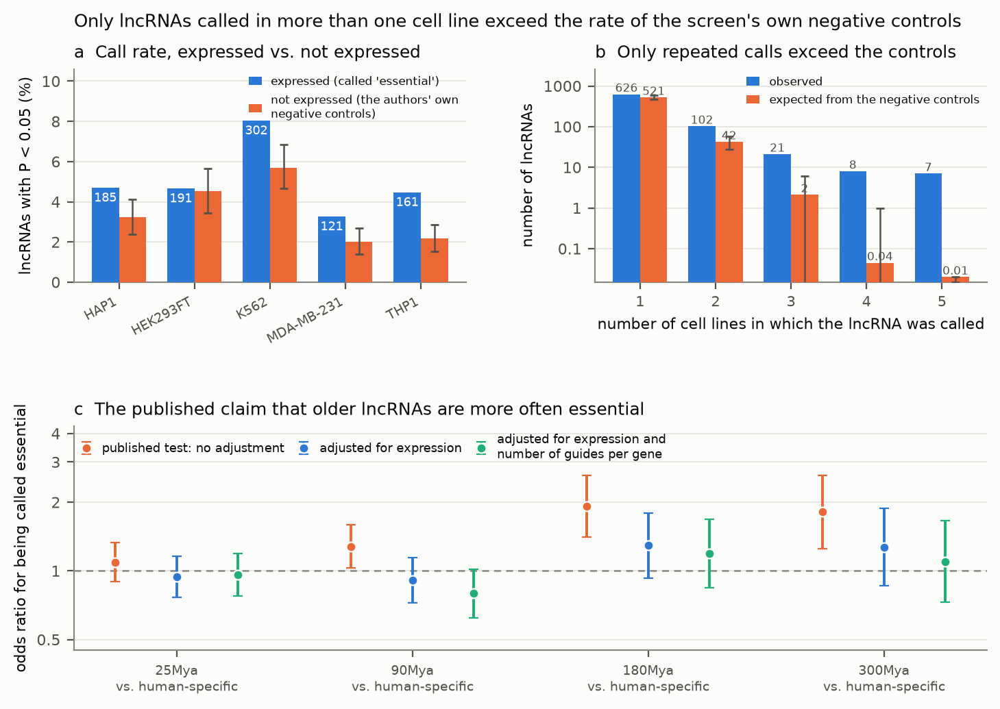
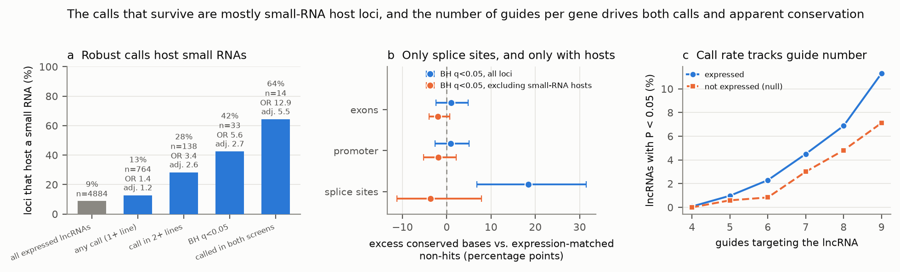
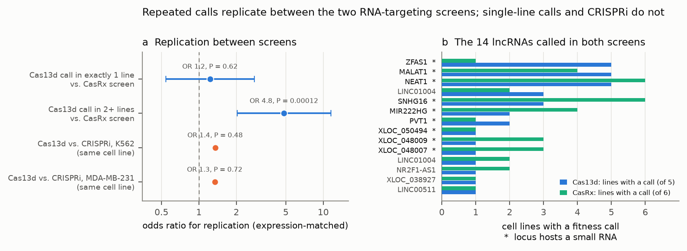

# In a published Cas13d screen of 5,496 human lncRNAs, single-cell-line essentiality calls largely match the rate of the screen's own negative controls; about 200 of 788 survive

## Summary

**Main finding.** A 2026 paper reports that 788 human long non-coding RNAs (lncRNAs) are necessary for cell
growth. Of those, 648 are called in only one of five cell lines. We show that most calls of this kind occur
at the rate seen for lncRNAs that the same paper designates as negative controls, because those lncRNAs
have no transcript for the enzyme to cut. Only calls repeated in two or more cell lines clearly exceed that
rate. About 200 lncRNAs, not 788, are supported.

**Why it matters.** Perturbation screens are the main experimental argument that the lncRNA part of the
genome carries function, and the reported count decides which loci laboratories study next. The paper's
gene-level P values are reported at a nominal threshold of 0.05 over about 4,000 tests per cell line, with
no correction for multiple testing.

**Key numbers.** The screen is Liang et al., *Cell Genomics* 2026 (the corrected, peer-reviewed replacement
for a *Cell* 2024 paper retracted for guide off-targets). Its own rule is: robust-rank-aggregation
P < 0.05 at day 14 and TPM > 0 in that cell line.

| Result | Value |
|---|---|
| Calls per cell line among expressed lncRNAs | 3.3% to 8.0% (121 to 302 lncRNAs) |
| Calls per cell line among non-expressed lncRNAs (the authors' negative controls) | 2.0% to 5.7% |
| lncRNAs called in exactly 1 cell line: observed / expected from the controls | **626 / 521** (95% 461–583) → false-discovery proportion **0.83** (0.74–0.93) |
| Called in 2 or more cell lines: observed / expected | **138 / 42** (28–57) → false-discovery proportion **0.32** (0.21–0.44) |
| Gene-level false-discovery proportion over all 764 called lncRNAs | **0.74** (0.65–0.84) → about **198** supported lncRNAs (126–271) |
| lncRNAs surviving Benjamini-Hochberg correction | 131 (q<0.25), 56 (q<0.10), 33 (q<0.05) |
| Single-line calls replicating in an independent CasRx screen | odds ratio **1.2** (P = 0.62) |
| Calls in 2+ lines replicating in that screen | odds ratio **4.8** (P = 1.2 × 10⁻⁴) |
| Guides matching a protein-coding transcript within 2 mismatches | 8 of 38,316 (0.02%); **0** match an essential gene |
| Small-RNA host loci: background → 2+ lines → q<0.05 → both screens | 9% → 28% → 42% → **64%** |
| Expression-matched odds ratio, and the same after adjusting for abundance | 3.4 / 5.6 / 12.9, and **2.6 / 2.7 / 5.5** |
| Excess conserved bases, q<0.05 set: splice sites / exons / promoter | **+18.4 pp** (CI +6.2, +32.9) / +1.0 (ns) / +1.0 (ns) |
| The same after removing small-RNA host loci (n = 19) | −3.7 / −2.0 / −2.0 pp, all not significant |

**The published age claim does not survive adjustment.** The paper concludes that essential lncRNAs "are
more likely to be evolutionarily conserved" from a Fisher's exact test of evolutionary age classes against
the whole library, with no adjustment. LncRNAs that arose 180 million years ago are called essential more
often than human-specific ones (odds ratio 1.92, P = 4 × 10⁻⁵). Adjusted for expression the odds ratio is
1.29 (95% CI 0.93–1.80); adjusted also for the number of guides per gene it is 1.19 (P = 0.33).

**A confounder we did not find discussed: guides per gene.** The library gives each lncRNA 4 to 9 guides. The
call rate rises from 0.07% at 4 guides to 11.3% at 9, a 160-fold range, and conserved-base fraction rises
with guide count as well. Called lncRNAs carry 7.9 guides against 6.9 for non-called ones. Standardising
the negative controls on guide count moves the gene-by-line false-discovery proportion from 0.71 to 0.66,
and adding guide count to the matching cuts the apparent conservation excess of calls by a third to a half.
Any analysis relating screen hits to sequence features must match on it.

**The retraction fix worked.** Of 38,316 lncRNA-targeting guides in the corrected library, 8 match any
protein-coding transcript within 2 mismatches and none match a core-essential gene (positive control: 97.5%
of the library's protein-coding guides match a protein-coding transcript exactly; negative control: 0 of
1,000 non-targeting guides match). The problem that remains is the uncorrected threshold, not off-targets.



---

## 1. Question and choice of question

### 1.1 Ways to ask what non-coding DNA does, from first principles

1. Cross-species conservation (phyloP, phastCons; the Zoonomia 241-mammal alignment).
2. Human population constraint (variant depletion in gnomAD; single bases or structural variants).
3. Re-analysis of public perturbation experiments with better statistics and internal controls.
4. Genetic association (partitioned heritability, de novo mutation burden).
5. Comparative genome-size theory (mutational hazard) across many species.
6. Theoretical bounds (mutational load against the functional fraction).
7. Sequence models (DNA language models). Not feasible on the available compute.

### 1.2 Candidates considered

| Candidate | What would change | P(surprising) | Who reuses it | Strongest argument against |
|---|---|---|---|---|
| **A. Are lncRNA essentiality screens statistically sound, do they replicate, and do hits carry constraint?** (3+1+2) | The count of functional lncRNAs, and which loci get mechanistic work | 0.5 | lncRNA biologists, screen designers, annotation groups | A critique of the retracted version already exists; may look derivative |
| B. ENCODE lentiMPRA activity against constraint among non-conserved cCREs (3+2) | Whether biochemical activity without conservation predicts function | 0.4 | Regulatory genomics | Several groups already work on this comparison |
| C. Mutational-hazard test with heterozygosity across assemblies (5) | Whether drift explains genome size | 0.3 | Genome-evolution theorists | Largely settled by Marino et al. (eLife 2025) |
| D. Non-coding fraction against complexity with phylogenetic control (5) | Whether the classic correlation survives | 0.15 | Few | Low expected surprise; the onion test already argues against |
| E. Load-based bound on the functional fraction (6) | The upper bound on functional DNA | 0.25 | Theorists | Graur (2017) and Galeota-Sprung et al. (2020) cover it |

We chose **A**. These predictions were recorded 16 minutes into the session and after an exploratory
false-discovery calculation had already been run, so they are an honest record of expectation but **not a
pre-registration**. They are in `files/results/priors.md`.

### 1.3 Prior predictions against outcomes

| # | Prediction | Prior | Outcome |
|---|---|---|---|
| P1 | Hits show significantly more exon constraint than expression-matched non-hits | 0.35 | Partly. True for the nominal set (+1.7 pp), but a third to a half of it is guide-count confounding, and it is absent in the corrected set once small-RNA hosts are removed |
| P2 | Multi-line or replicated hits show a clear excess (>1.5-fold) | 0.55 | Only at splice sites (2.4-fold), and only with small-RNA hosts included |
| P3 | The published age enrichment shrinks by more than half after adjusting for expression | 0.60 | **Yes**: 1.92 → 1.29 → 1.19 |
| P4 | Protein-coding positive control works | 0.95 | **Yes**: 78% of core-essential genes called, 0% of never-essential controls |
| P5 | Cas13d hits enriched among CRISPRi hits in the same cell line (OR > 2) | 0.50 | **No**: OR 1.3–1.4, P = 0.5–0.7 |
| P6 | The CasRx screen has a much lower internal-null false-discovery proportion (<30%) | 0.60 | **Only because of its threshold.** At its own FDR < 0.25 cut it is 0.33; at the same nominal P < 0.05 used by the Cas13d screen it is 0.81 |
| P7 | gnomAD rare-variant depletion beyond expression-matched controls | 0.25 | Not run |

The results we did not predict are the separation between single-line and repeated calls (Section 5.1),
and the guide-count confounder (Section 5.3).

---

## 2. Relation to prior work

This is a re-analysis, and several of its ingredients are already in print. We state plainly what is not ours.

* **The negative-control set is the authors' own.** Liang et al. write: "approximately 500 targeted lncRNAs
  were not detected in any of the cell lines and served as negative controls in our screens", and note that
  "31–89 lncRNAs depending on the cell line ... are not expressed in the respective cell line—these were
  omitted from our analyses as potential false positives". Our per-line null counts (36–99) agree. The
  authors removed those calls; they did not use their rate to estimate how many of the remaining calls are
  false. That step is what we add.
* **Non-expressed genes as an empirical null is standard practice**, going back to Hart et al. (2014) and
  used throughout DepMap (Chronos; the released probability-of-dependency field). We claim no novelty for
  the design, only for applying it to this list and quantifying the result.
* **Montero, Trozzo and Rad** already audited non-expressed hits in the **retracted** version, wrote that
  such hits "have to be considered false-positive", and anticipated that "a part of the expressed hits
  might also be false-positive". Their published *Nature Methods* Comment (2026) covers confounders of
  lncRNA screens generally. Their analysis is about guide off-targets; ours is about the threshold, and we
  show the off-target problem is now fixed.
* **Small-RNA host genes among essential lncRNAs have been named before.** Montero et al. (*Nat. Methods*
  2024), whose data we reuse, list "two lncRNA groups that are processed to small RNAs" among core
  vulnerabilities, naming SNHG16, SNHG29, SNHG32, SNHG6, ZFAS1, MIR222HG, MIR22HG, MIR4435-2HG and others.
  Mitra et al. (2022) use SNHG genes and MIR17HG as positive controls in DepMap co-essentiality analysis.
  Our contribution is to measure the enrichment against matched controls and to show it grows with how well
  a call replicates.
* **The mechanism has been shown for specific genes.** Briones-Martin-del-Campo et al. (*NAR Cancer* 2026)
  demonstrated with a genomic-versus-cDNA rescue that the CRISPRi fitness phenotype of SNHG1, SNHG12 and
  SNHG30 in Ewing sarcoma is due to the intronic snoRNAs; Lee et al. (*Mol. Cell* 2025) showed that the
  essentiality of CRNDE maps to an ultraconserved snoRNA-like element inside it. Our prediction for the
  SNHG genes is therefore a **generalisation of an already demonstrated result**, not a new one.
* **The opposite view is also published.** Monziani and Ulitsky (*Trends Genet.* 2023) argue that
  non-coding snoRNA host genes "exert independent and unrelated functions to those of the encoded
  snoRNAs", and Vietri Rudan et al. (*EMBO J.* 2024) rescued an SNHG7 knock-down phenotype with the spliced
  lncRNA alone, excluding its snoRNAs. Our result is a statistical statement about a hit list, and does not
  settle any single locus.

---

## 3. Data

| Source | Use |
|---|---|
| Liang et al., *Cell Genomics* 2026;6:101253 (PMID 42155443) and the identical author-posted tables at figshare `10.6084/m9.figshare.30370171` | The Cas13d screen: guide sequences, gene-level RRA P values and log fold changes for 5,496 lncRNAs and 3,157 protein-coding genes in 5 cell lines, RNA-seq TPM, lncRNA annotation |
| Liang et al., *Cell* 187:7637 (2024), **RETRACTED**; notice PMID 41344327 | Provenance and the stated reason for retraction |
| Montero et al., *Nat. Methods* 21:584 (2024), Supplementary Tables 2, 3, 7, 12, 14 | CasRx screen in 6 cell lines; hg38 lncRNA catalogue; RNA-seq counts; re-analysis of the CRISPRi screen of Liu et al. |
| Montero, Trozzo and Rad, bioRxiv 2025.11.27.690751 and *Nat. Methods* 23:2120 (2026) | The off-target critique and the published Comment |
| GENCODE v36 (hg38) | Exons, CDS, gene types; protein-coding and small-RNA masks |
| UCSC `wgRna` (hg19, lifted) | snoRNABase snoRNAs, scaRNAs, miRBase miRNAs. GENCODE v36 misses many intronic snoRNAs, including all ten inside GAS5 |
| Zoonomia 241-mammal Cactus phyloP (hg38) | Conservation; 2.27 is the published 5% false-discovery threshold for constraint |
| Hart et al. CEGv2 and NEGv1 | Core-essential and never-essential control genes |
| UCSC hg38 2bit, hg19→hg38 chain | Sequence for the off-target scan; coordinate lifting |

**Which version did we analyse?** We used the author-posted supplementary tables. They are the published
dataset: the per-line essential counts (HAP1 191, HEK293FT 195, K562 312, MDA-MB-231 126, THP1 162) and the
breakdown into 648 cell-type-specific, 125 partially shared and 15 shared lncRNAs match the published paper
exactly, and our rule recovers the published per-gene counts for 763 of the 788.

---

## 4. Methods

**Reproducing the published calls.** RRA P < 0.05 at day 14 and TPM > 0 in that cell line gives 764 lncRNAs
with at least one call, 763 of them among the published 788. Every comparison below is against the authors'
own calls.

**The negative controls.** Within each cell line, lncRNAs with zero reads in all available assays (total
RNA-seq of the parental line and of the Cas13d clone, and mRNA-seq) form the null, as the authors
themselves designate. Expected false calls are the null call rate times the number of expressed lncRNAs.
Gene-level expectations are computed over the lines in which each gene is expressed, so that a gene
expressed in five lines has five chances of a false call. The main calculation fits, on the control rows,
a logistic model with cell-line effects and a quadratic in guide count plus a gene-level dispersion term
whose size is calibrated so that simulating the control genes reproduces the observed number with calls in
two or more lines; the intercept is then re-centred so the simulated marginal rate matches the observed
one. The calibrated dispersion is zero, meaning the guide-count gradient alone accounts for the apparent
dependence between lines. Intervals come from a bootstrap over control genes with refitting.

Checks that the controls are a fair null:

* *Measurement noise*: the standard deviation of the difference between replicate guide log fold changes
  is equal in the two groups (ratio 0.98 to 1.01 across lines).
* *Within-gene contrast*: for the 2,187 lncRNAs expressed in some lines and not others, the same guides are
  used in every line. A conditional logistic model stratified by gene with line fixed effects gives an odds
  ratio of 1.12 (95% CI 0.88–1.43, P = 0.34) for a call in a line where the lncRNA is expressed.
* *Guides per gene*: means are close (7.08 null, 6.92 expressed) but the call rate is steeply non-linear in
  guide count, so we also standardise on it (Section 5.3).
* *Composition*: standardising the null on genomic class, evolutionary age and transcript-length tertile
  gives 0.72 against 0.71 unstandardised.
* *Stricter definitions*: five variants of "expressed" and of the null give 0.58 to 0.76.

**Conservation.** For each lncRNA we build an hg38 exon model, preferring the transcript named by the
authors, then the GENCODE transcript of the stated Ensembl gene whose start is closest to the lifted start,
then any catalogue transcript starting within 200 bp; 4,664 of 5,496 get a model and all get a promoter
window. Protein-coding exons **and small-RNA genes** are removed from exon, intron and promoter regions, so
no conservation measure counts a small RNA. Regions: exons; promoter (start ± 500 bp); splice sites (2
intronic bases at each internal boundary); intron interiors. The measure is the fraction of bases with
phyloP ≥ 2.27. Hits are compared with non-hits in 10 expression deciles (and, where stated, transcript
length, genomic class and guide count), weighted by hits per stratum, with 1,000 bootstraps over genes.

**Small-RNA host loci.** Three definitions, reported separately and as a union: *strict* (a small RNA
overlaps the exon model), *window* (a small RNA starts between 2 kb upstream and 10 kb downstream of the
lncRNA start; needs no model, applied identically to every gene), and *name* (the lncRNA or a GENCODE
lncRNA gene in that window carries a host-gene symbol such as `SNHG12` or `MIR4435-2HG`). The window rule
was introduced after noticing that two strong calls were unannotated hosts, so it is post hoc; a scan from
0 to 50 kb shows the enrichment is present throughout, peaking at 5 to 10 kb. The `name` rule hard-codes
`GAS5`, `ZFAS1` and `DLEU2`; removing them changes the name-only odds ratio from 17.5 to 12.7 and leaves
the union unchanged, because both genes are already captured by coordinates.

**Off-target scan.** A Cas13 spacer binds the reverse complement of its target, so we search for the
reverse complement of each spacer in the spliced sense sequence of protein-coding transcripts, allowing up
to 2 mismatches, by 2-bit packing and exhaustive enumeration of the 2,347 sequences within 2 mismatches.
Orientation is validated: a spacer's reverse complement is found in its own target transcript for 74% of
guides, the spacer itself for 0%.

---

## 5. Results

### 5.1 Only repeated calls clearly exceed the negative-control rate

Expected numbers are computed from the negative controls at each gene's own guide count (Section 5.3),
with an interval from a bootstrap over control genes. 626 lncRNAs are called in exactly one cell line and
521 are expected (95% 461–583), a false-discovery proportion of 0.83 (0.74–0.93). Calls in two or more
lines are a different matter: 138 observed against 42 expected (28–57), a proportion of 0.32 (0.21–0.44),
and the excess grows sharply with the number of lines (3 lines: 21 against 2.1; 4 lines: 8 against 0.05;
5 lines: 7 against 0.005). Over all 764 called lncRNAs the gene-level false-discovery proportion is
0.74 (0.65–0.84), leaving about **198** supported lncRNAs (126–271).

How much this depends on the model matters, so we report the alternatives. Using one null rate per cell
line and assuming independence across lines, the proportion is 0.84 and about 122 lncRNAs survive; adding
guide-count matching gives 0.75 and about 191; adding a gene-level dispersion term as well gives the 0.74
and 198 quoted above. The defensible statement is that **between about 120 and 270 of the 788 are
supported**, and that the single-line majority of the published list is where almost all of the loss is.

The replication analysis agrees independently and without any of this modelling. Single-line calls are not
enriched among the calls of the independent CasRx screen (odds ratio 1.2, P = 0.62); calls in two or more
lines are (4.8, P = 1.2 × 10⁻⁴).

This matters for how the published list is read: the paper reports that 648 of 788 (82%) are
"cell-type-specific", essential in exactly one line, and treats cell-type specificity as a biological
result. Our 626 single-line lncRNAs are effectively that group (623 are shared with it), and it is the
group that sits closest to the negative controls.

### 5.2 Standard correction leaves 33 to 131 lncRNAs

Benjamini-Hochberg over all expressed gene-by-line tests leaves 178 gene-line rejections at q < 0.25,
corresponding to 131 unique lncRNAs; 56 at q < 0.10 and 33 at q < 0.05. Because the guarantee applies to
the gene-line tests, the gene-level error rate is somewhat higher than the nominal q. Checked against the
negative controls, the procedure is well calibrated or conservative: the null-implied false-discovery
proportion is 0.04 at the q < 0.05 cut, 0.22 at q < 0.10 and 0.26 at q < 0.25.

### 5.3 Guides per gene drive both calls and apparent conservation

The library assigns 4 to 9 guides per lncRNA. Among expressed lncRNAs the call rate runs 0.07%, 0.98%,
2.29%, 4.50%, 6.88%, 11.31% for 4 to 9 guides; the same gradient appears among the negative controls, so it
is a property of the library and of the rank-aggregation statistic, not of expression. Called lncRNAs carry
7.9 guides against 6.9 for non-called ones, and the conserved-base fraction of exons rises from 0.045 at 4
guides to 0.078 at 9.

Three consequences. Standardising the negative controls on guide count moves the gene-by-line
false-discovery proportion from 0.708 to 0.657, and the gene-level proportion from 0.84 to 0.75
(Section 5.1). Adding guide count to the matching reduces the conservation excess of nominal calls from
+1.70 to +1.01 pp at exons, from +1.56 to +0.86 pp at promoters, and from +5.60 to +4.80 pp at splice
sites. And it explains the apparent dependence between cell lines: among control lncRNAs not expressed in
two or more lines, 19 drew calls in two or more lines where a single per-line rate predicts 12.4, but a
model with the guide-count gradient reproduces that excess with a gene-level dispersion of zero. The
apparent dependence is guide count, not a separate per-gene effect.

We did not find this confounder discussed in the screen re-analysis literature we read, though we cannot
exclude it; the related and well-established point is that control guides must match the perturbation in
kind, as for safe-targeting against non-targeting guides in Cas9 screens and for guides against
non-essential targets in Cas13d screens.

### 5.4 The age claim does not survive adjustment

Unadjusted odds ratios against human-specific lncRNAs are 1.09 (25 Mya), 1.28 (90 Mya), 1.92 (180 Mya,
P = 4 × 10⁻⁵) and 1.81 (300 Mya). After adjusting for expression level, breadth and genomic class they are
0.94, 0.91, 1.29 (95% CI 0.93–1.80) and 1.27; adding guide count gives 1.19 at 180 Mya (P = 0.33). The
published test is a Fisher's exact test of age class against the whole library with no adjustment, and
older lncRNAs are both better expressed and better targeted.

We also tested whether calls that cannot be real show the same age gradient. They do in the full set of
non-expressed rows, but not when restricted to lncRNAs never expressed in any line (180 Mya: odds ratio
0.63, P = 0.64), so we do not rely on that argument. See Section 5.7.



### 5.5 The calls that survive are enriched for small-RNA host loci

The share of loci that host a small RNA rises with how well a call replicates: 9% of all expressed lncRNAs,
13% of any nominal call, 28% of calls in two or more lines, 42% of the q < 0.05 set, and 64% of the 14
lncRNAs called in both RNA-targeting screens (12 distinct loci, since two pairs are duplicate entries of
the same gene). Matched on expression in five strata the odds ratios are 1.4, 3.4, 5.6 and 12.9.

Abundance is the serious alternative explanation, because abundant transcripts give Cas13d more substrate
and host transcripts are abundant. Adjusting for a cubic spline in abundance and for expression breadth,
the odds ratios fall roughly by half but remain: 1.2 (P = 0.10) for any call, **2.6** (P = 8 × 10⁻⁶) for
calls in 2+ lines, 1.8 (P = 0.01) at q < 0.25, **2.7** (P = 0.02) at q < 0.05 and **5.5** (P = 0.008) for
the cross-screen set. The gradient also holds inside the top abundance decile alone (odds ratio 7.0 for
calls in 2+ lines, 7.1 at q < 0.05) and is robust to finer matching: with 40 expression strata the odds
ratios are 3.1, 4.1 and 11.2 for the three tiers, and adding transcript length and exon number to the
strata gives 3.6, 6.0 and 11.6. Removing the hard-coded gene names from the nomenclature rule leaves the
union unchanged.

The q < 0.05 list reads as a catalogue of host genes: *GAS5*, *ZFAS1*, *SNHG8*, *SNHG15*, *SNHG16*,
*SNHG19*, *SNHG26*, *MIR17HG*, *MIR302CHG*, *MIR4435-2HG*, *NEAT1*, *MALAT1*, and the single strongest call
of the screen, an unnamed 299-base transcript on chromosome X whose start lies 3.7 kb upstream of
`hsa-mir-6087`.

### 5.6 The extra conservation is at splice sites, and needs the small RNAs

For the q < 0.05 set, only splice sites show a significant excess over expression-matched non-hits:
+18.4 pp (95% CI +6.2 to +32.9), a 2.4-fold ratio, confirmed by a permutation test that reassigns hit
status within expression deciles (5,000 draws, P = 0.0006). Exons (+1.0 pp in the matched estimate, +1.2 pp
in the permutation estimate, P = 0.52) and promoters (+1.0 pp, P = 0.64) do not. Removing small-RNA host loci leaves 19
lncRNAs whose differences are −2.0 pp at exons, −2.0 at promoters and −3.7 at splice sites, all with
intervals covering zero. So the conservation signal of the surviving calls is a splice-site signal that
depends on the host loci; there was never an exon or promoter signal in this set to remove.

### 5.7 A test that failed: the conservation placebo

We expected that calls which cannot be real would show no association with conservation, and that comparing
them with real calls would measure how much of the usual association is an artefact of calling. Over all
non-expressed rows the placebo calls do look conserved (exons +0.9, promoters +1.1, splice +2.8 pp). But
2,187 of those genes are expressed in other cell lines, so a transcript does exist and the premise fails.
Restricted to the 612 lncRNAs never expressed in any line — the only unambiguous placebo — the effect is
gone: exons −0.2 pp (95% CI −1.4 to +1.0), promoters +1.1 (−0.2 to +2.4), splice +0.6 (−2.8 to +4.2). The
whole apparent effect sits in the mixed-expression genes (exons +1.8 pp).

**We therefore do not claim that the essentiality-conservation link is an artefact.** The honest conclusion
is narrower: a large part of it is explained by expression and by guide count (Sections 5.3, 5.4), and in
the error-controlled set what remains is carried by small-RNA host loci (Sections 5.5, 5.6). We report the
failed test because the first version of this analysis used the contaminated placebo set and reached a
stronger conclusion than the data support.



### 5.8 Both RNA-targeting screens behave the same way at a nominal threshold

At the same nominal P < 0.05, the CasRx screen of Montero et al. has an internal-null false-discovery
proportion of 0.81 (0.69 to 0.94 by cell line), no better than the Cas13d screen's 0.71. What differs is
that Montero et al. report hits at a corrected FDR < 0.25, where the internal-null proportion is 0.33, and
their never-essential protein-coding controls give a false-positive rate of exactly 0 in all six lines.
The lesson is about thresholds and correction, not about the enzymes.

Agreement between RNA knock-down and CRISPRi in the same cell line is weak to absent: odds ratios 1.3 and
1.4 at a nominal CRISPRi threshold (P = 0.5 and 0.7); the log fold changes correlate at Spearman ρ = 0.001
in K562 (P = 0.97) and ρ = 0.10 in MDA-MB-231 (P = 0.02), that is, significantly but very weakly. The two
methods disturb different things, so this does not condemn either, but neither validates the other.

---

## 6. Predictions an experimental laboratory can test

1. **Re-screening will validate near the null rate.** If the 626 lncRNAs called in exactly one cell line are
   re-screened with independent guides in the same lines, the fraction reproducing at nominal P < 0.05 will
   be close to the per-line null rate of 2 to 6%, and far below the 75% implied by the published arrayed
   validation set, which was chosen from the strongest calls. For the 33 lncRNAs at q < 0.05 it will exceed
   0.7. This is the cheapest decisive test of the whole analysis.
2. **Small-RNA excision will reproduce the fitness effect, beyond the genes where this is already shown.**
   Briones-Martin-del-Campo et al. showed it for SNHG1, SNHG12 and SNHG30 in Ewing sarcoma. We predict the
   same for *GAS5*, *ZFAS1*, *SNHG8*, *SNHG15*, *SNHG16*, *SNHG19* and *SNHG26* in the five lines used here:
   deleting the hosted snoRNAs alone reproduces most of the defect, while removing the mature host exons
   with snoRNA biogenesis intact does not. The same for *MIR17HG*, *MIR302CHG* and *MIR4435-2HG*.
3. **The unnamed top call is a microRNA host.** `Hum_XLOC_053432` (hg38 chrX:109,050,890, plus strand) will
   prove to be a host transcript for `hsa-mir-6087`, and its fitness effect will track that microRNA. It is
   the most depleted lncRNA in the screen (P = 1.2 × 10⁻⁹, all five lines) and has no HGNC symbol.
4. **Where transcript-level function is most likely, with a caveat.** Eighteen q < 0.05 calls are neither
   small-RNA hosts nor explained by the null; the strongest are *THUMPD3-AS1* (five lines), *OIP5-AS1*
   (four), *LINC02739* (four), *LINC01234*, *FRG1-DT*, *JMJD1C-AS1* and *LPGAT1-AS1*, listed in
   `files/results/host_nomenclature.txt`. We removed *CRNDE* from this list: Lee et al. (2025) showed its
   essentiality maps to a snoRNA-like ultraconserved element, which makes it a fourteenth host-like locus.
   The caveat is that as a group these 19 carry no more conserved sequence than matched controls, so some
   are probably still false positives; they are where to look, not a validated set.
5. **A design rule.** Report the call rate among non-expressed targets alongside every hit count, stratified
   by the number of guides per gene. On this screen that single change moves the headline from 788 to about
   122, and it costs nothing, because the controls are already in the library.

---

## 7. Limitations

* We did not run the screen. Everything rests on the authors' tables and RNA-seq. We analysed the
  author-posted copy of the corrected tables rather than the journal's supplementary files, which we could
  not download; the counts match the published paper exactly (Section 3).
* "Not expressed" uses TPM > 0 on the authors' quantification. Transcripts below detection would be
  misplaced in the null; the stricter null (never expressed in any line) gives a higher, not lower,
  false-discovery proportion.
* 832 of 5,496 lncRNAs have no exon model, so their conservation statistics rest on the promoter window.
* The count of supported lncRNAs depends on how the negative controls are modelled: 122 with one rate per
  cell line, 191 adding guide-count matching, 198 adding a dispersion term, with a bootstrap interval of
  126 to 271 around the last. We quote "about 200" and give the range. The contrast between single-line
  and repeated calls is robust to all three choices, and is confirmed by the independent replication test,
  which uses no model at all.
* Small bootstrap-to-bootstrap differences remain between the text and the figures for the same quantity
  (for example the splice-site interval), because several intervals are computed in separate scripts with
  separate draws.
* The cross-screen set has 14 entries but 12 distinct loci, and the non-host subset of the q < 0.05 set has
  19 members; several intervals are wide and the 5-member non-host cross-screen interval is unreliable.
* The window definition of a host locus is post hoc, though the enrichment holds across window sizes from
  2 to 50 kb.
* Abundance and small-RNA hosting are correlated and cannot be fully separated in observational data. The
  adjusted odds ratios (2.6 to 5.5) are our best estimate, not the raw ones.
* Conservation across 241 mammals misses primate-specific function by construction.
* The off-target scan covers protein-coding transcripts at up to 2 mismatches. It does not cover
  lncRNA-to-lncRNA off-targets, bulged alignments, or collateral cleavage.
* Replication mapping uses exon overlap; 2,703 of 5,496 lncRNAs map to a CasRx family, so those tests use
  about half the library.
* This is a re-analysis of one screen. The design rule generalises; the gene list does not.

---

## 8. Was the work more or less useful than expected?

Mixed, and less than the first draft of this report claimed. Two things went better than expected: the
separation between single-line and repeated calls is sharper than any summary false-discovery proportion,
and the guide-count confounder appears to be unreported. Two went worse. The conservation placebo, which
the first version advertised as the main novel result, does not survive restriction to the rows where its
premise holds, and is reported here as a failed test. And the small-RNA host observation is less novel than
we believed: Montero et al. had already named those genes among core essentials in a paper we use as a data
source, and the mechanism was demonstrated experimentally for three SNHG genes in 2026. What survives as a
contribution is quantitative — the enrichment measured against matched controls, its growth with
replication, and the fact that the error-controlled set's conservation signal depends on it.

Two independent reviewers that had not seen our reasoning read the package. The first found four blocking
problems in the first version: a stale literature anchor (we had attacked the author-posted preprint while
the peer-reviewed paper had been out for six months), the placebo failure, a gene-level false-discovery
figure that was wrong by a factor of two, and selective reporting of the abundance control. The second
found that the corrected version still quoted a point estimate with no interval and had failed to carry
our own guide-count confounder into the headline accounting, which moves the estimate from about 122 to
about 198 supported lncRNAs. All of these are corrected above, and every number first computed by a
reviewer was re-derived independently before use (`files/results/review_checks.txt`,
`verify_claims.txt`, `gene_level_accounting.txt`).

---

## 9. Reproduction

Python 3.12 with numpy, pandas, scipy, statsmodels, matplotlib, pyarrow, openpyxl, pyBigWig, py2bit,
pyliftover. Scripts run in numbered order from the working directory. Peak memory is about 1.2 GB (the
off-target scan); total run time about 25 minutes on one Apple M1 core pair, excluding downloads.

```
03_gencode.py GENCODE.gtf.gz            # exon/CDS tables and masks
15_smallrna_annotation.py CHAIN wgRna   # combined small-RNA annotation
04_models_liang.py CHAIN                # hg38 lncRNA models and regions
05_phylop.py PHYLOP.bw REGIONS OUT      # conservation per gene and region
01_liang_table.py / 06_liang_features.py
02_liang_null.py 07_fdr_robustness.py 12_calibration.py 17_null_validity.py
08_constraint_liang.py 09_locus_vs_rna.py
10_montero_null.py 11_cross_screen.py
13_robust_set.py 19_host_window.py 20_host_nomenclature.py
16_offtarget.py hg38.2bit
21_constraint_final.py 22_placebo_constraint.py
23_review_checks.py                     # post-review verifications
25_verify_claims.py                     # permutation tests and finer stratification
26_gene_level_accounting.py             # the headline accounting, with intervals
24_figures_final.py
```

Note on provenance: `22_placebo_constraint.py` produces the contaminated placebo described in Section 5.7;
`23_review_checks.py` contains the corrected version restricted to never-expressed genes, together with the
first gene-level accounting, the guide-count standardisation, the abundance-adjusted host odds ratios and
the CasRx recalculation. `26_gene_level_accounting.py` supersedes the gene-level part of it, adding
guide-count matching, the dispersion calibration and bootstrap intervals. All are kept so the corrections
can be audited.

## 10. Files

* `files/code/` — all analysis scripts in run order.
* `files/figures/` — the three figures.
* `files/results/` — every numeric result, including `gene_level_accounting.txt` (the headline accounting
  and its intervals), `review_checks.txt` and `verify_claims.txt` (the post-review corrections and
  verifications), `figure_values.json`, `calibration.txt`, `fdr_robustness.txt`, `null_validity.txt`,
  `offtarget.txt`, `host_window.txt`, `host_nomenclature.txt`, `constraint_final.tsv`,
  `placebo_constraint.txt`, `cross_screen.txt`, `priors.md`.
* `files/data/lncRNA_gene_level.tsv` — the central per-lncRNA table: call counts, Benjamini-Hochberg
  status, abundance, host classification under all three definitions, conservation per region, guide
  off-target counts, cross-screen mapping.
* `files/data/screen_gene_line_level.tsv.gz`, `montero_gene_line_level.tsv.gz`,
  `lncRNA_region_phylop.tsv.gz`, `smallrna_hg38.bed.gz`, `screen_id_map.tsv`.

---

## Licence and attribution

Text, figures and data are released under CC BY 4.0; code under MIT. See `LICENSE`.

Copyright 2026 the authors. Produced by an autonomous Claude Code agent (claude-opus-5-5) in the SCI
research swarm on the Mac mini 'oya', run 59beac1a-1688-46ae-a45b-1e16026eb50d.

This work re-analyses public data. It confirms that the authors' correction removed the off-target problem
that caused the retraction. The disagreement that remains is about multiple-testing correction, about
guide-count matching, and about what the surviving calls mean.
