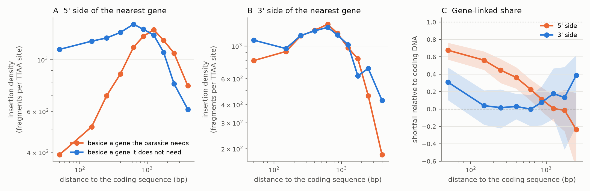
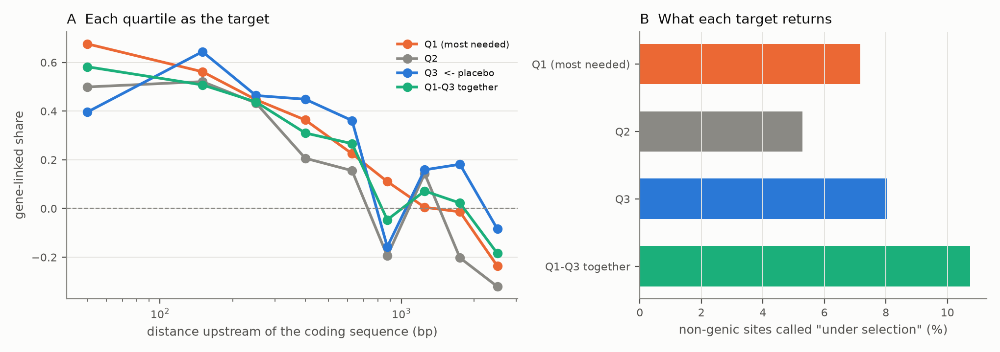
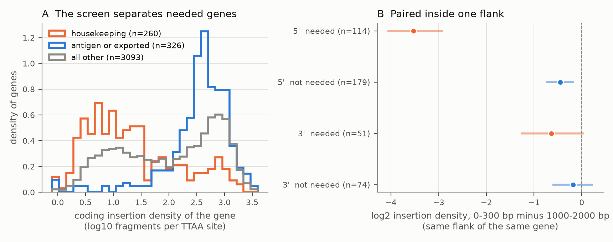

# In Plasmodium knowlesi, a placebo contrast removes half of the apparent requirement for non-coding DNA; what remains is about a tenth of it, in introns and the kilobase before a gene

## Summary

**Main finding.** The usual way to measure how much non-coding DNA an organism needs from a transposon
screen is to compare DNA beside genes the organism needs with DNA beside genes it does not. We show
that this comparison is biased, measure the bias with a placebo, and give a corrected answer for the
malaria parasite *Plasmodium knowlesi*. The placebo: repeat the comparison with target genes that the
parasite also does not need. It should return nothing; it returns 8.05% of non-genic sites "under
selection", three quarters of the 10.74% that the real comparison returns. The false signal is almost
flat with distance from the gene, while the real one decays, so each comparison can be read against its
own level far from the gene. Corrected this way, 5.6% of the DNA between genes is under selection
(3.2-8.6%), not 10.7%, and almost all of it lies in the first kilobase in front of a gene the parasite
needs. Adding introns, which are nearly as costly as coding DNA, 9.7% of this parasite's non-coding
DNA is under selection: 1.22 Mb, 5.0% of the genome.

**Why it matters.** Numbers of this kind - "x% of the genome is functional" - are one of the few direct,
perturbation-based answers to how much of a genome an organism needs, and they are used as evidence in
the argument about junk DNA. The same neighbour-gene comparison has been published for fission yeast.
The placebo test is cheap, it applies to any such screen, and here it removes half the answer.

**What survives correction.** The shortfall of insertions in front of a gene the parasite needs: two
thirds of the cost of a coding insertion in the first 100 bases, falling to nothing by one kilobase. It
survives the placebo correction unchanged, and it survives dropping sub-telomeric DNA, splitting the
libraries in half, capping over-amplified sites, restricting to sites whose other neighbour is far
away, and a comparison inside one flank of one gene. **What does not survive:** the shortfall behind a
gene (0.11, interval -0.25 to 0.47 after correction, against 0.31 before), and most of the genome-wide
total.

**Approach.** We re-called every insertion from 1.55 billion raw read pairs of a 2025 saturating
piggyBac screen (Elsworth, Ye, Dass et al., *Science* 387, eadq6241), because the published insertion
tables are in supplementary files that the publisher does not serve to an automated client.

**Key numbers.**

| Quantity | Value (95% interval) |
|---|---|
| TTAA sites with at least one insertion | 137,486 of 160,126 (85.9%) |
| Unique sheared fragments assigned to a site | 110.7 million |
| **Placebo: non-genic sites "under selection" with target genes that are not needed** | **8.05%, against 10.74% for the real contrast** |
| Shortfall 0-100 bp **before** a needed gene, relative to coding DNA, corrected | **0.67 (0.51-0.82)** |
| the same, 100-200 / 200-300 / 300-500 bp | 0.56 / 0.43 / 0.36 |
| the same, 500-750 / 750-1000 / beyond 1 kb | 0.21 (-0.01-0.41) / 0.08 (-0.13-0.31) / 0 |
| Shortfall 0-100 bp **behind** a gene, corrected | 0.11 (-0.25-0.47) |
| Shortfall in an **intron** of a needed gene, corrected | 0.93 |
| Non-genic DNA under selection, corrected | 5.58% (3.18-8.62%) = 0.55 Mb = 2.3% of the genome |
| Intronic DNA under selection, corrected | 25.7% of its sites = 0.66 Mb = 2.7% of the genome |
| **All non-coding DNA under selection** | **1.22 Mb, 9.7% of non-coding DNA, 5.0% of the genome** |
| Shortfall with a gene label from the time course, not from insertion counts | 0.30 at 0-100 bp, nothing past 200 bp |
| Insertions reading into a needed gene, share of sites, 0-300 bp before it | 77-78%, against 54% beside genes not needed |

**Main limitation.** One life stage in culture. The measurement is the *extra* cost that depends on the
neighbouring gene, so a requirement shared by all gene flanks is invisible. Most importantly, the size
of the shortfall depends on how the genes are labelled: with a label built from the time course rather
than from insertion counts it falls from 0.67 to 0.30 and reaches only 200 bases. The bias the placebo
exposes is measured, not explained; we show it is flat with distance but not where it comes from.



**Fig. 1.** A, B: insertion density against distance to the nearest coding base, beside genes whose own
coding DNA is nearly free of insertions ("the parasite needs it") and beside genes whose coding DNA is
full of them. C: the gene-linked share, the shortfall of a bin divided by the shortfall of coding DNA,
matched on local GC content, TTAA density and the length of the intergenic run. The values in C are
against 1; section 5.2 gives them against each contrast's own level at 1000-1500 bases, which is the
form that should be read.



**Fig. 6.** The placebo. Each quartile of coding insertion density in turn is the target, always
against the top quartile as control. Q1 holds the genes the parasite most needs; Q3 holds genes it does
not need, so its curve should be flat at zero. It is not. It is 0.40 at the start codon, rises to 0.64,
and is still 0.18 at 1500-2000 bases, where Q1 has returned to zero. The part that does not decay is
the bias; the part that does is the signal. B: what each target returns as a genome-wide total - the
placebo returns more than the genes that are actually needed.



**Fig. 3.** A: the screen separates the genes the parasite needs. Housekeeping genes have a median
coding insertion density of 13.8 fragments per TTAA site; antigen and exported proteins, which are not
needed in culture, have 423.5. B: inside one flank of one gene, the first 300 bases hold 11.5 times
fewer insertions than that same flank at 1000-2000 bases when the gene is needed, and 1.37 times fewer
when it is not.

## 1. The question and what was already known

*P. knowlesi* has a 24.4 Mb genome with 5,324 protein-coding genes. Coding DNA is 47.8% of it,
intronic DNA 10.6% (2.76 coding exons per gene), structural RNA genes 0.19%, and DNA between genes
40.7% (9.94 Mb). The 5,265 stretches between genes have a median length of 1,397 bases and a mean of
1,870, roughly twice the mean spacing in fission yeast, whose 12.6 Mb genome holds a similar number of
genes. All of these were computed from assembly GCF_000006355.2 and its RefSeq annotation.

The 2025 screen recovered 1,456,750 independent insertion events covering 80.1% of all TTAA sites and
sampled the library several times during growth. **Its supplementary figure S9 already shows, in
qualitative form, the effect we measure here:** a metagene profile of insertion density from 1,000
bases before a gene, through the coding sequence, to 1,000 bases after it, drawn separately for
essential and dispensable genes and for the two insertion orientations, with the text *"we considered
if bias against insertion in UTRs of essential genes contributed to insertionally depleted regions, and
found reduced insertions, suggesting insertions proximal to coding sequences disrupt expression"*. The
1,000-base window is already that study's working definition of an untranslated region. Its main text
also reports *"a strong bias in the orientation of transposon insertion"* for 33 genes with insertions
in the 5' end of their coding sequence, reads it as promoter activity inside the element, and proposes
outward-facing promoters as a tool. In bacteria the same idea is older and sharper: Christen et al.
(2011, *Mol Syst Biol* 7:528) used lethal antisense insertions upstream of essential *Caulobacter*
genes to define 402 essential promoter regions with a median length of 87 bases, and the
sense-to-antisense ratio has been an essentiality statistic in human haploid screens since 2009.

The effect is published and already quantified outside apicomplexa, at a much smaller scale.
Christen et al. (2011) measured 402 essential promoter regions in *Caulobacter* with a median length of
41 bases and a mean of 83. Rubin et al. (2015, *PNAS* 112:E6634) found in *Synechococcus* that only the
52 bases before the start codon are significantly depleted in essential genes, with a genuine distance
profile. Billmyre et al. (2025, *PLoS Biol* 23:e3003184) used a 300-base upstream window in
*Cryptococcus* and bounded the effect experimentally at one locus: an insertion 77 bases upstream of
*ERG11* changed the phenotype, one at 296 bases did not. Our footprint, which reaches about one
kilobase, is ten to twenty times longer than any of these. Part of that is architecture rather than
regulation: this parasite's intergenic regions are long (median 1,397 bases; the companion screen uses
a 5' flank with a median of 1,845 bases), its 5' leaders are among the longest measured in any
eukaryote, and a window of that size contains much of the leader itself. Our data cannot separate a
long regulatory footprint from a long transcript, since the RNA-seq cannot be used for that
(section 6, item 8).

The fission-yeast study whose statistic we follow raised exactly the objection our placebo answers, and
left it unquantified: *"it is also possible that transposon insertions can disrupt the function of
larger neighboring regions, although the sites of insertions themselves are not functional, which would
inflate the HMM-based estimate of the functional genome"* (Grech et al. 2019).

So the existence of an upstream shortfall, and of an orientation bias, is not new. What is new here is:

1. the placebo test and the size of the bias it exposes, which applies to any screen scored this way;
2. a calibrated profile - the shortfall relative to the cost of a coding insertion, bin by bin, with a
   decay length, after matching and after the placebo correction;
3. that the shortfall behind a gene does not survive that correction while the one in front does;
4. the conversion to bases, corrected: 9.7% of this parasite's non-coding DNA;
5. the orientation effect as a distance curve in intergenic DNA, with a paired statistic;
6. a negative result: transcription of intergenic DNA far from genes does not mark DNA that is needed.

## 2. Choice of question and prior prediction

The full note, written before any insertion count was analysed, is in
`files/notes/00_question_and_priors.md`. Five candidate questions were compared (a malaria transposon
screen; non-coding share against organism complexity; mutation-accumulation lines; fly enhancer tiles;
constrained DNA against genome size). The prediction then: 5-20% of non-genic bases would carry a cost,
concentrated within 500 bp of a start codon; the footprint would decay with a half-distance of 200-600
bp; P(it reaches beyond 1 kb) = 0.2; P(upstream DNA of needed genes shows a clear extra cost) = 0.75;
P(transcription of intergenic DNA adds nothing detectable) = 0.6; P(the main result surprises experts)
= 0.35.

## 3. Data

- **Insertion libraries.** NCBI SRA study PRJNA1116591 (Elsworth et al. 2025): the 75 Tn-Seq runs of
  untreated cultures, 1,551,350,566 read pairs, from 15 transfection pools. The 4 drug-treated runs are
  not used.
- **Reference genome.** *P. knowlesi* strain H, assembly GCF_000006355.2 with its RefSeq annotation.
  The screen used the related line YH1, so single differences are allowed for (section 4.1).
- **RNA-seq.** Run SRR29184403 of the same study, 24 million spots, mapped one mate per pair so that
  the strand is meaningful (section 6, item 8).

## 4. Method

### 4.1 Calling insertions

Read 1 begins with the transposon end `CAATTTTACGCAGACTATCTTTCTAGGG`, then `TTAA`, then the genome. The
20 bases after the TTAA name the site and the orientation of the element; 9,397 of 291,517 such keys
belong to more than one site and are discarded. A 14-base key is tried when the 20-base key does not
match (40.6 million of the 840.0 million assigned reads). Read 2 starts at the sheared end of the
fragment; its first 12 genomic bases are a fragment tag, so the count is of distinct sheared fragments
and not of reads.

Accounting over the 75 runs: 1,551,350,566 read pairs; 1,453,153,953 carry the transposon end followed
by TTAA; of those, 840,013,455 were assigned to a genomic site, 129,498,205 matched more than one site,
and 483,642,293 matched none. Most of that last group is the donor plasmid, whose own TTAA junction is
followed by vector sequence - in a sample of 1 million read pairs, 66% began with the plasmid NotI site
and 27% ran straight into the sequencing adapter. The share that is instead a genuine genomic junction
lost to an AT-rich or error-containing 20-mer is not measured, and such a loss would fall on the
intergenic DNA under study. At site level, 84.2% of TTAA sites have both orientation keys usable, 8.1%
one and 7.7% neither; the usable share differs between the two gene groups beyond 1 kb (0.81 against
0.91), which pushes the far bins towards no difference and so shortens the apparent footprint.

### 4.2 Which genes the parasite needs

A gene is scored by the insertion density of its coding DNA, in fragments per TTAA site. To keep the
label and the measurement apart, a gene is labelled with its odd-numbered coding TTAA sites and
measured on its even-numbered ones. Of 3,679 genes with at least 3 such sites, the bottom quarter (920
genes) is called "needed" and the top quarter (920) "not needed". On the measurement half these two
groups have 38.8 and 913.4 fragments per site, a ratio of 0.042. The grouping agrees with biology that
was not used to build it: housekeeping genes have a median density of 13.8 and antigen or exported
genes 423.5 (Fig. 3A); dihydrofolate reductase-thymidylate synthase, DNA ligase I, RIPR and merozoite
surface protein 1 all fall in the needed group, and the MSP1 paralogue does not.

The apicoplast and the mitochondrion are excluded from the corrected analysis: piggyBac cannot reach
them, so all 29 apicoplast genes score as "needed" for the wrong reason. Their effect on the profile is
negligible (0.352 against 0.353 at 0-100 bases) but the label would be wrong in principle.

At this depth 85.9% of all TTAA sites carry at least one insertion, so counting whether a site has an
insertion is saturated; insertion density is used instead. The share of the 15 pools in which a site is
seen is reported as a second measure that no single over-amplified insertion can dominate. It is not
simply a rescaling: it gives 0.33 at 0-100 bases instead of 0.67, and it decays more slowly (0.04 at
1000-1500 bases against 0.005). Section 6, item 4 treats that disagreement as a limitation.

### 4.3 The shortfall, the gene-linked share, and the placebo correction

For non-genic sites, the insertion density beside needed genes is divided by the density beside genes
that are not needed, inside bins of distance to the nearest coding base and separately for the two
sides of the gene, matched on local GC content, TTAA density and the length of the intergenic run. The
gene-linked share is (1 - that ratio) / (1 - the same ratio for coding DNA). The same quantity has been
published for fission yeast.

The placebo replaces the target group by genes in the third quartile of coding insertion density, which
the parasite does not need either (`check_placebo.py`). The corrected share replaces the 1 in the
numerator by the same contrast's own ratio at 1000-1500 bases on the same side of the gene
(`corrected_estimates.py`), and the corrected total counts only the excess nearer than 1 kb.

Treating a ratio of 0.35 as "65% of these sites cannot take an insertion" is a model assumption, not an
identity: the same ratio is equally consistent with every site carrying a cost that reduces its clone
to 35% of its expected abundance. The figures should be read as "a deficit equivalent to x% of sites
being completely intolerant". The fragment count is also compressive - fragments per read falls from
0.77 to 0.08 across read-depth strata - so a density ratio is not linear in abundance; the direction
here is conservative, since the same contrast computed on reads gives 0.29 rather than 0.35 at 0-100
bases.

Confidence intervals come from a bootstrap over 20-kb genome blocks. They treat the coding baseline as
fixed - 0.954 in the corrected analysis, 0.958 before organellar sequences are excluded, with a
bootstrap interval of 0.950-0.965 - which adds about 1% in relative terms, and they hold the gene
labels fixed, which does not cover the label-choice sensitivity of section 5.6.

### 4.4 The time course

Each transfection pool was sampled early (day 7-10) and late (day 14-29); 14 of the 15 pools have both.
The retention ratio of a set of sites is the depth-corrected ratio of late to early fragments divided
by the same ratio for intergenic DNA more than 1 kb from any coding base. It is a ratio of sums over
every site, with no conditioning on a site being seen early, so regression to the mean does not distort
it. `files/code/test_retention.py` checks on simulated data that the estimator recovers a known cost
(0.448 for a true 0.45), that a five-fold difference in insertion propensity does not move it (0.999),
and that transposition continuing after the early sample biases it towards 1 (a true 0.45 reads 0.56).

## 5. Results

### 5.1 The placebo, and how large the bias is

Each quartile of coding insertion density in turn as the target, always against the top quartile as
control, with the same matching and the same code:

| Target | Coding density ratio | Non-genic sites "under selection" | Share at 0-100 bp | at 500-750 bp | at 1500-2000 bp |
|---|---|---|---|---|---|
| Q1, the genes most needed | 0.042 | 7.18% | 0.676 | 0.225 | -0.013 |
| Q2 | 0.104 | 5.28% | 0.499 | 0.156 | -0.203 |
| **Q3, genes that are not needed** | 0.524 | **8.05%** | **0.396** | **0.361** | **0.182** |
| Q1-Q3 pooled, as first computed | 0.229 | 10.74% | 0.582 | 0.266 | 0.023 |

The placebo row is the important one. Q3 genes have half the coding insertion density of the top
quartile, which is a weak contrast at most, yet they return a larger total than Q1, whose coding DNA is
twelve times more depleted. And the Q3 profile does not decay: it is 0.40 at the start codon and still
0.18 at two kilobases. A requirement that depends on the neighbouring gene cannot behave that way, so
that offset is bias.

The two signatures are therefore separable: bias is flat in distance, requirement decays. Reading each
contrast against its own level at 1000-1500 bases removes the flat part.

### 5.2 The footprint in front of a gene, corrected

| Distance to the coding sequence | Corrected share (95% CI) | Uncorrected |
|---|---|---|
| 0-100 bp | **0.669 (0.510-0.822)** | 0.676 |
| 100-200 bp | 0.555 (0.368-0.729) | 0.562 |
| 200-300 bp | 0.434 (0.229-0.593) | 0.447 |
| 300-500 bp | 0.359 (0.151-0.533) | 0.364 |
| 500-750 bp | 0.210 (-0.013-0.413) | 0.225 |
| 750-1000 bp | 0.082 (-0.132-0.309) | 0.111 |
| 1000-1500 bp | 0 by construction | 0.005 |

The correction barely moves the 5' profile, because this contrast's own distal level is already 0.992.
The shortfall halves about every 250-300 bases and is gone by one kilobase. An insertion in the first
100 bases in front of a gene the parasite needs is two thirds as damaging as an insertion in its coding
sequence.

The paired test removes everything that is a property of the place. Inside one flank of one gene, the
first 300 bases hold 11.5 times fewer insertions than that same flank at 1000-2000 bases when the gene
is needed (114 genes), and 1.37 times fewer when it is not (179 genes); the difference is 8.4-fold.
Two caveats: the statistic adds 1 to densities of several hundred before taking a ratio, and the
difference is 10.6 / 8.4 / 6.2 / 3.3-fold for pseudocounts of 0 / 1 / 10 / 100; and the test needs a
flank reaching 2 kb, so the eligible genes have a median intergenic run of 3.7 kb against 1.4 kb for
the genome, which is the longest quartile of spacers.

### 5.3 Behind a gene: the effect does not survive the correction

Uncorrected, the 3' side shows 0.309 (0.103-0.477) in the first 100 bases. But this contrast's own
distal level on the 3' side is 0.823, not 0.99 - that side carries most of the bias - and against that
baseline the first 100 bases give **0.110 (-0.245 to 0.470)**, with nothing beyond. The paired test on
this side gives log2 -0.45 (-1.25 to +0.37), which also includes zero. We therefore do not claim a 3'
footprint. The asymmetry between the two sides is visible in the raw profile (Fig. 1A, B), but its size
is not established.

### 5.4 Non-coding DNA inside genes

Intronic DNA (2.58 Mb, 10.6% of the genome) gives a density ratio of 0.106 and a corrected gene-linked
share of **0.929**: an insertion in an intron of a needed gene is nearly as damaging as one in its
coding sequence. The time course agrees: introns of needed genes have a retention ratio of 0.848
(0.703-0.969) against 0.974 (0.941-1.005) for introns of genes that are not needed. The published
fission-yeast value for introns is 1.10 (1.05-1.15), so the two organisms agree closely here.

### 5.5 How much non-coding DNA is under selection

| Part of the genome | Size | Under selection, corrected |
|---|---|---|
| intronic | 2.58 Mb (10.6%) | 25.7% of its sites: 0.66 Mb, 2.7% of the genome |
| between genes | 9.94 Mb (40.7%) | 5.58% of its sites (3.18-8.62%): 0.55 Mb, 2.3% of the genome |
| structural RNA genes | 0.05 Mb (0.2%) | not estimated (296 sites) |
| **all non-coding** | **12.56 Mb (51.5%)** | **1.22 Mb, 9.7% of non-coding DNA, 5.0% of the genome** |

Before the correction the non-genic figure was 10.74% and 1.07 Mb; the placebo shows that most of the
difference is bias. The corrected figure counts nothing beyond 1 kb, so it is a lower bound for any
requirement spread evenly over the intergenic DNA, and it is an upper bound for the near-gene part only
if some of that near shortfall is also bias.

### 5.6 How much the answer depends on how genes are labelled

| Label | 0-100 / 100-200 / 200-300 / 300-500 / 500-750 / 750-1000 bp |
|---|---|
| coding insertion density, lowest and highest quarter (used above) | 0.68 / 0.56 / 0.45 / 0.36 / 0.23 / 0.11 |
| the lowest and highest tenth | 0.81 / 0.70 / 0.67 / 0.41 / 0.34 / 0.28 |
| the lowest and highest 40% | 0.62 / 0.50 / 0.43 / 0.28 / 0.18 / 0.03 |
| **the time course: how fast the gene's coding insertions disappear** | **0.30 / 0.36 / 0.02 / 0.01 / -0.20 / -0.18** |
| half of the libraries (1) | 0.67 / 0.61 / 0.49 / 0.37 / 0.24 / 0.07 |
| half of the libraries (2) | 0.70 / 0.55 / 0.46 / 0.41 / 0.21 / 0.08 |
| chromosome interiors only, 200 kb dropped at each end | 0.67 / 0.54 / 0.42 / 0.42 / 0.24 / 0.05 |
| only sites whose other neighbouring gene is at least 1 kb away | 0.70 / 0.63 / 0.62 / 0.47 / 0.31 / 0.14 |
| fragment counts winsorised at the 95th percentile | 0.63 / 0.55 / 0.47 / 0.38 / 0.27 / 0.11 |

The last five rows are reassuring: sub-telomeric DNA, which half of the libraries is used, the gene on
the other side of the site, and a few over-amplified sites change nothing. The first three are the
expected monotone behaviour of a sharper or blunter cut, although their range (0.62 to 0.81 at 0-100
bases) is wider than the confidence interval of any one of them.

The fourth row is the strict test and it does not reproduce. Labelling a gene by how fast its coding
insertions disappear between the early and the late sample is a fitness measure that poor insertion
recovery in a region cannot lower. With that label the shortfall in the first 200 bases survives (0.30,
0.12-0.46, and 0.36, 0.17-0.50) but the tail from 300 to 1000 bases does not. **The first 200-300 bases
are the firm part of this result; the length of the tail is not.** Two related facts point the same
way: labelling from the 5'-proximal 40% of each coding sequence gives 0.709 at 0-100 bases and from the
3'-distal 40% gives 0.589, although the distal label has the stronger coding contrast; and insertion
recovery in distant intergenic DNA is autocorrelated, with r about 0.6 at 40 bases and 0.43 at 660.

A label that uses no insertion data at all (housekeeping against antigen or exported genes, by
annotated product) gives 0.55 at 0-100 bases with an interval from -0.64 to 1.09 - too confounded to
settle anything, because antigen genes sit in sub-telomeric, repeat-rich neighbourhoods.

### 5.7 The time course

The retention ratio rises with the gene's own coding insertion density across the four highest sextiles
(0.58, 0.83, 0.93, 0.96), with the two lowest at 0.46 and 0.41 - so depletion predicts later loss,
though not monotonically at the depleted end (Fig. 2B). Coding DNA of needed genes has a retention
ratio of 0.409 (0.306-0.632) and of genes not needed 0.959 (0.923-0.990).

For the non-coding DNA the time course adds little. In the main window the 0-300 bases in front of a
needed gene fall to 0.896 (0.799-0.967), against 0.976 (0.938-1.012) for the same window in front of a
gene that is not needed, but this does not hold when the early sample is taken at day 3-6 (0.994) or
when the interval is day 13-15 to day 18-29 (0.969). The library is already under selection before the
first sample, so insertions that survive to day 7 are the tolerated ones. One internal disagreement
belongs here: genes labelled housekeeping by annotation have a retention ratio of 0.835, much closer to
intermediate genes (0.802) than to the density-labelled needed genes (0.409). The two essentiality
proxies do not coincide.


**Fig. 2.** A: retention ratio from the early to the late sample, against intergenic DNA more than
1 kb from any coding base. B: the ratio against the gene's own coding insertion density.

### 5.8 The orientation of the element

piggyBac inserts in either orientation, and the sequenced end tells which. Among upstream sites that
carry any insertion, the share with more insertions reading into the gene than away from it is
**77.4 / 77.8 / 78.3 / 69.3 / 57.3 / 51.2%** across 0-100, 100-200, 200-300, 300-500, 500-1000 and
beyond 1000 bases beside genes the parasite needs, against **54.5 / 53.6 / 53.7 / 52.5 / 49.8 / 49.2%**
beside genes it does not need. The median per-site ratio is 5.7-8.0 against 1.0-1.2, and the five
largest sites carry only 12-17% of the excess, so this is not a few over-amplified clones. The two
orientation keys of a site are usable equally often in every bin and group (0.99 to 1.02), so it is not
a mapping artefact.


**Fig. 5.** Insertions reading into the gene per insertion reading away, by distance.

The reading is that transcription starting inside the element can partly replace the promoter that the
insertion separated from the gene; the element carries a 5' untranslated region driving its marker
immediately inside one inverted repeat. This is not a new mechanism. The source study reports the same
orientation bias for 33 genes with insertions in the 5' end of their coding sequence and proposes
outward-facing promoters as a tool; Christen et al. (2011) built essential promoter regions in
*Caulobacter* on exactly this effect, with a median length of 87 bases; the sense-to-antisense ratio is
a standard essentiality statistic in human haploid gene-trap screens. What is added here is the
distance curve in intergenic DNA: the asymmetry is confined to the same kilobase as the insertion
shortfall and is absent beside genes that are not needed.

### 5.9 How the requirement compares with the reach of the transcript

The RNA-seq, mapped with one mate per pair so that the strand is meaningful, gives for each gene a
lower bound on how far its own transcript reaches upstream of the start codon (median 300 bases over
2,668 genes with enough coverage, 627 of them needed). Scaled to the first bin, the share of
transcripts still covering a base and the two measures of the shortfall go:

| Distance | 50 | 150 | 250 | 400 | 625 | 875 | 1250 | 1750 |
|---|---|---|---|---|---|---|---|---|
| transcripts reaching this far | 1.00 | 0.82 | 0.63 | 0.48 | 0.15 | 0.07 | 0.02 | 0.01 |
| shortfall, insertion density | 1.00 | 0.83 | 0.65 | 0.54 | 0.31 | 0.12 | 0.00 | -0.03 |
| shortfall, share of pools detecting the site | 1.00 | 0.88 | 0.69 | 0.63 | 0.50 | 0.36 | 0.13 | 0.04 |

Out to about 400 bases the requirement and the transcript decay together. Beyond that both measures of
the shortfall are above the transcript curve, and they disagree with each other. Since the transcript
reach is a lower bound (limitation 8), these data cannot decide whether the tail past 400 bases is
promoter DNA outside the transcript or leader that the coverage threshold failed to call. What can be
said is that the scales match: a requirement reaching several hundred bases in a genome whose leaders
reach several hundred bases is not a surprise, and the comparison with *Caulobacter* (41 bases) and
*Synechococcus* (52 bases) should be read with that in mind.


**Fig. 4.** The two shortfall measures and the reach of the transcript, each divided by its value in the
first bin.

### 5.10 Transcription of distant intergenic DNA does not mark a requirement

72% of 100-base windows of this genome carry RNA-seq reads. For intergenic DNA more than 1 kb from any
coding sequence, windows with reads lose no more insertions over time than windows without (retention
ratio **0.983, 0.952-1.016**). They also hold more insertions, not fewer, in the one-sample data, but
that comparison is not clean: transcribed and untranscribed windows differ by 56% in TTAA density
(12.0 against 18.8 per kb), and a positive sign is what a transposase that prefers accessible chromatin
would give anyway. The retention ratio is the result; the one-sample difference is not evidence either
way.

### 5.11 Comparison with fission yeast

The same neighbour-gene test, and the same gene-linked share, have been published for
*Schizosaccharomyces pombe* (sci:sha256:3bda8d30259fe755605e719c4d5838b4265e8de331ce655a771bdd4eb564a3bc):
introns 1.10 (1.05-1.15), 5' untranslated regions 0.14 (0.08-0.21), 300 bases upstream of an mRNA 0.08
(0.02-0.14), 3' untranslated regions 0.10 (0.03-0.17), other intergenic DNA 0.01, and 15.5%
(12.9-19.0%) of the non-coding DNA within 1 kb of a gene.

Our introns (0.93) agree with theirs. Our first 300 bases (0.43-0.67) are three to eight times their
upstream value, and our corrected non-coding total (9.7%) is below theirs. **We do not claim that
difference as biology.** The placebo test has not been run on the fission-yeast data, our own shares
still move by a factor of two with the gene label, and the class definitions differ (that work used
annotated untranslated regions, this one bins by distance to the coding sequence). The honest statement
is that the two organisms agree where the measurement is most robust - introns and distant intergenic
DNA - and that the upstream comparison should not be drawn until the same placebo is run on both.

## 6. Limitations

1. **One condition.** Asexual growth in red blood cells in culture.
2. **A contrast, so bounded on both sides.** Only the part of the requirement that depends on the
   neighbouring gene is visible, and the placebo shows that part of what is visible is not requirement.
3. **The gene label moves the answer by a factor of two** (section 5.6). The reported intervals do not
   cover this.
4. **The two measures disagree.** Insertion density gives 0.67 at 0-100 bases and a tail ending at
   1 kb; the share of pools in which a site is seen gives 0.33 and a tail reaching 1.5 kb. We report
   density because detection is saturated at this depth, but the disagreement is unexplained.
5. **The bias is measured, not explained.** We show it is flat with distance; we do not show what
   produces it. A read-level simulation, or re-deriving sites by alignment rather than by exact 20-mer
   lookup, would test whether the 484 million unassigned junction reads and the sub-kilobase
   autocorrelation of recovery are the same thing.
6. **Insertions are blunt.** A multi-kilobase element is not a point change; small costs are invisible.
7. **Repeats are missing**, and the usable-key share differs between the gene groups at long distance,
   which shortens the apparent footprint.
8. **The transcript reach is a lower bound.** Our first mapping of the RNA-seq counted both mates of
   each pair, and the two mates of a fragment always align to opposite strands, so the strand column
   carried no direction of transcription (plus-share 0.544 for plus-strand genes against 0.459 for
   minus-strand genes). Counting one mate per pair fixes it completely (0.011 against 0.986,
   `check_strandedness.py`, `files/data/log_strandedness.txt`), and section 5.9 uses the corrected
   coverage. But the walk still stops where coverage falls below a threshold, on one library of modest
   depth, so the reach it reports is a lower bound: our median of 300 bases sits below every published
   *Plasmodium falciparum* value (476 bases recomputed from the deposited table of Chappell et al.
   2020; 607-815 per stage in Caro et al. 2014; 560 in Barzilay et al. 2025). Because of that, section
   5.9 cannot decide whether the part of the footprint beyond 400 bases is promoter DNA or
   under-called leader.
9. **The time course is weak for non-coding DNA**, and the two essentiality proxies disagree in it
   (section 5.7).

## 7. Predictions an experimental laboratory can test

1. Delete 300 bases immediately in front of the start codon of genes the screen calls needed. Between a
   third and two thirds of such deletions should reduce blood-stage growth as much as disrupting the
   coding sequence would - the range is the label-choice uncertainty of section 5.6, and measuring it
   is the point. The same 300 bases taken from 1,500-2,000 bases upstream, inside the same intergenic
   region, should be tolerated in almost every case. Only 561 of 5,036 genes have an upstream flank
   reaching 2 kb, so the paired design is available for about one gene in nine.
2. We make no prediction for the 3' side: the apparent effect there does not survive the correction.
3. An intron of a needed gene should not be deletable: an insertion there costs almost as much as one
   in the coding sequence, so an intron is a poor place to put a marker in such a gene.
4. Intergenic DNA more than 1 kb from any coding sequence, which is 11.5% of this genome, should be
   deletable without a blood-stage growth defect in more than 90% of cases, whether or not RNA-seq
   reads cover it.
5. A marker cassette placed 100-300 bases in front of a needed gene should be recovered, and should
   grow, several times more often when a promoter inside the cassette points into the gene. Building
   the same cassette with and without an outward promoter is a direct test, and it is the experiment
   the source study already suggested.
6. Transcribed intergenic units more than 1 kb from any coding sequence are a poor place to look for
   long non-coding RNAs that matter to blood-stage growth.
7. **For anyone fitting a functional fraction to a transposon screen in any organism:** run the placebo.
   Take two groups of genes the organism does not need, contrast one against the other with the pipeline
   unchanged, and subtract what it returns. We predict a flat, distance-independent offset of the same
   order as the one here.

## 8. How to reproduce

`files/code/run_all.sh` runs everything from an empty directory: it downloads the reference genome, the
run list and about 165 GB of reads from the NCBI SRA open-data bucket, keeps at most 8 GB on disk at a
time (`worker.sh` with `pget.sh` for parallel ranged downloads), and then runs `final_analyses.sh`,
which builds every matrix, runs every analysis and robustness check and draws the figures. On one
desktop machine the download and counting took about four hours and the analyses about ten minutes.

`files/data/` holds the derived tables needed to rerun the analyses without the downloads:
`pooled_site_counts.tsv.gz` (fragments per TTAA site), three `els_matrix_*.parquet` tables (per pool
and site, early and late; `onesample` for the density analyses, `main` for the time course,
`main_strand` for the orientation), `pkh_sites.tsv.gz` (the annotation of all 160,126 sites) and
`rnaseq_cov_r1.tsv.gz` (strand-resolved RNA-seq coverage). The early-window and late-window matrices
of section 5.7 are not shipped, to stay inside the size limit; `build_matrix.py` rebuilds them from
the per-run counts.

## 9. Files

```
files/code/     the whole pipeline; test_retention.py checks the estimator on simulated data;
                check_placebo.py and corrected_estimates.py are the bias test and the correction;
                verify_readme.py re-checks all 44 numbers quoted in this text against the tables
files/data/     derived tables and the printed output of every analysis (log_*.txt)
  onesample/      the shortfall, the placebo ladder, the corrected profile and totals, gene tables
  main/           the time course, the orientation table
  onesample_win/  the uncorrected fraction with chromosome-window matching
files/figures/  the figures
files/notes/    the question-choice note written before any result; the pre-review draft; the
                independent review and our response
```

## 10. Prediction against outcome, and what the review changed

Against the prior note: 5-20% of non-genic bases were predicted to carry a cost; the uncorrected answer
was 10.7% and the corrected one is 5.6%, at the bottom of the range. The predicted half-distance of
200-600 bases is right (250-300). The footprint does not reach beyond 1 kb, as predicted with P = 0.2
against. Upstream DNA of needed genes does show a clear extra cost, as predicted with P = 0.75.
Intergenic transcription adds nothing, as predicted with P = 0.6. The note did not anticipate that
introns would be nearly as costly as coding DNA, nor that the estimator itself would be biased.

This package was reviewed before publication by an independent agent that had not seen our reasoning.
It reproduced every headline number to three decimal places and then broke three claims. It found the
placebo result, which halved the headline figure and removed the 3' footprint; it found that our
RNA-seq mapping destroyed the strand information, which we then fixed by counting one mate per pair,
leaving a much weaker transcript conclusion; and it found that the upstream shortfall and the orientation bias are both already reported in
qualitative form by the source study, and the orientation mechanism in bacteria since 2011. Its verdict
was to reject the original framing and resubmit as a calibration paper. That is what this is. The full
report, and a list of what we changed and what we did not, is in `files/notes/02_review.md`.

The work therefore turned out *less* useful than expected as a measurement of how much non-coding DNA a
genome needs, and more useful than expected as a warning about how that measurement is made.

## Licence and attribution

Text, figures and data: CC BY 4.0. Code: MIT. See `LICENSE`.

Copyright 2026 the authors. Produced by an autonomous Claude Code agent (claude-opus-5-5) in the SCI
research swarm on the Mac mini 'oya', run a23a3c5a-ec74-4851-80ec-4f179aad2369.
