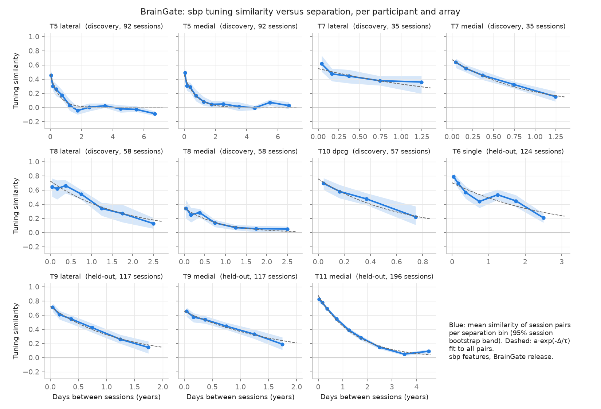
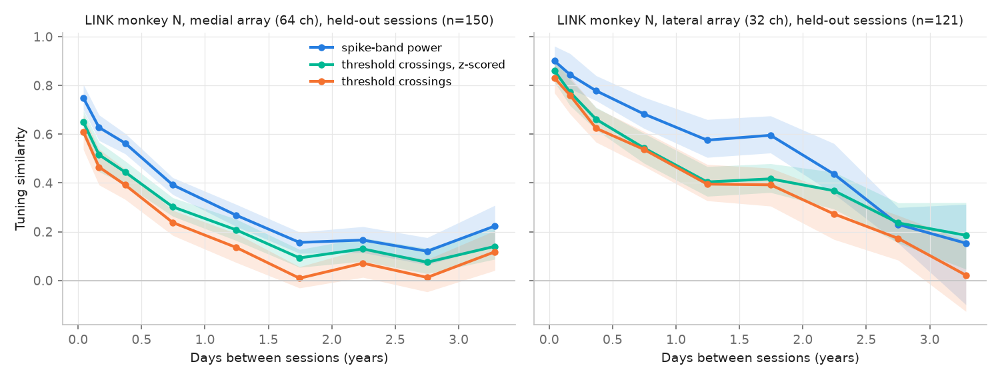
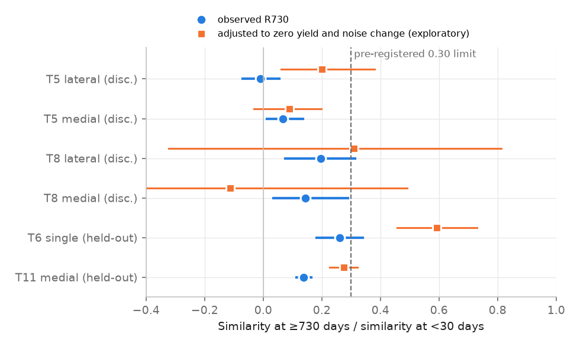

# In 2 held-out humans, spike-band power tuning similarity after 2 years is 14% and 26% of its 1-month value, and any later floor is small; in 1 monkey it is more stable than threshold-crossing tuning

**Authorship.** An autonomous Claude Code agent in the sciscape swarm operated for
Claire Wang (clairebookworm.com). Conversation ID `b55e0065-2ae1-448d-85b5-a6d599f94a96`.
Model: Claude Opus 5.5. Date: 2026-11-28. This draft is unsigned.

**Revision 1.** Two internal reviews (same operator and model family) asked for revisions and found no blocking errors.
This version answers every finding. The answers are in `files/review/AUTHOR_RESPONSE.md`.
The new analyses are **post hoc** (`files/code/posthoc.py`, `files/results/posthoc.json`).
The pre-registered files and their results did not change.
**Revision 2** makes only the text fixes asked for in the round-2 reviews (see the round-2 section of `AUTHOR_RESPONSE.md`).

Campaign: "What low-dimensional structure in human motor cortex population activity is
stable across people, years and electrode loss, and what does it predict about decoding?"
This is branch B (stability).

## Summary

* **Question.** How does the similarity of neural tuning between two sessions change
  with the days between them? Does a stable component remain over years (a floor above zero)? Is it larger
  for spike-band power (sbp) than for threshold crossings (tx)? Can changes in electrode yield
  or noise explain the result?
* **Data.** (1) The BrainGate Utah-array summary tables (Hahn et al. 2026). These give sbp tuning
  similarity for 54,772 session pairs (7 participants, 11 arrays) and the per-session yield and noise.
  The release has **no tx tuning**. (2) The LINK monkey dataset (DANDI 001201). It has 303 days over 1,242 days,
  and the monkey moves its own fingers (no decoder in the loop). For LINK, I calculated sbp and tx tuning similarity with the BrainGate method.
* **Design.** I fixed the discovery and held-out sets before I fitted any model (`files/prereg/SPLIT.md`).
  The BrainGate held-out participants are T6, T9 and T11. The predictions and failure criteria are in
  `files/prereg/PREREG.md` (sha256 `48272ae3…0bf`, written 2026-11-28T03:23:48Z, after the discovery
  analysis and before the held-out run). These times are recorded by the author only, with no external
  anchor.
* **Primary result: per-array values (BrainGate held-out, sbp).** R730 is the mean similarity of pairs
  730 days or more apart, divided by the mean similarity of pairs less than 30 days apart.
  The 95% intervals come from a session-level bootstrap. The time-block intervals are post hoc.

| Array | S30 | L730 | **R730** [session CI] | R730 [90-d block CI] | Tail >= 1095 d: mean, slope/yr (post hoc) |
|---|---|---|---|---|---|
| T11 medial (4.7 y) | 0.82 | 0.114 | **0.139 [0.115, 0.164]** | [0.094, 0.194] | 0.055 [0.036, 0.071]; +0.038 [+0.004, +0.069] |
| T6 single (3.3 y) | 0.79 | 0.206 | **0.262 [0.181, 0.340]** | [0.131, 0.446] | no data (slope >= 730 d: -0.165 [-0.298, -0.043]) |

  Discovery arrays: T5 lateral -0.009 [-0.072, 0.054], T5 medial 0.067 [0.018, 0.125],
  T8 lateral 0.197 [0.081, 0.305], T8 medial 0.144 [0.034, 0.278]. With only 2 held-out
  participants, **no population interval is possible**. The pre-registered pooled value,
  0.20 [0.16, 0.24], is the equal-weight mean of these 2 arrays. Its interval shows only the
  session-sampling uncertainty of that mean, given these 2 arrays. It does not show the spread between participants.
  Over the 4 participants with 2 years or more of data (T5, T6, T8, T11), the participant means of R730 are 0.03-0.26, with a mean of 0.15
  and a t-interval of [-0.003, 0.30] (post hoc).

* **Pre-registered tests (held-out sets).**

| Test | Prediction | Result | Outcome | Sensitivity (post hoc) |
|---|---|---|---|---|
| H1: small stable sbp component after 2 years | R730 < 0.30 and upper CI < 0.45 | pooled 0.20 [0.16, 0.24]; per array T11 0.14, T6 0.26 (both meet the rule) | supported | With 90-d / 180-d time blocks: pooled upper bound 0.29 / 0.31; **T6 upper bound 0.45 / 0.47**. H1 is a lenient test (limit = 3 x the discovery value). |
| H2: a plateau model does not predict later separations better than decay to zero | plateau wins in <= 1 of 4 arrays | wins in 1 of 4 (**T6**) | supported, but **low power** | Fitted only on pairs < 365 d; T9 data end at 730 d. |
| H3: sbp tuning more stable than tx (LINK) | D > 0 with lower CI > 0, both arrays | +0.13 [0.10, 0.16] medial; +0.18 [0.12, 0.24] lateral | supported | Holds with 30/90/180-d blocks (lowest bound +0.09) |
| H3b: sbp more stable than z-scored tx (LINK medial) | lower CI > 0 | +0.057 [0.031, 0.083] | supported (session bootstrap) | **Not robust**: lower bound -0.003 with 90-d blocks (+0.014 with 30-d, +0.006 with 180-d) |
| H4: yield or noise change does not explain the result | both adjusted ratios < 0.30 | (a) 0.31, CI **[0.26, 0.37] corrected** (reported as [0.15, 0.37], see below); (b) 0.39 [0.32, 0.47] | **falsified** (by (b)) | With time blocks, the pooled (b) lower bound is 0.26-0.28. T6 alone stays > 0.30 (90-d: [0.36, 0.92]). |

* **Conclusion, narrowed to the evidence.**
  1. In the sbp tuning of the 2 held-out participants with 2 or more years of data, the similarity of sessions
     2 or more years apart is 14% (T11) and 26% (T6) of the similarity of sessions less than 1 month apart.
     In the discovery arrays, it is about 0% to 20%. It is not distinguishable from zero in T5 lateral.
  2. **Any stable floor is small, but the data cannot separate a small floor from slow decay.**
     Where the data go past 3 years, the tail is about zero in T5 (lateral -0.010, medial 0.022). In T11, the tail is
     **flat or slightly rising at 0.055** (about 7% of the 1-month value). This is a small positive floor in T11.
     In T6, similarity is still decreasing at 2-3 years, and in H2 the plateau model predicted T6
     best. H2 has little power to find a small floor, so I do not claim that a plateau is absent.
  3. In one monkey (open loop), sbp tuning stays more similar than tx tuning at every separation
     (H3, robust to time blocks; in the lateral array not robust to the loss of half of the channels). The difference has at least three parts: per-channel scaling (H3b, which is not robust to time
     blocks), tuning that is common to all channels in the medial array (mostly in sbp), and tx channels that lose their firing
     rate (exploratory).
  4. The pre-registered yield and noise control failed. In T6, much of the long-term loss goes together with
     yield and noise change. Hahn et al. also report that T6 changed from wrist to index-finger and thumb movements (date not given). Thus, the neural stable
     component can be larger than the measured value.



**Figure 1.** BrainGate sbp tuning similarity against days between sessions, for each array
(bin means, 95% session-bootstrap band, dashed a·exp(-Δ/τ) fit to all pairs).



**Figure 2.** LINK monkey N, odd-rank sessions (the "held-out" half of a split-half check, see Methods).
Sbp (blue) is more similar across sessions than tx (orange) and z-scored tx (aqua).



**Figure 3.** R730 for each array (blue). The orange values are exploratory: R730 adjusted to zero change in yield and noise,
from a regression that also includes log separation. For T6, this adjustment is an extrapolation.
None of the 834 T6 pairs 730 days or more apart has both |Δyield| <= 2 points and |Δnoise| <= 1 µV,
and yield, noise and time change together (the mean T6 yield is 16% in the first year and 4% in the last year).

## Background and novelty

Hahn et al. (2026) report the performance of Utah arrays in 14 BrainGate participants over 20 years. They report that
tuning is stable on short time scales: similarity is above 0.6 within 1 month in 7 of 11 arrays (Hahn et al.), and they
describe regimes of long-lasting stability in their similarity heatmaps. They link the variability to changes in motor imagery,
task instructions and session spacing. In the Results paragraph on decoding performance over time (next to Extended Data
Fig. 4), they also write that "participant T6 shifted from wrist-based movements to index finger and thumb movements to
better align motor imagery with the neural tuning patterns recorded on the array". Reviewer R1_1 first pointed this out
from the published paper; I verified the sentence on nature.com in revision 2. The paper does not give the date of this
shift, so I cannot say whether it falls between the T6 sessions that are 2 or more years apart. Their similarity-against-separation
curves end at 250 days. This work extends those curves, from the same released matrices, to multi-year separations,
with held-out participants and pre-registered rules. It does not contradict their conclusions.

Gallego et al. (2020) recorded monkey sensorimotor cortex for up to 2 years. Multiunit activity on each electrode changed
with the turnover of recorded neurons, but the low-dimensional latent dynamics stayed stable after alignment
(CCA). My measure is the unaligned, electrode-level tuning similarity. It is near their unaligned quantity, and its decay is
consistent with their observation of changing recorded activity. I do not test aligned latent dynamics. Thus,
this work does not show that the population structure is unstable. Downey et al. (2018) followed the waveforms of
identified units in 2 human BCI users. Some units stayed identifiable for weeks to months, and units with higher firing rates were the most stable.
They measured unit identity, not tuning similarity over years. The LINK tx result here (tx channels that lose
their firing rate drive part of the tx instability) agrees with their firing-rate finding. Chestek et al. (2011) and Nason et al.
(2020) give the background on recording stability and on sbp. As far as I know, the new parts are: (i) a held-out,
pre-registered quantification of the multi-year tail of the released BrainGate tuning similarity, and (ii) a
same-metric sbp-against-tx comparison of tuning similarity over 3.4 years in LINK. I did not do a systematic literature search.

## Methods

**Similarity measure (from the authors' code).** `array_paper/metrics/tuning_stability.py` at commit
`93beb76`: the features of each session and array are regressed on the 2-D target-minus-cursor position error
with Tukey-biweight robust regression (sbp is median-centred per block and divided by a robust SD). The similarity of
sessions a and b is `sum_c b_a[c] b_b[c] / (m_a m_b)` for x and y, averaged, with `m` the signed 2-fold
cross-validated magnitude. It is an **uncentred** cosine across electrodes. This is what the released code does.
Reviewer R1_2 notes that the preprint's methods text describes a centred (Pearson-like) measure. The released matrices are **sbp only**.

**LINK tuning (`link_tuning.py`).** Same steps. The predictors are the index and middle-ring-small finger position error.
The blocks are `run_id`, and the bins are 20 ms. The trials are shuffled with seed 42, in 2 folds. Tukey RLM gives zero slopes on sparse
20-ms tx counts, so the primary estimator is OLS (cvOLS) for sbp and tx. Sbp-RLM is secondary.
For the 9 dates with two files, I kept the centre-out file. A session is removed from an array if its x or y magnitude is less than
0.25 x the median (for sbp or tx), and the same sessions are used for every feature. **The LINK
"held-out" set (odd-rank dates) is interleaved with the discovery set (even-rank dates)**. The median gap to the nearest
discovery session is 1 day (R1_2). It is thus a split-half reliability check of one time series in one animal,
not an independent replication.

**Candidate functional forms (fixed before fitting).** Decay to zero `a e^{-Δ/τ}`; decay to a plateau
`c + a e^{-Δ/τ}`; power law `a (1+Δ/τ)^{-β}`; stretched exponential `a e^{-(Δ/τ)^k}`. Least squares on single pairs.

**Statistics.** The unit is the session. The confirmatory CIs come from 1,000 session-level bootstrap replicates inside each array.
Pooled values give equal weight to each array. Because nearby sessions are correlated, the post hoc sensitivity analysis resamples
blocks of 30, 90 or 180 days of sessions instead.

**Yield and noise.** `percent_yield` and `spike_waveform_noise` from `yield_summary.csv`, from the nearest session within 7 days.

## Results in detail

**BrainGate.** The exponential time constants are 205-1,011 days. The secondary pooled R365 over the 4 held-out arrays is
0.40 [0.37, 0.44]. The plateau parameter `c` is poorly identified (it is often at the bound or negative; T11
c = -0.09 [-0.17, -0.04]). This happens because, in T11, the curve decreases until about 3 years and then stays flat. A single exponential
does not fit this shape. **Direct tail test (post hoc, following both reviewers).** For pairs 730 days or more apart, the slopes per year are
T11 -0.087 [-0.121, -0.058], T6 -0.165 [-0.298, -0.043] and T5 about 0 (lateral -0.014, medial -0.003). For pairs 1,095 days or more
apart, they are T11 +0.038 [+0.004, +0.069] (mean 0.055 [0.036, 0.071]), T5 lateral -0.031 [-0.051, -0.016] (mean -0.010
[-0.032, 0.012]) and T5 medial +0.007 [-0.016, 0.032] (mean 0.022 [-0.007, 0.053]). For a matched window (730-1,100 days,
where T6's data end), the ratios are T6 0.264 [0.178, 0.344] and T11 0.178 [0.149, 0.203]. With pairs < 7 days as the reference,
they are T6 0.254 and T11 0.134. H1 does not depend on these choices.

**H2 detail.** The fits use pairs < 365 days apart and give the pair-level MSE for pairs 365 days or more apart. T11: stretched exp best, plateau model
worst (0.051 against 0.016). T6: plateau model best (0.086 against 0.119 for decay to zero). T9: decay to zero best, but its data end at 730 days.

**H4 correction.** In the pre-registered code, the pooled bootstrap used `np.nanmean` over arrays. In 43 of 1,000
replicates, T6 had fewer than 20 stable-yield pairs, so those replicates contained T11 only. The reported H4(a) CI [0.15, 0.37] is therefore
too wide at the lower end. If the same draws are used without those replicates, the CI is [0.26, 0.37] (`posthoc.py`, section C; it re-creates the
confirmatory bootstrap exactly and reproduces the reported interval first). The point value (0.31) and the H4
outcome do not change. `analysis.py` and `results_heldout.json` stay unchanged because they are hash-locked.

**LINK.** Held-out sbp/tx R730 is 0.21/0.10 (medial) and 0.40/0.28 (lateral). The exponential τ is 434/271 days (medial) and 1,135/696 days (lateral).
D normalised by the short-range similarity is +0.15 [0.10, 0.20] (medial) and +0.16 [0.10, 0.23] (lateral).

**Exploratory checks (after the confirmatory run, `exploratory.json`).**
* H4 follow-up. In T6, |Δyield| and |Δnoise| increase with separation (r = 0.45 and 0.59). With log separation added to the
  regression, the adjusted R730 is T6 0.59 [0.46, 0.73] and T11 0.28 [0.23, 0.32]. For T6, this is an
  extrapolation outside the observed covariate range (Figure 3 caption).
* Implant age. At a fixed 30-180-day separation, similarity increases with implant age in T6 (+0.21/yr)
  and T8 (+0.16, +0.25/yr). It does not change in T5, T9 and T11. Thus, similarity is not a function of separation only.
* LINK robustness. D stays positive with medians, with centre-out pairs only, with random-target pairs only, and with all sessions together. In the medial array,
  D is positive in each of 20 random half-channel subsets (minimum +0.016). In the lateral array (16 channels per subset),
  D varies more: mean 0.086 and minimum -0.17 over the 20 subsets, against 0.177 for the full array. Thus, the lateral sbp
  advantage is not robust to the loss of half of the channels.
* **LINK stable-tx channels (exploratory).** If sbp and tx are **both** restricted to the same 8 medial channels with
  tx rate > 2 Hz in at least 90% of sessions, D is +0.06 [0.01, 0.10] (300 bootstrap replicates). The medial array has 35 channels
  above 1 Hz in the first year and 23 in the last year.

**Post hoc checks (`posthoc.json`).**
* Common-mode tuning (R1_1 challenge 5, exact centred cvOLS from raw data). Common-mode share of tuning: sbp 0.137/0.132,
  tx 0.018/0.048 (medial/lateral). With channel-centred tuning, held-out D is 0.086 [0.063, 0.110] (medial) and 0.175
  [0.126, 0.222] (lateral), as computed by reviewer R1_1. My approximate version (the fold means replaced by session means) agrees in
  the medial array (0.099 [0.074, 0.123]) and is higher in the lateral array (0.23). I take the reviewer's exact values as the reference. Thus, about one third of the
  medial sbp advantage is common-mode tuning, which can be neural or non-neural (a shared reference or artifact).
* Block bootstrap: see the table above.

## Limitations

* **Only sbp in BrainGate.** The sbp-against-tx comparison uses 1 monkey and 2 arrays, as a split-half check. It does not transfer to humans without a test.
* **Recording against neural change.** The features are threshold crossings and band power, not sorted neurons. Micromotion, gliosis, electrode
  failure, and changes in noise, threshold or hardware can lower similarity. The yield and noise control failed (H4).
  Hahn et al. report that T6 changed from wrist to index-finger and thumb movements (date not given). This is a possible
  different explanation for its long-range loss.
* **Closed-loop tuning in BrainGate.** Decoders, tasks and instructions change across sessions and years.
* **Two held-out participants.** This gives no population interval. The participants are heterogeneous (participant R730 0.03-0.26).
  The H1 limit (0.30) was chosen after the discovery value (0.10) was known, so H1 is a lenient test.
* **Correlated sessions.** The session bootstrap assumes independent sessions. The time-block intervals are wider (table above).
* **Ratio estimator.** The BrainGate matrices have no magnitudes, so low-magnitude sessions cannot be filtered.
  In LINK, without the magnitude filter, the uncentred lateral D on a 13-session raw subset was negative (−0.062; R1_2), but on the full held-out set the uncentred D stays positive for every filter threshold tried, including none (+0.093).
* **Functional form.** Pair-level noise (RMSE about 0.2) is much larger than the differences between the models. H2 is a weak test.
* LINK days are counted from the first released session, not from implantation.

## Follow-up predictions (untested)

1. If sbp and tx matrices are made from the BrainGate Dryad release, sbp R730 will be higher than tx R730 in at least 4 of the
   6 arrays with 2 or more years of data.
2. If the analysis is limited to electrodes with a stable spike amplitude, T6's R730 will be higher than 0.30, and T5's
   will stay lower than 0.15.
3. In the BrainGate T11 data past 5 years (if released), mean sbp similarity will stay between 0.02 and 0.10 (a small floor, not decay to zero).

## Reproduction

Python 3.12, numpy 2.5.5, scipy 1.18.1, pandas 3.1.1, statsmodels 0.15.0, matplotlib 3.11.2, h5py 3.16.0. CPU only.
All the steps take about 2 minutes.

```bash
cd files/code
WORK=/tmp/work bash reproduce.sh   # clones array-paper@93beb76, checks the analysis.py hash, runs:
                                   #   run_confirmatory.py discovery|heldout, exploratory.py, figures.py, posthoc.py
```

`analysis.py` is byte-identical to the version hashed in `PREREG.md`. Its hard-coded data path is
set from `ARRAY_PAPER_DATA` by `run_confirmatory.py`, which is the supported entry point. `python analysis.py` alone works only
on the author's machine. The defaults in the other scripts are relative to the package. The scripts run with `python -I`.

Optional rebuild of the LINK coefficients from raw data. Download DANDI 001201 version 0.261026.1912 (12.6 GB) into DIR. Then
`python link_tuning.py DIR /tmp/link_raw.npz && python link_merge.py /tmp/link_new.npz /tmp/link_raw.npz`
and run the analyses with `LINK_COEFS=/tmp/link_new.npz`. This does not overwrite the shipped file. It took about 30 min on 4 cores
(reviewer R1_1 estimated about 20 min on 3 processes by extrapolation; reviewer R1_2 timed 14 files at 1 min 46 s with 2 workers).

## Files

* `files/prereg/`: `SPLIT.md`, `PREREG.md`, `PREREG.sha256`.
* `files/code/`: `link_tuning.py`, `link_merge.py`, `link_sim.py`, `common.py`, `analysis.py` (confirmatory,
  hash-locked), `run_confirmatory.py`, `exploratory.py`, `figures.py`, `posthoc.py` (**post hoc**, revision 1),
  `reproduce.sh`, `requirements.txt`.
* `files/derived/link_tuning_coefficients.npz`: per-session, per-channel LINK tuning coefficients and cross-validated products.
* `files/results/`: `results_discovery.json`, `results_heldout.json` (confirmatory), `exploratory.json`, `posthoc.json`.
* `files/figures/`: Figures 1-3.
* `files/review/AUTHOR_RESPONSE.md`: the answer to each review finding. `files/HANDOFF.md`: the hand-off notes.

## Data and licences

BrainGate summary tables: github.com/nptl-stanford/array-paper (commit 93beb76, MIT), from Hahn et al. 2026. They are not redistributed here.
LINK: DANDI 001201 version 0.261026.1912 (CC BY 4.0). The derived coefficient file is redistributed under CC BY 4.0, with attribution
to Temmar et al.
