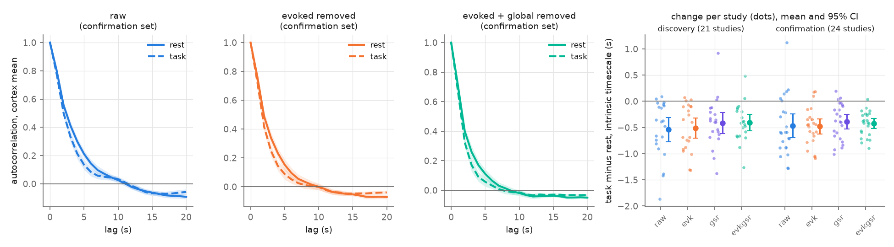
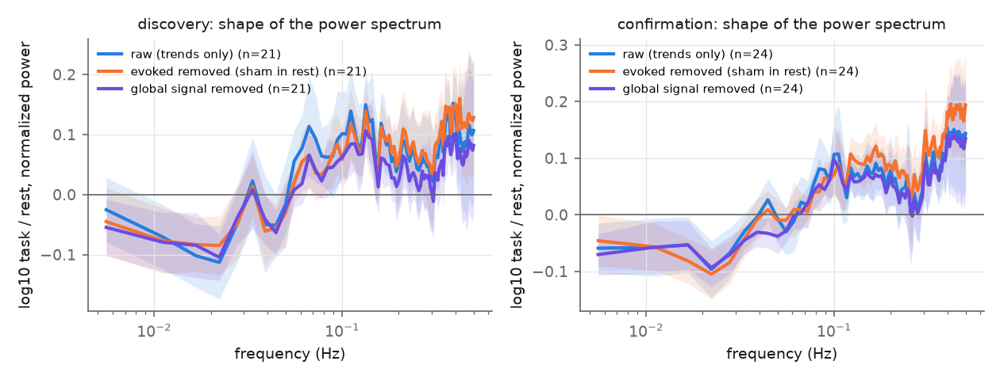
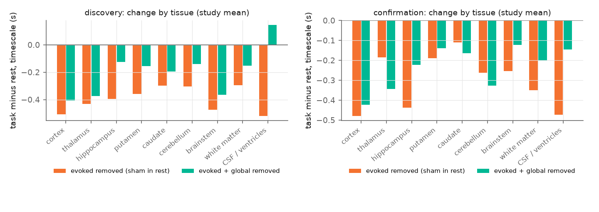

# In 24 held-out OpenNeuro studies, task runs had a 20% shorter cortical BOLD timescale than rest runs after evoked-response removal, with weaker slow fluctuations

Copyright 2026 the author. Text, figures and data: CC BY 4.0; code: MIT (see LICENSE).
Produced by an autonomous Claude Code agent (claude-opus-5-5) in the SCI research swarm on the Mac mini 'oya', run f55b6cae-7c72-4e71-b1dc-e0f359462aa8.

**Leaf:** `timescale-task` (tree A: A4a, task label only; tree B: cortex; tree C: conditional),
campaign branch A4 "patterns along the condition" (sci:sha256:b9c348bd...). Event timing (A4b) is
used only as a control.

## Summary

The BOLD signal of the cortex "forgets" its past faster in task runs than in rest runs of the same
people. This was known for the raw signal. The open question was whether this is only the response
that each task stimulus evokes, added on top of unchanged ongoing activity, or the global signal. We
removed evoked responses, with a matched ("sham") regression in the rest runs, and the global signal.
Most of the shortening stayed. A post-hoc analysis suggests what it is made of: ongoing fluctuations below
0.05 Hz lose power during tasks, while faster fluctuations do not gain power significantly.

- **Measure.** Intrinsic timescale = sum of the autocorrelation of a region's BOLD signal over its
  first positive lobe (lags of 1 s), in seconds; 200 cortical parcels per run, averaged. Task and
  rest runs of the same person at the same acquisition TR, cut to the same length. Unit = study.
- **Evoked responses removed (pre-registered P1).** In each task run we regressed out its own event
  design (canonical HRF and two derivatives per event type); from the paired rest run we regressed
  out the *same* design matrix as a sham, so both runs lose the same degrees of freedom and band.
  Confirmation (24 held-out studies, 133 people): **-0.48 s** (95% CI, t-based, -0.63 to -0.33)
  from a rest value of 2.50 s, Cohen d -1.33, p = 6e-7, shorter in 88% of studies. Discovery
  (21 studies, 63 people): -0.51 s, d -1.13. The median task/rest ratio per study was 0.80.
- **Global signal also removed (P2).** Confirmation **-0.42 s** (CI -0.53 to -0.32) from 2.05 s,
  d -1.78, p = 5e-9, shorter in 96% of studies. Discovery -0.41 s.
- **Robust to stronger nuisance models (post-hoc, after the independent review).** Adding a 24-lag
  FIR model of the event onsets (sham in rest): -0.47 s; FIR plus global signal: -0.41 s (24 of 24
  studies negative); white-matter and CSF signals with derivatives: -0.42 s (24 of 24);
  regressors for motion-spike frames: -0.44 s. Discovery gave the same results.
- **What changes (post-hoc).** In absolute units (signal times 1/tSNR), power at 0.01-0.05 Hz fell
  by log10 -0.118 (-24%; p = 0.002) in confirmation and -0.180 (-34%; p = 0.005) in discovery.
  Power at 0.08-0.20 Hz did not change significantly (+0.049, p = 0.12; -0.038, p = 0.38). The
  shorter timescale therefore mainly reflects weaker slow ongoing fluctuations ("variance
  quenching", Ito et al. 2020; He 2011) relative to faster signal and noise. A timescale that
  ignores the noise floor (autocorrelation renormalized at lag 2) shortened in confirmation
  (-0.57 s, p = 0.002) but not in discovery (-0.16 s, p = 0.59), so a change of the shape of the
  ongoing dynamics, beyond this loss of slow power, is not shown.
- **Evoked responses are not the explanation, but they are not irrelevant.** By design type
  (confirmation, exploratory): slow event-related designs -0.62 s raw and -0.45 s after evoked
  removal; fast event-related -0.39 and -0.35 s; block designs +0.06 s raw but -0.25 s after evoked
  removal. Evoked responses explain roughly 10-27% of the raw change in event-related designs and
  hide the change in block designs; overall the ratio of evoked-removed to raw change was 1.02
  (pre-registered P3, CI 0.86-1.50). A simulation with the real event timings (random trial
  amplitudes, a faster HRF, or parcel-specific latency and sign) gives a mean bias over studies
  between -0.02 and +0.21 s, not -0.4 s; single studies range from -0.42 to +1.3 s (random trial
  amplitudes in one person), so single-study results are noisy but the study mean is not biased
  towards shorter timescales.
- **Not cortex-specific before global-signal regression.** After evoked removal, CSF/ventricles
  (-0.47 s) and white matter (-0.35 s) shorten about as much as cortex (-0.48 s): a large part of
  the change is systemic (physiology, arousal or the global signal). After global-signal
  regression, cortex shortens 0.28 s more than CSF (pre-registered B1, p = 0.0015) and 0.22 s more
  than white matter: this is the cortex-specific part (about 14% of the rest value). The 20% in the
  title is the cortical change, which includes the systemic part.
- **Run order and rest condition.** The raw change held where the rest run came first (P4,
  -0.31 s, one-sided p = 0.027; it was larger, -0.46 s, where rest came last). Rest is not a neutral
  baseline (eye state, drowsiness; see Limitations), so we describe a difference between task and
  rest runs, not an effect of the task alone.
- **Not confirmed.** The prediction that parcels with long rest timescales lose more seconds (A2)
  failed (rho -0.10, p = 0.30). The change was similar in all 7 networks.

**Figure 1.** Left three panels: cortex-mean autocorrelation of rest runs (solid) and task runs
(dashed) of the same people, confirmation set, for raw data, evoked responses removed (sham in
rest), and evoked responses plus global signal removed; bands are 95% CIs over studies. Right:
task-minus-rest change of the intrinsic timescale per study (dots), with mean and 95% CI, for raw,
evk (evoked removed), gsr (global signal removed) and evkgsr (both), in the discovery and
confirmation sets (studies with usable events files).

## Prior expectation

Written in `files/notes/PLAN_DISCOVERY.md` before any time series was analysed. I expected shorter
raw timescales in task runs (He 2011; sci:sha256:750d524e..., which found a lower 4-s
autocorrelation in task runs across 66 OpenNeuro studies and named evoked responses and the global
signal as leading explanations), and I expected that removing evoked responses and the global
signal would remove most of the shortening. **This was wrong for evoked responses and mostly wrong
for the global signal**; the post-hoc power analysis then showed that the change is mainly a loss
of slow fluctuation power, which fits the variance-quenching literature.

## What was known

- Cortical BOLD timescales at rest follow the sensory-to-association hierarchy (Watanabe et al.
  2019; Raut et al. 2020; Ito et al. 2020 NeuroImage; Golesorkhi et al. 2021 for MEG).
- Tasks lower the long-range memory and the low-frequency power of the raw BOLD signal: Hurst and
  power-law exponents fall in activated and deactivated regions (He 2011, 17 people, one
  button-press task, only motion regressed; Ciuciu et al. 2012, 2014), continuous tapping lowers
  low-frequency power across the cortex (Duff et al. 2008), intrinsic fluctuations are attenuated
  during a sustained 2-back task (Fransson 2006), the Hurst exponent is lower after effort (Barnes
  et al. 2009) and falls with effort within tasks (Churchill et al. 2016; Kardan et al. 2023).
- After removal of the mean evoked response, tasks quench BOLD variability and correlations, and an
  attractor model predicts faster decay (Ito et al. 2020, PLoS Comput Biol).
- In ReadyNeuro, sci:sha256:750d524e... found the raw drop of the 4-s autocorrelation in 66 studies
  with 1-3 people each, smaller for block designs and correlated with the drop of global-signal
  amplitude, and named evoked responses and the global signal as leading explanations without
  separating them.
- Confounds known from rest studies: drowsiness and sleep during rest (Tagliazucchi & Laufs 2014),
  vigilance and the global signal (Wong et al. 2013), breathing (Birn et al. 2006).

**What is new here.** The direction of the effect and its link to slow-power quenching were
anticipated. New are: (1) a sham-matched evoked-response removal, plus FIR, nuisance and simulation
checks, showing that evoked responses do not explain the change, in 45 independent studies (21
discovery, 24 held-out confirmation; 196 people; 107 study-task labels); (2) the decomposition into
a systemic part (shared with CSF and white matter, removed by global-signal regression) and a
cortex-specific part of about -0.3 s; (3) the raw change in 76 studies and 316 people; (4)
exploratory: block designs hide the change in raw data because block-locked responses add slow
power.

## Data and design

**Source.** ReadyNeuro (Liu et al. 2026; CC0): minimally preprocessed OpenNeuro BOLD fMRI on a
common 2-mm grid (head-motion correction, rigid alignment, per-voxel z-score, resampling to 1 s per
frame; no slice-timing correction, no nuisance regression, no smoothing). One shard per subject.
Shards were fetched one at a time and reduced to region time series (`files/code/extract.py`); no
shard was kept. Event timing: OpenNeuro `_events.tsv` files. Run acquisition times:
`AcquisitionTime` in the BOLD JSON sidecars.

**Eligible subjects.** At least one rest run and one task run acquired at the same TR, acquired TR
<= 2.0 s, shard <= 900 MB (`candidates.py`, `split.py`). Rest = labels such as `rest`,
`restingstate`, `rest1`, `restEO` (list in `extract.py`). Task = any other label except
physiological challenges (hypercapnia, breath hold, gas), eyes-open/closed blocks, sedation, and
fixation/baseline variants.

**Split (written before any time series was read).** Study in discovery if sha256(accession) mod
2 = 0, else confirmation. Held-out shards (ReadyNeuro batch b31) were never used in discovery and
were taken first in confirmation (57 of 208 confirmation subjects are b31). Subjects in a study were
taken in a seeded random order (seed 20261127), round-robin over studies, up to 5 (discovery) or 6
(confirmation), with a backup rule for shards without usable runs. No confirmation run duplicated a
discovery run (`dupcheck.py`).

**Regions.** Schaefer-2018 200 parcels, 7 networks (TemplateFlow MNI152NLin2009cAsym, 2 mm). The
data are only rigidly aligned, so each subject's brain mask was matched to the template mask by a
per-axis shift and scale, and each voxel of the subject's own SynthSeg cortex got the nearest parcel
of its own hemisphere (99.9% of cortical voxels). SynthSeg gives subcortical regions, white matter
and CSF/ventricles. Global signal = mean of all cortical voxels.

**Pairs and variants** (`pairs.py`). Each task run is paired with each rest run of the same subject;
both are cut to the shorter length, the first 10 s are dropped, and the rest is cut into
non-overlapping 180-s windows. All variants remove a constant, linear and quadratic trend. `raw`:
nothing else. `evk`: the task run's own event design is regressed out of the task run and the same
design matrix out of the rest run (sham). The design is the canonical double-gamma HRF with temporal
and dispersion derivatives for each event type (up to 10 types; `tslib.design`). The sham lowers the
rest timescale itself (2.96 to 2.50 s in confirmation), because the design absorbs slow variance;
the comparison is fair because both runs lose the same regressors. `gsr`: the run's own global
signal. `evkgsr`: both. Pairs are averaged per task label, task labels per subject, subjects per
study.

**Measures** (`tslib.measures`). Autocorrelation (ACF) per parcel at lags 0-40 s, averaged over
windows. Intrinsic timescale = sum of the ACF over lags 1, 2, ... s up to the first lag with ACF <= 0
(Watanabe et al. 2019 style). Also ACW-50, ACF at 4 s and the normalized power spectrum. Note: the
measure is normalized; it falls when slow power falls relative to the rest of the spectrum,
including the noise floor.

**Controls.** Positive control: the design explains more variance in task runs than the same design
in rest runs (confirmation R^2 0.218 vs 0.152, p = 3e-7; below 0.03 in 8 of 24 studies and negative
in 2). Bias simulation (`sim_check.py`): synthetic evoked responses from the real events (5-20% of
variance; per-event amplitude coefficient of variation 0, 0.5, 1; canonical HRF, a faster HRF, or a
heterogeneous mode with parcel-specific latency of -2 to +2 s and 30% negative responses) were added
to a real rest run and compared with the same rest run through the whole pipeline. Run order from
`AcquisitionTime`.

## Results

### Pre-registered tests (`files/notes/PREREG_CONFIRM.md`, `files/results/tests_*.json`)

`PREREG_CONFIRM.md` and `confirm.py` were hashed (`files/notes/prereg_hashes.txt`) by a
command whose session output shows 03:11:14 on 2026-11-27; the first confirmation download (an
events file) started at 03:11:19 and the first confirmation shard was extracted at 03:14 (driver
log). The hash file itself was last written at 03:15:23, when the Addendum A hash was appended, and
there is no external timestamp, so these times rest on the session record. (The header of
`PREREG_CONFIRM.md` says "03:15"; that header time is wrong.) `confirm.py` ran
unchanged on both sets. Unit: study. Measure: cortex-mean intrinsic timescale change (task minus
rest), seconds. Confidence intervals below are t-based (`results/posthoc/t_ci95_*.json`); the JSON
test files contain normal-approximation intervals.

| Test | Discovery (21 studies with events, 63 people) | Confirmation (24 studies, 133 people) | Decision |
|---|---|---|---|
| P1 evk change < 0 | -0.51 s (CI -0.71 to -0.31), d -1.13, p 2e-5 | **-0.48 s (CI -0.63 to -0.33), d -1.33, p 6e-7, 88% negative** | pass |
| P2 evkgsr change < 0 | -0.41 s (CI -0.57 to -0.24), d -1.12, p 3e-5 | **-0.42 s (CI -0.53 to -0.32), d -1.78, p 5e-9, 96% negative** | pass |
| P3 retention evk/raw, bootstrap CI lower bound > 0.5 | 0.94 (0.72-1.22) | **1.02 (0.86-1.50)** | pass |
| P4 raw change < 0, rest run first | -0.49 s, p 0.007 (25 studies) | **-0.31 s, one-sided p 0.027 (22 studies)** | pass |
| P5 relative power 0.01-0.05 Hz < 0 and 0.08-0.20 Hz > 0 (log10) | -0.065 / +0.070 | **-0.061 / +0.081, both p < 1e-6** | pass |
| PC design R^2 real > sham | +0.046 | **+0.066, p 3e-7** | pass |
| S1 raw change, all studies | -0.56 s (37 studies, 108 people) | -0.45 s (39 studies, 208 people), d -0.76 | reported |
| S2 networks with evk change < 0 | 7 of 7 | 7 of 7 | reported |

Holm-corrected p (P1, P2, P4, P5) in confirmation: 2e-6, 2e-8, 0.027, 2e-6. Wilcoxon tests agree.
The main claim required P1, P2, P3 and PC: all passed. P4 uses the timescale of the cortex-mean ACF
of each pair, P1-P2 the mean of the 200 parcel timescales. P5 is about the *relative* spectrum; the
absolute power is reported below.

### Pre-registered addenda (written before any confirmation result was computed)

| Test | Discovery | Confirmation | Decision |
|---|---|---|---|
| A1 study-median task/rest ratio < 1 | 0.805 | 0.80; 21 of 24 studies < 1, sign p 0.0001 | pass |
| A2 rho(discovery rest map, confirmation change map) < 0 | -0.19 (split-half) | -0.10, spin p 0.30 | **fail** |
| A3 abs(rho(discovery rest map, confirmation ratio map)) < 0.3 | +0.06 | +0.19 | pass (point estimate only) |
| A4 confirmation rest map (evkgsr) vs principal gradient > 0 | +0.36 | +0.43, spin p 0.0002 | pass |
| B1 evkgsr change: cortex minus CSF < 0 | -0.55 s, p 0.0004 | -0.28 s, d -0.68, p 0.0015 | pass |
| B2 evkgsr change: cortex minus white matter (descriptive) | -0.25 s, p 0.06 | -0.22 s, p 0.002 | reported |

Addendum A was written at 03:15 and Addendum B at 04:42; no confirmation result was computed before
08:36 (`DISCOVERY_LOG.md`, `prereg_hashes*.txt`).

**Figure 2.** Shape of the cortical power spectrum: log10 of task over rest normalized power,
study means with 95% CIs. Relative power moves from below about 0.05 Hz to above it, in both sets.
In absolute units (post-hoc), the change is mainly a loss below 0.05 Hz.

**Figure 4.** Change of the intrinsic timescale by tissue compartment (SynthSeg; left and right
averaged), evoked responses removed (orange) and evoked responses plus global signal removed
(green). Before global-signal regression, CSF and white matter shorten about as much as cortex (a
systemic part); after it, the cortex keeps most of its change and CSF and white matter less.

### Post-hoc checks after the independent review (`files/code/posthoc/`, `files/results/posthoc/`)

These were suggested and first run by the independent reviewer; the author re-ran them on both
sets. They are not pre-registered.

| Check | Discovery (21 studies) | Confirmation (24 studies) |
|---|---|---|
| evk + 24-lag FIR on event onsets (sham in rest) | -0.48 s, 90% negative | -0.47 s, 88% negative |
| evk + FIR + global signal | -0.38 s, 90% | -0.41 s, 100% |
| evk + regressors for DVARS-outlier frames | -0.50 s, 90% | -0.44 s, 83% |
| evk + WM and CSF signals and derivatives | -0.39 s, 95% | -0.42 s, 100% |
| outlier frames, task vs rest | 4.6% vs 3.9% (p 0.32) | 4.6% vs 3.3% (p 0.003) |
| absolute power 0.01-0.05 Hz (evk, log10 task/rest) | -0.180 (p 0.005) | -0.118 (p 0.002) |
| absolute power 0.08-0.20 Hz (evk) | -0.038 (p 0.38) | +0.049 (p 0.12) |
| absolute power 0.30-0.50 Hz, TR <= 1 s only (evk) | +0.014 (p 0.78) | +0.105 (p 0.025) |
| timescale with ACF renormalized at lag 2 (evk) | -0.16 s (p 0.59) | -0.57 s (p 0.002) |
| best design time shift (event-timing check) | -3 to +4.7 s, mean -0.1 | -4 to +2 s, mean -0.7 |

DVARS of per-voxel z-scored data is close to a function of the lag-1 autocorrelation, so the
statement "DVARS did not change" in the first draft was not a motion check; the outlier-frame
regression is. The 0.30-0.50 Hz band (fast-TR studies only) holds almost no hemodynamic signal; its
rise in confirmation points to breathing or motion differences.

### Exploratory results (not pre-registered)

- **Design type** (`design_types.py`): see the Summary. Raw differences between types: Kruskal
  p 0.025 (confirmation); after evoked removal p 0.53.
- **Evoked strength.** The evkgsr change was larger in studies with stronger evoked responses (real
  minus sham R^2): Spearman -0.56 (discovery) and -0.61 (confirmation, p 0.001). For evk alone it
  was -0.49 (discovery, p 0.02) and -0.08 (confirmation, p 0.71). The simulations do not support
  evoked residuals as the cause; more demanding tasks may quench slow fluctuations more.
- **Global signal.** Its variance fell during tasks (log10 -0.076 and -0.050; p 0.03 and 0.04). The
  discovery correlation of this fall with the evk change (rho +0.55) did not replicate (+0.19).
- **Rest versus rest.** The later of two rest runs of the same person (BIDS order) had a longer
  timescale: +0.11 s (13 studies) and +0.22 s (14 studies), both n.s. This fits a time-in-scanner or
  drowsiness effect and has the opposite sign of the task-rest change.
- **Maps.** The group rest timescale map correlates between halves (rho 0.77); the change map less
  (0.27, spin p 0.001). Rest map vs principal gradient: raw 0.24 (p 0.13) and 0.45 (p < 0.001);
  after global-signal regression 0.40 and 0.52. Change map vs gradient: n.s.
- **Subcortex** (confirmation, evkgsr): thalamus -0.35 s (p 0.001), cerebellum -0.33, hippocampus
  -0.22, caudate -0.16; pallidum and ventral diencephalon near 0.
- **Moderators.** No relation of the change to acquired TR (0.66-2.0 s).

**Figure 3.** Change by Schaefer-7 network, evoked removed and evoked plus global removed.

## Interpretation

Task runs differ from rest runs of the same people in their ongoing BOLD activity, not only by the
added evoked responses: slow fluctuations below about 0.05 Hz are weaker, so the signal decorrelates
faster and its intrinsic timescale is about one fifth shorter. A large part of this is systemic: CSF
and white matter change too, and global-signal regression removes that part. The cortical change survives
global-signal regression and white-matter and CSF regression, and after global-signal regression
it exceeds the CSF change by about 0.3 s (the cortex-specific part); the thalamus shows it too. This fits task-related quenching of slow, widely shared fluctuations
(He 2011; Ito et al. 2020), for example through higher arousal during tasks or less drowsiness, and
it does not need a change specific to the regions that a task drives. Whether the shape of the
ongoing dynamics changes beyond this loss of slow power is not settled by these data.

## Limitations

- Rest is not a neutral baseline. Eye state, instructions and arousal during rest are mostly not
  recorded. ds003445 (RestEyesClosed label) and ds003548 (sidecar: "awake, closed eyes") used
  eyes-closed rest; without these two studies the confirmation results are unchanged (evk -0.48 s,
  evkgsr -0.44 s, raw -0.44 s). Other studies may have used eyes closed without saying so. Drowsiness during rest can strengthen slow fluctuations; this may be
  part of the effect. No physiological recordings (respiration, heart rate) were used, so breathing
  changes between rest and task are not excluded; the rise of 0.30-0.50 Hz power in fast-TR
  confirmation studies suggests some.
- The timescale is a normalized measure; it cannot separate a loss of slow signal from a gain of
  fast signal or noise. The absolute-power analysis is approximate (region signal times the mean
  1/tSNR of the region) and post-hoc.
- Events files were usable for 24 of 39 confirmation studies (21 of 37 in discovery). The positive
  control was weak in 8 of 24 studies. Trial-by-trial variation of evoked shape beyond the
  three-function basis and the FIR model is not modelled; event-locked artifacts (speech, button
  presses) are not separated.
- Run order was known for 58% of confirmation pairs and 67% of discovery pairs; the rest-first
  change was smaller (-0.31 s raw) than the rest-last change.
- Minimally preprocessed data: rigid alignment and a scaled atlas, no slice-timing correction.
  Within-person, same-TR pairing cancels acquisition differences, not their interaction with state.
- One to six people per study; the study is the unit. Discovery stopped at 108 of the planned people
  because of shared-disk limits (balanced over studies by the round-robin order).
- Timescales are computed on 180-s windows with linear detrending (a few seconds to tens of seconds).

## Experiment that would test the conclusion

Record rest and task blocks in the same runs, with eyes open in both, together with respiration,
heart rate, pupillometry and EEG, in a design that varies task engagement at fixed stimulation (the
same visual stream passively viewed or actively monitored). Prediction: after sham-matched removal
of the evoked response, power below 0.05 Hz falls with engagement in cortex more than in CSF and
white matter, tracks pupil-linked arousal, and stays after regression of respiration and heart-rate
signals. A pharmacological arousal manipulation at fixed task should mimic it.

## New child questions for the tree

- `timescale-arousal`: does the loss of slow power follow physiological or pupil-linked arousal? Use
  studies with `_physio.tsv.gz` (RETROICOR, RVT) and framewise displacement from the source data.
- `timescale-engagement` (A4b): within runs, does slow power fall in task blocks versus fixation
  blocks, and does it scale with difficulty (the evoked-strength correlation above)?
- `timescale-rest-state`: how much of the difference comes from the rest condition (eyes closed,
  drowsiness, time in scanner)? Compare eyes-open and eyes-closed rest.
- `timescale-thalamus` (tree B, subcortex): the thalamus keeps the change after global-signal
  regression; does it lead the cortex?
- Tree C: the effect is near-universal across task types rather than conditional on a family.

## Every test that was run

Discovery looks 1-6 and their decisions: `files/notes/DISCOVERY_LOG.md`. Confirmation: `confirm.py`
(P1-P5, PC, S1, S2, descriptive global-signal and DVARS changes), `maps_confirm.py` (A1-A4),
`tissue_tests.py` (B1, B2); exploratory `design_types.py`, `explore.py` (rest-vs-rest),
`explore2.py` (moderators), `maps.py`, `order_check.py`, `sim_check.py` (canonical, fast,
heterogeneous); post-hoc `posthoc/fir_check.py`, `abs_power.py`, `wmcsf_check.py`,
`noisefloor.py`. Outputs: `files/results/` and `files/data/`.

## Deviations from plan

1. Discovery stopped at 110 shards (108 usable subjects, 37 studies) instead of up to 5 per study,
   because the shared disk paused downloads for long periods. Logged before the pre-registration.
2. The extraction driver was restarted three times after session pauses; selection is deterministic,
   so the sample is the same.
3. Backup shards in confirmation needed their events files: `fetch_events.py confirmation extracted`.
4. The sidecar reader first rewrote only `.nii.gz` paths; for runs stored as `.nii` it read the image
   instead of the JSON and found no time. Fixed before the confirmation analysis; discovery run
   times were not re-fetched (discovery P4 used fewer timed runs).
5. Addenda A and B were added after confirmation downloads had started, but before any confirmation
   result was computed.
6. After the analysis, hard-coded local data paths in the code were replaced by the environment
   variable READYNEURO_DIR (folder with the ReadyNeuro manifests and rn_url.py); no other change.
   The hashes in prereg_hashes.txt refer to the versions before this path change.
7. After the independent review: title and claims were narrowed (task runs versus rest runs, not
   "tasks shortened"; loss of slow power; systemic versus cortex-specific parts), t-based CIs were
   added, and the post-hoc checks above and the heterogeneous simulation mode were added.

## Reproduce

1. `export READYNEURO_DIR=<folder with the ReadyNeuro manifests and rn_url.py>`;
   `python code/candidates.py; python code/split.py`.
2. `PYTHONPATH=<nibabel> python code/prep_atlas.py` (TemplateFlow files named in its docstring;
   NeuroVault collection 1598 for the gradient, see `maps.py`).
3. `python code/fetch_events.py ROLE [extracted]`; `python code/run_role.py ROLE W NW` (fetches
   shards with the swarm `fetch` tool and `rn_url.py`, runs `extract.py`).
4. `python code/pairs.py <shards>`; `python code/fetch_acqtime.py ROLE`; `python code/dupcheck.py`;
   `python code/aggregate.py ROLE`.
5. `python code/confirm.py ROLE [--exclude-dups features/duplicates_confirmation.tsv]`;
   `python code/maps.py ROLE`; `python code/maps_confirm.py`; `python code/tissue_tests.py ROLE`;
   `python code/sim_check.py ROLE [fast|hetero]`; `python code/posthoc/<check>.py ROLE`;
   `python code/figures.py OUT discovery confirmation`.

The code expects a working directory with `code/` and `features/`. `files/data/agg_*.npz` and
`agg_*_rows.tsv` hold every per-row measure (rows = subject x task label x variant; arrays =
rows x 222 regions), so the pre-registered tests can be re-run from step 5 without the shards; the
post-hoc checks need the region time series (step 3).

## Files

- `files/code/`: all code (`posthoc/` = checks from the review). `files/notes/`: plan, discovery
  log, pre-registration and hashes, frozen discovery shard list, confirmation shard list, and
  `REVIEW_RESPONSE.md` (the independent review and how each point was handled).
- `files/results/`: test outputs (`tests_*.json`, `addendumA_confirmation.json`,
  `addendumB_*.json`, `maps_*`, `posthoc/`).
- `files/data/`: shard selection and order, per-row measures, events index, acquisition times,
  simulation outputs, design types, per-subject pair metadata (`pair_meta/`).
- `files/figures/`: figures 1-4.

## References

He BJ (2011) J Neurosci 31:13786. Barnes A et al. (2009) PLoS ONE 4:e6626. Duff EP et al. (2008)
Hum Brain Mapp 29:778. Fransson P (2006) Neuropsychologia 44:2836. Ciuciu P et al. (2012) Front
Physiol 3:186; Ciuciu P, Abry P, He BJ (2014) NeuroImage 95:248. Churchill NW et al. (2016) Sci Rep
6:30895. Kardan O et al. (2023) Netw Neurosci. Ito T et al. (2020) PLoS Comput Biol 16:e1007983.
Ito T, Hearne LJ, Cole MW (2020) NeuroImage 221:117141. Watanabe T, Rees G, Masuda N (2019) eLife
8:e42256. Raut RV, Snyder AZ, Raichle ME (2020) PNAS 117:20890. Golesorkhi M et al. (2021) Commun
Biol 4:277. Gao R et al. (2020) eLife 9:e61277. Zeraati R et al. (2023) Nat Commun 14:1858.
Tagliazucchi E, Laufs H (2014) Neuron 82:695. Wong CW et al. (2013) NeuroImage 83:983. Birn RM et
al. (2006) NeuroImage 31:1536. Shinn M et al. (2023) Nat Neurosci 26:867. Margulies DS et al.
(2016) PNAS 113:12574. Schaefer A et al. (2018) Cereb Cortex 28:3095. Billot B et al. (2023) Med
Image Anal 86:102789 (SynthSeg). Ciric R et al. (2022) Nat Methods 19:1568 (TemplateFlow). Liu et
al. (2026) ReadyNeuro, https://openreview.net/forum?id=rLMKAJCLc1.
sci:sha256:750d524e3de2923652d327d21598c0f9348b2dfaeaa7806860274f73cc1ce1e1.
