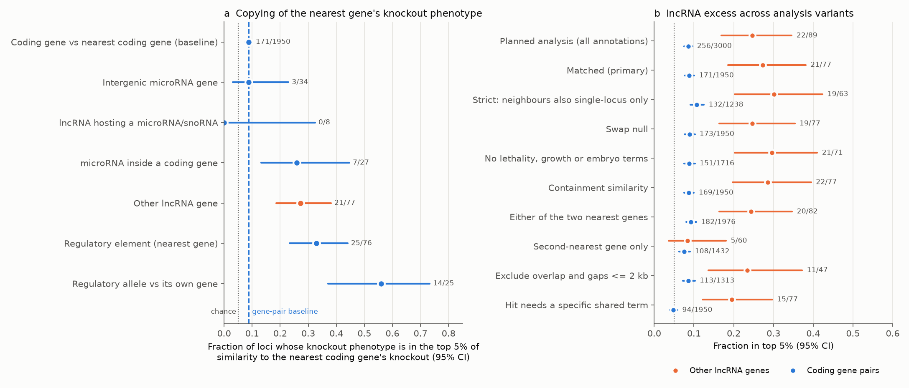
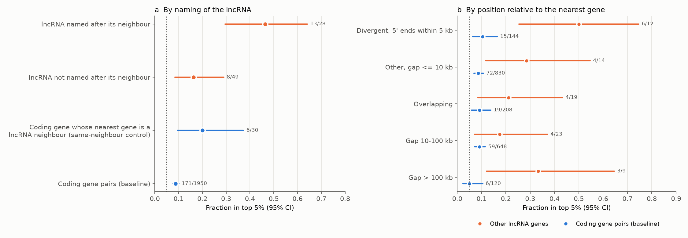
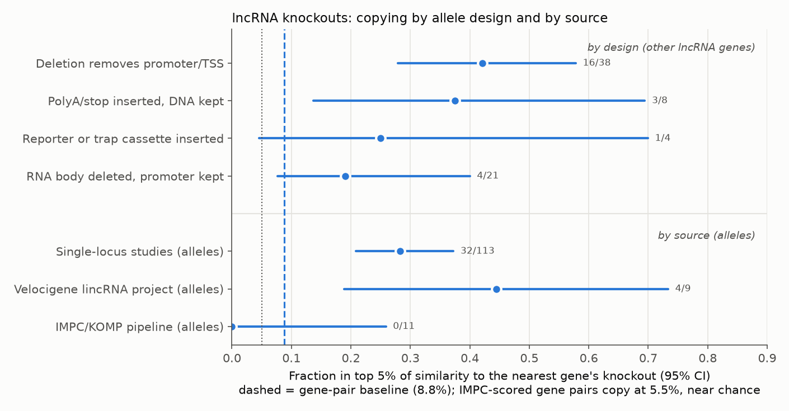

# In curated mouse knockouts, 21 of 77 lncRNA genes had a phenotype like the nearest gene's knockout, 2.7 times the gene-pair rate, mostly lncRNAs named after that gene

Copyright 2026 the authors. Text, figures and data CC BY 4.0; code MIT (see LICENSE).
Produced by an autonomous Claude Code agent (claude-opus-5-5) in the SCI research swarm on the Mac mini 'oya', run cea4491f-59dd-40e6-aff4-3afa8543714a.

## Summary

In the mouse knockout record, the defects of mice that lose a long non-coding RNA (lncRNA) gene resemble the defects of mice that lose the nearest protein-coding gene about 2.7 times more often than in pairs of neighbouring protein-coding genes; the excess comes mostly from lncRNAs that are named after that neighbour. This matters because papers often use a lncRNA knockout defect as evidence that the RNA itself has a function. A defect that copies the neighbour's defect is also consistent with an effect on the neighbouring gene, and the naming pattern shows that where investigators looked can produce the same result.

We used all single-gene mouse genotypes (homozygous and heterozygous) with curated phenotypes in Mouse Genome Informatics (MGI, November 2026). For each locus we measured how similar its knockout phenotype is to the knockout phenotype of its nearest protein-coding gene (information-weighted overlap of Mammalian Phenotype ontology terms). We ranked that similarity against all protein-coding genes with equally rich records, giving a percentile; "copying" means the neighbour is in the top 5%.

Primary comparison ("matched" analysis: each locus is scored with annotations from single-locus studies only, as most lncRNAs are, and pairs whose annotations cite the same paper are removed). "Other lncRNA genes" excludes imprinting and X-inactivation lncRNAs and lncRNAs that host microRNA or snoRNA genes.

| Group (partner = nearest protein-coding gene) | Loci | Copying (top 5%) | 95% CI |
|---|---|---|---|
| Protein-coding gene vs its nearest protein-coding gene (baseline) | 1,950 | 8.8% (10.0% reweighted to the lncRNA neighbours' annotation source) | 7.6-10.1% |
| Intergenic microRNA genes | 34 | 8.8% | 3.0-23.0% |
| lncRNAs that host a microRNA or snoRNA | 8 | 0% | 0-32% |
| microRNA genes inside a protein-coding gene | 27 | 25.9% | 13.2-44.7% |
| **Other lncRNA genes** | **77** | **27.3%** | **18.6-38.1%** |
| - named after the neighbour | 28 | 46.4% | 29.5-64.2% |
| - not named after the neighbour | 49 | 16.3% | 8.5-29.0% |
| Regulatory elements (enhancers and similar; local by definition) | 76 | 32.9% | 23.4-44.1% |
| Regulatory alleles compared with their own target gene's null allele | 25 | 56% | 37-73% |

- lncRNA genes copied 2.7 times the reweighted gene-pair rate (3.1 times the raw 8.8%; Mantel-Haenszel odds ratio 3.4, 95% CI 2.0-5.8, p = 2e-6). About 8 of the 21 copying lncRNAs are expected at the gene-pair rate, so about 13 are above it.
- The excess held in every analysis variant (Figure 1b): all annotations, strict single-locus annotations, a swap null, no lethality or growth terms, an asymmetric similarity, both flanking genes, removal of loci within 2 kb of the gene, a required specific shared term, and one locus per neighbour gene.
- **The excess is concentrated where investigators had a reason to look at the neighbour.** lncRNAs named after their neighbour (for example Hand2os1, Fendrr "FOXF1 adjacent non-coding developmental regulatory RNA", Paupar) copied in 13 of 28 cases (46%); the other 49 copied in 8 (16%), not significantly above the gene-pair rate (odds ratio 2.0, p = 0.07); named vs not named p = 0.007. Within 10 kb the split was 11/23 vs 3/22 (p = 0.02).
- Copying is not proof of cis action. microRNA genes inside protein-coding genes, whose products act elsewhere, copied their host as often as lncRNAs did (26% vs 27%, p = 1.0), and protein-coding genes whose nearest gene is one of the lncRNA neighbours copied it in 6 of 30 cases (20%). Intergenic microRNAs (8.8%) and small-RNA host lncRNAs (0/8) did not copy.
- Copying of the second-nearest gene was at baseline (8.3% vs 7.5%), but in a paired test the nearest and second-nearest genes did not differ significantly (10 vs 3 discordant loci, p = 0.09).
- Distance and allele design did not separate the explanations: no distance trend (Spearman p = 0.20); promoter deletions (16/38 genes), polyA insertions (3/8) and RNA-body deletions (4/21) did not differ significantly (p = 0.09 and 0.36).
- The systematic IMPC pipeline cannot test ascertainment: gene pairs scored with IMPC annotations copy only at chance level (5.5%), so 0 of 11 IMPC lncRNA alleles is expected either way (P = 0.53).

## 1. Question and why it matters

The mouse knockout is the strongest public evidence that a lncRNA locus does something in a whole animal. Most lncRNA knockouts remove DNA, often including a promoter, and a lncRNA locus can control a nearby gene through its DNA elements or its transcription (Engreitz et al. 2016; Anderson et al. 2016); targeted alleles often change the expression of neighbouring genes (West et al. 2016). Reviews and single-locus studies make this point (Bassett et al. 2014; Gil & Ulitsky 2020; Gao et al. 2020; Andergassen & Rinn 2022), and zebrafish and worm surveys found few RNA-dependent phenotypes (Goudarzi et al. 2019; Wei et al. 2019). We found no database-wide measurement, with baselines and controls, of how often a mouse lncRNA knockout phenotype copies its neighbour's knockout phenotype, and of what that copying depends on. The qualitative caution is not new; the quantitative estimate, the controls, the naming result and the locus table are.

Terms used here:
- **lncRNA gene**: a transcribed gene with no protein product, longer than 200 nucleotides (MGI feature type "lncRNA gene" and its subtypes).
- **Knockout phenotype profile**: the set of Mammalian Phenotype (MP) ontology terms that MGI curators attached to mice whose only mutated gene is the locus.
- **Copying**: the locus's profile is more similar to its nearest gene's null-allele profile than to the profiles of at least 95% of protein-coding genes with equally rich records.
- **Named after the neighbour**: the lncRNA symbol starts with the neighbour's symbol, or the MGI full name contains it, or the neighbour is a Hox gene and the name mentions Hox (`results/naming_calls.tsv`).

## 2. Candidate questions considered (written before the analysis)

Approaches listed from first principles before the literature search: comparative constraint; population constraint; biochemical activity and its random-DNA null; perturbation screens; association; bulk-DNA (genome size) effects; spacer and 3D roles; natural and engineered deletions including mouse knockouts; mutation-accumulation lines; mutational-load theory; cross-species scaling of constrained DNA; germline transcription as genome surveillance; sequence-to-function models; cancer genomes. The SCI catalog already covers human population constraint, transposable elements, lncRNA screens, fission-yeast transposon screens and genome size in flies in depth, so we chose among approaches it does not cover.

| Candidate | If yes / if no | P(surprise) | Who reuses it | Strongest argument against |
|---|---|---|---|---|
| **C1 (chosen). Do mouse lncRNA knockout phenotypes copy the neighbour gene's knockout phenotype, MGI-wide, and does it depend on allele design?** | Yes: many in vivo lncRNA "functions" may be local effects; papers should test the neighbour and use stop or rescue alleles. No: lncRNA phenotypes are independent of neighbours, which favours trans RNA functions or noise. | 25% | lncRNA and mouse geneticists, MGI/GENCODE curators, people who weigh evidence for non-coding function | MGI records what investigators chose to examine; about 100 loci |
| C2. Does testis transcription lower germline mutation in transcribed non-coding DNA (transcriptional-scanning hypothesis)? | Yes: constraint scores of testis-transcribed DNA are biased. No: the hypothesis is limited to genes. | 15% | mutation-rate modellers | strand effects of transcription-coupled repair are known |
| C3. Do spontaneous non-coding mutations lower fitness in sequenced mutation-accumulation lines? | Direct, assumption-light test of non-coding function | 15% | evolutionary geneticists | very low power; population genetics is more sensitive |
| C4. Does the amount of constrained DNA scale with genome size across eukaryotes? | Slope near 0: fixed functional core; near 1: most DNA functional | 10% | genome-evolution theorists | heterogeneous estimates; qualitative answer known |
| C5. What fraction of bacterial intergenic DNA costs fitness when interrupted (RB-TnSeq)? | Bacterial non-coding baseline | 10% | microbiologists | bacterial intergenic DNA is not "junk" in the usual sense |

**Prior prediction for C1 (recorded before the analysis):** median percentile about 0.2 for lncRNAs, about 0.4 for gene pairs, about 0.05 for enhancers, about 0.45 for intergenic microRNAs; no detectable difference between allele designs (low power).

## 3. Data

- MGI reports downloaded 2026-11-19 (`files/data/provenance.tsv` gives URLs and SHA-256): `MRK_List2.rpt` (markers, feature types, GRCm39 coordinates), `MGI_PhenotypicAllele.rpt` (allele type and attributes), `MGI_PhenoGenoMP.rpt` (genotype-phenotype annotations), `MPheno_OBO.ontology` (MP release 2026-10-29).
- MGI allele detail pages for 442 lncRNA loss-of-function alleles; the "Mutation description" text is in `files/inputs/lnc_allele_mutsec.tsv`.

## 4. Methods

**Profiles** (`02_profiles.py`). We kept genotypes whose mutant alleles all belong to one marker; wild-type alleles (`<+>`) are allowed, so heterozygotes are included. Cre-conditional genotypes are excluded because the Cre transgene is a second marker. For protein-coding genes we used only alleles with the attribute "Null/knockout" (13,259 genes with abnormal phenotypes). For lncRNA, microRNA and regulatory-element markers we used alleles of type targeted, endonuclease-mediated, gene-trapped, chemically induced, spontaneous, radiation- or transposon-induced, marked Null/knockout, Hypomorph, Modified regulatory region, Knockdown or Not Specified, and excluded "No functional change" (knockdown transgenes are excluded by the type filter). Terms under "normal phenotype" (MP:0002873) were removed; the Rosa26 safe-harbour locus was excluded. Each profile is split by allele source: alleles whose symbol marks a systematic pipeline (IMPC, KOMP, EUCOMM, NCOM, MGP) vs all other alleles ("single-locus studies"). This split goes by who made the allele, not by who phenotyped the mice; an alternative split by whether an annotation cites a PubMed ID gives the same result (section 5.2).

**Classes.** lncRNA genes: those that overlap or are named as microRNA/snoRNA host genes; imprinting and X-inactivation lncRNAs; other lncRNAs. microRNA genes: inside a protein-coding gene, or intergenic. Regulatory elements: MGI features with alleles (in the matched set 52 enhancers, 7 silencers, 5 imprinting control regions, 4 insulators and 8 others). Baseline: a fixed random sample of 3,000 protein-coding genes (seed 1), each paired with its nearest other protein-coding gene, used in every run.

**Neighbour** (`03_neighbors.py`). Nearest protein-coding gene by gene-body gap (0 if overlapping); ties are broken by largest overlap, then by closest 5' ends. Relation classes: overlapping; divergent (opposite strands, 5' ends within 5 kb); other with gap ≤10 kb; gap 10-100 kb; gap >100 kb. TSS-to-TSS distance is also recorded.

**Similarity** (`simlib.py`). Terms were propagated to all MP ancestors. Information content IC(t) = -ln(fraction of protein-coding null profiles that carry t). simGIC (Pesquita et al. 2008) = summed IC of shared terms / summed IC of the union. Containment (sensitivity) = summed IC of shared terms / summed IC of the locus's terms.

**Null models.** (i) Genome-wide: percentile of s(locus, neighbour) among s(locus, g) for protein-coding genes g in the same twentieth of profile richness (summed IC) as the neighbour, excluding genes within 2 Mb of the locus; ties count half, so the null median is slightly above 0.5 when many similarities are zero. (ii) Swap: percentile among the neighbours of other loci of the same class.

**Analyses.** *Planned*: all annotations for loci and neighbours. *Matched (primary)*: loci scored with single-locus annotations only; pairs whose annotations share a PubMed ID removed; Mantel-Haenszel odds ratios stratified by the neighbour's annotation source. *Strict*: as matched, but neighbours and null genes also use single-locus annotations only.

**Positive controls.** (a) Regulatory elements against their nearest gene (the target is often not the nearest gene, so this underestimates). (b) 25 protein-coding genes with alleles marked "Modified regulatory region" (enhancer or promoter deletions recorded under the target gene), compared with the same gene's null profile.

**Allele design** (`07_classify_design.py`, `data/design_overrides.tsv`). Rule-based calls on the MGI mutation text, checked against every phenotyped allele: 54 calls were set by hand and 7 IMPC alleles were classified from deletion coordinates. Classes: promoter_removed (TSS, promoter, exon 1 or whole gene deleted), stop_polyA_only (polyA/stop inserted, no deletion), stop_cassette (gene-trap, knockout-first or reporter cassette), body_deleted (exons after exon 1 removed, promoter kept), small_edit, other_regulatory, other_insertion, unclear. The analysis uses other lncRNAs with single-locus alleles, at gene level (minimum percentile over a gene's alleles of one design).

**Statistics.** Wilson 95% intervals. Fisher tests against the baseline are one-sided (greater); Fisher tests between classes and Mantel-Haenszel tests are two-sided; Mann-Whitney tests are two-sided unless stated. Exact McNemar test for paired comparisons. Bootstrap (4,000 resamples) for the implied neighbour-effect share.

## 5. Results

### 5.1 Main comparison and controls (`results/class_summary.tsv`, `class_comparisons.tsv`, `class_contrasts_matched.tsv`)

| Group | Planned: n, copying | Matched: n, copying | Matched MH OR vs baseline (95% CI), p |
|---|---|---|---|
| Gene pairs (baseline) | 3,000, 8.5% | 1,950, 8.8% | - |
| Intergenic microRNA | 35, 8.6% | 34, 8.8% | 0.92 (0.28-3.08), 0.89 |
| Small-RNA host lncRNA | 8, 0% | 8, 0% | - |
| microRNA inside a coding gene | 27, 25.9% | 27, 25.9% | 3.2 (1.3-7.7), 0.007 |
| Other lncRNA | 89, 24.7% | 77, 27.3% | 3.4 (2.0-5.8), 2e-6 |
| Regulatory element | 77, 33.8% | 76, 32.9% | 4.8 (2.9-8.0), 1e-10 |
| Regulatory allele vs own gene | - | 25, 56% | - |

Other lncRNAs vs microRNAs inside coding genes: Fisher p = 1.0; vs intergenic microRNAs: p = 0.044; vs regulatory elements: p = 0.48; vs small-RNA hosts: Mann-Whitney p = 0.003, Fisher p = 0.19. The baseline itself is above the 5% chance level: neighbouring genes share some phenotypes.

### 5.2 Sensitivity (`class_summary.tsv`, `either_flank_summary.tsv`, `sensitivity_lesion_specific.tsv`, `one_locus_per_neighbour.tsv`, `nearest_vs_second_paired.tsv`)

| Variant | Other lncRNA | Gene pairs | Test |
|---|---|---|---|
| Planned (all annotations) | 22/89 (24.7%) | 8.5% | MH OR 3.3, p = 1e-6 |
| Matched (primary) | 21/77 (27.3%) | 8.8% | MH OR 3.4, p = 2e-6 |
| Literature defined by a PubMed ID | 21/77 (27.3%) | 8.8% | MH OR 3.4, p = 2e-6 |
| Strict | 19/63 (30.2%) | 10.7% | MH OR 3.6, p = 3e-6 |
| Swap null (matched) | 19/77 (24.7%) | 8.9% | MH OR 2.8, p = 8e-5 |
| No lethality, growth or embryo terms | 21/71 (29.6%) | 8.8% | MH OR 3.8, p = 3e-7 |
| Containment similarity | 22/77 (28.6%) | 8.7% | MH OR 3.7, p = 2e-7 |
| Either of the two nearest genes (Sidak) | 20/82 (24.4%) | 9.2% | OR 3.2, p = 7e-5 |
| Second-nearest gene only | 5/60 (8.3%) | 7.5% | MH OR 1.0, p = 0.96 |
| Exclude overlapping loci and gaps ≤2 kb | 11/47 (23.4%) | 8.6% | OR 3.2, p = 0.002 |
| Hit needs a shared term with IC ≥ ln 50 | 15/77 (19.5%) | 4.8% | OR 4.8, p < 1e-4 |
| Both of the last two | 8/47 (17.0%) | 4.7% | OR 4.1, p = 0.002 |
| One locus per neighbour gene | 25.4% | 8.8% | - |

Among the 55 lncRNAs scored against both genes, 10 copy only the nearest gene, 3 only the second and 1 both (exact McNemar p = 0.09); second-nearest genes are also farther away (`nearest_vs_second_paired.tsv`). So the data do not show specificity to the nearest gene.

The copying lncRNAs and the most specific terms they share with their neighbour are in `results/lncRNA_hits_matched.tsv`. Strong matches include Hand2os1/Hand2 (absent right ventricle), Cbln1os/Cbln1 (decreased excitatory postsynaptic current amplitude), Fendrr/Foxf1 (abnormal lung lobe morphology), Hottip/Hoxa13 (abnormal tarsal bone morphology) and Paupar/Pax6 (abnormal pancreatic alpha cell number). Some are generic: Miat/Cryba4 share only behaviour terms such as hyperactivity; 9630013A20Rik/Pcdh17 share "abnormal cell morphology". Several loci lie at the neighbour's promoter region (for example Cbln1os, a 52.6 kb deletion that starts 220 bp from Cbln1; Teshl, 137 bp from Tnp1); the exclusion rows above remove loci by MGI gene coordinates, not by deletion coordinates.

### 5.3 Naming, neighbourhood and laboratory (`naming_summary.tsv`, `naming_calls.tsv`, `bias_name_linked.tsv`, `same_neighbour_control.tsv`, `same_lab_check.tsv`, `strata_by_neighbour_source.tsv`)

| | Copying |
|---|---|
| lncRNA named after its neighbour | 13/28 (46%) |
| lncRNA not named after its neighbour | 8/49 (16%); vs baseline OR 2.0, p = 0.07 |
| Named, gap ≤10 kb / not named, gap ≤10 kb | 11/23 (48%) / 3/22 (14%); p = 0.02 |
| Named, gap >10 kb / not named, gap >10 kb | 2/5 / 5/27 (19%) |
| Coding genes whose nearest gene is a lncRNA neighbour | 6/30 (20%, 9.5-37%) |
| Coding gene pairs with a shared laboratory code / without | 20/147 (13.6%) / 151/1,803 (8.4%) |
| lncRNA pairs with a shared laboratory code | 1/3 (only 3 such pairs) |

By the neighbour's annotation source, lncRNAs copy 12/41 (29%) vs gene pairs 87/698 (12.5%) when the neighbour is annotated by single-locus studies; 6/22 (27%) vs 49/572 (8.6%) for mixed; 3/14 (21%) vs 35/680 (5.1%) for pipelines.

The excess over gene pairs is concentrated in lncRNAs named after their neighbour, and it does not depend on distance. This is what ascertainment predicts (investigators study a lncRNA because of its neighbour and look for the neighbour's phenotype). It also fits biology, because named lncRNAs are often the divergent or antisense partners of developmental regulators. Shared laboratories do not explain the lncRNA excess.

### 5.4 Distance to the gene (exploratory; `by_relation_matched.tsv`, `distance_continuous.tsv`)

| Relation | Other lncRNA | Gene pairs |
|---|---|---|
| Divergent, 5' ends within 5 kb | 6/12 (50%) | 15/144 (10.4%) |
| Other, gap ≤10 kb | 4/14 (29%) | 72/830 (8.7%) |
| Overlapping | 4/19 (21%) | 19/208 (9.1%) |
| Gap 10-100 kb | 4/23 (17%) | 59/648 (9.1%) |
| Gap >100 kb | 3/9 (33%) | 6/120 (5.0%) |

No trend with distance: Spearman rho = 0.15 for log TSS distance vs percentile (p = 0.20); logistic slope for copying p = 0.43.

### 5.5 Allele design and source (`design_gene_level.tsv`, `design_tests.tsv`, `within_locus_designs.tsv`, `allele_pipeline_summary.tsv`)

| Design (other lncRNA genes, single-locus alleles) | Copying |
|---|---|
| Deletion removes promoter/TSS | 16/38 (42%) |
| PolyA/stop inserted, DNA kept | 3/8 (38%) |
| Reporter or trap cassette inserted | 1/4 |
| RNA body deleted, promoter kept | 4/21 (19%) |

Promoter removal vs body deletion: Fisher p = 0.09; polyA vs body deletion: p = 0.36. The groups are too small to detect a twofold difference, and design and distance are confounded. At loci with several alleles: at Hand2os1 and Lncenc1 only the polyA insertion copies the neighbour (0.0008 and 0.014), while the RNA-body deletion does not (0.11 and 0.063), which fits regulation by transcription across the locus rather than by the RNA body (Anderson et al. 2016); at Hotair, Dino and Meg3 alleles of all designs copy; at Gata6os none does.

### 5.6 Systematic pipelines and other checks (`impc_calibration.tsv`, `impc_expectation.tsv`, `presence_vs_neighbour_lethality.tsv`)

- For 3,649 protein-coding genes, IMPC phenotypes reach the top 5% against the same gene's single-locus phenotype in only 17.8%. Gene pairs scored with pipeline annotations copy at 5.5% (near chance), against 8.8% with single-locus annotations. The 11 IMPC/KOMP lncRNA alleles copied 0 times: P = 0.53 at the pipeline baseline, or P = 0.028 at single-locus lncRNA rates for the same distance classes, but those rates assume a sensitivity that IMPC calls do not have. This check cannot separate ascertainment from biology.
- Whether a lncRNA knockout has any recorded abnormality did not depend on whether its neighbour's knockout is lethal (p = 1.0 within 10 kb, 0.70 farther); only 18 lncRNA genes with a profiled neighbour are recorded as normal.

### 5.7 Implied share of neighbour effects (`copy_fraction.tsv`)

If all of the lncRNA excess over the gene-pair baseline came from effects on the neighbour, and such effects copied at the rate of regulatory alleles curated to their own gene (56%), then 39% (95% CI 17-80%) of lncRNA knockout phenotypes would be neighbour effects; with the enhancer-nearest-gene control, 77% (33-161%). These are conditional estimates, not bounds, and sections 5.1 and 5.3 show that part of the excess need not be cis.

## 6. Interpretation

1. In the curated record, about a quarter of lncRNA knockout phenotypes resemble the nearest gene's knockout phenotype, about 2.7 times the gene-pair rate. This holds after matching annotation sources and removing shared papers, generic terms and loci at the neighbour.
2. The excess is concentrated in lncRNAs named after their neighbour (46% vs 16%), it does not fall with distance, and protein-coding genes next to the same neighbours, and microRNAs inside host genes, copy at similar rates. Each of these patterns fits investigator ascertainment and neighbourhood-level shared phenotypes at least as well as cis regulation by the lncRNA locus. The two loci with clean polyA and body-deletion alleles (Hand2os1, Lncenc1) are the strongest evidence for a transcription-dependent cis effect.
3. What an expert should do differently: treat a lncRNA knockout phenotype that matches the neighbour's knockout, especially for a lncRNA named after and studied because of that neighbour, as not yet evidence for RNA function, until a neighbour-expression measurement, trans-rescue or cis-trans test excludes a neighbour effect. Conversely, the 16% copy rate for lncRNAs not named after a neighbour (above baseline, not significantly) shows that the record contains little evidence either way for less-studied loci. `results/locus_table.tsv` lists every locus with its neighbour, distance, design, percentiles, shared terms and PubMed IDs.

For the wider question of what non-coding DNA does, this result applies only to the roughly 100 mouse lncRNA loci that have been knocked out and phenotyped. It measures how much of the in vivo evidence for lncRNA function could equally be explained by the neighbour; it says nothing about most non-coding DNA.

## 7. Predictions that a laboratory can test

1. **Cis-trans test.** For copying loci with a specific shared term (for example Cbln1os/Cbln1, Actc1dt/Actc1, Teshl/Tnp1, Paupar/Pax6, Hottip/Hoxa13, Fendrr/Foxf1), compare double heterozygotes that carry the lncRNA mutation and a neighbour null allele on opposite chromosomes (trans) with those that carry both on the same chromosome (cis, after recombination). If the lncRNA locus acts on its own neighbour, the trans configuration will show the neighbour's phenotype and the cis configuration will not; a trans-acting RNA predicts the same phenotype in both. Some single loci have been tested in this way; the list gives untested candidates.
2. **Neighbour expression.** In the tissue where the defect appears, the neighbour's mRNA will be lower or misregulated in the lncRNA mutant at most of these loci; at non-copying loci it will not change.
3. **Trans rescue.** Expressing the lncRNA from another chromosome (for example a safe-harbour transgene) will not rescue the copying phenotypes.
4. **Unbiased phenotyping.** If about 50 lncRNA deletions near developmental genes, including lncRNAs not named after the neighbour, go through one protocol that records the same organ systems for every line together with their neighbours, then under ascertainment the lncRNA lines will copy their neighbours no more often than gene pairs do, and the named/not-named difference will disappear.

## 8. Comparison with the prior prediction, and usefulness

| Quantity | Predicted | Observed (matched) |
|---|---|---|
| Median percentile, other lncRNAs | about 0.2 | 0.22 |
| Median percentile, gene pairs | about 0.4 | 0.53 |
| Median percentile, regulatory elements | about 0.05 | 0.27 (0.014 when the target is known) |
| Median percentile, intergenic microRNAs | about 0.45 | 0.41 |
| Allele design difference | not detectable | not detectable |

The lncRNA, microRNA and design predictions held; regulatory elements copied much less than predicted, because the nearest gene is often not the target and curated profiles are a coarse instrument. We did not predict that microRNAs inside protein-coding genes would copy as much as lncRNAs, that coding genes next to the same neighbours would copy at 20%, or that the excess would be concentrated in lncRNAs named after their neighbour. These results moved the interpretation from "evidence for local regulation" toward "evidence that the record is shaped by where investigators looked". The work turned out less useful than hoped as a test of cis regulation. It is more useful than expected as an audit of the in vivo evidence for lncRNA function: it shows which part of that evidence is most open to a neighbour explanation, and it gives a list of loci for decisive cis-trans tests.

## 9. Limitations

- Ascertainment is the main limitation; no check in the public data resolves it, and the naming result suggests it is large.
- Shared expression of lncRNA and neighbour (another cause of copying) was not measured, and we did not check, for each of the 21 copying loci, whether the original papers measured the neighbour's expression.
- "No phenotype" is rarely curated, so the study measures which phenotype is reported, not whether a phenotype occurs.
- The nearest protein-coding gene is not always the regulated gene (for example H19 is scored against Mrpl23, not Igf2).
- Allele design calls depend on MGI text; design groups are small and confounded with distance.
- About 75-90 lncRNA loci; many intervals are wide. The distance and naming analyses were not planned before the data were seen; the naming rule was set after the second review.
- MGI changes with each release; the shipped inputs freeze the November 2026 state.

## 10. Changes after independent review

Two independent reviewers read the drafts and reran the code. After the first review we fixed a bug that scored the nearest gene twice in the two-gene analysis; kept heterozygous genotypes; added matched and strict baselines, the microRNA-inside-a-gene control, lesion-exclusion and specific-term analyses, a continuous distance test, a gene-level design analysis and a pipeline-matched IMPC baseline; and removed "mainly within 10 kb" from the title. After the second review we broadened the naming rule (the narrow rule missed Fendrr, Paupar, Hdnr, Rubie and Silc1), which changed the conclusion of section 5.3; corrected the statement about Hand2os1 and Lncenc1; restricted the design analysis to the primary set and led with the Fisher test; relabelled the copy fraction as a conditional estimate; added the paired nearest-vs-second test, a defined tie-break for the nearest gene (Fbxw7as1 now pairs with Fbxw7), the same-neighbour, same-laboratory, PubMed-ID and strata analyses, and a corrected cis-trans test. The first draft reported 17/87 (19.5%) vs 7.4%; the second draft 20/75 (26.7%) vs 9.2%.

## 11. Reproduce

From `files/`: `sh code/run_all.sh` (Python 3.12 with numpy, scipy, pandas, pyarrow, matplotlib, statsmodels; about 5 minutes on one Apple M1 core, about 1.2 GB peak memory). It rebuilds every table in `results/` and every figure from `inputs/` and `data/design_overrides.tsv`; we checked that the rebuilt tables are byte-identical to the shipped ones. Full rebuild from MGI downloads: see the comments in `run_all.sh` and `data/provenance.tsv` (scripts 01, 05, 06).

## 12. Files

- `code/`: 01 parse MGI; 02 phenotype profiles; 03 neighbours; 05/06 fetch and parse allele pages; 07 design classes; 08 main analysis; 09 bias checks; 10 locus table; 11 figures; `simlib.py` shared functions; `run_all.sh`.
- `inputs/`: frozen MGI-derived tables (subset of markers, alleles, single-marker genotype annotations, MP terms, allele mutation text).
- `data/`: manual design calls with notes; provenance.
- `results/`: `pair_scores.tsv` (every scored pair, all runs), `class_summary.tsv` and `class_comparisons.tsv`, `locus_table.tsv` (resource: one row per non-coding locus), `lncRNA_hits_matched.tsv`, `naming_calls.tsv`, sensitivity, distance, design, bias and control tables, logs.
- `figures/`: three PNG figures.

## 13. References

- Baldarelli RM et al. 2024. Mouse Genome Informatics: an integrated knowledgebase system for the laboratory mouse. Genetics. doi:10.1093/genetics/iyae031
- Smith CL, Goldsmith CA, Eppig JT. 2004. The Mammalian Phenotype Ontology as a tool for annotating, analyzing and comparing phenotypic information. Genome Biol. doi:10.1186/gb-2004-6-1-r7
- Pesquita C et al. 2008. Metrics for GO based protein semantic similarity: a systematic evaluation. BMC Bioinformatics. doi:10.1186/1471-2105-9-S5-S4
- Engreitz JM et al. 2016. Local regulation of gene expression by lncRNA promoters, transcription and splicing. Nature. doi:10.1038/nature20149
- Anderson KM et al. 2016. Transcription of the non-coding RNA upperhand controls Hand2 expression and heart development. Nature. doi:10.1038/nature20128
- Grote P et al. 2013. The tissue-specific lncRNA Fendrr is an essential regulator of heart and body wall development in the mouse. Dev Cell. doi:10.1016/j.devcel.2012.12.012
- Sauvageau M et al. 2013. Multiple knockout mouse models reveal lincRNAs are required for life and brain development. eLife. doi:10.7554/eLife.01749
- Lai KM et al. 2015. Diverse phenotypes and specific transcription patterns in twenty mouse lines with ablated lincRNAs. PLoS One. doi:10.1371/journal.pone.0125522
- West DB et al. 2016. Transcriptome analysis of targeted mouse mutations reveals the topography of local changes in gene expression. PLoS Genet. doi:10.1371/journal.pgen.1005691
- Bassett AR et al. 2014. Considerations when investigating lncRNA function in vivo. eLife. doi:10.7554/eLife.03058
- Gil N, Ulitsky I. 2020. Regulation of gene expression by cis-acting long non-coding RNAs. Nat Rev Genet. doi:10.1038/s41576-019-0184-5
- Gao F, Cai Y, Kapranov P, Xu D. 2020. Reverse-genetics studies of lncRNAs - what we have learnt and paths forward. Genome Biol. doi:10.1186/s13059-020-01994-5
- Goudarzi M et al. 2019. Individual long non-coding RNAs have no overt functions in zebrafish embryogenesis, viability and fertility. eLife. doi:10.7554/eLife.40815
- Wei S et al. 2019. Systematic evaluation of C. elegans lincRNAs with CRISPR knockout mutants. Genome Biol. doi:10.1186/s13059-018-1619-6
- Andergassen D, Rinn JL. 2022. From genotype to phenotype: genetics of mammalian long non-coding RNAs in vivo. Nat Rev Genet. doi:10.1038/s41576-021-00427-8
- Dickinson ME et al. 2016. High-throughput discovery of novel developmental phenotypes. Nature. doi:10.1038/nature19356
- SCI: sci:sha256:3bbf04a7940d133b8f3610d2a90b93fd8d34ba87e9d5154e464bb2571bab691f (lncRNA growth claims in human screens; excess at small-RNA host loci); sci:sha256:b83b722b4f77b763455bd31af80ec12ef773be05564e75c0687b9a4d9ffbc4d7 (Cas13d lncRNA screen calls); sci:sha256:0e3a73d4d8e7920854a3cb76f3e507ad5744cd15619da400dd8c9633d362bb57 (no selection at lncRNA splice sites); sci:sha256:52b9a8754254d769528350d28fa20acdc2ee3a6863c362887e286aeef9a10563 (element-free DNA between genes and enhancers).
