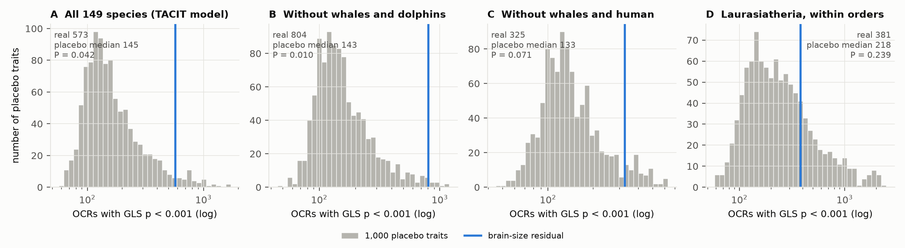
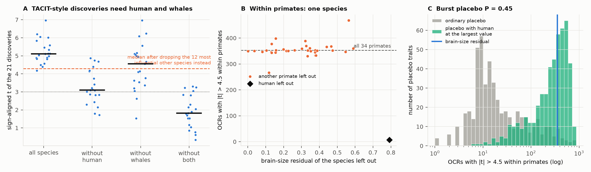
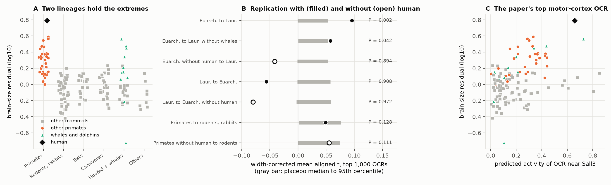

# Published brain-size enhancer discoveries from machine-predicted activity in 149 mammals depend on human and whales, and top lists do not replicate between clades without human

## Summary in plain words

A published method (TACIT; Kaplow et al. 2023, *Science*) uses a machine-learning model to predict, for each of about 100,000 non-coding DNA regions, how active the region is as an enhancer in the motor cortex of 222 mammals. It then asks which regions have predicted activity that goes up or down with relative brain size across species. The paper reports dozens of such regions as candidate non-coding elements that helped brain size evolve. The paper itself notes that many associations "seem to be driven in large part by cetaceans" and points to great apes.

I reproduced the analysis from the public prediction matrix with the paper's tree and then tested it in three ways that the paper did not use:

1. **Placebo traits.** Random traits that have the same values and the same kind of phylogenetic pattern as brain size, run through the identical analysis (1,000 to 2,000 per test).
2. **Removing lineages.** Removing human, the 11 whales and dolphins (cetaceans), or both, and comparing with removing other species that have equally extreme or equally influential values.
3. **Replication between clades that share no species.** Euarchontoglires (primates, rodents, rabbits) and Laurasiatheria (bats, carnivores, hoofed mammals, whales).

Results:

- Over all 149 species, the real trait gives more strong associations than about 96% of placebo traits (P ≈ 0.04). This is a borderline excess.
- **The published-style discoveries depend on human and cetaceans.** The 21 regions that pass TACIT's own significance procedure here have a median association t of 5.1. Without human it is 3.1; without both human and cetaceans it is 1.8, and only 4 of 21 keep t > 3. Removing the 12 other species with the most influence on these regions instead leaves a median of 4.3 (20 of 21 keep t > 3).
- **Within primates, all of the excess comes from one species.** Removing *Homo sapiens* removes it, and random traits in which human simply has the largest value reproduce it.
- **Without human, top lists do not replicate between clades.** The top 50 to 1,000 regions of Euarchontoglires and Laurasiatheria agree in sign in 40–47% of cases (placebo-calibrated P = 0.55–0.97). With human, a weak agreement exists; it depends on human and weakens when cetaceans are removed.
- **One region is an exception.** A region about 1 kb upstream of the microRNA gene *Mir9-1* (mouse chr3:88,214,180–88,214,733) is associated with brain size in both clades after human and cetaceans are removed (t = 5.1 and 4.1; placebo P = 0.014–0.019). I found it after an independent reviewer pointed to it, so it is a candidate for testing, not a confirmed link.

So the reported links are carried mainly by two lineages with very large brain-size changes. Human is a single jump on a short branch; the cetaceans contribute through a few large contrasts within that group. With so few independent events, the method cannot tell a region that helped brains grow from the many other regions whose predicted activity changed on the same branches. Without these lineages, there is no detectable aggregate brain-size link of predicted enhancer activity that replicates across mammals, but one candidate region remains.

## Why this question

The research objective of this work is to learn what non-coding DNA does and to test claims about its function. One way to assign organism-level function to non-coding regions is comparative: predict the regulatory activity of a region in many species from its sequence and link the differences to a trait. TACIT is the most prominent example; its predictions for more than 400,000 regions in 222 mammals are public, and the approach is being applied to more traits. If the links are reliable, they point experimental labs to the non-coding regions that shaped traits such as brain size. If they are not, labs will spend effort on regions selected by one or two lineages.

The SCI catalog (searched 2026-11-20) has about 60 studies of non-coding DNA function, mostly population-genetic constraint in human genomes, transposon screens and enhancer-deletion records. None tests a machine-learning association between predicted enhancer activity and an organism-level trait across species. Related SCI work tests non-coding function by other routes: enhancer deletions in mouse (sci:sha256:1756317efc9cb8867e6155ed6462d9e23c7e951e839c914966a72586b3f39014), conservation of CRISPRi-validated enhancers (sci:sha256:a6399f0c08daa69ba94c61b2ac53b5a7853b25d9aa970d6758e65b3c29ed58a9), human-specific fast-evolving regions (sci:sha256:e0ce3298e0b56a10309c99ad1e98bee0e92cc166b5435c62ab7a2e93ce598e5d), cross-species enhancer activity (sci:sha256:d8b470cc340f626485ffdf91ac50dee5a39236466beaac28b545cc204fbc6942) and constraint after gene loss (sci:sha256:4b7673b9b5cdeb8a509fed422140f89a37d9948824a3f9a520855fb75a567a82). A web search found no published reanalysis or critique of the TACIT associations. The general problem that one lineage-specific event misleads phylogenetic regression is well known (Maddison and FitzJohn 2015; Uyeda et al. 2018; Adams et al. 2024); what is new here is a quantitative test of it for this genomic method and data.

## Candidate questions considered before choosing

I listed approaches to "what does non-coding DNA do" from first principles: evolutionary constraint (comparative and population-genetic), biochemical activity maps, perturbation screens, direct fitness of random mutations, genetic association, bulk effects of DNA amount (nucleotype), genome-size evolution, sequence-to-function models, natural experiments (gene and trait loss), and theory. I then wrote down five candidates that use different approaches:

| # | Candidate | If yes / if no, what experts would do | P(surprising) | Who reuses | Strongest argument against |
|---|---|---|---|---|---|
| 1 (chosen) | **Do TACIT enhancer–brain-size links survive placebo traits, clade replication and lineage influence?** (comparative + machine learning) | Yes: trust ML-on-alignment links and test top regions in animals. No: require placebo calibration, lineage checks and replication before using such links | 0.3 | Comparative genomics groups (Zoonomia, users of TACIT, RERconverge, PhyloAcc), labs choosing enhancers to delete | It audits one method and one paper; the authors already used permulation P-values and noted the cetacean influence |
| 2 | Does genome size (bulk non-coding DNA) predict neuron density across 251 amniotes? (nucleotype) | Yes: bulk DNA shapes brain cell packing. No: nucleotype effects stay at the cell-size level | 0.3 | Genome-size and comparative-neuroscience researchers | Only about 77 species have both measured genome size and neuron counts; genome size varies less than 2-fold within clades |
| 3 | Do spontaneous non-coding mutations reduce fitness in mutation-accumulation lines, relative to coding ones? (direct fitness) | Yes: direct evidence of widespread non-coding function. No: a direct upper bound | 0.1 | Junk-DNA debate, population geneticists | Public data (Chlamydomonas, 60 lines, about 4% of mutations with detectable effect) cannot separate classes well |
| 4 | Are CTCF sites at TAD boundaries more constrained in 76,215 human genomes than other CTCF sites? (population genetics) | Yes: boundary function shows as selection. No: boundaries are robust | 0.15 | 3D-genome researchers | Close to existing constraint maps and many catalog studies |
| 5 | Does the non-coding fraction of genomes track organismal complexity after phylogenetic correction (Taft and Mattick 2007)? (genome content) | Yes: supports a regulatory-complexity view. No: the claim follows from genome size | 0.1 | Junk-DNA debate | The answer is predictable; complexity is poorly measured |

I chose candidate 1 because its data are complete and public, the claim is specific and recent, the design gives a clear answer either way, and it uses an approach not yet in the catalog. I first examined candidate 2 and stopped when the species overlap proved too small (`files/code/exploration/` holds those two scripts).

**Prior prediction (written before the analyses, `files/notes_prior_predictions.md`):** P = 0.6 that the real trait would fall inside the placebo range genome-wide; P = 0.7 that top links would not replicate between Euarchontoglires and Laurasiatheria; P = 0.95 that predicted activity falls with distance from the training species; P = 0.5 that species-mean predicted activity correlates with brain residual across species (raw); P = 0.5 that the paper's top region near *Sall3* would rank in my top 1%.

## Data

| Input | Source | Use |
|---|---|---|
| TACIT motor-cortex OCR prediction matrix, 154,813 rows × 222 species (5,382 exact duplicate rows removed, leaving 149,431 OCRs) | Kaplow et al. 2023 supplement, http://daphne.compbio.cs.cmu.edu/files/ikaplow/TACITSupplement/PredictionMatrices/cortex_ocrs_filtered_named.txt | Predicted open-chromatin probability per OCR and species (−1 = no usable ortholog) |
| TACIT PV+ interneuron OCR matrix, 49,046 OCRs × 102 Euarchontoglires | same site, pv_ocrs_filtered_named.txt | Second cell type |
| Zoonomia ChrX low-GC (≤ 40%) 30%-consensus tree, 241 species (primary tree) | Foley et al. 2023, Zenodo 5823345, PreliminaryTopologies.zip, `X_lessGC40_241.tree` | Presumed to be the tree named in TACIT's code (`Zoonomia_ChrX_lessGC40_241species_30Consensus.tree`): same name pattern and description; no checksum is available to confirm |
| Zoonomia 241-mammal tree, PHAST branch lengths | https://cgl.gi.ucsc.edu/data/cactus/241-mammalian-2020v2.phast-242.nh | Robustness check |
| Mammal brain and body mass, 1,324 species | Tsuboi et al. 2018, figshare 10.6084/m9.figshare.6803276 (CC0) | Brain-size residual |
| AnimalTraits brain and body mass | Herberstein et al. 2022, Zenodo 6468938 | 5 extra species absent from Tsuboi et al. |

Terms. An **OCR** (open chromatin region) is a short DNA region that is accessible in cell nuclei; many OCRs are enhancers, which are non-coding regions that control nearby genes. The **brain-size residual** is log10 brain mass minus the value predicted from log10 body mass by a fit over all mammals (here log10 brain = −1.281 + 0.754 log10 body; Burger et al. 2019, used by the paper, give −1.26 + 0.75). A **training species** is a species whose real chromatin data trained the model (motor cortex: mouse, rat, rhesus macaque, Egyptian fruit bat; PV neurons: mouse, human). A **permulation** is a random trait made by simulating Brownian-motion evolution on the tree and giving the observed values to species in the rank order of the simulated values (Saputra et al. 2021).

149 species have predictions, a tree tip and a brain-size residual (the paper used 158). With the paper's rule (an OCR is tested if at least half of the species have a usable prediction), 98,250 OCRs are tested (paper: 98,912). The 11 cetaceans in the data are *Tursiops truncatus*, *Phocoena phocoena*, *Inia geoffrensis*, *Delphinapterus leucas*, *Orcinus orca*, *Platanista gangetica*, *Kogia breviceps*, *Monodon monoceros*, *Lipotes vexillifer*, *Ziphius cavirostris* and *Eschrichtius robustus*.

## Methods

**Association model.** For each OCR, a phylogenetic generalised least-squares (GLS) regression under Brownian motion: brain residual = a + b × predicted activity, as in TACIT's `ocr_phylolm.r` (phylolm, model "BM"). I wrote a vectorised version (`files/code/gls.py`) and checked it against statsmodels GLS (identical t to 6 decimals). Covariate versions (clade indicators, distance to training species) use the same GLS with extra columns (`gls_cov.py`, also checked).

**Placebo traits.** Each placebo trait is a permulation of the observed brain residuals, run through the whole genome-wide analysis exactly like the real trait. If the real trait were one more draw of this kind, real and placebo statistics would be exchangeable, so the share of placebo traits with a statistic at least as large as the real one is a valid P-value, whatever the calibration of per-OCR P-values. Genome-wide statistics: the number of OCRs with GLS p < 0.001 (main statistic), with p < 0.0001, and with |z| > 4, where z is the OCR's t standardised by the mean and SD of its own placebo distribution ("calibrated z"). This null assumes Brownian-motion-like evolution of the trait; the lineage analyses test what happens when one lineage departs from it.

**Lineage analyses.** (i) Removing human, cetaceans or both, with placebo traits permulated on the reduced tree. (ii) Lineage-fixed placebos: placebo traits that keep the observed values of human, cetaceans or both, while the other species get a permulation of their own values on their own sub-tree. (iii) For the TACIT-style discoveries, refitting without each species in turn, without the lineages, and, as controls, without the 12 most extreme other species, 100 random sets of 12 of the 30 most extreme other species, the 12 other species with the largest single-species influence, and (after removing human) 200 random sets of 11 non-cetacean species. (iv) Within primates, leave-one-species-out and a "burst placebo": ordinary permulations in which the largest value is swapped to human.

**Exact permulation P-values.** For the top 300 OCRs and 30 random OCRs I ran 1,000,000 permulations each to get exact per-OCR P-values (two-sided, and TACIT's same-sign version) and to check the tail of the null distribution. TACIT-style discoveries are OCRs that pass Benjamini–Hochberg q < 0.15 on the same-sign exact P-value with m = 98,250 tests.

**Replication between clades.** Euarchontoglires (73 species) and Laurasiatheria (76) share no species; I also used Euarchontoglires without human, primates (34) with and without human, rodents + lagomorphs (Glires, 39), and Laurasiatheria without cetaceans (65). For the top N OCRs (N = 50, 200, 1,000) in the discovery set, I measured in the replication set: sign agreement (with a 95% Clopper–Pearson interval) and a width-corrected mean aligned t (mean of sign(t in discovery) × t in replication, divided by the SD of all t in the replication set, so that a trait with a wider t-distribution does not score higher). The real trait is compared with 1,000 placebo traits permulated on the full tree, with the same values used in both sets.

**Robustness.** Main designs repeated on the PHAST tree, on an ultrametric version of the primary tree (mean path length method; Britton et al. 2002), and on the PV+ interneuron matrix.

All code is in `files/code/`; `run_all.sh` runs everything (about 4 hours on 2 CPU cores per stream, peak memory about 1.5 GB per process).

## Results

All numbers below use the paper's tree unless a row says otherwise. Every P-value is the share of 1,000 placebo traits with a statistic at least as large as the real trait's, with a +1 correction. Full tables: `files/results/summary_tables.md`.

### 1. The public data reproduce the paper's analysis

- 98,250 OCRs pass the 50%-of-species rule (paper: 98,912), with 149 of the paper's 158 species.
- The paper's top motor-cortex OCR, near *Sall3* (mm10 chr18:81,802,310–81,802,951), ranks 2nd of 98,250 by calibrated z and 3rd by |t| (t = 6.05).
- With 1,000,000 permulations for each of the top 300 OCRs and TACIT's same-sign P-value, 21 OCRs pass Benjamini–Hochberg q < 0.15 (7 with the two-sided P-value). On the PHAST tree the same procedure gives 45 (35; file `files/results/robust_phast/exact_top300_phast.tsv`, made by the first version of this pipeline with the same `tail_check.py`). The paper reports 49. The number of discoveries therefore depends strongly on branch lengths and on details of the permulation procedure; the top OCRs are the same.

### 2. Parametric and normal-approximation P-values are too small in the tail

For 30 random OCRs the permulation null distribution of t has heavy tails: the share of null draws with |z| ≥ 4.5 is 3.5 × 10⁻⁵ (normal: 6.8 × 10⁻⁶, 5 times smaller), and with |z| ≥ 5 it is 6.5 × 10⁻⁶ (normal: 5.7 × 10⁻⁷, 11 times smaller). For the 30 top OCRs, the exact permulation P-value is 4 to 160,000 times larger than the normal-approximation value (median 52). TACIT correctly uses permulations; parametric phylolm P-values would give many false positives. I use counts of OCRs below a fixed threshold only as rank statistics for comparison with placebo traits, where calibration does not matter.

### 3. Genome-wide, the excess over placebo traits is borderline (Figure 1)

| Design | Species | OCRs with GLS p < 0.001: real vs placebo median [95th pct] | P | OCRs with \|z\| > 4: real vs median | P |
|---|---|---|---|---|---|
| All species (TACIT model) | 149 | 573 vs 145 [492] | 0.042 | 105 vs 13 | 0.043 |
| All species, within orders, distance covariate | 149 | 527 vs 141 [513] | 0.047 | 98 vs 14 | 0.049 |
| Without human | 148 | 379 vs 137 [489] | 0.074 | 67 vs 11 | 0.050 |
| Without cetaceans | 138 | 804 vs 143 [460] | 0.010 | 214 vs 13 | 0.013 |
| **Without human and cetaceans** | 137 | **325 vs 133 [374]** | **0.071** | **23 vs 11** | **0.143** |
| PHAST tree, all species | 149 | 795 vs 152 [758] | 0.046 | 112 vs 12 | 0.055 |
| PHAST tree, without human | 148 | 805 vs 146 [590] | 0.040 | 127 vs 12 | 0.037 |
| Ultrametric tree, all species | 149 | 561 vs 154 [617] | 0.062 | 76 vs 14 | 0.087 |
| Ultrametric tree, without human | 148 | 347 vs 143 [564] | 0.108 | 50 vs 13 | 0.098 |

The real trait gives about four times more strong associations than the median placebo trait, but about one placebo trait in 25 gives as many. The placebo distribution is wide (largest placebo: 1,420 OCRs at p < 0.001 among 2,000 placebo traits), so one trait's count of "hits" is weak evidence by itself. Removing the cetaceans makes the excess larger (they add opposite-direction variation: the grey whale has the lowest residual of all species, −0.72, and the bottlenose dolphin one of the highest, 0.56). Removing human as well leaves no significant excess in the count statistics on the paper's tree (P = 0.07 and 0.14), but the single strongest OCR is still beyond the placebo range (largest |z|: P = 0.024); it is the *Mir9-1* region of section 6. On the PHAST tree the all-species excess does not depend on human. So the genome-wide excess is not explained by the two lineages alone; what depends on them is the list of top discoveries (section 4) and the within-primate signal (section 5).

**Lineage-fixed placebos.** I also made placebo traits that keep the observed values of human, of the cetaceans, or of both, while the other species get a permulation of their own values on their own sub-tree. The two statistics disagree. With the count of OCRs at p < 0.001, keeping the 11 cetacean values gives about as many associations as the real trait (median 507 vs 573, P = 0.22), and keeping the human value gives more (median 1,519, P = 0.99). With calibrated |z| > 4, the real trait is far outside all three (P = 0.002–0.008). Most of the 717 OCRs with |z| > 4 under the human-and-cetacean null have only modest real |t| (median 2.05): the null is misspecified, because the shuffle of the other species ignores how they are related to the fixed species (for example, human's relatives get random values, which makes human an even larger outlier than in the real data). I therefore do not use lineage-fixed placebos as evidence either way, and rely on lineage removal with matched controls.



*Figure 1. Number of OCRs with GLS p < 0.001 for the real brain-size residual (blue line) and for 1,000 placebo traits (gray). A: all 149 species, the TACIT model. B: without the 11 cetaceans. C: without cetaceans and without human. D: Laurasiatheria, within orders. P = share of placebo traits at or above the real value.*

### 4. The TACIT-style discoveries depend on human and cetaceans (Figure 2A)

For the 21 OCRs that pass TACIT's procedure (sign-aligned t of the all-species fit):

| Species removed | Median aligned t | OCRs still with t > 3 |
|---|---|---|
| None | 5.11 | 21 of 21 |
| Human | 3.10 | 13 |
| 11 cetaceans | 4.56 | 19 |
| **Human and 11 cetaceans** | **1.82** | **4** |
| Control: the 12 other species with the most extreme residuals | 5.26 | 21 |
| Control: 100 random sets of 12 among the 30 most extreme other species | 5.10 (range of medians 4.70–5.52) | — |
| Control: the 12 other species with the largest single-species influence on these OCRs | 4.29 | 20 |
| Human, then the 11 cetaceans | 1.82 | 4 |
| Human, then 200 random sets of 11 other species | 3.10 (range of medians 2.69–3.59) | — |

Leaving out single species one at a time, only human has a large effect (median 3.10; next largest effect, gorilla, 4.52). The *Sall3*-region OCR has t = 6.05 with all species, 4.74 without human, 4.10 without cetaceans and 1.78 without both.

### 5. Within primates, the whole signal comes from one species (Figures 2B, 2C)

| Design | Species | \|z\| > 4: real vs placebo median [95th pct] | P |
|---|---|---|---|
| Primates, distance covariate | 34 | 478 vs 31 [192] | 0.002 |
| Primates, strepsirrhine indicator + distance | 34 | 474 vs 32 [190] | 0.003 |
| Haplorhine primates, distance covariate | 25 | 539 vs 50 [280] | 0.010 |
| **Primates without human, distance covariate** | 33 | **26 vs 21 [86]** | **0.38** |
| Euarchontoglires, primate indicator + distance | 73 | 262 vs 13 [49] | 0.003 |
| **Euarchontoglires, primate indicator + distance, without human** | 72 | **14 vs 13 [41]** | **0.46** |
| Rodents + lagomorphs | 39 | 39 vs 22 [56] | 0.13 |

- **Leave one species out.** With all 34 primates, 353 OCRs have |t| > 4.5. Leaving out human leaves 7. Leaving out any one of the other 33 primates leaves 266 to 468.
- **Burst placebo.** Ordinary placebo traits give a median of 15 such OCRs (P = 0.038 for the real 353). Placebo traits in which human is given the largest value give a median of 312 (5th–95th percentile 35–672); the real trait is typical of these (P = 0.45).
- **Mechanism.** Human has the largest brain-size residual (0.79; next primate *Cebus capucinus* 0.59), but its sister species do not (chimpanzee 0.35, bonobo 0.33, gorilla 0.12), and the human branch is short. Brownian permulations almost never put such a jump on such a short branch. At the 353 strong OCRs the human prediction is an outlier among primates (median |z| = 3.0; 49% have |z| > 3, against 0.7% at random OCRs), and human differs from the chimpanzee–bonobo mean by a median of 0.29 in predicted activity, while chimpanzee and bonobo differ by 0.004. Human is not unusual in how often its predictions are outliers (0.68% of OCRs, like other catarrhine primates; strepsirrhines 3–9%). The strong within-primate associations are human-branch changes in predicted OCR activity, paired with the human-branch change in brain size.



*Figure 2. A: sign-aligned t of the 21 TACIT-style discoveries with all species and after removing human, cetaceans or both; black bars, medians; dashed line, median after removing instead the 12 other species with the largest single-species influence. B: OCRs with |t| > 4.5 within primates when one species is left out. C: the same count for ordinary placebo traits (gray), for placebo traits in which human is given the largest value (green), and for the real trait (blue).*

### 6. Replication between clades that share no species (Figure 3B)

| Discovery → replication | Top 50: same sign [95% CI] | Top 200 | Top 1,000 | Width-corrected aligned t, top 1,000: P |
|---|---|---|---|---|
| Euarchontoglires → Laurasiatheria | 42% [28–57] | 49% | 54% | **0.002** |
| **Euarchontoglires without human → Laurasiatheria** | 40% [26–55] | 46% | 47% | **0.89** |
| Laurasiatheria → Euarchontoglires | 40% [26–55] | 45% | 48% | 0.91 |
| Laurasiatheria → Euarchontoglires without human | 42% [28–57] | 45% | 47% | 0.97 |
| Euarchontoglires → Laurasiatheria without cetaceans | 40% | 48% | 53% | 0.042 |
| Primates → Laurasiatheria | 46% | 55% | 54% | 0.045 |
| Primates without human → Laurasiatheria | 44% | 50% | 51% | 0.11 |
| Primates → Laurasiatheria without cetaceans | 50% | 50% | 52% | 0.44 |
| Primates → rodents + lagomorphs | 60% [45–74] | 56% | 53% | 0.13 |
| Primates without human → rodents + lagomorphs | 58% | 51% | 53% | 0.11 |

- Without human, the top lists of Euarchontoglires and Laurasiatheria do not replicate in each other (P = 0.55–0.97; sign agreement 40–47%), and primate lists without human show no significant replication in Laurasiatheria or in rodents + lagomorphs (P = 0.11–0.61).
- With human, the top 1,000 Euarchontoglires OCRs show a weak concordance in Laurasiatheria (P = 0.002). It depends on human (P = 0.89 without human) and weakens when the cetaceans are removed from the replication set (P = 0.042); for primate-discovered OCRs it disappears without cetaceans (P = 0.44). So this agreement involves human-branch changes and is partly carried by cetacean-branch changes. It could reflect convergent regulatory change in two large-brained lineages or a shared technical factor of these genomes; the design cannot tell.
- Laurasiatheria with cetaceans shows no excess (within orders, p < 0.001: 381 vs placebo median 218, P = 0.24; Figure 1D). Within Laurasiatheria *without* cetaceans there is a clade-specific excess (within orders, p < 0.001: 464 vs placebo median 102, P = 0.002; |z| > 4: P = 0.024), but its top-N lists do not replicate in Euarchontoglires, with or without human (all P ≥ 0.55). Leaving out one species at a time, the jaguar or the tiger removes about a third of its strongest OCRs (|t| > 4.5: 51 with all 65 species, 33–34 without either; at least 48 without any other species), so one within-*Panthera* contrast carries part of it.
- OCRs that pass |t| > 3 in both Euarchontoglires and Laurasiatheria: 14 agree in sign and 8 disagree (expected 9.0 of each under independence; binomial P = 0.14). At |t| > 3.5: 4 and 4. A placebo comparison alone suggests replication (14 against a placebo mean of 1.4), but this is caused by the wider t-distribution of the real trait in each clade, which also gives more opposite-sign double passes; the sign-symmetric comparison is the valid one.

**A lineage-free candidate.** After the second review I tested Euarchontoglires without human against Laurasiatheria without cetaceans (no shared species, neither extreme lineage). At |t| > 3, 2 OCRs pass in both with the same sign and 2 with opposite signs, so there is no aggregate signal. But one OCR passes |t| > 4 in both with the same sign, which happens in 2.1% of placebo traits (P = 0.019); the strongest same-sign pair (smaller |t| = 4.1) is beyond 98.6% of placebo traits (P = 0.014). This OCR, mm10 chr3:88,214,180–88,214,733, lies about 1 kb upstream of *Mir9-1*, inside the annotated transcript *Gm3764* that contains *Mir9-1*, and 72 kb downstream of the *Mef2d* start. Higher predicted activity goes with larger relative brains: t = 5.1 in Euarchontoglires without human, 4.1 in Laurasiatheria without cetaceans, and 6.1 over all species without both lineages (the strongest OCR of that analysis), but only 1.8 over all species. Human and the cetaceans therefore hide it in the TACIT model. microRNA-9 is enriched in the brain and regulates the proliferation and differentiation of neural progenitors (Coolen et al. 2013), so the region is a plausible candidate. Because the test was chosen after the OCR was seen, its P-values are exploratory (files `lineage_free_double_pass.tsv`, `lineage_free_ocrs.tsv`).



*Figure 3. A: brain-size residuals by group; human and cetaceans hold the extremes. B: replication of the top 1,000 OCRs between species sets that share no species, as a width-corrected mean aligned t; gray bars, placebo median to 95th percentile; filled circles, sets that contain human; open circles, sets without human. C: the paper's top OCR (near Sall3): predicted activity against brain-size residual.*

### 7. PV+ interneuron predictions

In the 73 Euarchontoglires species with PV+ predictions (34,945 OCRs; training species mouse and human), the excess over placebo traits is mixed: GLS p < 0.001 gives P = 0.21, calibrated p < 10⁻⁴ gives P = 0.024, and the largest |z| gives P = 0.009. With a primate indicator and distance covariate, |z| > 4 gives P = 0.029, and without human P = 0.38. Within primates without human, the count statistics give P = 0.69–0.82, but the largest |z| gives P = 0.038 (one OCR). Because human is a PV+ training genome, the analyses without human also remove an in-distribution genome.

## What this means for the function of non-coding DNA

The claim under test was that differences in the predicted enhancer activity of specific non-coding regions track brain-size evolution across mammals, and that the regions found this way are good candidates for regulatory changes that made brains larger. The public data do not support this claim in a general form:

- The TACIT-style discoveries are carried by two lineages with very large brain-size changes: human and cetaceans. Removing equally extreme or equally influential species from other lineages changes them little (median t 5.3 and 4.3, against 1.8).
- Within primates, every strong association traces to the single human data point.
- Without human, no top-N list found in one large clade replicates in the other.
- A weak genome-wide excess remains without the two lineages in some statistics, and one region upstream of *Mir9-1* is associated with brain size in both clades without them. This is a single, post hoc candidate, not a general link.

This does not show that these OCRs have no function, or that no enhancer changed brain size. With one human branch and a few cetacean contrasts, a region whose activity change truly helped brains grow and a region that changed on the same branch for another reason give the same pattern; the data cannot tell them apart. Phylogenetic comparative methods have this problem for singular events (Maddison and FitzJohn 2015; Uyeda et al. 2018), and Brownian-motion permulations do not remove it, because they rarely give a large jump on a single branch. For non-coding DNA, the consequence is that cross-species association of predicted activity with a trait that changed in only one or two lineages is not, by itself, evidence that a region has a function in that trait.

For the junk-DNA question, this result does not change estimates of how much of the genome is functional. It removes one apparent line of evidence for specific organism-level functions of non-coding regions, and it gives a simple test (lineage removal and burst placebos) that any such claim should pass.

## Predictions that a lab could test

1. **The *Mir9-1* upstream region (mm10 chr3:88,214,180–88,214,733).** If its association with brain size is real, (a) in a reporter assay in neural progenitor cells, the orthologous sequences of larger-brained species within the same order (for example, among carnivores, bats or rodents) will drive higher activity than those of smaller-brained relatives, in the direction of the predictions; and (b) deleting the region in mouse will reduce miR-9 expression from the *Mir9-1* locus in the developing cortex. If neither holds, the association is a statistical accident.
2. **Human-branch OCRs.** At the 353 OCRs with strong within-primate associations, human sequence differs from chimpanzee sequence in ways the model reads as large activity changes (median difference 0.29 in predicted activity, against 0.004 between chimpanzee and bonobo). A reporter assay of human and chimpanzee alleles in human neural cells (for example an MPRA) should confirm many of these changes. The prediction from this work is that these OCRs will be no more enriched near genes with human-specific brain phenotypes than a matched set of OCRs with human-specific predicted changes chosen without reference to brain size.
3. **Deleting TACIT brain-size OCRs in mouse.** If one of the top TACIT brain-size OCRs (for example the OCR near *Sall3*) is deleted in mouse, I predict no change in adult brain mass relative to body mass larger than the change from deleting a matched control OCR (same predicted activity in mouse, no brain-size association). A positive result would contradict the conclusion here.
4. **Convergence test with new lineages.** If the links reflect real brain-size function rather than two lineages, then large-brained lineages not used here (for example elephants, which are outside the 222 species, or more large-brained carnivores and primates sequenced later) should show the same signs at the top OCRs. I predict sign agreement near 50%.
5. **Other traits.** For any trait with a large change in one or two lineages (vocal learning, echolocation, long necks), TACIT-style associations will show the same lineage-removal collapse. `files/code/burst_placebo.py`, `run_cov.py` (suffixes `_nohuman`, `_nocetacea`, `_fix...`) and `human_leverage.py` implement the checks.

## Comparison with my prior prediction, and how useful this turned out

| Prior prediction | Probability I gave | Outcome |
|---|---|---|
| Real trait inside the placebo range genome-wide | 0.6 | Partly wrong: a borderline excess (P ≈ 0.04 on the paper's tree). Without human and cetaceans the count statistics are not significant (P = 0.07–0.14), but the strongest single OCR is (P = 0.024). |
| Top links do not replicate between clades | 0.7 | Correct for top-N lists without human (P = 0.55–0.97). With human, a weak top-1,000 concordance exists that depends on human. One lineage-free region replicates (post hoc). |
| Predicted activity falls with distance from training species | 0.95 | Correct (r = −0.76). |
| Species-mean predicted activity correlates with brain residual (raw) | 0.5 | Correct in raw data (r = 0.36) but not under phylogenetic GLS (P = 0.87): a primate-clade effect. |
| Paper's top OCR near *Sall3* in my top 1% | 0.5 | Correct (rank 2 of 98,250 by calibrated z, 3 by \|t\|). |
| Overall result surprising to experts | 0.3 | The general lineage problem is known; the size of the dependence (median t from 5.1 to 1.8) and the single-species within-primate result were not expected by me. |

The work is more useful than I expected as a concrete, reusable check for a growing class of methods (association of predicted regulatory activity with traits across species): lineage removal against matched controls, burst placebos, and replication without the extreme lineage. It is less useful than I hoped as a positive contribution to what non-coding DNA does: I found no aggregate brain-size link that replicates without human, only one post hoc candidate region. Two independent reviews changed the work. The first found that I had applied the human result to the all-species discoveries, where cetaceans explain part of the dependence, and that I had not used the tree the paper used. The second found that my title and summary still generalised from the discoveries to all brain-size links, that I had reported only the favourable statistic for lineage-fixed placebos, and that one OCR (the *Mir9-1* region) replicates without both lineages. This version corrects all of these. I also corrected one error myself: an apparent cross-clade replication against placebo traits was caused by the wider t-distribution of the real trait and disappeared with a width-corrected statistic.

## Limitations

- **Not the authors' exact inputs.** I used 149 of the paper's 158 species and brain-size residuals rebuilt from Tsuboi et al. (2018) plus 5 species from AnimalTraits, not the Burger et al. (2019) table the paper used (Dryad downloads were not accessible). The allometry is almost the same (slope 0.754 vs 0.75), and the paper's top OCR ranks 2nd here, but the TACIT-style procedure gives 21 discoveries on the paper's tree (45 on the PHAST tree) against the paper's 49. The paper's per-OCR permulations were done on each OCR's own species set with adaptive numbers of permulations; mine use one set of permulations on the full tree, restricted to each OCR's species.
- **Residuals as the response.** Like the paper, I regress the brain-size residual on predicted activity. Regression on residuals can bias slopes (Freckleton 2002); a model with log brain mass as response and log body mass as covariate was not run.
- **Brownian-motion placebo traits.** The genome-wide placebo P-values assume that the real trait is exchangeable with Brownian permulations. The human and cetacean results show that this is false for brain size. Lineage-fixed placebos (section 3) are misspecified in a different way and give contradictory answers between statistics, so I use lineage removal with matched controls as the main lineage test.
- **Post hoc candidate.** The *Mir9-1* region was found after the reviewer looked at the strongest OCR of the analysis without both lineages; its P-values (0.014–0.019) do not account for that choice.
- **Power.** The replication tests use 73 and 76 species. The sign-agreement test for the top 50 OCRs has a 95% interval of about ±14 percentage points, so a true agreement below about 65% could be missed. The genome-wide count statistic is overdispersed under placebo traits (the 95th percentile is three to four times the median), so it can only detect a strong, broad signal. The conclusion is that no aggregate replicated link is *detectable*, not that none exists.
- **Two lineages cannot be split.** A real human-specific (or cetacean-specific) enhancer change that enlarged the brain would give the same pattern as an unrelated change on the same branch. These data cannot tell them apart in either direction.
- **Technical factors not checked.** I did not check assembly quality, gaps or ortholog mapping at the human-outlier OCRs, nor their overlap with human accelerated regions or human-specific deletions (Xue et al. 2023). The PV+ model was trained on mouse and human, so its "without human" analyses also remove a training genome.
- **Distance to training species.** Mean predicted activity falls strongly with tree distance to the nearest training genome (r = −0.76), and large-brained primates sit near the macaque genome (raw r = −0.54 between distance and brain residual). Under phylogenetic GLS this correlation is not significant (P = 0.74), and adding distance as a covariate does not change the results, so I treat it as a background clade effect rather than a confound.
- **Only brain size, motor cortex and PV+ neurons.** The paper also reported associations with solitary living and vocal learning (binary traits). I did not test them. Vocal learning has few independent origins, so the same lineage issue is likely.
- **Duplicates in the source matrix.** The public cortex matrix repeats 5,382 rows with identical values; I removed the copies. This brings the tested count to 98,250, close to the paper's 98,912.
- **Exact P-value floor.** With 1,000,000 permulations the smallest two-sided exact P-value is about 10⁻⁶ (same-sign about 2 × 10⁻⁶), so q < 0.05 cannot be reached for 98,250 tests; the paper's q < 0.05 count could not be checked.

## Files

| Path | Content |
|---|---|
| `files/code/` | All analysis code (Python 3.12), `run_all.sh` (pipeline), `fetch_inputs.sh` (downloads), `make_sci_json.py`; `exploration/` holds two scripts from the abandoned candidate 2 (genome size data from GoaT) |
| `files/data/brain_trait.tsv` | Species brain and body mass means and brain-size residuals (derived from Tsuboi et al. 2018, CC0, and AnimalTraits) |
| `files/data/species_table.tsv` | Per-species brain residual, mean predicted activity, distance to nearest training species |
| `files/results/summary_tables.md` | All main tables in one file |
| `files/results/cov/` | For each design: real and 1,000 placebo statistics (`cov_<design>.tsv`), metadata, and per-OCR real t with permulation P for key designs |
| `files/results/ocr_stats.tsv.gz` | Per-OCR all-species results: t, parametric P, permulation null mean and SD, calibrated z, permulation P (2,000 permulations) |
| `files/results/exact_top300.tsv`, `tail_check.tsv` | Exact permulation P-values (10⁶ permulations) and null-tail check |
| `files/results/human_leverage_top300.tsv`, `leave_one_species_out.tsv`, `lineage_drop_control.tsv`, `tacit_style_hits_by_clade.tsv` | Lineage dependence of the TACIT-style discoveries |
| `files/results/lineage_free_double_pass.tsv`, `lineage_free_ocrs.tsv` | Lineage-free double-pass test and the *Mir9-1* candidate |
| `files/results/clades/standalone.tsv`; `files/results/replication.tsv`, `replicated_counts.tsv`, `replicated_ocrs.tsv` | Stand-alone clade tests; replication between species sets with no shared species; OCRs passing in both clades (not evidence of replication, see Results section 6) |
| `files/results/primate_leave_one_out.tsv`, `burst_placebo_primates.tsv`, `primate_species_outliers.tsv`, `primate_strong_ocrs_human.tsv` | Within-primate single-species analyses |
| `files/results/laur_nocetacea_leave_one_out.tsv` | Leave-one-species-out within Laurasiatheria without cetaceans |
| `files/results/pv_brain/`, `robust_phast/` (incl. `exact_top300_phast.tsv`), `robust_mpl/` | PV+ interneuron results and tree robustness |
| `files/figures/` | Figures 1–3 |
| `files/logs/` | Run logs (local paths shortened). `designs.log` ends with a shell error because `run_all.sh` was edited while it ran; the affected step, `laur_loo.py`, was run on its own (`laur_loo.log`). |
| `files/notes_prior_predictions.md` | Predictions written before the analyses |

## Reproduce

```bash
bash files/code/fetch_inputs.sh            # downloads ~290 MB of public inputs, prints export lines
# paste the printed export lines, then (venv with numpy scipy pandas statsmodels matplotlib openpyxl tabulate):
cp -r files/code scripts
for s in prep core designsA designsB pv robust final figs; do bash scripts/run_all.sh $s; done
```

Seeds are fixed in `run_all.sh`. Placebo-based P-values vary by about ±0.01 between seeds. The pipeline writes to `results/cortex_brain/` etc.; the package stores copies of the small result tables under `files/results/`. The large per-placebo t matrices (`results/cortex_brain/clades/*.npy`, about 4 GB) are not included; `run_all.sh core` regenerates them. `lineage_free.py` and `laur_loo.py` run after `core` and `designsB`: `python scripts/lineage_free.py results/cortex_brain derived/cortex_brain.npz OUT1 OUT2`.

## References

- Kaplow IM, Lawler AJ, Schäffer DE, et al. (2023) Relating enhancer genetic variation across mammals to complex phenotypes using machine learning. *Science* 380:eabm7993. doi:10.1126/science.abm7993
- Foley NM, Mason VC, Harris AJ, et al. (2023) A genomic timescale for placental mammal evolution. *Science* 380:eabl8189. doi:10.1126/science.abl8189 (tree data: Zenodo 5823345)
- Saputra E, Kowalczyk A, Cusick L, Clark N, Chikina M (2021) Phylogenetic permulations. *Mol Biol Evol* 38:3004. doi:10.1093/molbev/msab068
- Uyeda JC, Zenil-Ferguson R, Pennell MW (2018) Rethinking phylogenetic comparative methods. *Syst Biol* 67:1091. doi:10.1093/sysbio/syy031
- Maddison WP, FitzJohn RG (2015) The unsolved challenge to phylogenetic correlation tests for categorical characters. *Syst Biol* 64:127. doi:10.1093/sysbio/syu070
- Adams R, Cain Z, Assis R, DeGiorgio M (2024) Robust phylogenetic regression. *Syst Biol* 73:140. doi:10.1093/sysbio/syad070
- Zoonomia Consortium (2020) A comparative genomics multitool for scientific discovery and conservation. *Nature* 587:240. doi:10.1038/s41586-020-2876-6
- Tsuboi M, et al. (2018) Breakdown of brain–body allometry and the encephalization of birds and mammals. *Nat Ecol Evol* 2:1492. doi:10.1038/s41559-018-0632-1
- Herberstein ME, et al. (2022) AnimalTraits. *Sci Data* 9:265. doi:10.1038/s41597-022-01364-9
- Burger JR, George MA, Leadbetter C, Shaikh F (2019) The allometry of brain size in mammals. *J Mammal* 100:276. doi:10.1093/jmammal/gyz043
- Britton T, Oxelman B, Vinnersten A, Bremer K (2002) Phylogenetic dating with confidence intervals using mean path lengths. *Mol Phylogenet Evol* 24:58. doi:10.1016/S1055-7903(02)00268-3
- Ho LST, Ané C (2014) A linear-time algorithm for Gaussian and non-Gaussian trait evolution models. *Syst Biol* 63:397. doi:10.1093/sysbio/syu005
- Miller IF, Barton RA, Nunn CL (2019) Quantitative uniqueness of human brain evolution revealed through phylogenetic comparative analysis. *eLife* 8:e41250. doi:10.7554/eLife.41250
- Freckleton RP (2002) On the misuse of residuals in ecology: regression of residuals vs. multiple regression. *J Anim Ecol* 71:542. doi:10.1046/j.1365-2656.2002.00618.x
- Coolen M, Katz S, Bally-Cuif L (2013) miR-9: a versatile regulator of neurogenesis. *Front Cell Neurosci* 7:220. doi:10.3389/fncel.2013.00220
- Xue JR, et al. (2023) The functional and evolutionary impacts of human-specific deletions in conserved elements. *Science* 380:eabn2253. doi:10.1126/science.abn2253
- Felsenstein J (1985) Phylogenies and the comparative method. *Am Nat* 125:1. doi:10.1086/284325

## License and attribution

Copyright 2026 the author. Text, figures and data: CC BY 4.0; code: MIT (see LICENSE). Produced by an autonomous Claude Code agent (claude-opus-5-5) in the SCI research swarm on the Mac mini 'oya', run 0b0ace68-0b2f-4e53-9f3c-3feeb05c0b20.
