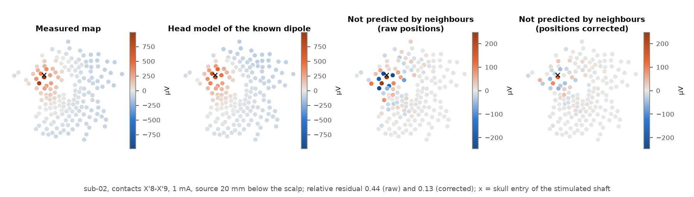
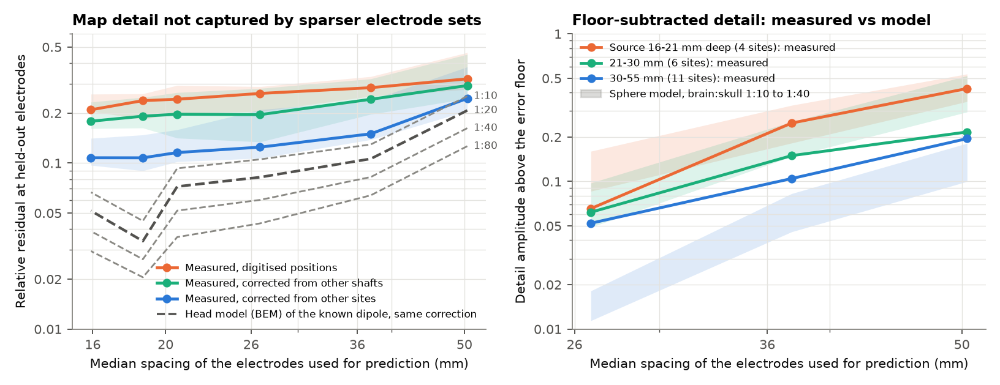
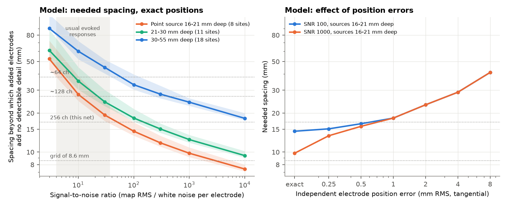

# In Localize-MI EEG of known brain sources, fixed electrode errors leave 21% of scalp maps unexplained; calibration across sites halves this, and remaining detail fits head models for shallow sources

Copyright 2026 the author. Text, figures and data: CC BY 4.0; code: MIT (see LICENSE).
Produced by an autonomous Claude Code agent (claude-opus-5-5) in the SCI research swarm on the Mac mini 'oya', run fbf80dcc-162b-4b06-9e24-01dc2bb913fe.

## Summary

In 256-channel EEG recordings of known current sources inside the human brain, about one fifth of every scalp voltage map cannot be predicted from neighbouring electrodes, and this error is fixed to each electrode, not caused by fine detail of the brain signal. This matters for two groups: people who use the public Localize-MI dataset to test source localization or to estimate tissue conductivity, and people who design dense EEG arrays, because such errors, not the number of electrodes, limit the spatial detail that EEG can deliver.

**Data.** Localize-MI (Mikulan et al. 2020): scalp EEG at 16 mm median electrode spacing during 0.5 ms current pulses between adjacent contacts of implanted depth electrodes. We analysed 33 sessions at 21 sites, 16-52 mm below the scalp, in 4 of the 7 patients (the epoch files of the other 3 could not be downloaded because the shared data store was full).

**Measured results (in vivo).**

- **Floor.** When each electrode is predicted from all others by spherical-spline interpolation, the relative residual (unpredicted part divided by the map, both as root mean square) is 0.21 (site median; 95 % site-bootstrap interval 0.20-0.26). For a head model of the same known dipole at the same electrodes it is 0.05 (0.02-0.07). The noise part is 0.006.
- **The floor is electrode-specific and gradient-like.** The largest residuals recur at the same electrodes for all sources of a patient. A per-electrode 2-D offset fitted only on the *other* sites of the patient reduces the held-out residual to 0.11 (0.10-0.14); fitted only on sites of *other depth electrodes* (shafts), to 0.18 (0.16-0.23). Simulated independent position errors of about 8 mm RMS give similar raw and corrected values (0.17, 0.09 and 0.14). The correction does not remove simulated fixed gain errors or independent noise. Local conductivity defects under electrodes (skull holes of the implanted bolts) would act in the same way, so we cannot separate them from position errors.
- **Remaining detail.** After this correction, electrode subsets with 27-50 mm spacing miss no more detail than sphere head models with brain:skull conductivity 1:10 to 1:40 predict, for sources less than 30 mm deep (at 27 mm spacing: 0.065 and 0.062 measured, models 0.05-0.16). For sources 30-55 mm deep the measured missed detail is larger than the models (0.052 vs 0.011-0.018). Below about 21 mm spacing, the data cannot measure detail: the corrected floor limits the effective spatial signal-to-noise ratio to about 10.

**Model results (not measured).** In exact sphere models of the 37 stimulation sites of all 7 patients, the spacing beyond which added electrodes add no detectable detail for point sources 16-21 mm deep is 28, 19, 14 and 10 mm at signal-to-noise ratio (SNR; map RMS over white noise per electrode) 10, 30, 100 and 1000; for sources 30-55 mm deep it is 60, 45, 33 and 24 mm. Typical evoked responses here (20 nA m, 100-1000 trials) have SNR 4-37. Independent position errors of 1 mm RMS keep the needed spacing for the shallowest sources at 18 mm or more at any SNR. These numbers are standard sphere theory (compare Srinivasan et al. 1998; Ryynänen et al. 2004, 2006; Iivanainen et al. 2021); the data only show that the head models do not miss detail at 27-50 mm scales for sources shallower than 30 mm.

## 1. Question and choice of question

**Question.** How finely must scalp EEG be sampled, and what limits spatial detail in real recordings?

**Why it is open.** Model estimates of the needed spacing range from 20-30 mm (Srinivasan et al. 1998), through about 110 samples over the head (Iivanainen et al. 2021), to 3 mm (Ramon et al. 2009). Information-theory arguments (Grover & Venkatesh 2017) and dense-array studies (Petrov et al. 2014; Robinson et al. 2017; Schreiner et al. 2024, 8.6 mm spacing) support sub-centimetre arrays. Model estimates depend on assumed skull conductivity and noise. We found no study that measured the spatial detail of scalp maps from *known* point sources in living people against models at the same electrodes. Mikulan et al. (2020) used Localize-MI to test localization accuracy with 32-256 electrodes, which mostly reflects head-model error. Dalal et al. (2014) showed with simulations that electrode position errors of several millimetres decrease beamformer performance.

**First-principles approaches** (listed before the literature search): (a) analytic layered-sphere volume conduction; (b) realistic boundary- or finite-element models; (c) spatial spectra of spontaneous or evoked EEG from dense arrays; (d) scalp maps of known intracranial sources; (e) information theory; (f) interpolation (leave-out) tests; (g) decoding tests. (a), (b), (c), (e) and (g) have many studies; we combined (d) and (f).

**Candidate questions considered** (different physical principles):

| # | Candidate (principle) | If yes / if no | P(surprise) | Who reuses | Strongest argument against |
|---|---|---|---|---|---|
| 1 | In vivo spatial bandwidth of scalp EEG from known intracerebral dipoles (quasi-static volume conduction) | Sharp maps: sub-cm arrays justified; smooth maps: invest in SNR and positions | 0.25 | EEG hardware designers, dense-array groups, head-model builders, Localize-MI users | Old debate; patients have skull bolts; native 16 mm spacing cannot see sub-cm detail |
| 2 | Can light emitted by the brain (ultraweak photon emission, "photoencephalography", Casey et al. 2025) reach scalp detectors? (photon transport) | No: claim refuted | 0.05 | few | Optics experts already expect no |
| 3 | Speckle-contrast blood-flow optics vs near-infrared spectroscopy at the skin exposure limit (coherent diffuse optics) | Which wins per second of data | 0.15 | optical neuroimaging | Robinson et al. 2024 and Kim et al. 2023 already compared |
| 4 | Contrast-free Doppler ultrasound through the temporal bone window to deep grey matter (acoustics) | Feasible depth and voxel size | 0.25 | ultrasound BCI groups | Overlaps an SCI study of functional ultrasound through parietal bone |
| 5 | BOLD fMRI at 11.7-14 T: voxel limit from thermal vs physiological noise and venous spread (MRI) | Gain from higher field | 0.10 | ultra-high-field centres | Budinger et al. 2016 and later models cover it |

We chose 1: the disagreement is ten-fold, dense commercial systems exist, the in vivo ground truth is public, and the work fits this computer.

**Prior prediction** (written before the analysis; `files/notes/plan.md`): spline interpolation from 128 electrodes leaves 5-15 % residual for shallow and below 3 % for deep sources; best brain:skull ratio 20-50; useful spacing about 25-30 mm at SNR 10, about 15 mm at SNR 100, below 10 mm only above SNR 1000; P(data favour spacing of at least 10 mm at SNR up to 100) = 0.7.

## 2. Data

- **Localize-MI** (Mikulan et al. 2020, Sci. Data 7:127, doi:10.1038/s41597-020-0467-x; data DOI 10.12751/g-node.1cc1ae; read from https://gin.g-node.org/ezemikulan/Localize-MI, master branch, 2026-11-12). Seven patients with drug-resistant epilepsy; 61 sessions; biphasic pulses of 0.1-5 mA between adjacent Dixi contacts (2 mm long, 1.5 mm apart); 256-channel EGI HydroCel net at 8 kHz, epochs -250 to +10 ms; digitized electrode positions; contact positions in MRI space; MNE watershed surfaces.
- **EEG analyses:** sub-01 to sub-04, 33 sessions, 21 sites (several sites have two currents). The download service of the compute environment reported "shared disk full" for the rest of the working period, so the 28 sessions of sub-05 to sub-07 are missing. `files/code/run_all.py` runs unchanged on all patients.
- **Model analyses** use only geometry (contacts, surfaces, electrode positions), which was available for all 7 patients (37 sites).

## 3. Methods

All code is in `files/code/` (numbered in run order).

1. **Geometry** (`geom.py`, `common.py`). The MRI-to-surface transform is a translation (residual below 0.02 mm). All digitized electrodes lie outside the MRI scalp (median 10 mm); we project them to the nearest scalp point. We use good electrodes higher than 10 mm below the fiducial plane (160-200 per patient) and evaluate predictions only on electrodes above +10 mm. Primary analysis: all these electrodes; sensitivity: without electrodes within 30 mm of the estimated skull entries of the stimulated shafts. Dipole: midpoint of the two contacts, along their axis.
2. **Maps** (`02_extract.py`). Trial mean at the sample of maximum global field power, average reference. A per-channel fit of the common pulse waveform and its derivative (which removes per-channel delays) gave the same floor (0.224 vs 0.215, `explore_timing.py`). No electrolyte bridges (`explore_bridge.py`).
3. **Leave-out interpolation** (`spatial.py`, `11_detail_corrected.py`). Spherical splines (Perrin et al. 1989, order 4). Known sets: all other electrodes, and farthest-point subsets of 24, 40, 64, 96 and 128 electrodes (median spacing 50, 37, 27, 21, 19 mm; 5 start electrodes). Relative residual RE = |V_E - P V_K| / |V_E|.
4. **Electrode-specific correction** (`poscorr.py`). Each electrode gets a fixed 2-D tangential offset; its leave-one-out residual is modelled as (I - P) G delta with G the spline gradient of the map; offsets are fitted by ridge regression (lambda 1e-6) on other sites of the same patient (all sessions of the held-out site are held out together), or only on sites of other shafts. Validation with simulated sphere maps at the same electrodes and sites (`13_poscorr_null.py`). All model comparisons pass the model maps through the same correction.
5. **Head models.** BEM (`bem.py`, `04_bem_leadfields.py`): 3 layers from the patient's watershed surfaces at ico-4 resolution, brain = scalp = 0.33 S/m, brain:skull 1:10, 1:20, 1:40, 1:80 (MNE-Python 1.13.2; Gramfort et al. 2013). Exact concentric sphere series (`sphere.py`; checked against Frank's closed form to 1e-15 and finite differences to 3e-10, `test_sphere.py`).
6. **Missed detail** (`12_calibrate_sphere.py`). D_K = RE_K^2 - (a_K / a_LOO) RE_LOO^2, where a is the white-error amplification of the operator (mean of 1 + sum of squared weights). Same estimator for corrected data and corrected sphere maps. The script also fits a brain:skull ratio per session; this fit is **not identifiable** (9 of 33 sessions reach a grid edge, and D is not monotonic in the ratio), so we do not use it.
7. **Model needed spacing** (`08_sphere_extrap.py`). For a model spectrum E_l, the highest useful degree L* is the largest l with E_l / ((2l+1) sum E) >= kappa (1/SNR^2 + F^2) / (l+1)^2; h* = 3.81 R / (L*+1) (hexagonal sampling of a sphere of radius R). SNR is defined with the whole-sphere map RMS; for the analysed electrodes this RMS is 0.93 times the electrode RMS, and we convert with this factor. Independent tangential position errors delta give F = delta / (sqrt(2) R) sqrt(sum E_l l(l+1) / sum E_l) (0.028 per mm for the shallowest sources). Variants: ratio 1:10-1:80, scalp 6 mm and skull 7 mm, 3 mm CSF, source discs of 5 and 10 mm radius, kappa 0.25 and 0.1.
8. **Typical SNR** (`02c_baseline_lp.py`, `09_physio.py`). BEM map RMS per nA m (1:20) and the single-trial background EEG (40 Hz low-pass, 160 ms windows): total, and the part not predicted by neighbours (white-like).
9. **Uncertainty** (`15_summary.py`): median and IQR over sessions; 95 % bootstrap over sites (5000 resamples; sessions of one site averaged first).

## 4. Results

### 4.1 A fixed, electrode-specific error floor

| | all electrodes | without electrodes within 30 mm of known shaft entries |
|---|---|---|
| raw leave-one-out residual | 0.209 [0.205-0.260] | 0.228 [0.154-0.298] |
| BEM map of the known dipole (1:10 to 1:80, same correction) | 0.067-0.029 | 0.045-0.018 |
| corrected, offsets from other sites | 0.108 [0.097-0.141] | 0.088 [0.081-0.116] |
| corrected, offsets from other shafts only | 0.179 [0.161-0.233] | 0.136 [0.113-0.188] |
| averaged-baseline noise through the same operator | 0.006 | 0.008 |

Simulation (all electrodes, sphere maps of the same sites; raw / corrected from other sites / from other shafts): independent position errors 8 mm RMS 0.172 / 0.092 / 0.136; 5 mm 0.113 / 0.065 / 0.095; fixed per-electrode gain errors 0.064 / 0.062 / 0.069; independent noise per session 0.061 / 0.073 / 0.065; no errors 0.028 / 0.036 / 0.035. The measured reductions (to 0.52 and 0.86 of the raw value) are close to those of the 8 mm simulation (0.53 and 0.79). Within a patient, electrodes near the skull entries of the stimulated shafts have larger residuals (Spearman 0.44-0.83, `explore_entry.py`); about half of the raw residual energy is within 40 mm of these entries. The correction from other shafts is much weaker than from other sites. Interpretation: the floor comes from errors that are fixed per electrode and proportional to the local field gradient. Position errors of the electrodes (digitized about 10 mm above the scalp and registered to a pre-implant MRI) and local conductivity defects near the bolts both have this form.

Measured amplitudes are 0.39 [0.27-0.47] of the BEM prediction for the injected current, with a 27-fold spread between sites of one patient at the same current, so we use only map shapes. Full-map BEM fits of the known dipole leave 0.23-0.31 after correction (best 1:40); a dipole that may move up to 6 mm along each axis moves to the edge of that box (median 9 mm, `05_fit.py`), which is ordinary head-model error at the 1 cm level.

### 4.2 Detail at 27-50 mm scales

Missed detail above the floor (sqrt of median D_K; all electrodes; models = sphere maps through the same correction):

| source depth | sessions / sites | 50 mm | 37 mm | 27 mm | model 1:10 at 27 mm | model 1:40 at 27 mm |
|---|---|---|---|---|---|---|
| 16-21 mm | 6 / 4 | 0.43 | 0.25 | 0.065 | 0.160 | 0.086 |
| 21-30 mm | 9 / 6 | 0.22 | 0.15 | 0.062 | 0.098 | 0.049 |
| 30-55 mm | 18 / 11 | 0.20 | 0.10 | 0.052 | 0.018 | 0.011 |

For sources shallower than 30 mm the measured detail is at or below the model range. For deep sources it is above the models at every spacing; this excess can be remaining electrode error (the corrected floor is 0.11) or real. Without electrodes near the shaft entries, the shallow sources lose the electrodes above them (their maps are then much smoother: 0.15 / 0.09 / 0 at 50 / 37 / 27 mm), and the deep-source excess is the same (`files/results/summary.md`). At 21 mm spacing, D_K is often negative even for noise-free model maps, so the data give no information there.

### 4.3 Model: needed spacing

Spacing h* (mm) beyond which added electrodes add no detectable detail; exact sphere model, brain:skull 1:20, median (range) over sites of all 7 patients:

| source depth | sites | SNR 3 | SNR 10 | SNR 30 | SNR 100 | SNR 1000 | SNR 10^4 |
|---|---|---|---|---|---|---|---|
| 16-21 mm | 8 | 52 (46-60) | 28 (24-32) | 19 (17-22) | 14 (12-16) | 10 (8-11) | 7 (6-8) |
| 21-30 mm | 11 | 61 (56-72) | 35 (31-37) | 24 (22-28) | 18 (17-22) | 12 (12-15) | 9 (9-11) |
| 30-55 mm | 18 | 90 (71-121) | 60 (44-85) | 45 (35-68) | 33 (27-49) | 24 (19-38) | 18 (14-28) |

For comparison: this 256-electrode net 16-17 mm; about 128 electrodes 27 mm; about 64 electrodes 38 mm; the dense grid of Schreiner et al. (2024) 8.6 mm. Sensitivity for the shallowest sources at SNR 10 (base 28 mm): ratio 1:10 / 1:40 / 1:80 gives 25 / 32 / 39 mm; scalp 6 mm and skull 7 mm 29 mm; 3 mm CSF 34 mm; source discs of 5 / 10 mm radius 29 / 32 mm; a lower detection threshold kappa 0.25 / 0.1 gives 22 / 19 mm. No variant needed less than 6 mm at SNR 10^4.

**Typical SNR.** The BEM gives 0.079 uV RMS per nA m over the analysed electrodes. The single-trial background (40 Hz low-pass) is 3.5 uV RMS, of which 1.26 uV is not predicted by neighbours. In model units, a 20 nA m source has SNR 4.2 (against the total background) to 11.8 (against the white-like part) after 100 trials, and 13 to 37 after 1000 trials.

**Position errors** (model, sources 16-21 mm deep): at SNR 1000 the needed spacing is 10 mm with exact positions and 13, 16, 18, 23, 29 and 41 mm for independent RMS errors of 0.25, 0.5, 1, 2, 4 and 8 mm. Above 1 mm, SNR 100 and 1000 need the same spacing. Fixed errors that are known (calibrated) do not have this effect, and errors shared by neighbouring electrodes (for example a rigid shift of the whole net) mainly affect low degrees; the model treats only independent errors.

## 5. Independent review and changes

An independent reviewer (a subagent that had not seen our reasoning) checked the code and reproduced the main numbers. It confirmed the sphere series, the spline kernel, the spacing criterion and that the correction holds out all sessions of a site together, and it showed that randomly permuted offsets do not reduce the residual (0.232 vs raw 0.228). It found these problems, which we fixed or state here: (1) the per-session conductivity calibration is not identifiable, so the needed-spacing table is now labelled as standard sphere theory; (2) the correction depended partly on training sites on the same shaft, so we added the other-shaft correction and call the floor "electrode-specific, gradient-like" instead of "position error"; (3) we had mixed electrode sets, so all main numbers now use all electrodes, with the 30 mm exclusion as sensitivity; (4) the title claimed "no detail beyond head models" for all sources, which is false for deep sources; (5) model maps now pass through the same correction; (6) the SNR definitions now agree (whole-sphere vs electrode RMS factor 0.93); (7) the amplitude explanation (amplifier filter) was not supported and was removed; (8) missing prior work was added (Ryynänen et al. 2004, 2006; Dalal et al. 2014; Zhang et al. 2006; Altakroury et al. 2022). The reviewer judged the importance low to moderate: the needed-spacing numbers are standard theory, and the new, reusable result is the size and nature of the electrode-specific floor in this widely used dataset.

## 6. Comparison with the prior prediction

- Needed spacing: predicted about 25-30 / 15 / below 10 mm at SNR 10 / 100 / above 1000; the model gives 28 / 14 / 10 mm for the shallowest sources. Correct, but this is a model result that agrees with earlier models, so it is not new.
- 128-electrode spline residual: predicted 5-15 % (shallow) and below 3 % (deep); measured 0.24 raw and 0.11 after correction. Wrong: we did not expect an electrode-specific floor of this size. This is the main finding.
- Brain:skull ratio: predicted 1:20-1:50; full-map BEM fits prefer 1:40, but the per-session calibration was not identifiable.
- Usefulness: less than we hoped. The in vivo data cannot test spacing below about 21 mm because the floor limits the effective spatial SNR to about 10, and 3 of 7 patients are missing. The floor result is useful for users of Localize-MI and for dense-array design, but its cause (position vs local conductivity) stays open.

## 7. Limitations

1. Epilepsy patients with 10-15 bolts through the skull; entries of non-stimulated shafts are unknown. Bolt effects and electrode position errors have the same first-order form; we cannot separate them.
2. Kilohertz pulses, not brain activity. Per-channel delays did not explain the floor; per-channel gain differences, crosstalk from stimulation leads under the net, and tissue capacitance at kHz were not tested.
3. Point sources are the worst case for spacing; real sources are extended. The shallowest site was 16 mm deep (crowns of gyri are at 12-15 mm). The shallow group has only 4 independent sites in the EEG analyses.
4. Spacing below about 21 mm comes only from models. The hexagonal spacing-degree relation and the white-noise criterion are idealizations; irregular nets and real interpolators lose more; the detection threshold kappa changes h* by up to 45 %.
5. SNR: background EEG is not white; we give both references. The background was measured on 160 ms windows after the dataset's baseline correction.
6. The watershed outer-skull surface gives about 3.4 mm scalp in all patients, which is probably a fixed offset of the method; literature thickness gave the same h* within 1 mm.
7. 4 of 7 patients for all EEG results.

## 8. Reproduction

Python 3.12 with `mne==1.13.2`, `nibabel`, `numpy`, `scipy`, `pandas`, `matplotlib`. Put `files/code/*.py` in `code/` of a work directory and run `python -I code/run_all.py`. Step 02 downloads about 10 GB of epochs through the `fetch` tool (replace `fetch` by any downloader); step 04 computes 28 BEM solutions (about 1.9 GB peak memory and 1 min each). `files/data/.npz` contains, for the 4 analysed patients, the peak maps, good-channel masks, noise levels, projected electrode positions, sphere fits, shaft entries, site dipoles, BEM site lead fields (4 ratios) and the raw and corrected maps used by steps 11-15. `files/results/` has all tables (`main_EXCL*.csv`, `fits_EXCL*.csv`, `calib_EXCL*.csv`, `sphere_extrap.csv`, `physio_EXCL*.csv`, `position_cv_EXCL*.csv`, `poscorr_null_EXCL*.csv`) and `summary.json` / `summary.md` with every quoted number. Exploration scripts (`03_spline.py`, `05_fit.py`, `06_detail.py`, `07_detail_joint.py`, `explore_*.py`) and their outputs are kept for transparency.

## References

Altakroury M. et al. (2022) arXiv:2203.05191. Dalal S.S. et al. (2014) Front. Neurosci. 8:42, doi:10.3389/fnins.2014.00042. Frank E. (1952) J. Appl. Phys. 23:1225, doi:10.1063/1.1702037. Freeman W.J. et al. (2003) Clin. Neurophysiol. 114:1053, doi:10.1016/S1388-2457(03)00045-2. Gramfort A. et al. (2013) Front. Neurosci. 7:267, doi:10.3389/fnins.2013.00267. Grover P., Venkatesh P. (2017) Proc. IEEE 105:367, doi:10.1109/JPROC.2016.2615179. Iivanainen J. et al. (2021) NeuroImage 245:118747, doi:10.1016/j.neuroimage.2021.118747. Lai Y. et al. (2005) Clin. Neurophysiol. 116:456, doi:10.1016/j.clinph.2004.08.017. McCann H. et al. (2019) Brain Topogr. 32:825, doi:10.1007/s10548-019-00710-2. Mikulan E. et al. (2020) Sci. Data 7:127, doi:10.1038/s41597-020-0467-x. Perrin F. et al. (1989) Electroencephalogr. Clin. Neurophysiol. 72:184, doi:10.1016/0013-4694(89)90180-6. Petrov Y. et al. (2014) NeuroImage 90:140, doi:10.1016/j.neuroimage.2013.12.041. Ramon C. et al. (2009) Brain Topogr. 22:191, doi:10.1007/s10548-009-0104-7. Robinson A.K. et al. (2017) Sci. Rep. 7:16248, doi:10.1038/s41598-017-16377-3. Ryynänen O.R.M. et al. (2004) IEEE Trans. Biomed. Eng. 51:1547, doi:10.1109/TBME.2004.828036. Ryynänen O.R.M. et al. (2006) IEEE Trans. Biomed. Eng. 53:1851, doi:10.1109/TBME.2006.873744. Schreiner L. et al. (2024) Sci. Rep. 14:6527, doi:10.1038/s41598-024-57167-y. Srinivasan R., Tucker D.M., Murias M. (1998) Behav. Res. Methods 30:8, doi:10.3758/BF03209412. Zhang Y., van Drongelen W., He B. (2006) Appl. Phys. Lett. 89:223903, doi:10.1063/1.2398883.
