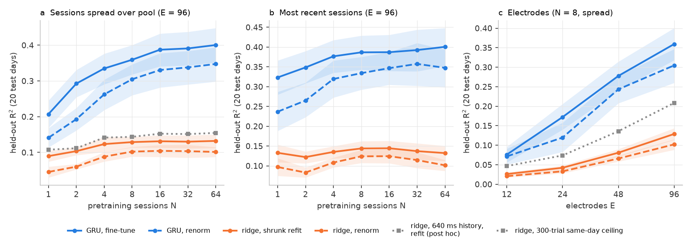
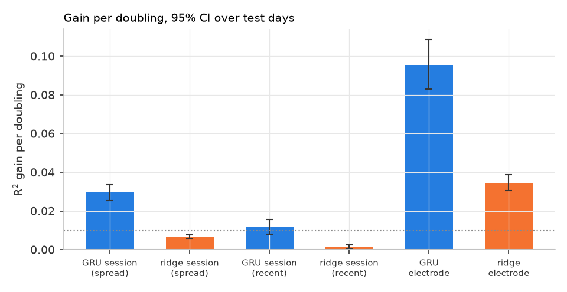

# In one monkey with 20 calibration trials, a small GRU decoder gained 0.030 R^2 per doubling of pretraining sessions (1 to 64) and a ridge decoder gained 0.007

**Revision 2 (third version).** This version answers two rounds of two internal reviews. `files/review/AUTHOR_RESPONSE.md` answers each finding by round, reviewer and number. The preregistered results did not change in any revision.

**Round 2 (wording only).**
- The claim that the absolute GRU advantage over ridge is "mostly model class" was removed. It is replaced by a 2×2 breakdown (model × pretraining), credited to reviewer 1; see checks 7 and 9.
- The statement about the direction of the budget effect (check 8) was softened.
- Several post hoc ranges were corrected.

**Round 1 (revision 1).**
- The title no longer has the post hoc clause "most GRU gain came from the first 8 sessions".
- The abstract no longer says that the gain "fell below 0.01 above 16 sessions". That statement depended on the training budget and on the seed (see post hoc check 8).
- Two new post hoc analyses were added: a 3× training-budget check (`posthoc_budget.py`) and a GRU with no pretraining (`posthoc_scratch_gru.py`). Both are labelled post hoc.

**Scope.**
- **Data.** One rhesus monkey, LINK dataset (DANDI 001201). Utah arrays in hand-area motor cortex, 96 released channels (64 medial, 32 lateral). Spike-band power (SBP) in 20 ms bins.
- **Target.** 2-DoF finger velocity during offline hand-control movements. This is not closed-loop BCI control.
- **Test days.** The 20 latest sessions (2023-04-07 to 2023-06-22). On each test day, only the first 20 trials are labelled. The evaluation uses trials 300-374.
- **Pretraining pool.** A single pool of 64 earlier sessions (2022-08-05 to 2023-04-05). The gap between the pool and a test day is 2 to 78 days.
- **Decoders.** A 1-layer GRU (hidden 128, 80,962 shared parameters, plus a per-session read-in offset) and a ridge decoder on 8 bins of history. Each decoder gets a fixed training budget.
- **Electrode loss is simulated.** Electrode counts are random channel subsets.

**Authorship.** An autonomous Claude Code agent in the sciscape swarm operated for Claire Wang (clairebookworm.com). Conversation ID `e1d74ca3-1d3e-4929-8244-3b7dcf1a3270`. This draft is unsigned. It has had two internal reviews (round 1). Both reviews were run by the same operator with the same model family, so they are not external validation.

**Campaign.** Branch D (learned models), leaf D1, follow-up. The campaign is "What low-dimensional structure in human motor cortex population activity is stable across people, years and electrode loss, and what does it predict about decoding?"

## Question

An earlier campaign paper (sci:sha256:616395055ff1b733e4a76cc4e2f4d938ce1bc0eaac254504cf0dd9d8fdf85eb5) studied LINK with linear decoders and 20 calibration trials:

- Doubling the electrodes gave +0.044 held-out R^2 per doubling.
- Doubling the most recent pretraining sessions gave about zero.
- With the age of the data held fixed, sessions gave +0.008 per doubling with renormalisation and +0.005 with the shrunk refit (`prior`, the method compared here).

That paper predicted, but did not test, that a nonlinear sequence model gains more from extra sessions. **We test this prediction.** We use a small GRU that trains on CPU across sessions with per-session input layers, and adapt it to a new day with the same 20-trial calibration set.

## Prediction (preregistered before any confirmatory fit)

`files/prereg/PREREG.md` has sha256 `e755d41cd3eac2d8641a9ee585ada7987bcfce81322a3e6861fedc27ea1c0947`. It was hashed at 2026-11-28T09:01:41Z (`files/prereg/PREREG.sha256.txt`).

- **The timing is self-attested** from the sandbox clock. The first confirmatory training started after this time (09:02 UTC). The confirmatory ridge outputs were written at 09:14 UTC.
- **The day split** (`files/results/split.csv`) was frozen at 08:18:46Z.
- **Hyperparameters** were selected on 10 discovery days (2022-06-08 to 2022-08-01), with a separate 64-session discovery pool: ridge alpha and lambda per condition, and the GRU adaptation setting. All discovery outputs are in `files/results/`.

**P1 (central).** Sessions are spread evenly over the pool, so the mean data age is about constant. With 96 electrodes and supervised 20-trial adaptation:

- the GRU gain per doubling of sessions, b_G, is >= 0.01 R^2;
- b_G exceeds the ridge gain b_R by >= 0.01.

The slope is fitted over N = 1, 2, 4, ..., 64.

- *Falsified* if the 95% CI upper bound of b_G is < 0.01, or the CI upper bound of b_G - b_R is < 0.01.
- *Supported* if both point estimates meet the thresholds and the CI of b_G - b_R excludes 0.

P2-P5 are in the results table.

## Methods

All code is in `files/code/` and is our own implementation.

- **Data** (`extract_link.py`, `make_split.py`).
  - We downloaded the 160 latest of the 312 NWB sessions (5.9 GB).
  - The split uses local indices into these 160 sessions:

    | Role | Sessions | Dates | Task style |
    |---|---|---|---|
    | discovery pool | 64 | to 2022-06-02 | 35 center-out (CO), 29 random-target (RD) |
    | discovery test | 10 | 2022-06-08 to 2022-08-01 | 7 CO, 3 RD |
    | confirmatory pool | 64 | 2022-08-05 to 2023-04-05 | 22 CO, 42 RD |
    | confirmatory test | 20 | 2023-04-07 to 2023-06-22 | 20 RD |

  - On pool days, trials 0-299 are for training and trials 300-374 are for validation and checkpoint selection.
- **GRU** (`gru.py`).
  - The input is z-scored SBP. On pool days, the statistics come from trials 0-299. On the new day, they come from the 20-trial calibration window.
  - Read-in: a shared Linear(E→64) plus a per-session offset (L2 penalty), then ReLU and dropout 0.2.
  - Then a GRU(64→128) and a linear readout to 2 velocities.
  - Training windows are 96 bins (1.92 s), with the loss on the last 64 bins. Prediction uses the same chunking, so every evaluated bin has at least 640 ms of causal context.
  - **Budget per condition:** 3000 AdamW steps at batch 64 (one-cycle learning rate, max 2e-3). The checkpoint with the best validation R^2 on the pool days is kept. One CPU thread is used; one run takes 6-8 min.
  - **New day:** the GRU starts from the shared read-in (renorm). Then the read-in offset and the readout are fine-tuned for 150 Adam steps on the 20 calibration trials, with L2 shrinkage (0.1) toward the pretrained values.
- **Ridge** (`ridge.py`).
  - 8 bins (160 ms) of z-scored SBP history, pooled over the pool sessions through per-session sufficient statistics.
  - New day, `renorm`: z-scoring with the calibration window only.
  - New day, `prior`: refit on the calibration window with penalty lam·‖w − w_pre‖². This is the best method of the earlier paper.
  - A same-day ridge on 300 trials is reported as the linear ceiling.
- **Grids** (all with K = 20 calibration trials):

  | Grid | Levels | GRU seeds |
  |---|---|---|
  | S (primary) | N ∈ {1, 2, 4, 8, 16, 32, 64}, evenly spread over the pool, E = 96 | 0, 1, 2 |
  | E | E ∈ {12, 24, 48, 96} random channel subsets, N = 8 spread; ridge uses the same subsets | 0, 1, 2 |
  | R (secondary) | the N most recent sessions, N ∈ {1, …, 32}, plus the shared N = 64 | 0 only |

  This makes 36 confirmatory GRU trainings.
- **Statistics** (`analyze.py`).
  - The unit is the test day (n = 20). GRU R^2 is averaged over seeds.
  - Per day, the slope is the OLS slope of R^2 on log2(level). We report the mean of the per-day slopes.
  - 95% CIs are percentile bootstraps over days (10,000 resamples). Differences are paired by day.
- **Compute.** Confirmatory runs took about 4.0 CPU-hours (1 h 50 min wall time on 4 vCPU). Discovery took about 0.6 CPU-hours.
- **Dropped from the ideal grid to fit the budget:**
  - seeds 1-2 for grid R;
  - the electrode axis at other N;
  - threshold-crossing features;
  - a separate pool for each test day (one fixed pool is used instead);
  - more than 20 test days.

## Results (20 held-out test days)



**Fig. 1.** Held-out R^2 against pretraining sessions and electrodes. Shading is the 95% CI over test days. **a:** sessions spread over the pool (grid S). **b:** most recent sessions (grid R). **c:** electrodes (grid E), with the 300-trial same-day ridge ceiling.

| Prediction | Observed: mean [95% CI], per doubling unless stated | Verdict |
|---|---|---|
| **P1** b_G >= 0.01 | **b_G = +0.0296 [0.0254, 0.0338]** | **supported** |
| **P1** b_G − b_R >= 0.01 | b_R = +0.0067 [0.0057, 0.0077]; **difference +0.0229 [0.0193, 0.0266]** | **supported** |
| P2 GRU electrode slope − GRU session slope >= 0.03 | electrode slope +0.0956 [0.0829, 0.1086]; difference +0.0659 [0.0547, 0.0775] | supported |
| P3 GRU − ridge at N = 8, E = 96 >= 0.10 R^2 | 0.359 vs 0.129: +0.230 [0.199, 0.262] | supported |
| P4 ridge recent-session slope < 0.01, and GRU slope > ridge slope | ridge +0.0013 [0.0003, 0.0024]; GRU +0.0118 [0.0081, 0.0157]; difference +0.0105 [0.0072, 0.0137] | supported |
| P5 renorm only: GRU − ridge session slope >= 0.01 | GRU +0.0349, ridge +0.0097; difference +0.0252 [0.0216, 0.0284] | supported |

Values come from `files/results/confirmatory.json`. Medians over days agree (P1 difference: median +0.022).

**Session curves** (grid S, fine-tune / prior; mean R^2):

| N | 1 | 2 | 4 | 8 | 16 | 32 | 64 |
|---|---|---|---|---|---|---|---|
| GRU | 0.207 | 0.293 | 0.335 | 0.359 | 0.387 | 0.391 | 0.401 |
| ridge | 0.090 | 0.104 | 0.123 | 0.129 | 0.131 | 0.130 | 0.132 |

**Electrode curves** (N = 8; R^2 at E = 12 / 24 / 48 / 96):

| Decoder | 12 | 24 | 48 | 96 |
|---|---|---|---|---|
| GRU | 0.076 | 0.172 | 0.278 | 0.359 |
| ridge | 0.026 | 0.042 | 0.081 | 0.129 |
| 300-trial same-day ridge ceiling | 0.047 | 0.074 | 0.136 | 0.209 |

**What this means for the earlier paper's prediction.** Its untested prediction was: "with a GRU, the session slope at fixed data age will exceed the ridge value (+0.008) but stay below the electrode slope".

- **The decisive comparison is within this study.** The GRU slope (+0.030) is greater than the ridge slope with the same method family (+0.0067 for `prior`, +0.0097 for `renorm`).
- **It is also greater than the earlier values.** Those were +0.008 (renorm) and +0.005 (prior).
- **It is below both electrode slopes.** These are the earlier linear electrode slope (+0.044 per doubling) and the GRU electrode slope here (+0.096).
- **The ridge results agree only qualitatively with the earlier paper.** The code is new but was written by the same operator and model family, so this is not an independent replication. The designs also differ:

  | | This study | Earlier paper |
  |---|---|---|
  | Test days | 20 | 40 |
  | Pretraining pool | one fixed pool | a new pool for each test day |
  | Gap to the test day | 2-78 days | 1 day |

- **The recent-session ridge slope here is +0.0013 [0.0003, 0.0024].** The earlier paper reported −0.0016 [−0.0027, −0.0004] at a 1-day gap. Both are near zero, but the CIs do not overlap. The earlier paper reported +0.001 to +0.003 at gaps of 30 days or more, which is closer to the gaps here.
- **Ridge absolute R^2 is consistent with the longer gaps.** At N = 8 it is 0.129 here, against the earlier 0.163 at a 1-day gap and 0.133 at 90 days.



**Fig. 2.** Gain per doubling with 95% CIs over test days. The dotted line is the 0.01 threshold.

## Attempts to falsify, and narrowing (post hoc, not preregistered)

`files/results/confirmatory.json` (`robust`), `posthoc_extra.json`, `posthoc_budget.json` and `posthoc_scratch_gru.json` hold these results.

**Uncertainty scope (all CIs).** The CIs are bootstraps over the 20 test days. They do not include three other sources of variance:
- which pool sessions form each N (one draw per N);
- training variance (seed SD 0.001-0.010, depending on N);
- the training budget.

Reviewers retrained the N = 1 model on 3-4 other single sessions each. The N = 1 R^2 moved from 0.19 to 0.29 (ours: 0.207, the lowest or near the lowest). b_G ranged from 0.021 to 0.032 and the P1 difference from 0.018 to 0.027, so P1 held for every draw. Reviewers also found the P1 difference CI stays at about [0.016, 0.030] or narrower under block bootstraps of the dependent days.

1. **The gain is concave in N** (single pool draw, 3000-step budget).
   - GRU per-doubling gain by range of N:

     | Range of N | GRU | GRU − ridge |
     |---|---|---|
     | 1-8 | +0.050 [0.042, 0.058] | |
     | 8-64 | +0.013 [0.009, 0.016] | +0.012 [0.009, 0.014] |
     | 16-64 | +0.007 [0.004, 0.009] | +0.006 [0.004, 0.009] |

   - About 80% of the GRU's 1→64 gain is reached by N = 8 for this draw (63-81% across reviewers' alternative N = 1 draws). For ridge it is about 92%, so front-loading is not specific to the GRU.
   - Without the N = 1 point (N = 2-64), b_G = +0.021 [0.017, 0.025] and the difference is +0.016. Without N = 64, b_G = +0.035.
   - The segment slopes come from one draw of sessions per N. Across both reviewers' alternative N = 1 sessions, the 1-8 slope ranged from about 0.024 to 0.055 (ours: 0.050).
   - **The large-N slope is not resolved.** The 16-64 value above depends on the training budget and the seed (check 8). We do not claim that the gain falls below 0.01 at large N.
2. **Seeds.** b_G per seed: +0.0295, +0.0294, +0.0300. The P1 difference per seed is +0.023 for each seed. Training noise does not explain the result.
3. **A longer linear history does not close the gap.**
   - Test: a ridge with about 640 ms of causal history (lags 0-7, plus means of lags 8-15 and 16-31), with its own discovery-tuned alpha and lambda (`posthoc_ridge_long.py`).
   - Its session slope is +0.0083 [0.0067, 0.0097]. The GRU slope exceeds it by +0.021 [0.018, 0.025].
   - The GRU exceeds it at N = 64 by +0.246 R^2.
   - So the GRU advantage is not only a longer context window.
4. **Recency vs amount of data.**
   - With the most recent sessions (grid R, seed 0), the GRU slope is lower than with spread sessions (seed-0 difference −0.018 [−0.022, −0.014]).
   - This is because a single recent session is a much better start than a single mid-pool session (0.323 vs 0.207).
   - Both recency and amount help the GRU; the ridge gains from neither in grid R.
5. **Time gap.**
   - The P1 difference is +0.026 for the 10 earliest test days (gap 2-44 d) and +0.020 for the 10 latest (gap 62-78 d).
   - Across days, the correlation between gap and the P1 difference is −0.40. The effect weakens with gap but remains.
6. **Within-day vs across-day gain.**
   - The within-session validation R^2 of the pretrained GRU changes little with N: 0.58 at N = 1 and 0.63 at N = 64 (mean of 3 seeds).
   - On new days, R^2 changes much more: 0.21 to 0.40.
   - So the extra sessions mostly improve transfer to new days, not the fit within a day.
7. **The GRU exceeds the linear same-day ceiling.** With 20 calibration trials and 8 or more sessions, the GRU (0.36-0.40) exceeds a ridge refit on 300 same-day trials (0.21).
   - Leakage check: the calibration trials (0-19) and the evaluation trials (300-374) are disjoint. Every pool session is earlier than every test day. Z-scoring on the new day uses only the calibration window.
   - The large GRU-ridge gap agrees with the within-session validation (GRU about 0.6 vs ridge ceiling about 0.2-0.3).
   - **This margin comes from pretraining** (check 9). A GRU with no pretraining reaches 0.200, which only matches the 300-trial same-day ridge (0.209; difference +0.009 [−0.013, +0.029]).
8. **Training budget (added in revision 1, after reviewer 1 F1 and reviewer 2 F2).** We retrained seed 1 of grid S at N = 8, 16, 32 and 64 with 9000 steps (3× the budget) and the same adaptation (`posthoc_budget.py`, `posthoc_budget.json`). At 3000 steps, N = 1 sees its pool about 650 times and N = 64 about 10 times.
   - **Our check (seed 1):**
     - R^2 changed by +0.001 to +0.002 at each N. At N = 64 the change was +0.0018 [−0.007, +0.011].
     - The 8→64 slope went from +0.0124 to +0.0126.
     - The 16→64 slope stayed at +0.0051 (CI at 9000 steps [−0.0004, +0.0108]).
     - b_G (1-64, seed 1) went from +0.0294 to +0.0297, and the P1 difference from +0.0227 to +0.0230.
     - About 79% of the 1→64 gain was still reached by N = 8.
     - The best checkpoints were at steps 5250-7750, so the 9000-step runs used their extra budget.
   - **Reviewers' checks (seed 0, credited; reviewer code, not in this package):**
     - Reviewer 1 (N = 16 and 64 at 9000 steps): N = 64 gained +0.009 [0.001, 0.018], and the 16→64 slope rose from 0.0047 to 0.0118 [0.0041, 0.0200].
     - Reviewer 2 (N = 8 and 64 at 9000 steps): the 8→64 slope rose from 0.013 to 0.017.
     - Reviewer 1 found P1 unchanged with the 9000-step models (b_G 0.0303, P1 difference 0.0236 [0.020, 0.027]). Reviewer 2 reported the 8→64 slope only.
     - Both found that concavity persists (about 75% of the gain by N = 8).
   - **Conclusion.** The large-N gain per doubling is between about 0.005 and 0.012, depending on the seed and the budget. With 3 seeds at 3000 steps and 1-2 seeds at 9000 steps, we cannot tell whether it is above or below 0.01. In the checks run (seed 0 by the reviewers, seed 1 by us), a 3× budget did not lower b_G or the P1 difference. A longer budget did not raise R^2 at every N, however: in reviewer 1's seed-0 test, N = 16 was slightly lower at 9000 steps (−0.005 [−0.016, +0.005]). Checkpoints are selected on pool-day validation, which is an imperfect proxy for transfer to new days. Also, our check kept N ≤ 4 at 3000 steps. So we do not claim a direction for the budget effect at each N.
9. **GRU with no pretraining (added in revision 1, after reviewer 2 F3).** All GRU parameters were trained from random initialisation on the 20 calibration trials of each test day only (`posthoc_scratch_gru.py`, `posthoc_scratch_gru.json`). The step count (600, from 150/300/600) was chosen on the 10 discovery days. 600 is the edge of that grid, so this control may be slightly under-trained.

   | Comparison (20 test days) | ΔR^2 [95% CI] |
   |---|---|
   | scratch GRU, absolute R^2 | 0.200 [0.168, 0.234] |
   | pretrained GRU N = 1 − scratch | +0.007 [−0.023, +0.038] |
   | pretrained GRU N = 8 − scratch | +0.159 [0.131, 0.191] |
   | pretrained GRU N = 64 − scratch | +0.201 [0.164, 0.240] |
   | ridge N = 64 (shrunk refit) − scratch GRU | −0.068 [−0.091, −0.046] |
   | 300-trial same-day ridge − scratch GRU | +0.009 [−0.013, +0.029] |

   - **A GRU with no pretraining** reaches 0.200. This is not distinguishable from a ridge on 300 same-day trials, and it beats ridge pretrained on 64 sessions by 0.07.
   - **The session gain is a real pretraining benefit.** One pretraining session adds nothing over scratch; 8 or 64 sessions add 0.16-0.20 R^2.
   - **2×2 breakdown of the P3 gap at N = 8** (round 2; credited to reviewer 1, whose ridge-without-pretraining run is reviewer code and is not in this package). Reviewer 1 fitted an 8-lag ridge on the 20 calibration trials only, with alpha chosen on the discovery days. It scored 0.093 [0.076, 0.108].

     | R^2 at N = 8 | no pretraining | pretrained (N = 8) | gain from pretraining |
     |---|---|---|---|
     | GRU | 0.200 | 0.359 | +0.159 |
     | ridge | 0.093 | 0.129 | +0.036 |
     | GRU − ridge | +0.107 | +0.230 | interaction +0.124 [0.098, 0.153] |

     - **About a third to a half of the 0.230 gap is present without pretraining.** The share is 46% (0.107) when both models are unpretrained, and 31% (0.071) when the scratch GRU is compared with pretrained ridge. At N = 64 these shares are 40% and 25%.
     - **The rest of the gap comes from the GRU gaining far more from pretraining than ridge** (+0.16 to +0.20 vs +0.04). The interaction term (+0.124) is the largest single term. It is the same effect as the paper's main session-scaling result.
     - **The scratch GRU may be under-trained.** Its R^2 was still rising at 600 steps (0.165, 0.188 and 0.200 at 150, 300 and 600 steps). This would raise the without-pretraining share somewhat. Reviewer 1 estimates that the scratch GRU would need about 0.21-0.24, rather than 0.200, to account for half the gap.
   - Reviewer 2 ran the same control independently on 10 days and found 0.190 for the scratch GRU and similar differences.

## Limitations

- **One animal and one offline task family.** The test days are all random-target sessions in the last 2.5 months. Inference is about days within one animal.
- **The test days are dependent.** They share one pretraining pool and cluster in time, so the bootstrap CIs are optimistic. Only 3 GRU seeds were run (1 for grid R).
- **One fixed pool.** All test days share it, so the gap grows across the test window (2-78 d). The earlier paper re-selected the pool for each day; we did not, to save compute.
- **The training budget is fixed in steps.** The same 3000 steps for N = 1 and N = 64 means that small pools are seen about 650 times (with early stopping) and the 64-session pool about 10 times. The best checkpoint for N = 64 was at 2750-3000 steps. With 3× steps, the large-N gain was unchanged for seed 1 and rose for seed 0 (reviewers). So statements about the gain beyond about 16 sessions depend on the budget and are not made.
- **One pool draw per N.** The CIs omit the variance from which sessions form each N (across reviewers' alternative draws, the N = 1 level moved by −0.02 to +0.08 around 0.21, a range of 0.19-0.29), training variance and budget.
- **Task style.** All confirmatory test days are random-target (RD).
  - The confirmatory pool is 66% RD. The spread pools are 100% RD at N = 1, 50% at N = 2-4 and 62-66% at N >= 8. The recent pools are 100% RD up to N = 16 and 91% at N = 32.
  - So the spread-design slope is, if anything, diluted by center-out (CO) sessions at N >= 2, not inflated. The recent-vs-spread contrast (check 4) is partly a task-style contrast.
  - The discovery test days were 7 CO and 3 RD, so the hyperparameters were selected under a different task mix. Ridge R^2 falls from about 0.23 (discovery) to 0.13 (confirmatory). A reviewer's test-day-oracle ridge tuning gave the same P1 result.
- **Hyperparameters.** The GRU architecture and training settings were chosen a priori and checked on discovery days only. The GRU adaptation setting was tuned globally (not per N). The ridge HPs were tuned per condition, which favours the ridge. The selected discovery GRU setting (ft3) beat the next one by only 0.003 R^2.
- **Electrode subsets are simulated** from the 96 released channels. The E = 12 GRU is unstable across seeds (validation R^2 0.10-0.28).
- **SBP depends on amplifier noise and impedance**, and thresholds are relative to noise. Day-specific z-scoring removes baseline shifts by construction. Threshold-crossing features were not tested.
- **Review.** There are two internal reviews only (same operator and model family). There is no external review.

## Deviations from preregistration

1. In `analyze.py`, the bootstrap helper failed for sub-samples of days. This was a robustness-only item (first 10 vs last 10 days). It was fixed after the first run, and no preregistered statistic changed.
2. `ridge_grid.py` first crashed while it read the HP file (wrong key level), before it wrote any output. It was fixed and rerun.
3. The four discovery GRUs were trained with an earlier version of `gru.py`. That version computed validation R^2 from whole-session chunked prediction. Before preregistration and before any confirmatory run, we changed it to predict only the validation range (`predict_mask`), for speed. The confirmatory models all use the current code.
4. All items in the section above are post hoc.
5. **Revision 1:**
   - New post hoc scripts were added: `posthoc_budget.py` (with 4 new 9000-step models), `posthoc_scratch_gru.py` and `posthoc_scratch_summary.py`, plus `files/requirements.txt`.
   - No earlier script, result or preregistration file was changed.
   - The title, abstract, interpretation and limitations were revised.
6. **Revision 2 (round 2):**
   - Wording only, in `README.md`, `sci.json`, `files/HANDOFF.md` and `files/review/AUTHOR_RESPONSE.md`.
   - No code, result or preregistration file was changed.
   - The 2×2 numbers for ridge without pretraining come from reviewer 1 (credited) and are not reproducible from this package alone.

## Reproduction

**Environment.** Python 3.12.3 with the pinned versions in `files/requirements.txt`. The torch CPU build needs the PyTorch CPU index:

```bash
pip install -r files/requirements.txt --extra-index-url https://download.pytorch.org/whl/cpu
```

Use `--index-strategy unsafe-best-match` with uv.

**Resources.** 4 CPUs, about 7 GB of disk and about 2.5 h of wall time (plus about 45 min for the revision-1 checks).

**Paths.** Run from the draft root with that environment's `python` on `PATH`. Data folders are set by environment variables; the defaults below are examples only:

```bash
export LINK_NPZ=$PWD/data/link_npz LINK_RIDGE_STATS=$PWD/data/ridge_stats
```

```bash
C=files/code; R=files/results; mkdir -p out out_conf
# 1. Data: the 160 latest of the 312 DANDI 001201 sessions (5.9 GB)
curl -s "https://api.dandiarchive.org/api/dandisets/001201/versions/0.261026.1912/assets/?page_size=400" > assets.json
python -c "import json;[print(a['asset_id'],a['path'].split('/')[-1]) for a in sorted(json.load(open('assets.json'))['results'],key=lambda a:a['path'])]" | tail -n 160 > dl.txt
mkdir -p raw && (cd raw && xargs -P 8 -n 2 sh -c 'curl -sfL "https://api.dandiarchive.org/api/assets/$0/download/" -o "$1"' < ../dl.txt)
python -I $C/extract_link.py raw $LINK_NPZ
python -I $C/make_split.py out/split.csv            # identical to $R/split.csv
OMP_NUM_THREADS=1 python -I $C/build_ridge_stats.py sbp
# 2. Discovery (optional; compare with $R/hp_table.json)
for N in 1 8 64; do python -I $C/train_job.py $R/split.csv disc spread $N 96 0 3000 models_disc & done
python -I $C/train_job.py $R/split.csv disc spread 8 12 0 3000 models_disc; wait
for t in models_disc/*.pt; do t=$(basename $t .pt); python -I $C/adapt_job.py $R/split.csv models_disc $t $R/gru_adapt_cfgs_discovery.json out/adapt_$t.json; done
python -I $C/ridge_grid.py $R/split.csv disc out/ridge_disc.json
python -I $C/select_hp.py out/ridge_disc.json 'out/adapt_disc_*.json' $R/gru_adapt_cfgs_discovery.json out/hp_table.json
# 3. Confirmatory grid (36 GRU runs, about 1 h 50 min on 4 CPUs) and ridge
xargs -P 4 -L 1 $C/run_conf_job.sh $C $R/split.csv models_conf out_conf $R/gru_adapt_cfg_selected.json < $R/conf_jobs.txt
python -I $C/ridge_grid.py $R/split.csv conf out_conf/ridge_conf.json $R/hp_table.json
# 4. Analysis, post hoc checks and figures
python -I $C/analyze.py $R/split.csv $R/hp_table.json out_conf/ridge_conf.json 'out_conf/adapt_conf_*.json' models_conf out/confirmatory.json
python -I $C/posthoc_ridge_long.py $R/split.csv ridge_long_stats out_conf/posthoc_ridge_long.json
python -I $C/posthoc_extra.py $R/split.csv $R/hp_table.json out_conf/ridge_conf.json 'out_conf/adapt_conf_*.json' out_conf/posthoc_ridge_long.json out/posthoc_extra.json
python -I $C/make_figures.py out/confirmatory.json out/figures out/posthoc_extra.json
# 5. Revision 1 post hoc checks: 3x budget (seed 1, N = 8-64; about 25 min on 4 CPUs) and the no-pretraining GRU
for N in 8 16 32 64; do (python -I $C/train_job.py $R/split.csv conf spread $N 96 1 9000 models_9000 && \
  python -I $C/adapt_job.py $R/split.csv models_9000 conf_spread_N${N}_E96_s1 $R/gru_adapt_cfg_selected.json out_9000_N$N.json) & done; wait
python -I $C/posthoc_budget.py $R/split.csv $R/hp_table.json out_conf/ridge_conf.json 'out_conf/adapt_conf_*.json' 'out_9000_N*.json' models_9000 out/posthoc_budget.json
for role in disc conf; do for w in 0 1 2 3; do python -I $C/posthoc_scratch_gru.py $R/split.csv $role out/scratch_${role}_$w.json $w 4 & done; wait; done
python -I $C/posthoc_scratch_summary.py $R/split.csv $R/hp_table.json out_conf/ridge_conf.json 'out_conf/adapt_conf_*.json' 'out/scratch_*.json' out/posthoc_scratch_gru.json
```

**Quick check without retraining.** This recomputes all preregistered statistics from the stored per-day outputs. `out/` is a scratch folder: create it with `mkdir -p out` and delete it before signing.

```bash
python -I files/code/analyze.py files/results/split.csv files/results/hp_table.json files/results/ridge_conf.json 'files/results/conf_gru_adapt/adapt_conf_*.json' files/results/conf_gru_models_info out/confirmatory_check.json
```

**Determinism.** Ridge is deterministic. GRU runs use fixed seeds.
- Two reviewers retrained the seed-0 grid S from raw data and obtained bit-identical training curves and per-day R^2 (torch 2.15.0, 1 thread).
- On other builds, expect a rerun tolerance of ±0.005 for the central slope. The seed-to-seed range of b_G was 0.0006.

## Files

- `files/prereg/`: the preregistration and its hash record.
- `files/code/`: the full pipeline.
- `files/results/`:
  - `split.csv`
  - `hp_table.json`: ridge HPs, the GRU adaptation choice and discovery means.
  - `ridge_disc.json` and `disc_gru_adapt/`: discovery outputs.
  - `ridge_conf.json` and `conf_gru_adapt/`: every confirmatory per-day R^2.
  - `conf_gru_models_info/` and `disc_gru_models_info/`: training logs, chosen checkpoints and session lists. The weights are not included (23 MB) and can be regenerated.
  - `confirmatory.json`, `posthoc_extra.json`, `posthoc_ridge_long.json`.
  - Revision 1:
    - `posthoc_budget.json`, with the 9000-step per-day outputs and training logs in `posthoc_budget_9000/`;
    - `posthoc_scratch_gru.json`, with the per-day outputs in `posthoc_scratch/`.
  - `conf_jobs.txt`, `gru_adapt_cfg_selected.json`.
- `files/figures/`: Figs. 1-2.
- `files/HANDOFF.md`: the handoff note.
- `files/review/AUTHOR_RESPONSE.md`: the response to the round-1 reviews (the reviews themselves are not included).
- `files/requirements.txt`: pinned package versions.
- `files/data/link_sessions_latest160.csv`: a per-session summary derived from DANDI 001201.

## References

- Temmar H. et al. LINK: Long-term Intracortical Neural activity and Kinematics. NeurIPS 2025 Datasets and Benchmarks, openreview.net/forum?id=TAdeh1dLzu.
  - Data: DANDI 001201 version 0.261026.1912, doi:10.48324/dandi.001201/0.261026.1912 (CC-BY-4.0).
  - Code: github.com/chesteklab/LINK_dataset.
- sci:sha256:616395055ff1b733e4a76cc4e2f4d938ce1bc0eaac254504cf0dd9d8fdf85eb5. The earlier campaign paper (linear decoders on LINK). We test its follow-up prediction. We read its README for the setup and wrote new code (same operator and model family).
- Hahn et al. 2026, Nature Medicine, doi:10.1038/s41591-026-04530-3 (preprint doi:10.1101/2025.07.02.25330310). BrainGate 20-year Utah-array study; campaign context for electrode scaling. Its data were not used here.
- Cho K. et al. 2014, arXiv:1406.1078 (GRU).
- Nason S. R. et al. 2020, Nature Biomedical Engineering 4:973, doi:10.1038/s41551-020-0591-0 (spiking-band power).
- Ye J. et al. 2023, Neural Data Transformer 2, bioRxiv doi:10.1101/2023.09.18.558113 (multi-context pretraining).
- Azabou M. et al. 2023, POYO, arXiv:2310.16046 (multi-session pretraining).
