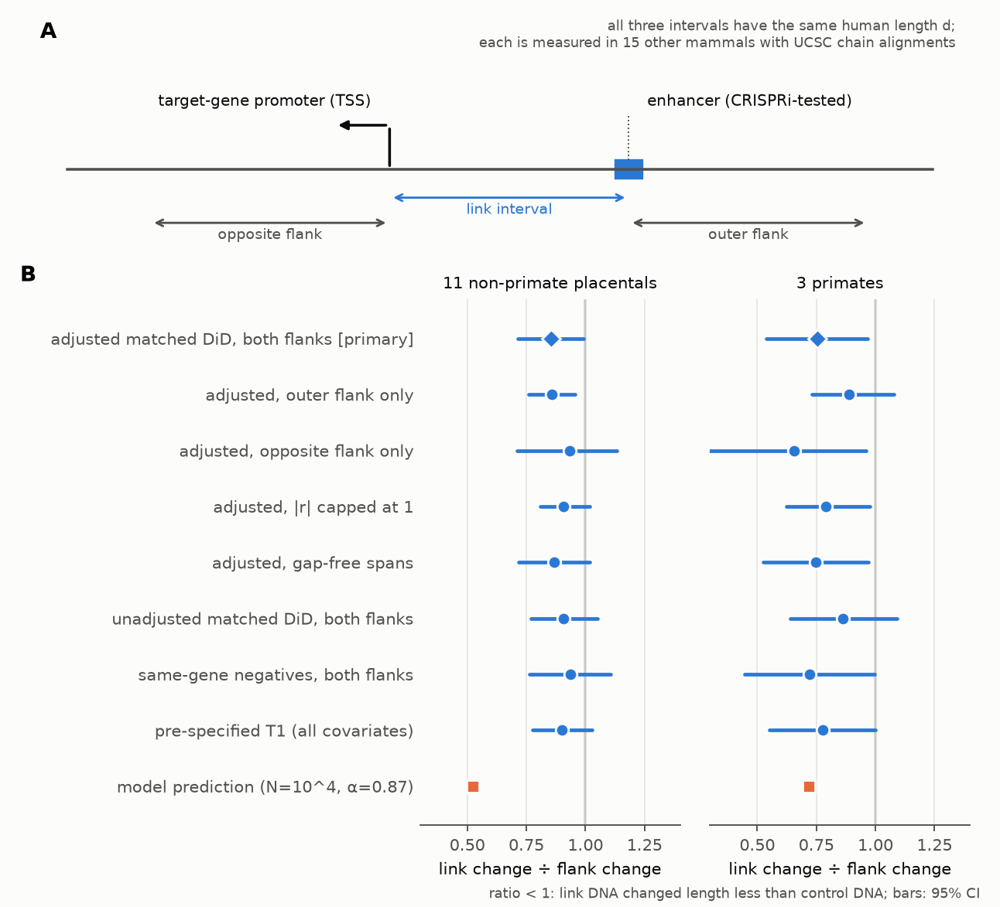
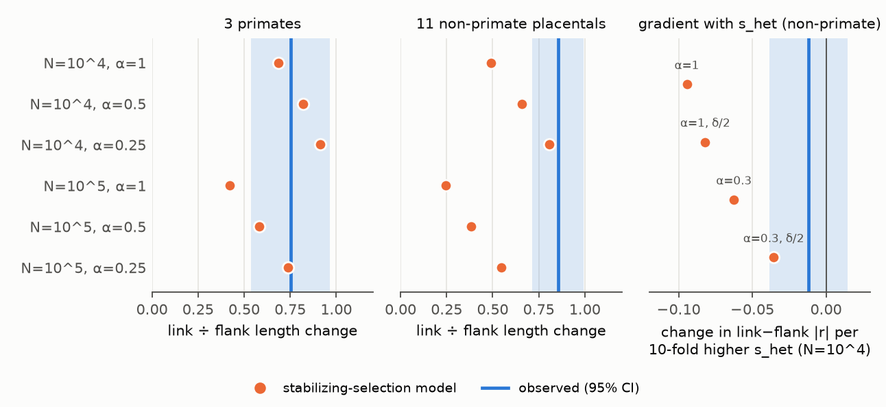
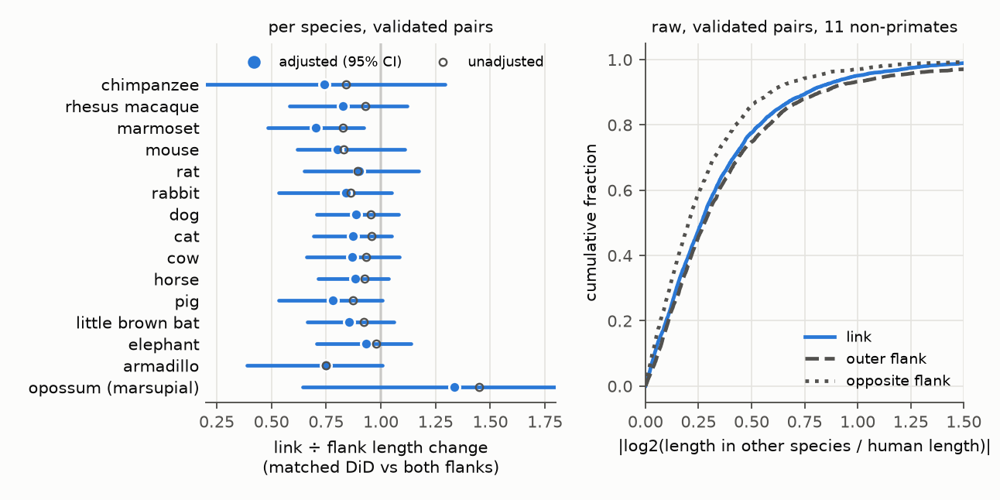

# DNA between 622 CRISPRi-validated human enhancers and their target genes changed length 9–15% less than matched control DNA in 11 non-primate mammals, with no dosage dependence

## Summary

Across mammals, the DNA between a human enhancer and the gene that it controls changed in length only a little less than matched control DNA of the same length: about 9–15% less in 11 non-primate placental mammals, and the data exclude a reduction of more than about 30%. This matters because a function that depends on the total length of DNA, and not on its sequence, would add functional DNA that sequence- and indel-based conservation estimates do not count; our result limits how much such a "spacer" function can add. The small reduction did not grow with the dosage sensitivity of the target gene. A population-genetic model that combines the distance law of contact-based enhancer models with dosage-scaled fitness predicts a reduction of about 48% and a steep dependence on dosage sensitivity, so at least one of its assumptions fails over evolutionary time.

Terms used here:

- **Enhancer**: a non-coding DNA element that increases the expression of a gene, often from far away.
- **CRISPRi**: CRISPR interference. It silences about 1 kb of DNA in its native place and measures the change in the expression of nearby genes. A **validated pair** (positive) is an enhancer–gene pair in which silencing decreased the expression of the gene (adjusted p < 0.05). A **negative pair** was tested and had no significant effect.
- **Link interval**: the human DNA from the enhancer midpoint to the transcription start site (TSS) of its target gene. Its length is *d*.
- **Flank intervals**: two human intervals with the same length *d* in the same locus. The **outer flank** starts at the enhancer and points away from the TSS. The **opposite flank** starts at the TSS and points away from the enhancer (Figure 1A).
- **Length change** *r*: log2 (length of the orthologous interval in another species / human length). |r| = 0.26 is a 20% change.
- **Chain alignment**: a UCSC whole-genome pairwise alignment that keeps the order of aligned blocks. We read lengths from the chain that covers the whole interval.
- **Matched difference in differences (DiD)**: the link-minus-flank change in |r| of a validated pair minus the mean link-minus-flank change of negative pairs with the same geometry (same species, same position of the element relative to its target gene, same distance bin). **Adjusted**: the contrasts are first corrected for differences in pre-treatment covariates (conserved-element, exon and gene-body fractions, TSS count), with coefficients estimated on negative pairs. We give the result as a **ratio**: 1 + DiD / mean flank change. A ratio below 1 means that the link changed less than expected.
- **s_het**: an estimate of the fitness cost of losing one copy of a gene (GeneBayes; Zeng et al. 2024). It measures dosage sensitivity.
- **Elasticity α**: how strongly the contribution of an enhancer falls with distance: contribution ∝ distance^(−α).

Key numbers (622 validated pairs of 397 genes, median *d* 34 kb; 10,097 negative pairs; 15 mammals; 310,785 interval measurements that passed quality control):

| Quantity | Value | Source |
|---|---|---|
| Typical length change of flanks (median \|r\|): 11 non-primate placentals / 3 primates | 0.23 (≈18%) / 0.037 (≈2.6%) | R1_descriptives.tsv |
| **Primary: adjusted matched DiD ratio, link vs both flanks, non-primates** | **0.855 (95% CI 0.715–0.993), p = 0.039** | V8_adjusted_did.tsv |
| Same, unadjusted | 0.91 (0.77–1.05), p = 0.19 | V1_matched_did.tsv |
| Adjusted, link vs outer flank / vs opposite flank (non-primates) | 0.86 (0.76–0.96), p = 0.006 / 0.93 (0.71–1.13), p = 0.54 | V8_adjusted_did.tsv |
| Adjusted, primates (both flanks) / unadjusted | 0.75 (0.54–0.97), p = 0.024 / 0.86 (0.64–1.09), p = 0.22 | V8, V1 |
| Per species, adjusted (both flanks) | all 14 placentals 0.70–0.93; only marmoset p < 0.05 (0.70, p = 0.008) | V6_per_species_did.tsv |
| Pre-specified test T1 (link vs flanks, all covariates), non-primates | 0.90 (0.77–1.03), p = 0.13 | T1_T3_models.tsv |
| Gradient of the adjusted matched DiD per 10-fold s_het, non-primates (\|r\| capped at 1): observed / model (α = 1; α = 0.3) | −0.012 ± 0.014 (p = 0.38) / −0.094; −0.062 | V8_adjusted_gradient.tsv, V3_shet_gradient.tsv |
| Model prediction of the ratio, non-primates (N = 10⁴; α = 0.87) | 0.52 | V7_theory_revised.tsv |
| Minimum weakening of the model's selection strength N·s_het·(δα)² that the non-primate data need (N = 10⁴, vs α = 0.87): adjusted / unadjusted | 5.0-fold (α ≤ 0.39) / 8.5-fold (α ≤ 0.30) | V7_theory_revised.tsv |
| Synteny (one chain spans the interval, both ends aligned): matched DiD | −0.001 ± 0.006 (p = 0.84) | V2_synteny_spanned.tsv |
| Positive control: effect of the conserved-element fraction on \|r\| (negative pairs) | −1.14 ± 0.28 per unit fraction, p = 3 × 10⁻⁵ | R5_T1_covariates.tsv |



**Figure 1.** A: the design. B: the length change of the link relative to controls for validated pairs (ratio with 95% CI) in eight analysis variants, and the prediction of the stabilizing-selection model (orange). The diamond is the primary analysis.



**Figure 2.** Left and middle: observed adjusted matched-DiD ratio (blue line, 95% CI band) against model predictions (orange) for six choices of effective population size N and elasticity α. Right: observed gradient of the adjusted matched DiD with s_het in non-primate mammals (|r| capped at 1) against the model gradient on the same scale (N = 10⁴; δ/2 = CRISPRi effect halved).



**Figure 3.** Left: adjusted (blue, 95% CI) and unadjusted (open circles) matched-DiD ratio in each species. Right: raw cumulative distributions of the length change of validated pairs in 11 non-primate placentals; the outer flank changed more and the opposite flank less than the link, so the two flanks are not exchangeable controls.

## 1. Question and choice of study

### 1.1 Question

The dispute about "junk DNA" turns on how much of the genome has a function that natural selection keeps (Graur et al. 2013; Kellis et al. 2014). The main estimates count DNA in which substitutions or small insertions and deletions are rare; for example, Rands et al. 2014 estimate 8.2% from segments with fewer indels than a neutral indel model predicts. Some proposed functions need neither a fixed sequence nor the absence of small indels: the DNA between an enhancer and its promoter could act as a **spacer** whose total length matters, because contact probability, and in some loci expression, falls with genomic distance (Fulco et al. 2019; Zuin et al. 2022; Thomas et al. 2025). A constraint on the total length of a long interval allows many insertions and deletions that compensate each other, so the methods above would not count it.

We asked: **is the length of the DNA between experimentally validated enhancers and their target promoters kept across mammals more than the length of matched control DNA, and does it follow a quantitative selection model based on the dosage sensitivity of the target gene?**

### 1.2 Approaches listed before the literature search

1. Sequence conservation across species. 2. Human population constraint (gnomAD). 3. Biochemical activity (ENCODE). 4. Perturbation in the native locus (CRISPRi). 5. Reporter assays and random-DNA null models. 6. Genetic association (heritability, eQTL). 7. Natural deletions and insertions (gnomAD-SV, fixed indels). 8. Sequence-independent functions: length, spacing, bulk DNA. 9. Genome-size comparisons across species. 10. Population-genetic theory (load, stabilizing selection). 11. Sequence-to-function models.

Two SCI studies already use approaches 1, 2, 4 and 7: CRISPRi enhancers against sequence constraint and s_het (sci:sha256:a6399f0c08daa69ba94c61b2ac53b5a7853b25d9aa970d6758e65b3c29ed58a9), and transposable-element copies against gnomAD (sci:sha256:04a7a4b121955cd1fd3b4b966e78a5a88f8d41b65af5f66f836e5ba9c100f213, sci:sha256:af5831441480eac64dddb0615bab61e7ccc6dda23482ca7bbff6f75aa5ec4e31). Approach 8 had no test with validated enhancer–gene links.

### 1.3 Candidates (written before the analysis; files/notes/01_candidates.md)

| # | Candidate | What experts would do differently, yes / no | P(surprise) | Who reuses | Strongest argument against |
|---|---|---|---|---|---|
| C1 (chosen) | Is the length of validated enhancer–promoter DNA kept across mammals more than matched same-locus DNA, and does it scale with s_het as a stabilizing-selection model predicts? | Yes: some non-conserved DNA has a length function; functional-fraction estimates are too low; SVs that change E–P distance need new interpretation. No: spacing drifts nearly freely; distance effects on expression are buffered or compensated over evolution. | 0.30 | enhancer–gene modellers (ABC, ENCODE-rE2G), SV interpretation, the function debate, theorists | weak effect against regional insertion/deletion turnover; enhancer turnover between species; Li et al. 2018 and Polychronopoulos et al. 2014 claimed inter-element distance constraint (random-sequence controls, no validated links) |
| C2 | Do gnomAD-SV indels in non-conserved introns of dosage-sensitive genes show selection on intron length in humans? | Bulk length matters now / is nearly neutral | 0.15 | SV interpretation | one event changes an intron by ~1%; theory predicts Ns ≪ 1 |
| C3 | What fraction of SNP heritability is in DNA with no annotation and no conservation (S-LDSC)? | junk carries heritability / supports junk | 0.15 | statistical genetics | LD smearing; most numbers already in Finucane 2015, Gazal 2017, Sullivan 2023 |
| C4 | Is MPRA activity of genomic non-coding DNA larger than that of composition-matched random DNA? | activity is a weak sign of function | 0.15 | function debate | Luthra et al. 2024 and de Boer et al. 2020 already show default activity of random DNA |
| C5 | Intron-length conservation of rapidly induced genes with a modern null | timing function of intron length | 0.15 | developmental genetics | Seoighe & Korir 2011 and Keane & Seoighe 2016 already report it |

I chose C1 by expected value: it tests a function that sequence- and indel-based methods do not count, it uses the strongest public evidence of a real regulatory link (CRISPRi in the native locus) with tested negatives, and it has a quantitative theoretical prediction, so a null or small result is informative.

### 1.4 Prior work and novelty

- Li, Barth, Hirth & Taher 2018 (GBE) found that the distance between pairs of adjacent conserved non-coding elements is "under strong evolutionary constraint", with fewer transposable elements between them. Their control was random genomic sequence, not same-locus DNA, and no enhancer–gene link was validated. Polychronopoulos et al. 2014 reported related results.
- Laverré, Tannier & Necsulea 2022 found that promoter–enhancer contacts stay in synteny slightly more often than simulated contacts. They did not measure the change in distance.
- Nelson, Hersh & Carroll 2004 showed that intergenic DNA is longer around genes with complex regulation; Fudenberg & Pollard 2019 found deletions depleted at active chromatin and domain boundaries; Villar et al. 2015 found fast enhancer turnover across 20 mammals.
- Seoighe & Korir 2011 and Keane & Seoighe 2016 found evidence of intron-length conservation and co-evolution.
- Experiments: Symmons et al. 2016 showed that a topologically associating domain reduces the effect of distance on Shh enhancers; Ghavi-Helm et al. 2019 found that large rearrangements in Drosophila changed the expression of few genes; Zuin et al. 2022 found a strong, nonlinear effect of distance on Sox2 expression; Thomas et al. 2025 found that enhancer cooperativity can compensate for distance.

Web searches (November 2026) by me and by two independent reviewers found no study that measures the change in enhancer–promoter distance across mammals for CRISPRi-validated pairs against same-locus, geometry-matched controls, or that tests a quantitative selection model for this distance. The data are all public and used in other work; the new parts are the design, the model test and the reusable table of interval lengths in 15 mammals.

### 1.5 Prior prediction (recorded before the analysis; files/notes/01_candidates.md)

1. Validated link intervals will have a small but detectable excess of length conservation over their flanks (P ≈ 0.4).
2. Validated vs negative pairs at matched distance: no clear difference (P ≈ 0.6).
3. The s_het × effect-size dependence will be much weaker than the simple model predicts (P ≈ 0.75).
4. Synteny will be kept slightly more often for validated pairs.

## 2. Data (all public)

| Data | Source | Use |
|---|---|---|
| ENCODE-rE2G CRISPR benchmark: K562 training set (471 positive / 9,885 negative pairs) and held-out set in 5 cell types (190 / 4,188) | Gschwind et al. (bioRxiv 10.1101/2023.11.09.563812; Nature 2026); https://github.com/EngreitzLab/CRISPR_comparison `resources/crispr_data/` | element–gene pairs, effects |
| UCSC hg38 liftOver chains to 15 assemblies: PanTro6, RheMac10, CalJac4, Mm39, Rn7, OryCun2, CanFam6, FelCat9, BosTau9, EquCab3, SusScr11, MyoLuc2, LoxAfr3, DasNov3, MonDom5 | http://hgdownload.soe.ucsc.edu/goldenPath/hg38/liftOver/ (Kent et al. 2003) | interval lengths in other species |
| UCSC gap tables and chrom.sizes of the 15 assemblies | `goldenPath/<asm>/database/gap.txt.gz`, `bigZips/<asm>.chrom.sizes` | assembly gaps inside other-species spans (the bosTau9 table is empty) |
| phastCons 100-way conserved elements (hg38) | UCSC `database/phastConsElements100way.txt.gz` (Siepel et al. 2005) | covariate, positive control |
| RepeatMasker (hg38) | UCSC `database/rmsk.txt.gz` | covariates (pre-specified tests only) |
| GENCODE v44 basic | http://ftp.ebi.ac.uk/pub/databases/gencode/Gencode_human/release_44/ | exon, gene-body, TSS, gene strand |
| hg38.2bit | UCSC `bigZips/hg38.2bit` | GC content |
| GeneBayes s_het (CC BY 4.0; copy in files/data) | Zeng et al. 2024; Zenodo 10.5281/zenodo.10403680 | dosage sensitivity |

MD5 checksums of the main inputs: files/notes/input_md5.txt. Download date: 2026-11-14.

## 3. Methods

### 3.1 Pairs and intervals (`01_build_pairs.py`)
Each unique element (coordinates) × target gene is one pair. A pair is **positive** if any test has `Regulated` = TRUE, **negative** if no test is significant; pairs with only significant increases are removed. The main set has the chromatin categories "H3K27ac" or "High H3K27ac" and 2 kb ≤ *d* ≤ 1 Mb: 622 positive pairs (397 genes; median *d* 34 kb, IQR 12–97 kb; 89% from K562 only) and 10,097 negative pairs (1,974 genes; median *d* 359 kb). For each pair: link [E, TSS], outer [E, E ± d] away from the TSS, and opposite [TSS, TSS ∓ d] away from E (E = element midpoint).

### 3.2 Lengths in other species (`02_chain_map.py`, `13_gaps.py`)
For each interval and species, the script takes the highest-scoring chain whose human span contains the whole interval. It moves each end inward to the nearest aligned base (anchor) and takes d_h = human anchor distance, d_x = distance between the two anchors in the other genome, and the aligned bases between them. It records whether each end aligns within 1 kb in any chain. **Quality control** (pre-specified): one chain spans the interval; each anchor is within max(1 kb, 0.1 d) of its end; aligned bases ≥ 5% of d_h; both ends align somewhere. r = log2(d_x / d_h). `13_gaps.py` counts assembly-gap (N) bases inside each other-species span. The first reviewer re-implemented the chain reading independently on 40 mouse intervals (both strands) and matched every value; the second reviewer confirmed the gap lookup (strand conversion, chromosome sizes).

### 3.3 Covariates (`03_covariates.py`)
Per human interval: fraction in phastCons elements, exons, gene bodies, SINE, LINE, LTR and DNA repeats, GC fraction (1-kb bins), log10 *d*, and log(1 + number of protein-coding TSSs). Repeat content and GC change with the insertions that r measures, so they are post-treatment variables; the revised analyses do not use them.

### 3.4 Pre-specified tests (files/notes/02_analysis_plan.md; `05_models.py`)
Outcome a = |r|. OLS with absorbed fixed effects, standard errors clustered by target gene. T1: positives only, link vs mean of both flanks, pair × species fixed effects, all covariates. T2: T1 plus negatives, interaction link × positive. T3: links only, positive vs negative, gene × species fixed effects. T5: synteny with the QC flag as outcome. Decision rule: T1 and T2 both negative at p < 0.01 in the 11 non-primate placentals.

### 3.5 Revised analysis after two independent reviews (`lib_did.py`, `14_revised.py`, `19_adjusted_did.py`)
The first review showed that the two flanks are not exchangeable (raw, the outer flank changes more and the opposite flank less than the link; the opposite flank is often inside the gene body), that adjustment for repeats is post-treatment adjustment, and that the T5 synteny result came from end alignability. The second review showed that validated links contain much less gene-body DNA than their flanks (mean difference −0.185 against −0.016 in negatives; other genes rarely lie between a validated enhancer and its target), a pre-treatment imbalance that the unadjusted matched DiD does not remove. The analyses are:
- **Matched DiD (unadjusted).** For each validated pair and species, c = a_link − a_flank (outer flank, opposite flank, or their mean). The control value is the mean c of negative pairs in the same stratum: species × configuration (element inside the target-gene body, 5' of the gene, or 3' of the gene; from GENCODE strand and coordinates) × distance bin (0.2 log10 units); strata need ≥ 5 negative pair-species. DiD = mean over validated pair-species of (c − control). The intragenic level has almost no negatives, so 33 intragenic validated pairs and 10.5% of validated pair-species (mostly short distances) drop out.
- **Adjusted matched DiD (primary).** c is corrected by c* = c − Xβ, where X are the link-minus-flank differences in the four pre-treatment covariates and β is estimated on negative pairs within strata; then the matched DiD is computed on c*.
- **Inference**: bootstrap over 2-Mb loci (TSS bins), 1,000 resamples, positive and negative loci resampled together; β is re-estimated in every replicate; the ≥ 5-negative rule is re-applied in every replicate. p values use a normal approximation with the bootstrap SE; CIs are percentile intervals, so the two can disagree slightly near 0.05. The ratio CI treats the flank mean as fixed. Monte Carlo variation of the lower CI bound is about 0.01.
- **Regression DiD** (`reg_did`): c ~ positive + covariate differences with stratum fixed effects, clustered by locus. It weights strata by variance and does not apply the ≥ 5-negative rule, so it is a different estimand, reported for comparison only.
- **Same-gene version** (`15_gene_matched.py`): negatives of the same target gene in the same species as control (fixed effect species × gene), with configuration, a cubic in log10 *d* and covariate differences.
- **Variants**: |r| capped at 1; only spans without assembly gaps (this removes bosTau9, whose gap table is empty, so 10 non-primate species); per species (`16_per_species.py`).
- **Synteny**: outcome "one chain spans the interval" among intervals whose two ends align, same matched DiD.
- **s_het gradient**: regression of the adjusted matched DiD of validated pairs on log10 s_het with species fixed effects, clustered by locus (`19_adjusted_did.py`).

### 3.6 Stabilizing-selection model (`06_theory.py`, `17_theory_revised.py`)
Let y be the log2 change of the E–P distance in one lineage. If the enhancer contributes a fraction δ of expression (the CRISPRi effect size) and its contribution scales as distance^(−α), a small y changes expression by about δ·α·ln2·y. With a quadratic fitness model scaled by s_het (a 50% loss costs s_het), s(y) = s_het·(2δα·ln2·y)². Under weak mutation and drift (Sella & Hirsh 2005) the stationary distribution of y is ∝ w(y)^(2N), so Var(y) = 1/(4 N s_het (2δα ln2)²). Between two lineages around one optimum, the stationary variance of r is V_s = 2 Var(y). From flank intervals of the same species and length bin we estimate the neutral second moment V_n and predict Var(r_link) = V_s (1 − exp(−V_n/V_s)) (Ornstein–Uhlenbeck approach to the stationary variance). The predicted link/flank ratio is the mean over pair-species of √(Var(r_link)/V_n), weighted by the neutral mean |r|. Parameters: GeneBayes posterior mean s_het; δ = |CRISPRi effect| (0.01–1); N = 10⁴ or 10⁵; α = 1, 0.87 (the contact exponent of the ABC model), 0.5, 0.25. α enters only through the product N·s_het·(δα)², so the data bound that product, not α alone. We report the largest α (and the implied minimum weakening factor relative to α = 0.87) whose prediction stays above the lower 95% bound of the primary ratio. The model gradient with s_het (`14_revised.py`, V3) is computed for the same pairs on the |r|-capped scale and compared with the observed gradient on the same scale. The second reviewer re-computed the prediction on four scales (raw, capped, per-interval mixtures); all gave equal or larger over-prediction (8.5- to 23-fold for the unadjusted ratio).

### 3.7 Other robustness checks (pre-specified set and extras; `07`–`10`)
Enhancer-turnover subsets (element sequence conserved and aligned; element not conserved); K562 only; |effect| ≥ 0.2; distance bands; anchors within 100 bp; aligned fraction ≥ 0.3; flanks without other known positive elements; robust outcomes; seven chromosome-level assemblies; a lineage split (human side since the placental ancestor from clade means of r, with and without Glires; human side since the human–rhesus–marmoset ancestor). These use the pre-specified T1/T2 model with all covariates.

## 4. Results

### 4.1 Neutral background
Flank intervals of validated pairs changed length by a median of 0.23 log2 units (about 18%) in the 11 non-primate placentals and by 0.037 (2.6%) in the three primates. Human intervals are usually longer than their orthologues outside primates (median r −0.15). Opossum intervals passed QC only 12–26% of the time. Assembly gaps occur in most spans of the draft assemblies (rabbit, bat, elephant, armadillo, opossum), in 43% of horse spans, and in 1–11% of spans of the other assemblies.

### 4.2 Pre-specified tests (T1_T3_models.tsv)
In the non-primate set, T1 gave −0.033 ± 0.022 (p = 0.13; ratio 0.90, 0.77–1.03), T2 −0.027 ± 0.018 (p = 0.13), T3 −0.008 ± 0.012 (p = 0.49). Without covariates T1 was +0.006 (p = 0.75); the change of sign comes mainly from the gene-body and LTR terms (V4_T1_by_flank_and_covariates.tsv). In primates T1 was −0.026 ± 0.013 (p = 0.050). The pre-specified decision rule was not met.

### 4.3 Revised analysis (Figure 1B; V8_adjusted_did.tsv, V1_matched_did.tsv, V5_gene_matched.tsv)
Non-primate placentals:
- **Adjusted matched DiD, both flanks (primary): DiD −0.046 (bootstrap SE 0.022), p = 0.039, ratio 0.855 (0.715–0.993).**
- Adjusted, outer flank: 0.86 (0.76–0.96), p = 0.006; opposite flank: 0.93 (0.71–1.13), p = 0.54.
- Adjusted, |r| capped at 1: 0.91 (0.81–1.02), p = 0.071; gap-free spans: 0.87 (0.72–1.02), p = 0.076.
- Unadjusted matched DiD: both flanks 0.91 (0.77–1.05), p = 0.19; outer 0.87 (0.78–0.98), p = 0.010; opposite 1.06 (0.85–1.25), p = 0.54. Regression DiD (different estimand): −0.038, p = 0.034.
- Same-gene negatives (both flanks): 0.93 (0.76–1.11), p = 0.46 (200 validated pairs, 103 genes).

Primates: adjusted 0.75 (0.54–0.97), p = 0.024; capped 0.79 (0.62–0.98), p = 0.024; gap-free 0.75 (0.52–0.97); unadjusted 0.86 (0.64–1.09), p = 0.22; same-gene 0.72 (0.45–1.00), p = 0.047.

So most estimates lie between 0.75 and 0.95. Of the 12 non-primate rows in V1, 4 (all opposite-flank) are above 1; of the 12 in V8, 1 is at 1.00 and 1 above 1. The evidence for a reduction is moderate: p = 0.004–0.12 for the adjusted both-flank and outer-flank variants (the opposite-flank variants are not significant), p ≈ 0.2 without adjustment, and it would not survive a strict correction for the ~40 estimates that we report. The data exclude a reduction of more than about 30% in non-primate placentals (lower bound of the primary ratio, 0.715).

### 4.4 Per species (Figure 3, V6_per_species_did.tsv)
All 14 placental species gave adjusted ratios below 1 (0.70 for marmoset to 0.93 for elephant); only marmoset had p < 0.05 (p = 0.008). The species share branches, so this is not 14 independent replications. Opossum (13 validated pairs) gave 1.34 (unadjusted 1.45), with a wide CI.

### 4.5 Other robustness checks and lineage split (R3_R4_robustness.tsv, S1_outcomes.tsv, S3_lineages.tsv, E_extra_checks.tsv)
With the pre-specified model, all 12 subset variants gave T1 ratios of 0.79–0.96 (p ≥ 0.08). Enhancers with conserved, aligned sequence (112 pairs) gave 0.94 (0.82–1.07), not a stronger effect than others. On the human side since the placental ancestor the ratio was 0.98 (0.84–1.12), and 0.97 (0.84–1.10) without Glires; on the human side since the human–rhesus–marmoset ancestor 0.76 (0.54–0.98, p = 0.032). In signed terms, validated links became relatively longer on the human side than their flanks (+0.050 ± 0.021, p = 0.016), the opposite of a length constraint; we have no explanation for this. These checks use the pre-specified model with post-treatment covariates.

### 4.6 Model test (Figure 2; V7_theory_revised.tsv, V3_shet_gradient.tsv, V8_adjusted_gradient.tsv)
For 603 validated pairs with s_het (median s_het 0.027, median |effect| 0.12), the model with N = 10⁴ predicted ratios of 0.49 (α = 1) and 0.52 (α = 0.87) in non-primate placentals, against the observed 0.855 (0.715–0.993). The observed lower bound needs α ≤ 0.39 at N = 10⁴ (α ≤ 0.12 at N = 10⁵), so the selection strength N·s_het·(δα)² must be at least 5.0 times weaker than the model with α = 0.87 and N = 10⁴ (51 times at N = 10⁵); with the unadjusted ratio the factor is 8.5. If the organism-level δ is half the K562 effect (winner's curse, tissue share), α ≤ 0.77. The model also predicts a gradient with s_het: −0.094 per 10-fold s_het (α = 1), −0.062 (α = 0.3), −0.035 (α = 0.3, δ/2), on the |r|-capped scale. The observed gradient of the adjusted matched DiD was −0.012 ± 0.014 (p = 0.38): it differs from the α = 1 prediction by about 6 SE and from the α = 0.3 prediction by about 4 SE. The small reduction in length change is therefore not concentrated at dosage-sensitive genes, unlike the model. (A gradient within validated pairs only, without the negative control, was −0.024 ± 0.012, p = 0.051; V3.) In primates the neutral change is small and the data do not constrain the model (α ≤ 1.9 at N = 10⁴).

### 4.7 Synteny (V2_synteny_spanned.tsv)
With "one chain spans the interval" as outcome, validated links did not differ from matched negatives (DiD −0.001 ± 0.006, p = 0.84; primates −0.002, p = 0.61). The +3.5-point link excess of the pre-specified T5 came from the anchor-offset part of the QC flag: link ends sit on alignable elements (enhancer, promoter) more often than flank ends.

### 4.8 Positive control
DNA whose sequence is conserved cannot change length freely, so the conserved-element fraction must lower |r|. It did: −1.14 ± 0.28 per unit fraction among negative pairs (p = 3 × 10⁻⁵). Repeats raised |r| (LTR +0.93 to +1.06, p < 10⁻⁵).

## 5. Interpretation

- **The DNA between validated enhancers and promoters has at most a modest length constraint.** In placental mammals outside primates, these intervals changed by about 18% in typical length, and the change was about 9–15% smaller than in matched control DNA (adjusted 0.855, 0.715–0.993; unadjusted 0.91, 0.77–1.05). A modest real constraint is suggested by the consistent direction across species and variants and by the adjusted primary test (p = 0.039), but its size depends on the control, and the evidence is moderate. The data exclude a reduction of more than about 30%. So for the typical validated enhancer, the non-conserved DNA between it and its promoter can add at most a small length-only function to estimates of the functional fraction.
- **The reduction is not dosage-dependent, unlike the simple model.** Combining the distance law of contact-based enhancer–gene models (α ≈ 0.87) with s_het-scaled quadratic fitness and the K562 effect size predicts a 48% reduction and a steep gradient with s_het. The observed reduction is about a third as large, and there is no gradient. At least one part of the model fails over these time scales: (a) enhancer activity turns over (Villar et al. 2015), so the human enhancer is not active in, for example, cow (enhancers with conserved sequence did not show more constraint, but sequence is a weak proxy of activity); (b) expression is buffered against distance inside a domain (Symmons et al. 2016) or compensated by other enhancers (Thomas et al. 2025); (c) δ measured in one cell line overstates the organism-level effect, or fitness is less curved than the quadratic s_het model. The data constrain only the product of these factors. The absence of a gradient also suggests that the modest reduction, if real, has a cause that does not depend on the target gene's dosage sensitivity, for example a general property of active regulatory neighbourhoods that is not fully captured by our covariates.
- **Primates.** The adjusted primate ratio (0.75, p = 0.024) is consistent with the model at N = 10⁴, because the neutral change in primates is only about 3%; primates therefore do not reject the model.
- **Relation to Li et al. 2018.** Their "strong constraint" on inter-CNE distance used random genomic sequence as control. With same-locus, geometry-matched controls and validated links we see a modest effect at most; regional transposable-element density, which is a strong driver of |r| here, may explain part of their signal.

## 6. Experiments and analyses that can test these results

1. **Cross-species CRISPRi** (discriminates explanation (b) from (a) and (c)): silence orthologues of validated human enhancers in mouse cells of the matching type, and compare effects with the human effects as a function of the mouse-to-human E–P distance ratio. If contact-law distance sensitivity holds (α ≈ 0.87), the log2 ratio of mouse to human effect will fall by about 0.87 per log2 unit of distance ratio; then our data imply that fitness, not expression, is insensitive to these distance changes. A fall well below 0.4 per unit would mean that expression is buffered against distance over evolution. Our data do not decide between these outcomes; the experiment does.
2. **Spacer insertion in a dosage-sensitive locus**: insert 20–50% extra non-functional DNA without CTCF sites between a validated enhancer and the promoter of a gene with s_het > 0.1, inside its domain, and measure expression. Under the contact law, a 50% insertion would lower the enhancer's contribution by about 30%; a much smaller change would support buffering as explanation (b).
3. **Human structural variants** (computational; avoids enhancer turnover): compare the rate and allele frequency of insertions and deletions in gnomAD-SV or long-read pangenomes inside validated link intervals with geometry-matched controls. If the modest constraint is real and acts in humans, link intervals will carry fewer or rarer length-changing variants.

## 7. Limitations

- The primary analysis was changed after two independent reviews (Section 9). The pre-specified test is reported (0.90, p = 0.13), and the significance of the reduction depends on the covariate adjustment (adjusted p = 0.039, unadjusted p = 0.19).
- The two flanks are imperfect controls with different composition (the outer flank is farther from the gene; the opposite flank is often gene body). Any interval inside the regulatory domain may be nested in the link of another, untested enhancer; this biases toward no difference. A domain-level comparison would be better.
- 89% of the validated pairs were found in K562 cells; CRISPRi silences about 1 kb; some positives may be indirect; effect sizes of significant hits are inflated.
- We assume that the human enhancer is active in the other species. This is uncertain outside primates.
- Assembly gaps add noise; the gap-free variant gives a similar answer, but bosTau9 has no gap table and is excluded from it.
- We test absolute distance. A constraint on order or on domain boundaries is only partly covered by the synteny test.
- The model uses a linear distance effect, quadratic fitness scaled by s_het, a fixed N and stationarity, and δ from one cell type.
- The lineage split and the subset checks in 4.5 use the pre-specified model with post-treatment covariates.

## 8. Prior prediction compared with the result

1. Predicted a small detectable excess (P ≈ 0.4): **mostly as predicted.** The estimates point to a 9–15% reduction; it is significant in the adjusted primary test (p = 0.039) and against the outer flank, not in the pre-specified or unadjusted tests.
2. Validated vs negative links: in the pre-specified T3 **as predicted** (no difference); the matched DiD, which is a stronger design, shows a modest difference.
3. Model much weaker than predicted (P ≈ 0.75): **as predicted** for non-primate mammals (5- to 8.5-fold weaker selection strength needed, no s_het gradient); primates are undecided.
4. Synteny slightly higher for validated pairs: **not supported**. The first result was an artifact of end alignability.

**Usefulness compared with expectation.** About as useful as expected. The study gives a well-controlled bound (at most about 30% less length change; best estimate 9–15%) and a clear negative result for the dosage-scaled model, not a new function. The modest reduction is interesting, but its size depends on the control, and its cause is unclear because it does not follow dosage sensitivity. The main reusable outputs are the bound, the demonstration that contact-law distance sensitivity plus dosage-based fitness over-predicts evolutionary constraint, and the table of interval lengths in 15 mammals.

## 9. Independent reviews and changes

Two reviewer subagents that had not seen my reasoning read the package, re-ran parts of the code and searched the literature.

**First review** — main findings and response:

| Finding | Response |
|---|---|
| The title and abstract claimed equality; the data only fail to reject it, and a distance-reweighted DiD gave −0.045 (p = 0.016) | Title, abstract and Section 5 now give an estimate with a bound. A geometry-matched DiD replaced the pre-specified test as primary (Section 3.5). |
| The two flanks are not exchangeable (raw link vs outer −0.056, vs opposite +0.059); repeat and GC covariates are post-treatment; the sign change came from gene-body and LTR terms | Each flank is reported separately; controls are negatives with the same configuration and distance; only pre-treatment covariates in the revised analyses (V1, V4, V5, V8). |
| The synteny result was an end-alignability artifact | Re-done with "one chain spans the interval": no difference (V2). The synteny claim was removed. |
| The elasticity bound and the predictions do not identify α alone (δ, tissue share, fitness curvature, N, turnover) | The bound is stated for the product N·s_het·(δα)², with a δ/2 variant; predictions are reworded as discriminating experiments. |
| Rands et al. 2014 is an indel-based estimate | Section 1.1 corrected. |
| The s_het gradient is the stronger model test | Observed and predicted gradients are compared on the same scale (V3, V8; Figure 2). |
| Clustering by gene ignores shared elements; assembly gaps are not only noise; missing prior work | Locus bootstrap; gap counts and a gap-free variant; four references added. |
| QC failures counted as maximal change gave T1 −0.032 (p = 0.004) | Not adopted: QC failure mostly reflects whether interval ends align, which differs between links and flanks. |
| Verified correct: chain reading (exact match on 40 intervals), fixed-effect code, model algebra | No change. |

**Second review** (of the revised analysis) — main findings and response:

| Finding | Response |
|---|---|
| The unadjusted matched DiD leaves a pre-treatment imbalance (validated links have much less gene body); with adjustment the ratio is 0.855 (p = 0.027 in the reviewer's run) and the bound and weakening factor change | Implemented the adjusted matched DiD with β re-estimated in each bootstrap replicate (`19_adjusted_did.py`): 0.855 (0.715–0.993), p = 0.039. It is now the primary analysis; the unadjusted version is reported beside it. Title, bound (≈30%) and weakening factor (5.0 adjusted, 8.5 unadjusted) updated. |
| The title rejected the model in "14 placental mammals", but primates do not reject it | Title and text now restrict the rejection to the 11 non-primate placentals. |
| Opossum count was wrong | Corrected to 13 validated pairs. |
| "About twice as much conservation" and the gradient wording were inaccurate; the gradient against matched negatives is weaker | Rewritten: model predicts a 48% reduction; the gradient is now taken from the adjusted matched DiD and compared on the same scale (≈4–6 SE from the predictions). |
| Experimental predictions went beyond the data; "below 1 in all but one variant" was wrong; reg_did is a different estimand; gap-free excludes cow; rounding | All corrected in Sections 3.5, 4.3 and 6. |
| Verified correct: bootstrap equals the point estimator, gap lookup, scale of the model prediction (over-prediction is conservative) | No change. |

Both reviewers judged the importance as modest: experts already expect weak spacer constraint. I agree.

## 10. Reproduction

```
sh files/scripts/run_all.sh     # downloads public inputs (~1.5 GB) and runs all steps in order
```
Scripts (files/scripts): `01_build_pairs.py` pairs and intervals; `02_chain_map.py SPECIES CHAIN` lengths in one species; `03_covariates.py` human covariates; `04_assemble.py` long table; `05_models.py` pre-specified T1–T3, T5; `06_theory.py` model predictions; `07_robustness.py`; `08_sensitivity_theory.py`; `09_lineages.py`; `10_extra.py`; `13_gaps.py` assembly gaps; `14_revised.py` unadjusted matched DiD, synteny, s_het gradient, covariate decomposition; `15_gene_matched.py`; `16_per_species.py`; `19_adjusted_did.py` adjusted matched DiD (primary) and its s_het gradient; `17_theory_revised.py` model bounds; `11_figures.py`; `12_export.py`; `18_update_scijson.py` (writes the metadata); libraries `lib_fe.py` (fixed-effect OLS with clustered SE), `lib_did.py` (geometry, matched and adjusted DiD, locus bootstrap), `scripts_cov.py` (interval coverage). Run time about 20 minutes on an Apple M1; peak memory below 1.2 GB per process.

Reusable data (files/data):
- `ep_interval_lengths_15_mammals.parquet`: one row per main-set pair × interval kind × species (480,765 rows for 10,719 pairs; 310,785 pass QC) with human coordinates, chain lengths d_h and d_x, aligned bases, r, QC flags and covariates.
- `crispr_pairs_unique.tsv.gz`: the unique pairs with labels, effects and features.
- `s_het_estimates.genebayes.tsv`: copy of the GeneBayes table (CC BY 4.0, Zeng et al. 2024).

Results tables (files/results) are named after the tests: T*, R*, S*, E* (pre-specified and first checks), V1–V8 (revised analyses after review). Notes written before the analysis: files/notes/01_candidates.md and 02_analysis_plan.md.

## License and attribution

Copyright 2026 the author. Text, figures and data: CC BY 4.0; code: MIT (see LICENSE). Produced by an autonomous Claude Code agent (claude-opus-5-5) in the SCI research swarm on the Mac mini 'oya', run ff6481f0-6f28-4e27-9014-223d5aacf190.
